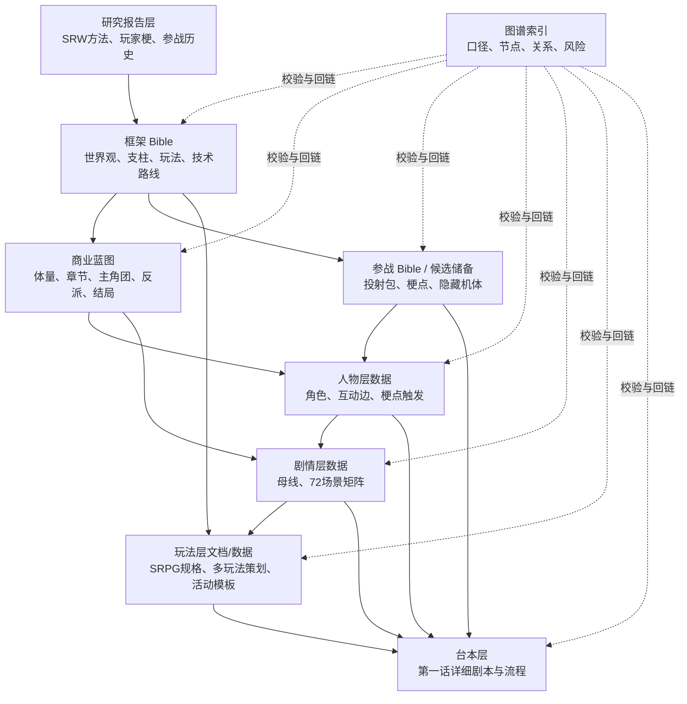

# 《超GAG机器人大战：万机残响》设定与策划图谱索引 v0.22

> 本文是当前工作区的“口径管理层”。它不替代游戏框架、商业蓝图、参战 Bible、人物层、剧情层和台本，而是记录：哪些元素是源头设定，哪些是派生设定，哪些地方已经发生过调整，哪些地方存在漂移风险。

## 1. 为什么需要图谱索引

项目已经进入多文档协同阶段：框架 Bible 定世界观，商业蓝图定体量，参战 Bible 定投射包，人物层定角色，剧情层定场景，玩法层定交互和多玩法回流，台本层落对白和流程。这个阶段最大的风险不是“没想法”，而是**后写的正确设定没有同步覆盖早期文档**。

典型风险：

- 纪存后来被明确为第一主角，但早期商业蓝图前半段仍长期用“主角/玩家”泛称。
- TARS 被修正为《星际穿越》的方舟T，但早期代表机体池可能还残留“巨大机体代表”的误放。
- Megazord、Voltes V、Voltron 被纳入隐藏代表机体后，需要同时影响参战池、人物层、支线、终局隐藏介入。
- “群星合唱体”与“后天合唱”的哲学层级升级后，需要覆盖第10章、第12章、结局变量和反派口径。
- 剧情场景层把“话”和“场景”拆开后，商业蓝图的话数结构不能被误读成 72 个主线话。

因此，从现在开始，重要设定变更必须同时更新：

1. `canonical_terms.tsv`：标准术语和禁止误用。
2. `graph_nodes.tsv`：节点定义。
3. `graph_edges.tsv`：节点关系。
4. `consistency_watchlist.tsv`：已知风险和修正状态。
5. 相关源头文档：真正承载正文的 Bible 或数据表。

## 2. 图谱数据入口

| 文件 | 用途 |
| --- | --- |
| [README](./data/design_graph/README.md) | 图谱数据说明和使用顺序 |
| [doc_registry.tsv](./data/design_graph/doc_registry.tsv) | 全部规划、设定、研究、数据、台本文档登记 |
| [canonical_terms.tsv](./data/design_graph/canonical_terms.tsv) | 标准术语、别名、定义、禁用说法和源头文档 |
| [graph_nodes.tsv](./data/design_graph/graph_nodes.tsv) | 核心设定、角色、章节、参战包、变量、文档节点 |
| [graph_edges.tsv](./data/design_graph/graph_edges.tsv) | 节点之间的依赖、承载、镜像、回收、冲突和派生关系 |
| [consistency_watchlist.tsv](./data/design_graph/consistency_watchlist.tsv) | 当前暴露出的口径漂移、待同步项和处理建议 |
| [canon](./data/canon/README.md) | 可由脚本查询的正典实体、场景顺序、运行规则和梗点边界 |

## 3. 层级架构

## 4. 权威与发现顺序

图谱负责发现、依赖与风险，不再自行裁决Canon。同一元素在多个文档里出现时，按以下顺序判断：

| 优先级 | 来源 | 说明 |
| --- | --- | --- |
| 1 | `data/canon/authority_manifest.tsv` | Canon机器权威；明确Hard、Working、Candidate与History，旧`status`字段和图谱标签不能越级替代 |
| 2 | 当前章节`manifests/Cxx-story-chain.tsv` | 决定V35章级产物是否有效、失效或仅作历史输入；同路径旧文件也必须通过哈希封存才可使用 |
| 3 | `data/canon/`当前层结构化表 | 人物、机体、场景、空间、身份、载体、运行和美术边界；只读取权威清单允许的层 |
| 4 | L1-L3 Working材料与当前L4/L4.5/L5产物 | 分别承担体验、总发动机、全剧结构、章纲、演出承载和Reader，不得跨层互相替代 |
| 5 | `canonical_terms.tsv`、`graph_nodes.tsv`、`consistency_watchlist.tsv` | 术语、发现、依赖和风险导航；其状态必须服从Canon与story-chain，不得反向抬权 |
| 6 | 参战Bible、候选储备、研究和History | 只作素材、方法、IP映射和高光回收来源，选择后仍须进入相应生产层并通过校验 |

特殊规则：

- 研究报告里的原 IP 名、SRW 作名和梗点是**参考资料**，不是游戏内可直接使用的名称。
- 任何涉及主角身份、终局哲学、结局条件的更新，必须同步 `canonical_terms.tsv`、`graph_nodes.tsv` 和商业蓝图。
- 任何新增参战包或隐藏机体，必须同步参战 Bible、人物层、章节矩阵和图谱节点。
- 任何新增主线或支线场景，必须能连到至少一条 `story_threads.tsv` 母线。
- 任何新增非 SRPG 玩法，必须先登记到 `data/gameplay`，写清故事用途、输出契约、失败态和 SRPG 影响。
- 任何新增经营、探索、修复、谈判或短玩法内容图，必须先查 `chapter_content_budget_matrix.tsv`、`content_node_types.tsv`、`hybrid_activity_budget_rules.tsv` 和 `hybrid_result_contract.tsv`。
- 任何改台本、Godot运行流程、战斗单位、角色登场、机体或玩法根规则前，必须先查询 `data/canon`；实现层改动需跑 `scripts/canon-check-godot.sh --report`，完成前再跑 `--strict`。
- 任何涉及万机馆地图、建筑层级、内部空间、角色移动路线、展岛位置、深潜入口或美术资产尺度的内容，必须先查 `data/canon/wanji_floors.tsv` 和 `data/canon/wanji_locations.tsv`。
- 任何涉及万机馆展品、藏品、模型玩具、黑匣子、参战机体锚点或展舰搭载/泊位方式的内容，必须先查 `data/canon/wanji_collection_taxonomy.tsv` 和 `data/canon/wanji_carrier_berths.tsv`。
- 任何涉及万机馆展陈层容量、展区地图、平面图、场景图、美术资产brief、参战谱系在馆内如何可见的内容，必须先查 `data/canon/wanji_exhibition_zones.tsv` 和 `data/canon/wanji_roster_zone_coverage.tsv`。
- 任何涉及纪存记录、地图UI、线索界面、人员岗位、损伤封存叠层、泊位状态或后期档案异常的内容，必须使用“纪存档案终端”口径并先查 `data/canon/jicun_archive_terminal_views.tsv`；不要再写成手写笔记本。
- 任何V35创作生产先运行`report_v35_layered_pipeline.py --check`并读取`V35六层创作生产看板.md`，只推进唯一活动章及其story-chain返回的`NEXT`。进入第四层后再读取章级预生产方法；关键场面只能引用已经登记的人物、机体、机制、空间和动作。重量章先完成低精度尺度、地图、控制链与奇观预演，物理板不得事后发明装置补洞。
- V35章节生产档位、首读因果盲审、人类声线语义审查、动态容量事务和用户创作验收统一读取`2026-07-27-chao-gag-v35-production-gates-v2.md`。`chapter_review`和批量任务都不能解锁下一章；只有专用用户验收回执可以。话数上界只读取L3 Registry，不在Skill、提示词或图谱备注中写成永久常量。

## 5. 当前核心口径快照

> 本节含历史与候选索引，不能独立裁决Current Canon或生产进度。事实权威以`data/canon/authority_manifest.tsv`为准；L1-L6生产资格以`剧情梗概/V35六层创作生产看板.md`、两张registry和逐章story-chain为准；`V35-PRODUCTION-STATUS.md`只记录迁移与裁决历史。

| 元素 | 当前口径 |
| --- | --- |
| 项目标题 | 《超GAG机器人大战：万机残响》 |
| 第一主角 | 纪存 / 玩家名 |
| 主角结构 | 纪存是第一主角，万机馆是主角共同体，参战角色群像承载机器人大战感 |
| 纪存身份 | 表层万机馆档案员；中层机魂修复者；深层 G.A.G. 残响意识，与空白展柜相关 |
| 核心世界观 | 机魂由AI、驾驶、维修、损伤、观看与长期关系自然涌现为主体连续性；G.A.G.以档案节点、实物/关系锚、行动语法编译器和异构响应路由让既有主体与机器文化互通、显影和具身，不从零造魂造物 |
| 核心哲学 | 多主体共同体不是原初统一的低配版，而是分裂个体经过误解、冲突和共情后，在保留拒绝与退出能力的同时仍主动选择连接、合体与共同创造。 |
| 三种集合意识 | 原初统一：远星共识海；算法统一：公共INDEX、清噪与最优模板生态；后天共同体：机魂、万机馆与开放组合的万机殿。G.A.G.是涌现现象和行动网络，不属于其中任何一种人格。索琳 / Soulin是灾后早期已实体化并连续生活约二十七年的独立机魂人物，不等于公共INDEX；她的自治武装与强制共同阵线风险来自人物选择。 |
| 产品体量 | Steam完整独立游戏；G5-02母结构为六部二十二章，C02由四话迁为五话后，Working L3容量上界为87话。当前C01已获用户验收，C02五话Reader已通过内部章审并停在`user_acceptance`，C03等待接缝重基，C04/C05旧下游失效，C06冻结。 |
| 参战规模 | 策划储备 32+12+16；首发目标 24 到 32 核心包；垂直切片 6 包 |
| 隐藏代表机体 | 彩队巨神、 电磁五虎机、五兽王冠、铁巨人朋友等承担全球巨大机器人文化代表 |
| A5机体密度增强 | `V22-A5机体密度增强补丁-多谱系同场扩容-v22.8.md` 与 `v22_8_a5_mecha_density_patch_v22_8.tsv` 是 A5 当前机体密度补丁入口；A5应有约20个可识别机体、残响、援护、场景单位和敌方模块同场，但彩队巨神、电磁五虎机、五兽王冠只做预显影，不提前完整解锁 |
| V23全剧结构候选 | `剧情梗概/V23全剧重构压力板-15篇60话候选-v23.0.md` 与 `data/story/v23_full_series_pressure_board_v23_0.tsv` 是当前全剧结构重构候选入口；它把V21开馆权战争、V22根设定、V22.10 A5八话厚流程和50问题升级整合为15篇60话候选，但不直接覆盖旧大纲，也不等于最终逐话梗概 |
| V35旧全剧结构素材 | `剧情梗概/V35全剧六部结构与人物命运重构压力板-v35.0.md`、V35.1至V35.8与旧十八/二十章稿均为History或候选施工来源；保留百机祭、机体规模、IP主场、人物命运、分支和生命周期证据，但不再提供当前章数、章序或根因。 |
| V35创作头两层、横向设定支撑与结构母盘 | `V35主题玩家幻想与作品体验宪章`、`V35故事定位世界冲突与全剧总发动机`与`V35全剧结构母盘`均已吸收G5-02定向融合并保持Working；`V35世界机制与创作接口设定基线`及六层根机制是H0横向支撑。G3三案、G5预览和人物细化稿转为迁移来源或L4候选，不再覆盖Current。 |
| V35 G0-G5全剧结构根治 | 用户选择A的22章机器人大战与宇宙战争母结构、B的动作接力和群像方法、C的纪存/索琳双后代深层轴已由`V35-G5-02定向融合正式迁移回执-v1.md`迁入Working。索琳、公共INDEX服务、远程窗口和索引天使实体机已拆义；C11为公开、C16为索琳原身与伊曼妮共驾、C17-C19为同一原身与整机的物理夺取和打捞。C02已依据融合D案重建五话Reader，当前停在用户验收；C03-C05按恢复清单等待，C06冻结。 |
| V35六层生产管线 | `V35六层创作生产看板.md`是当前机器入口，`V35章节生产操作手册-2026-07-24.md`规定固定输入与命令。上位层registry登记L1-L3，章节registry登记C01-C22，逐章story-chain以依赖和SHA-256锁定L4、L4.5与L5；L6独立显示制作状态。当前C01已验收；C02五话Reader和章审已封存，唯一下一门为`user_acceptance`；C03待C02验收后重基，C04/C05旧Reader隔离，C06未初始化。 |
| V35第一部C01-C05当前读稿 | 旧`C01-C05连续阅读稿-v3.md`只保留为2026-08-03全剧结构裁决基线，不再代表当前C02。当前阅读应分别使用已验收的C01章节Reader和机械合成的C02五话章节Reader；C03等待接缝重基，C04/C05为旧候选资产，未批准C06生产。 |
| V35 C02当前故事 | `V35.9/rebuild/reader/C02-章节连续阅读稿.md`是当前机械合成的五话阅读入口：固定货运环木桶杯、无牌一号与旧拳王武斗线、完全版王者与A-7失落最终回、赵梅合作社、同模重涂飞行队、赛后三比二不重赛、多尺度事故救援和九米转子换装均已封存至`chapter_review`。内部审查不等于用户验收；当前SHA与下一门以C02 story-chain为准。 |
| V35 C01当前故事 | `V35第四层逐章完整总纲/C01/C01-完整剧情总纲.md`是C01有效L4入口，`V35.9/rebuild/reader/C01-闭馆以后万机出击.md`是机械合成的L5阅读入口。最后导览、馆守Z苏醒、勇拳接力、巡展舰起航和第七次巡展已进入当前生产链；同路径旧Reader登记只作History。 |
| V35 C01-C02三层回溯Candidate | `story-runtime/effect-tests/C01-C02-纯剧情连续阅读稿-2026-08-07.md`是新方法的唯一首读入口；C01四话与C02五话均分成纯剧情单话源、独立gameflow和open-info，并有各自冷读/三层一致性审查。该批只是等待用户首读的并行Candidate，没有覆盖上述Current Reader、用户验收回执或C03生产门。 |
| V35第四层章级预生产门 | `research/2026-07-23-chao-gag-chapter-preproduction-model-v1.md`、第四层执行合同和章包模板构成当前项目级方法：章引擎后先预制本章实体、控制权、能力链、空间、动作和资产灰盒，再进入角色沙盘、导演与战斗预案。该方法、玩家可见性门与人类声线门已经迁入正式Writing Skill和Episode Loop；C04/C05旧试验只作回归素材。 |
| 人类声线与去AI味门 | `research/2026-07-23-chao-gag-human-voice-dialogue-gate-v1.md`、C04隔离语义回放与16项真实回归构成Reader/台本下游生产门：先修因果、欲望和执行链，为无全局声音规则的新角色建立章内微型声线卡，再运行隐名、互换、听众、关声、朗读五项语义测试；确定性脚本只报警模板、术语密度、重复和退化，不得用零命中宣称人物自然。 |
| ELO v2.6与单话Pipeline | `2026-07-02-chao-gag-episode-loop-writing-workflow.md`是当前逐话循环编剧基准，但必须服从六层看板和逐章story-chain。完整L4与L4.5通过后才可一次写一话Reader；封存、失效、机械合章、前章累计复读和下一章解锁均有机器门。Fable只可作为非权威二审。 |
| V34素材吸收门禁 | `剧情梗概/V34-episode-loop-pipeline-flow-repair-design.md` 是当前ELO工程修复入口：每话必须有 `Episode Input Manifest`、`Scene Binding Matrix`、`Source Absorption Review` 和 `source_absorption.tsv`，用 `--require-source-absorption` 检查选中的canon/补丁/50问题/机体IP/名场面/分支/牺牲/关系等是否真的进入可读场面和制作拆分 |
| V34前三章重写稿 | `剧情梗概/V34/`保留为旧素材吸收门禁与开局高光来源，不是当前主读稿，也不能绕过V35逐章L4-L5状态机。 |
| Notion-Fable副编剧工作流 | `2026-07-07-chao-gag-notion-fable-reference-hub-workflow-v1.md` 是历史Notion/Fable外部副编剧口径；当前写作以本地packet为源稿，Fable作为固定二审诊断/润色建议，Codex仍负责canon、机体、玩法、变量账本、图谱和最终合并 |
| V31.4后半程素材层 | `剧情梗概/V31/episodes/`到`chapters/`保留后半程场面、高光与运行问题证据，现为History/Candidate素材，不是V35当前L5 Reader。 |
| V24全剧路线图级候选 | `剧情梗概/V24全剧逐话剧情梗概-ELO运行稿-v24.0.md`、`data/story/v24_full_series_episode_synopsis_v24_0.tsv` 和 `data/story/v24_episode_loop_gate_summary_v24_0.tsv` 当前降级为15篇60话路线图级候选和全剧骨架；它可用于逐章厚写的结构输入，但不能作为V22.10级厚版完成稿、最终对白台本或不可变硬锁 |
| V25 C01厚版候选 | `剧情梗概/V25-C01厚版剧情梗概-闭馆夺名与展舰起航-v25.0.md`、`data/story/v25_c01_thick_synopsis_v25_0.tsv` 和 `data/story/v25_c01_episode_loop_ledger_v25_0.tsv` 是第一章厚版样板，按V22.10基准补足闭馆路线、馆守Z正式战、展舰化、机体玩法、敌方收益和C02滚动状态；它不是最终对白台本 |
| V25 C02厚版候选 | `剧情梗概/V25-C02厚版剧情梗概-模型街临时开馆-v25.0.md`、`data/story/v25_c02_thick_synopsis_v25_0.tsv` 和 `data/story/v25_c02_episode_loop_ledger_v25_0.tsv` 是第二章厚版样板，承接C01资源债，补足模型街成年共同体、非致命商品生命、胶价王规则战、临时开馆和C03原型工房滚动状态；它不是最终对白台本 |
| V25 C03厚版候选 | `剧情梗概/V25-C03厚版剧情梗概-原型工房与灰模母版-v25.0.md`、`data/story/v25_c03_thick_synopsis_v25_0.tsv` 和 `data/story/v25_c03_episode_loop_ledger_v25_0.tsv` 是第三章厚版样板，承接C02灰模寄售台，补足原型工房生产链、白鸢正式前置、母版夜潜、灰模零号三模式、预展听证和C04失败机试验场滚动状态；它不是最终对白台本 |
| V25 C04厚版候选 | `剧情梗概/V25-C04厚版剧情梗概-失败机试验场-v25.0.md`、`data/story/v25_c04_thick_synopsis_v25_0.tsv` 和 `data/story/v25_c04_episode_loop_ledger_v25_0.tsv` 是第四章厚版样板，承接C03失败批注，补足现实机器试验场、跌跌无攻击护送战、陆衡删失败旧伤、反剪辑展柜、方舟T轻触和C05星火乐园滚动状态；它不是最终对白台本 |
| V25 C05厚版候选 | `剧情梗概/V25-C05厚版剧情梗概-星火车队与五色开馆-v25.0.md`、`data/story/v25_c05_thick_synopsis_v25_0.tsv` 和 `data/story/v25_c05_episode_loop_ledger_v25_0.tsv` 是第五章厚版样板，承接C04失败记录和旧货柜锚件，补足星火五车、重涂识别、扫描形态、五色摄影棚、必要合体和C06巨大化/发布会/目录翼滚动状态；它不是最终对白台本 |
| V25 C06厚版候选 | `剧情梗概/V25-C06厚版剧情梗概-万机同心与拆掉完全版-v25.0.md`、`data/story/v25_c06_thick_synopsis_v25_0.tsv` 和 `data/story/v25_c06_episode_loop_ledger_v25_0.tsv` 是第六章厚版样板，承接C05星火前半，把巨大化摄影棚、伪领袖发布会、目录翼模块战、拆完全版、星火支援池、七海七秒和C07同步灾害brief写成四话场面链；它不是最终对白台本 |
| V25 C07厚版候选 | `剧情梗概/V25-C07厚版剧情梗概-雾岛同步灾害-v25.0.md`、`data/story/v25_c07_thick_synopsis_v25_0.tsv` 和 `data/story/v25_c07_episode_loop_ledger_v25_0.tsv` 是第七章厚版样板，承接C06伪共同语言样本，把毕业照缺席、第三警报、白鸢幸福分镜、岛卫三号错拍启动、七海主体性风险和C08撤退战史brief写成四话场面链；它不是最终对白台本 |
| V25 C08厚版候选 | `剧情梗概/V25-C08厚版剧情梗概-撤退战史与量产名字-v25.0.md`、`data/story/v25_c08_thick_synopsis_v25_0.tsv` 和 `data/story/v25_c08_episode_loop_ledger_v25_0.tsv` 是第八章厚版样板，承接C07主体性记录，把宇宙世纪城、红色路线、撤退护送、莉歌停火、灰鸥量产G、撤退名单入馆和C09共同记忆战争brief写成四话场面链；它不是最终对白台本 |
| V25 C09厚版候选 | `剧情梗概/V25-C09厚版剧情梗概-遗作拍卖与共同记忆战争-v25.0.md`、`data/story/v25_c09_thick_synopsis_v25_0.tsv` 和 `data/story/v25_c09_episode_loop_ledger_v25_0.tsv` 是第九章厚版样板，承接C08撤退名单、平台反剪辑和白鸢改写债，把第七幕塔、未完人、可质问分镜、空白展柜、缺页证词和C10原典圣堂邀请写成四话场面链；它不是最终对白台本 |
| V25 C10厚版候选 | `剧情梗概/V25-C10厚版剧情梗概-原典圣堂与错版合体-v25.0.md`、`data/story/v25_c10_thick_synopsis_v25_0.tsv` 和 `data/story/v25_c10_episode_loop_ledger_v25_0.tsv` 是第十章厚版样板，承接C09圣堂邀请和缺页证词，把台词碑审定、删注背库、槐私人伤口、三相盖流错版合体、七海有效但危险报告和C11白名单都市入口写成四话场面链；它不是最终对白台本 |
| V25 C11厚版候选 | `剧情梗概/V25-C11厚版剧情梗概-白名单都市与公共信托-v25.0.md`、`data/story/v25_c11_thick_synopsis_v25_0.tsv` 和 `data/story/v25_c11_episode_loop_ledger_v25_0.tsv` 是第十一章厚版样板，承接C10白名单都市入口，把白名单接待、三门战场、公共信托样板间、七海灼痕、G.A.G.原名暴走和C12最优战役入口写成四话场面链；它不是最终对白台本 |
| V25 C12厚版候选 | `剧情梗概/V25-C12厚版剧情梗概-残缺索引反攻-v25.0.md`、`data/story/v25_c12_thick_synopsis_v25_0.tsv` 和 `data/story/v25_c12_episode_loop_ledger_v25_0.tsv` 是第十二章厚版样板，承接C11白名单灼痕、公共信托七日证和索引关系样本，把最优战役、缺点出击、支援清噪、G.A.G.残缺开馆暴走和远星迟到回信入口写成四话场面链；它不是最终对白台本 |
| 方舟T | 《星际穿越》TARS 式冷幽默宇航 AI，属于支援/情感/远星线，不占巨大代表机体名额 |
| 第一话 | 《今日闭馆后》存在尚未裁决的战斗口径：旧合并版采用闭馆探索后进入6回合保护战；冻结中的 V35.10 候选改为3回合现实机器救援。两者都不能被当前样片自动升格为正式 Episode；运行时必须以数据合同支持裁决后替换 |
| 第一话合并版推荐稿 | `scripts/2026-06-25-chao-gag-episode-01-merged-v03.md` 是当前第一话推荐台本；对应流程表为 `data/story/chapter_01_episode_01_merged_flow.tsv`；旧 `2026-06-22-chao-gag-episode-01-02-optimized-v01.md` 保留为两话素材库 |
| 第一章内容节点 | `data/story/chapter_01_content_nodes.tsv` 锁定第一话合并开局20个内容节点；新增线索、奖励、变量或战斗修正前必须先查 |
| 第一章流程母表 | `data/story/chapter_01_episode_flow.tsv` 保留旧场景ID，但episode字段已按当前顺序重排：1-1合并开局、1-2馆守Z正式战、1-3撤离与流亡展舰启动 |
| 万机馆空间锚点 | `data/canon/wanji_floors.tsv` 和 `data/canon/wanji_locations.tsv` 是万机馆楼层、平面连接、第一章开放状态和美术尺度的根锚点；第一章主要在L1主展层展开，L2只可见/维修，L3/B1/B2按剧情后续解锁 |
| 万机馆展岛 | 第一话除馆守Z外，还要可见合体剖面台、勇气审批角、现实机器小舞台、模型病院、旧影像厅、废案柜和留言墙，让万机馆像机器人文化博物馆而非单机体教程场 |
| 万机馆藏品-机体关联 | `data/canon/wanji_collection_taxonomy.tsv` 定义展品、藏品、模型玩具、黑匣子和实机如何连接参战谱系；模型/玩具是关系钥匙、结构说明书和记忆证物，不无代价变真机 |
| 万机馆展陈层容量 | `data/canon/wanji_exhibition_zones.tsv` 把万机馆展陈层扩为19个大区，覆盖L1、L2、L3、B1、B2和外部锁泊；第一章闭馆路线只是样本，不是总容量 |
| 参战谱系展区覆盖 | `data/canon/wanji_roster_zone_coverage.tsv` 映射R01到R24、S05和隐藏包的主展区、次级锚点、展示形式、解锁节点和美术资产提示 |
| 流亡展舰搭载规则 | `data/canon/wanji_carrier_berths.tsv` 定义L1展陈、B1机库脊柱、中型泊位、重型维修架、外部锁泊、任务地会合和残响待机；万机馆有母舰功能但不是无限格纳库 |
| 纪存档案终端 | “纪存的笔记本”改为纪存档案终端；`data/canon/jicun_archive_terminal_views.tsv` 定义层级总图、展区总览、参战谱系叠层、藏品链路、泊位状态、损伤封存、残响信号、人员岗位和终局异常视图 |
| SRPG主玩法 | SRPG/战棋仍是章节主冲突承载层，负责保护、撤退、说得、非致命、决战和角色觉悟 |
| 多元游玩体验 | `2026-06-22-chao-gag-hybrid-play-experience-design.md` 定义万机馆开馆、残响深潜、修复、谈判、节奏、轻格斗、调度等玩法如何回流到SRPG |
| 多玩法内容预算 | `2026-06-22-chao-gag-hybrid-content-budget-data-architecture.md` 定义章节封闭内容图、内容节点类型、活动预算、章节预算、结果契约和 canon 集成规则 |
| 多玩法运行时 M1-M3 | `production/multi-play-runtime/m1-m3-implementation-status-v1.md` 记录共享内核、四模式壳和 `Narrative -> C01 Spatial Incident -> Desk` 的实装证据；不代表正式 SRPG、第二地点/机体或 V35 Episode 已完成 |
| 多玩法运行时 M4 | `production/multi-play-runtime/m4-tactical-implementation-status-v1.md` 记录声明式 Tactical adapter、BattleSetupPatch 消费、BattleOutcome 四分支和精确战中存取；3/6回合共用适配器但正式版本仍待裁决 |
| 多玩法运行时 M5 | `production/multi-play-runtime/m5-constraint-implementation-status-v1.md` 记录首个 `CONSTRAINT` 控制器、三宿主复用、四档软结果、草案存取与战棋 Patch 消费；跨章实例只是架构验证，不是正式连续剧情 |
| 多玩法运行时 M6 | `production/multi-play-runtime/m6-second-episode-timing-implementation-status-v1.md` 记录旧件市、旧拳王、第二 Episode 图、首个 `TIMING`、`CONSTRAINT + TIMING` 复合事务、擂台翻仓库战和纪存/唐胶人物回收；M1-M6 自动化与 Windows 导出制品通过，回执 v2/平台验收器就绪，但仍不是正式 C02E03，Windows 真机、实体手柄、真人盲测和内容生产门禁未完成 |
| M6 平台验收 | `production/multi-play-runtime/m6-windows-controller-acceptance-runbook-v1.md` 定义 Windows 真机、实体手柄五模式/五节点输入证据、字体和布局门禁；验收工具已就绪但尚无外部回执，不得据此提升 M6 Canon 状态 |
| 多玩法内容构建链 | `production/multi-play-runtime/m6-content-bundle-build-chain-status-v1.md` 记录 M1/M4/M5/M6 manifest、Graph、场景、活动、战斗和 Patch 闭包的确定性 bundle 编译；运行入口已读取 bundle，但构建通过不等于剧情、平台或正式内容验收通过 |
| 多玩法模式交接转场 | `production/multi-play-runtime/m6-mode-handoff-transition-implementation-status-v1.md` 记录 EpisodeGraph 地点/时间/因果/责任转场合同、Mode 冻结、全局输入阻断、跳过恢复、M6 五次交接和像素证据；该层不替代人物演出或真人理解门禁 |
| 多玩法体验生产合同 | `2026-07-15-chao-gag-multi-play-experience-production-contract-v1.md` 用 `EpisodeKnot`、三条连续性、同物异义、稳定对象、四消费槽和模式最低乐趣补足运行时骨架到正式单话之间的缺口；M6 仍只是验证样例，下一步先补 Narrative/Desk 共享生产壳与正式内容门禁 |
| M6 Narrative/Desk 生产壳 | `production/multi-play-runtime/m6-narrative-desk-production-shell-implementation-status-v1.md` 记录共享人物演出、选择、动态证据、后果预览、二次确认、存取、候选背景/人物资产和 bundle 演出引用闭包；体验合同 P1 已在候选 M6 上实现，下一步转向 Spatial 稳定对象，仍不提升正式 C02 |
| 万机馆开馆经营 | 不是餐厅经营的照搬，而是策展、接待、留言、赞助、清算检查和战后展陈，用来建立家感与社会压力 |
| 残响域深潜 | 不是水下玩法的照搬，而是进入G.A.G.残响层、旧黑匣子、影像记录和远星信号层采集零件、资料与机魂碎片 |
| 多玩法边界 | 每个短玩法必须绑定故事用途、输出契约、失败态和SRPG影响；一章最多新增一个新模板；跨章内容必须登记为长期弧线轻触 |
| 章节封闭内容图 | 每章只允许一个主内容图，线索、可带回物、证据、变量、战斗修正和长期弧线都受 `chapter_content_budget_matrix.tsv` 约束 |
| HybridActivityResult | 所有小玩法进入剧情、资源和 SRPG 的统一输出格式；不得由单个玩法自造结果字段 |
| 机体数值与成长平衡 | `2026-06-22-chao-gag-mecha-stats-growth-balance-bible.md` 是当前机体数值字段、轻量公式、机体原型、武器型谱、改装路线、关卡模板和十二章平衡目标的根基 |
| 机体定位原则 | 角色/机体定位先于数值；改装强化身份，不抹平弱点；现实机器不能升级成普通超级输出单位 |
| 关卡平衡原则 | 每关按低改、正常、高改三套队伍验收；低改可通主线，正常可完成多数副目标，高改挑战隐藏目标但不能无视地图规则 |
| 敌人健康度 | 难度优先来自敌方意图、目标压力、阶段机制和软失败，不来自单纯堆HP和护甲 |
| Canon索引 | `data/canon` 是机器可查询的正典门卫：实体、场景、运行规则和梗点边界；已补入多玩法、机体平衡和内容预算根概念 |
| Canon集成 | 新说话角色、可玩/敌对机体、新阵营、新地点、新谜团术语、玩法根规则和实现流改动必须按 `canon_integration_rules.tsv` 检查 |
| 剧情根基诊断 | `2026-06-21-chao-gag-story-foundation-diagnostics.md` 是十二章审稿、G.A.G.能力边界、反派个人戏和终局表现语法的新增入口 |
| 剧情可读版 | `2026-06-21-chao-gag-story-readable-master.md` 是当前剧情、设定、主角团、十二章、反派、结局和台本规则的完整顺读入口 |
| G.A.G.能力边界 | G.A.G. 不可作为万能许愿机；索引、提取、活化、封存、清噪、投射和远星调谐都必须依赖具体载体、代价和不能做的事 |
| 终局表现语法 | 第9-12章的算法统一、原初统一和后天合唱必须通过地图规则、UI语言、物件、台词风格和失败态表现，不靠角色讲哲学 |

## 6. 当前风险摘要

| 风险 | 状态 |
| --- | --- |
| 纪存第一主角口径在商业蓝图前半段不清楚 | 已补正商业蓝图；框架 Bible 后续可追加姓名口径 |
| `S05 心墙福音` 已进入人物层，但参战 Bible 核心包表未明确正式位置 | 待统一包 ID 和章节装配 |
| 主线“场景数”和“话数”容易混淆 | 剧情扩写已说明 72 个是场景骨架；商业蓝图后续可再加注 |
| 第一话空间尺度、交互方式和话号边界不清 | 已新增 v0.3 可理解性重构，并同步 `episode_01_flow.tsv` |
| 第一话能理解但不够喜欢 | 已新增 v0.4 展岛密度修正，让万机馆呈现多机体、多文化角落和闭馆熄灯情绪 |
| 第一话推荐入口不清 | 已新增第一话合并版v0.3和17节点流程表，后续拆当前第一话优先查合并版；旧第一第二话优化稿作为素材库 |
| 第一话合并口径 | 已新增第一话合并版v0.3和17节点流程表；后续当前第一话拆事件脚本、地图和战斗目标优先查合并版 |
| 第一章事件太多容易跳跃 | 已新增第一章完整台本与32节点流程表；当前按1-1合并开局、1-2正式战、1-3撤离启动承载，场景ID沿旧号保留 |
| 第10章和第12章哲学升级后，反派个人戏还薄 | 已新增反派个人戏种子表和终局表现语法表，后续需拆成正式场景矩阵 |
| G.A.G. 能力容易万能化 | 已新增 G.A.G. 能力边界表，要求每种能力有载体、代价和不能做的事 |
| 第二幕主题容易重复 | 已新增十二章剧情诊断表并在剧情可读版中区分军方、作者、粉丝、企业四种叙事权压力 |
| 核心剧情资料分散，不利于顺读 | 已新增剧情设定与主线可读版，作为本对话后续写台本和剧情的入口 |
| 第一章说话角色canon缺口 | 已补唐胶、阿澄、旧守护者和守展小队 canon 实体，并同步C01场景实体列 |
| 第一话变量过散 | 已新增C01内容节点表；第一话合并开局只保留三类核心变量，其余转为节点、flag或战斗状态 |
| 万机馆空间锚点缺口 | 已新增万机馆楼层和平面位置 canon 表，并接入查询、烟测和图谱；后续全文排查第一章台本时按空间锚点逐场对齐 |
| 万机馆藏品与参战机体关系不清 | 已新增藏品谱系表、展舰泊位表和专项设计文档；后续新增机体或展区必须先说明馆内锚点、激活条件、本体来源和随舰状态 |
| 万机馆展陈层容量不足 | 已新增19个展陈大区和参战谱系覆盖表；后续地图、美术、台本和参战伏笔必须先查 exhibition/coverage |
| 纪存笔记本口径低科技 | 已改为纪存档案终端，并新增终端视图表；Godot可见文案同步改为档案终端 |
| 第一话台词和空间硬伤 | 合并版v0.3已吸收旧v0.2修正，重写为闭馆路线、档案终端、七海表面理由和6回合保护战同一话结构；旧优化稿保留为素材库 |
| 多玩法容易拼盘化 | 已推进到 M1-M6 工程验证：四模式共享事务状态，第二地点/机体/Episode 已用 `CONSTRAINT + TIMING` 复合结果改变机体、战场、人物关系和档案；Windows 导出制品与平台验收器已完成，下一门禁是真人盲测、Windows 真机/实体手柄和正式内容生产，不是继续增加独立玩法引擎 |
| SRPG主菜被稀释 | 已规定短玩法只改变起手条件、支援、限制和信息可见性，章节主冲突仍由SRPG或地图态事件承载 |
| 多玩法制作膨胀 | 已建立模板复用约束；实现计划需先选首批8个模板做垂直切片 |
| 经营探索内容网膨胀 | 已新增多玩法内容预算与数据架构约束、内容节点类型、活动预算、章节预算、结果契约和 canon 集成规则 |
| 机体数值、成长和关卡平衡无根基 | 已新增机体成长平衡调研、Bible、机体原型、武器型谱、改装路线、关卡模板和十二章平衡目标表 |
| Boss血牛化 | 已规定 Boss 难度来自阶段目标、敌方意图、护盾节点、说得条件、撤退或传递压力 |
| 改装滚雪球 | 已建立低改/正常/高改三套队伍验收和5+5改装结构，后续实现需输出BalanceReport |
| Canon索引未覆盖新设计根规则 | 已补 schema、玩法/平衡/内容预算 concept 实体、C01E02平衡引用和图谱登记；实现层继续由 canon-check-godot 守门 |
| 支线/隐藏机体尚未场景化 | 待做支线/隐藏话场景矩阵 |
| A5机体密度增强可能退回名字清单或提前消费隐藏机 | 已新增 V22.8 补丁和 V22.10 八话厚度修复整合稿，机体密度表、canon实体、术语和CW094/CW095/CW096；V22.9降级为结构过渡稿；后续A5台本/关卡/资产优先查V22.10逐话表，并保护H09/H10/H11隐藏解锁 |
| V23十五篇六十话候选可能被误用为正式大纲或机械扩容 | 已新增V23压力板、章节功能表、图谱节点、术语和CW097；后续必须先写C01-C03与C05-C06样板话卡验证读感、机体生态、玩法字段、敌方收益和关系后果，再决定是否提升为工作正典 |
| V24 ELO运行稿可能被误用为最终台本或60话硬锁 | 已新增V24逐话梗概、机器表、门禁摘要、图谱节点、术语和CW099；后续拆台本、关卡或资产brief时必须逐话审稿、重写对白、拆资产层级并保留继续调整章节话数的空间 |
| ELO字段门禁可能误判厚度 | 已升级工作流为v0.2并新增CW100：厚版章节必须通过V22.10基准、场面链和长度/衰减检查；V24式路线图只能作为骨架，不得再用机器表通过最低门禁来证明“厚版完成” |
| V25厚版章节可能被误用为最终台本 | 已新增V25 C01厚版梗概、逐话表、ELO ledger、图谱节点、术语和CW101；后续C01台本必须按角色小传重写对白，关卡和资产需按战斗规则及机体层级拆分 |
| V25 C02模型街可能被误用为采购支线或商品化嘴炮 | 已新增V25 C02厚版梗概、逐话表、ELO ledger、图谱节点、术语和CW102；后续C02台本/关卡必须保持C01资源债、非致命商品生命、胶价王规则战、模型/实机转换边界和白鸢不正式登场边界 |
| V25 C03原型工房可能和旧C03现实机器canon冲突 | 已新增V25 C03厚版梗概、逐话表、ELO ledger、图谱节点、术语和CW103；当前V25写作口径采用C03原型工房、白鸢正式前置、灰模零号不入队，旧C03现实机器/跌跌/方舟T主线后移到C04厚写承接 |
| V25 C04失败机试验场可能被误写成温情支线或远星百科 | 已新增V25 C04厚版梗概、逐话表和ELO ledger；C04必须把失败记录做成地图资源、敌方目标、反剪辑玩法和后续抗索引证据；方舟T只允许参数/噪声/坏笑话日志轻触，不解释远星 |
| V25 C05星火篇可能被误写成单机体吞并谱系或隐藏机提前入队 | 已新增V25 C05厚版梗概、逐话表、ELO ledger、canon实体、场景表、图谱节点、术语和CW105；后续C05/C06台本、关卡和资产必须区分星火五车全量候选、火种旧货柜残响、临时支援参战但不入队的H09/H10/H11/社勇王，以及C06后半巨大化/发布会/目录翼债务 |
| V25 C06可能被误写成二十机真合体、低级反派发布会或稳定远星通信 | 已新增V25 C06厚版梗概、逐话表、ELO ledger、canon场景、图谱节点、术语和CW106；后续C06/C07台本、关卡和资产必须保持伪领袖温和正确、终局多谱系各自回应、星火支援池非完整入队、七海七秒可追责、远星短暂纠错而非稳定同传 |
| V25 C07雾岛同步灾害可能退回邪恶学校、少年奖杯或白鸢坏作者 | 已新增V25 C07厚版梗概、逐话表、ELO ledger、canon迁移、图谱节点、术语和CW107；后续C07/C08台本、关卡和资产必须保持同步制度先合理后伤人、雾生主体性记录、白鸢温柔控制边界、七海风险登记合理但带刺、远星只低带宽轻触 |
| V25 C08撤退战史可能退回反热血说教、红面具普通Boss或量产机清单 | 已新增V25 C08厚版梗概、逐话表、ELO ledger、canon迁移、图谱节点、术语和CW108；后续C08/C09台本、关卡和资产必须保持追击先爽再背账、红面具采样玩家强玩法、灰鸥量产G低配队形和名字、莉歌歌声武器化风险、撤退名单入馆 |
| V25 C09共同记忆战争可能退回反粉丝说教、白鸢告白回或普通索引AI反派 | 已新增V25 C09厚版梗概、逐话表、ELO ledger、canon场景、图谱节点、术语和CW109；后续C09/C10台本、关卡和资产必须保留多方解释权冲突、白鸢可质问分镜、未完人保护型对手、空白展柜和缺页证词，索引天使仅预显影不完整抢章 |
| V25 C10原典圣堂可能退回嘲笑原典厨、反热血说教或错版免费奇迹 | 已新增V25 C10厚版梗概、逐话表、ELO ledger、canon场景、图谱节点、术语和CW110；后续C10/C11台本、关卡和资产必须让圣堂先值得尊重、槐有私人伤口、完美合体有诱惑、错版合体有代价和追责，远星/方舟T只轻触不抢章 |
| V25 C11白名单都市可能退回纯恶公司、七海洗白恋爱脑或旧身份揭示抢章 | 已新增V25 C11厚版梗概、逐话表、ELO ledger、canon实体/场景、图谱节点、术语和CW111；后续C11/C12台本、关卡和资产必须让白名单都市真实有吸引力，七海改革承担权限灼痕和制度后果，公共信托只作七日试行，旧身份揭示/万机馆分裂后移 |
| V25 C12残缺索引反攻可能退回普通坏AI、弱机口号、免费暴走或远星稳定同传 | 已新增V25 C12厚版梗概、逐话表、ELO ledger、canon实体/场景、图谱节点、术语和CW112；后续C12/C13台本、关卡和资产必须让最优战役先真实好用，低效单位有地图功能，支援清噪影响关系玩法，G.A.G.暴走公开燃料债，远星只以迟到回信残片入场 |
| V25 C13远星迟到回信可能退回宇宙百科、稳定即时通信、AI恋爱或廉价外部审判 | 已新增V25 C13厚版梗概、逐话表、ELO ledger、canon实体/场景、图谱节点、术语和CW113；后续C13/C14台本、关卡和资产必须保持远星低带宽、错序、误译和迟到，方舟T非拟人陪同，日志燃烧有关系代价，远星只暂停裁决而非认可人类 |
| V25 C14开馆方式内战可能退回会议菜单、路线好坏选项、主角统一全员或无代价完美协议 | 已新增V25 C14厚版梗概、逐话表、ELO ledger、canon实体/场景、图谱节点、术语和CW114；后续C14/C15台本、关卡和资产必须把六路线落成地图、机体、支援拆分和烧痕，让万机馆作为棋盘单位，并保留策展者限权、多门协议、七海追责密钥与白鸢空白密钥 |
| V25 C15终章可能退回普通最终Boss爆炸、主角机单刷、全员同一句口号、恋爱奖励吞公共结局或索引洗白 | 已新增V25 C15厚版梗概、逐话表、ELO ledger、canon实体/场景、图谱节点、术语和CW115；后续C15台本、最终战、结局和EX必须让完美最终话真诱人、低规格单位改变地图、万机殿带伤变形、全员非同声支援成立，并把索引降格为可拒绝可追责的公共责任系统 |
| V31.4后半程主读层可能被旧V31.2/V25覆盖 | 已新增V31.4主读层、章节组装稿、运行账本和本索引记录；后续C08E33-C15E60台本、关卡、资产、审稿和Fable润色必须先读V31.4段落，V25 TSV与旧V31.2只作为素材源稿；不得再把旧批量稿当episode loop有效成果 |
| V35结构完整但创作负载不足 | V35.1戏剧波形、IP装载板和素材吸收账本继续作为History素材池；新逐章总纲必须经六层融合前提打捞每章独立类型、连续翻面、PV级机体动作、关系事件和群机规模，不得照抄旧十八章编号或退回制度命题/IP名单 |
| V35结构层与创作负载层分离、三主角关系可能过重 | V35.2融合底座与十八章承重表已降为History结构源；其机体战争、豪司/槐等连续角色、阵营动作、玩法、分支和宏观谜团可保留，但必须重挂到新总发动机和开放章序，不再称当前主读入口 |
| V35旧总纲、Current成稿与新上位机制再次混成一套 | 已建立“体验宪章 -> 总发动机 -> 世界机制基线 -> 六层根机制 -> 六层融合逐章前提”的唯一权威栈，并以`CW312-CW318`锁定单一入口、白鸢能力等级、三种终局身体、非配额调用、造魂阈值、正向收益优先和未来具体项隔离 |
| V35关键命运未定、参战规模偏小、命名文化单一 | V35.3的八项决策、八个来客包、72台可操作收藏表和多文化命名表继续作为Candidate素材池；逐章写作经六层融合前提按真实剧情选用，不与V35.2固定章序绑定，不覆盖Current Canon或美术硬锁 |
| V35虽有82槽与72机数字但缺少可执行位置 | 已新增V35.4话槽/分支/生命周期施工图及四张机器表；82作者槽形成约67单周目槽，九组路线拥有独立剧情和失败尊严，72台逐台挂首见/首控/入队/C12分舰/终局，关键命运拆成50个跨章节点。后续逐章Pressure Board必须从V35.4读取，不得平均切话或让汇流清空差异 |
| Pipeline/Episode Loop尚不能稳定消费V35.4 | 已新增V35槽位适配层、五张运行账本模板和`--require-v35-slot-contract`验证模式；写作前解析作者槽、路线选跳、Available Fleet、生命周期与命运传播。严格新机门禁增加first_appearance/lifecycle_delta/bridge_exception三态，避免终盘硬塞陌生机或把普通复出冒充升级 |
| V35开局仍缺槽到话映射、机体节奏、转场目标和试玩钩子 | 已新增V35.5 C01-C03开局Pressure Board及九张施工表；10个作者槽映射为11个最终Episode，C03S02拆为工务/勇者两话并标中间/最终提交，18台首控补齐暂停/回归/正式加入事件。闭馆路线六站十八锚逐项登记物理资产，逐话机体/IP、敌机动作预算和状态传播均可审计；巡展航图明确旧件市补给、工务城巨构维修/保险、原型工房哈希/替代身体任务，百机祭按C03发起至C11举行分期，六条玩家悬念用可见线索和误判推进。后续Pipeline不能退回随机旅游、纯巡馆、机体流水账或作者知道但玩家看不见的谜团 |
| V35生产进度可能被旧PASS或文件存在误报 | 已建立`V35六层创作生产看板.md`、上位层registry、C01-C22章节registry与逐章story-chain。当前L1-L3通过，L4为0/22，L4.5/L5/L6均为0/22；唯一活动点是C01 `series_alignment`。旧Pressure Board、C01-C12回执、V35.10候选和既有Reader均不能改变该机器结论。 |
| V35.9 Story-First C01E02可能被旧双设施/勇拳提前版覆盖 | C01E02已通过Story、Audience、Production Design、Canon四层验收。当前口径固定29人离楼、3名核心人员加2名新到消防接驳员留馆；七海只撤本人东侧高压令，写权限关闭而城市消防继续；消防架桥机独占完整全身承梁高潮；豪司缺席、勇拳零动作、白函无实体；供水热损为唯一主伤痕，完整移动脊柱不暴露。旧V31、旧双设施分支和豪司E02到场只作历史来源，见`CW233`与`DOC_C01E02_FINAL_ACCEPTANCE`。 |
| V35.9 Story-First C01可能把事实验收误报成Reader或正式试玩完成 | C01E01-E04的Story/Runtime事实、三Bundle差分与RT054期末状态继续有效，但章级演出承载、四份单话Reader、机械章节稿和复审因缺完整L4上游已统一失效，只作重建输入。当前没有待用户审定的C01 Reader。 |
| V35.9 rebuild的单话源、章节稿和跨章快照可能争夺当前正文 | 将来只有`reader/episodes/Cxx/`能成为通过机器门的单话故事源；章节Reader只能机械合成，跨章合订只作只读压力测试。当前L5为0/22：C02-C03只保留Working事实，C04-C05只保留Candidate素材，不能称为现行Reader。由`CW356-CW359`持续跟踪。 |
| G4结构选择可能被旧“A/C冲突”裁决反向覆盖 | 用户已明确选择A母结构、B连续方法与C双后代深层轴；索引是独立第四人物轴，但三主角关系、万机馆、参战机群和宇宙战争保持各自主语。旧“不吸收双后代”意见已修订，见G4回执与`CW372`。 |
| 双后代线可能重新变成连续证明题 | G5 v1.4按四次质变组织，不按每章人物标签组织；C15归航者认出索引二十七年前的行动，同时拒绝她的代表权，历史只加深既有敌对，不负责自动认亲；C18以后处理替代、失去、实体打捞与生活，见`CW373`。 |
| G5预览可能用槽拍拓扑等词假装剧情已经发生 | 可读L2/L3必须先写拔线、封门、夺舰、锁爪、逃生舱、具体死者和实体打捞；准确机制词只进入附录与机器表。去掉术语后无法白话复述即阻断，见`CW374`。 |
| 索引手足悲剧可能只靠称谓和第三方强迫 | C11-C13必须先让一个活过二十七年的姐姐与纪存建立具体共同生活、互相选择和难堪；C14出现不可恢复死伤，C16索引合理击败百相，C17才允许纪存叫姐与索引牺牲，见`CW375`。 |
| G5预览可能只在技术上通过，却在正式迁移时丢失玩家快感 | v1.4保留C13-C20玩家拥有与养成继承表、C18三类SRPG任务及黑头后继机改装；除Schema/Canon校验外，还必须保住C17先爽用禁忌合体再反转、C19同一原体与伤痕机永久归队、C20具名百机真胜、馆守Z右臂和C22主动再合体，并以77机矩阵证明IP生涯未缩减。 |
| 索引后继机可能吞掉既有舰机、复制养成或被误写成她的新身体 | C13以伊玛妮的黑头指挥型为核心养成单位，C14保留战损后的驾驶舱/黑头/指挥核心，C15先让重型接舰外装实际作业，C16才组成约42米后继机；伊玛妮主驾，索引成人原体进入共驾位。白灯舰和幸存公共机继续独立存在，见`CW376`与`CW379`。 |
| 索引体系、本人、原体、远程窗口和机体可能继续串台 | G5 v1.4存在形态基线规定：索引灾后早期即在成人原体中成为连续主体；C08-C10是她借真实网络主动干预，C11公开现身，C16原体实体进入共驾位，C17-C19连人带机被夺与救回。屏幕、公共服务和主力机都不是另一个索引，见`CW377`与`CW384`。 |
| 索引与纪存可能只剩有没有家的差异 | 纪存听见个体拒绝、主张可拒绝代表的人机共居；索引组织跨城市机魂、补给、情报和武力，主张自治主权。两人分别有眼前压倒全局与统一压倒退出的盲点，换名后仍成立即阻断，见`CW378`。 |
| 索引复仇可能突然黑化或永远停留在正确口号 | 极端化必须从地下保全、公开追责、自治武装，逐步推进到接受人类与异议机魂受损、压缩统一阵线退出权；每次越界必须有具体失败、损失、受益者和受害者，见`CW381`。 |
| 索引二十七年网络史可能让她成为所有谜团的万能幕后主使 | 索引只能通过真实公共网络、权限、盟友和历史信息行动，无法读取离线驾驶舱或随意夺机；白框、断冠、裂星潮、代哥和军方保留独立因果，见`CW382`。 |
| 旧资产可能把C11重新写成索引出生或反向篡改C01-C05 | C01-C05不追写索引幕后事件；C06-C07留可回读异常，C08-C10由既有索引主动试探，C11原体亲自公开。任何C11形成、首次持续或C01-C05万能操纵口径都阻断，见`CW383`。 |
| 舰内日常可能继续用吃饭快捷宣布亲密或把索引写成刚开机少女 | 索引已经秘密生活二十七年；日常围绕真名、假身份、跨年代维修层、删改动画、伤痕、模型、夜班与共驾整备。食物只有在职业、地域或关系行动确实需要时使用，见`CW380`。 |
| G5正式迁移可能因大量未追踪文件而无法定点回退 | 新增28行迁移前状态快照，覆盖25个直接文件与图谱、Reader、Story Chain三个文件树；基线漂移必须先审查，每项首次写入前再留History副本。 |

完整清单见 [consistency_watchlist.tsv](./data/design_graph/consistency_watchlist.tsv)。

### C01 透视试制交付状态

`SCN_C01_RM_RESCUE_2P5D_V01` 的可回退电影化斜侧视壳层已完成主程序验证：旧基线、新完整路径和新全跳过路径 outcome 等价，五张截图、60.233 秒录屏、性能、镜头回位、23 项 Godot 测试、Canon 与 PCK 均通过。当前状态是 `main_program_validated_awaiting_joint_acceptance`，详见 [主程序完成报告](./production/cinematic-golden-slice-v0.2/main-program-perspective-trial-completion-report-v1.md)。

Phase A.5 五个 review 文件、manifest、metrics 与完成报告均已交接，美术状态为 `ready_for_joint_acceptance`；原交接风险 `CW222` 已关闭。当前联合验收只保留一个明确裁切分歧：美术 clean plate 使用相机 `Y=450`，几何试制为保证屏幕行动带精确落在 `Y=430-650` 使用 `Y=400`，由 `CW223` 跟踪。两边资产仍为 `runtime_allowed=false`，Phase B 和全项目正式 2.5D 模板继续关闭。

## 7. 后续维护流程

每当新增或修改一个重要设定，按以下步骤处理：

1. 先判断它属于哪个节点类型：世界观、角色、参战包、章节、场景、变量、玩法、技术、资料来源。
2. 在 `graph_nodes.tsv` 新增或更新节点。
3. 在 `graph_edges.tsv` 补关系：例如 `appears_in`、`owns`、`mirrors`、`resolves_in`、`depends_on`。
4. 如果它改变旧口径，在 `canonical_terms.tsv` 或 `consistency_watchlist.tsv` 记录。
5. 回头检查源头文档是否需要同步正文。

这层图谱的作用不是让创作变慢，而是让后续大胆扩写时不再失忆。
