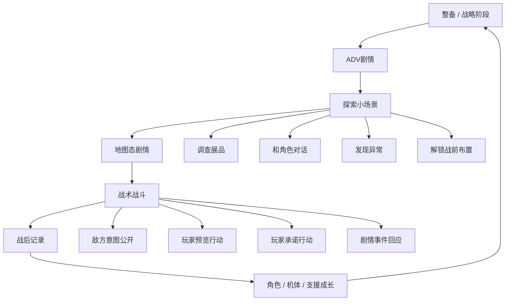
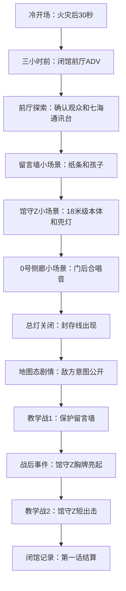
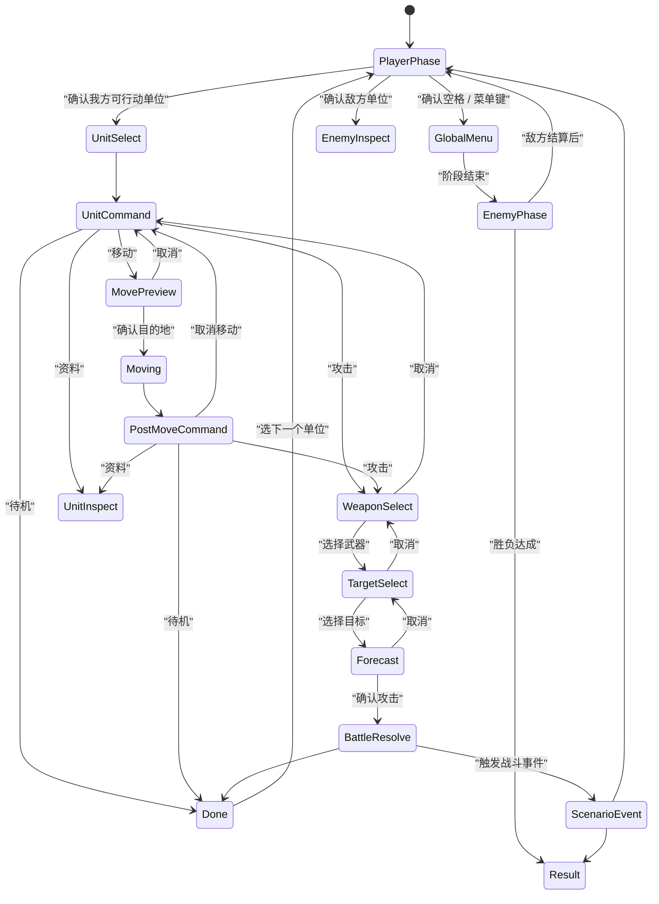
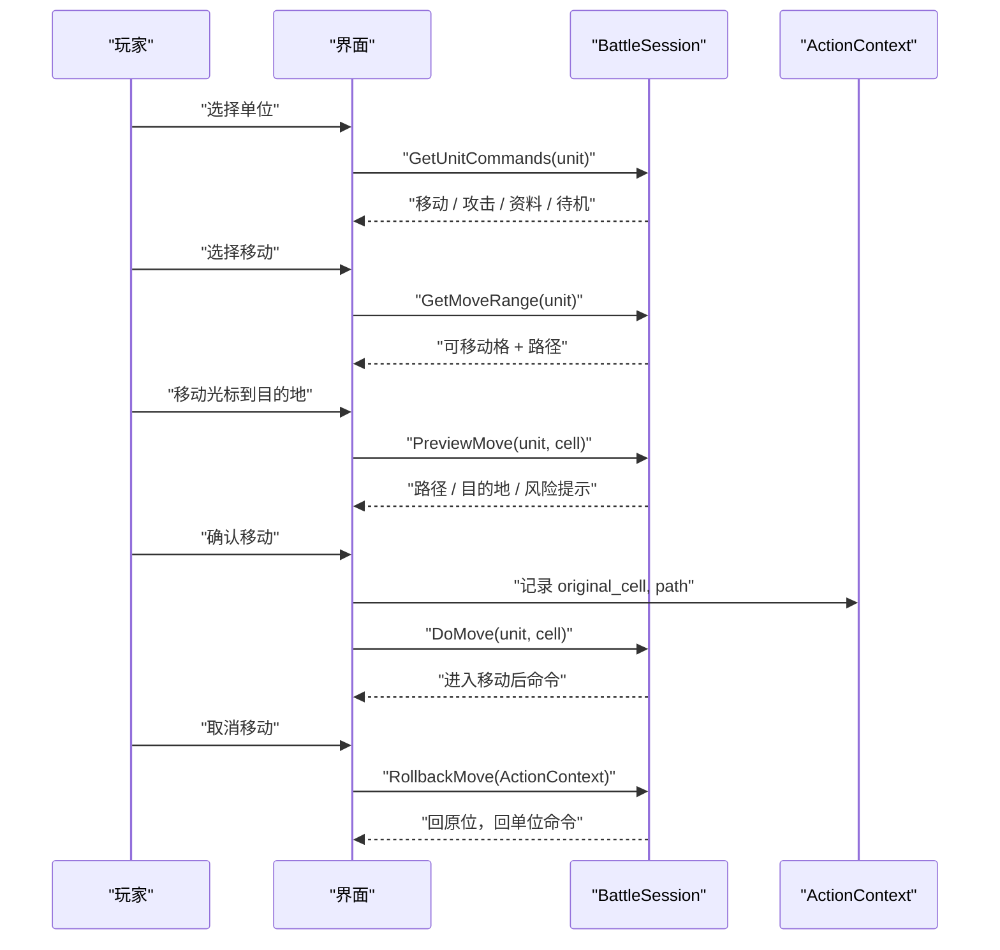
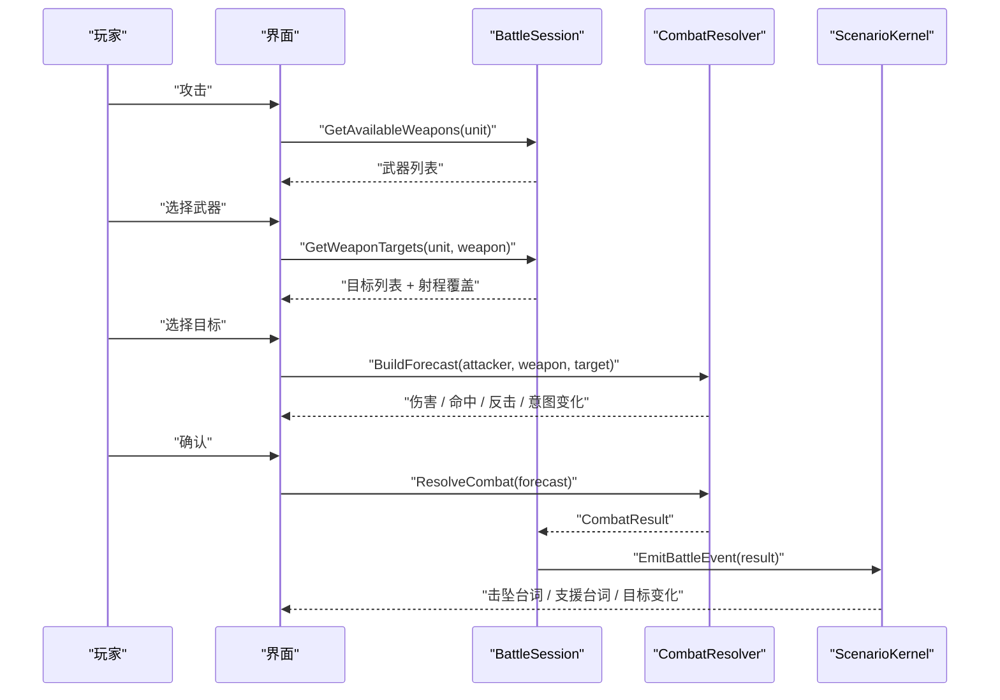
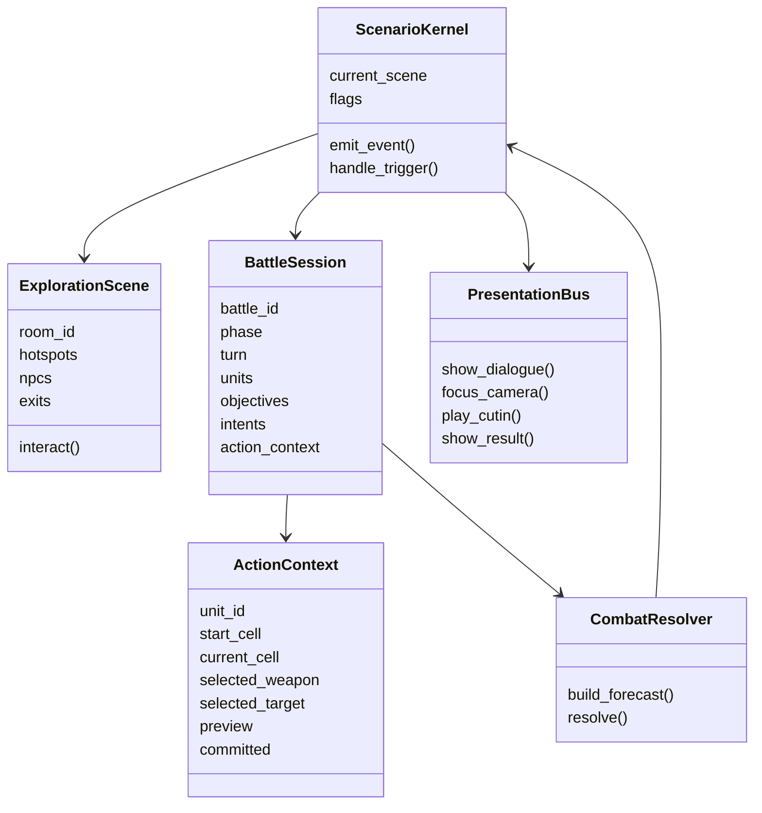

# 《超GAG机器人大战》SRPG 交互设计审计与目标方案 v0.1

> 本文目的：解释当前 demo 为什么“不知所谓”，并把目标游戏的交互设计写成可审阅、可推翻、可重做的形态。  
> 本文不是实现计划，也不是美术方案。它先回答：玩家进入这种游戏时，到底在看什么、想什么、按什么、为什么愿意继续。

---

## 0. 先给结论

当前 demo 最大的问题不是低保真，而是**没有建立玩家的交互契约**。

玩家不知道：

- 现在处于什么游戏模式。
- 当前目标是什么，为什么重要。
- 哪个对象是能操作的，哪个只是装饰。
- 选中单位后下一步可以做什么。
- 移动、攻击、取消、待机、结束阶段之间的关系是什么。
- 剧情为什么切换到战斗，战斗结果为什么又切回剧情。
- 角色为什么在这里、机体为什么在这里、玩家为什么要在乎。

所以即使底层已经有一些规则，体验上仍像“几个界面拼起来”。真正的 SRPG / 机战式交互，首先不是数值，不是菜单，不是立绘，而是：

```text
玩家能读懂局面
  -> 形成意图
  -> 试探行动
  -> 看见后果
  -> 做出承诺
  -> 局面变化
  -> 剧情回应这个变化
```

当前 demo 缺的是这条心理闭环。

---

## 1. 这种游戏的核心交互语法

### 1.1 不是“网页点击”，而是“局面阅读”

SRPG 玩家进入战斗时，第一反应不应该是“我该点哪个按钮”，而是：

```text
敌人在哪？
目标在哪？
谁有危险？
我方谁能行动？
我能阻止哪一个坏结果？
这一步做了以后，下回合会怎样？
```

因此战术地图必须是第一信息源。UI 面板只能辅助解释，不能代替地图表达。

### 1.2 不是“剧情完了开战”，而是“剧情变成战场”

战斗的目标不应凭空出现。正确结构是：

```text
剧情里认识的人/物/秘密
  -> 探索里亲自接触
  -> 地图态剧情把它们摆上战场
  -> 战斗目标要求玩家保护/利用/牺牲/选择
  -> 战斗结果回写角色关系和剧情分支
```

如果玩家没有先喜欢留言墙、观众、馆守Z、0号侧廊，那么“保护留言墙”只是系统任务。  
如果玩家已经在探索里跟孩子说过话、看过纸条、听过门后声音，那么战斗目标才有感情重量。

### 1.3 不是“移动加攻击”，而是“预览与承诺”

机战式行动链里，每一步都分成两类：

| 类型 | 含义 | 可否撤销 | 示例 |
|---|---|---:|---|
| 预览 | 只显示可能性，不改变局面 | 可以 | 查看移动范围、选择武器、查看目标、看预测 |
| 半提交 | 改变显示位置，但还没结束行动 | 可以部分撤销 | 移动后进入行动菜单 |
| 承诺 | 消耗行动，改变战局 | 不可撤销 | 攻击确认、待机、精神使用、支援命令 |

玩家信任游戏的前提是：他知道什么时候只是试，什么时候是真的动手。

---

## 2. 当前 demo 的根因诊断

### 2.1 失败不是单点 bug，是信息架构失效

| 现象 | 玩家感受 | 根因 | 目标修正 |
|---|---|---|---|
| 看起来像网页 | 点按钮翻页面 | 地图没有承担局面信息 | 地图成为主画面，目标、意图、可行动作直接画在地图上 |
| 剧情没头没尾 | 不知道为什么开战 | 剧情事件没有转译成战术目标 | 探索目标必须变成地图目标 |
| 探索目标无意义 | 像打卡 | 热点只是文字按钮 | 每个热点改变战斗布置、台词或可用支援 |
| 人物出现突然 | 像系统在说话 | 角色没有用行为进入场景 | 角色要先作为场景中的人出现，再进入战斗职责 |
| 战斗卡状态 | 不知道怎么退出 | 状态机没有可见出口 | 每个状态必须有确认、取消、返回路径 |
| 结束回合不清楚 | 不知道何时能结束 | 单位命令和全局命令混淆 | 单位命令只管单位，全局菜单才管阶段 |
| 攻击没爽点 | 像扣血按钮 | 缺少武器选择、预测、演出承诺 | 武器、目标、预测、cut-in、结果分层 |
| 情感没有进战斗 | 战斗像无关小游戏 | 保护对象不是先被玩家认识的对象 | 先建立共情，再把共情放进规则 |

### 2.2 当前 demo 的最大误区

它试图一次性呈现：

```text
剧情
探索
战斗
角色
世界观
敌方意图
机战流程
```

但没有给玩家一个清晰的进入顺序。正确顺序不是“内容都放进去”，而是：

```text
先让玩家知道自己是谁
再让玩家知道现在在哪里
再让玩家知道眼前什么值得在乎
再让玩家知道危险如何逼近
再让玩家获得第一个可控行动
最后才让系统变复杂
```

---

## 3. 游戏整体交互结构

### 3.1 宏观循环



### 3.2 四种主交互模式

| 模式 | 玩家主要行为 | 情绪功能 | 系统功能 |
|---|---|---|---|
| ADV剧情 | 阅读、推进、少量选择 | 建立人物、主题、悬念 | 设置场景、关系、变量 |
| 探索小场景 | 走动、调查、对话、切房间 | 建立地点感和共情 | 产出旗标、支援、布置 |
| 地图态剧情 | 看地图上的剧情演出 | 把剧情压力空间化 | 展示目标、敌我位置、意图 |
| 战术战斗 | 读局面、移动、攻击、保护、承诺 | 用选择承担剧情 | 回合、单位、武器、目标、结算 |

### 3.3 模式之间必须有转场理由

每次切换都要回答一个问题：

```text
为什么现在切？
玩家失去了什么自由？
玩家获得了什么新能力？
场景压力如何变化？
```

例子：

| 切换 | 错误做法 | 正确做法 |
|---|---|---|
| ADV -> 探索 | 点“开始探索” | 闭馆广播播完，纪存能走动，玩家要确认馆内还有谁 |
| 探索 -> 地图态剧情 | 点“进入战斗” | 玩家按下总灯，封存线从已调查过的对象旁出现 |
| 地图态剧情 -> 战斗 | 台词结束 | 最后一句台词让控制权交到玩家手里，例如“纪存，指挥权给你了” |
| 战斗 -> 战后 | 敌人清空 | 地图上的保护对象仍在或受损，角色对结果做出反应 |

---

## 4. 第一话交互目标

### 4.1 第一话不该急着“很好玩”，应该先让玩家相信

第一话的交互任务：

1. 让玩家知道万机馆是一个具体地方，不是背景名词。
2. 让玩家知道纪存的身份和性格：他不是勇者模板，而是守馆、归档、嘴硬但认真。
3. 让玩家知道七海不是简单反派：她执行流程，但能看见人的处境。
4. 让玩家喜欢至少三个可保护对象：留言墙、观众、馆守Z、0号侧廊。
5. 让玩家第一次理解“法务封存”如何变成战斗敌人。
6. 让玩家完成一次标准 SRPG 行动链。
7. 让战斗结果回到角色关系，而不是只显示胜利。

### 4.2 第一话建议节奏



### 4.3 第一话的玩家学习曲线

| 段落 | 玩家学到什么 | 不该出现什么 |
|---|---|---|
| 冷开场 | 今晚会出事，有火灾和未归档记录 | 不解释大设定 |
| 前厅ADV | 人物关系、闭馆任务、封存压力 | 不给大量菜单 |
| 探索 | 可以走动，物件值得调查 | 不用大地图格子移动 |
| 地图态剧情 | 战斗发生在刚认识的空间里 | 不突然刷敌人 |
| 教学战1 | 选择单位、移动、攻击预测、待机 | 不引入复杂数值 |
| 战后事件 | 战斗结果改变剧情 | 不只给胜利字样 |
| 教学战2 | 机体启动、武器演出、保护目标升级 | 不做长关卡 |

---

## 5. 探索小场景设计

### 5.1 探索不是战斗地图

探索阶段应该像角色真的在馆里走，而不是在整张战斗地图上挪格子。

正确模型：

```text
房间 / 展区
  -> 可走区域
  -> 热点
  -> NPC
  -> 出入口
  -> 当前目标
```

错误模型：

```text
整张展馆平面图
  -> 玩家小人像棋子一样格子移动
  -> 靠近文字按钮
```

### 5.2 探索画面线框

```text
┌────────────────────────────────────────────────────────────┐
│ 万机馆 / 留言墙                         目标: 确认纸条来源 │
├────────────────────────────────────────────────────────────┤
│                                                            │
│       [纸条墙: 发光热点]                                   │
│    ┌─────────────────────┐                                 │
│    │  便签  便签  便签   │        [小观众 NPC]              │
│    │  便签  便签  便签   │             ●                    │
│    └─────────────────────┘                                  │
│                                                            │
│          ● 纪存                                             │
│                                                            │
│                                          [回前厅 出口]       │
├────────────────────────────────────────────────────────────┤
│ 小观众：那张是我爸画的。他说明天机器人会站起来。            │
└────────────────────────────────────────────────────────────┘
```

### 5.3 探索输入

| 输入 | 行为 | 说明 |
|---|---|---|
| 方向键 / 左摇杆 | 角色连续移动 | 不是格子移动 |
| 确认 | 调查最近热点 / 对话 | 必须有距离提示 |
| 取消 | 关闭调查文本 / 返回上一层 | 不退出整个游戏 |
| 菜单键 | 打开目标笔记 | 查看已确认事项 |
| 地图键 | 小地图 / 展区列表 | 只显示已到过区域 |

### 5.4 热点层级

| 热点类型 | 外观 | 交互结果 |
|---|---|---|
| 主线热点 | 明显光圈 / 目标图标 | 推进必要旗标 |
| 人物热点 | NPC 名牌 / 朝向 | 对话、关系变化 |
| 梗点热点 | 小闪光 / 可重复 | 图鉴、吐槽、轻奖励 |
| 出入口 | 门牌 / 地面箭头 | 切换小场景 |
| 危险热点 | 红白线 / 警告灯 | 预告战斗机制 |

### 5.5 探索必须产出战斗意义

| 探索行为 | 战斗回报 |
|---|---|
| 和小观众对话 | 战斗目标出现“观众安全”条，而不是突然冒出来 |
| 调查留言墙 | 留言墙成为保护对象，受损会触发纪存台词 |
| 看馆守Z展柜 | 解锁旧守护者支援或第二战机体 |
| 听0号侧廊 | 敌方“开封”意图提前显示 |
| 与七海通讯 | 战斗中七海会提示封存流程弱点 |

---

## 6. ADV剧情设计

### 6.1 ADV界面线框

```text
┌────────────────────────────────────────────────────────────┐
│ 背景图: 万机馆前厅 / 雨夜 / 闭馆灯                         │
│                                                            │
│              [角色立绘: 纪存]      [投影: 七海]             │
│                                                            │
├────────────────────────────────────────────────────────────┤
│ 纪存                                                       │
│ 各位，今天真的闭馆了。纪念章可以明天再盖，鞋不能明天再穿。 │
│                                                [自动][记录] │
└────────────────────────────────────────────────────────────┘
```

### 6.2 ADV 不是设定朗读

ADV 台词应该服务当下动作：

- 纪存在收拾展签，所以他说闭馆。
- 七海通过封存流程插入广播，所以她的台词像流程但带人味。
- 小观众问留言墙，所以留言墙获得情感意义。
- 旧守护者更正闭馆记录，所以旧机魂第一次显露人格。

不能让角色直接说：

```text
本作世界观中，机魂是人类分裂意识发展出的集合意识。
```

这种信息应该通过后续事件、战斗目标、角色误解和代价呈现。

### 6.3 ADV 选择应该改变后续口径

第一话可以有轻选择，不要早期分大支线：

| 选择 | 后续变化 |
---|---|
| 温柔回应孩子 | 观众安全相关台词更柔软 |
| 先问七海权限 | 七海信任 +1，后续给提示 |
| 先查0号侧廊 | 0号共鸣 +1，敌方开封意图更早显示 |

---

## 7. 地图态剧情设计

### 7.1 地图态剧情的用途

地图态剧情不是普通对白换个背景。它必须完成三件事：

1. 把探索里认识的对象摆到战场上。
2. 把敌方意图画出来。
3. 把玩家控制权交接得有仪式感。

### 7.2 地图态剧情线框

```text
┌────────────────────────────────────────────────────────────┐
│ TURN 0 / EVENT                    目标: 观察封存流程       │
├────────────────────────────────────────────────────────────┤
│                                                            │
│   我方: 纪存      兜灯      豪司                           │
│        ●          ●         ●                               │
│                                                            │
│                留言墙 [保护对象]                           │
│                    █████                                    │
│             ↑ 红色意图线                                    │
│        法务无人机A ●  -> 下回合归档留言墙                   │
│                                                            │
├────────────────────────────────────────────────────────────┤
│ 七海：封存线落下来了。它不攻击人，它把人重新分类成附件。    │
└────────────────────────────────────────────────────────────┘
```

### 7.3 镜头和焦点

地图态剧情每句台词都应绑定焦点：

| 台词来源 | 地图焦点 |
|---|---|
| 七海解释封存 | 敌方封存线 |
| 孩子喊纸条 | 留言墙 |
| 纪存回应 | 纪存单位 |
| 旧守护者报告 | 保护对象和敌意图 |
| 战斗开始 | 可行动单位逐个亮起 |

---

## 8. 战术地图界面设计

### 8.1 战斗首要原则

战斗画面里，地图必须占主视觉，面板不能抢戏。

建议布局：

```text
┌────────────────────────────────────────────────────────────┐
│ PHASE: PLAYER        TURN 1/4       万机馆完整度: ████░     │
├──────────┬───────────────────────────────────┬─────────────┤
│ 我方队列 │                                   │ 目标 / 情报  │
│ 纪存 HP  │                                   │ 守留言墙     │
│ 兜灯 HP  │              战术地图             │ 护观众       │
│ 豪司 HP  │                                   │ 阻止开封     │
│          │                                   │ 敌方意图     │
├──────────┴───────────────────────────────────┴─────────────┤
│ 当前焦点: 豪司 / 社勇拳  HP 12/12 EN 55/55  气力 100        │
│ 光标格: 展柜地砖 / 可移动 / 敌方下回合无攻击                 │
└────────────────────────────────────────────────────────────┘
```

### 8.2 地图元素

| 元素 | 地图表现 | 交互作用 |
|---|---|---|
| 我方单位 | 明亮阵营色、可行动闪光 | 可选择、可行动 |
| 已行动单位 | 降低亮度、姿态收起 | 可查看，不可行动 |
| 敌方单位 | 红/白封存色 | 查看状态、意图 |
| 保护对象 | 黄色/绿色边框 | 被攻击会影响胜负 |
| 危险格 | 红色覆盖 / 箭头 | 敌方下回合攻击或封存 |
| 可移动格 | 蓝色半透明覆盖 | 选择移动目的地 |
| 可攻击格 | 橙红覆盖 | 选择目标 |
| 地形效果 | 小图标 | 加防、阻挡、漏电、可燃 |

### 8.3 战斗状态机



### 8.4 单位命令和全局命令必须分离

单位命令：

```text
移动
攻击
精神 / 支援
资料
待机
取消选择
```

全局命令：

```text
阶段结束
作战目的
战况报告
部队表
系统
中断保存
```

关键规则：

- 阶段结束不属于某个单位。
- 当仍有单位可行动时，可以允许阶段结束，但必须二次确认。本项目早期可先要求全员行动后才能结束。
- 空格确认打开全局菜单，选中单位确认打开单位命令。

---

## 9. 单位行动链详细设计

### 9.1 单位行动状态

| 状态 | 含义 | 可用命令 |
|---|---|---|
| READY | 本回合未行动 | 移动、攻击、精神、资料、待机 |
| MOVED_READY | 已移动但未承诺最终行动 | 攻击、精神、资料、待机、取消移动 |
| DONE | 行动结束 | 资料 |
| DISABLED | 击坠/瘫痪/剧情封锁 | 资料 |

### 9.2 移动流程



### 9.3 攻击流程



### 9.4 预测窗口内容

预测窗口不是装饰，必须回答玩家的决策问题：

| 信息 | 玩家问题 |
|---|---|
| 攻击方和目标 | 我在打谁？ |
| 武器名和射程 | 我用什么方式打？ |
| 命中率 | 会不会空？ |
| 预计伤害 | 打完敌人剩多少？ |
| EN/弹药消耗 | 值不值得？ |
| 敌方反击 | 我会不会受伤？ |
| 敌方意图变化 | 我是否阻止了坏结果？ |
| 地图副作用 | 会不会误伤、推到危险格、破坏展品？ |
| 剧情触发 | 这次攻击是否触发台词/支援/觉醒？ |

### 9.5 攻击无目标时的正确反馈

不能进入目标选择死状态。

正确处理：

```text
玩家选择攻击
  -> 系统检查是否有任一武器存在合法目标
  -> 如果没有：
       播放无效音
       地图不切状态
       单位命令保持打开
       提示“当前射程内无目标。可先移动或待机。”
  -> 如果有：
       进入武器选择
```

---

## 10. 敌方意图设计

### 10.1 为什么要有敌意图

《超GAG》的战斗不应只是清怪。它应该像解一个正在坍塌的局面：

- 敌方要封存留言墙。
- 敌方要把观众分类成附件。
- 敌方要打开0号侧廊。
- 敌方要让馆守Z自我否认。

这些都应该在地图上提前显示。玩家行动的爽点是阻止坏结果，而不是把 HP 打空。

### 10.2 意图表现

```text
敌人单位上方：意图图标
敌人到目标：红色/白色箭头
目标格：受害高亮
右侧短文本：封存留言墙 / 扫描观众 / 开封0号门
预测窗口：本次行动是否解除意图
```

### 10.3 意图类型

| 意图 | 地图表现 | 玩家应对 |
|---|---|---|
| 攻击 | 红色受击格 | 击破、推开、挡线、防御 |
| 封存 | 红白条覆盖目标 | 击破、打断、改写权限 |
| 扫描 | 锁定线 + 倒计时 | 遮挡、干扰、转移目标 |
| 开封 | 门锁进度条 | 站位阻挡、击退、支援关闭 |
| 误导 | 伪目标高亮 | 调查/识破后显示真目标 |
| 复制 | 复制我方武器名或姿态 | 用梗点/真名破除 |

---

## 11. 战斗中的剧情触发

### 11.1 剧情不能只在战前战后

机战的魅力之一是地图事件：

- 某单位靠近某地点。
- 某敌人 HP 低于阈值。
- 某角色首次攻击某敌人。
- 某保护对象受损。
- 某回合开始。
- 某单位击坠。

这些事件让战斗感觉是剧情的一部分。

### 11.2 触发规则

| 触发 | 示例 |
|---|---|
| `on_turn_start` | 第2回合七海提示封存线重排 |
| `on_unit_reaches_cell` | 纪存靠近留言墙，孩子喊他 |
| `on_first_attack` | 豪司第一次出手吐槽名字被写错 |
| `on_hp_below` | 馆守Z HP 低于50%，兜灯请求撤回 |
| `on_object_damaged` | 留言墙受损，纪存台词变短 |
| `on_enemy_defeated` | 击破扫描器，七海沉默半秒 |
| `on_battle_clear` | 战后事件进入馆守Z胸牌亮起 |

### 11.3 地图事件必须短

战斗中台词不能长篇大论。建议：

```text
1句触发
1句回应
最多3句
```

战斗台词承担“针刺”，不是承担整段解释。

---

## 12. 管理 / 整备阶段设计

### 12.1 管理不是 Excel 菜单

整备阶段应该像“万机馆夜间基地”：

```text
主展厅
  -> 机体整备
档案室
  -> 剧情档案 / 梗点图鉴
留言墙
  -> 关系与支线
放映厅
  -> 战斗回放 / 典藏立绘
现实机器小舞台
  -> 支援角色 / 现实机器人
0号侧廊
  -> 主线谜题
```

### 12.2 管理界面线框

```text
┌────────────────────────────────────────────────────────────┐
│ 万机馆夜间整备                              第1章 第2话前 │
├────────────────────────────────────────────────────────────┤
│                                                            │
│       [主展厅: 机体整备]        [档案室: 图鉴]             │
│                                                            │
│       [留言墙: 关系]            [放映厅: 回放]             │
│                                                            │
│       [现实机器小舞台: 支援]    [0号侧廊: 未开放]          │
│                                                            │
├────────────────────────────────────────────────────────────┤
│ 当前建议: 给馆守Z装上“胸牌初光”，或去留言墙看孩子的新纸条 │
└────────────────────────────────────────────────────────────┘
```

### 12.3 管理阶段功能优先级

第一章 demo 不应做复杂养成。只需要：

1. 查看机体和角色。
2. 装备一个简单模块。
3. 查看新增图鉴。
4. 触发一段支线对话。
5. 进入下一话。

---

## 13. UI 信息层级

### 13.1 一屏只回答一种主要问题

| 屏幕 | 主要问题 | 不该同时塞入 |
|---|---|---|
| ADV | 发生了什么，人物怎么反应 | 战斗数值、复杂菜单 |
| 探索 | 我在哪里，什么值得调查 | 大段系统说明 |
| 地图态剧情 | 危险如何落在地图上 | 自由操作 |
| 战斗自由光标 | 局面是什么，谁能动 | 长剧情 |
| 单位命令 | 这个单位能干什么 | 全局系统菜单 |
| 预测 | 这次行动会怎样 | 图鉴、整备 |
| 结算 | 我保住/失去了什么 | 新系统教学 |

### 13.2 常驻 HUD 应该很少

战斗常驻 HUD：

- 当前阶段。
- 回合数。
- 全局保护条。
- 当前目标短句。
- 我方单位状态小队列。
- 光标对象 tooltip。

不常驻：

- 长说明。
- 大段剧情。
- 角色小传。
- 系统教学。
- 全部武器表。

---

## 14. 输入设计

### 14.1 键盘 / 手柄映射

| 动作 | 键盘 | 手柄 |
|---|---|---|
| 移动光标 / 角色 | 方向键 / WASD | 左摇杆 / D-pad |
| 确认 | Enter / Space | A |
| 取消 | Esc / C | B |
| 菜单 | Tab / M | X |
| 资料 | I | Y |
| 切换我方单位 | Q/E | LB/RB |
| 快速结束阶段 | End | Start |
| 查看敌意图 | Alt | RT |

### 14.2 鼠标映射

鼠标不能只是点击按钮。它应直接操作地图：

| 鼠标行为 | 结果 |
|---|---|
| 悬停单位 | 显示单位 tooltip |
| 点击我方单位 | 选择单位 / 打开命令 |
| 点击可移动格 | 预览移动 |
| 再次点击目的格 | 确认移动 |
| 点击敌人 | 选择目标或查看状态 |
| 右键 | 取消当前状态 |
| 点击空格 | 打开全局菜单或移动光标 |

---

## 15. 第一话详细交互样例

### 15.1 开场 0 到 2 分钟

```text
画面：火灾后30秒，主展厅烟雾，旧守护者重复“观众仍在馆内”。
交互：只能推进对白。
目的：建立悬念，不解释。

切回三小时前。
画面：前厅闭馆，孩子、纪存、七海通讯台。
交互：对白推进，轻选择。
目的：建立角色关系。
```

### 15.2 探索 2 到 7 分钟

```text
玩家控制纪存在前厅走动。
目标笔记显示：
  [ ] 确认观众
  [ ] 查看留言墙
  [ ] 查看馆守Z展柜
  [ ] 检查0号侧廊
  [ ] 联系七海
```

每个目标都要给一个“为什么它值得保护”的小场景。

完成后，目标笔记改成：

```text
已确认：
  观众仍在馆内
  留言墙保存未归档记忆
  馆守Z可接入临时守护权限
  0号侧廊有异常合唱音
  七海确认封存流程无法等待
```

### 15.3 地图态剧情 7 到 9 分钟

```text
地图出现。
刚才探索过的对象被摆到地图上。
敌方单位落下。
红白意图线指向留言墙、观众、0号门。
七海解释“它不攻击人，它重新分类”。
纪存回应“那就先拆分类器”。
玩家获得控制权。
```

### 15.4 教学战 9 到 15 分钟

教学目标：

1. 选择单位。
2. 查看移动范围。
3. 移动后还能取消。
4. 攻击前选择武器。
5. 选择目标。
6. 查看预测。
7. 确认攻击。
8. 其他单位待机。
9. 阶段结束。
10. 敌方按意图行动。

第一回合只放 3 个敌意图：

| 敌人 | 意图 | 正解不唯一 |
|---|---|---|
| 法务无人机A | 归档留言墙 | 豪司击破或纪存贴签 |
| 白线扫描器 | 扫描观众 | 兜灯阻挡或打断 |
| 封存框体 | 开封0号门 | 站位阻挡、击退、打断 |

### 15.5 战后 15 到 18 分钟

根据结果回写：

| 结果 | 战后对白 |
|---|---|
| 留言墙无伤 | 孩子把纸条重新贴高一点 |
| 留言墙受损 | 纪存把碎纸收进档案袋，话变少 |
| 观众受损 | 七海第一次明显动摇 |
| 0号门被碰触 | 门后声音变成人声 |

---

## 16. 角色和机体如何进入交互

### 16.1 角色不是头像，角色是行动倾向

每个角色至少要有：

| 层 | 示例 |
|---|---|
| 场景行为 | 兜灯会先摸温度，不先看报告 |
| 战斗职责 | 兜灯偏修理、补给、封住危险格 |
| 台词节奏 | 兜灯短句、硬、带手上经验 |
| 成长问题 | 她能否承认“旧件也有继续战斗的权利” |
| 关系接口 | 她和馆守Z、纪存、七海如何互相改变 |

### 16.2 机体不是皮肤，机体是玩法人格

| 机体 | 玩法人格 |
|---|---|
| 馆守Z | 慢、硬、保护、老派但可靠 |
| 社勇拳 | 近战爆发、击退、吐槽命名梗 |
| 兜灯整备机 | 修理、供能、临时封格 |
| 纪存指挥机 | 标记、改写、降低敌意图强度 |

### 16.3 关系加成不应只是数值

关系加成可以表现为：

- 援护台词。
- 特定组合武器名变化。
- 某些预测窗口出现额外提醒。
- 某角色在战斗中主动请求行动。
- 战后结算解锁短支线。

例如：

```text
纪存保护留言墙成功
  -> 小观众信任 +1
  -> 下一话“留言墙”支援可用
  -> 七海在预测窗口提示一个封存流程漏洞
```

---

## 17. 架构交互模型

### 17.1 需要的核心对象



### 17.2 Get / Preview / Do 边界

所有交互 API 应分清：

| 类型 | 是否改变状态 | 示例 |
|---|---:|---|
| Get | 否 | `GetMoveRange`, `GetWeaponList`, `GetObjective` |
| Preview | 否或只改变临时预览 | `PreviewMove`, `PreviewAttack`, `PreviewEnemyIntent` |
| Do | 是 | `DoMove`, `DoAttack`, `DoWait`, `DoEndPhase` |
| Emit | 是，剧情层消费 | `EmitBattleResult`, `EmitObjectDamaged` |

很多卡死 bug 都来自 Preview 和 Do 混在一起。

---

## 18. 什么样的 demo 才能算“能 review”

### 18.1 最小可审版本

一个合格的第一话 demo 不需要大量美术，但必须满足：

- 开场 30 秒内知道人物、地点、当前问题。
- 探索阶段能自由走动到至少 3 个小场景。
- 每个小场景有至少 2 个热点，且至少 1 个会影响战斗。
- 地图态剧情能把探索对象转成战术目标。
- 战斗中能完整执行一轮 SRPG 行动链。
- 攻击前预测清楚。
- 敌方意图在地图上可读。
- 战后有角色回应，而不是只有结算。
- 玩家不看说明也知道下一步能做什么。

### 18.2 不能再接受的 demo 形态

```text
只有几个大按钮切界面
探索只是点击热点
地图只是网格背景
单位只是彩色方块
敌人只是在等被打
攻击没有预测
移动和攻击状态没有取消路径
剧情切换没有空间和目标承接
战后没有角色关系变化
```

---

## 19. 我对当前问题的最终判断

这次失败的根本不是“美术没补够”，而是我在实现时过早把想法塞进了一个能跑的壳里，没有先把玩家交互体验设计成稳定结构。

正确下一步不是继续往 v0.3 上修补，而是先拿本文做一次设计审稿：

1. 你先判断本文描述的交互目标是不是你想要的游戏。
2. 如果方向对，再把第一话拆成可执行的交互分镜。
3. 然后重做 demo，先做低保真但严格遵守交互状态机的版本。
4. 最后再换美术资源和演出。

如果本文的交互模型本身不对，那么任何实现都会继续不知所谓。
