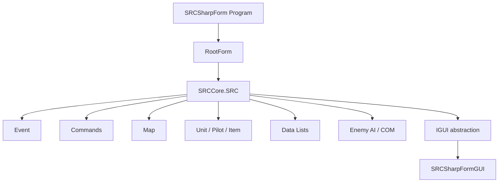
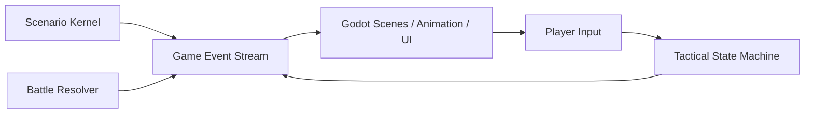

# SRC / SRC# 项目设计与代码逻辑研读报告 v0.1

> 目的：回答“SRC 是否值得看、怎么借鉴、怎么反推《超GAG机器人大战》的 Godot 方案”。本报告基于本地拉取的 `7474/SRC` 仓库静态研读，重点覆盖启动链、场景生命周期、事件脚本、数据模型、地图、战斗命令、AI 与 UI 边界。

## 0. 结论先行

SRC 对《超GAG》非常有价值，但价值不在“直接拿来改”，而在于它证明了一件事：机战式体验的核心不是某个战棋算法，而是**剧本事件系统、单位数据、战斗状态机、地图交互和角色台词库共同构成的内容引擎**。

对我们最有用的部分：

1. **关卡生命周期**：`プロローグ -> スタート -> 玩家回合/敌方回合 -> 攻击/进入/破坏/全灭等事件 -> エピローグ/Continue`。
2. **事件 DSL**：用标签和命令把剧情、出击、增援、战斗前对白、击破台词、胜败条件串起来。
3. **行动状态机**：移动、攻击、待机、取消、移动后菜单、目标选择、反击选择，都由明确状态和可恢复上下文管理。
4. **数据驱动单位/角色**：机体、驾驶员、武器、能力、台词、动画、道具分文件管理，剧本只引用名字。
5. **战斗是事件发生器**：攻击不是单纯扣血，而会触发使用、攻击、攻击后、破坏、全灭、对白、奖励、状态变化。
6. **AI 是可解释规则链**：先处理精神/变形/治疗/地图攻击，再按击杀概率和期望伤害选目标。

对我们不能直接采用的部分：

1. **许可证**：SRC# 代码为 GPLv3-or-later，不能把源码直接并入我们未来可能闭源或商业化的项目。
2. **复杂度过量**：SRC 的完整数值、特殊能力、表达式函数、遗留兼容逻辑远超《超GAG》当前需要。
3. **架构过老**：核心对象 `SRC` 类似巨型 service locator，逻辑大量同步调用 GUI，不适合作为 Godot runtime 内核。
4. **UI 模型不适合现代 Godot**：WinForms 式阻塞对话框、同步地图刷新和 GUI 锁，不适合做流畅演出。

推荐路线：**Godot 继续作为正式运行时，SRC 作为“剧本引擎和机战语法参考”。我们实现一个 SRC-like、但不兼容、不拷贝代码的轻量《超GAG》脚本内核。**

## 1. 研读范围与证据

本地源码路径：

- `external_repos/SRC`
- 克隆来源：`https://github.com/7474/SRC.git`
- 本地浅克隆 HEAD：`4c717b2`

重点阅读对象：

- `SRC.Sharp/SRCSharpForm/Program.cs`
- `SRC.Sharp/SRCSharpForm/RootForm.cs`
- `SRC.Sharp/SRCCore/SRC.cs`
- `SRC.Sharp/SRCCore/SRC.main.cs`
- `SRC.Sharp/SRCCore/SRC.play.cs`
- `SRC.Sharp/SRCCore/Events/*.cs`
- `SRC.Sharp/SRCCore/CmdDatas/CmdParser.cs`
- `SRC.Sharp/SRCCore/CmdDatas/Commands/**`
- `SRC.Sharp/SRCCore/Commands/*.cs`
- `SRC.Sharp/SRCCore/Maps/*.cs`
- `SRC.Sharp/SRCCore/Models/*.cs`
- `SRC.Sharp/SRCCore/Units/*.cs`
- `SRC.Sharp/SRCCore/COM.cs`
- `SRC.Sharp/SRCCore/UIInterface/*.cs`
- `SRC.Sharp/SRCCoreTests/**`
- `SRC/HelpChm/md/**`

验证边界：

- 本机未安装 `dotnet`，因此没有编译运行 SRC# 测试。研读方式为静态代码阅读、测试用例阅读、帮助文档交叉验证。
- `SRCCore` 约 21 万行 C#，且存在大型 `.ref.cs` 迁移参考文件。本报告覆盖主启动链、核心模块、命令注册表、代表命令和测试意图，不宣称逐行复刻所有数值细节。

## 2. 项目分层

SRC 仓库大致是三代并存：

| 层 | 路径 | 意义 |
|---|---|---|
| 原始 SRC | `SRC/` | 旧版 SRC 本体、帮助文档、CHM 转 Markdown |
| SRC.NET | `SRC.NET/` | VB6 时代向 .NET 的迁移产物 |
| SRC# | `SRC.Sharp/` | 当前最值得读的 C# 化实现 |

SRC# 内部再分为：

| 模块 | 作用 |
|---|---|
| `SRCCore` | 核心逻辑：数据、事件、地图、单位、战斗、AI |
| `SRCSharpForm` | Windows Forms 前端 |
| `SRCDataLinter` | 数据检查工具 |
| `SRCTestBlazor` | Web/测试方向实验 |
| `SRCCoreTests` | 单元测试 |

架构关系：



关键判断：`IGUI` 虽然抽象了界面，但 `SRCCore` 仍频繁直接调用 GUI，如打开消息框、锁 UI、刷新屏幕、移动光标、播放效果。这说明 SRC# 不是现代“纯逻辑内核 + 事件输出”的结构。

## 3. 启动链与场景生命周期

### 3.1 WinForms 启动

入口链：

1. `Program.Main(args)`
2. 建立单实例 mutex：`SRC_SHARP_FORM`
3. 初始化 logging
4. `Application.Run(new RootForm(args))`
5. `RootForm` 注入配置、文件系统、声音播放器、GUI 实现
6. 用户选择或命令行传入文件后，调用 `SRC.Execute(filePath)`

### 3.2 SRC.Execute

`SRC.main.cs` 的 `Execute(fname)` 做这些事：

1. 校验运行环境，比如 `Bitmap`、`Sound`、地图资源目录。
2. 载入主窗体和 flash/动画相关资源。
3. 打开标题窗体。
4. 配置声音。
5. 载入 ini。
6. 初始化地图。
7. 初始化随机种子。
8. 根据文件类型进入剧本。

支持文件类型：

| 类型 | 作用 |
|---|---|
| `.eve` | 普通场景脚本 |
| `.srcs` | 存档 |
| `.srcq` | 中断/快速存档 |

### 3.3 StartScenario

`SRC.play.cs` 的 `StartScenario(fname)` 是一话的真正入口：

1. 解析事件文件路径。
2. `Event.LoadEventData(fname, "")` 载入事件脚本。
3. 重置回合、命令状态、显示状态、全局上下文。
4. `Stage = "プロローグ"`。
5. 如果定义了 `プロローグ` 事件，先执行。
6. 要求必须存在 `スタート` 事件。
7. 保存重开用 `_リスタート.srcq`。
8. 显示地图主窗体。
9. 执行 `スタート` 事件。
10. 进入玩家回合。

SRC 帮助文档明确建议一个最低可玩的场景至少包含：

| 事件 | 功能 |
|---|---|
| `プロローグ:` | 战斗前背景说明 |
| `スタート:` | 出击、敌人生成、地图开场对白 |
| `勝利条件:` | 告诉玩家目标 |
| `全滅 敵:` | 胜利处理 |
| `全滅 味方:` | 失败处理 |
| `エピローグ:` | 通关后演出、下回预告 |

对《超GAG》的直接启发：第一章 demo 不能再是几个界面跳转，而应该每一话都有硬性的“话结构”。探索话也应该有 `Prologue / Start / Objective / Trigger / Epilogue`，战斗话则必须有胜败条件和触发事件。

## 4. 回合流程

`StartTurn(uparty)` 是回合系统中枢。

玩家回合：

1. `Turn` 和 `TotalTurn` 增加。
2. 味方单位恢复行动次数。
3. 其他阵营重置行动状态。
4. 移除敌回合持续的精神/状态。
5. 根据地形和场景播放 BGM。
6. 触发 `ターン turn 味方` 事件。
7. 如果存在可行动味方，解锁 GUI，交给玩家操作。
8. 如果没有可行动单位，自动推进敌方、中立、NPC、再回到味方。

敌方/NPC 回合：

1. 恢复该阵营单位行动。
2. 播放 BGM。
3. 触发 `ターン turn party`。
4. 锁定 GUI。
5. 调用 `CPUOperation(uparty)`。

结束回合：

- `Command.mapcommend.cs` 的 `EndTurnCommand()` 会检查是否还有未行动单位。
- 如果有，会弹确认。
- 未行动单位会触发 `行動終了`。
- 然后依次进入敌、中立、NPC、味方。

对《超GAG》的启发：结束回合必须是战术主循环的一等命令。单位行动结束后应消耗行动并进入 `acted` 状态，不允许无限移动/攻击。我们之前 Godot demo 的多次行动问题，正是缺少这个硬约束。

## 5. 事件系统

### 5.1 事件载入

`Event.LoadEventData(fname, load_mode)` 做了非常多内容组织：

1. 清理非系统事件数据。
2. 加载系统事件。
3. 加载精神命令、特殊能力、泛用战斗动画等 include。
4. 解析脚本中 `@` 开头的作品/数据依赖。
5. 搜索 `Data`、`ExtDataPath`、系统 `Data` 目录。
6. 加载 `include.eve`。
7. 注册标签。
8. `ParseCommand()` 将每行变成 `EventCmd`。
9. 检查 `If/Else/EndIf`、`For/Next`、`Talk/End`、`Ask/End` 等块结构。

这套机制的关键不是语法本身，而是**脚本可以动态声明“本话需要哪些作品/机体/动画/事件库”**。

### 5.2 标签匹配

`Event.label.cs` 把标签分为多类：

| 标签 | 用途 |
|---|---|
| `プロローグ` | 开场 |
| `スタート` | 地图开始 |
| `エピローグ` | 通关后 |
| `ターン` | 回合事件 |
| `損傷率` | HP 到达阈值 |
| `破壊` | 单位被破坏 |
| `全滅` | 阵营全灭 |
| `攻撃` | 战斗前/攻击触发 |
| `攻撃後` | 战斗后 |
| `会話` | 玩家主动对话 |
| `接触` | 单位相邻/接触 |
| `進入` | 进入坐标/区域 |
| `使用` / `使用後` | 武器/能力使用前后 |
| `行動終了` | 单位行动结束 |
| `勝利条件` | 作战目的 |
| `マップコマンド` | 自定义地图菜单 |
| `ユニットコマンド` | 自定义单位菜单 |

标签还支持参数，例如：

```text
ターン 3 味方:
攻撃 主角 敌王牌:
破壊 敌王牌:
進入 主角 5 8:
```

SRC 的 `HandleEvent(...)` 会根据事件类型把多个候选标签塞入队列。比如攻击事件可能匹配具体双方，也可能匹配泛用攻击；进入事件可能匹配坐标、地形名、边界脱出。

对《超GAG》的启发：我们需要的是类似的“触发器队列”，不是在代码里手写 `if episode == 1 and enemy_dead`。这样人物梗点、战斗前嘴炮、击破台词、隐藏说得、路线变量才能自然增长。

### 5.3 命令执行模型

每一条事件命令继承 `CmdData`：

- `Exec()` 包装异常和日志。
- `ExecInternal()` 返回下一条事件行 ID。
- 控制流命令通过返回不同 ID 实现跳转。
- 参数可以通过表达式求值。

`CmdParser` 中注册了近 200 个命令。大类包括：

| 类别 | 例子 |
|---|---|
| 控制流 | `If`、`ElseIf`、`Else`、`EndIf`、`For`、`Next`、`Do`、`Loop`、`Goto`、`Call`、`Return` |
| 对话/输入 | `Talk`、`AutoTalk`、`Ask`、`Question`、`Confirm`、`Input` |
| 地图/画面 | `ChangeMap`、`ChangeTerrain`、`Center`、`Telop`、`FadeIn`、`FadeOut`、`PaintPicture`、`ShowImage` |
| 声音 | `PlaySound`、`PlayMIDI`、`KeepBGM` |
| 单位 | `Create`、`Launch`、`Move`、`Attack`、`Destroy`、`Transform`、`Combine`、`Split`、`Ride` |
| 状态/能力 | `SetStatus`、`ClearStatus`、`SpecialPower`、`SetSkill`、`RecoverHP`、`RecoverEN` |
| 数据/存档 | `Load`、`Require`、`SaveData`、`QuickLoad` |

### 5.4 Talk / Ask 的意义

`Talk` 不是一行对白，而是块结构：

```text
Talk 角色名
台词第一行
台词第二行
End
```

它还负责：

- 校验说话人是否存在。
- 打开消息框。
- 自动把地图中心移动到说话单位。
- 支持头像滤镜、位置、固定显示、枠外显示等演出选项。
- `End` 关闭消息框并返回块后。

`Ask` 同样是块结构，可以在脚本里列出选项，也可以从数组变量生成选项。

对《超GAG》的启发：我们现在的对白不应该只是 UI 组件切换，而应该是事件命令。对白命令可以携带说话人、镜头、表情、地图焦点、角色关系变量变化。

## 6. 数据模型

SRC 的数据加载核心在 `SRC.data.cs` 和 `Models/*List.cs`。

一个 Data 目录可包含：

| 文件 | 内容 |
|---|---|
| `alias.txt` | 能力/特征别名 |
| `mind.txt` / `sp.txt` | 精神命令 |
| `pilot.txt` | 驾驶员数据 |
| `non_pilot.txt` | 非驾驶员/NPC |
| `robot.txt` | 机体/机器人 |
| `unit.txt` | 单位 |
| `pilot_message.txt` | 驾驶员战斗台词 |
| `pilot_dialog.txt` | 对话数据 |
| `effect.txt` | 效果 |
| `animation.txt` | 动画 |
| `ext_animation.txt` | 扩展动画 |
| `item.txt` | 道具 |

`SrcDataReader` 的文本读取规则：

- 跳过 `#` 注释行。
- 去除 `//` 行内注释。
- `_` 结尾表示续行。
- 全角逗号转半角逗号。
- 记录 raw/comment/data buffer 和行号，便于报错。

单位数据大致包含：

- 名称、显示名、假名、类别。
- 驾驶员数、道具槽。
- 移动类型、移动力、尺寸。
- 金钱/经验。
- HP、EN、装甲、运动性。
- 地形适应。
- 特征、武器、能力。

驾驶员数据大致包含：

- 名称、昵称、性别、类别。
- 地形适应。
- 经验、等级成长。
- 格斗、射击、命中、回避、反应、技量。
- 性格、SP。
- BGM。
- 特殊能力。

武器数据包含：

- 名称、攻击力、射程。
- 命中、弹数、EN、气力。
- 地形适应。
- 暴击率。
- 武器属性。
- 必要技能/条件。

台词数据是按“角色 + 情况”查找的。`Unit.message.cs` 会根据战斗情况找最合适的台词，例如具体武器、近战/射击、反击、回避、受伤、击破等。

对《超GAG》的启发：角色“像不像人”不只靠主线台本，还要靠分散在战斗、受击、击破、调查、整备、支线中的情境台词库。梗点也应该数据化绑定“触发情况”，否则会变成作者在旁白里讲梗。

## 7. 地图系统

`Map.cs` 的核心特征：

- 坐标为 1-based。
- 支持旧 20x20 地图和带 `MapData` header 的宽高地图。
- `MapData` 存 terrain/cell。
- `MapDataForUnit` 存单位占位。
- `MaskData` 存可选区域，但它的约定是 `false = 可选`、`true = 不可选`，这点很容易踩坑。
- 支持地形层、上层图、下层图、遮罩。
- 支持 ZOC、移动成本、地形适应、特殊移动能力。

范围计算非常丰富：

- `AreaInRange`
- `AreaInReachable`
- `AreaInCross`
- `AreaInLine`
- `AreaInWideCross`
- `AreaInCone`
- `AreaInSector`
- `AreaInSpeed`

对《超GAG》的启发：我们不需要一口气实现所有范围类型，但必须把“范围层”设计为独立数据，而不是临时改 tile 颜色。地图至少要有：

1. terrain layer
2. unit occupancy layer
3. cursor layer
4. move range layer
5. attack range layer
6. enemy intent layer
7. objective / hazard layer

## 8. 玩家战斗交互状态机

SRC 的 `Command` 模块是这次研读最该搬进我们脑子的部分。

主要状态：

| 状态 | 含义 |
|---|---|
| `ユニット選択` | 地图自由选择单位或打开地图菜单 |
| `コマンド選択` | 已选单位，显示单位命令 |
| `ターゲット選択` | 正在选移动格或攻击目标 |
| `移動後コマンド選択` | 已移动，等待攻击/能力/待机 |
| `移動後ターゲット選択` | 移动后正在选攻击目标 |
| `マップ攻撃使用` | 地图炮范围选择 |

`SelectedState` 存储一次行动上下文：

- 当前单位。
- 当前目标。
- 当前命令。
- 选择坐标。
- 选择武器/反击武器。
- 防御选项。
- 选择能力、道具、精神。
- 支援攻击/支援防御。
- 移动前坐标。
- 移动前范围遮罩。
- 移动前 EN。
- 移动消耗。

状态支持：

- `SaveSelections()`
- `RestoreSelections()`
- `SwapSelections()`

取消逻辑：

- 在 `コマンド選択` 取消，回到 `ユニット選択`。
- 在 `ターゲット選択` 取消，回到命令菜单。
- 在 `移動後コマンド選択` 取消，回滚单位到移动前坐标、恢复范围/EN/命令。
- 在 `移動後ターゲット選択` 取消，回到移动后命令菜单。

这直接解释了我们之前 demo 的 bug：移动后点攻击，如果范围内没有敌人，系统进入目标选择但没有可回退上下文，于是卡死。SRC 的解法不是给按钮加个“返回”，而是整个行动上下文都必须可保存、可恢复、可取消。

## 9. 攻击与战斗结算

玩家攻击流程大致是：

1. 选择单位。
2. 选择 `攻撃`。
3. 打开武器列表。
4. 根据武器范围生成 `MaskData`。
5. 进入目标选择。
6. 选目标。
7. 选择/自动选择反击、防御、回避。
8. 触发 `使用` 事件。
9. 触发 `攻撃` 事件。
10. 打开战斗消息窗。
11. 执行先制、支援、攻击、反击等。
12. 发放经验/资金。
13. 触发破坏、损伤、全灭、使用后、攻击后等事件。
14. 消耗行动或进入移动后逻辑。

事件用 `AttackCmd` 强制攻击时，也会：

- 根据指定武器或自动选武器。
- 根据防御选项决定反击/防御/回避/无抵抗。
- 暂时切换 `SelectedUnit` / `SelectedTarget`。
- 打开消息框。
- 调用 `Unit.Attack(...)`。
- 处理反击。
- 恢复上下文。

命中与伤害公式完整而传统：

- 命中率基于攻击方命中值、防御方回避值、地形修正、尺寸修正。
- 伤害基于武器攻击力、驾驶员攻击、气力、地形适应、装甲、防御方气力、地形修正。
- 暴击基于技量差和武器 CT 修正。

对《超GAG》的启发：我们不需要保留完整数值公式，但要保留战斗作为事件总线的思想。一次攻击至少要输出：

```text
BattleStarted
WeaponDeclared
PreBattleTalkTriggered
HitPredicted
DamageResolved
CounterResolved
UnitDamaged
UnitDestroyed
PostBattleTalkTriggered
ActionConsumed
ObjectiveChecked
```

这样才能做“战斗中剧情”和“角色梗点”。

## 10. 敌方 AI

`COM.cs` 的 AI 行动链很完整。

普通敌方行动大致顺序：

1. 使用精神命令。
2. 如果可用，进入 hyper mode。
3. 敌人在 5 格内时，变形成适合战斗的形态。
4. 使用不消耗行动的自我强化能力。
5. 使用召唤。
6. 修理受伤友军。
7. 使用地图型回复。
8. 使用普通回复能力。
9. 如果地图攻击能打多个有效目标，使用地图攻击。
10. 选择最有效攻击目标。
11. 如果不能攻击，则向最近敌人移动。
12. 移动时会考虑地形、防御、支援单位邻接。

目标选择：

- 如果一击击破概率超过 50%，优先击破。
- 多个可击破目标中，命中率高者优先。
- 重要单位，如指挥、支援、修理单位，会提高权重。
- 如果不能击破，则按期望伤害选择。

武器选择：

- 能击破且命中率足够的武器优先。
- 否则选期望伤害最高。
- 高风险武器只在能击破或特定条件下使用。

对《超GAG》的启发：我们的敌人不一定聪明，但必须让玩家觉得“它们有意图”。尤其参考 Into the Breach，应将敌方下一步威胁可视化：

- 法务无人机下回合删除哪块展品。
- 回收机准备抓走哪个 NPC。
- 清算框体准备封锁哪条路。
- 远星噪声准备同步哪台机体。

也就是说，AI 不只是数值策略，而是剧情压力的可视化。

## 11. UI 抽象与它的局限

`IGUI.cs` 很大，职责包括：

- 主窗体/消息窗/列表框开关。
- 锁定/解锁 GUI。
- 地图刷新。
- 光标、鼠标、键盘状态。
- 居中、坐标转换。
- 单位图绘制、擦除、移动动画。
- 文字绘制。
- 图片显示。
- 武器/能力列表。
- LIPS timed choice。
- 确认框。
- 状态窗口。

这说明 SRC 的 UI 抽象不是现代游戏引擎的 ViewModel，而是把传统桌面 UI 操作包装成接口。核心逻辑仍然同步等待 UI。

对《超GAG》的启发：Godot 版本应反过来设计：



核心逻辑产出事件，Godot 场景订阅事件。不要让核心逻辑直接 `OpenMessageForm()` 或 `RedrawScreen()`。

## 12. 对《超GAG》的架构改造建议

### 12.1 保留 Godot 主线

原因：

- 我们需要真实游戏窗口、tilemap、动画、输入、导出。
- 用户已经明确不想要网页感。
- SRC/SRW 的强项是语法和结构，不是现代 runtime。

### 12.2 新增 SRC-like 剧本内核

建议实现一个不兼容 SRC、但吸收其思想的轻量脚本层。

推荐文件结构：

```text
game-godot/
  data/
    episodes/
      ch01_ep01.cgag
      ch01_ep02.cgag
    catalogs/
      pilots.json
      units.json
      weapons.json
      messages.json
      maps.json
  scripts/
    scenario/
      scenario_kernel.gd
      scenario_loader.gd
      scenario_label_index.gd
      scenario_command_registry.gd
      scenario_linter.gd
    tactical/
      tactical_state_machine.gd
      action_context.gd
      battle_resolver.gd
      enemy_intent.gd
    presentation/
      presentation_event_bus.gd
      dialogue_presenter.gd
      cutin_presenter.gd
```

### 12.3 建议的《超GAG》脚本标签

不要照抄日文 SRC 标签，使用我们自己的语义：

```text
episode_start:
prologue:
map_start:
objective:
turn 1 player:
turn 2 enemy:
enter JiCun ArchiveHall:
inspect GuestbookWall:
attack GuanShouZ LegalDrone01:
after_attack GuanShouZ LegalDrone01:
destroy LegalDrone01:
all_destroyed enemy:
unit_finished JiCun:
victory:
defeat:
epilogue:
```

### 12.4 建议的最小命令集

第一阶段只做这些：

| 命令 | 用途 |
|---|---|
| `title` | 话标题 |
| `narrate` | 旁白 |
| `talk` / `end` | 对话块 |
| `focus` | 镜头聚焦单位/地点 |
| `show_cutin` | 显示立绘/大魄力 pose |
| `load_map` | 加载地图 |
| `spawn` | 生成单位 |
| `move_unit` | 剧情移动 |
| `set_objective` | 设置作战目标 |
| `set_flag` / `add_var` | 设置变量 |
| `if_flag` / `else` / `endif` | 简单分支 |
| `choice` / `choice_end` | 玩家选择 |
| `play_bgm` / `play_sfx` | 声音 |
| `battle_tutorial` | 教程提示 |
| `end_stage` | 结束本话 |

第二阶段再加入：

- `reinforcement`
- `route_var`
- `relationship_delta`
- `unlock_unit`
- `combine`
- `rescue`
- `retreat`
- `enemy_intent`
- `battle_message`

### 12.5 必须引入 ActionContext

`ActionContext` 是下一版 Godot 战斗的核心。

应包含：

```text
selected_unit_id
selected_command
selected_target_id
selected_cell
selected_weapon_id
pre_move_cell
pre_move_energy
pre_move_action_points
move_range
attack_range
available_targets
support_candidates
phase
```

并支持：

- `push_context()`
- `pop_context()`
- `restore_pre_move()`
- `cancel_to_command_menu()`
- `cancel_to_unit_select()`
- `commit_action()`

这会一次性解决：

- 攻击范围无敌人后卡死。
- 移动后不能回退。
- 行动后还能继续行动。
- 菜单不知道该回到哪里。
- UI 遮罩和地图状态不一致。

### 12.6 数据表改造

当前 docs 中已有大量 TSV 数据，Godot runtime 需要一套更直接的游戏数据：

| 数据 | 建议格式 | 内容 |
|---|---|---|
| pilots | JSON/TSV | 角色、性格、关系变量、战斗台词池 |
| units | JSON/TSV | 机体、尺寸、移动、HP、EN、装甲、特性 |
| weapons | JSON/TSV | 武器、射程、范围、威力、命中、演出标签 |
| messages | JSON/TSV | 情况台词：攻击、受击、击破、调查、整备 |
| episodes | 自定义文本/JSON | 话结构和事件命令 |
| maps | Tiled/Godot resource + JSON | 战斗地图、探索小场景、目标点 |

核心原则：剧本引用 `unit_id` 和 `pilot_id`，不在剧本里硬写数值。

## 13. 对第一章 demo 的直接修正口径

第一章要变成“可玩的一章”，至少每话满足：

| 层 | 要求 |
|---|---|
| 话结构 | 开场、目标、主循环、关键触发、结尾 |
| 探索 | 有小场景、有可移动角色、有调查目标、有原因 |
| 战斗 | 有胜败条件、有结束回合、有行动消耗、有预测 |
| 剧情 | 战斗前、战斗中、战斗后都有角色反应 |
| 管理 | 不是孤立菜单，而是关卡间整备/图鉴/角色关系入口 |

第一章可以按 SRC-like 结构重排：

| 话 | 结构 |
|---|---|
| 1-1 今日闭馆后 | `prologue -> map_start -> inspect 展岛 -> inspect 留言墙 -> fire_alarm -> epilogue` |
| 1-2 法务警报 | `map_start -> objective 保护留言墙 -> enemy_intent 删除 -> player turns -> destroy/timeout -> victory` |
| 1-3 展厅里的旧守护者 | `prologue -> spawn 馆守Z -> tutorial 大单位/护卫 -> attack events -> all_destroyed/holdout -> epilogue` |
| 1-4 流亡展舰启动 | `management -> route choice -> battle/escape -> star signal -> chapter_epilogue` |

每一话都应该有：

- `objective` 可随时查看。
- 失败条件。
- 关键角色的地图内对白。
- 至少一个战斗中触发的剧情事件。
- 至少一个角色/机体梗点不是旁白解释，而是通过行动触发。

## 14. 跟现有方案的关系

SRC 研读不会推翻此前决定，而是把它们补完整：

| 现有决定 | SRC 带来的修正 |
|---|---|
| Godot 主工程 | 继续保留，但必须有剧本内核 |
| 不照搬 SRW 复杂数值 | 保留轻量数值，但保留完整行动状态 |
| 第一章要可玩 | 每话必须有生命周期标签和目标 |
| 角色要真实 | 给角色建立情境台词库，而不是只写主线对白 |
| 梗点要可 get | 梗点绑定事件触发、武器、台词、敌我关系 |
| 参考 Into the Breach | 敌方意图层可视化，用于剧情压力 |

## 15. 下一步执行建议

下一步不建议继续“手写一堆 Godot 场景流程”。应该先做一个小但真正能承载内容的内核。

建议任务顺序：

1. 在 `game-godot` 建立 `ScenarioKernel`、`ActionContext`、`BattleResolver` 三个核心类。
2. 写一个最小 `.cgag` 剧本文件，重做 1-2 的保护战。
3. 加 `ScenarioLinter`，启动前检查标签、单位 ID、地图 ID、胜败条件。
4. 将第一章四话流程转为脚本文件，而不是写死在 `main.gd`。
5. 给每个主要角色建立 `messages.json`，先支持攻击、受击、击破、调查、整备五类情境。
6. 战斗 UI 改成状态机驱动：地图菜单、单位菜单、移动范围、武器范围、目标预览、确认、演出、结算。
7. 敌方回合先做 Into-the-Breach 式预告意图，再执行。

验收标准：

- 玩家 30 秒内知道当前目标。
- 玩家可移动、取消、重新选择、待机、结束回合。
- 单位行动一次后不能再行动。
- 攻击无目标时不会卡死。
- 每一话有开头、中段触发、结尾。
- 每场战斗至少触发一次角色/机体专属台词。
- 剧情脚本不需要改 Godot 主逻辑即可新增一段对话、一个增援或一个击破事件。

## 16. 附录：关键文件索引

| 文件 | 读到的关键点 |
|---|---|
| `SRC.Sharp/SRCSharpForm/Program.cs` | WinForms 入口、单实例 mutex、日志 |
| `SRC.Sharp/SRCSharpForm/RootForm.cs` | 装配 `SRCCore.SRC`、注入 GUI/文件系统/声音 |
| `SRC.Sharp/SRCCore/SRC.cs` | 巨型核心对象，持有所有子系统和数据表 |
| `SRC.Sharp/SRCCore/SRC.main.cs` | `Execute` 启动流程 |
| `SRC.Sharp/SRCCore/SRC.play.cs` | `StartScenario`、`StartTurn` |
| `SRC.Sharp/SRCCore/Events/Event.data.cs` | 事件载入、include、数据依赖 |
| `SRC.Sharp/SRCCore/Events/Event.handle.cs` | 事件队列与触发 |
| `SRC.Sharp/SRCCore/Events/Event.label.cs` | 标签类型和参数匹配 |
| `SRC.Sharp/SRCCore/CmdDatas/CmdParser.cs` | 近 200 个事件命令注册 |
| `SRC.Sharp/SRCCore/CmdDatas/Commands/Talk/ATalkCmd.cs` | 对话块、说话人校验、镜头居中 |
| `SRC.Sharp/SRCCore/CmdDatas/Commands/Input/AskCmd.cs` | 选择项块和变量数组选项 |
| `SRC.Sharp/SRCCore/CmdDatas/Commands/Unit/CreateCmd.cs` | 生成单位、驾驶员、上图 |
| `SRC.Sharp/SRCCore/CmdDatas/Commands/Unit/AttackCmd.cs` | 脚本强制战斗 |
| `SRC.Sharp/SRCCore/Commands/Command.process.cs` | 玩家输入状态机 |
| `SRC.Sharp/SRCCore/Commands/Command.props.cs` | `SelectedState`、命令状态 |
| `SRC.Sharp/SRCCore/Commands/Command.unitmove.cs` | 移动、移动后状态、回滚 |
| `SRC.Sharp/SRCCore/Commands/Command.attack.cs` | 攻击选择、范围、结算 |
| `SRC.Sharp/SRCCore/Commands/Command.mapcommend.cs` | 地图菜单、结束回合 |
| `SRC.Sharp/SRCCore/Maps/Map.cs` | 地图数据、范围、遮罩 |
| `SRC.Sharp/SRCCore/Models/UnitDataList.cs` | 机体/单位数据解析 |
| `SRC.Sharp/SRCCore/Models/PilotDataList.cs` | 驾驶员数据解析 |
| `SRC.Sharp/SRCCore/Models/MessageDataList.cs` | 台词/效果/动画数据 |
| `SRC.Sharp/SRCCore/Units/Unit.attack.cs` | 战斗结算核心 |
| `SRC.Sharp/SRCCore/Units/Unit.message.cs` | 情境台词查找 |
| `SRC.Sharp/SRCCore/UnitWeapon.cs` | 武器威力、命中、伤害相关逻辑 |
| `SRC.Sharp/SRCCore/COM.cs` | 敌方 AI |
| `SRC.Sharp/SRCCore/UIInterface/IGUI.cs` | UI 抽象边界和耦合问题 |
| `SRC.Sharp/SRCCoreTests/Commands/*` | 行动状态、取消、地图菜单测试 |
| `SRC.Sharp/SRCCoreTests/Events/*` | 标签、事件行、热区测试 |
| `SRC.Sharp/SRCCoreTests/Lib/SrcDataReaderTests.cs` | 数据文件读取规则 |
| `SRC/HelpChm/md/イベントラベル.md` | 场景事件标签官方说明 |
| `SRC/HelpChm/md/戦闘システム詳細.md` | 命中、伤害、暴击公式说明 |
| `SRC/HelpChm/md/行動パターン.md` | 敌方 AI 行动模式说明 |

