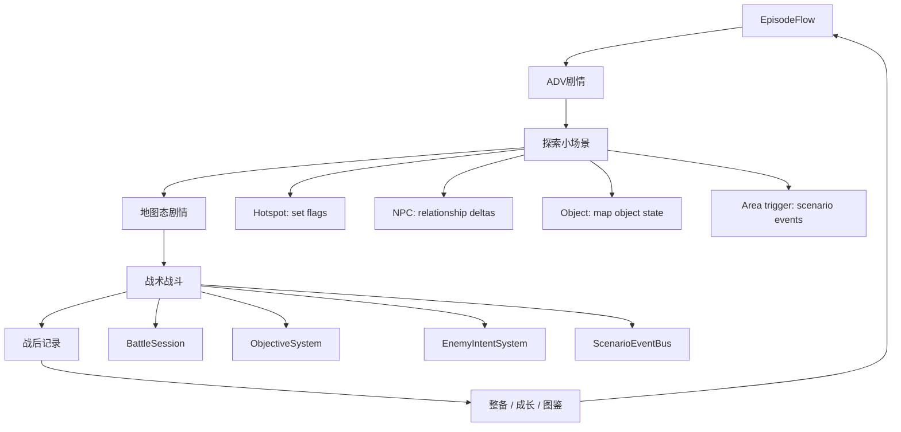
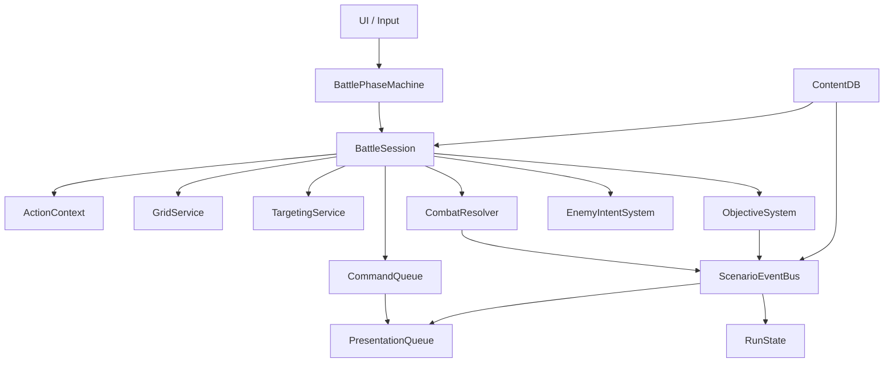
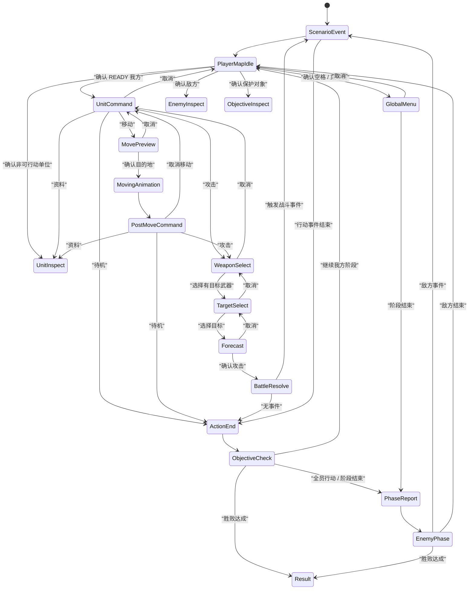

# 《超GAG机器人大战》SRW-like 玩法交互规格 v0.1

> 本文是 `2026-06-21-chao-gag-srpg-interaction-design-audit.md` 的下一层规格。  
> 交互审计回答“玩家为什么玩不懂、目标体验是什么”；本文回答“Godot demo 应该如何实现这些体验”。  
> 依据：SRC / SRPGcore / SRW Engine MV / Sulis / MegaMek / Cosmos War / Godot 与 Unity 战棋项目源码研读结论。

---

## 0. 结论

现有交互方案大方向不推翻，但必须升级为可执行规格。下一版 demo 的核心不是补几个按钮，而是建立五个稳定内核：

1. **模式内核**：ADV、探索小场景、地图态剧情、战术战斗、战后记录互相切换，但共享同一套剧情变量和对象 ID。
2. **战斗状态机**：单位选择、移动预览、移动后菜单、武器选择、目标选择、预测、结算、行动结束必须是强状态，不靠零散 bool。
3. **行动上下文**：每次单位行动都有 `ActionContext`，记录原位置、路径、武器、目标、预测和是否已承诺。
4. **事件内核**：探索、地图演出、战斗前后对白、目标受损、击坠、胜败都通过 `ScenarioEventBus` 触发。
5. **表现队列**：规则结算和镜头/对白/cut-in/伤害数字分离，避免 UI 直接修改战斗状态。

一句话：**玩家每次操作都必须知道自己处于什么状态、可做什么、能否取消、确认后会发生什么、剧情为什么回应。**

---

## 1. 本文覆盖范围

本文定义：

- 游戏模式流转。
- 战术地图输入契约。
- 单位行动状态。
- 战斗状态机。
- `ActionContext`、`CommandQueue`、`PresentationQueue` 的职责。
- 探索、剧情、战斗的事件连接方式。
- 敌方意图与保护目标的交互规则。
- 第一章 demo 的最低验收标准。

本文不定义：

- 最终数值公式。
- 完整美术风格。
- 商业版所有章节内容。
- 全部机体和角色数据。
- 最终 UI 皮肤。

---

## 2. 设计调整点

相对交互审计文档，需要做这些调整：

| 原方案口径 | 调整后口径 | 原因 |
|---|---|---|
| “战斗状态机”作为交互说明 | “战斗状态机”作为实现硬规格 | SRPGcore / SRW Engine MV 都证明 SRPG 必须靠强子状态管理 |
| 探索产出 flags | 探索产出 `EventFlag + MapObjectState + BattleModifier` | Sulis 启发：探索、区域、对话、战斗要共享内容内核 |
| 敌方意图作为地图信息 | 敌方意图作为核心玩法对象 `EnemyIntent` | 让玩家阻止坏结果，而不是只清怪 |
| 战斗预测显示伤害命中 | 战斗预测还显示反击、资源消耗、意图变化和事件风险 | SRW / MegaMek 启发：预测是承诺前的理解层 |
| UI 线框指导布局 | 输入契约 + 状态出口 + 信息层级共同约束 UI | 当前 demo 的问题是“状态不可理解”，不是单纯低保真 |
| 剧情切换到战斗 | 剧情对象进入战场，战场结果回写剧情对象 | SRC / SRPGcore 启发：战斗是事件发生器 |

---

## 3. 总体模式循环



### 3.1 模式定义

| 模式 | 玩家输入核心 | 系统核心 | 输出 |
|---|---|---|---|
| ADV剧情 | 确认、取消、选择、记录 | `ConversationRunner` | flags、关系、场景切换 |
| 探索小场景 | 连续移动、调查、对话、切房间 | `ExploreSceneController` | flags、对象状态、战前信息 |
| 地图态剧情 | 确认推进、查看目标 | `PresentationQueue + ScenarioEventBus` | 战斗目标、敌方意图、可控单位 |
| 战术战斗 | 光标、单位命令、攻击预测、阶段结束 | `BattleSession` | 战斗结果、事件、目标状态 |
| 战后记录 | 确认、查看详情、选择回应 | `EpisodeFlow` | 关系变化、奖励、分支变量 |

### 3.2 模式切换原则

每次模式切换必须满足三个条件：

1. **剧情理由清楚**：玩家知道为什么从阅读变成探索，或从探索变成战斗。
2. **控制权变化清楚**：玩家知道此刻能不能移动、能不能选单位、能不能打开菜单。
3. **对象连续**：探索里认识的对象，在地图态剧情和战斗中仍以同一对象身份出现。

示例：

```text
探索中调查“留言墙”
  -> 设置 flag: knows_message_wall_value
  -> 更新 map object: message_wall.emotional_weight = high
  -> 战斗开始时 ObjectiveSystem 生成保护目标
  -> 敌方意图线指向 message_wall
  -> message_wall 受损触发纪存/小观众台词
  -> 战后记录根据完整度反馈
```

---

## 4. 核心运行对象

### 4.1 架构对象

```text
RunState
  当前章节、全局变量、关系、解锁、图鉴、队伍状态

EpisodeFlow
  管理一话的模式顺序、检查进入条件、接受战斗结果

ContentDB
  读取 units / pilots / weapons / events / conversations / maps / objectives

ScenarioEventBus
  接收触发器，匹配事件，输出事件动作

BattleSession
  管理一场战斗的单位、地图、回合、阶段、目标、意图

BattlePhaseMachine
  管理战斗子状态和合法转移

ActionContext
  管理当前单位尚未完成的一次行动

CommandQueue
  顺序执行规则命令，例如移动、攻击、待机、AI 行动

PresentationQueue
  顺序播放镜头、对白、cut-in、伤害数字、结果条

GridService
  管理格子、占据、通行、路径、范围

TargetingService
  计算武器合法目标、地图攻击覆盖、支援目标

CombatResolver
  生成预测并结算战斗

ObjectiveSystem
  管胜败条件、保护对象、计时器、隐藏目标

EnemyIntentSystem
  生成并显示敌方下次行动意图
```

### 4.2 依赖方向



规则：

- UI 只能发请求，不直接改单位 HP、位置、行动状态。
- `BattlePhaseMachine` 决定当前输入是否合法。
- `BattleSession` 是战斗真实状态源。
- `PresentationQueue` 播放表现，但不决定规则。
- `ScenarioEventBus` 可以暂停战斗控制权，播放事件后再交还。

---

## 5. 输入契约

### 5.1 全局输入

| 输入 | ADV | 探索 | 地图态剧情 | 战术战斗 | 战后记录 |
|---|---|---|---|---|---|
| 确认 | 下一句/选择 | 调查/对话 | 下一段演出 | 选择/确认 | 下一项/确认 |
| 取消 | 关闭选择/文本 | 关闭文本/返回 | 跳过当前自动焦点时需确认 | 返回上一状态 | 返回详情页 |
| 方向 / 摇杆 | 选项 | 角色移动 | 无或移动镜头 | 移动光标 | 选项 |
| 菜单 | 记录/系统 | 目标笔记 | 作战目的 | 全局菜单 | 系统 |
| 信息 | 术语/人物 | 当前目标 | 单位/目标说明 | 单位/地形/意图详情 | 战果详情 |
| 快进 | 可用 | 不可用 | 可用但不跳战斗状态 | 只加速表现队列 | 可用 |

### 5.2 战术地图输入

| 光标对象 | 确认 | 取消 | 信息键 |
|---|---|---|---|
| 我方 READY 单位 | 打开单位命令 | 清空选择 | 查看单位详情 |
| 我方 DONE 单位 | 查看详情 | 清空选择 | 查看单位详情 |
| 敌方单位 | 查看敌方详情/意图 | 清空选择 | 显示射程、意图、状态 |
| 空格 | 打开全局菜单 | 清空选择 | 查看地形 |
| 保护对象 | 查看目标状态 | 清空选择 | 查看完整度、威胁 |
| 事件点 | 查看提示 | 清空选择 | 查看触发说明，若允许 |

### 5.3 取消层级

取消键必须遵循栈式返回：

```text
Forecast
  -> TargetSelect
  -> WeaponSelect
  -> PostMoveCommand 或 UnitCommand
  -> MovePreview
  -> UnitCommand
  -> PlayerMapIdle
```

特殊规则：

- `MovingAnimation` 期间取消无效，除非实现动画跳过。
- `BattleResolve` 已承诺，不允许取消，只能加速表现。
- `ScenarioEvent` 期间取消只关闭当前文本或加速，不能跳过规则事件。
- 移动后未承诺时，`取消移动` 是单位命令项，不是普通取消键的隐式行为；普通取消键从 `PostMoveCommand` 返回 `UnitCommand` 时需明确是否回滚。

推荐早期简化：

```text
PostMoveCommand 按取消：
  弹出/显示“取消移动并回到原位”
  确认后 RollbackMove
```

---

## 6. 战斗单位状态

### 6.1 行动状态

| 状态 | 含义 | 可用命令 | 何时进入 | 何时离开 |
|---|---|---|---|---|
| READY | 本阶段可行动 | 移动、攻击、支援、资料、待机 | 我方阶段开始，单位未受控 | 移动后进入 MOVED_READY；攻击/待机后进入 DONE |
| MOVED_READY | 已移动，尚未承诺 | 攻击、支援、资料、待机、取消移动 | 移动动画完成 | 攻击/待机后 DONE；取消移动后 READY |
| DONE | 本阶段行动结束 | 资料 | 攻击、待机、强承诺支援 | 下次我方阶段开始 |
| SCRIPT_LOCKED | 剧情锁定 | 资料或无 | 地图态剧情、特殊事件 | 事件解除 |
| DISABLED | 击坠/瘫痪/撤离 | 资料 | HP 归零或剧情退出 | 复活/修复/下一场 |

### 6.2 武器与移动后攻击

第一版可以让多数武器 `post_move = true`，但数据层必须预留：

```yaml
weapon:
  id: archive_beam
  range_min: 2
  range_max: 4
  post_move: false
  target: enemy
```

规则：

- `READY` 状态可使用全部满足条件的武器。
- `MOVED_READY` 状态只显示 `post_move = true` 的武器。
- 如果移动后没有可用武器，攻击命令灰掉或隐藏。
- 若攻击命令可见但无合法目标，点击后提示并回命令，不进入目标选择。

---

## 7. 战斗状态机

### 7.1 主状态图



### 7.2 状态明细

| 状态 | 进入条件 | 允许输入 | 退出 | 必须显示 |
|---|---|---|---|---|
| `ScenarioEvent` | 事件队列非空 | 确认推进、快进、记录 | 事件结束后返回指定状态 | 对白、镜头焦点、事件目标 |
| `PlayerMapIdle` | 玩家可控且无当前单位命令 | 光标、确认、菜单、信息 | 单位命令、查看、全局菜单 | 回合、目标、敌意图、可行动单位 |
| `UnitCommand` | 选中 READY 单位 | 选择命令、取消 | 移动、攻击、资料、待机、返回地图 | 单位状态、可用命令、移动/攻击概要 |
| `MovePreview` | 选择移动 | 光标、确认、取消 | 移动动画或命令菜单 | 移动范围、路径、目的地风险 |
| `MovingAnimation` | 确认合法目的地 | 加速动画 | 移动后菜单 | 路径动画、镜头跟随 |
| `PostMoveCommand` | 移动动画完成且未承诺 | 攻击、资料、待机、取消移动 | 武器选择、行动结束、回滚 | 原位置标记、可取消提示 |
| `WeaponSelect` | 选择攻击且至少一个武器有潜在用途 | 选择武器、取消 | 目标选择或返回 | 武器列表、射程、消耗、post_move 限制 |
| `TargetSelect` | 选择武器且存在合法目标 | 光标、确认目标、取消 | 预测或武器列表 | 攻击范围、合法目标、高亮禁用目标 |
| `Forecast` | 选择合法目标 | 确认、取消 | 战斗结算或目标选择 | 命中、伤害、反击、消耗、意图变化 |
| `BattleResolve` | 确认预测 | 快进表现 | 行动结束或事件 | cut-in、伤害、命中、结算 |
| `ActionEnd` | 攻击/待机/承诺命令结束 | 无或确认提示 | 目标检查 | 单位变灰、行动完成反馈 |
| `ObjectiveCheck` | 任意行动后 | 无 | 继续、阶段报告、胜败 | 目标状态变化 |
| `GlobalMenu` | 空格确认或菜单键 | 菜单选择、取消 | 回地图或阶段报告 | 作战目的、阶段结束、系统 |
| `EnemyPhase` | 我方阶段结束 | 快进、查看日志 | 玩家阶段或结果 | 敌方意图执行、事件 |
| `PhaseReport` | 阶段切换 | 确认/快进 | 敌方或我方 | 回合报告、目标损益 |
| `Result` | 胜利/失败 | 确认 | 战后记录或重试 | 胜败原因、保护对象状态 |

### 7.3 禁止状态

以下情况必须由测试覆盖，不能在 demo 中出现：

- `MOVED_READY` 后仍能再次移动。
- 攻击无合法目标仍进入 `TargetSelect`。
- `BattleResolve` 期间可以打开全局菜单。
- `ScenarioEvent` 播放时玩家还能移动单位。
- 单位 `DONE` 后还能攻击或待机。
- 敌方阶段没有任何表现就瞬间跳过，玩家不知道发生了什么。
- 目标已死亡/撤离后预测窗口仍引用旧目标。

---

## 8. ActionContext

### 8.1 字段

```yaml
ActionContext:
  id: action_0001
  unit_id: jicun_guardian_z
  phase_id: player_turn_01
  original_cell: [5, 7]
  current_cell: [5, 7]
  path: []
  moved: false
  selected_command: null
  selected_weapon: null
  selected_target: null
  forecast: null
  committed: false
  rollback_allowed: true
  started_events: []
```

### 8.2 生命周期

```text
选择 READY 单位
  -> 创建 ActionContext
选择移动
  -> 填入可移动范围，不改变 committed
确认移动
  -> 记录 original_cell/path/current_cell，moved=true
移动后取消
  -> 回滚位置，moved=false，清空 path/current_cell
选择武器/目标
  -> 填入 selected_weapon / selected_target / forecast
确认攻击或待机
  -> committed=true
结算结束
  -> 单位 DONE，归档 ActionContext，清空当前上下文
```

### 8.3 回滚规则

可回滚：

- 移动预览。
- 移动后尚未攻击/待机。
- 武器选择。
- 目标选择。
- 预测窗口。

不可回滚：

- 攻击确认后。
- 待机确认后。
- 使用被定义为承诺型的支援/精神后。
- 触发不可逆剧情事件后。

---

## 9. CommandQueue 与 PresentationQueue

### 9.1 CommandQueue

规则命令只处理状态变化，不直接播放复杂表现。

```text
MoveUnitCommand
AttackCommand
WaitCommand
UseSupportCommand
ApplyDamageCommand
ApplyObjectiveDamageCommand
SetUnitStateCommand
AdvancePhaseCommand
EnemyActionCommand
```

原则：

- 命令必须可被日志记录。
- 命令执行前做合法性检查。
- 命令输出 `CommandResult`，供事件和表现层消费。
- AI 行动和玩家行动都走命令队列。

### 9.2 PresentationQueue

表现队列只处理演出，不决定规则。

```text
CameraPan
CameraShake
MapDialogue
CutIn
SpriteMove
HitFlash
DamageNumber
ObjectiveBanner
PhaseBanner
ResultBanner
```

原则：

- 规则可以先算完，再按结果播放。
- 表现播放期间输入被状态机限制。
- 玩家可以加速表现，但不能跳过规则结果。
- 剧情事件可以插入表现队列，但不能绕过 `BattleSession`。

### 9.3 为什么需要两层队列

当前 demo 的状态混乱，本质是“点击 UI 后直接改场景”。两层队列能保证：

- 移动动画没播完，系统不会提前进入攻击。
- 攻击结算完成后，剧情事件能按顺序插入。
- 敌方回合不会瞬间改完一堆 HP 让玩家看不懂。
- 以后做 cut-in、语音、短动画时不破坏规则。

---

## 10. 敌方意图系统

### 10.1 EnemyIntent 数据

```yaml
EnemyIntent:
  id: intent_003
  actor_id: seal_drone_a
  action_type: archive_object
  target_id: message_wall
  target_cell: [8, 4]
  resolves_on: enemy_phase
  predicted_result:
    objective_damage: 1
    status_added: archived
  interrupt_conditions:
    - destroy_actor
    - push_actor_out_of_range
    - block_line
    - disable_weapon
```

### 10.2 地图显示

| 信息 | 表现 |
|---|---|
| 敌人行动目标 | 从敌人指向目标的意图线 |
| 预计结果 | 目标旁显示损伤/封存/开门等图标 |
| 可打断方式 | 选择敌人时在情报面板显示 |
| 危险区域 | 红/白覆盖格 |
| 保护对象状态 | 完整度条、剩余可承受次数 |

### 10.3 敌方 AI 与意图关系

敌方 AI 在敌方阶段执行，但意图应在玩家阶段开始时生成并展示。

第一版 AI：

```text
for enemy in enemies:
  if enemy has scripted_intent:
    use scripted_intent
  elif protect_objective exists and enemy can threaten it:
    intent = attack_or_archive_objective
  elif can kill ally:
    intent = attack_ally
  else:
    intent = move_towards_priority_objective
```

规则：

- 生成意图不等于锁死行动。若玩家改变局面，敌方阶段应重新验证意图。
- 无法执行原意图时，敌方可降级为移动或攻击最近目标。
- 关键剧情敌人的意图可以脚本化。

---

## 11. CombatForecast

### 11.1 字段

```yaml
CombatForecast:
  attacker_id: guardian_z
  weapon_id: lamp_punch
  target_id: seal_drone_a
  hit_rate: 88
  damage: 1500
  target_hp_before: 1800
  target_hp_after: 300
  resource_cost:
    en: 5
    ammo: 0
  counter:
    possible: true
    weapon_id: legal_notice_sting
    hit_rate: 42
    damage: 400
  intent_effect:
    interrupts_enemy_intent: true
    saved_objective_id: message_wall
  event_risks:
    - first_attack_dialogue
  reasons:
    - "距离 1，格斗武器适性正常"
    - "敌方正在展开封存线，回避下降"
```

### 11.2 预测窗口必须回答的问题

| 玩家问题 | 显示字段 |
|---|---|
| 我在打谁？ | 攻击者、目标、单位头像 |
| 用什么打？ | 武器名、属性、射程 |
| 会不会中？ | 命中率、命中修正理由 |
| 能打多少？ | 预计伤害、目标剩余 HP |
| 我要付出什么？ | EN、弹药、冷却、行动消耗 |
| 敌人会反击吗？ | 反击武器、命中、伤害 |
| 是否阻止坏结果？ | 意图解除标识 |
| 是否影响剧情目标？ | 保护对象、事件提示 |

### 11.3 预测与结算的关系

- 预测不改变真实状态。
- 结算以预测输入为基础，但允许随机命中/暴击。
- 若使用随机，结果差异必须可解释。
- 第一版为了调试和教学，可以暂时采用确定伤害 + 命中率固定显示，减少挫败。

---

## 12. ScenarioEventBus

### 12.1 触发器列表

```text
episode_start
episode_end
area_enter
area_exit
hotspot_inspect
npc_talk
map_start
turn_start
phase_start
unit_selected
before_move
after_move
before_attack
after_attack
after_battle
unit_destroyed
objective_damaged
objective_complete
enemy_intent_created
enemy_intent_interrupted
victory
failure
post_battle_record
```

### 12.2 事件结构

```yaml
event:
  id: ep01_first_guardian_attack
  trigger: before_attack
  conditions:
    attacker_id: guardian_z
    target_tag: seal_drone
    once: true
  actions:
    - camera_focus: guardian_z
    - dialogue: ep01_guardian_first_attack
    - cutin: guardian_z_lamp_pose
```

### 12.3 事件动作

| 动作 | 用途 |
|---|---|
| `dialogue` | 播放 ADV 或地图对白 |
| `camera_focus` | 镜头聚焦单位/目标/区域 |
| `cutin` | 播放短 cut-in |
| `set_flag` | 设置剧情变量 |
| `change_relationship` | 改变角色关系 |
| `add_objective` | 增加/更新战斗目标 |
| `damage_objective` | 保护对象受损 |
| `spawn_unit` | 增援 |
| `retreat_unit` | 撤退 |
| `change_intent` | 改变敌方意图 |
| `unlock_support` | 解锁支援 |
| `append_record` | 追加战后记录 |

### 12.4 事件队列规则

- 同一触发器可能匹配多个事件，按优先级执行。
- `once: true` 事件执行后记录。
- 战斗结算期间触发的事件先进入队列，结算安全点再播放。
- 事件播放时进入 `ScenarioEvent` 状态，锁定战斗输入。
- 事件执行完返回原状态或指定状态。

---

## 13. 探索与战斗的对象连续性

### 13.1 MapObject

```yaml
MapObject:
  id: message_wall
  display_name: 留言墙
  type: protectable_object
  explore_scene: hall_message_wall
  battle_map_id: ep01_hall_battle
  battle_cell: [8, 4]
  state:
    known: false
    emotional_weight: 0
    integrity: 3
  tags:
    - museum_memory
    - child_note
```

### 13.2 探索结果进入战斗

| 探索行为 | 数据变化 | 战斗变化 |
|---|---|---|
| 调查留言墙 | `message_wall.known = true` | 目标说明更完整，受损触发专属对白 |
| 与小观众对话 | `relationship.child += 1` | 保护对象受威胁时出现孩子台词 |
| 调查馆守Z展柜 | `guardian_z.pre_awake = true` | 第二段战斗提前或支援更强 |
| 听0号侧廊 | `corridor_0.heard_chorus = true` | 敌方开封意图提前显示 |
| 与七海通讯 | `nanami.trust += 1` | 七海在战斗预测中提示弱点 |

### 13.3 禁止断裂

不能出现：

- 探索时调查的是“留言墙”，战斗里突然叫“记忆节点 A”。
- 探索中 NPC 只说背景，战斗目标与 NPC 无关。
- 战斗胜利后不反馈保护对象状态。
- 角色忽然出现在战斗地图，没有在探索或地图态剧情中进入。

---

## 14. UI 信息层级

### 14.1 战术地图布局原则

```text
┌────────────────────────────────────────────────────────────┐
│ 顶栏: 阶段 / 回合 / 当前目标摘要 / 危险提示                │
├──────────────┬──────────────────────────────┬──────────────┤
│ 我方队列     │                              │ 情报面板     │
│ 可行动/已行动│          战术地图主体         │ 目标/单位/意图│
│              │                              │ 命令列表     │
├──────────────┴──────────────────────────────┴──────────────┤
│ 底栏: 当前光标格 / 地形 / 快捷键 / 最近事件提示            │
└────────────────────────────────────────────────────────────┘
```

原则：

- 地图永远是主信息源。
- 命令面板不能遮住当前单位、目标和敌方意图线。
- 所有可选项必须有禁用态理由。
- 预测窗口可以覆盖，但必须让攻击双方和目标区域仍可见，或提供小地图引用。

### 14.2 状态对应 UI

| 状态 | 主 UI | 辅助 UI |
|---|---|---|
| `PlayerMapIdle` | 地图、敌意图、目标摘要 | 我方队列、光标信息 |
| `UnitCommand` | 单位命令坞 | 单位详情、移动/攻击概要 |
| `MovePreview` | 移动范围、路径 | 目的地风险 |
| `PostMoveCommand` | 移动后命令 | 原位置标记、取消移动提示 |
| `WeaponSelect` | 武器列表 | 射程、消耗、post_move 标识 |
| `TargetSelect` | 攻击范围、目标高亮 | 目标详情 |
| `Forecast` | 预测窗口 | 意图解除、反击、剧情风险 |
| `EnemyPhase` | 敌方行动演出 | 阶段日志 |
| `ScenarioEvent` | 地图对白/ADV框 | 镜头焦点 |

---

## 15. 第一章 demo 最低规格

### 15.1 第一话闭环

第一话必须完整跑通：

```text
ADV：火灾冷开场 / 闭馆前厅
探索：前厅、留言墙、展柜、0号侧廊
地图态剧情：封存线出现，敌方意图指向留言墙
教学战：纪存/馆守Z或临时单位阻止封存无人机
战斗事件：首次攻击、留言墙受威胁、七海插话、馆守Z觉醒
战后记录：保住了什么、损坏了什么、谁改变了看法
```

### 15.2 战斗容量

第一章 demo 最低容量：

| 内容 | 最低量 |
|---|---:|
| 探索小场景 | 4 个 |
| 可调查热点 | 20 个 |
| 关键角色 | 5 人 |
| 我方单位 | 3 台/人 |
| 敌方单位类型 | 3 种 |
| 战斗遭遇 | 1 个教学遭遇 + 2 个完整关卡 |
| 每关战斗事件 | 8 个以上 |
| 保护目标 | 每关至少 1 个 |
| 敌方意图类型 | 每关至少 2 种 |

### 15.3 验收脚本

人工验收时必须能走完这些路径：

1. 不调查留言墙，进入战斗，目标说明较弱但仍可玩。
2. 调查留言墙并与小观众对话，进入战斗后出现更强目标说明和专属台词。
3. 移动后取消，单位回原位。
4. 移动后待机，单位变 DONE。
5. 移动后攻击，单位变 DONE。
6. 攻击范围无目标，提示后回命令菜单。
7. 选择武器、选择目标、查看预测、取消回到目标选择。
8. 确认攻击后无法取消，只能加速演出。
9. 敌方意图线指向保护对象，玩家击破敌人后意图解除。
10. 保护对象受损，触发台词和战后记录变化。

---

## 16. P0 / P1 / P2 实现优先级

### P0：没有这些就不是可玩的 SRPG

- `BattlePhaseMachine`
- `ActionContext`
- `GridService`
- 移动范围和路径预览。
- `READY -> MOVED_READY -> DONE`
- 移动后菜单。
- 攻击无目标安全返回。
- 武器选择、目标选择、预测窗口。
- 全局菜单与单位菜单分离。
- 敌方阶段可见执行。
- 胜败条件和战后记录。

### P1：没有这些就缺少《超GAG》特色

- `ScenarioEventBus`
- 探索 flags 影响战斗。
- 敌方意图线和保护目标。
- 战斗事件对白。
- 支援/提示角色。
- 简短 cut-in。
- 对象连续性：探索对象等于战斗对象。

### P2：后续增强

- 多尺寸单位。
- 地图攻击。
- 援护攻击/防御。
- 移动后不可用武器差异扩展。
- extent / 梗力加码。
- 复杂机体装备挂载。
- 反击/防御/回避选择。
- 多结局变量回写。

---

## 17. 测试与调试标准

### 17.1 状态机测试

至少覆盖：

```text
READY -> MovePreview -> MovingAnimation -> PostMoveCommand -> CancelMove -> READY
READY -> MovePreview -> MovingAnimation -> PostMoveCommand -> Wait -> DONE
READY -> WeaponSelect(no targets) -> UnitCommand
READY -> WeaponSelect -> TargetSelect -> Forecast -> Cancel -> TargetSelect
READY -> WeaponSelect -> TargetSelect -> Forecast -> Confirm -> BattleResolve -> DONE
DONE -> select -> inspect only
PlayerMapIdle -> GlobalMenu -> EndPhase -> EnemyPhase -> PlayerMapIdle
```

### 17.2 内容事件测试

至少覆盖：

```text
hotspot_inspect(message_wall) sets flag
map_start reads flag and changes objective text
enemy_intent_created displays target line
before_attack guardian_z triggers first attack event once
objective_damaged(message_wall) changes battle dialogue
victory writes post_battle_record
```

### 17.3 UI 验收

至少覆盖：

- 菜单不遮挡当前单位、目标、意图线。
- 禁用命令有理由。
- 取消路径清楚。
- 当前状态在 UI 上可见。
- 玩家不看说明也能知道目标和危险。

---

## 18. 下一步建议

下一步不应继续直接堆完整第一章内容，而应先做一个“战斗内核沙盒”：

```text
一张测试地图
2 个我方
3 个敌方
1 个保护对象
1 条敌方意图线
1 个探索 flag 模拟开关
1 套完整行动链
1 个战斗前事件
1 个击坠事件
1 个胜利事件
```

这个沙盒跑通后，再接回第一话真实场景和美术资源。  
否则继续扩内容，只会把状态机问题埋得更深。

