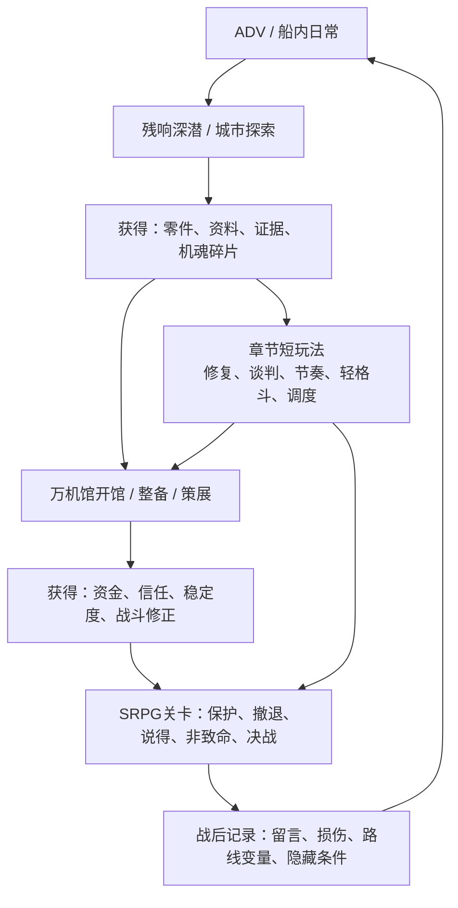

# 《超GAG机器人大战：万机残响》多元游玩体验策划 v0.1

> 承接 [《潜水员戴夫》混合玩法循环调研](./2026-06-22-dave-the-diver-hybrid-loop-research.md)。  
> 本文定义《超GAG》如何在 SRPG/战棋主玩法之外，加入经营、探索、修复、解谜、轻格斗、节奏和调度等多元体验，并保证它们都回流到剧情、机体成长和战斗关卡。

---

## 0. 总结

《超GAG》不应该变成“机器人主题的小游戏合集”。它应该是：

**SRPG 决战 + 万机馆开馆经营 + 残响深潜探索 + 章节定制短玩法。**

一句话版本：

> 玩家白天/幕间进入残响域或现实区域找回零件、证据和机魂碎片，回到万机馆通过开馆、修复、策展和支援派遣把它们变成资金、信任、机体状态与战斗修正，最终在 SRPG 关卡里承担后果。

主循环：



---

## 1. 设计支柱

### 1.1 SRPG仍是主冲突

SRPG/战棋承担：

- 章节高潮。
- 角色觉悟。
- 机体人格。
- 保护、撤退、说得、非致命和牺牲等核心决策。
- 长线变量的显性结算。

多玩法不能取代 SRPG，只能改变 SRPG 的起手条件、目标形态、可用支援或战后后果。

### 1.2 万机馆是经营层，不是菜单页

万机馆经营不是抽象基地菜单，而是玩家能感到“这里在开门”的系统：

- 展岛开放：选择今日开放的展品和主题。
- 讲解安排：让不同角色接待游客，产生不同台词、收益和关系。
- 维修排程：决定先修馆守Z右臂、旧录像、模型、实机还是防火系统。
- 清算压力：处理白名单、保险、版权、城市安全协议和舆论。
- 观众反馈：留言墙、赞助、投诉、误解、孩子的问题。

经营层要让玩家喜欢万机馆，也让玩家害怕失去它。

展岛和藏品不只是收益项。每件重要展品都要能回答“它连接哪个参战谱系、是真机/模型/黑匣子/档案中的哪一类、后续如何变成支援、说得、修复或出击条件”。模型和玩具可以是关系钥匙与结构说明书，但不直接无代价变成真机；大型机体随舰则需要B1机库、外部锁泊、任务地会合或残响待机等明确泊位规则。

### 1.3 残响深潜是资源采集和秘密发现

残响深潜是《戴夫》潜水的本作转译。它可以发生在：

- G.A.G. 残响域。
- 旧机体黑匣子。
- 废弃展厅的空间折叠。
- 城市安防记录。
- 旧录像带和模型盒内的记忆层。
- 远星信号灯槽。

核心压力：

- 信号氧气：越深噪声越高，时间越短。
- 背包容量：零件、证据、台词碎片、机魂样本都占容量。
- 热量/稳定度：过度扫描会让机魂失真或触发清算探针。
- 路线取舍：带回高价值素材，还是救一个弱小残响。

### 1.4 章节短玩法是剧情动作，不是独立关卡

每章最多引入一个新短玩法模板，后续章节复用并变形。  
短玩法时长标准：

| 类型 | 建议时长 | 用途 |
| --- | --- | --- |
| 微事件 | 30 到 90 秒 | 修复一次零件、截住一句话、按下一次合体锁 |
| 小段落 | 3 到 8 分钟 | 残响深潜、开馆服务、撤离路线、轻格斗擂台 |
| SRPG关卡 | 20 到 40 分钟 | 章节主冲突 |

---

## 2. 四层玩法结构

### 2.1 开馆经营层

定位：把探索和战斗结果变成资源、关系和压力。

主要玩法：

- 选择展岛：巨型机、合体剖面台、勇气审批角、现实机器小舞台、模型病院、旧影像厅、废案柜、留言墙。
- 管理藏品关联：确认模型、玩具、黑匣子、实机和档案分别连接哪些机体谱系，哪些只做展陈，哪些可成为支援、修复线索或隐藏条件。
- 安排岗位：纪存整理档案，旧守护者导览，七海处理清单，兜灯修火线，唐胶剪短视频，陆衡做安全报告。
- 接待客流：孩子、老粉丝、媒体、清算观察员、现实机器人研究者、失主。
- 服务节奏：点击/选择/拖放类轻经营，不做复杂模拟。
- 战后展陈：把战斗中保护下来的物件变成展品或纪念。

输出：

- `museum_warmth` 万机馆家感。
- `audience_trust` 观众信任。
- `funding` 资金。
- `repair_parts` 维修件。
- `enterprise_pressure` 清算压力。
- 角色支援、说得台词、隐藏路线触发。

### 2.2 残响深潜层

定位：让玩家主动进入“机器人文化的海底”。

主要玩法：

- 横版或俯视小地图。
- 扫描热点、搬运零件、躲避噪声、打开短谜题。
- 背包/信号限制。
- 可撤退，不鼓励死磕。

输出：

- 机体修复素材。
- 资料完整度。
- 黑展柜共鸣。
- 敌方弱点情报。
- 特殊战斗开局修正。

适合章节：

- C01 火灾前夜的闭馆深潜。
- C06 作者遗迹的分镜层。
- C09 索引天使的数据层。
- C10 外宇宙观测站的远星信号层。
- C12 万机殿的记忆层回收。

### 2.3 章节短玩法层

定位：把机器人文化梗点变成短动作。

推荐模板：

| 模板 | 本作表现 | 适合章节 |
| --- | --- | --- |
| 修复时机条 | 模型、旧录像、右臂、动力管线 | C01、C02、C11 |
| 重心校准 | 现实机器第一次站立 | C03 |
| 合体锁校验 | 勇者、战队、审批、同步 | C04、C08、C12 |
| 路线规划 | 撤退舰队、城市疏散、展舰逃离 | C05、C11 |
| 分镜排序 | 作者遗迹、剧中剧、被改写的名场面 | C06 |
| 节奏打断 | 歌、仪式、咏唱、同步槽 | C04、C07、C10 |
| 谈判/合规 | 清算部、保险、三法城、白名单 | C01、C08 |
| 轻格斗反击 | 钢拳擂台、怪兽近身、父子修复 | C02、C12 |

### 2.4 SRPG承载层

定位：把所有准备和小玩法的结果送上战场。

多玩法输出对 SRPG 的影响必须可控：

- 解锁额外目标，而不是直接跳过战斗。
- 改变保护对象耐久、撤退路线、敌方意图、初始站位、可用支援。
- 提供非致命解法、说得窗口或隐藏援护。
- 失败也能继续，但会付出更高代价。

---

## 3. 资源体系

### 3.1 资源分层

| 资源 | 来源 | 用途 | 设计原因 |
| --- | --- | --- | --- |
| 资金 | 开馆经营、赞助、任务 | 装备升级、雇佣、采购 | 保留传统升级爽感 |
| 维修件 | 深潜、派遣、战后回收 | 机体修复、展品维护 | 避免所有东西都用钱解决 |
| 资料完整度 | 扫描、旧影像修复、战场记录 | 弱点情报、说得、图鉴 | 让信息也是资源 |
| 机魂稳定度 | 修复、对话、非致命战斗 | 援护、觉醒、隐藏路线 | 把“尊重机魂”变成系统 |
| 观众信任 | 开馆、保护市民、公开解释 | 赞助、舆论、清算抵抗 | 让万机馆是社会空间 |
| 清算压力 | 法务事件、城市损伤、封存选择 | 限制出击、触发检查 | 让反派系统持续存在 |

### 3.2 失败不是 Game Over

多玩法失败一般不终止主线，而是改变后续条件：

- 深潜撤退太早：少一个情报，SRPG 里敌方弱点不可见。
- 开馆经营混乱：观众信任下降，清算压力上升。
- 修复失败：机体可出击，但首回合有过热或武器锁定。
- 谈判失败：SRPG 加入清算观察目标，不能随意破坏建筑。
- 节奏失败：同步槽初始较低，援护触发窗口变窄。

这样既保留玩家行为后果，又不把小玩法变成卡关点。

---

## 4. 十二章应用框架

| 章节 | 混合玩法主轴 | 与剧情的关系 | 进入SRPG的方式 |
| --- | --- | --- | --- |
| C01 火灾后的开馆 | 闭馆探索、模型/右臂修复、开馆保护 | 让玩家先喜欢万机馆，再保护它 | 留言墙、右臂、防火系统状态决定保护战条件 |
| C02 模型圣地的孩子们 | 模型病院、轻格斗擂台、玩具生命接待 | 商品化与童年不是靠说教，而是靠修复一件小东西 | 修好的模型成为地图支援或非致命说得证物 |
| C03 第一次站起来 | 现实机器重心校准、展品养护 | 现实机器的笨拙尊严必须被玩家亲手体验 | 校准质量影响护送战速度和跌倒风险 |
| C04 雾岛防卫圈 | 同步灯槽、巨大化灾害避险 | 同步不是数值，而是共同承担压力 | 同步小游戏决定援护链和过载惩罚 |
| C05 宇宙世纪城 | 撤退路线规划、战报传递、补给派遣 | 战争不是全灭敌人，而是让更多人离开 | 规划结果决定撤退点、补给车和市民队列 |
| C06 作者遗迹 | 分镜排序、旧影像修复、舞台机关 | 作者权力被拆成“谁决定下一格” | 分镜结果改变地图事件顺序和敌方增援 |
| C07 原典圣堂 | 节奏打断、仪式证词、粉丝辩论 | 爱与囚笼要通过玩家打断仪式体现 | 节奏成功开启非致命窗口，失败增加狂热护盾 |
| C08 清算都市 | 合规谈判、城市调度、审批合体 | 企业秩序诱惑来自“它确实能降低风险” | 谈判结果限制破坏额度，也提供城市支援 |
| C09 索引天使 | 索引深潜、资料完整度战、UI清噪 | 算法统一通过界面规则压迫玩家 | 深潜带回的异常记录决定能否看见隐藏目标 |
| C10 外宇宙观测站 | 远星信号调谐、灯槽同步、低氧探索 | 最后的问题先表现为听不懂的信号 | 调谐质量决定远星敌意、支援和真结局信息量 |
| C11 万机馆分裂 | 舰内灾害调度、支援派遣、开馆崩盘 | 家的分裂要在系统层也失控 | 调度结果决定离队单位、可用设施和火线 |
| C12 万机殿 | 记忆回收、共鸣对决、后天合唱选择 | 终局不是最大数值，而是保留不完美合唱 | 回收的记忆和关系决定终局援护、隐藏介入和结局 |

详细结构表见 `data/gameplay/chapter_hybrid_activity_matrix.tsv`。

---

## 5. 垂直切片方案

### Slice A：第一章最小多玩法闭环

目标：证明“探索 -> 修复/开馆 -> SRPG”的回流成立。

内容：

1. **1-1 闭馆探索**：在主展厅、模型病院、留言墙、0号侧廊找线索和维修件。
2. **微修复**：用修复时机条抢救馆守Z右臂线路或模型病院里的小零件。
3. **开馆经营试算**：选择 2 个展岛开放，安排 2 名角色岗位，获得观众信任和维修件。
4. **1-2 保护战**：保护留言墙和白色封存清单。前面做得好，保护目标耐久更高或右臂支援提前解锁。

验收：

- 玩家能说出“我刚才在馆里做的事改变了战斗”。
- 玩家能说出“万机馆不是菜单，是我刚刚逛过和修过的地方”。
- 不需要复杂数值，只需要 3 个清楚的输出：维修件、观众信任、保护目标耐久。

### Slice B：商业版一章模板

目标：定义每章可复制的标准节奏。

节奏：

1. 章节导入 ADV：提出本章的问题。
2. 一次短探索或开馆经营：让玩家获得准备资源。
3. 一次章节专属短玩法：表达本章梗点或主题。
4. SRPG关卡：承载冲突。
5. 战后开馆/记录：兑现选择、损伤和留言。

---

## 6. 制作边界

### 6.1 首批只做 8 个模板

第一阶段推荐模板：

1. `T_SERVICE` 开馆服务/策展。
2. `T_SIDE_DIVE` 残响深潜。
3. `T_REPAIR_TIMING` 修复时机条。
4. `T_ROUTE_PLANNING` 路线规划。
5. `T_DIALOGUE_CONTRACT` 谈判/合规。
6. `T_SIGNAL_TUNING` 信号调谐/资料解谜。
7. `T_RHYTHM_INTERRUPT` 节奏打断。
8. `T_DUEL_COUNTER` 轻格斗反击。

后续再补：

- `T_DISPATCH_DECK` 支援派遣。
- `T_PASSIVE_CARE` 展品养护。
- `T_COMBINE_LOCK` 合体锁校验。
- `T_REPAIR_ROUTING` 舰内灾害调度。

### 6.2 不做重物理平台跳跃

横版探索可以有移动、跳跃、躲避，但不把精密平台跳跃作为核心。原因：

- 本项目核心玩家预期仍偏 SRPG/机战/剧情。
- 精密动作会显著抬高手感、美术、关卡和测试成本。
- 更适合用“路线、信号、容量、风险”来制造探索感。

### 6.3 小玩法必须共用数据接口

所有小玩法输出同一种结构：

```text
HybridActivityResult
- activity_id
- score_band: fail / clear / good / perfect
- resource_delta
- variable_delta
- battle_modifiers
- unlocked_flags
- injury_or_pressure_delta
```

SRPG关卡只读取结果，不直接关心小游戏内部细节。

---

## 7. UI/交互要求

### 7.1 全局入口

幕间界面只保留四个清楚入口：

- 出击。
- 开馆。
- 深潜。
- 整备。

支援派遣、展品养护、图鉴和资料修复都挂在开馆/整备里，避免基地菜单膨胀。

### 7.2 玩家必须知道收益去向

每个小玩法结算界面必须显示：

| 项目 | 示例 |
| --- | --- |
| 带回资源 | 维修件 +3，资料完整度 +1 |
| 变量变化 | 万机馆家感 +1，清算压力 +1 |
| 战斗影响 | 留言墙耐久 +20%，敌方第一波延迟 1 回合 |
| 新台词/事件 | 七海战前追加一句“这张清单我先压下去” |

### 7.3 失败也要有叙事反馈

失败反馈要像剧情后果，而不是系统责骂：

- “右臂能动，但烧焦的线路会让旧守护者少一次援护。”
- “观众没有散，留言墙前多了三个人，保护战的负担更重。”
- “清算白名单没谈下来，城市建筑损伤会被计入战后账单。”

---

## 8. 与既有设定的关系

| 既有元素 | 多玩法承接方式 |
| --- | --- |
| 万机馆家感 | 开馆经营、留言墙、展岛维护、战后展陈直接增加或损伤家感 |
| 黑展柜共鸣 | 残响深潜、0号侧廊、旧纸条和记忆回收逐步推进 |
| 企业信任/清算压力 | 谈判、白名单、城市损伤、合规玩法持续作用 |
| G.A.G.能力边界 | 深潜和索引玩法必须消耗载体、授权、信号或机魂稳定 |
| 终局表现语法 | 第9-12章的抽象哲学通过 UI 清噪、信号调谐、记忆回收和地图规则表现 |
| 第一第二话优化台本 | Slice A 直接以 1-1 闭馆探索和 1-2 法务保护战为原型 |

---

## 9. 下一步

1. 用 `hybrid_loop_templates.tsv` 选定首批 8 个模板。
2. 把第一章 1-1/1-2 拆成可实现的 `HybridActivityResult` 输出。
3. 在主程序对话中让 Godot demo 先实现：闭馆探索、修复时机条、保护战读取修复结果。
4. 后续做机体、数值、升级、改装时，把资源分层纳入成长体系，避免所有成长都只靠钱和经验。
