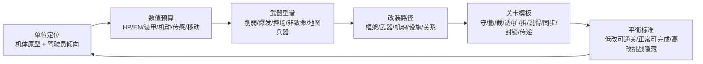

# 机体数值、成长改装与关卡平衡调研报告 v0.1

> 本文补齐《超GAG机器人大战：万机残响》在机体、数值、升级、改装、敌方模板和关卡平衡上的根基。  
> 结论进入 [机体数值、成长改装与关卡平衡 Bible](./2026-06-22-chao-gag-mecha-stats-growth-balance-bible.md) 以及 `data/gameplay` 下的五张结构化表。

---

## 0. 摘要

《超GAG》的数值体系不能只回答“伤害怎么算”，而要回答五件事：

1. **每台机体在队伍里承担什么工作**：守、撤、截、诱、护、拆、说得、同步、封锁、传递。
2. **玩家为什么愿意改装它**：不是所有机体都堆攻击，而是让它更像它自己。
3. **关卡如何避免血牛化**：难度来自目标压力、敌方意图、地图对象和资源承诺，不来自无限抬 HP。
4. **升级如何不把平衡打穿**：低改队能过主目标，正常改能拿大部分副目标，高改队能打隐藏目标但不能无视规则。
5. **剧情变量如何进入战斗**：万机馆开馆、残响深潜、修复和谈判输出战斗修正，但不替代 SRPG 主冲突。

核心结论：



---

## 1. 资料来源

| 来源 | 关键事实 | 对本项目的设计启发 |
| --- | --- | --- |
| [Super Robot Wars Y 官方页](https://www.bandainamcoent.com/games/super-robot-wars-y) | 官方定位为 grid-based tactical combat RPG；任务后获得 credits/resources，用于升级单位、训练驾驶员；Assist Link 让支援角色进战斗并成长 | 成长层要拆成机体、驾驶员、支援三层，不把所有成长塞进机体面板 |
| [Super Robot Wars Y DLC2/免费更新新闻](https://www.bandainamcoent.com/news/super-robot-wars-y-dlc-2-now-available-in-early-access) | Battle Rush 2 有 20 波，强调火力、作战时长、资源管理和跨难度平衡；更新提高驾驶员与机体/武器改装上限 | 后期内容要扩上限，但必须配合资源管理和专门挑战，不应把主线后半变成纯数值膨胀 |
| [Super Robot Wars 30 官方页](https://www.bandainamcoent.com/games/super-robot-wars-30) | SRW 结合跨作品、战斗动画、升级机器和驾驶员；基础系统是 Simulation RPG，并引入 Tactical Area Select 和 Auto Battle | 本作可以保留“喜欢谁就能练谁”的机战宽容度，但主线目标要更清楚 |
| [Into the Breach 官方页](https://subsetgames.com/itb.html) | 城市建筑供能、敌方攻击预告、每回合分析并反制；武器和驾驶员构筑机体 | 关卡难度应来自“可预见坏事”，敌方意图要比隐藏命中率更重要 |
| [Into the Breach Advanced Edition 官方页](https://subsetgames.com/itb_ae.html) | 新机甲小队、近 40 种新武器、更多敌人、Boss 和任务目标增加挑战与变化 | 武器/敌人/目标模板比单纯加数值更能扩展内容 |
| [Fire Emblem Engage 官方战斗页](https://www.nintendo.com/ph/switch/ayfn/system/battle.html) | 回合制网格战斗、职业克制、Emblem 同步/Engage、三回合强力状态、支援/羁绊带来能力提升 | 本作可用短时“燃魂/同步/合体锁”形成爆发窗口，避免常驻数值堆叠 |
| 本地开源 SRPG 源码研读 | `BattleSession`、`CombatResolver`、`ObjectiveSystem`、`EnemyIntentSystem`、事件触发、战斗预测等已有规格 | 数值体系必须接入现有战斗状态机和事件内核，不另起一套 |

---

## 2. SRW 系列给出的结构启发

### 2.1 机体、驾驶员、支援分层

SRW 的魅力不只是机体数值，而是三层叠加：

- **机体层**：HP、EN、装甲、运动性、照准值、移动、地形、武器。
- **驾驶员层**：格斗、射击、技量、防御、回避、命中、精神/技能。
- **支援/战舰/设施层**：支援指令、基地升级、通用资源、强化零件。

对《超GAG》的结论：

- 机体负责“能做什么动作”。
- 驾驶员负责“用什么态度和效率做动作”。
- 万机馆负责“战斗前准备、战斗中支援、战后后果”。

如果只做机体面板，机器人大战感会很快变成普通 RPG 装备堆数值。

### 2.2 宽容升级与角色爱

机战类作品通常允许玩家把喜欢的单位练起来。这个方向适合《超GAG》，因为本作的核心是“机器人文化和角色共情”。但要加三条限制：

1. 喜欢谁都能带上场，不等于谁都能单刷。
2. 改装必须强化角色定位，不允许所有单位最终变成高攻高防高速。
3. 章节目标必须要求多种角色工作，例如保护、撤退、封锁、说得、传递，不只看击坠效率。

### 2.3 后期扩上限只给专门挑战

SRW Y 后续更新把驾驶员等级、驾驶员强化上限、机体和武器改装上限继续拉高，同时推出更长波次挑战。这提示《超GAG》：

- 主线平衡应以基础上限设计，不应要求玩家满改。
- 后期/隐藏/挑战内容可以开放额外改装，但必须配套更长作战、资源限制或特殊目标。
- 扩上限是“给爱和挑战找出口”，不是主线数值通胀的理由。

---

## 3. Into the Breach 给出的关卡启发

### 3.1 难度来自可预见坏事

《Into the Breach》的敌方攻击预告非常适合本项目吸收。它的重点不是敌人多聪明，而是玩家能看见坏事即将发生：

- 哪栋建筑会被打。
- 哪个单位会被撞。
- 哪个格子会产生新敌人。
- 自己的武器会不会误伤。

对《超GAG》的转译：

- 敌方意图线要显示“下一回合谁要封存什么、烧哪里、打谁、抢哪条路线”。
- 玩家每回合应该是在阻止坏结果，而不是只清最近的敌人。
- 关卡副目标必须可预见，例如“3 回合后封存机抵达留言墙”。

### 3.2 机体设计是工具组，不是职业名

《Into the Breach》的机体小队用武器效果定义玩法：推、拉、盾、范围、位移、环境、牺牲。  
《超GAG》也应让武器承担战术动词：

- 推开封存机。
- 拉回暴走机魂。
- 罩住留言墙。
- 打断同步仪式。
- 标记说得对象。
- 非致命压制。
- 封锁刷兵口。

这比“近战强/远程强/防御高”更适合机器人大战的梗点和关卡艺术。

### 3.3 小地图和短目标比大地图堆敌人更好

本作不应一开始就做 30 单位大地图。更好的垂直切片标准是：

- 4 到 6 个我方单位。
- 6 到 12 个敌方单位。
- 1 个主目标，2 个副目标。
- 5 到 8 回合主压力。
- 每回合有 1 到 3 条明确敌方意图。

---

## 4. Fire Emblem Engage 给出的成长启发

### 4.1 职业克制要服务可读性

Fire Emblem Engage 官方页强调不同职业有不同能力，错误对位会让强角色陷入劣势。本作不需要照搬武器三角，但需要“机体克制语言”：

| 本作克制轴 | 作用 |
| --- | --- |
| 装甲 vs 穿甲 | 重装单位怕专用穿甲和绕后，不怕杂兵刮痧 |
| 高机动 vs 广域锁定 | 高机动单位怕锁区、地图兵器和传感压制 |
| 屏障 vs 破障 | 超级系护盾怕破障/多段削能 |
| AI/机魂 vs 信号干扰 | AI 和同步机怕清噪、失真和封锁 |
| 远程炮击 vs 近身截击 | 炮台单位怕被贴身或视野破坏 |

克制的目的是让玩家换位和组合，而不是让某类单位永久废掉。

### 4.2 短时强力状态比常驻膨胀更健康

Engage 状态只持续三回合。这种“短爆发窗口”很适合《超GAG》：

- 燃魂：一次短时间爆发，改变武器或援护。
- 同步：几回合内提升援护链，但过载会产生代价。
- 合体锁解除：短时间开放合体技或地图兵器。
- 远星调谐：短时间看见隐藏意图或免疫清噪。

短时状态可以让玩家兴奋，又不会让常驻数值膨胀。

### 4.3 羁绊成长要有战斗价值

支援等级、羁绊等级和能力提升给本作一个重要方向：关系不是只解锁对白。  
《超GAG》的关系成长应影响：

- 援护攻击/防御窗口。
- 说得条件。
- 双人合体或同步稳定。
- 非致命压制成功率。
- 战后修复效率。

---

## 5. 本地源码研读给出的实现启发

已有 `SRW-like 玩法交互规格` 明确了这些对象：

- `BattleSession`
- `CombatResolver`
- `ObjectiveSystem`
- `EnemyIntentSystem`
- `ScenarioEventBus`
- `ActionContext`
- `ContentDB`

因此本轮不再另起“数值引擎”，而是定义这些对象应读取哪些数据：

```text
ContentDB
  unit_archetypes.tsv       -> 机体定位和数值预算
  weapon_patterns.tsv       -> 武器战术功能和约束
  upgrade_paths.tsv         -> 改装路径和资源
  encounter_templates.tsv   -> 关卡目标模板
  mission_balance_targets.tsv -> 逐章平衡目标

CombatResolver
  读取单位数值、驾驶员倾向、武器型谱、地形和状态

ObjectiveSystem
  读取关卡模板、保护对象、倒计时、隐藏目标

EnemyIntentSystem
  读取敌方模板，生成下一回合可见意图
```

---

## 6. 对《超GAG》的设计原则

### 原则 A：角色定位先于数值

先写“这台机体在队伍里解决什么问题”，再给数值。  
例如：

- 馆守Z：守护、反击、承伤、爆发，不应变成高速万能机。
- 现实机器跌跌：护送、笨拙、稳定、非战斗价值，不应升级成普通超级机器人。
- 钢拳擂台：近身反击、非致命、单挑，不应成为地图炮。
- 方舟T：信号、支援、远星理解，不应抢主战单位位置。

### 原则 B：武器必须有动词

每个武器至少承担一个战术动词：

- `damage` 伤害
- `guard` 守
- `push/pull` 位移
- `intercept` 截
- `seal` 封锁
- `pierce` 破障
- `nonlethal` 非致命
- `sync` 同步
- `persuade_mark` 说得标记
- `transmit` 传递

没有动词的武器只是数字皮肤。

### 原则 C：升级强化身份，不抹平弱点

改装路径不允许“全项目加满后人人一样”。每个 archetype 有推荐升级：

- 守护型优先 HP、装甲、护盾、保护范围。
- 高机动优先移动、机动、再行动条件。
- 炮击型优先射程、EN、装填、地形适应。
- 支援型优先修复、补给、信号、支援次数。
- 现实机器优先稳定、失败恢复、护送目标，而不是火力。

### 原则 D：平衡用三套队伍测

每关用三套队伍检验：

| 队伍 | 标准 |
| --- | --- |
| 低改队 | 必须能通过主目标，但可能丢副目标 |
| 正常改装队 | 应能完成主目标和大部分副目标 |
| 高改/爱用队 | 可以挑战隐藏目标和更高评价，但不能无视地图规则 |

### 原则 E：敌人健康度来自“意图”，不是 HP

敌人越来越强不等于血越来越厚。更健康的增长方式：

- 更多种敌方意图。
- 更短的倒计时。
- 更复杂的目标互斥。
- 精英敌有机制，而不是只有高 HP。
- Boss 有阶段目标，而不是一直挨打。

---

## 7. 需要落表的资产

本轮落五张表：

| 表 | 作用 |
| --- | --- |
| `unit_archetypes.tsv` | 机体原型、数值预算、弱点和关卡用途 |
| `weapon_patterns.tsv` | 武器型谱、资源消耗、战术动词、反制方式 |
| `upgrade_paths.tsv` | 改装路线、资源、层级、效果和禁区 |
| `encounter_templates.tsv` | 关卡目标模板和敌方压力结构 |
| `mission_balance_targets.tsv` | 十二章平衡目标、部署规模、回合数、敌方预算和三套队伍标准 |

这些表不是最终数值表，而是“数值根基”。后续具体机体表、武器表、关卡表都应引用这些模板。

