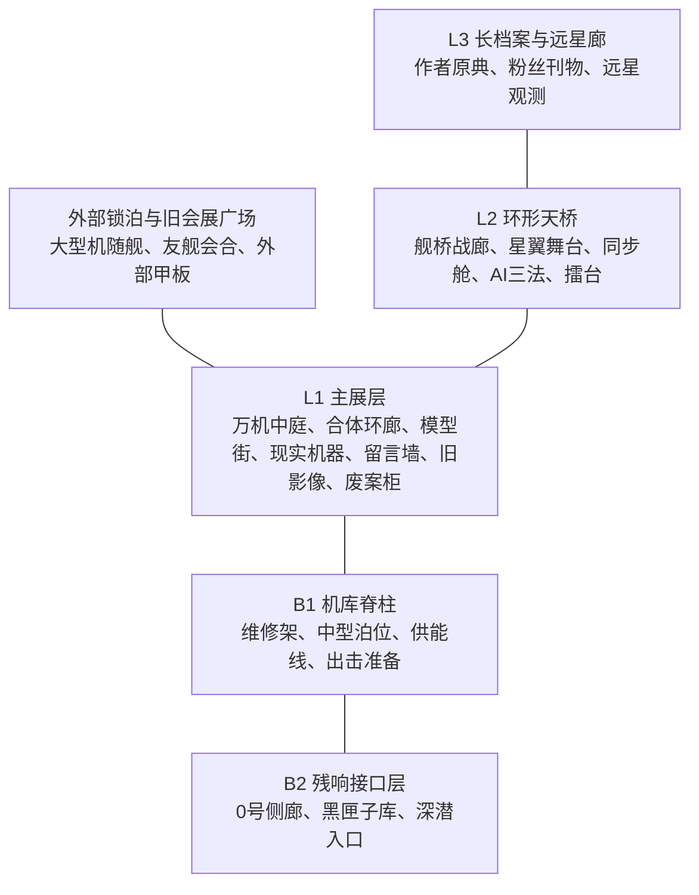

# 万机馆藏品、参战机体与展舰结构设计 v0.2

> 本文把“机器人文化博物馆”升级为可长期承载主线、参战谱系、模型玩具情感和机战母舰功能的根设定。机器可查规则见 `data/canon/wanji_exhibition_zones.tsv`、`data/canon/wanji_roster_zone_coverage.tsv`、`data/canon/wanji_collection_taxonomy.tsv`、`data/canon/wanji_carrier_berths.tsv` 与 `data/canon/jicun_archive_terminal_views.tsv`。

## 1. 核心口径

万机馆不是“摆了几台机器人”的展厅，也不是传统机战里无限容量的战舰仓库。它是三层结构：

1. **展陈层**：玩家能看见、能喜欢、能保护的机器人文化现场。
2. **典藏层**：模型、玩具、黑匣子、旧件、驾驶舱、影像和废案保存机魂残响。
3. **战斗层**：展舰机库、外部锁泊和残响接口把部分机体转化为可出击力量。

这三层互相连接，但不能混成一句“展品变真机”。每台参战机体都要回答四个问题：

| 问题 | 设计含义 |
| --- | --- |
| 馆内锚点是什么 | 玩家最早通过什么展品、模型、档案或实机认识这个谱系 |
| 真正本体在哪里 | 在馆内、馆外、残骸里、黑匣子里，还是尚未实体化 |
| 激活条件是什么 | 修复、人物关系、深潜回收、战斗记录、授权或剧情事件 |
| 随舰状态是什么 | 常驻舰内、外部锁泊、任务地会合、临时投射，还是只做支援 |

## 2. 展陈层完整分区

万机馆的“万机感”不靠一句台词，而靠玩家一打开地图就能看见：这里曾经系统性收藏过超级系、真实系、战舰系、勇者系、合体变形、舞台歌姬、同步驾驶、现实机器人、AI伦理、作者档案、模型玩具、废案、远星探索和隐藏巨大机器人谱系。

第一章前半只走闭馆巡检路线，但地图上必须保留完整馆体轮廓。可进入区域是样本，不是容量上限。

当前展陈层按 `wanji_exhibition_zones.tsv` 固定为19个大区：

| 层位 | 关键展区 | 承担的“万机”功能 |
| --- | --- | --- |
| L1 | 前厅、万机中庭、合体变形环廊、模型玩具街、现实机器与市政实验场、勇气合规厅、留言墙、旧影像厅、废案柜 | 第一章可见的文化密度，覆盖巨神、合体、玩具、现实机器、勇者、观众、媒体和作者废案 |
| L2 | 战舰舰桥与撤退战廊、星翼舞台与飞行天桥、同步舱与身体边界廊、AI三法与网格修复厅、擂台与运动机器人角 | 从L1抬头可见的第二层谱系，给战舰、飞行、歌声、同步、AI、非致命决斗留空间 |
| L3 | 长档案、作者与原典库、远星观测廊 | 承载作者线、原典线、粉丝文化、宇宙线和远星理解度 |
| B1 | 展舰机库参观窗与机库脊柱 | 第一章末揭示母舰功能，服务维修、出击和容量边界 |
| B2 | 0号侧廊与黑匣子封存层 | 残响深潜、黑展柜和纪存身份谜题的长期入口 |
| EXT | 外部锁泊与旧会展广场 | 解决大型机、飞行机、友舰和战舰级单位的空间逻辑 |

参战谱系覆盖由 `wanji_roster_zone_coverage.tsv` 约束。每个核心包、特殊包和隐藏包都必须能回答：

- 主展区在哪里。
- 次级锚点在哪里。
- 玩家第一眼看见的是模型、实机、驾驶舱、档案、核心还是外部锁泊。
- 第一章地图上能不能看见。
- 什么时候第一次重大解锁。
- 美术资产要画出哪些具体物件。

这能让美术资产session生成平面图和场景图时不只画“大机器人博物馆”，而是知道哪里有合体站位线、哪里有旧盒绘墙、哪里有舰桥比例舱、哪里有同步舱玻璃、哪里有三法谜题墙，哪里只是封存门和低频信号。

## 3. 纪存档案终端

“纪存的笔记本”正式改为“纪存档案终端”。它不是手写纸本，而是纪存作为档案员持有的馆内信息终端：可腕持、可折叠、能接入旧馆内网，也能在系统损伤时离线缓存。

终端承担三个功能：

| 功能 | 表达方式 | 剧情价值 |
| --- | --- | --- |
| 地图锚点 | 层级总图、展区总览、闭馆路线、损伤封存叠层 | 让玩家知道自己在哪里，哪些区域可见、锁定或危险 |
| 谱系索引 | 参战谱系叠层、藏品链路图、泊位状态 | 把模型、玩具、实机、黑匣子和参战机体关系可视化 |
| 角色与异常 | 人员岗位、系统记录、未记录条目异常 | 解释人物为什么在场，并在后期表现档案漂移和纪存身份异常 |

终端视图由 `jicun_archive_terminal_views.tsv` 定义。写作和UI规则如下：

- 台本中需要说明路线、展区、封锁、损伤、泊位、参战谱系时，优先让纪存看档案终端。
- 可以保留“私人草稿区”这种人味，但不要把地图和系统记录写成手写本。
- 第一章终端应能显示大量未开放区域，让玩家感到万机馆很大。
- 终局阶段终端可以出现未记录旧条目，但这表示记录和载体发生漂移，不是万能神谕。

## 4. 模型和真实机体的关系

模型、玩具和手作藏品不是“低级替代品”。它们在本作里有四种作用：

| 作用 | 解释 | 例子 |
| --- | --- | --- |
| 关系钥匙 | 证明某个机器人曾被具体的人爱过、修过、带来过 | 小满的社勇王模型连接勇气株式会社线 |
| 结构说明书 | 老玩具、拼装件、卡扣和说明书保存机体结构语法 | 合体剖面台预告三相盖流和彩队巨神 |
| 记忆证物 | 断件、贴纸、补土痕和错字让机魂稳定 | 唐胶修复模型不是修塑料，是保存托付 |
| 说得凭据 | 战斗中用于非致命说得、隐藏条件、援护台词 | 修好的拳击模型可影响钢拳擂台支线 |

因此“模型和真实机体共存”的规则是：

- 模型不会无代价变成真机。
- 模型可以证明机魂存在、提供结构线索、稳定人格、触发支援或隐藏条件。
- 真正参战仍需本体、核心、驾驶者、战场接口或外部会合。
- 玩家收藏、修复、展示模型的行为，应当像在整理自己喜欢过的机器人文化，而不是在刷材料。

这点很重要，因为目标玩家本来就可能是模型和玩具收藏者。游戏要承认他们的快乐：摆柜、补件、重涂、修关节、找说明书、给旧件留盒子，这些不是菜单装饰，而是机器人文化进入战斗系统前的情感根。

## 5. 四类藏品到参战机体的连接

### 5.1 原型锚点

原型锚点负责展示某种机体语法，不等于机体本体。

- 合体剖面台让玩家理解合体不是口号，而是锁扣、同步、相位和失败风险。
- 勇气审批角让玩家理解勇者热血被企业流程化后的矛盾。
- 舰桥模型让玩家理解战舰不是背景板，而是撤退命令、补给、组织责任和舰内生活。

原型锚点的回收方式通常是：解锁战术规则、说得条件、支援演出、合体稳定度或隐藏路线。

### 5.2 实机/退役机体

实机是确实有物理身体的机器人。

馆守Z是基准：18米级，半跪展示，右臂拆在维修角，导览人格平时使用外设行动。它能参战，但启动意味着过热、场地损伤、清算风险和维修责任。

这类机体的叙事重点不是“我有多强”，而是“我以什么代价重新活动”。它们适合承担守护、挡路、重型维修、章节高潮和旧伤回收。

### 5.3 核心/黑匣子/机魂载体

这类藏品没有完整身体，但保存人格残响、战斗数据、事故记录或未完成设计。

它们可以：

- 成为临时投射单位。
- 成为支援人格或战术建议。
- 解锁后续正式机体的修复条件。
- 被清算部封存，成为剧情压力。

它们不能：

- 在无载体、无关系、无战场接口时凭空实体化。
- 一次性把万机馆变成机体军工厂。
- 绕过角色同意和章节预算。

### 5.4 模型/玩具/手作藏品

这类藏品最能代表本作的玩家情感。

小满的社勇王模型不是社勇王本体，却能证明“勇气”先存在于孩子手里，而不是企业批准书里。唐胶修复模型，不是在修塑料，而是在替别人保存一段本来可能被扔掉的童年。

后续它们可以转化为：

- 关系支援。
- 隐藏说得凭据。
- 改装路线提示。
- 合体或变形解谜样本。
- 战后展陈与观众信任。

## 6. 展舰搭载规则

第一章末万机馆展舰化后，可以承担机战母舰功能，但不是无限格纳库。

万机馆的战舰功能由四个区域共同完成：

| 区域 | 功能 |
| --- | --- |
| L1主展层 | 情感心脏、开馆、留言、模型、展岛和战后展陈 |
| B1机库脊柱 | 中型机体常驻、馆守Z维修、补给、出击准备 |
| 外部锁泊甲板 | 15米以上大型机、飞行机、临时随航机体的锁定与补给 |
| B2残响接口 | 黑匣子、机魂核心、临时投射和深潜入口 |

战舰级单位、超大型舰和宇宙巨构不进入万机馆内部。它们通过外部会合、友舰编队、任务地参战或地图级支援存在。

这能解决两个问题：

1. 展区不会被格纳库吃掉。L1仍然是玩家喜欢万机馆的理由。
2. 搭载逻辑不会荒唐。十几米机体有重型维修架和外部锁泊；战舰级单位不硬塞进建筑。

## 7. 第一章表达方式

第一话不要把万机馆写成“小而密”。它应当是旧会展中心改造的大型多层机器人文化馆，但玩家第一章前半只走到其中一段闭馆路线。

第一章玩家应先看见：

- L1主展厅的馆守Z和展岛环线。
- 模型病院、现实机器小舞台、合体剖面台、勇气审批角、旧影像厅、废案柜。
- L2环形天桥和胸牌维修点作为尺度提示。
- B1低频震动和封闭货运门作为展舰伏笔。
- B2只通过0号侧廊门口轻触。

第一章末再揭示：万机馆地下并不是小仓库，而是旧会展中心物流层、机库脊柱和移动底盘。玩家不是突然得到战舰，而是发现这座馆本来就为了“把还能救的东西带走”留下了退路。

## 8. 写作与玩法边界

- 新参战机体不要直接从展柜里跳出来，必须先定义馆内锚点和本体来源。
- 新展品不要只做梗点，要说明它连接哪个谱系、后续如何回收。
- 模型和玩具可以强烈影响剧情与系统，但不要廉价变真机。
- 大型机体随舰要选择泊位方式：舰内常驻、重型维修、外部锁泊、任务地会合或残响待机。
- 战斗奖励不应只给钱和数值，应该给“修好的东西”“被留下的名字”“能摆回展柜的证据”。

最终口径是：**万机馆收藏的不是机器人本体清单，而是机器人文化与参战机体之间的关系网络。模型、玩具、废件、黑匣子和实机都可以通向战斗，但每一种通向战斗的方式都不同。**
