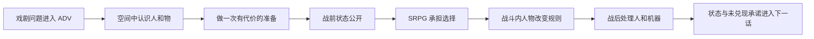
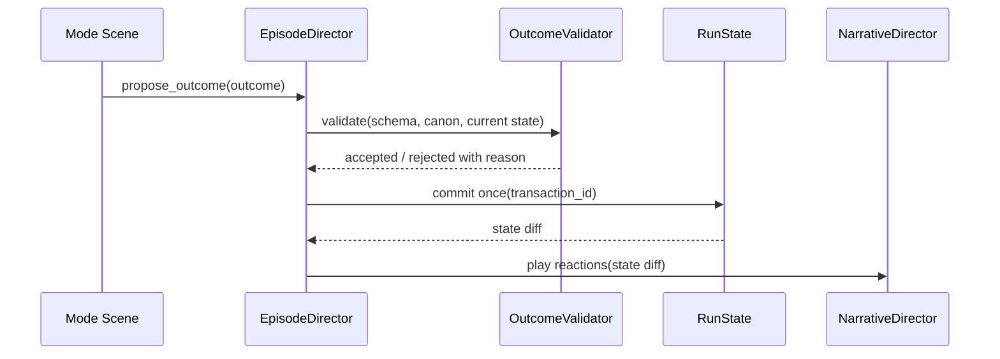

# 《超GAG机器人大战》多玩法统一实现架构 v1

> 状态：候选实现架构，供 C01 可玩切片验证。  
> 日期：2026-07-13。  
> 适用范围：Godot 运行时、单话制作拆分、探索/副玩法、SRPG、关系与结算的联合实现。  
> 不改变：V35 Canon、C01 场景顺序、馆守 Z 半跪锁定、既有战斗规则、全游戏演出分级数量。  
> 上游依据：`2026-06-22-chao-gag-hybrid-play-experience-design.md`、`2026-06-22-chao-gag-hybrid-content-budget-data-architecture.md`、`2026-06-21-chao-gag-srpg-interaction-design-audit.md`、`2026-07-07-chao-gag-episode-production-layer-split-v1.md`、V35.8/V35.9。

---

## 0. 结论

现在的“多玩法”不应继续按“做八到十五个小游戏”实现，而应改成：

> **一个连续的戏剧状态图，四套可复用交互引擎，六种玩家可见的场景形态。**

玩家看到的六种形态是：

1. 动态漫画 / ADV。
2. 人尺度空间探索。
3. 万机馆运营、整备和计划界面。
4. 章节定制短玩法。
5. SRPG 战术战斗与战斗演出。
6. 笔记本、日常关系与战后结算。

程序真正维护的核心引擎只有四套：

1. `NarrativeDirector`：动态漫画、ADV、地图对话、战斗内对话、日常事件。
2. `SpatialActivityEngine`：馆内走动、残响深潜、疏散、舰外抢修等空间型玩法。
3. `ConstraintActivityEngine`：开馆、路线规划、谈判、派遣、分镜、归档等约束型玩法。
4. `TimingActivityEngine`：修复、同步、合体锁、节奏打断、短反击等时机型玩法。

SRPG 继续使用独立的 `TacticalBattleEngine`。从工程分类看它是第五套系统；从产品结构看，它不是“副玩法引擎”，而是全作主冲突承载层，所以单列。

所有模式只通过一套事务式结果合同修改游戏状态。任何玩法都不能直接改另一玩法内部数据，也不能私自改变 Canon 结局。

---

## 1. 为什么旧方案不能直接实现

2026-06-22 的旧多玩法方案有正确的核心：探索、开馆、修复必须回流 SRPG；失败应有尊严；万机馆不能只是菜单。但它和当前项目已产生四处漂移。

| 漂移 | 旧方案 | 当前项目 | 实现风险 |
| --- | --- | --- | --- |
| 章节结构 | 十二章应用表 | V35 为十八章、95 作者槽 | 旧活动排班不能直接当正式排班 |
| 生产结构 | SRPG + 经营 + 深潜 + 小玩法 | 单话已有 A-F 六层制作拆分 | 再建一套流程会重复且互相打架 |
| 关系表达 | `relationship +1`、家感、信任数值 | 当前要求角色从欲望、恐惧、行为和承诺生长 | 容易把“感动”再次做成累计值 |
| 工程模板 | 首批八套玩法模板 | 当前 Godot 连基础模式切换仍需重构 | 同时开八套会放大 UI、资产和测试债 |

当前 Demo 的 `RunState` 也暴露了同一问题：

```gdscript
var relationships := {"qihai": 0, "doudeng": 0, "guardian": 0, "audience": 0}
var map_objects := {
    "message_wall": {"emotional_weight": 0}
}
```

这种结构能做 smoke test，却不能承载真实人物关系。七海和纪存之间重要的不是“好感 2”，而是：

- 她是否给过三分钟未记录窗口。
- 纪存是否利用过这次例外伤害她。
- 她是否承认流程完整但不等于正确。
- 两人目前是否拥有直接通讯权限。
- 哪一方欠另一方一次解释、一次救援或一次公开承担。

因此需要升级运行时架构，而不是在旧 Demo 上继续加模式字符串。

---

## 2. 多玩法的真正产品结构

### 2.1 一分钟内的微循环

所有模式都使用同一套心理节奏：

```text
看懂局面
  -> 形成意图
  -> 预览后果
  -> 做出承诺
  -> 看见具体反馈
  -> 人物和世界回应
```

区别只在于“局面”和“承诺”的形态：

| 模式 | 玩家读什么 | 玩家承诺什么 | 立即反馈 |
| --- | --- | --- | --- |
| ADV | 人物情绪、物件、权力关系 | 回答、沉默、打断、交付 | 对方行为和场面走向 |
| 探索 | 空间、NPC、热点、出口 | 去哪里、先帮谁、带走什么 | 场景变化、线索、关系动作 |
| 运营/计划 | 人手、设施、期限、风险 | 谁负责、什么先修、哪条路放弃 | 设施与人员状态 |
| 短玩法 | 机械反馈、节拍、约束 | 调整、修复、截断、保留缺陷 | 机体/物件的可见状态 |
| SRPG | 地图、意图、目标、回合 | 移动、攻击、保护、撤退 | 战局与剧情事件 |
| 结算/日常 | 损伤、承诺、未完成事项 | 如何记录、向谁解释、先处理谁 | 下一话可读状态 |

这保证玩家学习的是一种《超GAG》的交互语言，而不是每到新章重新猜小游戏规则。

### 2.2 单话循环

单话不是固定把六层全部走一遍，而是由一个有因果的 `EpisodeGraph` 组织：



一话可以跳过某层，但必须写明 `skip_reason`。例如纯听证话可以没有 SRPG，纯撤退战可以没有自由探索；不能因为程序没做就假装该层不存在。

### 2.3 章节和全剧循环

章节层只保存三类东西：

1. **物理后果**：谁受伤、哪台机体失去什么、哪个区域还能使用。
2. **社会后果**：谁拥有权限、谁被停职、谁公开承担、哪个共同体还愿意开门。
3. **未完成关系**：承诺、误解、欠债、拒绝、尚未说出口的真话。

资金、维修件等资源可以存在，但不能替代以上三类状态。全剧的情感厚度来自玩家反复遇见这些后果，而不是“家感 83”。

---

## 3. 六种场景形态，四套副玩法引擎

### 3.1 动态漫画 / ADV：叙事导演

`NarrativeDirector` 不是普通文字框。它负责同一台本在不同空间的呈现：

- 动态漫画：大幅构图、分格、推拉、遮罩、声画停顿。
- 标准 ADV：背景、左右角色、说话者高亮、表情与动作。
- 探索对话：保留场景空间，角色立绘只在需要时进入。
- 战斗通讯：不夺走地图阅读，短句、头像、触发后立即回到战局。
- 战斗演出对白：Cut-in 与机体动作同步。
- 舰内日常：允许沉默、动作、物件和多人走位，不只轮流发言。

同一段内容的权威来源是 `DialogueBeat`，呈现方式由 `presentation_profile` 决定，避免复制六份台词。

### 3.2 空间型玩法：一套移动内核，多种场景规则

`SpatialActivityEngine` 统一处理：

- 连续行走、跑步、朝向、热点距离判定。
- 房间和局部区域切换。
- NPC 的站位、巡逻、注视和阻挡。
- 扫描、拾取、搬运、护送、撤退。
- 风险条：烟雾、信号、氧气、噪声、结构稳定度。

它可以被内容配置成：

| 玩法表面 | 共享能力 | 章节定制规则 |
| --- | --- | --- |
| 万机馆探索 | 走动、调查、房间切换 | 闭馆路线、观众确认、0号异响 |
| 残响深潜 | 走动、扫描、带回物 | 信号衰减、容量、版本切换 |
| 城市疏散 | 走动、标记、护送 | 火线、群众路径、巨机危险区 |
| 舰外抢修 | 移动、互动、搬运 | 磁靴、系绳、碎片、外甲状态 |

重点不是换皮，而是“移动、选择路径、与世界发生身体关系”这一核心动词保持一致。

### 3.3 约束型玩法：同一块决策板，不同语义

`ConstraintActivityEngine` 处理所有“有限资源下安排对象”的玩法：

- 节点、卡片、岗位、角色、物件和路线。
- 相容/冲突约束。
- 可预览的风险和收益。
- 一次提交与可撤销预览。
- 时间压力可选，而不是默认倒计时。

可承载：

| 旧模板 | 新引擎配置 |
| --- | --- |
| 开馆服务 | 展岛槽 + 岗位槽 + 访客需求 |
| 谈判合规 | 证据槽 + 承诺槽 + 对方红线 |
| 路线规划 | 地点节点 + 交通边 + 优先队列 |
| 舰内调度 | 设施节点 + 人员能力 + 火线传播 |
| 支援派遣 | 任务槽 + 角色意愿 + 风险 |
| 分镜排序 | 场面卡 + 因果锁 + 禁改锚点 |
| 战后归档 | 记录槽 + 公开范围 + 署名/损伤标记 |

玩家在 C01 学会“把有限的人和权限放到正确的位置”，C05 便能自然理解撤退规划，C11 也能理解舰内灾害调度。

### 3.4 时机型玩法：机械触感，不做完整动作游戏

`TimingActivityEngine` 处理：

- 单条或多条动态曲线。
- 输入窗口、保持、释放、切换焦点。
- 机械反馈、声音和局部动画。
- 宽容的评价区间和软失败。

可承载修复、重心校准、同步压差、合体锁、节奏打断和一屏反击。不同活动不是只换贴图，而是选择不同的曲线规则：

- 修复：读热量和接触反馈，正确时刻停手。
- 重心：持续微调，不追求完美中心。
- 同步：不让任何一方被压成同一条线。
- 合体：确认次序和停机权，不是手速考试。
- 节奏打断：辨认哪一拍有害，而非全曲打满分。
- 反击：忍住不抢攻，在对方过伸时一次回应。

### 3.5 SRPG：主冲突承载层

SRPG 不只读取“小玩法加成”，而要把前面的选择变成局面差异：

- 玩家在探索中认识的对象成为地图目标。
- 路线规划直接改变地图入口、撤退点和拥堵。
- 修复结果改变机体可执行动作或风险，不只改攻击力。
- 谈判结果生成限制条件、观察员或公共支援。
- 关系状态改变谁愿意出击、谁会违令、谁能打断错误指令。
- 战斗结果反过来损坏空间、关系和运营条件。

因此接口的重点是 `BattleSetupPatch` 和 `BattleOutcome`，不是传统的 buff 列表。

### 3.6 笔记本、日常与结算：玩家理解世界的操作台

纪存的笔记本不是把全部信息塞进 HUD，而是一个独立场景，承担：

- 当前任务和已知风险。
- 人物之间已发生的承诺、权限和裂痕。
- 机体身体状态、维修决定和拒绝动作。
- 馆藏、展签、影像和战后记录。
- 玩家刚才的行为如何进入下一阶段。

日常事件从这里或万机馆空间中触发，但不是“送礼菜单”。它们要回收战斗后的身体和关系：谁给谁上药、谁避开了谁、谁把损坏的普通物件放回原处、谁仍然拒绝解释。

---

## 4. 统一因果合同

### 4.1 不再用万能 `variable_delta`

旧 `HybridActivityResult` 允许资源、变量、压力、旗标、战斗修正混在一个字典里。原型阶段方便，长期会产生无法追踪的字符串网络。

新版建议拆成：

```text
ActivityOutcome
  identity
    activity_instance_id
    source_episode_node_id
    source_canon_refs[]
    resolution_grade

  facts[]
    fact_id
    from_state
    to_state
    evidence_id

  physical_changes[]
    target_entity_id
    component_id
    condition

  social_changes[]
    authority / promise / debt / refusal / disclosure

  battle_setup_patches[]
    declared schema only

  presentation_context[]
    line tags / cut-in tags / visible reminders

  deferred_consequences[]
    trigger window + recovery path

  player_summary[]
    concrete language, no internal variable names
```

### 4.2 状态分为五层

| 层 | 示例 | 生命周期 | 是否直接显示数字 |
| --- | --- | --- | --- |
| 世界事实 | 0号异响已听见、火警已触发 | 永久或跨章 | 否 |
| 身体状态 | 馆守 Z 半跪、右臂过热、跌跌膝部松动 | 跨场景/跨话 | 条件化显示 |
| 社会状态 | 七海停职、纪存持有临时闭馆权 | 跨话/跨章 | 否 |
| 关系状态 | 欠一次解释、允许直连、拒绝出击 | 跨话/路线 | 否 |
| 战术状态 | 入口、目标耐久、敌方意图可见 | 单场战斗 | 是，必须清楚 |

资源属于辅助层，可以有数值；人物、承诺和伤口不应折算成同一根好感条。

### 4.3 关系状态使用“边”而非分数

```text
RelationshipEdge
  edge_id
  subject_id
  object_id
  kind: promise | trust_permission | attraction | wound | debt | rivalry
  state: offered | accepted | strained | broken | repaid | unresolved
  origin_event_id
  witnessed_by[]
  gameplay_permissions[]
  next_pressure
```

示例：

```text
Qihai -> Jicun
kind: trust_permission
state: offered
origin: C01 three-minute-unlogged-window
gameplay_permission: keep_exit_log_visible
next_pressure: Jicun uses it without making Qihai the scapegoat
```

这比 `qihai +1` 更能产生真实对白、支援和后续冲突。

### 4.4 每次提交都是事务

模式只能发出候选结果：



这样可以防止：

- 跳过演出时重复伤害或重复台词。
- 重进场景时再次领取结果。
- 一个小游戏直接把角色设置为“已和解”。
- 存档读取后同一事件执行两次。

---

## 5. Godot 运行时架构

### 5.1 推荐结构：共享内核，独立模式场景

```text
game-godot/
  autoload/
    game_kernel.gd
    content_registry.gd
    save_service.gd
    audio_director.gd

  scripts/core/
    episode/episode_director.gd
    episode/episode_graph.gd
    state/run_state.gd
    state/state_transaction.gd
    state/outcome_validator.gd
    narrative/narrative_director.gd
    activity/spatial_activity_engine.gd
    activity/constraint_activity_engine.gd
    activity/timing_activity_engine.gd
    battle/...

  scenes/modes/
    narrative/
    explore/
    operation/
    activity/
    prebattle/
    battle/
    settlement/
    notebook/

  content/episodes/c01/
    episode_manifest.json
    graph.json
    dialogue.json
    activities.json
    battle_setup.json
    reactions.json
```

关键是“独立模式场景”。当前 `kernel_chapter_demo_scene.gd` 同时绘制探索、对话、笔记本和战斗，已经接近巨型 God Object。它可以保留为旧回归样板，但不应继续成为商业体量的主场景。

### 5.2 `EpisodeDirector` 只做编排，不做玩法

职责：

- 读取 `EpisodeGraph`。
- 激活当前节点对应的场景。
- 传入只读上下文。
- 接收 `ActivityOutcome` 或 `BattleOutcome`。
- 事务提交后选择下一节点。
- 在模式边界建立自动存档。
- 向笔记本提供可读状态摘要。

它不负责角色移动、战斗伤害、卡片拖放或台词绘制。

### 5.3 模式场景统一生命周期

```gdscript
class_name PlayMode

signal outcome_proposed(outcome)
signal exit_requested(reason)

func enter(context: ModeContext) -> void:
    pass

func suspend() -> ModeSnapshot:
    return ModeSnapshot.new()

func resume(snapshot: ModeSnapshot) -> void:
    pass

func can_exit() -> bool:
    return true

func request_skip() -> void:
    pass
```

每个模式必须具备：进入、暂停、恢复、取消/退出、跳过策略和结果提交。这样才能保证状态都能进能退。

### 5.4 输入语法保持一致

| 意图 | 键鼠 | 手柄 | 所有模式含义 |
| --- | --- | --- | --- |
| 导航 | 方向键 / 鼠标移动 | 左摇杆 | 移动焦点或人物 |
| 确认 | Enter / 左键 | A | 预览后的承诺 |
| 取消 | Esc / 右键 | B | 返回上一个可撤销状态 |
| 信息 | I | Y | 打开当前对象信息 |
| 笔记本 | N | View | 独立笔记本场景 |
| 跳过演出 | 长按 C / 指定键 | Start 长按 | 只跳呈现，不跳结算 |

同一键不能在探索中是“调查”，到战斗里突然变成“立刻结束回合”而没有上下文提示。

### 5.5 存档边界

自动存档只发生在稳定边界：

- 模式进入前。
- 事务提交后。
- 战斗回合开始。
- 战斗结束结算后。

动态漫画镜头中、伤害演出中、拖放未提交时不写正式存档；需要临时恢复时保存 `ModeSnapshot`，不写入永久状态。

---

## 6. 内容作者怎样制作一话

每话仍先写可读剧情，再生成运行时包。

### 6.1 作者层

1. Reader Synopsis：故事是否好看。
2. A-F 制作拆分：这一话哪些层存在。
3. Scene/Beat 表：人物、物件、欲望、阻碍、转折。
4. Gameplay Contract：玩家具体做什么、失败怎样继续。
5. Clear State：下一话读取什么。

### 6.2 编译层

TSV/Markdown 不由 Godot 运行时直接解析。构建脚本把已通过检查的内容编译成稳定 JSON：

```text
canon + pressure board + episode production split
  -> content validator
  -> episode bundle JSON
  -> Godot ContentRegistry
```

这样文档仍适合编剧和审稿，运行时只吃确定的 ID、枚举和合同。

### 6.3 每个玩法节点必须回答七个问题

1. 玩家此刻是谁，以什么身体或权限行动。
2. 他看见什么具体局面。
3. 他能预览哪些后果。
4. 哪一步是不可撤销承诺。
5. 失败后如何继续且留下什么疤。
6. 哪个角色会因结果改变行为。
7. 后续 SRPG 或日常场景怎样让玩家看见这件事没有白做。

答不出其中任何一项，就不是可制作玩法，只是文档里的主题愿望。

---

## 7. C01 作为第一份验证样板

### 7.1 切片定位

C01 当前 10–15 分钟切片不是完整 Episode，也不替代冻结的 V35.10。它验证的是一条局部但完整的因果链：

```text
动态漫画看见危机
  -> ADV认识当事人
  -> 空间探索摸到三种准备证据
  -> 选择一种行动优先级
  -> 战前明确显示改变
  -> 短战棋要求玩家利用该改变
  -> 馆守 Z 半跪防卫演出
  -> 战后由人物和机体状态回收
```

### 7.2 建议时长

| 段落 | 内容 | 目标时长 |
| --- | --- | ---: |
| 动态漫画 / ADV | S01-S02 压力摘要，不改 Canon 顺序 | 2-3 分钟 |
| 局部探索 | 主展厅三个相关热点，不要求全调查 | 3-4 分钟 |
| 准备选择 / 战前 | 三种行动优先级与后果预览 | 1-2 分钟 |
| 短 SRPG | 3 回合、位置/目标优先级/意图理解 | 4-6 分钟 |
| 演出与战后 | 馆守 Z 防卫、状态回收、下一压力 | 1-2 分钟 |

总计约 11-17 分钟；熟练玩家约 10-12 分钟，首次阅读约 13-15 分钟。

### 7.3 探索不做“搜齐三点才能推进”

三个热点是三种认知路径，调查任意一个即可获得相应准备方案；调查更多只增加理解和可选项，不把推进变成清单：

| 热点 | 人物/物件动作 | 解锁方案 | 战斗可见后果 | 演出台词变化 |
| --- | --- | --- | --- | --- |
| 兜灯安全锁 | 她用手背试温并赶纪存离开胸牌下方 | `safety_lock` | 馆守 Z 低热量防卫更稳定 | 兜灯先报温度和停机线 |
| 孩子与撤离线 | 小满让鞋先过去，阿澄重新数人 | `evac_route` | 撤离目标更靠近安全区或多一格余量 | 旧守护者优先广播跟随路线 |
| 0号侧廊异响 | 先听见异响，之后通讯台才可接入七海 | `intent_trace` | 封存无人机意图和目标优先级提前公开 | 七海提示执行线而非自报百科 |

三条路线进入同一 Canon 结局，但不是同一个体验。玩家在战斗里必须使用自己选的那条优势，否则它只是一句假选择。

### 7.4 战前状态不是装备菜单

战前画面只显示：

- 当前要保护的两件具体对象。
- 馆守 Z 仍处于半跪、低热量、受限支援状态。
- 跌跌和机器狗可执行的动作。
- 已选准备方案带来的一个规则差异。
- 敌方已知意图与未知项。

不显示等级、刷装、复杂成长或几十项参数。

### 7.5 短战棋的戏剧任务

这场战斗应证明：

1. 玩家看得懂封存无人机下一步要做什么。
2. 不可能同时挡住所有威胁，必须决定谁先处理。
3. 跌跌和机器狗不是弱化版巨机，而是能占位、引导和切断执行链的小型单位。
4. 馆守 Z 不能站起来，却能用半跪身体改变空间。
5. 演出结果由战斗结算先确定，`full / short / off` 只改变观看长度。

### 7.6 战后回收

战后不显示“万机馆家感 +1”，而显示：

- 小满是否需要重新贴那张纸。
- 七海是否保留了出口日志，或只留下普通通讯口。
- 兜灯是否允许馆守 Z 继续低热运行。
- 馆守 Z 的右臂、胸牌温度和半跪状态。
- 玩家选择的方案实际救了什么，也放弃了什么。
- 下一段 Canon 压力是什么，而不是提前演完断臂事件。

---

## 8. 资产与界面复用策略

多玩法的成本控制不能靠把所有东西画成同一个网页，而要靠共享空间、角色和状态资产。

### 8.1 同一地点的三种分辨率

每个重要地点建立：

1. `establishing`：ADV / 动态漫画的大构图。
2. `explore`：人尺度可走动的局部场景。
3. `tactical`：SRPG 使用的棋盘化空间。

三者共用门、展柜、吊轨、留言墙等稳定 ID。玩家会认出“刚才走过的地方变成了战场”，美术也不需要每种玩法从零设计世界。

### 8.2 同一机体的资产梯度

- 地图 Sprite：阅读局面。
- 标志 Pose：关键动作和收藏。
- Cut-in：角色决定与机体反应。
- 少量视频：只用于高等级演出，不成为运行依赖。

视频缺失时仍由 Pose + Sprite + FX 完成同一结算。多玩法场景不能依赖视频才能继续。

### 8.3 UI 共用设计语言，不共用布局

共用：字体、颜色语义、边框、音效、选择焦点、确认/取消动画。  
不共用：探索 HUD、战棋 HUD、ADV 对话框、运营决策板的空间布局。

“统一美术”不等于“所有模式都在同一个右侧栏里”。

---

## 9. 测试与验收

### 9.1 状态合同测试

- 每个 `EpisodeGraph` 节点至少有一个合法出口。
- 每个可取消状态都有返回目标。
- 每个事务 ID 只能提交一次。
- 任意演出跳过不改变结算次数。
- 存档重载后不会重复奖励、重复对白或重复伤害。
- 软失败必有恢复路径和玩家可读后果。

### 9.2 模式切换测试

至少覆盖：

```text
ADV -> Explore
Explore -> Dialogue -> Explore
Explore -> Preparation
Preparation -> PreBattle
PreBattle -> Battle
Battle -> Presentation -> Battle
Battle -> Settlement
Settlement -> Notebook / Next Node
```

每次切换检查输入焦点、鼠标捕获、HUD 可见性、音乐层、暂停状态和存档边界。

### 9.3 内容体验测试

测试者应能回答：

1. 我刚才为什么从探索进入战斗。
2. 我在战前做的选择具体改变了什么。
3. 战斗目标对应的是我认识过的谁或什么。
4. 战斗后哪段关系或机体状态发生了变化。
5. 即使没调查所有热点，我为什么仍能推进。

任何一项答不上来，说明多玩法仍是拼盘。

---

## 10. 从当前 Demo 迁移的顺序

### M0：保留旧 Demo

把现有 `kernel_chapter_demo` 留作旧回归场景，不在其上继续无限加模式。

### M1：先抽状态和事务

- 将 `RunState` 从数值好感/任意 flags 升级为分层状态仓。
- 新增 `StateTransaction` 和幂等提交。
- 战斗演出结算接入事务 ID。

### M2：建立 `EpisodeDirector`

- 用数据图控制节点。
- 先接 Narrative、Explore、PreBattle、Battle、Settlement 五个场景。
- 先不做完整管理和深潜。

### M3：用 C01 验证一条因果链

- 实现三个探索方案。
- 让准备方案改变战前、战斗和战后至少各一次。
- 馆守 Z 演出 full/short/off 共用同一结果。

### M4：抽出第一套约束型活动

以 C01 准备选择为最小 `ConstraintActivityEngine`，后续扩展到路线、开馆和谈判，不另写三套 UI 逻辑。

### M5：再引入时机型与深潜变体

等 C01 的模式切换、存档、状态回收和 SRPG 闭环稳定后，再做修复时机和残响深潜。否则新增玩法只会放大当前架构问题。

---

## 11. 三种工程路线

### 路线 A：共享内核 + 独立模式场景

优点：模式体验能各自成立；状态、存档、输入和内容仍统一；最适合 Godot 和当前项目。  
代价：需要先重构 `EpisodeDirector` 和场景切换。  
建议：**采用，并先用 C01 切片验证。**

### 路线 B：继续扩展当前单场景巨型状态机

优点：短期加一个按钮很快。  
代价：地图被 UI 遮挡、模式状态互相污染、对话/战斗输入冲突、测试组合爆炸；现有 Demo 已经证明其上限。  
建议：只保留作旧回归，不再作为正式骨架。

### 路线 C：每个小游戏完全独立成子项目/插件

优点：团队可并行，玩法隔离强。  
代价：输入、美术、存档、状态和版本整合成本最高；当前单人/Codex 主导开发不合适。  
建议：暂不采用。未来只有某一玩法大到足以独立生产时再评估。

---

## 12. 当前建议

1. 将旧“十二章多玩法排班”保留为历史素材，不再作为当前正式章节表。
2. 保留旧活动目录里的创意，但把十五种模板归并到空间、约束、时机三类副玩法引擎。
3. SRPG、NarrativeDirector、笔记本/结算作为独立主系统，不塞入小游戏 Host。
4. 关系从数字好感迁移为承诺、权限、伤口、吸引、债与拒绝等状态边。
5. C01 只验证一条完整因果链，不借机一次性实现经营、深潜、修复、谈判和全部管理功能。
6. C01 验收通过后，再决定这套架构是否提升为项目正式生产标准；当前只作为候选实现架构。

最重要的体验判据只有一句：

> 玩家不该说“我刚玩完一个小游戏，拿到战斗加成”；他应该说“我刚才在馆里做的那件事，真的跟着我进了战场，而且有人记得”。
