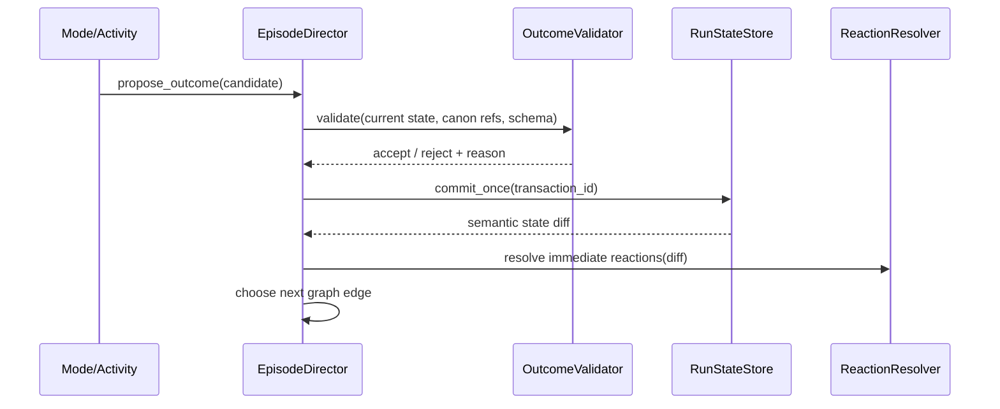

# 《超GAG机器人大战》多玩法实现蓝图 v2

> 状态：候选实现蓝图；M1-M6 已通过自动化运行验证，Windows x86_64 导出制品、手柄输入代码路径与回执 v2 平台验收工具已通过；Windows 真机、实体手柄、真人盲测和正式 Episode 内容验收未完成。  
> 日期：2026-07-14。  
> 目的：把现有“多玩法统一因果运行时”从概念架构推进到可连续制作、可保存、可测试、可复用的 Godot 工程方案。  
> 继承：`2026-07-13-chao-gag-multi-play-runtime-architecture-v1.md`。  
> 不改变：V35 正式进度、既有 Canon 场景顺序、馆守 Z 18 米/半跪/低热限制、正式 SRPG 规则、已批准美术状态。  
> 当前验证对象：`SCN_C01_RM_RESCUE_2P5D_V01` 只是一段局部混合玩法样片，不等于完整 C01 Episode，也不等于多玩法架构已经验收。
> 实现回执：`production/multi-play-runtime/m1-m3-implementation-status-v1.md`、`production/multi-play-runtime/m4-tactical-implementation-status-v1.md`、`production/multi-play-runtime/m5-constraint-implementation-status-v1.md`、`production/multi-play-runtime/m6-second-episode-timing-implementation-status-v1.md`、`production/multi-play-runtime/m6-narrative-desk-production-shell-implementation-status-v1.md`。回执只记录工程事实，不改变 V35 正式进度或剧情候选状态。

---

## 0. 核心判断

多玩法不能以“经营、探索、修复、谈判、音游、格斗各做一套”为实现单位，也不能只靠把这些玩法放进同一个场景来显得连续。

真正的实现单位应是：

```text
一个具体戏剧问题
  + 玩家此刻拥有的身体/权限
  + 一组可反复学习的核心动词
  + 一次不可撤销承诺
  + 一个会被后续人物、空间和战斗再次读到的结果
```

因此，v2 将结构收敛为：

> **四种玩家权能模式 + 三类可组合活动语法 + 一个 SRPG 战术内核 + 一套事务式因果状态。**

玩家仍会看见 ADV、探索、计划、修复、深潜、战棋、笔记本和日常等丰富形态；程序不为每个名词各造一套游戏。

---

## 1. 现有 v1 的正确部分与未解决部分

### 1.1 应保留的设计

1. 玩法必须回流人物、空间、机体和 SRPG，而不是只发资源。
2. `ModeScene` 应独立，不再扩张一个同时绘制所有模式的 God Object。
3. 所有结果经事务提交，跳过演出不能重复结算。
4. 关系使用承诺、权限、伤口、吸引、债和拒绝，不用万能好感度。
5. 同一地点应有 `establishing / explore / tactical` 三个尺度视图。
6. 每种玩法都必须有软失败和后续消费点。

### 1.2 仍然容易拼盘的原因

v1 同时使用了“六种可见场景”“四套副玩法引擎”“独立 SRPG”和“笔记本/结算”等分类。它适合解释产品全貌，但直接拿去写代码会产生三个问题：

- **呈现形态与玩家权能混在一起。** 动态漫画和 ADV 只是同一叙事权能的不同镜头配置；修复和同步也可能只是同一时机活动的不同规则。
- **场景切换粒度不清楚。** 若每次对白、修复、调查都换场景，游戏会被切碎；若全部塞进一个场景，又会回到当前 989 行控制器的局面。
- **“回流”容易退化成加成。** 玩家做过的事若只在战前显示 `+1 格`，人物不记得、地图不改变、结算不追问，因果仍然是假的。

### 1.3 当前 Godot 样片证明了什么

`c01_real_machine_rescue_validation.gd` 已证明：

- 同一 2.5D 房间内可以连续走动、调查、进入局部战术、播放馆守 Z 演出并进入七海审计。
- 演出 full/skip 可以共享语义结果。
- 几何占位美术、正式机体 Pose 和 UI 能在一个样片里共存。

它尚未证明：

- `EpisodeDirector` 能在多个独立 ModeScene 间编排一整话。
- 模式切换后的输入、音乐、镜头、存档和暂停能可靠恢复。
- 探索结果能进入正式 `TacticalBattleEngine`，战斗结果再回到空间与人物。
- 笔记本能从同一状态源生成可读记录。
- 第二话、第二地点、第二机体能复用同一框架。

所以当前样片应保留为一个 **Spatial Incident 节点**，不应继续长成整章总控。

---

## 2. 四种玩家权能模式

“模式”不按画面命名，而按玩家此刻能做什么命名。

| 权能模式 | 玩家此刻是谁 | 核心动词 | 典型呈现 | 不承担 |
| --- | --- | --- | --- | --- |
| `NARRATIVE` | 见证者/对话参与者 | 看、听、回应、沉默、打断、交付 | 动态漫画、ADV、地图对话、战斗通讯 | 自由空间移动、复杂计划 |
| `SPATIAL` | 具体身体/小型机器人/机体局部 | 走、靠近、观察、搬、护送、撤退 | 万机馆探索、残响深潜、舰外抢修、疏散 | 回合制巨机战、全局资源排程 |
| `TACTICAL` | 小队指挥权与具名单位 | 选单位、移动、行动、保护、撤离、结束阶段 | SRPG 棋盘、战斗内剧情、战斗演出 | 自由走路、长篇资料整理 |
| `DESK` | 纪存或主角团的组织权限 | 比较、安排、承诺、归档、复盘 | 万机馆运营、计划板、整备、笔记本、结算 | 实时移动、战斗动作 |

### 2.1 为什么不是六个主模式

- 动态漫画、标准 ADV、场内对白和战斗通讯都由 `NarrativeDirector` 以不同 `presentation_profile` 呈现。
- 开馆、谈判、路线规划、派遣、归档和笔记本共享“在有限信息下安排并承担”的桌面权能。
- 深潜、疏散、抢修和馆内探索共享“用一个身体进入空间”的权能。
- 修复、同步、分镜、合体锁等不是全局模式，而是被主模式托管的短活动。

这让玩家看到丰富变化，工程只维护四套稳定的输入、镜头、暂停和 UI 边界。

---

## 3. 三类活动语法

活动语法是可插入主模式的短控制器，不拥有永久状态，也不自行决定下一章。

### 3.1 `CONSTRAINT`：约束与安排

适用：开馆、路线、谈判、派遣、分镜、灾害调度、战后归档。

共享组件：

- 槽位/节点/连线。
- 相容和冲突规则。
- 后果预览。
- 可撤销草案。
- 一次正式提交。

它通常由 `DESK` 托管，也可在 `TACTICAL` 战前阶段以轻量形式出现。

### 3.2 `TIMING`：时机与机械反馈

适用：修复、重心校准、同步压差、合体锁、节奏打断、短反击。

共享组件：

- 一到三条动态信号。
- 输入窗口、保持、释放和切换焦点。
- 机械/声音/局部动画反馈。
- 宽容分级与软失败。

它可由 `SPATIAL` 托管，让玩家对着现场物件操作；也可在 `TACTICAL` 演出前作为一次具名动作出现。

### 3.3 `SIGNAL`：扫描、筛选与版本辨认

适用：旧影像修复、索引深潜、远星信号、未来战报取证、残响版本切换。

共享组件：

- 多信号层/过滤器。
- 空间热点或时间片段。
- 异常锁定与证据比较。
- 容量、噪声或暴露风险。

它通常依附 `SPATIAL` 或 `DESK`。加入这一语法比把所有信息玩法都硬塞进“时机条”更有辨识度。

### 3.4 活动不是小游戏弹窗

活动应尽量保留所在场景的身体和物件：

- 在维修角修馆守 Z：镜头推近胸牌，保留兜灯站位和机体呼吸灯，不切到抽象网页。
- 在疏散图上规划路线：地图节点来自玩家刚走过的门和楼梯。
- 在残响中调谐：筛选器覆盖当前空间，玩家仍看得见正在靠近的噪声。

只有活动需要完全不同的空间、时间尺度或输入捕获时，才加载独立 Activity Scene。

---

## 4. 何时留在同一场景，何时切模式

### 4.1 留在同一主场景

同时满足下列条件时，使用场内 `ActivityController` 或 `NarrativeOverlay`：

1. 玩家仍控制同一个身体或同一份权限。
2. 空间尺度没有改变。
3. 活动结束后应回到原位置、原 NPC 站位和原环境状态。
4. 活动不需要独立存档边界。
5. 局部 UI 不会遮蔽完成任务所需的信息。

例如 `SCN_C01_RM_RESCUE_2P5D_V01` 的巡查、白框误分类、跌跌占格、机器犬牵引和低热量审核都发生在同一现实机器区，应该保持房间连续性。

### 4.2 切换主模式

命中任一条件时，交给 `ModeRouter` 切换：

1. 控制身体从人尺度变为巨机小队或反之。
2. 时间粒度从连续秒变为回合/阶段。
3. 玩家权限从现场行动变为全局安排。
4. 需要一个稳定自动存档点。
5. UI 阅读目标与原模式根本冲突。
6. 失败/退出需要独立恢复快照。

> 2026-07-15 实现补充：主模式切换已经加入声明式交接转场。目标节点用 `transition` 记录地点、时间、上一段具体因果和下一段具体责任；`ModeTransitionDirector` 覆盖切换过程，冻结新旧 Mode 并用 blocking input context 阻断笔记本、存档和场景输入。玩家画面不显示模式名或 Graph 术语。M6 五节点已完成自动与 1280×720 像素验证，回执见 `production/multi-play-runtime/m6-mode-handoff-transition-implementation-status-v1.md`。

### 4.3 笔记本的特殊位置

笔记本视觉上是独立全屏场景，运行上是 `ModeStack` 的可暂停覆盖层：

- 只能在稳定状态打开。
- 暂停底层输入和局部计时。
- 不复制任务、人物和线索数据，只读取统一状态生成视图。
- 退出后恢复原模式、相机、焦点和音乐层。
- 战斗演出、伤害结算、不可撤销提交过程中不能强开。

---

## 5. 一话如何真正串成游戏

### 5.1 Episode Graph 不是模式清单

每个节点必须写清“为什么下一步非发生不可”。


真正的连接不是 `mode=A -> mode=B`，而是：

```text
因为玩家在空间中确认了谁还在馆内
所以战前目标能用名字而不是“平民单位”出现
因为玩家选择让跌跌占住某个位置
所以战术地图少一个安全格但多一条撤离路
因为馆守 Z 在低热限制下仍介入
所以七海审计的对象是具体动作、停机权与责任人
```

### 5.2 同一结果至少被消费三次

任何重要玩法选择至少要在三处出现：

1. **立即反馈**：空间、动作、对白或 UI 当场变化。
2. **冲突消费**：战斗布置、单位动作、目标、限制或敌方意图变化。
3. **人物回收**：战后有人记得、质疑、感谢、误解或要求承担。

可选第四次是跨话回响。只有一次战前加成的选择，不足以支撑多玩法的情感价值。

### 5.3 不要求每话走完所有模式

Episode 节点按戏剧需要选用：

- 纯撤退战可从短 `NARRATIVE` 直接进入 `TACTICAL`。
- 听证/作者权利冲突可由 `DESK + NARRATIVE` 承重，没有 SRPG 也必须有可见代价。
- 舰外抢修可由 `SPATIAL + TIMING` 构成完整危机。
- 重大章节可走完整链，但不能把六层做成固定打卡。

未使用层必须写 `skip_reason`，防止制作困难伪装成叙事选择。

---

## 6. 统一状态：让人物和世界真的记得

### 6.1 状态域

```text
RunStateStore
  world_facts
  entity_conditions
  authority_states
  relationship_edges
  promises_and_debts
  inventory_and_resources
  episode_memory
  tactical_snapshots
```

其中只有资源和战术量适合直接显示数字。关系、伤口和权限以具名状态显示。

### 6.2 `ActivityOutcome`

```json
{
  "transaction_id": "C01E01:RM_RESCUE:FALL_POSITION:V01",
  "source_node_id": "C01E01-RM-R2",
  "resolution": "costly_success",
  "facts": [
    {"id": "FACT_DIEDIE_BLOCKS_FALL_LINE_B", "to": true, "evidence": "EV_R2_FALL"}
  ],
  "entity_changes": [
    {"entity_id": "MECHA_DIEDIE", "condition": "knee_joint_strained"}
  ],
  "relationship_edges": [
    {"edge_id": "DIE_DIE_TO_JICUN_STOP_AUTHORITY", "state": "tested_and_obeyed"}
  ],
  "battle_setup_patches": [
    {"patch_id": "PATCH_C01_FALL_LINE_B", "schema": "objective_geometry_v1"}
  ],
  "reaction_requests": [
    {"reaction_id": "REACT_DOUDENG_CHECKS_KNEE", "window": "after_incident"}
  ],
  "player_summary": "跌跌替你占住了坠落线，但它的膝关节松了。"
}
```

### 6.3 提交路径



模式不能：

- 直接修改另一模式的字段。
- 直接把人物设成“和解”。
- 直接决定 Canon 结局。
- 通过演出 Cue 发放第二次结果。

### 6.4 Notebook Projection

笔记本只读取状态并转成可读栏目：

- “现在要做什么”来自活跃 Episode 节点。
- “我知道什么”来自有证据的 world facts。
- “谁对我开放什么”来自 authority/relationship edges。
- “机体为什么拒绝这个动作”来自 entity conditions 与最近反应。
- “还有什么没处理”来自 promises/debts 和 deferred consequences。

这样笔记本不是第二套数据库，也不会出现剧情里没交代、只在笔记本里突然知道身份的问题。

---

## 7. Godot 运行时结构

### 7.1 顶层服务

```text
autoload/
  game_kernel.gd
  content_registry.gd
  run_state_store.gd
  save_service.gd
  input_router.gd
  audio_director.gd

scripts/core/
  episode/
    episode_director.gd
    episode_graph.gd
    episode_node.gd
    mode_router.gd
  state/
    state_transaction.gd
    outcome_validator.gd
    reaction_resolver.gd
    state_projection.gd
  narrative/
    narrative_director.gd
  activity/
    activity_controller.gd
    constraint_activity_controller.gd
    timing_activity_controller.gd
    signal_activity_controller.gd
  battle/
    tactical_battle_engine.gd
```

### 7.2 场景树

```text
GameRoot
  WorldViewport
    ActiveModeHost
  PresentationLayer
    NarrativeDirector
    CinematicDirector
    TransitionDirector
  OverlayLayer
    NotebookHost
    SystemMenu
    Accessibility
  DebugLayer
```

`ActiveModeHost` 同一时刻只拥有一个主模式。活动控制器作为主模式的子节点，笔记本和系统菜单进入 OverlayLayer。战斗演出不替换战斗状态，只暂时接管表现层。

### 7.3 `ModeScene` 生命周期升级

```gdscript
class_name ModeScene

signal outcome_proposed(outcome)
signal transition_requested(target_node_id, reason)

func prepare(context: ModeContext) -> void: pass
func enter(snapshot: Dictionary = {}) -> void: pass
func activate() -> void: pass
func suspend(reason: String) -> Dictionary: return {}
func resume(snapshot: Dictionary) -> void: pass
func can_open_overlay(overlay_id: String) -> bool: return true
func can_exit() -> bool: return true
func request_skip() -> void: pass
func exit() -> void: pass
```

`prepare` 只加载资源；`enter` 建立场景；`activate` 后才接收输入。这样转场时不会出现上一场景仍响应按键、新场景已经开始对话的问题。

### 7.4 `ModeRouter`

职责：

- 异步预载下一个 PackedScene。
- 让旧模式 `suspend/exit`。
- 清除旧输入上下文。
- 交给 TransitionDirector 做遮挡或匹配剪辑。
- 挂载新模式并恢复快照。
- 在稳定边界通知 SaveService。

它不判断剧情下一步；下一节点只由 `EpisodeDirector` 决定。

### 7.5 输入上下文

```text
global: confirm / cancel / info / notebook / pause / skip_hold
narrative: advance / choice_nav
spatial: move / interact / run / scan
tactical: cursor / unit_action / phase_menu / intent_view
desk: focus_nav / compare / preview / commit
activity: activity_primary / activity_secondary / retract
```

进入子活动时，主模式的移动输入被压栈暂停；退出后恢复。禁止每个脚本直接在 `_unhandled_input` 中自行抢同一按键。

---

## 8. Episode 内容包

### 8.1 运行时目录

```text
content/episodes/c01/e01/
  manifest.json
  graph.json
  narrative_beats.json
  spatial_scenes.json
  activities.json
  battle_setup.json
  reactions.json
  settlement.json
```

### 8.2 图节点最小合同

```json
{
  "node_id": "C01E01-RM-INCIDENT",
  "mode": "SPATIAL",
  "scene_id": "SCN_C01_RM_RESCUE_2P5D_V01",
  "entry_conditions": ["FACT_JICUN_HAS_LOCAL_STOP_AUTHORITY"],
  "required_context": ["RM_ROOM_STATE", "DOUDENG_POSITION", "DIEDIE_CONDITION"],
  "completion_contract": "OUTCOME_C01_RM_INCIDENT_V01",
  "transition": {
    "transition_id": "C01-TR-RM-INCIDENT",
    "kind": "pressure_escalation",
    "location": "万机馆 · 现实机器区",
    "cause": "撤离路线被白框切断。",
    "handoff": "亲自确认停机权、失败路径和低热支援边界。"
  },
  "soft_fail_edges": ["C01E01-RM-AUDIT-COSTLY"],
  "success_edges": ["C01E01-RM-AUDIT-STABLE"],
  "skip_policy": "presentation_only",
  "autosave": "before_enter_and_after_commit"
}
```

### 8.3 构建链

> 2026-07-15 实现状态：**候选构建链已验证**。`EpisodeBundleCompiler` 已对 M1、M4、M5、M6 执行 manifest/Graph/scene/activity/battle/Patch 闭包检查，生成带确定性源指纹的自包含 bundle；四个可视入口已改为从 bundle 取得 Graph，活动与战斗优先读取节点内嵌定义。未知场景、未声明资源和无战斗消费者 Patch 均有负例阻断。构建脚本先运行 Canon strict gate，但本能力不提升验证内容的 Canon 等级。实现回执见 `production/multi-play-runtime/m6-content-bundle-build-chain-status-v1.md`。

```text
Canon/Graph + Episode Packet + Production Split + Gameplay Contract
  -> content compiler
  -> schema validation
  -> episode bundle JSON
  -> Godot ContentRegistry
```

Godot 不在运行时解析 Markdown/TSV。Codex 可以继续维护可读文档和机器表，构建脚本负责生成稳定包并报告缺失 ID。

---

## 9. C01 应如何用这套结构落地

### 9.1 当前 2.5D 现实机器样片

保留为一个 `SPATIAL` 节点，内部包含三个受控子活动：

```text
巡查走动
  -> NarrativeOverlay：白框误分类
  -> CONSTRAINT micro-activity：判断失败路径/放置跌跌
  -> SPATIAL action：机器犬牵引
  -> Safety Review：具名占用检查
  -> CinematicDirector：馆守 Z 单次低热输出
  -> NarrativeOverlay：七海四步审计
  -> propose ActivityOutcome
```

这里不需要加载正式 SRPG，因为身体尺度、空间和对象没有变化。它是一场“现场救援活动”，不是“缩小版机战”。

### 9.2 正式 C01 Episode 的多玩法链

正式 Episode 仍应另有：

1. `NARRATIVE`：火灾后短冷开场，再回到三小时前；建立纪存、万机馆日常和浅层清算动机。
2. `SPATIAL`：闭馆路线与可选展岛；玩家认识具体观众、门、留言墙、现实机器和 0 号异响。
3. `DESK/CONSTRAINT`：不是装备菜单，而是选择谁先撤、哪条线路保留、谁拥有停机权。
4. `TACTICAL`：独立保护战，使用正式行动链、敌方意图、增援和地图事件；3回合冻结候选与6回合既有口径在剧情门禁裁决前并存。
5. `NARRATIVE`：馆守 Z/角色在战斗内外的具名反应。
6. `DESK`：伤损、权限、未完成承诺和下一压力进入笔记本与结算。

当前现实机器区样片可以作为第 2 步中的一段高密度事件，不能替代第 4 步正式 SRPG，也不能单独宣称第一话完成。

### 9.3 三准备路线的正确消费

每条路线至少产生以下差异：

| 路线 | 立即空间反馈 | 正式战斗差异 | 人物回收 |
| --- | --- | --- | --- |
| 安全锁 | 兜灯明确停机线，胸牌读数稳定 | 馆守 Z 低热支援窗口稳定，但动作仍受限 | 兜灯允许继续低热，要求纪存承担越线后果 |
| 撤离线 | 玩家亲自确认孩子/观众与出口 | 撤离目标站位、路线或容错变化 | 被救的人能指出是怎样被带走的，不只说谢谢 |
| 意图追踪 | 0 号异响后通讯台才可接入七海 | 封存无人机目标优先级提前公开 | 七海审计玩家如何使用这份信息，而非自我介绍身份 |

---

## 10. UI 与美术实现原则

### 10.1 各模式独立构图

- `NARRATIVE`：人物、物件和镜头是第一层，文本框不重复显示。
- `SPATIAL`：画面至少 75% 留给可走空间；提示靠边、按需出现，不遮挡出口和热点。
- `TACTICAL`：地图、敌方意图、行动状态和预测优先；命令菜单围绕当前单位，不永久压住棋盘。
- `DESK`：可以高信息密度，但必须有比较、预览和一次提交的层次。

统一字体、颜色语义、焦点动画和确认音效，不统一成一个右侧栏模板。

### 10.2 同一地点的资产绑定

```text
LocationAnchor
  stable_object_id
  establishing_asset
  explore_asset_or_tile_set
  tactical_tile_or_prop
  collision_profile
  interaction_anchor
  destruction_state
```

门、展柜、留言墙、吊轨等必须在三种尺度使用同一 `stable_object_id`。玩家才会相信战场就是刚才走过的地方。

### 10.3 资产预算

- 人尺度：四方向 Sprite + 2 到 4 个情绪/动作 Pose。
- 巨机：地图 Sprite + 标志 Pose + 少量 Cut-in；视频不是流程依赖。
- 活动：优先复用场景物件、局部动画、音效和 UI 元件。
- 新活动若需要完整新角色控制器、新镜头体系和新资产管线，应视为新主系统，不能伪装成一章短玩法。

---

## 11. 实施顺序

### M0：锁住当前样片边界

- 完成 `SCN_C01_RM_RESCUE_2P5D_V01` 的性能、跳过、重入和截图验收。
- 不再把正式战斗、笔记本和整章流程继续塞进该 989 行控制器。
- 将其登记为 `SPATIAL incident` 候选，而非正式 Episode。

### M1：先做骨架，不扩玩法

> 2026-07-14 实现状态：**已验证**。`GameKernel`、`EpisodeDirector`、`ModeRouter`、`RunStateStore`、`StateTransaction`、`OutcomeValidator`、`InputRouter` 与 `SaveService` 已进入 Godot 工程，并通过模式切换、覆盖层暂停/恢复、精确存取和事务幂等 smoke test。

实现：

- `GameKernel`
- `EpisodeDirector`
- `ModeRouter`
- `RunStateStore`
- `StateTransaction`
- `OutcomeValidator`
- `InputRouter`
- `SaveService`

用两个空壳 ModeScene 验证切换、暂停、保存、恢复和幂等提交。

### M2：建立四个模式壳

> 2026-07-14 实现状态：**四模式均有实际入口**。Narrative、Spatial、Tactical、Desk 均已有独立 `ModeScene`；Tactical 已由占位壳升级为声明式战术场景，但全游戏菜单、正式美术和内容工具仍未完备。

1. `NarrativeModeScene`
2. `SpatialModeScene`
3. `TacticalModeScene`
4. `DeskModeScene`

先只做 C01 必需功能，不做全游戏菜单。

### M3：把当前样片接成一个 Episode 节点

> 2026-07-14 实现状态：**接线已验证**。验证流程为 `Narrative -> C01 Spatial Incident -> Desk`；从笔记本覆盖层返回现场不会重置位置、重播入口对白或重复提交，样片完成结果已转成统一 `ActivityOutcome` 进入 `RunStateStore`。

- 把局部状态移出大控制器，进入节点上下文和 ActivityOutcome。
- 把对白/演出/局部活动拆成组合组件。
- 完成 `Narrative -> Spatial Incident -> Narrative/Desk` 的实际切换。
- 验证从笔记本返回现场不重置位置、不重复对白、不重复提交。

### M4：接正式 SRPG

> 2026-07-14 实现状态：**适配与回流已验证，正式剧情版本未裁决**。独立 `TacticalModeScene` 已消费声明式 `BattleSetupPatch`，支持敌方意图、单位行动、提前结束阶段、武器/目标/预测、中段事件、胜利、有代价胜利、失败与主动撤离，并以 `BattleOutcome` 返回 Narrative/Desk。3回合冻结候选和6回合既有口径共用同一适配器；这不等于第一话正式战斗版本已经选定。

- 由探索结果生成声明式 `BattleSetupPatch`。
- 独立加载战术场景。
- 战斗结算生成 `BattleOutcome`，回到 Narrative/Settlement。
- 验证敌方意图、全员行动、主动结束阶段、胜败和中段事件。

### M5：做第一个真正可复用活动

> 2026-07-14 实现状态：**`CONSTRAINT` 与 `TIMING` 已验证，`SIGNAL` 未实现**。`ConstraintActivityController` 已用同一份槽位/对象/冲突/预览/撤销/提交规则承载 A008 路线规划、A006 法务谈判、A012 灾害调度和 M6 旧拳王维修分配。`TimingActivityController` 已在旧件市维修棚承载三段身体反馈校准；两项活动可合成为一个事务和两个战棋 Patch，未提交草案可精确存取，四档软结果、拒绝恢复、人物关系回收与重复事务拒绝均通过测试。正式内容验收与 `SIGNAL` 仍未完成。

优先顺序：

1. `CONSTRAINT`：因为 C01 准备选择、后续路线/谈判/调度都能复用。
2. `TIMING`：选择一台不同机体做修复或重心验证。
3. `SIGNAL`：等空间、状态和存档稳定后做残响/索引变体。

### M6：第二地点、第二机体、第二 Episode 复用

> 2026-07-15 实现状态：**自动化运行证明与 Windows 导出制品通过，候选 Narrative/Desk 生产壳通过，正式生产门禁未通过**。`LOC_MODEL_STREET + MECHA_OLD_BOXER_KING + C02E03-MULTI-PLAY-M6-VALIDATION` 已复用同一四模式骨架和事务状态；维修棚连续移动、`CONSTRAINT + TIMING` 复合提交、擂台翻仓库 Tactical、共享人物演出、战后纪存/唐胶关系回收与可比较/预览/承诺的 Desk 形成五节点闭环。M6 场景已统一经由 `InputIntentTranslator -> InputRouter` 接收键鼠/手柄，子活动压栈与 Tactical 阶段菜单二次确认已自动验证；官方 Godot 4.7 Windows x86_64 模板已生成嵌包 EXE。回执 v2 会按设备、输入上下文和节点记录已接受意图，配套 PowerShell 验收器可在 Windows 真机检查制品身份、完整流程、实体手柄、中文字体和布局；工具已就绪但外部回执尚未产生。该图仍标记为 `runtime_validation_only`，不会提升 C02 候选剧情。

架构升级为 Working Canon 前必须同时通过：

- 第二地点不复制 C01 控制器。
- 第二机体使用同一演出/结果合同。
- 第二 Episode 使用同一四模式骨架。
- Windows 真机启动/存档/字体、实体手柄和真人盲测通过（导出制品及输入代码路径已先行通过）。

---

## 12. 验收标准

### 12.1 因果

- 玩家能指出为什么从当前模式进入下一模式。
- 一个重要选择至少有立即、冲突、人物三次可见消费。
- 不调查全部热点仍能推进，但会得到不同理解和局面。
- 软失败改变后果，不把玩家赶回小游戏重考。

### 12.2 工程

- 主模式切换后旧输入、HUD、音乐和计时器全部停止。
- 每个事务 ID 最多提交一次。
- 任意演出跳过与完整播放得到同一语义结果。
- 保存/读取后恢复正确模式、位置、回合和未提交草案。
- 笔记本打开/关闭不重置现场，也不复制状态。
- `EpisodeGraph` 每个节点有合法出口、取消路径和失败路径。

### 12.3 内容与人物

- 角色反应由欲望、恐惧、当下物件和关系历史驱动，不由系统说明需要驱动。
- 身份、浅层动机和现场权限必须在剧情行为中成立，不能只藏在笔记本。
- 关系变化用动作和权限证明，不显示抽象好感条。
- 玩法选择不抢走角色的主体性；玩家决定条件和承诺，角色仍可拒绝、误解或自行承担。

### 12.4 产品

- 一话可以有多种玩法，但玩家回忆时首先说出“发生了什么、我为什么那样做”，而不是“我玩了五个小游戏”。
- SRPG 仍是巨机与主冲突的核心承载层；局部现场活动不冒充正式战斗容量。
- 新玩法主要来自三种活动语法重组；每章原则上不新增主引擎。

---

## 13. 最终建议

采用以下生产口径：

> **四种权能决定场景，三类语法决定短玩法，EpisodeGraph 决定因果，事务状态决定世界记得什么，SRPG 决定主冲突如何付出代价。**

`M1 -> M6` 的第一轮工程验证已经完成：第二地点、第二机体、第二 Episode 图、`CONSTRAINT + TIMING` 复合活动和四个可见消费槽均已通过自动化回归。M1/M4/M5/M6 已由确定性内容 bundle 驱动，源 Graph、活动、战斗、场景、演出资产和 Patch 消费关系会在构建时闭合校验。M6 的开场、人物反应和 Desk 已迁入共享 `NarrativeDirector / DeskWorkbench`，但 Spatial 稳定对象和同物 Tactical 映射仍未生产化。当前最佳下一步不是继续横向增加玩法名词，而是完成体验合同 P2/P3，再用 M6 做真人盲测、Windows 真机和实体手柄验收，确认玩家是否理解并记住“为什么旧拳王漏掉一拍、自己最后留下了哪项责任”。`SIGNAL` 只在这轮认知负担验证后制作。真人/真机/正式内容门禁通过前，本蓝图仍是候选实现方案。
