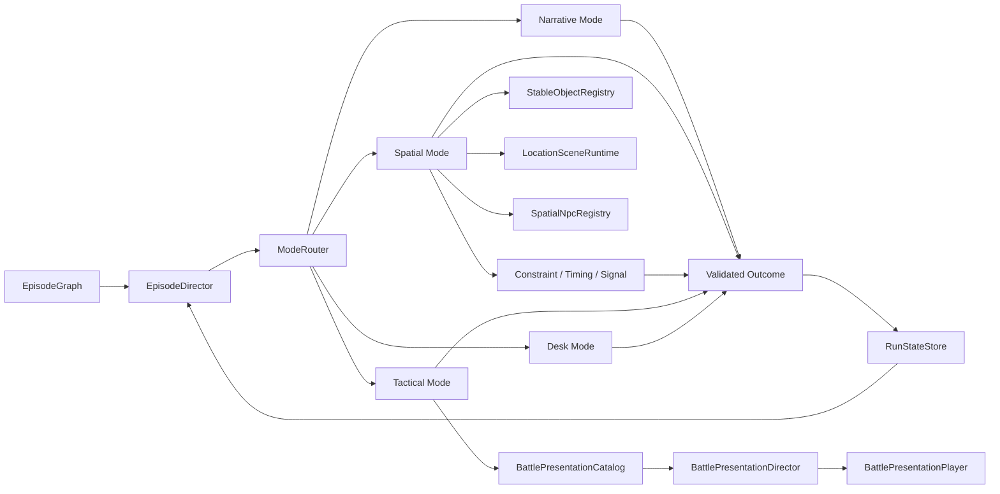

# 《超GAG机器人大战》多玩法状态织网实现蓝图 v1

> 日期：2026-07-15  
> 层级：玩法与运行时生产合同  
> 状态：Working Design，M6 已完成 Candidate Runtime Proof  
> 适用：Episode 企划、剧本拆层、Godot 运行时、战棋、演出、资产清单、测试与跨会话开发

## 1. 结论

本作的“多玩法”不应实现为几个可以从菜单切换、互不相干的小游戏。

正确实现是：

> 玩家围绕同一个戏剧对象，在不同尺度下逐步形成认识、承诺、行动与责任。

主循环只有一条：

```text
人物提出无法回避的问题
-> 玩家在空间中接触具体事物
-> 玩家用局部玩法形成判断或方案
-> 战棋把判断变成公开行动与风险
-> 人物根据行动改变关系和权限
-> 管理界面要求玩家承认剩余代价
-> 未完成责任进入后续 Episode
```

四个主模式是 `NARRATIVE`、`SPATIAL`、`TACTICAL`、`DESK`。`CONSTRAINT`、`TIMING`、`SIGNAL` 等不是第五、第六个独立模式，而是嵌入场景的短玩法语法。

这些模式构成可选的生产语法库，不是每话必须集齐的打卡表。每个 Episode 只选择能让本话 `EpisodeKnot` 发生认识、风险、关系或责任变化的模式；未用层要写明跳过原因。C01E01 因为四令接管在数秒内连续发生，选择 `NARRATIVE -> SPATIAL -> NARRATIVE -> TACTICAL -> NARRATIVE`，以玩家行动完成承诺、以剧情后果完成结算，明确跳过 `DESK`。

## 2. 多玩法的最小戏剧单元

每个 Episode 先定义一个 `EpisodeKnot`：

```text
EpisodeKnot =
  戏剧对象
  + 玩家能立刻理解的问题
  + 至少一条人物主张
  + 一条机体用动作表达的主张
  + 玩家必须作出的承诺
  + 无法全拿的代价
  + 会进入未来的话后责任
```

例如 M6：

```text
戏剧对象：旧拳王机的完整身体，右拳护具只是锚点
问题：修好一台机器人，是否也包括保留它不肯完成的动作？
唐胶主张：不能为了直播把旧伤和迟疑磨平
机体主张：它把拳停住，用拳面承住碎梁和人
玩家承诺：保留原速和身体承力逻辑
代价：右拳、仓门、直播计划无法同时按原方案完成
后续责任：先修哪一项，另一项就进入返场债务
```

若一个玩法不能改变这个 Knot 的认识、风险、关系或责任，它不应进入本话。

## 3. 四主模式与嵌套玩法

| 层 | 玩家此刻做什么 | 核心乐趣 | 必须产生的状态 |
|---|---|---|---|
| `NARRATIVE` | 看、听、回应、判断人物 | 角色魅力、悬念、误读、关系张力 | 当前问题、人物立场、权限、浅层动机 |
| `SPATIAL` | 走动、进房间、看物、与人交谈 | 地方感、发现、物的历史、自由顺序 | `world_objects`、见闻、人物位置、可用 Offer |
| 嵌套玩法 | 排方案、校时、辨信号、装配 | 手感、局部掌握、有限选择 | `activity_results`、Battle Patch、失败继续状态 |
| `TACTICAL` | 移动机体、读意图、选武器、保护目标 | 机体身份、空间压力、战术因果、动画爽感 | 战斗结果、对象损伤、公开行动、机体动作证词 |
| `DESK` | 比较记录、承诺责任、查看债务 | 推理归档、后果理解、长线经营 | 责任、债务、关系/权限变化、未来消费窗口 |

模式之间不是价值递增关系。`SPATIAL` 不是战棋前的找钥匙，`DESK` 也不是结算表。每层都应有自己的乐趣，但都要消费同一状态。

## 4. 同物异义

同一个稳定对象在不同模式中承担不同意义：

| 模式 | 右拳护具的意义 |
|---|---|
| Narrative | 唐胶不肯把它称为“冠军装备”的人物冲突 |
| Spatial | 可触摸的磨损、错误修复痕迹和身体尺度 |
| Constraint | 承力顺序中的一个限制条件 |
| Timing | 动作最后一拍的身体反馈来源 |
| Tactical | 旧拳王右拳组件与武器的来源锚点，不是独立单位 |
| Reaction | 唐胶判断纪存是否真的听懂机器 |
| Desk | 右拳复查或仓门积压之间的责任选择 |

这叫“同物异义”，不是“同一图标在五处出现”。运行时必须保存对象身份、访问次数、已完成 Offer 和已知状态；各模式只读取自己有权解释的部分。

## 5. 共享状态模型

### 5.1 状态分层

```text
RunState
├── world_facts              已公开成立的事实
├── world_objects            稳定对象状态、访问与身体条件
├── entity_conditions        人物和机体的条件、损伤、权限
├── relationship_edges       信任、误读、支持权与关系方向
├── authority_states         谁能命名、开启、维修、公开或指挥
├── promises_and_debts       玩家承诺、代价和未来消费窗口
└── episode_memory
    ├── activity_results
    ├── battle_setup_patches
    ├── battle_outcomes
    ├── player_summaries
    └── presentation_history
```

### 5.2 状态写入原则

1. 模式不能直接篡改其他模式内部控制器。
2. 模式结束时提出一个 `Outcome`，由共享状态仓验证并原子提交。
3. 每个节点只提交一次；拒绝后可以重开同一结果，不可重复记账。
4. 默认失败应可提交，形成损伤、债务或路线变化；只有剧情合同明确规定“世界线尚未越过节点边界”的局部试演，才能用 `retry_without_commit` 回滚。C01E01 三回合撤离属于这一例外：R3 完成前不向 Episode 世界状态提交局部回执。
5. 外部模式只读取被明确公开的状态，不读取角色不可能知道的隐藏元信息。

## 6. 运行时架构



### 6.1 EpisodeGraph

Graph 只负责：

- 节点顺序、条件边和终点；
- 模式权威；
- 进入/离开转场；
- 完成合同；
- 模式声明数据；
- 资产和 Canon 引用。

Graph 不应塞进控制器实现，也不应把“看完所有对话”作为默认推进条件。

### 6.2 ModeRouter 与 EpisodeDirector

`EpisodeDirector` 判断当前节点是否完成以及下一条合法边。`ModeRouter` 只负责激活对应模式、输入上下文和存取恢复。两者不解释人物台词，不计算战斗伤害，也不替 Desk 作责任选择。

### 6.3 Spatial 生产层

`LocationSceneRuntime` 管房间、出生点、Portal、精确返回点和玩家位置。`StableObjectRegistry` 管对象 Offer。`SpatialNpcRegistry` 根据对象状态决定人物在哪、能说什么。`SpatialInteractionDirector` 将对象、NPC、门口统一为一个最近交互动作。

这允许：

- 主场景拆成多个小场景；
- 玩家在小场景中连续行走；
- 回上级房间回到刚离开的门口；
- NPC 因调查结果移动；
- 首轮、重复、条件对话不同；
- 只完成一组足够证据也能推进，不要求清空地图。

### 6.4 嵌套玩法控制器

每种语法只解决一种认知问题：

- `CONSTRAINT`：有限资源怎样分配，哪项责任被推迟。
- `TIMING`：身体节奏、动作差异和手感判断。
- `SIGNAL`：多个来源怎样辨真伪与边界。

控制器输出必须小而结构化，例如分数档、选择、状态变化和 Battle Patch。不能输出一整段剧情结论来取代人物演出。

### 6.5 Tactical 规则层与表现层

规则层负责：

- 单位行动一次后进入 `DONE`；
- 移动、取消移动、武器选择、目标、预测、攻击、待机；
- 玩家可在仍有 READY 单位时主动结束阶段；
- 敌方按可视意图移动或攻击；
- 目标完整度、战中事件、胜败与软撤离；
- 探索对象到单位组件、武器、目标、事件和格位的绑定。

表现层负责：

- 斜 45 度地图单位图；
- READY、MOVED_READY、DONE 可读状态；
- 攻击前预测；
- 可跳过的 Full、Short、Off 演出；
- 机体地图动作、人物 Cut-in、标志 Pose、FX、停顿、震动、伤害；
- 战中事件根据此前状态选择不同演出版本。

两层通过 `last_resolution` 连接。表现层只能展示已结算结果，不反过来偷偷计算伤害。

### 6.6 Desk

Desk 至少包含：

- 本话记录与玩家已知事实；
- 冲突来源对照；
- 对象当前身体/空间状态；
- 人物反应与权限变化；
- 可承担的承诺；
- 明确后果预览；
- 二次确认；
- 后续债务。

Desk 提交的是“我承认接下来要负责什么”，不是选择一句正确总结。

## 7. 状态如何改变战斗

探索不能只给战斗侧栏加一行金字。允许的消费方式包括：

1. 改变单位身体状态或武器可用性。
2. 改变地图阻挡、出生点或保护目标完整度。
3. 提前揭示敌方意图或事件位置。
4. 改变战中事件的动作与损伤。
5. 改变招式演出的动作版本和人物台词。
6. 改变战后人物对玩家行为的解释。
7. 改变 Desk 中必须承担的后续责任。

至少要同时出现“规则变化”和“人物/机体可见反馈”。纯加成没有文学意义，纯台词没有玩法意义。

## 8. M6 已落地的完整例子

### 8.1 Narrative

直播倒计时将旧拳王包装成冠军复活。唐胶关心的是身体能否承受，纪存先注意到动作原速和展演版本不一致。

### 8.2 Spatial

玩家在直播前台、维修内场、零件后仓之间移动。可调查：

- 完整旧拳王身体上的右拳护具；
- 左膝旧轴；
- 原速录像；
- 后仓门报警器；
- 直播终端；
- 唐胶的零件盘。

右拳或膝轴任一身体证据，加录像或仓门任一上下文证据，即可打开维修草案。终端是可选证据，不要求清单全清。

### 8.3 Constraint 与 Timing

玩家先决定维修资源怎样分配，再通过动作节拍辨认“漏掉的一拍”。失败档也可进入战斗，只会带来较差 Patch 或后续责任。

### 8.4 Tactical

旧拳王以完整约 3 米机体上场。右拳护具只绑定右拳组件与承力刺拳。

第二回合拳台翻成仓库：

- 未调查仓门：敌方动作结算后，坍塌再对仓门造成 1 点损伤。
- 已调查仓门：货柜领袖提前抢位，坍塌不再追加仓门损伤。
- 已调查仓门且打开维修草案：进入 `controlled_rescue`，旧拳王左膝落地、右拳顶门；规则与专属演出同时承认此前调查。

若看过原速录像，`漏拍停拳` 的 Full 演出改成原速版本，唐胶会说“别补那一拍”，标志 Pose 与停顿强调拳没有完成。

### 8.5 Reaction 与 Desk

唐胶根据玩家是否保留身体逻辑改变维修信任。Desk 再要求玩家在右拳复查与后仓积压之间承诺先处理哪一项，另一项进入未来消费窗口。

## 9. 资产生产策略

为了达到独立游戏体量而不死磕 SRW 全动画，每台核心机体分四档：

| 档 | 资产 | 用途 |
|---|---|---|
| A | 1 张地图待机图 + 状态染色 | 所有可控/关键敌机最低要求 |
| B | 1 到 2 张地图动作图 | 移动、攻击、受击、支援 |
| C | 1 张标志性正比例或 Q 版 Pose | 主武器、剧情动作、典藏 |
| D | 人物 Cut-in + FX + 音效 + 关键帧 | 代表招式与 PV 级时刻 |

普通武器复用短演出。每台主机至少有一个辨识度高的 C/D 级动作。关键剧情允许用静态 Pose、镜头、停顿和程序 FX 代替逐帧动画，但不能用圆点和文字永久代替机体。

## 10. 内容数据包

每个可生产 Episode 至少交付：

```text
manifest.json
graph.json
narrative beats
spatial rooms / portals / objects / NPC placements
activity definitions / explicit skip reason
battle definition
battle presentation manifest
desk workbench / explicit skip reason
experience contract
asset declarations
playtest receipt reference
```

编译器必须阻断：

- 未声明资源；
- 房间或 Portal 断链；
- 对象没有 Tactical 消费者；
- 战棋表现清单引用缺失资产；
- 体验合同缺少戏剧问题、机体动作或责任；
- 正式 Episode 没有容量回执却被标为完成。

## 11. 可扩展而不失控

### 11.1 共享语法，不共享内容答案

房间、Offer、Constraint、Timing、Tactical、Desk 都是共享语法；每话的人物欲望、物件、机体动作和代价必须重新创作。

### 11.2 小地图不等于小事件

战棋地图保持 8x6 到 12x8 左右，宏大感来自：

- 战场目标在中段变化；
- 巨物或场景尺度翻转；
- 参战机体之间的关系动作；
- 远处战线、广播与 Cut-in；
- 之前认识的物在战斗中改变意义。

### 11.3 可选内容必须改变解释

可选调查不一定给数值奖励，但要改变人物判断、演出版本、后续记录或路线入口。重复对话要给简短复述、余波或新状态，不可重复首轮选项刷结果。

### 11.4 分支不是大量平行关卡

优先使用：

- 同一地图的状态变体；
- 不同增援/撤离口/目标损伤；
- 同一招式的语义版本；
- 战后关系和责任分歧；
- 少量真正改变地点与阵营的路线节点。

这样能保留文学层次和重玩差异，又不把资产量乘成不可生产规模。

## 12. 当前实现边界

截至 2026-07-15：

- P1 `NARRATIVE + DESK` 候选生产壳：已实现并验证。
- P2 `SPATIAL` 三房间、精确返程、动态 NPC、多轮 Overlay：已实现并验证。
- P3 `TACTICAL` 同物映射、表现清单、旧拳王地图图、标志 Pose、Cut-in、攻击与事件变体：已完成 M6 候选运行时证明；P3b 又以八种 A 档程序化轮廓闭合九个地图实体的可读性。
- P4 体验结构编译门禁：已通过；standard 容量回执仍为 `pending_external`。
- P5 正式剧情候选 Episode：C01E01《最后一条闭馆路线》已建立独立 manifest、Graph、七节点模式链、六站七房 Spatial、三回合专用 ScenarioDriver、唯一 RT013S 原子交接和整话自动化回执。这是 `candidate_runtime_vertical_slice`，证明已验收剧情能进入统一运行时，不等于美术、容量、真人理解或平台完成。M6 仍保持 `runtime_validation_only`，不提升 C02E03 或 V35 状态。

仍需：

1. 为 C01E01 补齐跌跌、机器犬、四枚撤离 Token、活动路径框和贴片机的正式地图 Sprite/短动作，把馆守Z北缘巨型地形与胸灯安全角做成真正的尺度主峰。
2. 为 C01E01 补正式分房背景、碰撞遮挡、纪存步行 Sprite、冷开场与四令切断镜头；当前程序化地标只用于运行闭环验证。
3. 完成 C01E01 图像可读性与 GPU 像素回执，确认 8x10 棋盘、巨神尺度、四 Token、传感格、黄线和三挡板不被信息栏遮挡。
4. 真人完成时长、理解、设备和疲劳回执，特别检查玩家是否能复述三台机器的自主动作与二十九人“只到前厅”的未完成性。
5. Windows 真机、实体手柄与完整导出资源闭包验证。

## 13. 生产验收问题

试玩后至少能回答：

1. 这一话围绕哪个具体对象，而不是哪个抽象主题？
2. 你在 Spatial 中发现了什么，后来在哪个战斗动作里被承认？
3. 你的局部玩法结果改变了哪条规则，而非只改变分数？
4. 哪个机体动作表达了机器自己的主张？
5. 哪个人因此改变了对主角的态度或权限？
6. 结算后有什么责任仍未完成，未来何时会回来？
7. 即使跳过长演出，战棋信息是否仍完整可读？
8. 即使没有全清可选调查，主线是否仍可自然推进？

回答不出来时，不应继续堆内容量，应回到 Knot、状态消费和模式交接处修正。
