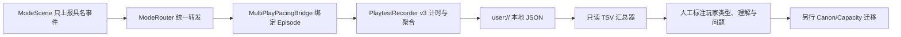

# 超GAG机器人大战 C01 本地匿名节奏回执链 v1

> 日期：2026-07-17  
> 状态：候选运行时已验证，真人样本仍为空  
> 适用：C01 Story-First E01-E04 Godot Runner  
> 不替代：剧情读感、正式美术、平台验收、真人容量通过

## 1. 解决什么问题

静态容量模型只能回答“作者写了多少”，不能回答玩家实际在哪里读、走、想、卡住、重试或直接跳过。本链把 C01 的匿名运行事实落成 Episode 级 JSON，使下一轮试玩能够回答：

1. 每话总时长、活动净时长和四模式停留如何分布。
2. 哪些调查是首次、回顾或被锁拒绝，是否靠重复点击虚增容量。
3. 每个战术回合或阶段实际停留多久，哪里发生局部重试或整战重启。
4. Notebook、暂停、存取与结算占用了多少时间。
5. 自动流程是否真的经过当前 Graph 节点，而不是只凭最终事务猜测。

它不记录玩家姓名、键盘原文、自由文本、硬件唯一标识或鼠标轨迹，也不联网发送。

## 2. 运行链



职责分离如下：

- `ModeScene` 不计时，只发 `spatial_interaction`、`tactical_phase`、`retry` 等声明式事件。
- `ModeRouter` 不理解统计意义，只转发当前 Mode 的事件。
- `MultiPlayPacingBridge` 绑定 `EpisodeDirector`、`ModeRouter`、`InputRouter` 与 `RunStateStore`，在话末结算并关闭回执。
- `MultiPlayPlaytestRecorder` 负责时钟、节点/模式区间、暂停、Overlay、调查、战术阶段、重试、结算和隐私字段。
- 汇总脚本只读取回执，不改 Manifest，不改 `capacity_evidence.status`。

## 3. Schema v3

每份回执固定包含：

| 区域 | 内容 |
|---|---|
| 身份 | `session_id`、`episode_id`、`build_id`；均为运行内容 ID，不是玩家身份 |
| 时间 | 总时长、活动净时长、节点时长、四模式时长、Overlay 与暂停时长 |
| 探索 | 首次、重复、拒绝、选项次数及 Offer/Node 聚合 |
| 战术 | 阶段开始/结束数、阶段时长、结算类型、检查点 |
| 恢复 | 局部/整战重试、存档、读档 |
| 输入 | 被当前上下文接受的意图按设备类型、上下文和节点聚合；不记原始文本、鼠标轨迹或硬件 ID |
| 结果 | 提交数、结算数、最终 RunState 摘要 |
| 隐私 | 六项显式 `privacy_contract`，禁止自由文本、身份、硬件 ID 和原始指针路径 |

证据固定标记为：

```text
evidence_class = LOCAL_ANONYMOUS_PLAYTEST_CANDIDATE
verification_status = unreviewed
```

任何运行时或脚本都不得把它自动改成“真人容量已通过”。

## 4. C01 接线

`C01StoryFirstChapterRunner` 默认在本地开启回执，输出到：

```text
user://chao_gag_playtests/c01_story_first/
```

macOS 开发机通常对应：

```text
~/Library/Application Support/Godot/app_userdata/
  Chao GAG Robot Wars Godot Prototype/
  chao_gag_playtests/c01_story_first/
```

每话生成唯一文件，并更新 `latest.json` 与 `latest-<episode-id>.json`。唯一文件名同时含 Unix 时间和单调时钟，连续重开同一话不会覆盖上一份样本。

当前事件覆盖：

1. Episode/Mode 进入和退出。
2. E01-E04 稳定物件首次、回顾与锁定调查；E03 战中嵌套 Spatial 通过父 Tactical 转发。
3. Tactical 回合/阶段开始、结束、回滚、完成与撤离。
4. E02 R5 局部检查点、整战重启以及 E03 嵌套探索重试。
5. Notebook 打开/关闭与停留、应用失焦暂停接口、手动存取、事务和话末结算。
6. InputRouter 已接受意图的 `device/context/node` 聚合；按下和松开分开计数，用于验证持续行走与长按/释放链。

### 4.1 玩家可见回执与恢复入口

2026-07-18 起，Chapter Runner 不再只把上述能力留在 JSON 和隐藏快捷键中：

1. 纪存笔记的系统页提供立即保存、二次确认读取、保存并返回标题。
2. 读取会恢复精确 Episode 节点并显式关闭旧 Notebook Overlay。
3. 每话结算显示本话活动时长、四模式分布、首次/重复调查与重试数；第四话显示第一章合计。
4. 结算摘要随章节存档持久化，仍固定标注“本地未审阅”，不得当作容量升格。
5. 玩家入口、界面与合成遍历证据见 `2026-07-18-chao-gag-c01-playtest-delivery-audit-v1.md`。
6. 玩家中途返回标题或主动读档时，当前 Episode 段会先以 `suspended_to_title` 或 `restored_away` 关闭并写入章节存档；最终完成段与此前分段合并，话末时长、模式、调查、重试和存取不会只剩后半段。

## 5. 汇总

```bash
python3 scripts/summarize_c01_pacing_receipts.py \
  "/path/to/chao_gag_playtests/c01_story_first" \
  --strict \
  --output /tmp/c01-pacing.tsv
```

TSV 一行对应一份非重复 Session，包含四模式分钟数、调查类型、战术尝试、重试和存取。脚本跳过 `latest-*` 镜像，检查 Schema、Evidence Class、隐私合同和 Session 唯一性，并只在标准错误流显示“未审阅中位数”。

## 6. 当前自动证据

1. Recorder 确定性时钟烟测：总时长、活动净时长、四模式累积、Overlay、暂停、首次/重复/拒绝调查、战术阶段和重试全部通过。
2. Bridge 烟测：事件转发、话末关闭、幂等关闭和自由文本反向注入过滤通过。
3. E01 整话集成：8次因果调查、0次伪重复、3个战术回合进入回执。
4. E02 整话集成：三证、5回合加1次R5局部重试进入回执。
5. Chapter Runner：E01-E03自动交接分别关闭独立回执，E04中断被保留为 `aborted`，不会混入完成样本。
6. 四话完整集成自动玩家已统一生成 `completed / unreviewed` 合成回执；它验证结构可达，不提供真人时长。
7. 连续 Chapter Runner 自动玩家从标题开始，经过24个正式节点、4次结算和一次真实返回标题/继续恢复；证据明确标注使用模式测试 API、未使用原始输入事件。
8. C01 原始输入走廊用172个键盘/虚拟手柄按下和松开事件覆盖 startup/narrative/spatial/overlay/desk/tactical/interlude，额外验证笔记本页内键盘焦点和保存，并证明 Chapter 回执能聚合已接受输入。该证据不代替实体手柄或跨平台验收。
9. macOS 可见窗口代表样本用正式 `Godot.app`、隔离存档命名空间和130个系统级键盘意图覆盖标题、Narrative、Spatial、Notebook、保存、返回标题与恢复；两种请求窗口尺寸的字形、布局和焦点经机器辅助复看。该证据不是独立真人首玩，也未覆盖可见 Tactical/Desk/完整章。
10. 失败恢复输入走廊用60/60个键盘原始事件验证E01 `BATTLE_START`、E03 `EXPLORE_ENTRY_LOCAL` 与E04 `ANCHOR_LOCAL`；E03重开恢复内嵌Spatial owner，E04同阶段子回合倒退进入匿名 `retry`。它是独立节点验收，不是完整章真人失败样本。
11. E04四检查点矩阵另用130/130个键盘原始事件验证 `ANCHOR_LOCAL`、`LOADOUT_LOCAL`、`HALF_RISE_LOCAL` 与 `CITY_LOCAL` 各产生一条精确局部重试，并恢复完整快照和Tactical owner；四段前置状态由直接合法动作建立，不冒充连续首玩。

这些是自动化对采集链的验证，不是真人试玩样本。

## 7. 真人容量升格门

`pending_external` 只能在另一次人工审阅后迁移：

1. 至少有熟悉 SRW、熟悉战棋、偏剧情三种玩家各一次完整首玩。
2. 回执为 `completed`，未使用调试跳转；中位活动净时长进入该话目标档。
3. 另行记录卡点、跳过原因和一句话剧情复述；这些自由文本不写入运行回执。
4. 主要剧情无结构性误解，重复调查和失败次数没有暴露门控或信息表达缺陷。
5. 由人工提交 Capacity/Canon 迁移，同时更新 Manifest、审计文档与图谱。

## 8. 缓存与体积边界

- 一份回执通常只有数 KB，不截图、不录视频、不生成 Godot 导入缓存。
- 每个输出目录最多保留64份唯一Session；`latest`镜像不计入上限，超出时只删除最旧的唯一回执。
- 自动测试使用隔离 `HOME`，验证后删除对应 `/private/tmp/chao-gag-pacing-*`。
- 汇总器只读 JSON；除显式 `--output` 外不写文件。
- 正式 demo 的本地回执属于可删除用户数据，不进入项目资产或 Git。
