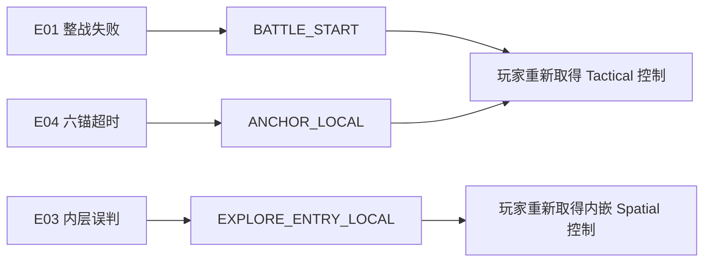

# 超GAG机器人大战 C01 失败恢复原始输入验收 v1

> 日期：2026-07-18  
> 状态：`synthetic_raw_input_and_visible_capture_passed / full_failure_matrix_human_gate_pending`  
> 范围：E01整战重开、E03断臂内部误判回滚、E04六锚本地回滚、输入上下文与匿名重试回执

## 1. 为什么需要单独验收

既有 Session 和集成测试能直接调用 `confirm_result()`、`inspect_object()` 与检查点函数，证明规则正确，却不能证明玩家真的能用正式输入完成“失败 -> 看懂原因 -> 确认恢复 -> 重新取得控制”。本层把三种不同恢复粒度放进同一条原始键盘走廊：



## 2. 本轮发现并修复的问题

### 2.1 E03 内嵌探索没有输入所有权

P6 的右臂内部 Spatial 能由 API 打开，但 InputRouter 栈顶仍是外层 Tactical owner。内层 Mode 用自己的节点 id 请求输入时会被拒绝，因此旧测试可以直接调查，玩家按键却没有同等保证。

修正后：

- 打开内嵌 Spatial 时推入独立 `spatial` 上下文。
- 外层 Tactical 因 owner 不匹配而暂停接收地图命令。
- 保存/恢复不会重复推入上下文。
- 成功、失败重开、战斗重开与 Mode 退出都会清除内层 owner。
- E03 误判重开后重新推入同一语义上下文，玩家立即恢复行走、调查和选项控制。

### 2.2 E04 同阶段回滚没有进入重试统计

E04 的六锚检查点从 `stage=1, turn=6` 回到 `stage=1, turn=1`。旧 `_pacing_phase_outcome()` 只比较阶段号，因此把同阶段回滚误记成 `advanced`。

修正后同时检查：

- 阶段号是否倒退；
- 同阶段子回合是否倒退；
- Session 最近结算是否为 `ROLLBACK` 事件。

命中后写出匿名 `retry`：`scope_id=local_checkpoint`、准确 `checkpoint_id` 与玩家可见原因。

### 2.3 失败画面暴露工程文本

视觉捕获发现 E01 长摘要横向溢出，保护目标显示 `yellow_line_a` 等内部 id；E04 提示直接写 `ANCHOR_LOCAL`。现已改为40字元中文换行、目标显示名和“六锚/半身抬升/城市移动检查点”等玩家语言；内部 checkpoint id 只保留在回执中。

## 3. 三条输入路线

测试：`game-godot/scripts/c01_story_first_failure_recovery_input_smoke_test.gd`  
无头回执：`outputs/c01-failure-recovery-input-v01/receipt.json`  
可见捕获回执：`outputs/c01-failure-recovery-input-v01/visual_receipt.json`  
机器复核摘要：`outputs/c01-failure-recovery-input-v01/acceptance_summary.json`

| 路线 | 玩家输入 | 恢复结果 | 回执 |
|---|---|---|---|
| E01 三回合未完成救援 | `E -> Enter`结束三次阶段，结果页`Enter` | 从战斗初态重开；回合1、动作清空、世界状态不写入 | `battle_start / BATTLE_START` |
| E03 第四筋强按可见轮廓 | `Enter -> Down -> Enter`并走完失败演出 | 只清空右臂内部搜索；外层P6姿态保留，内层Spatial输入重新取得 | `explore_entry_local / C01E03_P6_RIGHT_ARM_FOURTH_RIB` |
| E04 六锚阶段空过至越界 | 每回合`E -> Enter` | 回到六锚检查点；六锚重新锁定、载荷选择保留、Tactical键盘控制恢复 | `local_checkpoint / ANCHOR_LOCAL` |

冻结结果：

- `60` 个原始按下/松开事件。
- `60` 个 InputRouter 已接受意图。
- 三种恢复各产生且只产生一条目标 `retry` 事件。
- 四项覆盖布尔值全部为 `true`。

## 4. 可见画面

五张 `1280x720` 捕获与同一条原始输入路线绑定：

1. `00-e01-battle-start-retry-result.png`：整战失败原因和“从战斗初态重试”。
2. `01-e01-after-battle-start-retry.png`：回合1地图、恢复说明与重新可操作状态。
3. `02-e03-visible-outline-choice.png`：错误选项有明确焦点，不依赖颜色猜测。
4. `03-e03-explore-entry-local-retry.png`：搜索0/4、外部输入0/3与“外部姿态复原”说明。
5. `04-e04-anchor-local-retry.png`：六锚重新锁定、P1回合1与玩家语言的检查点提示。

## 5. 验证命令

```bash
scripts/run-godot-with-timeout.sh \
  --headless --path game-godot \
  --script res://scripts/c01_story_first_failure_recovery_input_smoke_test.gd

CHAO_GAG_CAPTURE_FRAMES=1 scripts/run-godot-with-timeout.sh \
  --path game-godot --resolution 1280x720 \
  --rendering-method gl_compatibility \
  --script res://scripts/c01_story_first_failure_recovery_input_smoke_test.gd

python3 scripts/summarize_c01_failure_recovery_acceptance.py \
  --layout-clear --labels-readable --focus-visible
```

## 6. 证据边界

当前可以宣称：**E01整战失败、E03人尺度嵌套误判和E04六锚本地失败，都能由正式键盘输入进入玩家可见恢复链；恢复后正确上下文重新取得控制，并写入匿名重试回执。**

当前不能宣称：

- 这是从标题连续走完24节点后自然产生的失败；三个节点采用独立正式节点实例。
- E03 前置阶段和七项调查全部由原始输入完成；本测试直接建立前置状态，只把最终错误选择、关闭、回滚和上下文恢复交给原始输入。
- 本 v1 的60事件走廊本身不包含 E04 `LOADOUT_LOCAL`、`HALF_RISE_LOCAL`、`CITY_LOCAL`；三者已由独立的 `2026-07-18-chao-gag-c01e04-four-checkpoint-input-acceptance-v1.md` 补齐，但仍采用直接前置状态。
- 另外两种E04载荷组合、鼠标、实体手柄、Windows或真人理解已经通过。
- 截图和机器断言能证明对白、节奏、情感或商业品质。
