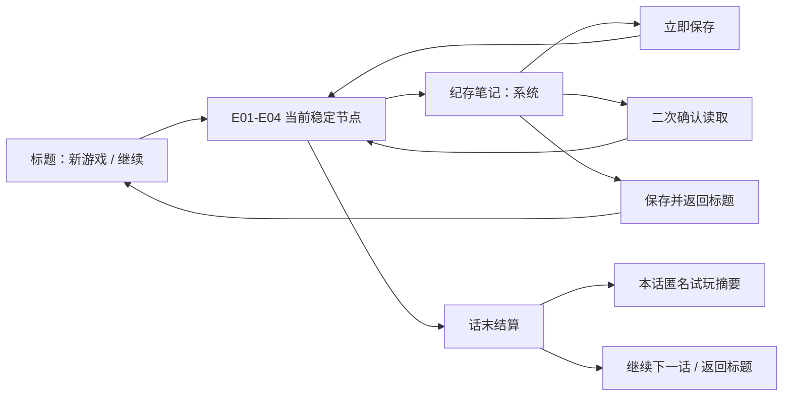

# 超GAG机器人大战 C01 试玩交付性审计 v1

> 日期：2026-07-18  
> 范围：Godot `C01E01-E04` Story-First Chapter Runner  
> 判定：机器闭环、玩家可见恢复链、macOS headless 功能/失败原始输入走廊、E04四检查点矩阵与 macOS 可见键盘代表样本已成立；真人首玩、可见完整章、实体手柄、跨平台与商业品质仍未验收

## 1. 本轮解决的不是“再多一个自动测试”

反查现有企划、容量审计、回执合同和 Chapter Runner 后，底层保存与回执其实已经存在，真正的交付缺口是玩家看不见：

1. 标题页有继续游戏，但运行中只有隐藏的 `F5/F9` 存取档。
2. 笔记本能看目标、线索、人物和记录，却不能保存、读取或返回标题。
3. Episode 回执只写 JSON，话末结算不显示本话到底走了多久、调查了多少、重试了几次。
4. 读档可以恢复节点，但旧笔记本遮罩没有明确生命周期合同，存在“状态已恢复、画面仍像卡住”的风险。
5. 长测试没有统一硬超时，失败脚本可能残留为数小时的无头 Godot 进程。

本轮把上述能力从隐藏工程接口迁移成正式试玩入口，不改变 C01 剧情、物理结果、角色出场或四话 Canon。

## 2. 当前玩家可见链



已实现并自动验证：

- 设置页显示 `保存进度 / 读取进度 / 保存并返回标题` 三个正式按钮。
- 读取需要二次确认；成功后恢复精确 Episode 节点并关闭旧 Overlay。
- 返回标题前先保存；标题页能识别第几话和节点标题，再继续时回到同一稳定状态。
- 话末显示本话活动时长、Narrative/Spatial/Desk/Tactical 分布、首次调查、回顾和重试数。
- 第四话结算额外显示第一章四话活动时长合计。
- 每话摘要进入章节存档，因此完成后返回标题再查看结算不会丢失。
- 摘要固定显示“本地未审阅”，不能自动升格为真人容量结论。

界面证据：

- `outputs/c01-chapter-shell-v04/00-title-new-game.png`
- `outputs/c01-chapter-shell-v04/02b-notebook-settings.png`
- `outputs/c01-chapter-shell-v04/03-e03-to-e04-interlude.png`
- `outputs/c01-chapter-shell-v04/04-c01-final-settlement.png`

## 3. 四话合成完整遍历

四个 Episode 的完整集成自动玩家统一写入 `c01_synthetic_integration`，汇总为：

`outputs/c01-synthetic-playthrough-v01/pacing.tsv`

本轮四份冻结原始回执位于 `outputs/c01-synthetic-playthrough-v01/raw/`，避免后续测试追加 Session 后改变本报告的样本集合。

| Episode | 状态 | 首次调查 | 重复 | 拒绝 | 战术阶段尝试 | 重试 | 自动路线覆盖 |
|---|---|---:|---:|---:|---:|---:|---|
| E01 | completed / unreviewed | 8 | 0 | 0 | 3 | 0 | 六站八责任、保存恢复、三回合29人撤离 |
| E02 | completed / unreviewed | 3 | 0 | 0 | 6 | 1 | 三证、五回合、R5局部失败恢复、RT038 |
| E03 | completed / unreviewed | 8 | 0 | 0 | 8 | 0 | 八阶段、战中人尺度探索、断臂桥、RT035 |
| E04 | completed / unreviewed | 3 | 0 | 0 | 16 | 0 | B1、零号测试、二选三、公开申诉、六阶段离馆、RT054 |

这里的 `duration_min` 是无头自动玩家在数帧内直接执行合法动作的机器耗时，只有毫秒级，**不可用于容量判断**。这批证据只证明：

1. 每话完整代表路线可以从开场走到原子结算。
2. 必做调查、战术阶段、局部重试和终局事务进入同一匿名回执 Schema。
3. E01-E04 的确切前任快照可以被下一话消费。
4. Chapter Runner 的跨话交接另有烟测；四个完整 Episode 测试使用精确 Canon 前任 Fixture，尚不是一条连续鼠标/手柄输入录像。

### 3.1 单次连续 Chapter Runner 证据

独立 Episode Fixture 之外，现已增加真实 Chapter Runner 的连续章级自动玩家：

- 证据：`outputs/c01-continuous-chapter-v01/receipt.json`
- 摘要：`outputs/c01-continuous-chapter-v01/summary.json`
- 测试：`game-godot/scripts/c01_story_first_continuous_chapter_smoke_test.gd`

该路线从玩家标题选择新游戏开始，未注入前任 Fixture，未跳入终局节点：

1. 按正式顺序经过24个 C01 节点和4个话末结算。
2. E01 模型病院中途打开笔记本保存，选择保存并返回标题，再由继续游戏恢复同一房间和锁扣责任。
3. 恢复产生25条节点进入事件，但去重后的24个正式节点与 Graph 顺序完全一致。
4. E01 的 `suspended_to_title + completed` 两段回执合并为一个话末摘要，保留总时长、8次首轮调查、2次保存和1次恢复。
5. E02 实际触发一次 R5 局部失败并从检查点完成；E03 战中嵌套探索与 E04 六阶段离馆均在同一 RunState 上继续。
6. RT013S、RT038、RT035、RT054 各出现且只出现一次；最终事实为29人楼外、馆守Z永久断臂、`PHYSICAL_ARCHIVE`、受损巡航与零号伤害历史保留。

该证据固定声明 `uses_direct_mode_test_api=true / uses_raw_input_events=false`。它证明连续 Runtime、存档和状态交接，不冒充鼠标、键盘或手柄级真人输入。

## 4. 当前仍未完成的交付边界

### P0：真人首次游玩

- 一名熟悉 SRW、一名熟悉战棋、一名偏剧情玩家，各自从标题完整进入。
- 记录四话总时长、模式净时长、卡住点、失败、回顾调查、跳过和一句话剧情复述。
- 重点验证 E01 是否达到 `22-30` 分钟，E02 `22-35`，E03 `35-55`，E04 `45-60`。
- 真人没有完成前，所有 `capacity_evidence.status` 保持 `pending_external`。

### 已完成：单次连续 Runner 遍历

- 已实现不使用终局节点跳转、不注入前任 Fixture 的连续 E01-E04 Chapter Runner 路线。
- 已覆盖中途保存、返回标题、继续恢复、Overlay 关闭、E02失败恢复、四次结算与最终继续存档。
- 已修复分段游玩只统计后半段的问题：同一 Episode 的中断段和完成段会合并进入玩家可见摘要。

### 已完成：macOS headless 原始输入走廊

- `outputs/c01-raw-input-corridor-v01/receipt.json` 已记录172个原始按下/松开事件与172个已接受意图，其中新增 Notebook 系统页键盘聚焦和保存。
- 键盘和虚拟手柄都覆盖标题、Narrative、Spatial持续行走与选项、Notebook、Desk撤回/提交、Tactical选机/移动/阶段菜单/提前结束，以及话末结算。
- 该走廊抓出并修正了 Desk 绕过 InputRouter、标题手柄 A 无回退路径、同步切场后旧 Mode 访问 viewport，以及 C01 回执未绑定已接受输入四项问题。
- Desk/Tactical 使用正式 C01 节点的独立代表片段；它不冒充第二条24节点完整章回放。详见 `2026-07-18-chao-gag-c01-raw-input-platform-acceptance-v1.md`。

### 已完成：macOS 可见键盘代表样本

- 正式 `Godot.app` 在隔离存档命名空间下完成标题、Narrative、Spatial、Notebook、保存、返回标题和恢复。
- `1280x720` 与 `1600x900` 请求窗口均取得截图；已捕获状态的中文字形、地图/侧栏、系统页按钮和焦点没有不连贯遮挡。
- 可见运行发现并修复 Notebook 系统页键盘无法进入按钮的问题；原始输入走廊同步扩为172/172。
- 回执为 `machine_reviewed_not_human`，不冒充独立真人、可见 Tactical/Desk 或完整章。详见 `2026-07-18-chao-gag-c01-macos-visible-keyboard-acceptance-v1.md`。

### P1：实体设备与跨平台遍历

- macOS 仍需补可见 Tactical、Desk、结算、鼠标与完整24节点；Windows仍需键鼠完整路线。两平台的实体手柄、SDL/XInput、热插拔与震动均未验收。
- 这层用于抓平台差异，不重复证明剧情事务，也不用于证明真人理解或喜欢。

### P1：选择与失败矩阵

- E04 合成路线当前选择 `PHYSICAL_ARCHIVE`；另外两种合法载荷组合仍由合同/Session 测试覆盖，不是完整首玩路线。
- E02 已覆盖一次 R5 局部重试；E01整战失败、E03嵌套探索误判和E04 `ANCHOR_LOCAL` 已由60/60键盘原始事件与五张可见捕获证明，恢复后输入上下文和匿名重试回执均成立。
- E04 四个本地检查点现均有正式 Tactical 键盘失败与恢复证据：独立矩阵记录130/130个事件、四条精确 `retry`、完整快照恢复和四张可见捕获。前置合法动作仍由直接驱动建立，因此不是从标题连续抵达的首玩路线；另外两种合法载荷组合也不是完整首玩路线。
- Desk 目前有模式时长和最终载荷结果，但回执摘要尚未独立列出每次草案改动；需要真人试玩后再决定是否扩 Schema，避免先为指标而加指标。

### P2：平台与表现

- 当前截图基线包含 `1280x720` 与 `1600x900` 的 macOS 机器辅助代表样本；Windows、实体手柄、全屏、多显示器、不同 DPI 和完整状态矩阵未验收。
- 失败恢复共有九张 `1280x720` 捕获：五张覆盖E01/E03/E04六锚，四张覆盖E04全部本地检查点；已修正E01摘要溢出、保护目标内部ID、检查点快照漏项和E04内部枚举泄漏。它们不是完整章节视觉遍历。
- 自动回归不能判断对白是否像活人、转场是否有呼吸、机体动作是否够爽、玩家是否喜欢万机馆。
- 正式美术替换、声音、震动、性能与 Steam 包装仍是独立生产门。

## 5. 资源卫生

新增 `scripts/run-godot-with-timeout.sh`，全量 `scripts/godot-test.sh` 的每个 Godot 子测试默认限制为 `180s`。测试完成后已检查，不存在项目 `godot --headless --path game-godot` 残留。

macOS 活动监视器的 `Cached Files` 是可回收文件页缓存，不按项目临时文件处理。只有以下情况才需要介入：

- 项目 Godot/Codex 子进程 RSS 持续增长；
- 内存压力进入黄/红；
- Swap 明显增长；
- 已定位到具体的大型磁盘目录。

## 6. 验证命令

```bash
scripts/godot-test.sh
scripts/run-godot-with-timeout.sh --headless --path game-godot \
  --script res://scripts/c01_story_first_raw_input_corridor_smoke_test.gd
scripts/run-godot-with-timeout.sh --headless --path game-godot \
  --script res://scripts/c01e04_failure_checkpoint_input_smoke_test.gd
python3 scripts/summarize_c01e04_failure_checkpoint_acceptance.py \
  --layout-clear --labels-readable --map-unobscured --recovery-notice-visible
python3 scripts/summarize_c01_macos_visible_acceptance.py --help
scripts/canon-smoke-test.sh
scripts/canon-check-godot.sh --strict
python3 scripts/audit_c01_story_first_capacity.py --check
python3 scripts/summarize_c01_pacing_receipts.py \
  outputs/c01-synthetic-playthrough-v01/raw \
  --strict \
  --output outputs/c01-synthetic-playthrough-v01/pacing.tsv
```

## 7. 可宣称口径

当前可以宣称：**C01 四话机器闭环、玩家可见存取恢复、跨话结算、匿名节奏采集、四话独立完整遍历、无 Fixture 连续章级遍历、macOS headless 键盘/虚拟手柄功能输入走廊、E01/E03失败恢复、E04四检查点键盘恢复矩阵，以及 macOS 可见标题/Narrative/Spatial/Notebook键盘代表样本已经成立。**

当前不能宣称：**第一章容量、理解、情感、对白、商业品质、实体手柄、Windows，或 macOS 可见完整章交付已经通过真人验收。**
