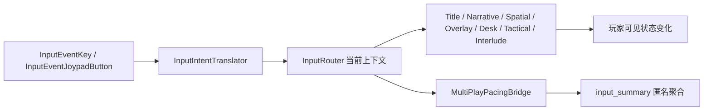

# 超GAG机器人大战 C01 原始输入与平台验收 v1

> 日期：2026-07-18  
> 状态：`synthetic_raw_input_passed / physical_and_cross_platform_pending`  
> 范围：C01 Story-First Chapter Runner、InputRouter、Narrative/Spatial/Desk/Tactical、笔记本与话末结算

## 1. 验收目标

连续24节点自动玩家已经证明章节事务、存档和跨话状态可达，但它直接调用模式公开 API。本层不再重演一遍剧情事务，而是回答：

1. 真实 `InputEvent`是否经过输入翻译、当前上下文和模式消费链。
2. 键盘与虚拟手柄是否都能进入、撤回、提交和结束阶段。
3. 标题、Overlay、模式转场和同步节点切换是否泄漏输入或访问已移除场景。
4. 本地匿名回执是否记录“被接受的意图”，而不是硬件身份、鼠标轨迹或原始文本。

## 2. 运行链



正式运行时只有栈顶上下文可以接受输入。转场使用 blocking context 清除持续方向；笔记本使用 overlay context 暂停底层模式；返回时恢复同一场景快照。

## 3. 本轮修正

| 暴露问题 | 修正 | 玩家可见结果 |
|---|---|---|
| E04“精确二选三”硬编码读取键盘 | `ConstraintActivityHostMode` 改用 InputRouter 语义意图 | 键盘和手柄均可切栏、选择、移除、清空和提交 |
| 手柄 A 在标题页依赖 Godot 原生 UI 映射 | Chapter Runner 增加 blocking startup context 的导航/确认/取消 | 无存档时默认焦点直接开始；有存档时优先继续；二次确认可取消 |
| Narrative 最后一次确认同步切走当前 Mode | `ModeScene.consume_input_event()` 对已移除 viewport 安全失效 | 节点转场不再因旧场景标记输入而空引用 |
| C01 节奏回执不含实际接受的输入 | PacingBridge 绑定 `intent_dispatched` | 回执按设备、上下文和当前节点聚合，不保存硬件 ID 或鼠标路径 |
| 笔记本系统页按钮无法用键盘进入 | Notebook 在 GUI 前消费语义输入，并把页签导航与页内焦点分层 | `Tab/方向/Enter` 可聚焦并执行保存；手柄肩键仍只换页 |
| E03内嵌Spatial打开后仍由外层Tactical持有输入 | 内嵌模式推入/清除独立Spatial owner | 外层战棋暂停接收，误判重开后行走、调查和选项控制立即恢复 |
| E04同阶段子回合回滚被统计为继续推进 | 阶段、子回合和ROLLBACK结算联合判定 | `ANCHOR_LOCAL`等局部恢复进入匿名重试回执 |

## 4. 合成原始输入走廊

测试：`game-godot/scripts/c01_story_first_raw_input_corridor_smoke_test.gd`  
冻结回执：`outputs/c01-raw-input-corridor-v01/receipt.json`

本次 macOS headless 回执状态为 `completed / unreviewed`，172个原始按下/松开事件得到172个已接受意图回执。

| 玩法与往返 | 键盘 | 虚拟手柄 | 验收的玩家效果 |
|---|---:|---:|---|
| 标题 | 通过 | 通过 | 焦点上的新游戏真正启动 E01 |
| Narrative | 通过 | 通过 | 两个完整 ADV 序列逐句离开当前节点 |
| Spatial 持续行走 | 通过 | 通过 | 按住方向会连续移动，松开立即停止 |
| Spatial 调查/选项 | 通过 | 通过 | 前厅多轮调查、选项导航和稳定物状态真正提交 |
| 笔记本 | 通过 | 通过 | 打开、切页、键盘进入系统控件并保存，关闭后恢复同一人物坐标 |
| Desk 精确二选三 | 通过 | 通过 | 两链安排、移除、重新安排、单次提交 |
| Tactical | 通过 | 通过 | 选机、移动、执行R1动作、打开/取消阶段菜单、有READY友军时提前结束 |
| 话末结算 | 通过 | 通过 | 同一焦点行为返回标题 |

接受意图的上下文分布：

| 设备 | startup | narrative | spatial | overlay | desk | tactical | interlude |
|---|---:|---:|---:|---:|---:|---:|---:|
| keyboard | 2 | 11 | 8 | 20 | 18 | 26 | 1 |
| virtual joypad | 2 | 16 | 19 | 4 | 18 | 26 | 1 |

### 4.1 失败恢复原始输入走廊

另有 `game-godot/scripts/c01_story_first_failure_recovery_input_smoke_test.gd` 以60个键盘原始事件覆盖三种恢复粒度，60个事件全部进入已接受意图：

- E01整战失败确认后从 `BATTLE_START` 清洁重开。
- E03错误选择后回到 `EXPLORE_ENTRY_LOCAL`，并重新取得内嵌Spatial输入 owner。
- E04六锚超时后回到 `ANCHOR_LOCAL`，同阶段回滚被正确记为重试。

回执与五张1280x720捕获位于 `outputs/c01-failure-recovery-input-v01/`。它与172事件的双设备功能走廊互补，不把两份样本相加冒充一条完整章节输入录像。详见 `2026-07-18-chao-gag-c01-failure-recovery-input-acceptance-v1.md`。

### 4.2 E04四检查点矩阵

独立测试 `game-godot/scripts/c01e04_failure_checkpoint_input_smoke_test.gd` 进一步覆盖 E04 的 `ANCHOR_LOCAL`、`LOADOUT_LOCAL`、`HALF_RISE_LOCAL` 与 `CITY_LOCAL`：

- 130个键盘原始事件全部成为已接受意图。
- 四个检查点各产生一条 `local_checkpoint` 重试。
- 回滚后完整状态与检查点逐字段一致，Tactical owner 恢复。
- 四张1280x720画面确认地图、风险、下一步和玩家语言提示可读。

前置合法动作由正式 Tactical 内的直接测试驱动建立，不冒充连续 E04 首玩。详见 `2026-07-18-chao-gag-c01e04-four-checkpoint-input-acceptance-v1.md`。

## 5. 证据边界

这份回执能证明“软件输入路径在当前 macOS headless 构建中成立”，不能证明：

- 实体手柄的 SDL/XInput 映射、热插拔、震动或厂商差异。
- Windows 真机、高 DPI、窗口缩放、中文字形和焦点顺序。
- macOS 可见代表样本之外的 Tactical、Desk、完整章、鼠标点选、双显示器或系统辅助功能。
- 玩家是否理解目标、是否被剧情打动、实际容量和商业品质。
- 从标题用原始输入走完24节点的另一条完整章回放；Desk/Tactical 在本测试中使用正式 C01 节点的独立代表性片段。

## 6. 外部平台门

| 层级 | 当前状态 | 所需证据 |
|---|---|---|
| macOS headless虚拟键盘/手柄 | 已通过 | 本回执 |
| macOS可见窗口键盘代表样本 | 已通过 | 标题、Narrative、Spatial、Notebook、存取；1280x720与1600x900机器辅助回执 |
| macOS可见完整章键鼠 | 待验 | Tactical、Desk、结算、24节点、鼠标路线与真人布局确认 |
| macOS实体手柄 | 待验 | 实体设备连接数、全上下文意图和人工布局确认 |
| Windows 10/11键鼠 | 待验 | 官方导出包、哈希、字形、DPI和 `user://` 回执 |
| Windows 10/11实体手柄 | 待验 | 完整上下文覆盖、热插拔和人工视觉门 |

Windows 验收的证据口径沿用 `production/multi-play-runtime/m6-windows-controller-acceptance-runbook-v1.md`，但制品、节点清单和回执目录必须换成 C01 Chapter Runner，不得用 M6 通过代替 C01 通过。

## 7. 验证命令

```bash
scripts/run-godot-with-timeout.sh \
  --headless --path game-godot \
  --script res://scripts/c01_story_first_raw_input_corridor_smoke_test.gd

scripts/run-godot-with-timeout.sh \
  --headless --path game-godot \
  --script res://scripts/c01_story_first_failure_recovery_input_smoke_test.gd

scripts/run-godot-with-timeout.sh \
  --headless --path game-godot \
  --script res://scripts/c01e04_failure_checkpoint_input_smoke_test.gd

scripts/godot-test.sh
scripts/canon-smoke-test.sh
scripts/canon-check-godot.sh --strict
```

## 8. 可宣称口径

当前可宣称：**C01 的标题、ADV、探索、笔记本、Desk、Tactical 和话末结算已通过 macOS headless 键盘/虚拟手柄原始事件走廊；E01整战重开、E03内嵌误判回滚与E04四个本地检查点另通过键盘原始事件走廊，接受意图、完整恢复和重试均有机器回执。**

另有 `2026-07-18-chao-gag-c01-macos-visible-keyboard-acceptance-v1.md` 证明 macOS 可见窗口的键盘代表样本；它不扩张本 headless 回执的实体设备或完整章边界。

当前不可宣称：**实体手柄、Windows、macOS可见完整章、全窗口/DPI/字形矩阵、震动、完整章原始输入回放或真人体验已验收。**
