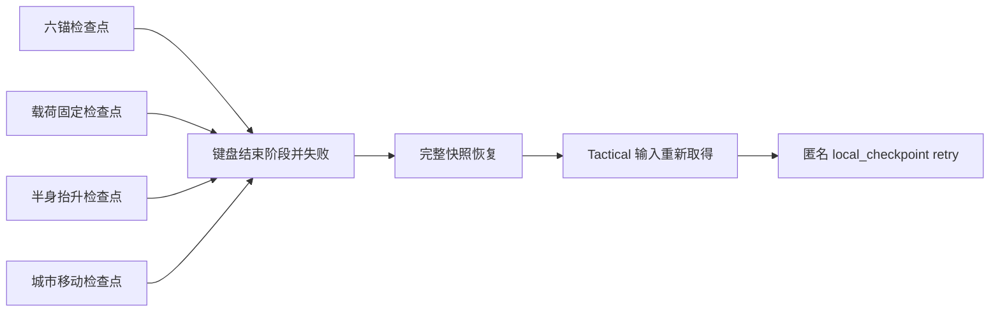

# 超GAG机器人大战 C01E04 四检查点原始输入验收 v1

> 日期：2026-07-18  
> 状态：`synthetic_raw_input_and_visible_capture_passed / continuous_episode_and_human_gate_pending`  
> 范围：`ANCHOR_LOCAL`、`LOADOUT_LOCAL`、`HALF_RISE_LOCAL`、`CITY_LOCAL` 的失败、回滚、状态恢复、输入恢复与玩家提示

## 1. 要关闭的交付缺口

E04 Session 已经能直接验证四个本地检查点，但此前正式 Tactical 输入只证明了六锚失败。其余三段仍可能出现以下玩家级问题：

1. `E -> Enter` 无法真正结束阶段。
2. 规则层完成回滚，但 Tactical 没有重新取得输入。
3. 只恢复阶段号，没有恢复载荷、馆体几何、分支资源和单位位置。
4. 匿名节奏回执没有把同阶段回滚记为 `retry`。
5. 画面把 `LOADOUT_LOCAL` 等工程枚举直接显示给玩家。

本验收为四个检查点分别实例化正式 `c01e04_carrier_escape` Tactical 节点，先用合法动作驱动进入目标阶段，再把失败、演出关闭、回滚和重新取得控制交给原始键盘事件。



## 2. 本轮发现并修正的问题

### 2.1 检查点漏存馆守 Z 与夹具几何

`_restore_runtime_state()` 已经读取以下字段，但 `_runtime_state()` 没有写入：

- `prepared_anchor_holds`
- `guardian_support_mask_state`
- `guardian_right_shoulder_sunk`
- `guardian_left_screen_range`

这意味着旧测试只比较阶段、火锁或载荷时可以通过，完整回滚却可能把馆守 Z 支撑几何退回默认值。现在四项进入本地快照，输入测试会把回滚后的完整运行状态与检查点逐字段比较，仅忽略用于告知玩家的本次 `failure_reason`。

### 2.2 工程枚举泄漏到玩家提示

载荷超时和阶段切换原本直接显示 `LOADOUT_LOCAL`、`HALF_RISE_LOCAL`、`CITY_LOCAL`。现统一为：

- 六锚检查点
- 载荷固定检查点
- 半身抬升检查点
- 城市移动检查点

内部枚举只保留在机器回执的 `checkpoint_id`，测试明确拒绝失败原因或画面提示包含 `_LOCAL`。

## 3. 四检查点矩阵

测试：`game-godot/scripts/c01e04_failure_checkpoint_input_smoke_test.gd`  
无头回执：`outputs/c01e04-failure-checkpoint-input-v01/receipt.json`  
可见回执：`outputs/c01e04-failure-checkpoint-input-v01/visual_receipt.json`  
机器复核：`outputs/c01e04-failure-checkpoint-input-v01/acceptance_summary.json`

| 检查点 | 原始输入触发 | 回滚前可见风险 | 恢复不变量 | 结果 |
|---|---|---|---|---|
| `ANCHOR_LOCAL` | 空过6回合 | 消防锁与六锚超时 | 锚0/6、固定馆体、只保留预选载荷 | 通过 |
| `LOADOUT_LOCAL` | 空过3轮本地操作 | 两类载荷未完成固定 | `PHYSICAL+ARCHIVE`仍被选择，货轨、留置清单和收据清空 | 通过 |
| `HALF_RISE_LOCAL` | 空过5回合 | 火锁、热量、结构或档案冷却越界 | 皇影卡锁历史、半身前掩码、档案冷却6、物理缓冲1 | 通过 |
| `CITY_LOCAL` | 空过2回合 | 城市包络或公共设施损伤 | 道路起点、双臂收拢、七海远程回执不重复、三类城市损伤归零 | 通过 |

冻结结果：

- `130` 个原始键盘按下/松开事件。
- `130` 个 InputRouter 已接受意图。
- 四个检查点各且仅各产生一条 `local_checkpoint` 重试。
- 四次回滚后的完整运行状态均与对应检查点一致。
- 四次恢复后的上下文均为 `tactical / c01e04_carrier_escape`。

## 4. 可见画面

四张画面均为 `1280x720`，来自同一测试在可见 Godot 窗口中的运行：

1. `00-anchor-local-retry.png`
2. `01-loadout-local-retry.png`
3. `02-half-rise-local-retry.png`
4. `03-city-local-retry.png`

机器复看确认：地图没有被右栏遮挡；阶段、危险增量、下一步和回滚原因可读；回合菜单入口仍在；玩家文案没有内部检查点枚举。四张图具有不同 SHA256，不是重复帧。

## 5. 验证命令

```bash
scripts/run-godot-with-timeout.sh \
  --headless --path game-godot \
  --script res://scripts/c01e04_failure_checkpoint_input_smoke_test.gd

CHAO_GAG_CAPTURE_FRAMES=1 scripts/run-godot-with-timeout.sh \
  --path game-godot --resolution 1280x720 \
  --rendering-method gl_compatibility \
  --script res://scripts/c01e04_failure_checkpoint_input_smoke_test.gd

python3 scripts/summarize_c01e04_failure_checkpoint_acceptance.py \
  --layout-clear --labels-readable \
  --map-unobscured --recovery-notice-visible
```

## 6. 证据边界

当前可以宣称：**E04 的四个本地检查点都能由正式 Tactical 键盘输入触发玩家可见失败；回滚后完整状态、地图控制、输入 owner 和匿名重试回执一致恢复。**

当前不能宣称：

- 四段前置合法动作全部由原始输入完成；本测试用正式 Tactical 内的直接动作驱动建立前置状态。
- 四个独立样本组成了从标题到 E04 结算的一条连续输入录像。
- 玩家能首次理解六阶段规则、喜欢该关节奏，或能在合理时间内完成。
- 鼠标、实体手柄、Windows、辅助功能和商业品质已经通过。

