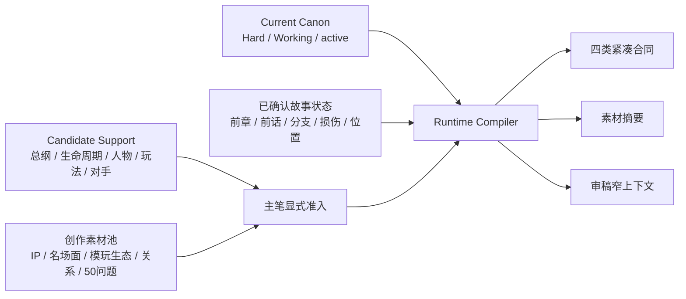
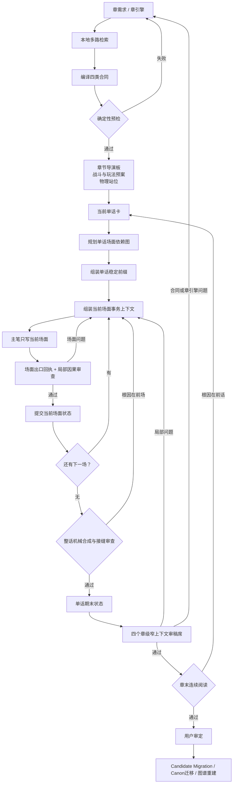

# 《超GAG机器人大战》Story Runtime Harness v2.2

> v2.2生产迁移：v2.1的交互级事务、状态继承和缓存机制继续保留；默认作家内核切换为Creative First v2。Current事实、候选素材、历史证据和写后Lint实行四区隔离。候选素材检索默认关闭，只有主笔先确定场面方向并点名记录ID后才可准入；旧Reader、旧效果测试、坏句示例和审稿意见不再进入初稿上下文。机器入口见`story-runtime/production/production_source_policy_v1.tsv`。

## 一、目标

Story Runtime 不负责替作家写故事。它负责把项目巨量知识编译成一份**短、稳定、可验证、允许创作**的任务环境，并把上下文治理下钻到一次模型交互：

- 本地检索可以读全量 Canon、总纲、机体生命周期、人物弧线和素材池；
- 作家不再反复读取这些原始资料，只读稳定内核、本章合同、导演板、当前单话卡、场面事务卡和上一事务差量；
- 能用程序判断的连续性问题在写作前拦截；
- 好不好看、像不像人、机战感够不够，由彼此独立的窄上下文审稿席判断；
- 用户确认后的故事结果回写成状态增量，再经 Canon 迁移进入下一轮知识底座。

它要同时解决两个看似相反的问题：

1. **不给全量上下文会丢东西。**
2. **把全量上下文塞给作家会爆上下文、稀释重点、降低 KV cache 命中。**

答案不是“找一个更大的提示词”，而是做一次本地编译。

## 二、合同、提示词与门禁不是同一件事

可以把合同和门禁粗略理解为“作家侧”和“审稿侧”，但严格说不够准确：

| 层 | 本质 | 谁读取 | 能否自动判断 |
| --- | --- | --- | --- |
| 稳定写作内核 | 长期不变的共同创作语言 | 作家 | 部分 |
| 合同 | 编译后的结构化输入与状态边界 | 作家、程序、审稿 | 大部分可验证 |
| 作家任务提示 | 当前一话要创作什么 | 作家 | 否 |
| 机器门禁 | 身份、生命周期、字段、预算、哈希等确定性检查 | 程序 | 是 |
| 语义审稿提示 | 因果、人物、机体、玩法、声线和可制作性审查 | 独立审稿席 | 需要判断 |
| 状态回执 | 写完后实际发生了什么 | 程序、下一轮编译器 | 字段可验证，内容需审 |

因此：

- **合同不是单纯作家提示词。**它既约束作家，也是机器检查和写后回流的数据接口。
- **门禁不是单纯审稿提示词。**确定性门禁由脚本执行；只有“有不有趣、自然不自然、场面是否成立”才交给语义审稿。

## 三、知识底座分层



### 1. Current Canon

`story-runtime/generated/nodes/` 与根目录下的 Current 图谱只包含 Hard / Working、active 事实。它负责回答：

- 这个人或机体究竟是谁；
- 名称、别名、尺寸、控制权、机魂载体是什么；
- 已经发生了什么；
- 哪些规则不能静默改。

### 2. Candidate Support

`story-runtime/generated/support/` 单独投影：

- 全剧结构母盘；
- 七条长线；
- 核心人物生命周期；
- 参战包与单机生命周期；
- 玩法成长、永久奖励；
- 长期对手链；
- 关系边与玩家认知波形。

它不拥有覆盖Current Canon的权力，也不自动进入作家上下文。只有主笔已经形成场面方向、能够说明该素材将改变什么行动或转折，并按记录ID显式准入时，它才参与本轮合同。

### 3. 创作素材

IP精神、名机体、名场面、台词锚、What-if、模型生态、现实共鸣、成人关系和喜剧素材是候选燃料，不自动变成事实或配额。默认生产不做自由BM25灌入；BM25仅保留为后台探索或旧版回归模式，真正送入作家的素材必须由主笔按记录ID显式准入。

### 4. 已确认状态

上一章和上一话只保留会影响下一步的差量：

- 人和机体在哪里；
- 谁控制什么；
- 什么已经损坏、离队、加入、被误解或被公开；
- 对手真正获得什么；
- 下一话为什么必须发生。

不把全部旧 Reader 重复送进每一话。

## 四、多路检索与编译

Runtime 编译不是一次模糊搜索，而是按问题选择检索路：

1. **精确ID连接**：人物、机体、参战包、章节、生命周期。最高优先级。
2. **图关系扩展**：实体与场景、人物与关系、机体与参战包、长线与章节。
3. **结构化章节筛选**：按 `chapter_id`、宏观波形、章窗和前后章读取总纲。
4. **BM25**：从大体量创作素材中找高相关候选。
5. **显式种子**：用户或主笔点名必须读取的机体、IP和案例。
6. **语义检索**：未来可作为召回补充，但不能覆盖精确ID与权威裁决。

检索结果先在本地完成。只有被编译为合同或短摘要的内容进入 LLM 上下文；原始证据包留给溯源和审稿，不按话反复发送。

## 五、四类合同

### 1. 全剧对齐与章间交接

回答：

- 本章在全剧波形中做什么；
- 前章交来什么不可逆状态；
- 本章必须获得什么；
- 如何自然发动下一章；
- 哪些未来高潮不得提前消费；
- 哪些长期对手即使主角不来，也正在做事。

### 2. 实体身份与机体生命周期

每个重要实体至少含：

- Canonical ID、正式名、允许别名；
- 尺寸、类型、驾驶/AI/机魂控制权；
- 入场状态；
- 本章允许改变；
- 必须离场状态；
- 下一次用途；
- IP锚、正向欲望和生命周期；
- 新昵称首次怎样连接正式身份。

这道合同能在写作前拦住：

- “火种货柜领袖”被静默改成“货柜中继者”；
- 无牌一号写完 C02 却没送入 C03；
- 旧拳王被一只手套替代；
- 机体首登以后无交代消失；
- 模型盒被当成巨型参战机。

### 3. 核心人物行动合同

不要求每个人平均戏份，而是锁定：

- 本章欲望；
- 一次主动决定或局势贡献；
- 一次变化、显露或关系后果；
- 下一章交接；
- 绝对不能被压扁成的版本。

例如兜灯不是“安全检查员”，七海不是“远程授权器”，白鸢不是“画线施法者”，纪存不是“审批别人方案的人”。

### 4. 新实体准入

具名人物、机体、组织和重要空间在进入正文前必须回答：

- 为什么现有实体不能承担；
- 本章功能是什么；
- 资产成本；
- 章末退出还是长期复用；
- 当前权威是 Candidate 还是准备迁移。

无名店员、群众和一次性通讯员可以按职能存在；不必把世界写成只有旧角色，也不能让每话凭空长出一批没有未来的人名。

## 六、上下文、生成容量和 KV Cache

Runtime 区分三种容量：

1. **技术上下文窗口**：模型最多能读多少；
2. **单次输出上限**：接口允许模型最多吐多少；
3. **稳定创作容量**：模型在不赶进度、不压缩后段、不漏状态的情况下，一次能认真写好多少。

第三项通常最小，也会随人物、地点、战斗阶段、关系转折和新机制密度变化。Runtime 不让作家在一次生成中自行猜测容量，而是在成文前把单话拆成完整场面或战斗阶段。

缓存分为四层：

```text
L0 章级稳定前缀：稳定写作内核 + 本章四类合同
L1 单话稳定前缀：L0 + 导演摘要 + 单话卡 + 单话初始状态 + 场面地图
L2 场面静态前缀：L1 + 当前场面事务卡 + 合同切片 + 本场检索摘要
L3 交互差量：入口状态 + 上一场原文尾段 + 返修意见 + 本次任务
```

L0 在同章逐字复用，L1 在同一话逐字复用，L2 在同一场重试时逐字复用。只有 L3 随真实写作结果变化。所有上下文按 SHA-256 内容寻址；内容未变时不重写文件、不改变 mtime。单话编译清单同时登记整条交互工具链与共享 schema 的哈希；单场上下文另登记 Current/Support 两份检索语料哈希。工具、合同或语料变更后，旧缓存不得伪装成当前结果。

C02 v2 实测：

- 后台三份原始检索包约 225 KB，不进入写作调用；
- 作家稳定上下文约 32 KB；
- 相比直接塞后台证据，单次上下文减少约 86%；
- 后续单话只追加短导演板、话卡和状态差量；
- 相同输入重新编译时，作家上下文内容和 mtime 均保持不变。

本地检索本身不消耗模型上下文。只有把检索结果发给模型时才计入；因此 Runtime 的关键不是“少检索”，而是“多检索、少装载、装得准”。

多次交互会增加少量规划、回执和局部审查成本，但不会线性重复全部知识。正文总输出量与一次写完接近，稳定前缀可缓存，返工只重写最早出错场面及其后代。实际目标是减少整话和整章推倒重来的昂贵浪费。

## 七、场面事务与一次模型交互

### 1. 最小单位

最小生成单位是一个能够闭合的**戏剧场面或战斗阶段**，不是固定字数块。它必须：

- 因某个已提交事实而开始；
- 有明确人物或玩家目标；
- 有主动阻力；
- 在本场内发生转向；
- 以可登记的事实、位置、关系或控制权变化结束；
- 不把争吵、选择、攻击或救援截在半空。

地点、时间、视点、玩法模式、战斗目标、控制权或关系阶段发生重大变化时，优先切成新事务。大型战斗可以拆成入场、第一阶段、规则反转、人物改写目标、决胜和余波，但每一阶段仍要有局部完成态。

### 2. 单话场面计划

单话写作前，规划职责先输出场面依赖图。每行固定：

- `fragment_id` 与顺序；
- 戏剧职责、进入原因、本地目标、阻力和转向；
- 依赖的既有事务和必须已建立事实；
- 本场必须提交的出口事实；
- 视点、地点、活跃人物与机体；
- 需要续读的早期事务；
- 本地检索查询与显式种子；
- 必须保留和不得提前消费；
- 当前模型的安全输出范围与上下文上限。

长度只作技术安全边界，不作平均戏份配额。规划者发现完整场面无法在安全输出上限内闭合时，必须先重拆计划，不能让作家写到上限再突然收尾。

### 3. 场面交互包

每次写作调用读取：

1. 字节稳定的单话前缀；
2. 当前场面静态卡；
3. 本场涉及的实体和人物合同切片；
4. 本地 Current/Support 图谱的限额检索摘要；
5. 直接前置事务的出口状态；
6. 必要的更早状态回执；
7. 上一场少量原文尾段；
8. 当前返修意见；
9. “只写本场”的任务。

不把此前全部 Reader 再塞一遍。早期事实由状态回执继承；只有语气、动作或对话接缝需要时才带上一场原文尾段。需要精确回看更早文字时，在计划的 `continuity_reads` 中点名，不能靠模型模糊回忆。

### 4. 提交事务

作家完成正文后必须填写场面出口回执：

- 本场建立的事实ID及正文证据；
- 人物和机体结束位置；
- 控制权、伤势、形态和物件状态；
- 欲望、情绪、误会和关系变化；
- 新开或关闭的线程；
- 下一场为何必须发生；
- 尚未解决的逻辑风险。

随后由窄上下文局部审稿检查入口/出口因果、知识来源、物理控制、人物动机与听众、最简单可靠方案、未来边界和转场。存在阻断项时不能提交，必须重写完整场面。

### 5. 失败恢复

已提交事务内容发生变化时：

- 当前事务生成新的正文与状态哈希；
- 所有后续事务标记为 `invalidated`；
- 当前事务旧版正文、状态和审查回执移入可追溯历史，不被删除；
- 后续事务的旧正文与回执仍保留为失效证据，不作为当前状态读取；
- 未提交的内容寻址上下文只是可重建缓存，可以按保留策略清理；
- 整话合成同时失效；
- 从最早被影响的事务按顺序重新运行。

相同正文、回执和审查再次提交时保持幂等，不制造新缓存版本。

### 6. 缓存清理边界

`contexts/` 下的单场组装上下文与元数据属于缓存。正文草稿、场面出口回执、局部审查回执、整话审查、期末状态和 `history/` 属于生产证据。

清理命令默认只预览，不删除：

```bash
python3 scripts/prune_story_runtime_interaction_cache.py \
  --run-dir <单话Runtime目录>
```

确认后显式追加 `--apply`。清理器永远保护 `run_state.json` 当前引用的上下文，默认还为每个场面保留一个最近的未引用重试版本；它不进入正文、回执、审查或历史目录。缓存膨胀不应通过删除审计证据解决。

## 八、作家怎样自由发挥

Harness 只锁：

- 已经成立的事实；
- 本章必须得到的结果；
- 身份与生命周期；
- 人物不能缺席的主动功能；
- 未来不能偷吃的峰值；
- 资产和物理边界。

它不预写：

- 冲突怎样升级；
- 谁误会谁；
- 战斗如何逆转；
- 台词怎样说；
- 情色、喜剧、泪点和名场面怎样交织；
- 哪一种场面最有魅力。

作家可以创造任何满足合同的更强场面。若创意需要改变合同，就提交迁移，而不是在 Reader 里悄悄覆盖。

## 九、单章、单话与交互级工作流



### 章节导演板先解决

- 场面顺序和能量波形；
- 视点人物；
- 一眼能懂的大动作；
- 战斗与玩法目标；
- 人物、机体和信息站位；
- 最简单替代方案为何不可用；
- 玩家能看到什么，而不是作者知道什么。

### 单话规划解决

- 本话为什么现在发生；
- 唯一主要目标；
- 本话反转、高潮和结束状态；
- 当前关系变化；
- 真实进入下一话的差量。

### 单次交互只解决

- 当前场面为何从入口状态发生；
- 谁在本场想做什么，谁在阻止；
- 玩家、人物和机体实际做了什么；
- 本场如何改变理解或办法；
- 哪些可验证状态被提交给下一场；
- 不提前替下一场完成什么。

## 十、审稿怎样避免“技术PASS”

审稿席不共享一大包提示词：

- **连续性席**：只看前后章、身份、位置、控制权和离场状态；
- **机器人文化席**：只看机体欲望、IP情绪前提、名场面语法、战斗爽点和生命周期；
- **人物关系席**：只看欲望、主动决定、声线、身体距离、误解和关系后果；
- **游戏制作席**：只看玩家目标、地图、载体、资产、尺度和可操作性。

各席只交付症状、证据、根因和必须重写的场面。只有主笔能改正文，避免多名审稿人把规则分别塞进角色嘴里。

脚本不能宣布“有意思”或“说人话”。它只检查：

- 缺字段；
- 名称和别名断裂；
- 生命周期丢失；
- 新实体未准入；
- 章末状态未回执；
- 上下文超预算；
- 固定机械句式命中；
- 输入哈希和稳定前缀漂移。

## 十一、写后回流

每个场面完成后：

1. 填写场面出口状态回执；
2. 生成窄上下文局部审查包；
3. 通过局部因果、知识、物理、人物、简单替代方案和未来边界审查；
4. 提交事务状态；
5. 生成下一场交互差量。

每话完成后：

1. 机械合成所有已提交场面；
2. 进行整话接缝与因果审查；
3. 从各场回执编译单话期末状态；
4. 再填写章级实体、人物和离场状态回执；
5. 进入下一话。

整章得到用户确认后：

- 已发生事件、位置、关系、伤势和生命周期结果进入 Candidate Migration；
- Canon 管理流程裁决哪些升为 Working；
- 重建 Current 图谱与 Support 图谱；
- 下一章重新编译，不沿用旧的手写摘要。

未经用户确认，Runtime 不自动把候选稿提升为 Canon。

## 十二、问题归因

| 症状 | 主要责任层 |
| --- | --- |
| 货柜领袖消失、无牌一号没进C03 | 生命周期合同或检索编译 |
| 兜灯只剩检查动作 | 核心人物行动合同或导演板 |
| 白鸢房间不挨儿童房这种多余说明 | 作家/语义审稿；新事实必要性门 |
| 新人物突然出现且以后消失 | 新实体准入 |
| 机体动作细碎、场地名词爆炸 | 章节导演板、物理预案与制作审稿 |
| 所有字段齐全但故事不好看 | 主笔创作和语义审稿，不是数据门禁 |
| 后话与前话矛盾 | 单话状态差量或章末连续阅读 |
| 同一话前后场面矛盾 | 场面计划、出口回执、交互提交或整话接缝审查 |
| 长话后半段压缩、注水或漏项 | 场面事务切分与安全输出范围 |
| 早期场面重写后后文仍沿用旧结果 | 后代失效链和内容寻址缓存 |
| Canon 太大导致上下文爆炸 | Runtime 编译策略，不应继续扩大作家提示词 |

## 十三、当前实现

- Vault 构建：`scripts/build_story_runtime_obsidian_vault.py`
- 章级编译：`scripts/compile_story_runtime_context_pack.py`
- 合同与回执门禁：`scripts/check_story_runtime_harness.py`
- 旧单话上下文组装兼容入口：`scripts/assemble_story_runtime_episode_context.py`
- 单话场面计划编译：`scripts/compile_story_runtime_episode_run.py`
- 单交互上下文组装：`scripts/assemble_story_runtime_interaction_context.py`
- 场面局部审查准备：`scripts/prepare_story_runtime_interaction_review.py`
- 场面事务提交：`scripts/commit_story_runtime_interaction.py`
- 整话机械合成：`scripts/assemble_story_runtime_episode_draft.py`
- 整话封存与状态编译：`scripts/seal_story_runtime_episode.py`
- 交互级运行门禁：`scripts/check_story_runtime_episode_run.py`
- 可重建交互缓存清理：`scripts/prune_story_runtime_interaction_cache.py`
- 端到端回归：`scripts/test_story_runtime_interaction_loop.py`
- 生产语料构建：`scripts/build_story_runtime_production_corpora.py`
- 生产隔离门禁：`scripts/check_story_runtime_production_isolation.py`
- 生产源策略：`story-runtime/production/production_source_policy_v1.tsv`
- 默认作家内核：`story-runtime/contracts/Story-Runtime-Creative-First最小写作内核-v2.md`
- 退役方法证据：`story-runtime/contracts/Story-Runtime稳定写作内核-v1.md`
- 导演板、单话卡、场面计划、状态与审查模板：`story-runtime/templates/`
- C02 v2 章级实例：`story-runtime/context-packs/C02-runtime-v2/`
- C02E01 交互级实例：`story-runtime/context-packs/C02-runtime-v2/episodes/C02E01-interaction-pilot/`

## 十四、边界

Runtime 能显著降低“丢三落四、身份漂移、生命周期断裂、上下文过载和审稿无依据”，但它不能用结构化字段制造优秀戏剧。真正的高光仍来自主笔对人物、机体、类型片、游戏节奏和共同记忆的创造。

正确目标不是让作家变成合同执行器，而是让作家不再浪费创造力记住二百条后台事实。
