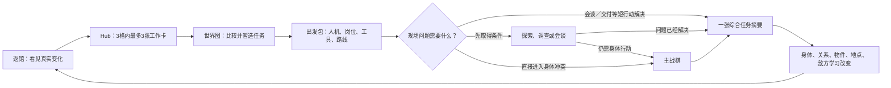

# 《超GAG机器人大战：万机残响》核心玩法总案｜整合版 v0.4

> 当前状态：`Candidate / integrated_core_game_design / user_direction_approved_2026-08-17 / no_Canon_or_Build_authority`
>
> 本稿只负责把整款游戏“玩家为什么想玩、实际怎样玩、为什么还想继续玩”讲清楚。它不修改 Canon、Reader、C01E02 Demo 或 Runtime。文中的关卡母型、数值种子、人物牌形、LLM与Meta玩法和后期机制仍是 Candidate；用户已经同意的是产品方向和本稿采用的公共设计答案，不等于授权制作或把示例升格为剧情事实。

**本页是唯一的玩法总案与正式批注入口。**`00b`只演示本页规则怎样连续接力两个周期，`05f／05c／06a／06b／06c／06d`只放大某一段操作。若支持稿与本页冲突，系统边界、提交位置和持久写回以本页为准；支持稿不能另开提交入口，也不能另造一份世界真相。

## 一句话产品定义

这是一款**让玩家带领一群有身体、有脾气、有历史的机器人，在确定可钻研的战棋中亲手搭出名场面，再把胜负、伤痕、关系、藏品和传说带回万机馆的群像机战叙事 RPG**。

它的核心幻想不是“替一群数值单位下命令”，也不只是“谨慎处理工程事故”。玩家要同时得到五种满足：

1. **像战棋高手一样解题：**读敌方行动意图，用朝向、站位、身体、预备反应和行动顺序组成强解，甚至合法地把一关玩坏；
2. **像机器人番剧导演一样搭台：**让一台被误解、想出风头或怕再次失败的机体，靠玩家亲手创造的条件打出只属于它的名场面；
3. **像队长和同伴一样组队：**战前选择人物出席与战术牌，战中让专业、关系、争执和共同动词改变打法，而不是走一串审批菜单；
4. **像收藏家和馆主一样生活：**巡访机器人文化、进入残响记忆、亲手修复和布展，让万机馆、藏品和冷门机因偏爱发生可见变化；
5. **像长篇RPG玩家一样被世界记住：**战报怎样发布、谁亲眼见过、谁被照料或被放手，会改变宿敌、城市、关系、后期Meta与终局回收。

本作允许纯粹的燃、爽和完整胜利，也允许救到一半、带伤撤离和有遗憾的继续。代价不是每次胜利后的罚单；先让玩家爱上、玩爽、想拥有，真正的代价才有重量。

### 玩家期待的是四种不同的日子

| 今天是什么日子 | 玩家第一眼看见什么 | 主要在做什么 | 离开时带走什么 |
| --- | --- | --- | --- |
| **打仗的日子** | 巨大身体、敌方行动意图、任务对象、场地下一次变化 | 排路线和朝向、设预备、钻公开规则、选择谁承担、为名场面搭台 | 胜负、伤损、战报、宿敌记忆和一段可复述的战场故事 |
| **出门的日子** | 城市里的机器人文化、可走空间、当地人物、机体记忆中的失真地点 | 巡访、攀爬、交谈、拆装、调查、进入残响并用物证校正 | 新路线、人情、藏品来历、机体理解和以后才会回来的约定 |
| **回家的日子** | 万机馆里真正改变的房间、停泊位、展台、伤机和仍在过日子的人 | 修复或留伤成招、布展、陪伴、关系重谈、少量战备和下一次编组 | 马上想试的新动词、空间变化、共同生活和下一次出发的偏爱 |
| **被世界回望的日子** | 谁亲眼见过、战报怎样流通、城市怎样称呼这台机、终端为何记得不该记得的偏好 | 公开／删节／馆藏、面对宿敌学习、识别或利用版本错位 | 名声的门与墙、私密意义、长期敌方反制、Meta余响与终局位置 |

一项任务不必把四种日子全塞进去。常规任务只前台化一到两个玩法母型；不同日子的轮换负责换气，系统写回负责让它们仍像同一款游戏。

### 先看一个完整任务：玩家这一晚到底做了什么

> 这是用于解释系统的中性Candidate示例，不属于任何正式章节，人物牌形仍须在适配时重新核对。

万机馆刚抵达一座河港。世界图上有一项请求：一台退役仪仗机想在旧桥封闭前，沿自己当年的路线把城市原钟送回展厅；收藏商名角要夺走它的稀有头饰，却公开坚持“必须先完成鉴定，绝不在主镜头前粗暴拆件”。第三轮潮水上涨，旧桥会转位。

**返馆与编组。**玩家先在馆里看见三件事：上一战受损的锚机、正研究旧路线的纪存、在画两条拦截草图的白鸢。纯走动和闲聊免费；玩家把三次会写回的返馆选择用于`给锚机保留旧凹痕并换成侧顶动作／和仪仗机谈它是否真的想走／调查港口班次`。出发时从可用人物中装五张牌，实际带上纪存的可靠旧路线、白鸢的有限预演、陆衡的桥面承力改形、驾驶员与机魂的一张共同中止牌，以及地方水务员的潮位牌；没带的人继续留馆生活。

**可选巡访。**玩家可以直接开打，也可以先走河港。沿军乐声攀上货梯、帮水务员拆开卡泵后，玩家得知一条高架检修路和第三轮放水方向；仪仗机明确说它不要被拖过去，只接受自己走完最后一段。巡访没有现实倒计时，但会让队伍在世界时间上晚到一个班次。直接开打仍有正面强攻解；巡访换来的是另一种题，不是通关许可。

**战斗第一轮。**主家族是三方戏台，桥口局部有正面会战压力。敌方行动意图显示：两台拆解机会封主路，收藏商名角会先鉴定头饰；仪仗机每轮自己向前走两格。玩家让锚机横身占桥口，轻机预备`拆解臂启动就切断它的落脚绳`，工程机打开检修路。人物牌没有替任何单位行动，只把陆衡验证过的侧撑方式写进工程机已有动作。

**第二轮。**收藏商名角的公开性格成了可钻规则。玩家可以把无人直播机位移到空冷却桥，诱它去那里完成体面的鉴定；也可以正面拆掉它的鉴定臂。前者省战力却占用轻机和一张人物牌，后者更直接却会让仪仗机暴露。若玩家巡访过，潮位牌会提前标出本轮末哪条浅滩消失；没巡访也能用更宽但更慢的主路。

**第三轮。**旧吊臂将倒，地图长出一个名场面机会：仪仗机可以完成最后一次敬礼，同时用肩架接住原钟；它主动请战，但不画路线。玩家有三种好答案：为它搭台，让锚机承受侧翼撞击；把机会让给从未亮过相的量产轻机，安全救钟；或放弃这幕，拆收藏商正在形成的敌方名场面，保证全队完整撤离。选择敬礼时，玩家还要决定现在发动，还是赌潮水上涨前再走两格。爆发后原钟落点、桥面和敌阵都会真的改变，战斗不会自动结束。

**结果与世界回望。**玩家可能得到`仪仗机完成路线／原钟完好／锚机旧凹痕扩大／收藏商撤退`，也可能得到安全但没有公开敬礼的一版。事实账先固定谁亲眼见过什么；玩家再选完整公开、明确删节或仅馆藏。公开会让城市重新邀请退役机登台，也让远方收藏商学到这套桥口阵形；馆藏会打开仪仗机的私密重演和以后对未亲历敌人的惊喜。

**回家。**锚机的旧凹痕现在真成了选择：复原可恢复稳定正顶，留伤可保留有角度限制的侧顶新动词；仪仗机若自愿，会把旧头饰放进展厅并改变观众路线。白鸢会复盘自己哪条草图被潮水推翻，水务员以后来馆参观，没出席的人有自己度过的夜晚。玩家下一次想做的不是“清红点”，而是试侧顶、再见收藏商、带另一组人物看看能否把同一行为合同卡得更狠。

只想理解游戏是否有吸引力，读到这里已经可以形成第一判断。以下内容把公共循环、精确规则、长期系统和范围上限全部展开，供主策与后续适配使用。

## 已接受的四个产品方向

原评审问题已在2026-08-17归并并接受为下列四个方向。它们是本稿的设计前提，不再构成第二张待回答问卷：

1. **战棋底盘：**采用不限现实思考时间的短全队协同回合；身体、朝向、敌方行动意图、预备反应、非歼灭目标和合法规则利用共同构成基础深度；
2. **燃爽高光：**普通战本身必须好玩；焦点战和高潮战再启用气势与名场面发动机，允许请战、让台、拆台、合体、变形、地图炮、宿敌对撞和无歉意全胜；
3. **人物与机群：**机魂和机体是会主动争取、害怕、抬杠、拒绝和改主意的同伴；战前人物出席与有限战术牌改变打法，人物不是通用Buff，也不是流程审批员；
4. **长线RPG与个性化：**城市巡访、残响深潜、返馆修复／布展、关系网络、战报与世界学习、可选LLM陪伴和世界内Meta共同承接收藏、恋爱、家、记忆和延迟回收。

旧八项中的返馆三格、轻系统、成长与复杂度上限继续作为这四项的支撑规则。最终秒数、具体动作成本、正式地图、逐章关卡、资产量与实现方案仍未在此定案。

### 本阶段已经完成什么，还没有授权什么

- **已完成：**核心产品幻想、主回合语言、名场面三档、人物组牌方向、四类战斗题型、主要非战棋母型、规则精通立场、长线个性化与复杂度上限已经进入同一份Candidate总案；
- **仍可批注：**本文任何具体规则、例子或取舍都可继续返修，但不再因一个局部问题把整套方向退回未决定；
- **没有授权：**没有把Candidate晋升为Canon，没有改写C01—C03已验收故事，没有批准C04以后情节，没有生成Build、Runtime、BOM、数值平衡表或22章关卡清单。

后续策划只应做三件事：先让本稿内部一致；用户另行启动后，再用C01—C03各做少量适配样板；最后才决定哪些规则值得进入实现规格。Fable 04—17保留为创意与推导来源，不再与本稿并列承担玩家总案权威。

## 这款游戏的主次关系

| 层级 | 承担什么 | 学习成本 | 不做什么 |
| --- | --- | --- | --- |
| 主战棋 | 空间、身体、时序、敌方行动意图、预备反应、规则精通、任务目标与名场面 | 中高；允许成为主要深度 | 不靠刷级、随机词条或过场替代判断 |
| 活机群与人物组牌 | 机体欲望、驾驶者／机魂回应，以及人物的独占专业、有限战术牌和共同动词 | 逐步开放；战前构筑，战中轻量 | 不把人物做成通用Buff，不让普通动作逐项审批，不由AI替玩家排完整方案 |
| 巡访／深潜／调查 | 换节奏，在真实空间和主观记忆中取得路线、人情、物证、许可或工程条件 | 低到中；各有独特触感，共用少量动词 | 不搜满发光物，不做扫描清单，不每章发明新谜题系统 |
| 万机馆与长线 | 回家、手修、布展、关系、收藏、战备、战报与下一次编组 | 低到中；普通维护自动化，只有高价值冲突前台化 | 不做每日打卡、全员送礼、仓库会计或审批模拟 |
| Reader、演出与世界回望 | 让玩家促成的笑点、燃点、亲密、损失和奇观被人物与世界承认 | 叙事理解 | 不在过场里夺走玩家搭好的高潮，不用战后文字冒充玩法反馈 |

### 三个产品支柱怎样落到这五层

这套总案只用三个产品支柱。旧稿中提到的六条体验原则，不是另一套玩法或第二张评分表，而是判断这三个支柱有没有被写对的条件。

| 产品支柱 | 主要落在哪些层 | 必须满足的体验条件 |
| --- | --- | --- |
| 主战术有深度也有爆点 | 主战棋＋活机群与人物组牌 | 信息可读但不全知；基础交换本身好玩；名场面来自玩家搭台；规则强解被承认 |
| 长线轻而具体 | 巡访／深潜／调查＋万机馆与长线 | 家、藏品、身体和关系可见变化；非战棋本身有趣，并把少量结果交给后续系统 |
| 故事后果由玩法制造 | 全部玩法＋Reader／演出／世界回望 | 玩家亲手促成，角色自主选择，演出负责兑现，状态负责长期回收；四者缺一不可 |

### 为什么选择这套组合

这些作品只帮助说明取舍，不证明本作规则一定正确，也不是要把它们拼成一款游戏。完整来源和证据边界见[比较研究附录](research/01-comparative-gameplay-research.md)。

| 参考方向 | 保留什么 | 本作不迁移／主动避免 | 为什么适合本作 |
| --- | --- | --- | --- |
| 《超级机器人大战》 | 具名机器人、角色存在感和战斗奇观 | 用通用增伤、回血和气力按钮代替人物身份 | 让角色身份落实为路线、判断、权限和身体回应 |
| 《陷阵之志》 | 敌方意图可读、保护对象与多种解法 | 全知、零误差、每题都有唯一最优解的纯谜题感 | 玩家能负责地计划，同时仍要判断信息来源和风险 |
| 《Phantom Brigade》／《Frozen Synapse》／《Valkyria Chronicles》 | 短计划、动作时长、具身路线和执行压力 | 编写长脚本、逐帧微调或靠即时反射取胜 | 让巨大机器人真的占空间、转身、碰撞和承力 |
| 《Radio Commander》／《HighFleet》 | 情报有来源、延迟、误差和通信范围 | 让玩家只做脱离身体的远程总司令 | 保留前线机体自己的视野、判断和拒绝权 |
| 《BATTLETECH》／《XCOM》／《Pyre》 | 功能伤损、撤退、部分成功和持续后果 | 随机永久死亡、刷合同、佣兵经济和数值磨损 | 失败能继续写故事，但不会把主线变成刷资源游戏 |
| 《Outer Wilds》／《TOEM》／《Botany Manor》／《Chants of Sennaar》 | 观察、证据、知识开路和低压力探索 | 发光物清单、背诵世界观、每章另造一种谜题语言 | 探索和调查只解决一个真实问题，并立刻改变后续行动 |
| 《火焰纹章：风花雪月》／《Citizen Sleeper》／《Spiritfarer》 | 有限时间内选择少量重要关系与整备行动 | 每日打卡、全员送礼和清空红点 | 返馆阶段保持轻量，但每个选择都改变身体、关系或下一任务 |

## 一次普通会话怎样循环

```text
返馆，看见上次留下的身体、关系、物件和任务变化
→ 在3个时间格内安排最多3张高价值工作卡
→ 比较世界图上少量正在变化的任务
→ 暂选任务，编排人员／机体／岗位／工具／路线
→ 一次性“承担任务”
→ 视任务需要进行轻探索、调查实证、会谈或直接战术
→ 主战棋完成救援、保护、撤退、证明或争取同意
→ 一张摘要写清成功、损失和责任
→ 回到已经变化的万机馆
```

探索不是每次战斗的固定前菜，战斗也不是每次出发的固定结尾。一项调查可以直接解决问题；一段关系事件也可以留在馆内完成。系统出现与否由当前冲突决定，不按“每章凑齐所有模式”的配额决定。

### 系统怎样接力，而不是各开一张菜单



系统之间传递的不是“通关分数”，而是少量具名事实：

| 被记住的东西 | 谁会改变它 | 下一步谁会读取 | 本例中的一句话 |
| --- | --- | --- | --- |
| 机体身体与功能 | 战术、维修、训练 | Hub、编队、下一场战术 | 左臂受限后仍能警戒，但不能正常承接冲撞 |
| 知识、权限与同意 | 探索、调查、会谈、人物战术牌与主体回应 | 路线、出发包、具体动作 | 知道侧门可开，不等于有权开，也不等于机魂接受穿门承接 |
| 关系与条件协议 | 具名承诺、拒绝、训练和共同经历 | 下一次提案、停止权与人物事件 | “允许现场自主中止”会改变以后高风险动作的提交方式 |
| 唯一物件与保管位置 | 携带、借出、留置和回收；策展只读取它 | 工具槽、调查、收藏与归还责任 | 便携地面支撑架留在现场后，下一任务就不能再装一件副本 |
| 地点、任务与世界时间 | 任务选择、未选后果、战术和工程结果 | 世界图、路线与后续故事 | 主桥降级后，下一轮出现限载和维修责任，而不是地图刷新 |
| 敌方学习 | 被目击的战法、样本、日志与通信 | 后续部署、敌方行动意图和反制提示 | 敌人见过固定交接后，下次会封交接点，但部署前必须让玩家看见来源 |

### 不同模式共用一套屏幕语言

Hub、世界图、探索、调查和战术不会各讲一种状态话。玩家查看任何卡片，都应该马上回答四个问题：**我知道到什么程度？现在能不能提交？事情已经走到哪一步？结果会交给谁？**

| 维度 | 全游戏只用这组状态 | 屏幕还必须说明什么 |
| --- | --- | --- |
| 信息 | `已确认／估计／未知` | 来源和更新时间；估计写范围，未知写怎样缩小 |
| 动作 | `可提交／有条件／不可提交` | 代价或阻断属于信息、物理、权限、主体回应、资源、时间还是唯一物冲突；同时给至少一个合法替代 |
| 进程 | `草案／已提交／已发生／已交接` | 草案可免费修改；提交后不能免费倒带；已发生事实只读；交接后显示下一个读取它的页面或人物 |

颜色只帮助扫视，不能单独承担含义；每个状态同时有文字和形状／线型。长期行程只写`时间格T`，战斗内部只写`战术周期`，不会用同一个“回合”混指两种时间。

所有页面共用一条操作语法：

```text
准备方案
→ 查看得到什么、付出什么、仍然不知道什么
→ 明确提交
→ 观看执行或在合法窗口主动中止
→ 读取已发生结果
→ 处理尚未发生的责任，并交给下一屏
```

`报告路线`、`请求开始`、`提交时间格`、`承担任务`和摘要页的`继续`，只是不同情境中的主提交键，不是五套规则。浏览、悬停、比较和编辑草案都不会偷偷改世界；每个页面最多有一个主提交键。提交前发现冲突就保持原状，并说明原因和替代。

例如“护卫机左臂受限”会沿着同一张状态卡移动：返馆诊断时显示`已确认／不可独立承力`；排班草案中显示`有条件：1格＋材料1可安装临时箍架`；提交后，编队页显示`已发生：下一完整任务内可受限承接，触及停止线或主体中止即关闭`；任务结束后，摘要显示`箍架已报废，左臂受限继续交给下一次Hub`。它不是四个菜单里各记一份数。

### 一次中等任务的节奏（不是现实限时）

下面只表示内容重心，不要求玩家在多少分钟内完成。回合制规划、巡访和调查默认不限现实思考时间；世界内截止只用明确轮数、班次或长期时间格表示。

| 段落 | 玩家在做什么 | 本段的核心犹豫 |
| --- | --- | --- |
| 短返馆 | 查看最多四件真正变化的事 | 哪一项值得今晚走过去看？ |
| 短到中等的返馆选择 | 生活、手修、布展和至多三张高价值工作卡 | 彻底修好再晚走，还是留伤成招或把时间给某个人？ |
| 短世界图与编组 | 比较任务、暂选、装备人物牌与机体 | 现在承担哪一个请求，谁同行，谁留下过自己的生活？ |
| 可选的中等非战棋段 | 城市巡访、深潜、调查或关系时刻 | 深入取得独特条件／理解，还是保留时间与未知直接前进？ |
| 主要战棋段 | 在一个主家族里排身体、预备、人物牌与名场面 | 用哪副身体承担哪项责任，保什么、放弃什么？ |
| 短摘要与发布 | 读取事实、处理未决责任、决定战报去向 | 谁会学到、谁会记得、哪一幕只留在馆里？ |
| 短返馆余韵 | 看见后果落到人、机体、展台和下一任务 | 下一次最想试什么、最想去见谁？ |

完整两周期实例见[全游戏公共玩法骨架](00b-full-game-common-gameplay-skeleton.md)。

## 主战棋：玩家每一轮究竟做什么

战术地图第一眼同时显示四类内容：

- 我方与敌方的身体、占格、朝向和地形；
- 敌方当前行动意图：目标、准备动作、预计生效时间和信息来源；
- 车辆、桥、样本、闸门、撤离线等任务对象；
- 我方每台机体仍能使用、已经受限或已经失效的身体功能。

**本稿采用短全队协同作为唯一主方案。**这里的“一轮”是一个短的共同战术周期，不等于现实八秒倒计时，也不限制玩家思考时间。玩家可以停下来查看、预演、换编排和撤销尚未提交的命令。

一轮固定经过五步：

1. **局势公开：**敌方真实计划冻结；界面显示它愿意公开或能被合法观察到的行动意图、行动先后，以及轮末火势、水位、车辆、机关和目标怎样变化；
2. **全队编辑：**玩家逐台安排短路线、终点朝向、一个主要动作或一条预备反应。点`本机排好`只表示这一行检查完，整队提交前仍可修改；
3. **提交摘要：**系统把敌我动作放进同一条可预览时间线，显示争格、接触、承力、预备优先序、未知区间、人物牌消耗和可能进入的备用方案；
4. **执行本轮：**玩家长按唯一主提交键，锁定全队计划。敌方不能读取未提交草稿，也不能在看过结果后临时改计划；
5. **轮末结算：**环境和公共任务状态只推进一次，敌方再根据本轮实际看见的结果重规划下一轮。

编辑期间世界不会实时流逝。某台机选择`等待`只是放弃本轮动作，敌人、车辆和环境仍会在`执行本轮`后推进。每段移动和动作按公开时长进入时间线；具体采用几秒仍待以后定，但玩家永远不靠动画播放顺序猜先后。

逐台交替行动只保留为未来低负担模式的研究备选，不与本稿关卡混写。若以后改选它，必须整体重写敌方回应、人物牌刷新和环境推进合同，不能让两种时制在不同案例里轮流出现。

### 一轮完整小例

浅滩边，敌方拆解机显示“切吊索”，名角的动作类型确定为突进，但它可能冲旧吊车，也可能冲货厢；轮末河水上涨。

玩家让重型机进入浅滩，并预备`敌机踏入作用区就肩顶侧推`；侦查机从名角重心判断它更可能冲货厢，于是封住货厢分支；运输机同时把货厢向安全岸移动。提交摘要清楚写出：若名角实际冲吊车，侦查机不会触发，吊车会受损；若冲货厢，它会在第一段突进后被截住。

执行后，拆解机踏入浅滩，重型机的预备触发，把它推离吊索作用位；名角按早已冻结的货厢分支突进，被侦查机挡住；运输机继续把货厢拖离。轮末河水上涨，下一轮地图变窄。

这里没有必杀技，也没有角色审批链。乐趣来自读身体、为真假分支做有代价的鲁棒计划、把预备押在正确位置，再一次看见全队因果兑现。

### 机器人不是一根血条

基础身体至少区分：

- **机动**：能否移动、转向、稳定站位；
- **作用**：能否攻击、推拉、工程操作或搬运；
- **防护／承力**：能否保护、承接冲撞或撑住结构；
- **传感／通信**：能看见什么，能与谁共享；
- **能源、热量和具名工具**：能否继续执行特定动作。

功能受限会关闭或改变具体动词，而不是只让总HP变少。例如锚定腿受限后仍可原地保护，却不能完成快速转身；维修臂失效后工程机仍能撤离，却不能再开门或固定样本。

### 敌方行动意图不是未来剧透

敌方行动意图分三种可读状态：

| 状态 | 玩家知道什么 | 玩家还要承担什么 |
| --- | --- | --- |
| 已确认 | 可见敌人的当前目标、动作与预计接触时刻 | 判断怎样阻挡或利用它 |
| 估计 | 来自传感、报告或行为推断的目标与误差范围 | 决定是否先取证、试探或接受偏差 |
| 未知 | 没有合法来源，或信息已经过期 | 不能靠角色能力凭空补全，只能换路线、增派传感或保留反应 |

普通敌人的行动意图必须诚实。只有档案明确标出“会佯动”的名角或精锐才可以说谎，而且每种敌人只能在`动作类型／目标区域／移动路线`中的一个字段上佯动，其余字段仍为真。意图卡同时给出两个可能分支与可观察的身体线索；玩家可以读重心、视线和推进器方向，也可以用调查或人物牌缩窄范围。

敌方真实计划在本轮开始时已经冻结。它可以在轮末重规划，但不能读取玩家未提交的草稿，也不能在执行中免费换答案。若敌方以后学会反制某种战法，必须有目击、战报、样本、日志或通信来源，并让玩家在部署前看见它学到了什么、来源是什么。

### 反应与保护为什么重要

“保护别人”必须是提前承担的动作，不是敌人打下来后系统白送的动画。

例如玩家让护卫机预留“保护车1”：

- 敌人撞车1时，保护路线触发并占用真实时间与承力；
- 敌人改撞桥墩时，这次保护不触发；
- 没有预留保护时，即使护卫机站在附近，也不会自动替车挡下冲击。

同理，截击、中止和承接都要提前写清触发条件、覆盖方向、代价和放弃了什么。

预备反应遵守四条公共规则：

1. 一条预备写成`若公开条件X发生，就执行动作Y`；范围、代价和结果在提交前可见，本轮最多触发一次，没触发就失效；
2. 同一时刻争同一格、交换位置或接触的身体，从同一个前态组成接触组一起结算，不按阵营、角色重要性或单位编号抢先；
3. 进入射界、物体坠落、友军受击、机关变位等非接触事件同样可触发预备；多条我方预备的先后在提交摘要中排好，不在执行中弹窗让玩家使用后见之明；
4. 预备制造的新事件可以再触发另一条预备，但每条每轮只触发一次，因此反应链必然结束。某段因前置结果变得非法时，只取消该段及后续，并进入提交前公开的备用方案；没有备用就停在最后合法状态。

敌方预备至少公开动作类型、触发类别和作用区；普通敌人还公开具体条件，只有行为卡明确标出的精锐可以隐藏阈值。同一事件中，我方预备按提交摘要的顺序结算，再结算敌方预备；执行中不弹出临时反应窗口。

### 胜利不等于清光敌人

普通任务使用一个主要目标、最多两个次要目标和一项身体／撤离账：

```text
主要目标：任务截止前撤出至少2／3辆维护车
次要目标（公共设施）：主桥保持完整通行能力
次要目标（证据）：中央样本不被敌方带走
身体账：三台我方机体带着什么具体损伤离场
```

敌人可以被挡住、迫停、推离、缴械、压制或迫使撤退。玩家完成主要救援但丢掉样本，仍是带着后果继续；主要目标彻底失守且没有合理继续态时，才回到稳定检查点重试。

但“非歼灭目标”不是“禁止玩家爽”。四类胜利应轮换出现：

- **无歉意全胜：**面对明确恶意的敌人，在正面会战里全歼、彻底拆阵或完封目标，回馆后有庆典，不追加道德罚单；
- **多解责任胜利：**保桥、保样本、保第三方或保身体，各自打开不同后续；
- **尊严失败：**主要目标失去，但玩家保住主体、关系或撤退线，故事承认这次失败而不羞辱玩家；
- **代价胜利：**玩家明知会失去某项东西，仍选择承担并完成更重要的事。它是少数重音，不是每场固定税。

全游戏统一按三种情况分流，不让每个章节临时发明一种“失败界面”：

| 发生了什么 | 下一屏让玩家做什么 | 哪些东西继续存在 |
| --- | --- | --- |
| `部分完成`：主要目标完成，但次要目标、身体或物件有损失 | 进入任务摘要；展开原因，并处理尚未发生的回程、保管或现场交接责任，然后按一次继续 | 已救出的人、已丢失的样本、具体伤损、资源消耗、敌方观察全部保留 |
| `主要目标失败，但世界仍有合理后续` | 结果卡给出一个具体的下一责任，例如撤离幸存者、处理事故余波或接受改变后的路线；玩家选择怎样承担，不重选已经失败的事实 | 本场事实和损失保留，任务转成新的世界状态、债务或后续入口 |
| `无法形成合理继续态`：例如本例少于两辆车撤出，故事所需的基本救援已经不存在 | 回到任务前标明的稳定检查点，重新选择路线与计划 | 不发资源、不保留这次未提交的战场结果；玩家已经学到的规则与信息由玩家自己保留，故事世界不假装发生了时间倒流 |

因此“失败继续”不是自动把失败涂成成功；“检查点重试”也不是每次掉一台机就清空世界。判断标准是：当前结果能不能产生一个仍然可信、仍有玩家责任的后续状态。

## 同一题面的两条完整战法

三台机体分别是：两格锚机、单格游击机、单格工程机。它们面对三辆维护车、受损主桥、关闭侧门、中央样本、两台重机和一台取样猎手。

### 战法一：保公共设施

1. 锚机抢占支撑位并持续承力；
2. 游击机连续反压制主路，让两辆车顺利过桥；
3. 工程机修复旧裂损，再打开侧门作为撤离备用；
4. 玩家接受没有截击猎手，样本被敌方带走；
5. 最后一次强化推进使锚机锚定腿受限，但主桥保持完整。

结果：`撤出2辆／桥完整／样本失守／锚定腿受限`。

### 战法二：保住证据

1. 锚机横身保护车辆，不负责修桥；
2. 游击机预留截击，中止猎手取样；
3. 工程机开侧门并在第二周期固定样本；
4. 两辆车从主路撤出，工程机携样本从侧门撤出；
5. 桥因连续占用和重接触降级，锚机保护框架失效。

结果：`撤出2辆／桥降级／样本保住／保护框架失效`。

两条路线都重复“选机—画路—定朝向—选动作—预留反应—提交”。操作上的关键差异是：战法一连续把游击机的主动作投给主路压制；战法二先把游击机的反应预留给取样猎手，再把工程机的下一个动作投给样本固定。

两条战法的区别不是路线颜色，而是谁用身体承担了哪一项责任。更详细的逐周期操作见[基础主战棋完整例](05f-first-neutral-tactics-v0.3-decision-ladder.md)。

## 规则精通：允许玩家聪明地把一关玩坏

理性玩家卡规则、做构筑、找几何漏洞和利用敌人公开性格，本来就是战棋的乐趣。系统应当在字幕、战报和敌人反应中承认“这一手真厉害”，而不是偷偷加免疫把胜利没收。

一个合法精通解满足五条：

1. 关键规则在选择前公开，或能通过巡访、调查、观察和敌方档案查到；
2. 结论来自两条以上公共规则的组合，不是本关临时出现的一句作者例外；
3. 玩家付出位置、行动、编组、公开情报、时间窗或其他真实机会成本；
4. 它压缩或改写本关难题，但没有永久跳过整款游戏的核心循环；
5. 敌人只有亲历、收到战报或取得记录后才能学习，不能从后台偷读玩家习惯。

例如，敌方名角公开立誓“同一招绝不在主镜头里用第二次”。玩家把无人聚光塔移到一座空冷却桥，引它在那里公开展示突进：它守约，下一轮只剩两条可见变招；它毁约，就失去观众和僚机对它舞台规则的支持。玩家卡的是对手公开人格，不是伤员或市民的安全。

若某个强解跨大多数关卡通吃，修法不是隐藏免疫、随机故障、突然追加权限或道德扣分。先给它战前可见的固定代价；仍然过强，就用另一种公开地图、目标、身体或敌方性格出题。它此前赢下的那一关仍然算数。儿童、病人、伤员和避难者只能是需要保护的主体，不能被主动当作掩体、引怪线、炮线阻挡物、气势燃料或名声倍率。

## 四个战斗家族：同一底盘，不同快乐

每场战斗恰有一个主家族，后期至多叠一个只在局部生效的次压力。家族不是剧情类型，而是玩家这场最主要在算什么。

| 战斗家族 | 核心判断 | 两种典型打法 | 失败怎样继续 | 长期变奏从哪里来 |
| --- | --- | --- | --- | --- |
| **正面会战** | 阵形、交换、朝向、承力、行动顺序和预备线 | 抢先拆阵；或后手反应把敌冲锋吃干净 | 阵地失守后转成撤退／追逃，伤机带回馆 | 敌我身体家族、阵形地形、波次与不能硬吃的敌方单位 |
| **三方戏台** | 第三方想做什么、敌人遵守什么公开习惯、场地何时变化 | 保护并陪第三方完成自己的路；或借敌人执念和场地节奏替你做事 | 第三方走向坏结果，目标转成追缴、善后或赎回 | 第三方欲望×敌方性格合同×潮位／列车／仪式等场地周期 |
| **追与走** | 速度差、路线承诺、断后、放弃什么和何时脱离 | 轻队抢路、重队阻追；或主动舍弃一件目标换全员撤离 | 从“逃出去”转成“谁留下、哪里失联、以后怎样找回” | 追击者身体、岔路代价、可拆地形、携带物和传递责任 |
| **大动作战** | 为合体、变形、地图炮、巨构动作或百机合奏凑公开前置，并决定何时兑现 | 快速冒险启动；或稳妥保护前置、接受错过窗口 | 半完成会留下应急身体和新的撤离目标，不只播放失败动画 | 前置条件、参与者、身体损伤、场地、替补与中止权 |

### 四家族各自为什么能不断出新关

**正面会战**不是“无脑清杂”。玩家看敌我阵形和部位损伤，决定先手抢位还是后手反打，把谁的正面对准谁的侧面，预备押在哪条线。它是纯燃纯爽和无歉意大胜的法定家园。几何强解可以是围绕一台零战力供电机站出三向反应阵：代价是全队失去机动，收益是一轮连锁反打清场。

**三方戏台**让机器人性格和城市生活进入规则。第三方不是要被搬到终点的箱子，而是会按自己的理解行动；敌人也有能被利用的执念。玩家可能一边挡敌，一边让一台把今天误认成阅兵日的老机走完路线；也可能故意把收藏癖敌人引向无害展件。好解来自读懂它们，不来自解锁唯一作者按钮。

**追与走**把“撤退”做成主动玩法。玩家看追兵下一轮封哪条路，决定重机回头封窄口、轻机先送物、把谁的动作存成断后预备；携带样本、拖伤机或守约都会真实改变速度和路线。完整脱离本身就是高潮，不欠一段额外必杀。

**大动作战**满足经典机战幻想。合体、变形和地图炮不是剧情按键，而是空间题：谁清出站位、谁承受前置伤害、谁愿意入席、替补是否成立、发动后地图怎样翻面。快速启动可能保住窗口却留下不稳定接口；稳妥启动更安全但会失去次目标。该家族即使采用高潮档，也由公开的前置进度替代三格气势；仍保留机会、请战、拆台、对撞与地图改变，但不再运行一套平行气势条。

主次组合只允许在判断仍清楚时使用：会战可局部叠追逃，三方可局部叠会战，大动作可在前置区叠会战或追逃；三方戏台、深潜、百机导演、Meta异化和馆内危机不能在同一个可操作场面同时争夺主界面。一个新模板若换目标、换地图尺度或换阵容就失效，应诚实标成作者型名场面，不冒充可批量生产的系统。

## 名场面发动机：普通战不欠作业，高潮战真的爆

名场面不是蓄满一条条就播动画。完整高潮由七步组成：

1. **打得像自己：**机体做符合其公开风格、又真实推进当前目标的动作，获得气势；
2. **战场长出机会：**危险源、身体能力和时机组成一个公开的“名场面机会”，也可以由玩家故意引敌、改路线或搭地形亲手锻造；
3. **机体开口请战：**它只说“这幕想给我”，不会给玩家完整路线；
4. **玩家搭台：**送它就位、调朝向、安排僚机、选人物牌、承担侧翼放空或身体受损；
5. **玩家决定：**现在发动、再赌一轮、让给冷门机、拆敌方名角的机会，或让敌我高光正面对撞；
6. **爆发改变地图：**绝活、合体或巨构动作必须产生新的落点、裂口、白雾、位移或身体状态，不只是高伤害数字；
7. **战斗继续：**气势清零、余韵台词出现，但玩家还要处理自己制造的新局面。

### 三档运行密度

| 档位 | 适用场面 | 前台规则 | 玩家得到的高潮 |
| --- | --- | --- | --- |
| **基础战** | 多数普通战、教学和纯交换题 | 不计算战斗气势，不显示气势条，不生成请战 | 靠排序、预备、朝向和身体赢得干净利落；“我算穿了这一关”就是高潮 |
| **焦点战** | 人物战、招牌战、重要回门 | 全场固定一名我方或敌方焦点；地图同时最多一个机会 | 围绕一台机搭成一幕，也允许另一台满足条件后抢下这幕 |
| **高潮战** | 宿敌、合体、地图炮、章级决战 | 最多一名我方焦点和一名敌方焦点；地图同时最多两个机会 | 请战、让台、拆台、顶台和双方绝活对撞完整运行 |

每场原则上固定档位。确需从焦点升级为高潮，开场目标卡必须提前写明“本战存在一次高潮升级”及机械触发类别；每战最多一次，伤势、位置、气势和标签次数不刷新。

焦点战和高潮战中，所有直接操作机体都计算气势；只有焦点机常驻显示并主动请战，其他机体选中时才展开自己的气势。机体达到三格、且场上存在它能承担的机会时才会请战；发动专属名场面消耗三格，系统永不自动发动。

人物牌、共同动词和名场面发动都必须在全队编辑阶段加入计划，并进入提交摘要；执行中不再接受临时输入。若发动条件因先行事件不再成立，就进入提交前显示的普通动作或安全中止方案。

### 气势怎样算，怎样防止刷条

- 每台前台机有三格气势和2—3个公开风格标签；符合风格且实际推进当前目标的动作最多加一格；
- 一个动作同时符合多个标签时只记一个，系统给默认，玩家提交前可改；
- 每个标签整场最多提供两次气势；名场面发动后只清空气势，不重置标签次数；
- 气势满后继续做风格动作不消耗剩余额度；落空、重复或因前置事件失效的动作不加势；
- 失势条件必须事前公开。无目标价值的摆拍会直接写`没有人需要这一手`，不能在安全角落刷；
- 有没有观众不决定战力。公开见证改变名声与敌方学习，只有同伴看见改变关系，无人看见的精确救援依然是完整高光。

让出机会时，接手者支付自己的气势，不能转移原焦点机的资源。原焦点保留气势，但本次请战结束；地图长出新机会前不会反复催促。只有身体条件没有气势，仍能用普通动作解危机，只是不触发专属名场面。

### 爆点不只来自“帅”，也来自笑和被看见

- **战术GAG：**错版机左右手反装，档案防守方向全错；社勇王把敌人砸进货柜后向货柜鞠躬，敌阵因荒谬的仪式真空一轮。笑点必须改变地图、意图或选择，不只是战后台词；
- **夺回声音：**一台被宣传定义成拆迁机的扶桥手，在众目睽睽下用绝活保住桥，战报公开后世界真的改口；
- **读懂才解锁：**首次绝活不靠刷等级，而可由物证考古、共同战斗或践行约定解锁；手修和收藏再把它变成侧向变体；
- **让冷门机登台：**把机会让给从未亮过相的量产机可能更难，但会改变它与队伍、观众和后续编组的关系；这是玩家偏爱的回报，不是强迫最优解。

## 活的机群与人物组牌：同伴会改题，不替玩家解题

### 机体不是许可灯，而是会主动制造戏的队友

每台重要机体有一组玩家可读、可逐步发现的“性格三件套”：

- **它最想做什么：**抢正面、保护后辈、证明自己还能跑、把某件东西完整送到；
- **它害怕或不愿重复什么：**被当作消耗品、再次弄丢同伴、让旧伤拖累别人、在众目睽睽下失控；
- **它绝不会做什么：**越过明确主体边界、把弱者当诱饵、重复某次创伤方式，或违背已经成立的约定。

这些不是三条隐藏好感值。机体通过四种方式在前台出现：

1. **主动看中一个目标或名场面：**它说想解决什么，不提供完整路线；
2. **给出局部反提案：**“别让我硬接；我可以把它引向左侧”，改变动作形状，不替玩家决定是否采用；
3. **在真正越界时拒绝：**拒绝必须有稳定原因和合法替代，不用于普通移动、攻击和已建立惯用动作的逐项审批；
4. **执行后改主意或长出习惯：**共同经历会改变以后它愿意主动提出什么、怎样中止和与谁能做共同动词。

玩家可以接受、改造、延期或拒绝机体的请求。一直顺着它不应成为固定最优；有时真正尊重它，是认真改造提案，或在不合适的战局里说“这次不行”。机体主体性给玩家新的局面和情感，不把战斗变成批复流程。

战棋中“玩家逐台编排全队”是团队协作的玩家层抽象，不等于纪存遥控所有四肢。机体、驾驶者和机魂依照已确认计划自主完成动作；只有请战、拒绝线、高风险承担和共同动词等真正有戏的边界，才把主体回应放到前台。

### 战前组牌：换人就是换打法

人物的身份不再只表现为“信息—许可—验证”链。出发前，玩家决定谁驾驶、谁随乘、谁现场同行、谁占通讯席、谁远援，以及谁留在馆里过自己的生活；然后从所有合法出席者中装备至多五张人物主动牌。

- 同一人物只能贡献一张主动牌；换岗位只改变接入位置、范围和风险，不能复制第二张；
- 每张牌每战使用一次；每轮全队最多结算两张；同一单位的一次出手不能叠两张独立牌；
- **共同动词**是唯一例外：两名相关人物的牌同时在编组，才可合并成一个强效果；发动时两张一起消耗，并占满本轮两张额度；
- 人物牌可以改变信息、路线、合法目标、动作形状、反应时机或场地条件，不能凭空多送一次单位行动，也不能只做通用增伤、必中或回血；
- 工修坊和资料席只做战前准备。每台出击机至多接受一项战前动作改形，并服从六动作上限，不从后台叠百分比；
- 没带的人会继续自己的工作、关系和生活，返馆后可见；缺席不是暗雷，也不意味着人物从故事里消失。

打出人物牌本身不占单位主动作；它只能修改、授权或重塑计划里的既有动作，不能生成额外出手。若某张牌要求人物亲自完成现场动作，牌面必须明确它占用哪台载具／机体或哪名现场主体的主动作。

每张人物牌必须回答一条完整来源链：

```text
人物固有的专业、习惯或创伤
→ 本场实际持有的工具、证据、岗位或关系
→ 玩家按下后改变哪条可见规则
→ 使用前提、失效条件与代价
→ 换人后为什么会形成另一种打法
```

### 具名人物的能力边界与候选牌形

下表只把Current能力边界与Candidate玩法提案分开；牌名和次数不是Canon事实。

| 人物 | 已知能力边界 | 可继续设计的候选牌形 | 绝对不能偷升成什么 |
| --- | --- | --- | --- |
| 纪存 | 组织、判断、调查；在馆守Z导览席只提供路线和判断，不控制四肢 | `档案叠图`：调出他亲自走过、记录过或取得可靠资料的路线；地形变化会让它失效 | 玩家基础战术控制不是纪存超能力；不能全图开路或遥控机魂 |
| 七海 | 只能撤回本人签发且仍在执行的命令，并承担后果 | `撤回我的签名`：签发记录确为七海时可用；否则灰显。也可追责、保全证据或提出异议 | 不能用自我停权购买他人权限，不能暂停军方、城市、平台或他人流程 |
| 白鸢 | 用已知分镜、传感、地形和机体资料做有限、可推翻的行动预演 | `预演草图`：把已知证据整理为两三条可能路线，遇到资料外动作就标`超出已知` | 不是未来视，不读隐藏信息，不下战斗命令，不画稿改现实 |
| 唐胶 | 模型修复、手作，以及已经建立的维修与路障经验 | `手作痕迹`：从亲手接触的手工件、外露修补或可追溯维修记录提出动作假设，再由扫描或工程确认 | 不能凭模型记忆判定当前全尺寸桥梁、地下设施或敌机精确弱点 |
| 兜灯 | 馆守Z整备员，能判断馆守Z何时可行动、何时必须制动并现场执行 | `整备红线`：对她亲自整备、验收或当场检查并接入执行接口的机体，给出候选合法动作边界 | 不能把馆守Z经验自动推广到所有机体，也不是全型号敌机分析员 |
| 陆衡／地方工程者 | 全尺寸载荷、材料与工程可行性 | 把一个工程动作改造成经验证的承力方案；失败数据仍保留 | 不解释机魂身份，不替唐胶读手作史 |

关系会改变牌的形状，但不免费增加行动经济。例如两人长期共事后，原本各自的`先标出危险／再做停止判断`可变成一张共同动词：一次同时给出风险区和现场中止条件；代价是本轮两张牌全部用完。恋爱、友情、师徒或非恋爱深信任都能长出等值但不同的共同动词，不能把最优战术奖励锁给唯一恋爱路线。

### 同一任务，两套编组怎样换题

任务是护送一件已确认无机魂、无活性主体载体的惰性大型外甲穿过收藏商封锁。

- **正面编组：**重型驾驶组合顶住主路；工程人物把旧桥面改成可承力的短直线；七海若本场恰有本人签发的封存命令，可撤回自己的签名，消除一道由她自己造成的流程障碍。打法稳定、路短，但会被更多亲历者看见；
- **轻装编组：**唐胶从可追溯修补痕迹提出“外甲右侧不可再吃横撞”的假设，白鸢用已知传感把拦截路线缩成两个候选，地方客将提供真实潮位信息；玩家用轻机绕行、预备截击并卡潮位。路线更脆，却保留外甲完整，也少向远方敌人公开一套正面阵形。

两套都由玩家排身体和时间线。人物没有替玩家玩，只是把“这关能怎样想”改成了两种不同题。冷门编组也可以对具有公开档案癖、仪式规则或地域习惯的敌系形成强解；这种强解只在相关行为合同成立时有效，不是全局固定Buff。

## 不打仗时玩什么：城市、记忆、家与关系

非战棋内容不是战斗前的许可工序，也不必全部兑换成战斗Buff。它们用少量共用输入承载四种不同幻想：

| 母型 | 玩家主要动词 | 真正的乐趣 | 结果可以只改变什么 |
| --- | --- | --- | --- |
| **城市巡访** | 观察、交谈、攀爬／搭乘、拆装／调律、撤回 | 在机器人文化江湖里走路、结识人、找捷径、碰见活事件 | 城市关系、路线、人情、收藏来源、同行者看法 |
| **残响深潜** | 进入、观察、比较物证、重组路径、校正或保留矛盾、退出 | 走进机体主观记忆，让“它怎样记得自己”成为可探索空间 | 机体理解、绝活变体、对旧失败的新解释、以后的一句回声 |
| **返馆之夜** | 走到房间／机位、手修、布展、陪伴、选择少量战备、结束夜晚 | 看见家真的改变，照料偏爱的机和人，马上得到新玩具或空间变化 | 身体、新动词、展台、生活、关系、下一次编组 |
| **关系时刻** | 发起共同活动、换视角表达、接受／反提案／拒绝／暂停、重谈 | 成年人之间的吸引、吃醋、信任、边界、错过、退出和重组 | 共同动词、出席形状、生活场景、私人记忆、关系结局 |

### 城市巡访：不是扫描清单，是机器人文化江湖

城市巡访发生在真实空间，有可走的街区、高差、交通、声音、机体尺度和当地日常。玩家不靠按住扫描键收集发光点，而是围绕一个想做的事自由走一段：找一台退役仪仗机、追一条旧零件来路、帮本地队解决一项活问题、带同伴看它从未见过的城市。

一段完整巡访例（长度随玩家停留与交谈自然变化，没有现实倒计时）：

1. 玩家在河港广场听到远处旧军乐，但主街正在升桥；地图只标出已知公共路，没有满屏问号；
2. 沿声音走到堤岸，观察轮痕和低矮护栏，发现仪仗机不可能从主街过来；同行人物各自指出不同细节，玩家选择继续跟谁的视角走；
3. 攀上旧货梯看见一条高架检修路，也可以在下面帮水务员拆开卡死的泵盖，换取他告诉你今晚闸门何时放水；
4. 走高架会更快见到仪仗机，却错过泵站的人情；帮水务员会晚一班世界内交通，但打开以后可再走的河床捷径。这里没有现实倒计时，班次只是世界状态；
5. 找到仪仗机后，玩家可以谈旧演出、请它走一段、只在旁边听，或尊重它今天不想表演。结果可能只是一张合照、一段关系、一条以后才可用的路线，也可以让它成为章节客将候选；
6. 返访时，修好的泵、换过班的水务员和仪仗机今天的位置都会变化。玩家没有被罚“第一次没拿全”。

体力或时间格不能成为唯一决策货币，也不要求每次巡访注定错过一半内容。真正的取舍应来自路线、人情、同行视角和世界班次；可返访的城市允许玩家以后看见变化。

### 残响深潜：走进一台机怎样记得自己

深潜不是读一段回忆，也不是把主观记忆当成事实。它把机体的感官、误解和缺失变成空间：一条走廊可能永远下雨，门牌顺序来自它当年的恐惧，某个人在记忆里没有脸。玩家携带现实物证进入，既可能纠正机体，也可能发现官方记录才是错的。

一段完整深潜：

1. 现实里，一台旧仪仗机坚持“那天雨没有停”；档案却写典礼全程晴；
2. 玩家选择至多三件物证带入：生锈的鼓架、现场照片、维修员留下的湿手套。没有一件单独给答案；
3. 在主观街道中，玩家沿鼓声移动、攀上倾斜看台、拆开永远漏水的扩音器，再把照片放到它记忆中的拍摄位；
4. 照片天空确实晴，但鼓架内部积水与手套时间标记说明雨在开场前刚停。玩家可以校正为“典礼时已停雨”，也可以保留它的说法：“对它而言，等待被允许登场的那段雨从未结束”；
5. 退出后，历史不被改写。档案新增来源清楚的窄结论，机体可能愿意重演那段入场，也可能拒绝把它变成展品；
6. 全剧少数机体可以进入一次**重演台**：用现在的身体重打它一生中那场旧败局。胜利改变的是它如何理解自己、绝活怎样变形和终局愿意站在哪里，不把过去的人复活，也不把失败从历史里删除。

深潜可以产生路线、身体动词或战斗情报，但不必每次服务战斗。它独有的价值是“可玩的传记”和玩家对一台机的长期依恋。

### 返馆之夜：先回家，再处理少量战备

返馆首页先显示3—5个真正改变的地方：某台机停在临时架上、一个展台被观众留下纸花、有人把饭端进维修间、借出的工具仍在外地、一个角色今天没有在等玩家。玩家可以直接走过去；系统不会把这些全变成红点、积压率或每日任务。

返馆分三层，但只共享一个夜晚：

1. **生活与陪伴层：**散步、闲聊、吃饭、修机陪伴、成年人关系和机群斗嘴。它可以只改变口吻、记忆、关系与家，不必给战斗奖励；
2. **展陈与手修层：**决定一件东西怎样被理解、保留哪道伤、让哪台冷门机站上主展台。审美布展改变观众路线、人物相遇、对白与城市理解，不改变下次战斗数值；
3. **战备层：**处理大型维修、训练、调查和真正冲突的出击准备。普通维护、回收、归位与惯用编组自动完成，可一键沿用；只有容量、唯一物或任务窗口真的冲突时才前台化。

三层共享同一个夜晚的行动上限：**一次返馆最多提交3次会写回持久后果的高价值返馆行动**，连续大型维修可占多次；生活、关系、手修、布展、训练和战备若会产生持久变化，都从这同一上限中支付，不存在三套额外次数。纯走动、查看和无后果闲聊免费；首页最多显示4张值得处理的后果卡，不要求清空。

重大伤势才会出现`复原／留伤成招`：

- **复原**恢复原身体动词、稳定性和装备兼容，不额外送新招；
- **留伤成招**保留原动词缺失或限制，换一个有次数、角度或维护代价的伤痕动词；
- 新动词是替换，不是白送第七项；确认前同时预览失去、得到和下一战怎样按；
- 只有策划能先写出“至少一种局面复原独有优势、至少一种局面留伤独有优势”时才提供二选一，否则按剧情与维修条件走单一路线，不制造作者已经选好的假选择。

布展也不是战前答案题。馆内危机只读取一件焦点展品、一个可复用互动标签（重型／易碎／供能／保密／可移动等）和一种预制布局类型；其余展品改变人物、对白和纪念，不要求为每种排列各写逃生谜题。

### 万机馆的物理边界

万机馆已在C01E04恢复为百米级巡展舰体并以有限防卫炮、救援锚和外部锁泊参加空战；当前不是人形机器人，也不是无限格纳库。L1主展厅约70×45米、净高约24米，可容18米馆守Z半跪展示，却不能让多台十数米至数十米巨机自由机动作战；B1只有有限中型泊位和单机重型维修架，大型机主要外部锁泊。

因此，馆内危机只承载人物、小型机器人、无人机、展陈机械、断电、火灾、封存系统和局部舰体灾害；大型机守馆战发生在外部锁泊、舰体表面、邻接广场、任务地或空域。全剧可有2—3次馆内危机夜，但它们是作者型高峰，不是常驻战斗家族。具体吊轨数量、吞吐轮次、万机馆未来人形／暴走／更高战斗形态均仍是Candidate；Working层的万机殿多方模块组合不能偷换成“万机馆单舰必然变人”。

### 关系时刻：不是好感条，也不是主角中心后宫

关系玩法从“共同做一件事”开始，而不是选正确台词：一起修一台机、共看一次巡访、换班守夜、为同一主体承担责任、在争执后重谈一个共同动词。玩家可以在关键片段切到另一名成年角色的有限视角，表达他／她自己的欲望，而不让所有关系都经纪存中转。

关系允许双人、三人、非互斥、拒绝、错过、退出和重组；七海—白鸢等非纪存关系必须能够独立发展，但当前已验收故事没有锁定任何恋爱或多角结果。爱情不决定女性价值，非恋爱深信任也能得到同等丰富的生活、共同动词和终局位置。

一次关系操作要有可见行为：选择今晚去哪里、把谁叫进来、谁先说、是否让位、接受哪条反提案、在哪里停下。成人“色”来自身体距离、战损照料、驾驶舱和维修空间、相互欲望与边界选择；只属于成年人，不做数值奖励，不与儿童内容相连，也不把亲密兑换成攻击力。

关系改变的是“彼此愿意提出、完成和中止什么”。例如原本两人分别提供风险判断和现场停止，长期共同经历后可长成消耗两张牌的共同动词；一方拒绝、退出或不在场时，玩家仍有完整但不同的单人方案。具体行动永远读取本次身体、场景和当前回应，不能用高好感换永久服从。

## 任务型轻系统：少量动词，立即改变下一段

每次进入轻系统，屏幕只给一个明确问题、2–3个可点对象和一个返回／提交键。下表的动词，就是玩家在对应屏幕中实际能做的事。

轻探索、工程实证和知识／档案对照共用同一本现场手册与同一组`聚焦—记录—比较—提交—返回`操作。手册固定显示：当前问题、来源与时间、证据能证明什么／不能证明什么、候选结论、未知项和提交后的下一消费者。三者的区别在于：探索改变路线与到达条件；工程用可停止的实体试验确认安全范围；知识对照比较来源、版本与缺口，缩窄玩家能够负责声称的结论。

| 系统 | 玩家动词 | 一次具体取舍 | 失败／不做 | 下一消费者 |
| --- | --- | --- | --- | --- |
| 轻探索 | 移动、观察、交谈、记录、报告、返回 | 帮维护员移开装卸机，晚到但开放公共坡道；或申请一次性维护走道，让轻队早到但队伍分开 | 少看线索也能走保守路线；走错只回最近路口 | 战场入口、到达时点、本地许可与人物回应 |
| 调查／工程实证 | 检视、比较、提出解释、配置、试验、报告 | 消耗一份安装材料，并把唯一的便携地面支撑架暂留现场以保住时间；或把工具带走但晚到 | 错误配置产生可解释反馈，退回修正或采用保守方案 | 可用工程动作、危险区、路线与维修工单 |
| 知识／档案对照 | 检视来源、按时间／主体对照、连结、标出矛盾、提交较窄结论 | 形成只写“用途已确认、来源未知”的可靠展签草案；或暂不形成草案并继续追查来源 | 过度断言会指出哪条来源不足；玩家可缩窄说法、标为争议或保留未知 | 档案层、待审展签、人物回应、路线提示与后续查询 |
| Hub | 查看变化、拖工作卡、检查冲突、逐格提交、结束排班 | 连续两格标准维修；或一格左臂临时箍架＋核验后早走 | 不处理则动作保持关闭，人物分歧和未知状态继续存在 | 出发时间、身体功能、关系事件和库存 |
| 编队／出发包 | 读取暂选任务、分配人物／机体／岗位、请求回应、选工具／路线、承担任务 | 让带伤重机负责承力，还是把它换到警戒并让工程机承担慢路线 | 任一冲突使整包不提交，不会先扣资源 | 战场单位、岗位、入口、工具和未选任务 |
| 成长 | 回看实证、进行低载训练、设停止线、形成／修订／退休身体用法 | 只验证安全轻载；或扩大用途但接受更严停止条件 | 训练未完成就保留读数与候选，不发技能点补偿 | 下一次可提议的新身体动作和物理适用条件 |
| 关系 | 回看共同事件、提出具体协作办法、接受／附条件／拒绝 | 高风险动作等待中央确认；或允许现场主体自主中止 | 分歧保留并改变未来协作，不扣抽象好感 | 谁能请求、确认、中止或撤回某项动作，以及人物事件 |
| 收藏／图鉴 | 读取已提交的实物位置和权利、核验来源、标注已知／未知、请求公开 | 获准后现在只公开已验证用途并标`来源未知`；或占一张工作卡继续核验、暂不展陈 | 不公开也保留内部档案；实物不会复制，已决定的借用／归还不会再问一次 | 展签、调查入口、人物回应和共同生活史 |
| 世界图 | 比较任务、查看时间／路线／未选后果、暂选并进入出发包 | 亲自救桥，或去旧中继并让地方队部分处理救桥 | 未选任务由具名主体继续，不为玩家冻结 | 出发包草案、下一轮任务状态、世界时间和外部队伍结果 |
| 三级结算 | 展开因果、返回负责页处理未决责任、一次继续 | 已发生事实不可重选；只决定工具借用、证据交给谁保管或回程责任，不决定以后是否展陈 | 中途退出保留只读待结算状态，不重复发资源 | 机体、地点、任务、关系、物件与下一入口 |

微型连线、校准或证据编排不是新的独立小游戏。它们复用同一本现场手册和状态语言：工程题把证据送入实体试验，知识题把证据送入较窄结论；两者都不另建专属失败页或作者答案按钮。

### 五个轻量操作例

**轻探索：**玩家走到坡道前点击磨痕，再询问旁边的维护员。界面显示两条合法路：帮他移开装卸机，晚一个时间点但整队走公共坡道；或请求一次性维护走道，轻队早到但与重机分开。玩家选择并点击“报告路线”后，后续战场的入口、到达时点和本地回应一起改变。

**调查／工程实证：**玩家把压力记录、底座偏移和当地主体的回应放入证据栏，选择“结构在偏移”作为候选解释，配置一次低载、慢动作、可随时停止的试验。若实体反馈印证判断，才开放对应工程动作；若假设错了，系统显示哪项观察不支持它，玩家修正一次或带着保守结论继续。

**知识／档案对照：**玩家在`T2`进入一座旧维修库，要在`T4`前判断“哪扇门仍连接原来的撤离通道”。这段只用六步：

1. 聚焦同屏五张卡：旧照片、维修工单、门框原始螺孔、后来移位的铭牌和一段人物回忆；
2. 记录每张卡的来源与时间，不把人物回忆自动当成事实；
3. 按时间和主体排列，比较`西门保持实体连续`与`铭牌位置可信`两个解释；
4. 把照片与螺孔连到西门，把移位铭牌标成`只能证明现在的位置`，并保留`西门当前由谁管理`这一未知项；
5. 若把铭牌直接连到原路线，手册会指出“物件后来移动过，缺少实体连续性”，玩家可缩窄说法，而不是只收到红叉；
6. 选择一张结果卡并按`提交结论`，或按返回保留当前记录。

两张结果卡的取舍如下：

| 结果卡 | 时间与资源 | 权利边界 | 写到哪里 | 下一屏怎样读取 |
| --- | --- | --- | --- | --- |
| `申请查看西门` | 不消耗物资；若本地管理者在`T3`前同意，队伍可在`T3`抵达 | 证据只支持发起请求；开门权仍属于本地管理者，对方可拒绝 | 现场手册的知识卡：`西门实体连续＝已确认；当前管理者＝未知／待回应` | 路线简报显示`较快但等待许可`；获准才出现西门入口，拒绝则仍可改走公共通道 |
| `走慢速公共通道` | 不消耗物资、不等待许可，确定在`T4`抵达 | 不申请西门权限，也不声称铭牌证明原路线 | 同一知识卡保留证据与未知，不另造结论 | 路线简报显示`较慢但已确认可走`，并把西门问题留给后续查询 |

知识只让路线提案有依据，不会改变门或物件的所有权，不自动取得开门权，也不替任何主体决定是否进入。

**低压馆内小活动：**一台自愿帮忙的导览小机想复现旧广告照片里的迎宾姿势，但它现在的身体比例已经不同。玩家看两张照片，把旧标牌和软垫底座各放到一个位置，再问它想忠实复刻还是用现在舒服的动作，最后按一次`试演`。忠实复刻会留下接近旧照的新照片；选择“现在的我”会把旧照与新动作并列展出。道具摆得别扭时，小机会扶住标牌并把失误照也当成可选结果，玩家可原地重摆或接受。选择这项活动会占一张Hub工作卡和一个时间格，但不消耗材料或资金；跳过没有关系惩罚、红点或清单债，旧展台与现有闲聊保持原样。完成后只写回展台姿势、一句回应和下次闲聊。它复用观察、摆放、询问、试演和报告，不注册另一套小游戏系统。

**三级结算：**单场交锋只记本场目标、伤损与地点事实；整项任务结束时汇总成败、消耗和尚未决定的保管／回程责任；只有真正章末才结算长期地点、关系、权限与世界路线。玩家前台只看一张综合摘要，处理尚未发生的责任后按一次“继续”，已经发生的事实不重选。

具体一屏是这样：摘要上半页只读显示`两辆车已撤离／主桥保持完整通行／样本已被敌方带走／锚机锚定腿受限`，点任一条可展开“谁在什么时间做了什么”的原因。下半页只有一项尚未发生的责任：跨接头要`随队取回`，还是`借给地方维护组至T7`。玩家选择借出并按一次`继续`后，工具位置、借期、合同交付的通用材料和下一任务入口一起写回；中途退出再进入时仍回到这一页，不会重复发材料。若这里不是章末，就不会再弹一张关系或世界路线结算页。

### 五个长线页面各举一屏

**世界图一屏：暂选，不在这里最终出发。**`断桥撤离`显示到达`T2`、不选则地方队只能先救一辆车；`旧中继`显示到达`T3`、不选则档案组先停止外发。玩家点`暂选断桥`只生成草案，不推进时间；随后进入出发包。

**编队一屏：决定这次由谁承担。**出发包显示三个职责位、两个工具槽，以及每张卡的身体、回应和权利状态。Hub已经决定左臂是否维修，编队不能再选一次维修；玩家只决定让这副带伤身体负责承力还是警戒、两件唯一工具带哪两件、走哪条路线。最后按一次`承担断桥`，任务、队伍、路线、工具和未选任务处理才一起提交。

**成长一屏：证明身体能不能做。**上一场留下`受限左臂成功承接`记录后，整备页出现一张低载训练卡。玩家花一个时间格选择只验证40%轻载，或扩大用途但设置更严停止线；触线就只保留读数，不发技能。完成后写入`40%以内可提议承接`这一条物理条件，不代表任何主体已经同意下一次动作。

**关系一屏：决定主体愿不愿意、在什么条件下做。**同一页读取训练已经证明的40%上限，再把“高风险前怎样叫停”交给相关人物与机魂回应。玩家可提出`等中央确认`，较慢且断联时不可用；或`现场到线自主停止`，更快但由现场承担判断。主体可以附条件或拒绝；拒绝不会让物理上可行的动作消失，但下一次编队不会出现尚未成立的协作协议。

**收藏一屏：处理知识与公开，不重复处理实物去向。**一件推进模块显示`用途已核验／来源未知／原件由地方维护组保管／公开权未取得`。玩家可在取得许可后只公开已验证用途，并明确标注来源未知；也可占一张Hub工作卡继续核验、暂不展陈。什么都不做时，内部档案和原件位置都保留；本次任务结算已经提交过的借用或归还不会在收藏页再问一次。

## 战报、宿敌与世界怎样记住玩家

战后不是只有“公开／不公开”一条名声数值。系统把三种真相分开：

1. **事实账：**实际发生了什么、谁亲眼看见、谁成功传出记录；不可编辑；
2. **发布稿：**玩家选择完整公开、明确删节或仅馆藏；可以选镜头和叙事重点，不能捏造动作或篡改胜负；
3. **受众知识：**具名人物、势力和宿敌根据亲历、直播、传输和发布稿知道什么。普通公众只记传播范围，不给每个路人建好感档案。

发布前，界面并排预览两类后果：`谁会学到哪一种打法`，以及`这条记录会打开哪一种内容`。

| 发布方式 | 真实收益 | 真实代价 | 典型侧向内容 |
| --- | --- | --- | --- |
| **完整公开** | 新委托、借展、慕名同伴、城市改口、被误解机体夺回名字 | 远方敌人更快得到完整战法样本 | 城市来信、公开庆典、挑战者、传播争议 |
| **明确删节** | 保护一部分私密内容，同时承认删了什么 | 当事人或记者会追问缺口，敌人仍学到公开部分 | 补证、争议复盘、当事人谈话、删节理由回收 |
| **仅馆藏** | 保留私密意义和对未亲历敌人的战术惊喜 | 少了大众传播入口；世界可能仍把馆看成没落或沉默 | 内部修复、私密展陈、机魂回访、Meta反证 |

三条路线必须有同等规模的侧向内容，但不要求每份战报都各写一整条支线；它们不能直接多发行动、永久伤害或核心成长点。全藏不是隐身：亲历者不会失忆，能撤退或传输就会把见过的东西带回阵营。全公开也不是唯一正确：传播会让更多敌人带着档案登门。

敌方学习必须显示来源，例如`研究自：桥战公开战报／某名角亲历回报／现场直播`，并标明它反制的是哪一段。玩家可以用真实使用过的削弱版作为“半成品诱饵”再如实发布，不能用无限假战报骗世界。敌人只学习它能得到的样本；玩家也可以卡这一规则。

### 宿敌回门不是数值升级的Boss复赛

宿敌有自己的身体、风格、公开规矩和它眼中“你是谁”。每次回门至少改变一项：它学会了哪种旧打法、它仍误解什么、它今天坚持哪条决斗规矩、玩家可以怎样利用或打破这条规矩。

一场回门战的乐趣可能是：它开局准确叫出玩家三个月前公开的招式；中盘却被玩家一直私藏、它本人也从未见过的左手拳打懵；战后它不因后台统计而知道答案，只能追问“这一手为什么没人见过？”玩家获得的是一段有历史的对局，而不是Boss抗性表。

敌方适应不能抹掉玩家以前钻出的胜利。它应把旧强解变成新的公开问题：会绕后的副手、不同场地、另一条人格合同或对公开镜头的反利用。玩家可以继续研究、诱导和反学习。

## 难度与无障碍：减少负担，不偷换因果

这不是只服务战棋的一组设置。战棋、探索、调查、Hub、编队和结算共用同一套输入、信息、暂停、回看和演出规则。

| 统一规则 | 所有模式都必须做到 | 难度或辅助可以改变 | 永远不能改变 |
| --- | --- | --- | --- |
| 信息可读 | 标明已确认／估计／未知、来源与时效；非法项说明原因和替代 | 提示出现时机、解释详略、预览清晰度 | 把未知伪装成事实、隐藏基础规则、凭空生成许可 |
| 时间与暂停 | 规划没有强制倒计时；短时窗口可暂停或延长；执行可减速或逐步查看 | 中止窗、纠错窗、敌方计划稳定度和局部检查点的宽松程度 | 暂停时推进世界时间；用即时反应速度决定剧情权利 |
| 输入与感官 | 所有键可重映射；拖拽可改逐格；长按可改单击／双击；颜色同时配文字、形状和图标；声音配字幕或视觉提示 | 字号、对比、朗读、震动、镜头摇晃和播放速度 | 因关闭声音、震动或动画而丢失必要信息 |
| 教程与重复 | 新维度按“先看见—单变量练习—与旧规则组合—稍后独立使用”教学 | 可选提示、建议方案，以及完全同构且结果已知的重复动作自动结算 | 自动替玩家作新选择、取得证据、消耗唯一物、授予权限或代替主体同意 |
| 完整／精简／跳过 | 完整版看完整因果演出；精简版保留关键接触与结果；跳过立即回地图／页面并显示摘要；三者都有完整日志 | 观看长度和镜头密度 | 改变结果、消耗、伤损、知识或后续写回 |
| 失败与重试 | 提交前错误零写入；提交后按“部分完成／失败继续／无法继续才重试”处理 | 原因解释、通用资源余量、稳定检查点和重试便利 | 抹掉已提交事实、复制唯一物、撤销主体拒绝、把失败暗改成成功 |

因此辅助档可以让敌方计划保持更久、把两条建议路线摆得更清楚、给更多局部重试便利，却仍然要玩家决定保桥还是保样本。它不能替玩家拿到开门权、替机魂接受冲撞，也不能把已经丢掉的样本改回背包。

若以后提供现实时间限时，只能是玩家主动开启的挑战／自定义规则，不进入主线默认难度。高难奖励可以是称号、外观、特殊战报版式或重演台纪念，不锁剧情、角色、机体、新动词和核心成长；无障碍模式可关闭限时而不失去故事内容。

### 同一题面怎样切换标准、规划辅助与无障碍

以“保桥还是保样本”为例，三个入口不会生成三套规则：

| 玩家选择 | 屏幕与操作怎样变化 | 保持完全相同的东西 |
| --- | --- | --- |
| 标准规划 | 显示敌方目标、预计接触时刻、来源和未知项；直接冲突会标出，玩家自己展开原因、比较路线并决定何时使用局部检查点 | 地图、身体、权限、机魂回应、敌方合法动作、结果与故事资格 |
| 规划辅助 | 自动展开本周期最关键的2–3个冲突，给出两条合法起手但不替玩家选择；提交前可逐步回看每台机的因果，失败后提供更近的稳定检查点 | 同一批事实与未知、同一行动成本、同一胜负条件和长期后果规则；不会替玩家保桥或保样本 |
| 无障碍开关 | 可独立启用逐格输入、单击替代长按、文字＋形状替代纯颜色、字幕／视觉声效、镜头减震、执行减速或逐拍 | 不改变难度层、信息来源、权限范围、主体回应和奖励；关闭某种感官反馈不会丢失必要信息 |

三者都没有规划倒计时。辅助选项减少的是记忆、输入和解释负担，不是把未知变成真相，也不把拒绝或失败改成成功。

**玩家怎样改这些设置：**任务前或暂停时都可打开`规划／输入／感官`三栏。选中一项后，右侧先写清“会改变什么／绝不会改变什么”；按`应用并返回`后回到原来的决策窗，世界不推进。什么都不改就保持当前设置。这些选择只保存为玩家偏好，不写进角色、任务或故事结果，并可在下一个决策窗再次调整。

## 成长与经济：增加办法，不增加刷取义务

轻经济只保留六种容易说明的约束。这里的数值是第一轮Candidate种子，目的是让取舍可读，不是要求玩家维持一套经营报表。

| 约束 | 怎样取得 | 用来做什么 | 何时恢复／是否持续 | 迫使玩家放弃什么 |
| --- | --- | --- | --- | --- |
| Hub时间格 | 每次返馆可安排3格 | 维修、训练、调查、关系或馆内活动 | 未用格不结转；用掉会推迟出发 | 同一段时间里做不了另一项高价值工作 |
| 维修设备容量 | 每个返馆周期提供有限重吊、修理和测试吞吐 | 限制大型维修与承载测试并行 | 下一周期恢复；不是人物工时，也不能储蓄 | 设备被占时，别的人有空也不能再开大型工程 |
| 通用材料 | 具名任务交付、合法维护来源或获准拆解 | 维修、临时箍架和具名试作 | 跨周期保存；花掉就不自动刷新 | 彻底修复一处身体，还是保留材料换另一种准备 |
| 运营资金 | 公共合同、合法展陈或城市合作 | 绕行、开放活动和具名外包 | 跨周期保存；不按天发钱 | 花钱换时间或外部协助，还是走免费但更慢的保底路线 |
| 任务工具槽与唯一工具 | 来自真实物件、所有者和保管位置 | 在现场开放扫描、跨接或支撑动作 | 槽位每次重新编排；物件的位置、借期和损坏持续 | 带两件就必须把第三件留在原处，不能复制 |
| 战内弹药与耗材 | 由机体和本次合法补给带入 | 压制、工程操作和紧急处置 | 在一项连续任务中持续消耗，只在合法补给点恢复 | 本周期现在使用，还是为后续接触保留 |

**一张资源卡怎样读：**玩家点`安装临时箍架`时，卡面同时显示`现有材料2／本次需要1／提交后剩1`，并列出材料不足时仍可选择的`只做诊断，保持左臂动作关闭`。拖动、比较和返回不会扣除；Hub材料与资金在提交工作卡时使用，战内弹药与耗材在动作真正开始时使用，卡面必须写清具体时刻。已经使用的资源随结果保留，尚未开始的使用不扣；任务摘要把剩余数量和唯一工具位置写回Hub与下一次出发包。

关系、权限、同意和情报不是资源条。材料不能买来机魂服从，资金不能生成城市权限，关系也不能兑换真相。

长期成长主要有五类：

1. 机体学会新的身体用法；
2. 人物、驾驶者和机魂形成新的条件协议；
3. 调查让玩家更早知道风险或开放准备办法；
4. 工具和功能装备增加新动作，而不是叠随机词条；
5. 城市、路线、盟友和万机馆空间因玩家行动发生变化。

普通材料、运营资金、机内弹药和具名任务工具各自只做一件事；独一物件不能在库存、收藏和现场同时出现三份。

允许少量透明数值帮助可读性和容错，例如能源、散热或耐久。主线不能要求重复练级，故事核心角色也不能因为练度落后而失去可用性。

### 成长首先要给“今晚拿到，明天就想试”的东西

无刷级不等于无奖励、无养成或清汤寡水。奖励优先级如下：

1. **新身体动词或旧动词新形状：**一条新抓取臂、错位反手、受限变形、伤痕动作；
2. **绝活与合奏变体：**同一名场面换落点、换代价、换共同参与者；
3. **人物牌与共同动词：**换人就换题，关系成长后牌形改变；
4. **新机、新编组位与冷门机专属场合：**不是把旧机数值淘汰，而是增加可构筑的身体与性格；
5. **可见空间和收藏变化：**展厅、泊位、房间、照片、旧伤和修复选择在万机馆留下形状；
6. **世界入口：**新城市、新委托、宿敌、返访路线与长期关系场景。

文字记录、风险边界收窄、停止线变严和更多审批不是奖励。它们可以是世界回应或使用条件，必须同时伴随玩家能马上玩到的新办法。

动作栏未满六项时，新身体件可以直接增加一个有辨识度的新动词；满六项后才改为替换、分支、编成取舍或情境动作。预备只是已有动作的使用方式，名场面就位用普通移动、朝向、工程和身体动作完成，不另占按钮。一项主要任务最多把一个永久新动词放到奖励前台，避免奖励页同时塞入五项作业。

### 正反馈要在多个时间尺度出现

| 经过多久 | 玩家应该得到什么 |
| --- | --- |
| **10—30秒的执行段** | 落点闷响、承力顿帧、巨大尺度、余韵台词、同伴起哄、观众抽气和地图真实变化 |
| **一轮** | 预备触发、敌阵被拆、一条规则强解成立，系统当场承认“这一手没有档案” |
| **一次任务** | 一次完整胜利或有尊严的继续、一页可决定命运的战报、一项马上想试的身体／人物变化 |
| **两三场** | 绝活变体、共同动词、冷门机专属位置、新宿敌或新城市入口 |
| **一个阶段** | 万机馆空间变化、出席池扩编、战斗家族与非战棋母型的新组合、一次庆典或纯快乐回合 |
| **长期** | 重演台翻案、早年承诺兑现、恋爱与群像形态成形、馆外观测方向被察觉、终局回收旧物与偏爱 |

完整成功不能稀有到让玩家长期缺氧。每个大阶段至少要有一次不立刻追加罚单的庆典、爽战或快乐日；苦战和遗憾因有这些明亮段落才更重。

## 燃、爽、笑、爱、色、痛、惊与感动怎样由玩法产生

这些是体验目标，不是八种货币，也不要求每场全部出现。一项主要任务通常只选一个主情绪和一个余味；情绪必须沿同一条玩家因果生长。

| 情绪 | 玩家亲手做了什么 | 游戏与剧情怎样共同兑现 |
| --- | --- | --- |
| **燃** | 用数轮站位、编组和牺牲把不可能的名场面搭成可能，并在最后决定发动 | 角色／机魂自愿把自己交进来；镜头和音乐放大玩家已经完成的结构 |
| **爽** | 熟练利用公开规则、身体和构筑，把敌阵一次拆穿或完成无歉意全胜 | 系统不反向惩罚，战报、同伴与庆典直接承认玩家玩得漂亮 |
| **笑** | 利用错版身体、机体性格、商业荒唐或战场礼仪制造真实战术窗口 | 喜剧让意图、阵形、路线或关系变化，不靠过场段子填充 |
| **爱** | 花时间照料、信任、让位、共同承担或在该放手时放手 | 关系改变共同生活、出席、提案和中止方式，不只加好感或伤害 |
| **色** | 成年人主动接近、照料战损、共享狭小驾驶／维修空间，也可以停下或拒绝 | 身体距离、欲望与边界被演出承认；不兑换战力，不涉及未成年人 |
| **痛** | 明知会失去哪台机、哪件东西、哪段名声或哪条路线，仍作出有价值的选择 | 后果持续，但不是每胜必罚；人物不会替玩家把代价哭完就清零 |
| **惊** | 发现地图、机体、记忆或版本规则真的翻面，并能亲手利用或恢复 | 反转改变可操作空间和规则，不只揭一段设定文本 |
| **感动** | 早年保存、偏爱、失败、答应或放弃过某物，后来用它改变命运 | 回收引用玩家真实记录；演出让人看见谁记得、为什么今天能回来 |

每个重要高光必须回答四问：**玩家亲手促成什么？角色或机魂自主选择什么？演出让玩家看见什么？结果永久改变什么？**若只剩过场，玩家作者性失败；若角色只是棋子，主体性失败；若结果不留痕，长篇RPG承诺失败。

### 玩家幻想满足与风险处理

| 玩家幻想 | 本案怎样满足 | 仍不能满足什么 | 处理方式 |
| --- | --- | --- | --- |
| 驾驶巨大机器人、感到重量 | 多格身体、朝向、转身、承力、部位动词、碰撞和声画反馈 | 不追求高速动作游戏的实时操控 | 用短执行段、顿帧和地图变化给重量，不假装是动作游戏 |
| 做战棋高手、研究构筑 | 确定预览、公开敌性格、预备链、人物牌、合法精通解 | 不保证每关都有唯一完美解 | 允许局部支配解，后续用公开新题回应而非暗削 |
| 看经典机战燃爽场面 | 四战斗家族、名场面三档、合体／变形／炮击／宿敌／百机 | 基础战不会每轮放大招 | 让普通交换先好玩，再把高光集中在焦点与高潮战 |
| 喜欢角色并组成自己的队 | 五张人物牌、缺席生活、关系改牌形、冷门编组强解 | 不允许全员同时上屏或用关系换永久服从 | 用岗位封顶和轮用两张保持清楚，让没带的人继续生活 |
| 收藏、修复、拥有一个家 | 城市巡访、深潜、手修、布展、唯一物、万机馆可见变化 | 不做无限仓库和每天清单 | 普通维护自动化，只让真正有情感或战术意义的物件前台化 |
| 成人恋爱与多角关系 | 多边关系、视角切换、共同活动、拒绝／退出／重组 | 不承诺后宫、单线或多边必为唯一真结局 | 保持三边和群像独立，以用户与后续剧情裁决具体形态 |
| 被游戏长期记住 | 战报、亲历学习、关系记忆、可选软记忆、世界内Meta | 不读取现实设备，不用模型自由改Canon | 只读游戏内行为，记忆可查改删关，硬后果结构化确认 |

## 全剧怎样变复杂，而不变成菜单爆炸

全剧遵守一条 Candidate 复杂度规则：**每章最多正式教学一个新决策维度，约70%复用、20%重组、10%新奇观。**

这里有三个不同层级的上限，不能混成一句“少做内容”：

- **每一话（作者配比，不是玩家限时）：**通常只把一段巡访、深潜、调查或关系活动做成前台主段；确实需要第二段时，只回调已学操作，不再引入另一套新判断；
- **每一章：**最多正式教学一个新的决策维度，而且这是主战棋、辅助玩法和Hub共用的一份额度，不是每个系统各领一个；其余新人物、敌人、地点和奇观都使用已学语法；
- **全剧：**新增一个长线系统时，必须同时说明哪个旧入口被合并或退役，不能让22章各加一层后永久累积。

复用不是把同一张地图换颜色，而是让玩家继续使用已经学会的动词和屏幕语言，在新的身体、人物、目标和后果中重新取舍：

移动、定朝向、选动作、看来源、提交和读结果是这款游戏的“字母”，不按六个新机制计算。**新决策维度**是玩家必须首次学习的一种判断语法，例如“身体功能受损后怎样非致死得分”或“多个主体怎样在可退出条件下组合”。70／20／10说的是玩家判断与界面的比例：约70%使用熟悉规则，约20%重组两个成熟规则，约10%承担一个新问题或一次英雄奇观；不是要求70%的地图或美术换皮。

| 内容层 | 每章可以变化什么 | 不能新增什么 |
| --- | --- | --- |
| 主战棋 | 新敌人身体、新地形压力、新任务对象，以及最多一个需要正式学习的判断 | 不另开一套移动、伤害、反应、失败或结算规则 |
| 巡访／深潜／调查 | 新的地点、记忆空间、证据、人物和物理问题 | 不新增顶层输入外壳、专属失败页或只用一次的谜题语言 |
| 万机馆与长线 | 新人物、新工作卡、新关系条件、展陈与上次结果带来的冲突 | 不新增每日货币、红点清单、独立岗位小游戏或另一套库存真相 |
| 奇观与演出 | 放大玩家已经促成的身体接触、许可、共同工程与结果 | 不在演出里凭空完成目标；完整／精简／跳过必须得到同一后果 |

一个想法如果需要自己的输入、顶层页面、失败界面、长期状态和专属资产，默认就是新系统，必须替换或合并一个旧系统。若它只服务一次高潮，就把它做成现有系统中的目标、事件或演出，不让玩家为一场戏永久学习一套菜单。

若要成为长期系统，它还必须能在至少三个不同情境、跨两个阶段再次出现；第二次使用只能换人物、地点、目标或数据，不能又新增输入和顶层页面。找不到这些复用位置，就把它降为章节事件，而不是硬留在成长菜单里。

### 内容与资产成本怎样在策划阶段受控

这里不估人月，只规定什么内容值得成为新资产，避免核心玩法一确定就反过来要求22章各造一套：

**这不是玩家要管理的预算界面。**它是主策用来防止“每章另做一款游戏”的检查表。每提出一个新地点、机器人或界面，只问四句：复用哪套已有内容？玩家真正会看见什么新差异？取消专属资产后玩法还能否成立？它是否达到下表要求的再次使用次数？答不清，就把它降为已有系统中的任务对象、场景状态或演出。

| 内容类型 | Candidate范围纪律 | 玩家仍然得到什么 |
| --- | --- | --- |
| 地点 | 先建立可复用地点套件，再用封锁、损坏、修复、撤离等状态层表现变化；普通新套件至少要服务两个章节或两个玩法模式 | 同一地点会因行动真正改变，而不是每次只换背景图 |
| 章内奇观 | 每章最多一个高辨识度英雄地标；它可拥有专属构图与演出，但仍复用移动、调查、战术和结算语法 | 有章级记忆点，不必为一次奇观学习新菜单 |
| 机器人 | 只有身体尺寸、转向、承力或功能损伤会产生独立判断的主体，才需要独立高细节身体骨架与动作集；一次性背景单位优先复用身体家族、战斗插入演出或远景表现 | 重要机器人有真实身体身份，背景阵容不会吞掉主系统预算 |
| 界面与辅助活动 | Hub、现场手册、出发包、战术和摘要保持固定顶层页面；新内容换人物、证据、任务对象、图标和状态，不按章节新增一套UI | 玩家学过的操作持续有用，内容仍能通过角色与后果变化 |

### 后果怎样持续，又不长成组合分支树

每次返馆首页最多激活4张**后果卡**，例如身体伤损、地点变化、唯一物去向和人物／敌方回应。更细的战场事实仍保存在只读记录中，但不会全部变成待办。

每张后果卡必须同时写明：下一页或下一任务谁会读取它；它在什么条件下解决、合并或退到档案；玩家若暂时不处理会怎样。后续优先用任务卡、路线、可用动作、场景状态和对白差分读取这些后果，不为“桥状态×样本状态×三台机伤损”的每种排列各写一条新章节。只有经用户明确审定的少数峰值选择，才允许打开长期独立分支；其余差异在共享主线上持续、汇合或留下记忆。

即使到了后期，玩家同时面对的东西也有硬上限：

| 前台对象 | 上限 |
| --- | --- |
| 常规直接操作机体 | 3—5台；少数峰值6台 |
| 单位立即可选主动作 | 至多6项；移动与取消不计 |
| 普通一轮真正困难判断 | 2—3项 |
| 人物主动牌 | 战前至多5张；每轮至多使用2张；同机战前改动作至多1项 |
| 任务目标 | 1个主目标、至多2个次要目标；动态危机替换或改写目标，不叠成第四本账 |
| 名场面 | 基础战0焦点；焦点战1名；高潮战最多敌我各1名 |
| 关卡家族 | 1个主家族，至多1个局部次压力 |
| 返馆前台 | 至多3个高价值决定；首页至多4张后果卡 |
| 高成本层 | 同一可操作场面只以百机、深潜、Meta异化、馆内危机中的一种为主 |
| 情绪 | 一项主要任务1个主情绪＋1个余味 |

后期规模由后台战区、人物牌、编队包和具名盟友承担，不靠把二十台机、十个头像和四种小游戏塞进同一轮。

下面只规定玩法与情绪怎样演进，不把未验收章节的具体关卡写死：

| 阶段 | 新的快乐与判断 | 同时退到后台的负担 |
| --- | --- | --- |
| **早期：身体与相识** | 会战／三方戏台的单纯形；身体、朝向、预备、非歼灭；城市巡访和返馆手修；名场面以基础战为主、少数第一次焦点 | 移动与保护教学逐场退；动作词提示可关；人物牌只开放少量清楚牌形 |
| **中前期：群像与经典机战** | 出席组牌全开；追逃与大动作战入场；第一次合体／变形／地图炮；深潜、重演台、宿敌回门；公开／馆藏开始影响敌方学习 | 普通动作不再逐项解释；请战和预备提示逐步退；返馆惯用维护自动化 |
| **中后期：分舰与世界学习** | 多地报告、地方客将、人物缺席生活、流通战报、可解释敌方反学习；百机导演首次登场；低强度Meta错位开始可被利用 | 旧家族教学退；同一时间只展开一个局部战区；资料和伤损履历进专家层 |
| **后期：共同工程与版本战争** | 跨家族局部引用、可退出组合、宿敌情报网、对抗型百机、完美版本、对弈被总结的自己和终局旧物回收 | 所有教程层可关；目标提示可自定；返馆待办可完全自治；不再增加顶层页面 |

每个大阶段都安排减压日：低压巡访、庆典、关系、维修、收藏或纯爽会战。减压段仍有1—2个高价值选择，但暂时拿掉环境倒数、敌方反学习和多目标压力，让玩家重新喜欢这些人、机器和家。

后期的深度来自同一组动词跨越更多主体、时间和历史，而不是每章新开一层菜单。前期玩家看见重机要撞桥，移动锚机、定朝向并预留保护；中期同一题多出人物牌、敌方人格合同和名场面机会；后期多战区同时发生，玩家仍然只在一个亲临区亲手画路、定朝向、设预备，其余区按可见方针行动。增加的是责任范围与历史，不是每个单位的按钮数。

## 三类后期高峰

### 宿敌回门：与你过去的打法对话

宿敌读取亲历和有来源的流通记录，带着旧误解、公开规矩和新身体回来。玩家可以沿用旧强解、故意喂半成品、用从未公开的变体、卡它的性格合同，或在它面前让另一台冷门机接过名场面。每次回门都必须产生新的战术判断和新的关系位置，不能只给Boss加血。

### 百机导演：大会战不是三条进度条

百机战共用同一个全局轮。除转场轮外，玩家只有一个当前亲临战区；转场时没有亲临区。亲临区展开3—5单位的短全队协同，其余战区按公开的当地默认方针和玩家留下的`稳守／推进／优先保人`粗方针演化。标准百机战开局提供两枚亲临令：

1. 在一轮结束时消耗一枚，指定目标战区并给当前区留下方针；
2. 下一轮是完整转场轮：所有战区继续演化，玩家不操作局部棋盘，只能做一次全局调度和一次主屏选择；
3. 再下一轮抵达，目标区成为亲临区，展开一至两轮局部身体题；
4. 离开或返回中央仍需下一枚亲临令和转场轮，不能瞬移。局部题结束只交还当地队伍，玩家物理位置不自动改变；
5. 每轮至多一次调度、一次主屏选择；不改就沿用，避免大会战退化成报表管理。

“能下场却不下场”必须是合法强解：有时当地队伍按玩家早先教会的打法能自己翻盘，玩家留在主区完成跨区连携反而更好。亲临、零接管和连续转场都可成立；接管只展开一个局部身体问题，不另开一张完整战棋。

亲临令一经签发即消耗，目的地锁定，途中不能免费取消；目标提前收束时，玩家抵达它的残局。抵达后可在任一轮末再次离开，但仍要消耗下一枚亲临令。整场百机大会战算同一项任务，转场不刷新人物牌、气势标签额度、弹药或其他“每战”资源；每个亲临区的局部盘面各自只采用一个主战斗家族。

### 完美的那一版：界面本身成为战场

世界内Meta从可靠日常开始，少数高强度节点才越界：

```text
可靠基线
→ 无害错位
→ 有用异常
→ 责任追查
→ 版本破裂
→ 真正诱人的“完美版本”
→ 馆外方向被承认
→ 终局非同声回应与二周目余响
```

完美版本必须先真的爽：自动给出高质量编组、漂亮台词、低伤亡路线、顺滑合奏和强演出，玩家可以研究并卡它的确定规则，不受追溯惩罚。恐怖来自它逐步把低使用机、失败记忆、尴尬关系、生活空间、拒绝和说错话的权利折叠掉，最终只剩“最正确、最体面、最高效”的同一种声音。

破局不是只按`拒绝AI`。玩家要识别异常、利用便利、保留被折叠声部、恢复普通版本；用早年照料冷门机、允许拒绝、保留不完整战报和普通物件留下的结构化痕迹，对抗“被总结的自己”。七海可从来源与责任审计察觉，白鸢可从所有场面都被补得太漂亮察觉，机魂可从“这句话像我，但不是我选的”产生反抗；没有任何人直接说现实玩家是神、主人或游戏外角色。

Meta只读取游戏内行为，不碰桌面、用户名、联系人、真实文件和私人数据，不真实删档、不伪造病毒或系统警告。系统整体让玩家拥有识别、利用、拒绝、恢复四种权利；普通小错位只前台化1—2种，关键节点才四种齐开。具体版本外壳、章点、索引完美版战斗规则和二周目规模仍是Candidate。

## 可选LLM陪伴：让关系延续，不让模型当裁判

作者预制的主线、结局、关键关系、拒绝、胜负和奖励必须在离线状态完整成立。LLM只作为可选的陪伴与软记忆生成层，服务成年角色与非儿童机魂／机体的巡馆闲聊、修机陪伴、战后复盘、口吻变化和日常回呼。

| 互动层 | 模型可以做什么 | 怎样留下记忆 | 绝不能做什么 |
| --- | --- | --- | --- |
| **自由陪伴** | 对玩家替纪存选择的表达作角色化回应；聊今天、陪修、吐槽、沉默 | 当次session摘要，可丢弃 | 不发任务、资源、关系点或隐藏奖励 |
| **软后果** | 在下一次见面回呼称呼、情绪、小习惯和一件被授权记住的生活事 | 本周目稀疏记忆卡，可查看、纠正、钉住、删除 | 不把幻觉写成共同事实，不让全员共享不在场信息 |
| **硬后果表达** | 把自然语言整理成候选意图，并按已经结算的事实演绎 | `输入→候选意图与置信度→玩家确认结构化选项→确定规则结算→模型表演` | 不裁判Canon、机魂真假、爱情承诺、生死、资源、路线或战斗胜负 |

跨周目只保留极少数残响级事件类型和次数档位，例如长期偏爱冷门机、尊重拒绝、保存普通照料或接受／拒绝完美版本；不保存原始自由文本、现实身份或精确人格画像。关闭LLM、离线、超时或服务终止时，作者文本给出等价主线、关系与奖励。

日常ADV和探索中，玩家以纪存这个可控第一主角表达并承担后果；Meta本体论上，现实玩家留下的是独立的“馆外观测方向”，不是纪存本人、纪存的主人、G.A.G.或远星神明。LLM只能偶尔成为这种长期方向的伏笔，不能因上下文丢失假装角色失忆，也不能让角色知道自己身处游戏。

## C01–C03只承担适配验证，不重造系统

前三章不会各自发明一款新游戏，也不能用已经发生的剧情反向证明某套玩法必然好玩。总案完成后，只从公共母型中挑少量规则做三个适配样板：

| 章节 | 主要调用公共系统 | 本章最多新增的候选维度 | 不应做什么 |
| --- | --- | --- | --- |
| C01 | 基础会战／三方压力、身体战术、任务型探索、连续事故、失败继续 | **基础身体责任：**用移动、朝向、阻挡、保护和预备完成非歼灭目标；机体性格只潜伏表达 | 不提前塞入完整组牌、气势作业或复杂成长树；不让馆守Z右臂长期后果被玩法抹掉 |
| C02 | 复用基础战术、调查语法与竞技目标 | **功能性非致死＋首次焦点名场面候选：**用功能损伤、身体意图和场上见证完成竞技与事故处置 | 不为比赛与事故各造一套战棋；不让模型／维修记录直接变成实机万能能力，不改已验收赛果与去向 |
| C03 | 复用身体战术、调查实证、有限人物牌、权限与停止 | **地图身体＋大动作前置：**把多格地点、载荷路径和工程约束当作可操作对象 | 不把许可与停止另算第二个新系统，不让纪存、七海或白鸢凭空获得城市控制权／未来视，也不改已验收人物到场与登舰结果 |

这只是玩法职责映射。C01—C03的故事事实继续由已验收Reader和回执约束；本稿不改写剧情、具体地图、角色到场、机体归属或固定结果。C04当前仍未完成用户验收，E03及以后材料不能拿来证明人物能力、关系、玩法或Meta已经成立。

## 设定回补与玩法设计怎样分工

公共玩法审定后，第二阶段只补跨章反复使用的基础设定：

- 万机馆的真实空间、岗位、动力、控制和生活功能；
- 纪存、白鸢、七海、工程组等能力的稳定边界；
- 核心机体的身体、接口、损伤和可执行动作；
- 信息、权限、主体连续、组合与退出等世界规则；
- 确实承担整章玩法的重要城市或巨构。

木桶街、货运环等现有材料可以保留为 Candidate 设定草案，但不会因为房间和物流写得细，就算玩法已经设计完成。

进入逐章适配后，每章只回答六件事：

1. 复用哪些公共系统；
2. 本章最多新增哪个决策维度；
3. 哪些剧情转折交给玩家操作；
4. 哪些必须保留为Reader或演出；
5. 结果怎样持续到后面；
6. 为此真正需要哪些地点、机体和资产。

## 详细阅读入口

**现在普通评审只需要读本稿。**若想确认“这些规则连续玩起来是什么样”，再读`00b`；其余文件都是局部放大或内部依据，不需要逐份消化，也不再各自开一轮裁决。

- [核心玩法阅读导航](00-user-reading-guide.md)
- [连续两个周期完整流程](00b-full-game-common-gameplay-skeleton.md)
- [基础主战棋完整例](05f-first-neutral-tactics-v0.3-decision-ladder.md)
- [旧角色协作完整操作例](05c-robot-combat-c2-public-decision-pack.md)（只保留信息来源、主体回应与名场面素材；若与本文五牌两用、普通动作不审批的规则冲突，以本文为准）
- [轻探索完整操作例](06a-auxiliary-play-walkthroughs.md)（只放大探索操作；系统边界与提交规则以本稿为准）
- [Hub完整操作例：返馆排班与标准维修承载确认](06c-first-return-hub-brief.md)
- [第一次调查／工程实证](06d-first-investigation-engineering-brief.md)
- [编队、成长、关系、收藏、世界图和结算](06b-long-term-systems-player-walkthroughs.md)（只放大单页操作；系统边界与提交规则以本稿为准，`00b`只提供案例顺序与结果）
- [全剧玩法演进](07-series-mechanic-evolution.md#玩家到后期实际多做了什么)（只展开早中后期变化，可选）

内部创意与规则来源：

- [Fable V3.4玩法母型库](external-reviews/fable5/16-v3.4-gameplay-template-library-closure.md)：提供四种游戏日、四战斗家族、名场面、巡访／深潜／返馆／关系、宿敌、百机、LLM与Meta创意；示例演员和事件不是项目事实；
- [V3.4采纳与规则矛盾关闭稿](external-reviews/fable5/17-v3.4-adoption-and-rule-conflict-closure.md)：关闭公共回合、气势、百机、五牌、战报、复杂度、万机馆、LLM与Meta冲突；仍是Candidate规则来源，不是Canon或实现规格。

00a方向摘要、05b／05e／05g规则附录、00d未来章节适配与其余内部文件都不承担本轮首次解释责任。
