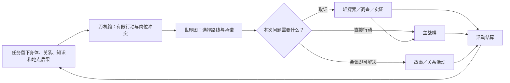

# 全游戏公共玩法骨架：一局 45 分钟到底在玩什么

> Status: `Candidate / retired_parallel_walkthrough / supporting_history_only / non_evidence / zero_build`
>
> 这份文件是早期45分钟串联例，现已由 [00b唯一公共循环主稿](00b-full-game-common-gameplay-skeleton.md) 取代。保留它只用于追溯旧解释与检查有没有遗失好问题；其中流程、战果、数值和状态不得作为当前规则输入。
>
> **阅读提示：** 当前第一入口是 [一页方向判断](00a-public-gameplay-direction-review.md)和四份短例。本45分钟长例只用作第二遍串联参考；已发生事实由系统记录并只读显示，不要把下文旧“确认”措辞理解为玩家批准事实。

**不必先懂术语：** 文中的“一场战斗”就是一张战斗地图；“一次任务”可以包含几张地图、探索或会谈；“敌方意图”就是地图提前告诉你敌人目前想针对谁、准备何时接触。技术名词只在括号里保留，便于后续实现者对照。

## 先用一句话说清楚

玩家带着上次任务留下的伤损和关系回到万机馆，用有限行动决定“谁修、谁休息、谁调查、下一站去哪”，在目的地通过短探索取得真实情报，再指挥几台具名机器人完成一场以保护、撤离或救援为目标的战术行动，最后把身体损伤、人物承诺、地点变化和未解决问题带回家。

不是每次出发都要打仗，也不是每次回馆都要经营所有系统。一局只取当前故事真正需要的部分。

## 一次完整会话例子

### 0–5 分钟：回到万机馆，先看见后果

上一场行动结束后，玩家没有先看到经验条，而是看见三件具体变化：

- 护卫机的左臂承力功能降级，仍能挡路，但暂时不能安全拖拽重物；
- 一份从敌方装置取得的样本进入“来源未确认”状态，不能直接当作真相；
- 一名同伴因为玩家上场没有听取停止建议，愿意说明原因，但本周期只会等一次。

玩家可以直接走到这些对象旁边，也可以在万机馆总览上看见三张变化卡。卡片只回答：发生了什么、现在能做什么、若本周期不处理会怎样。

### 5–10 分钟：三张高价值工作卡，不是清空日常清单

本例的返馆周期有三个时间格，最多安排三张会改变状态的高价值工作卡。不同人和设施的工作可以在同一时间格并行；同一人、同一设施或同一件唯一工具重叠时会冲突。当前出现四项候选：

1. `修左臂`：是一张连续占两格的标准维修卡，占用工程员与机体、修理位的全部2点设备容量和两份通用材料；下场恢复拖拽。设备容量只表示重吊位／测试台的本期吞吐，不是又扣一次人员工时。本例由独立档案员在另一房间核验样本，因此核验可与维修第一格并行，但材料用完后不能再制作支撑工具。
2. `做临时支架`：占用工程员一格时间、修理台 1 点设备容量和一份材料；不完全修复，只让护卫机获得一次“承接”反应，伤损继续保留。
3. `核验样本`：档案岗位确认一条敌方战法，下场能更早看到相应 Intent；不增加伤害。
4. `和同伴谈停止建议`：占用一个馆内行动；可能形成新的叫停协议，也可能只确认分歧。它不另收一种“关系货币”。

`结束排班，前往任务比较`不是第四张工作卡，也不等于已经出发。按下后，未开始的卡牌取消，未使用的馆内时间格放弃，伤损和未知信息原样带到任务比较页；此时仍是`0费用／0编队锁定／0任务承诺`。任务卡显示“现在是第几格／预计第几格抵达／截止是第几格”，随后玩家再做任务草案、出发包和路线，只有长按`承担这个任务`才真正出发。世界时间按已完成工作格和最终承担后的旅程推进，不会因同一格并行了两项工作而重复跳时。

玩家没有“最优清单”。例如：

- 选 `修左臂 + 核验样本 + 谈话`，核验与维修第一格并行，维修连续到第二格，第三格再谈话；准备充分，但更晚进入任务比较；
- 选 `临时支架` 后在第一格结束排班，放弃余下时间格和未开始工作，可以在最终承担后较早到场并保住一条路线，但要带着不确定情报作战；
- 选 `只谈话` 后结束排班，身体风险最大，却可能得到一次关键的主体协作。

这就是 Hub 的玩法：有限时间里决定把注意力给谁，不是把每个房间点一遍。

### 10–12 分钟：世界图选择的是承诺，不只是关卡

世界图出现两张任务卡：

- `护送三辆撤离车穿过断桥`：时间紧，已知有两条路，敌人会抢一只样本箱；奖励是保住人员和地方通行。
- `先去旧中继站查清敌方信号`：没有强制战斗，能降低以后遇敌时的未知度；但断桥任务会进入更差的时间状态。

每张卡都显示：谁请求、最晚到达时间、可到场成员、已知风险、当前未知、预计会影响哪些后续对象。它不提前透露隐藏结局。

玩家先点击一张卡查看地图路线和影响对象，再按比较键把两张卡并排。此时可以返回 Hub 改尚未确认的安排。只有长按 `承担这个任务` 后，出发时间、出击名单和被延期任务才一起锁定；界面会再显示一次“选择这里意味着暂时不处理什么”。

本例选择断桥任务。

### 12–18 分钟：轻探索只解决一个问题

到达前沿，玩家在一个小型服务站自由走动：

- 从高台观察断桥，确认主路能过但会累积应力；
- 向本地维护员询问侧路，得知闸门可以手动打开；
- 扫描一只样本箱，确认敌人可能不是来全灭，而是来带走它。

玩家可以少看一项就进入战斗。没看的内容不会变成主持人悄悄塞进 UI 的答案：

- 没看桥，应力仍真实存在，但预览只给较宽风险带；
- 没问侧路，地图仍能看见闸门，操作时才知道需要工程机；
- 没扫样本箱，敌方猎手的目标先显示为“可能与中央物件有关”。

探索的结果是减少某些未知、开放路线或建立关系，不是搜满发光物。

### 18–40 分钟：主战棋

玩家指挥三台身体职责不同的测试机，保护三辆撤离车。敌人公开当前目标，但不会把整个未来交给玩家：

- 重型敌机准备从主路冲向第一辆车；
- 另一台重型敌机准备破坏侧路闸门；
- 猎手准备夺走中央样本箱；
- 两台压制机分别控制主路和侧路的长直线。

玩家每次只安排一个短决策段：看 Intent，给单位画短路线，选一个身体动作，必要时预留一个反应，查看结果，再提交。当前完整任务只读 [公共主战棋总案](05f-first-neutral-tactics-v0.3-decision-ladder.md)；旧05a只保留为History证据。

目标不是全灭，而是让至少两辆车在四个决策段内离开。桥是否完好、样本是否保住分别产生后果，不能用“撤出两车”自动抹掉。

### 40–45 分钟：三级结算不是三张重复奖励页

本例统一采用“保公共设施”示范结果：两辆车撤离，主桥保持完整通行，样本被敌方带走，锚机锚定腿轻度受限，敌方记住游击机惯用站位。

- `Encounter 事实`由系统记录刚才发生了什么：哪辆车出去、桥应力多少、谁受了什么伤、样本现在归谁。玩家可展开原因，不校对或批准事实。
- 若同一任务还有下一张地图，`Operation 结果`只在整个救援行动结束后合并显示目标与可继续状态：地方是否保住通行、敌人学到了什么。
- `Chapter 结算`只在真正章末保存已由故事、路线、Hub、关系或收藏负责页准备好的长期变化：谁留下或登舰、地点是否永久受损、关系／债务、收藏保管和下一目的地。

事实本身不能由玩家改写，结算器也不发明“追击还是返馆”这类新选项。它先把事实和各系统已准备的改变一次性提交；然后由路线系统单独生成 `带伤追击` 或 `结束接触并返馆` 等下一承诺卡，玩家确认后再由结算器提交。保管、公开和关系选择也分别由收藏或关系系统生成，不由结算页凭空冒出。没有选择时，页面只是可跳过的回执，不伪装成三次领奖。

回到万机馆后，玩家会在实际空间看到伤机、空掉的样本柜和等待解释的人。下一轮由这些后果重新开始。

## 公共系统之间怎样闭环

真正共享的是同一批对象和后果，不是每个模式都有一套同名数值：

- 机体身体伤损会影响战棋、维修和是否能出击；
- 关系改变请求是否被接受、能否形成协同协议；
- 知识改变敌方 Intent 的精度、工程假说和路线选择；
- 地点状态改变探索路线、战场地形和未来回访；
- 资源只支付现实工作，不可以买到同意、权限或真相。

## 这份例子还没有证明什么

- 没有可玩 Build，也没有真人实际完成这 45 分钟；
- 三格 Hub 时间带与三张高价值工作卡上限只是演示“时间、人员与设施冲突”，最终数量要经过原型；
- 战棋时制尚未决定；例子只描述四种时制都必须保留的玩家判断；
- 没有把中性地图迁入 C01–C03；
- 没有批准万机馆、地点、美术、数值、预算或 Runtime。

以后每份系统设计都必须先有这种“玩家看见什么、按什么、为什么犹豫、结果怎样回写”的完整例子，再列机器字段与验收表。机器合同是附录，不再是你的阅读入口。
