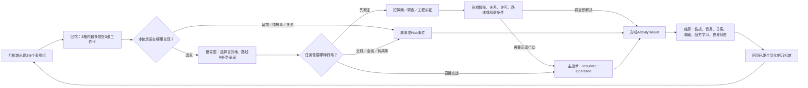
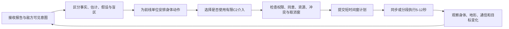

# 《万机残响》产品体验宪章与统一核心循环 Candidate v1

> Status: `candidate_paper_proposal / user_review_required / zero_build / no_canon_promotion`
>
> Depends on: Current L1-L2、C01-C03 用户验收 Reader、G1 官方案例研究、用户 2026-08-10 主策划方向
>
> Purpose: 回答“这究竟是一款怎样玩的游戏”，而不是继续增加玩法名词

> User entry: 当前唯一阅读顺序见 [00-user-reading-guide](00-user-reading-guide.md)。第一遍只读 [00c核心玩法总案](00c-core-game-design-master-review.md)；需要具体过程时再读 [两个周期公共骨架](00b-full-game-common-gameplay-skeleton.md) 与 [基础主战棋完整例](05f-first-neutral-tactics-v0.3-decision-ladder.md)。本文是设计原则附录，不要求用户先理解术语或机器合同。

## 0. 本文裁决什么、不裁决什么

本文先锁一份可供原型验证的产品假设。它不把任何数值、按钮、时长或章节载体直接晋升为 Canon，也不授权修改现有 C01E02 Demo。后续 D04-D07 可以推翻本文中的候选参数，但必须说明替代方案如何更好地满足同一体验合同。

本文继承现行 L1 的六项硬承诺：机器人文化与主体性、万机馆共同生活、最大冲突由机器人战斗兑现、多玩法改变战斗条件、胜利会留下长期回应、终局把小物件与文明尺度连接起来。它根据用户的新要求，把旧有“轻战棋”假设改成：**主战术可以有较高学习成本，但练级、刷取与配装负担保持轻量。**

## 1. 一句话产品定义

**一款以移动机器人博物馆“万机馆”为家的、重故事轻练级的角色驱动 C2 机器人战术 RPG：玩家不是把所有角色当成绝对服从的棋子，而是在不完整战场信息、机体身体规律、现实权限和机魂同意之间，组织前线机体与主角团完成有责任、有代价、可持续回写的共同决策。**

对外类型名暂定为：

- 主标签：`叙事战术 RPG / 机器人 SRPG`
- 差异化副标签：`角色驱动 C2（Command & Control）/ 作战室策略`
- 辅助体验：`移动 Hub / 轻探索 / 调查解谜 / 机器人收藏与共同生活`

它不是“传统 SRPG 加几个主角技能”。传统的移动、占位、攻击、掩护、地形、目标和敌人反应必须先独立成立；主角团再通过信息、路线、预演、授权、工程验证和机魂沟通，改变玩家能知道什么、允许什么、相信什么和承担什么。

## 2. 目标玩家与承诺的学习负担

### 2.1 目标玩家

- 喜欢手工剧情、角色关系和巨型机器人演出的玩家；
- 愿意学习中高复杂度战术规则，但不愿刷等级、反复打随机地图或管理几十名可替换佣兵；
- 愿意接受“信息不完全、结果并非全知”，前提是来源、时效、风险和反制都清楚可读；
- 希望战斗胜利来自对角色、机体和场地的理解，而不是看攻略叠出唯一构筑。

### 2.2 学习负担分配

复杂度集中在主战术的空间、时序、信息、反应和协同。辅助玩法每种只保留一个可读证据模型与 3-6 个核心动词；Hub 每次回馆只把 2-5 个事项组摆到玩家面前，标准周期固定 3 格且最多提交 3 张高价值工作卡，不建立每日清单式劳动。

允许玩家花时间学会：

- 看懂敌方意图、行动时序、接触置信度和通信链；
- 判断机体身体、地形、任务目标和非致死条件；
- 组合前线动作与有限 C2 介入；
- 接受一次局部失败并在后续状态里修复它。

不要求玩家花时间做：

- 重复练级或刷取随机词条；
- 为每名角色维护大体同构的技能树；
- 每次回馆逐人送礼、逐房间点对话、逐件展品清洁；
- 记忆隐藏命中公式、隐藏好感阈值或无法从 UI 推断的敌方规则。

## 3. 六根产品支柱

### P1 可读，但不全知

玩家看到的是有来源、有时间戳、有置信度的战场认识，而不是作者随时隐藏关键信息，也不是无条件上帝视角。未知必须能够通过传感、观察、询问、试探或承担风险而缩小。

### P2 身体行动与指挥权分离

前线单位用自己的身体移动、攻击、承伤、救援、变形和撤离；主角团改变路线、信息、许可、验证和协同窗口。任何能力都必须说明谁提出、谁解释、谁接受或拒绝、由谁的身体执行。

### P3 故事胜利就是玩法胜利

Reader 中真正解决冲突的行动必须成为玩家目标或玩家促成的状态，而不是战棋先清光杂兵、过场再让角色完成另一套真正胜利。必要时可以有“守住、撤离、证明、叫停、争取同意、让某人抵达”等非歼灭目标。

### P4 万机馆会记住玩家

每次返回都至少有一个可见变化落在具体的人、机体、房间、展签、维修状态、路线或来信上。万机馆不是菜单皮肤，也不是无尽经营沙盒；它是可受伤、可修复、可开放、可争论的移动之家与博物馆。

### P5 辅助玩法短、轻、会回写

探索、调查、工程、解谜和小游戏只在它们能创造证据、改变世界或关系、并有后续消费者时存在。一次性换皮 QTE、无后果收集和“为了品类齐全”而创造的新模式直接淘汰。

### P6 魄力来自因果和尺度

奇观不是只把爆炸做大。小零件、舰内岗位、十八米机体、百米万机馆和城市／轨道尺度必须形成一条玩家能理解的因果接力；大动画是玩家方案被世界兑现的高潮，而不是用来遮盖没有玩法的过场。

## 4. 统一长循环

探索不是战斗的固定前置，战斗也不是每次出发的固定终点。一个章节不必把所有模式各做一次。每个 Episode 只选择一个主体验和至多一个辅体验；一个 Operation 可以跨多个 Episode。模式是否出现，由故事冲突和系统回写决定，不按配额填表。

## 5. 不同时间尺度上，玩家具体在做什么

| 时间尺度 | 玩家行为 | 必须得到的反馈 | 设计上禁止 |
| --- | --- | --- | --- |
| 5-15 秒 | 检查对象、悬停预览、移动焦点、选择一个动词、确认来源或许可 | 目标、预计作用、风险、执行者和取消窗口 | 纯等待播片；无意义连点 |
| 30-120 秒 | 解决一个局部关系：挡一条攻击、确认一个词义、修一处结构、选择一个人物回应 | 至少两个可理解方案；立即状态变化 | 只有一个正确按钮但伪装成选择 |
| 2-5 分钟 | 完成一次战术“计划→提交→执行→复盘”脉冲，或一个轻玩法小段 | 行动顺序、意外、代价和下一轮新问题 | 连续十分钟没有可逆或可解释节点 |
| 20-45 分钟 | 完成一个 Encounter | 目标是否达成、局部损失、资源与后续入口 | 只有“全灭敌人”一种结构 |
| 45-90 分钟 | 完成一个 Operation 或一个可停靠的 Episode 会话 | 稳定存档点、摘要、人物／世界回写 | 必须一口气打完整章 |
| 2-6 小时 | 完成一章的若干 Operation 与故事段 | 章级胜负、关系和万机馆可见改变 | 每章强塞所有玩法家族 |
| 全剧 | 让更多主体、机体、城市和通信线形成可撤回的协作 | 早期选择、旧物与旧关系在终局成为具体动作 | 只用等级与伤害数字表达成长 |

以上时长是 D11 预算前的候选范围，不是对 22 章平均长度的承诺。桥接章、支柱章和终局章必须采用不同内容预算。

## 6. 主战术的基本决策脉冲

这里保留的是四种旧候选时制曾经共用的判断边界，不代表它们当前仍等权。最新公开方向以[00c核心玩法总案](00c-core-game-design-master-review.md#已接受的四个产品方向)为准：B短全队协同是当前主方案，A逐台行动只是未来低负担模式的研究备选，C／D只作比较参考。旧四版原型与测试路线已经冻结，除非以后按用户的新方向重新立项，不得直接执行。白鸢的预演只显示有限候选和不确定性；未知敌人、通信变化、机魂拒绝、物理碰撞和临场变招可以改变结果。

战术核心必须先在关闭所有主角 C2 权能时通过 G3：同一局面至少有两种有效解，且移动、站位、目标、地形、反应、敌人行为和撤离本身有趣。角色权能只能扩大、转换或承担选择，不能替弱战棋解题。

## 7. 三类辅助玩法脉冲

### EX1 微型自由探索

**看见远处目标 → 自选路线 → 观察／拍摄／帮助具名人物 → 取得证据或公共支持 → 改变战场入口、关系或展品。**

- 时长目标：单段 10-25 分钟；
- 主要动词：移动、观察、交谈、拍摄／扫描、帮助、返回；
- 失败：通常局部重试或错过可选收益，不做惩罚性坠落与长途返跑。

### EX2 调查与工程实证

**收集不同来源证据 → 提出候选判断 → 配置实体试验或鉴定部件 → 观察是否成立 → 把结论写入维修、关系或战术条件。**

- 时长目标：单案 5-15 分钟；
- 主要动词：比较、标注、组合、配置、试验、确认；
- 失败：假说未确认，可调整；严重误判只在有清楚预告时产生前向后果。

### EX3 知识门控遗迹

**进入 → 发现语言／时间／空间规则 → 带着新知识重访 → 打开此前看不懂而非打不开的路线 → 形成章级真相。**

- 时长目标：跨 2-4 次短访问累计 20-45 分钟；
- 主要动词：观察、记录、翻译、对照、重访、选择解释；
- 成长钥匙是玩家知识与档案证据，不是统一钥匙卡或数值等级。

所有辅助活动统一输出一份 `ActivityResult`，但不强迫不同家族伪造同一种“证据”。最低共通项是：`activity_trace`、至少一项 `world_or_relation_or_body_writeback`、`future_consumer`；只有调查、实证、摄影取证或知识判断才强制 `evidence_created`。空间导览可以只产出 `visited_objects / place_familiarity / route_or_memory`，节奏/表演可以只产出具名动作与身体／关系反馈。各家族的强制字段以 [auxiliary-output-gates.tsv](data/auxiliary-output-gates.tsv) 为准；缺少本家族写回或未来消费者时，优先改成短演出或 Reader，不制作独立玩法。

## 8. Hub、世界图与任务节奏

### 8.1 每次回馆的最小循环

1. 看见上次行动留下的一处具体变化；
2. 从 2-5 个事项组展开候选工作，在标准 3 格内最多提交 3 张有机会成本的工作卡：人物、维修、展陈／档案或设施；任务编组只做零成本预览，真正出发时才原子锁定；
3. 至少触发一个由刚才结果而变化的关系或生活回应；
4. 在世界图查看少量任务卡：目标、风险、可到场成员、时间／路线、可能收益和未处理后果；
5. 确认整备、岗位与承诺，离馆。

同一角色在同一准备周期不能同时出击、重修、远程外勤和主持高价值馆内事件。排班的意义是制造角色选择，不是经营人力表格。

### 8.2 世界图不是任务列表皮肤

世界节点保存距离／时间、通信延迟、开放度、求援期限、已知风险、可用路线和其他队伍的行动。未选路线可以继续，但必须按预先定义的执行者、能力和不确定性结算，不能为了惩罚玩家而临时写坏结局。

## 9. 成长：增加动词与关系，不增加刷取义务

长期成长分为五条：

1. **战术理解：** 新信息层、新反应、新目标语法和更复杂敌方反制；
2. **协作协议：** 角色与机体通过事件获得新的请求、授权、组合与叫停方式；
3. **机体功能：** 新身体动作、传感、工具、武装接口、变形或修复性，而非连续十阶数值；
4. **万机馆能力：** 新房间用途、岗位、展陈、远程支援和生活事件；
5. **世界关系：** 城市开放、路线、盟友、档案、回信与公共支持。

允许小幅、透明、有限的数值成长用于可读性和容错，例如耐久、能源、散热、维修效率或某件武装的明确升级；禁止让重复练级成为通过主线的默认解。核心角色和机体不会因为“练度落后”而失去故事可用性。

关系、信任、权限、同意和情报**不是可刷货币**：

- 关系保存具名事件、承诺、伤害、边界与可用协作；
- 权限保存谁在什么条件下可以做什么、由谁授权、何时到期；
- 同意必须由具体主体在具体动作上给出、拒绝或附条件；
- 情报保存来源、时间、置信度和相互矛盾，不兑换成万能“情报点”。

## 10. 失败与继续

失败按四级处理，不使用一个万能 Game Over：

| 级别 | 例子 | 处理 | 持久回写 |
| --- | --- | --- | --- |
| `local_retry` | 工程试验条件不成立、探索路线走错、提交前发现冲突 | 原地调整或回到短检查点 | 保留已看见的教学信息，不刷奖励 |
| `hypothesis_unconfirmed` | 证据不足、翻译未确认、接触识别错误但尚未行动 | 继续取证或带着不确定性进入下一段 | 保存候选判断、来源与置信度 |
| `forward_consequence` | 没救到可选对象、许可过晚、机体受损、撤离少带回一件东西 | 主线继续；改变伤损、关系、债务、路线或后续难度 | 必须由具体人物／地点回应 |
| `continuation_break` | 核心目标完全失守且现有故事没有可写的继续态 | 从 Encounter 稳定检查点重试 | 不伪装成 Canon 时间倒流；只保留玩家学习 |

失败不能自动取消此前所有成功；成功也不能总被下一幕立刻惩罚。结算必须说明“做成了什么、没做成什么、谁承担、接下来谁会回应”。

## 11. 候选体验比重与内容密度

以完整章节的平均主动游玩时间估算，而不是每话配额：

| 体验 | 候选范围 | 说明 |
| --- | --- | --- |
| 剧情演出／Reader式叙事 | 25%-35% | 角色与因果主体，不降格为战斗间填充 |
| 主战术／战场决策 | 40%-55% | 主要学习与复用投资；支柱章可更高 |
| 探索／调查／工程解谜 | 10%-20% | 每段一个证据模型，调节节奏并送回战场 |
| Hub／关系／收藏／结算 | 10%-20% | 高频短循环；每次少量高价值行动 |

这些范围用于防止辅助玩法反客为主，也防止游戏退化成“长小说加偶尔一战”。D06 逐章蓝图和 D11 人月预算必须联合校正；如果总资产量超出独立游戏承受范围，先减少地点与一次性模式，不削掉主战术可读性和故事关键动作。

## 12. 模式进入／退出合同

| 模式 | 进入时必须已有 | 玩家核心动词 | 最小退出结果 |
| --- | --- | --- | --- |
| Story/ADV | 角色状态、地点当前态、可公开信息 | 阅读、选择回应、查看证据 | 人物选择、任务需要、可追踪承诺 |
| Hub | 战后／章间状态、人物位置、机体泊位、可用行动格 | 走访、整备、安排、展陈、交谈 | 出击承诺、维修/关系/设施变化 |
| 世界图 | 任务卡、路线、时效、通信与到场条件 | 比较、规划、承诺、派遣 | 目的地、路线、到场阵容、时间推进 |
| 探索 | 真实空间拓扑、可见锚点、调查问题 | 移动、观察、交互、取证、帮助 | 证据、路线、对象状态、可选战前条件 |
| 调查/工程 | 对象、证据来源、可验证规则 | 比较、假设、配置、试验 | 确认/未确认结论、实体变化、责任人 |
| 主战术 | 战场、单位、目标、信息、权限与伤损 | 侦察、计划、移动、行动、支援、提交 | 战斗结果、伤损、救援、关系/权限事件 |
| 结算/档案 | 所有已提交活动结果 | 对照、确认、命名、归档、选择后续处理 | 持久事务、玩家摘要、未来消费者 |

任何模式都不得在退出时只返回 `score`。至少返回具体对象变化、玩家可读摘要和一个后续消费者。

## 13. 难度与无障碍合同

- 难度优先改变容错、提示、预演清晰度、敌方计划稳定性和重试边界，不隐藏剧情内容；
- 关键颜色状态同时使用形状、图标、文字和声音，不靠红绿区分；
- 所有短时窗口允许暂停或延长；字幕、战斗日志、信息来源和行动顺序可回看；
- 第一次关键实证必须由玩家亲手完成；之后只允许自动结算完全同构、结果已知的重复动作，提交前仍展示输入、代价与结果；涉及新证据、权限、同意、唯一物或真实取舍时不得自动提交；
- 主战术提供逐层信息视图：简洁目标层、标准战术层、专家时序／传感层；规则一致，不以“简易模式”偷偷作弊；
- 完整、精简与跳过只改变演出长度；事实、消耗、知识、伤损、责任与后续写回保持一致；
- 失败摘要必须说明可改进原因，不能只显示“任务失败”。

## 14. 明确非目标

- 不做程序化百局战役、随机佣兵永死、刷级与随机词条驱动的长线；
- 不把万机馆做成巨大跑腿场景或完整模拟经营；
- 不为每章创造一种不可复用的新小游戏；
- 不把主角团能力做成普通增伤、必中、再动的换皮技能集合；
- 不把机魂同意做成好感值满格后永久服从；
- 不把白鸢写成确定未来，不把纪存写成万能遥控，不把七海写成凭空生成法律权限，不让工程判断跳过实体验证；
- 不让视觉奇观代替地图、目标、动作和结果设计；
- 不以现有 Demo、脚本 PASS 或文档字段齐全作为玩法成立证据。

## 15. G2 用户需裁决的产品级问题

1. 是否批准“角色驱动 C2 机器人战术 RPG + 移动博物馆 Hub”为主产品身份？
2. 是否批准主战术承担中高学习成本，而成长和日常保持轻量？
3. 是否同意在同一世界初态、动作结果、目标、AI 与未知信息预算下，中立比较 A／B／C／D 四种时制；P1 只形成 shortlist，入围方案再承载同一组最小 C2 交叉测试，最后才由用户决定主时制？
4. 是否同意每次回馆只显示 2-5 个高价值事项组，标准周期固定 3 格且最多提交 3 张工作卡，并取消每日打卡式经营？
5. 是否同意辅助玩法收束为三类复用框架，而不是维护现有 16 个独立模板？
6. 是否接受主要失败进入持续后果；只有无法形成合法故事继续态时才从 Encounter 检查点重试？
7. 是否接受关系、权限、同意、情报不作为可刷可消费的通用货币？
8. 是否接受“基础战术无权能先通过”作为后续 C2 设计的硬门？

用户未逐项确认前，以上均保持 Candidate；沉默不视为批准。
