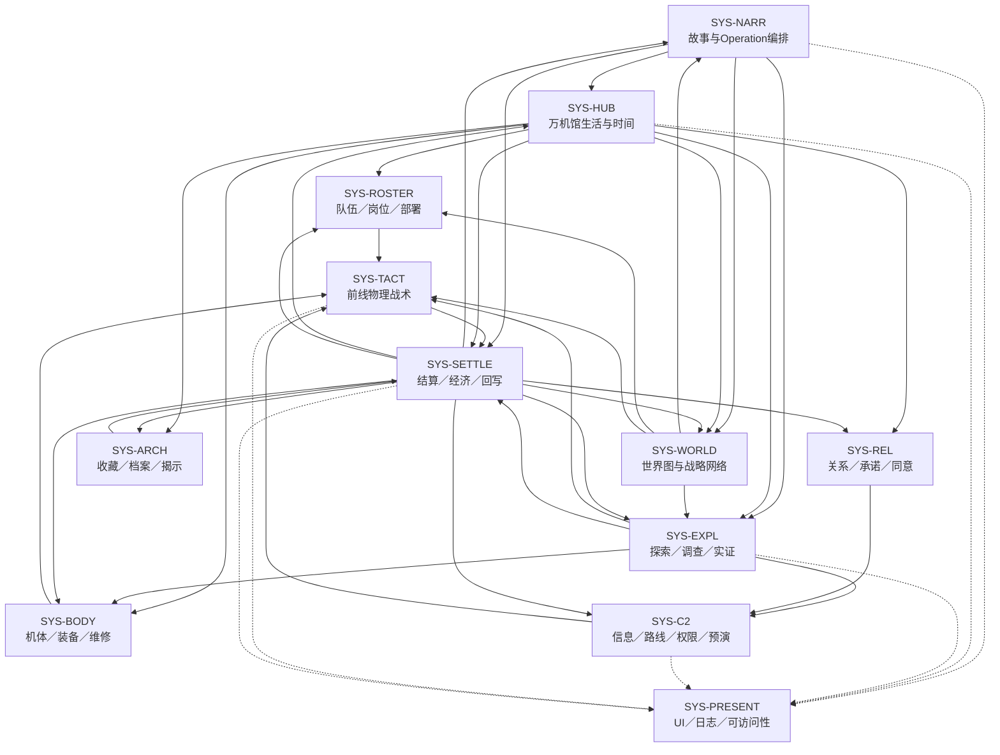

# 《万机残响》全游戏系统图、状态合同与经济流 Candidate v1

> Status: `candidate_paper_contract / user_review_required / zero_build / no_runtime_authority`
>
> Depends on: [03-product-experience-charter.md](03-product-experience-charter.md)
>
> Machine-readable companions: [data/system-node-contracts.tsv](data/system-node-contracts.tsv)、[data/system-state-contracts.tsv](data/system-state-contracts.tsv)、[data/system-edge-contracts.tsv](data/system-edge-contracts.tsv)、[data/economy-flows.tsv](data/economy-flows.tsv)、[data/mode-transition-contracts.tsv](data/mode-transition-contracts.tsv)、[data/episode-mode-token-contracts.tsv](data/episode-mode-token-contracts.tsv)、[data/settlement-owner-prepare-commit-contracts.tsv](data/settlement-owner-prepare-commit-contracts.tsv)、[data/owner-decision-receipt-schema.tsv](data/owner-decision-receipt-schema.tsv)、[data/action-resolution-semantics.tsv](data/action-resolution-semantics.tsv)、[data/mission-commitment-contracts.tsv](data/mission-commitment-contracts.tsv)、[data/sortie-manifest-contracts.tsv](data/sortie-manifest-contracts.tsv)、[data/time-scale-bridge-contracts.tsv](data/time-scale-bridge-contracts.tsv)、[RunState v2类型Registry](data/runstate-v2-enum-type-registry.tsv)、[字段Schema](data/runstate-v2-field-schema.tsv)、[领域Registry](data/runstate-v2-domain-registry.tsv)、[事务op Schema](data/state-transaction-v2-op-schema.tsv)

## 1. 设计结论

全游戏不应由“战棋、探索、经营、关系、收藏”五套互不相干的小游戏拼接，而应由一套可审计的长期状态和结算事务连接。模式只负责产生不同类型的判断；任何结果都经过同一个 `ActivityResult → StateTransaction → PlayerSummary → FutureConsumer` 链写回。

现有 Runtime 已有 `world_facts / world_objects / entity_conditions / authority_states / relationship_edges / promises_and_debts / inventory_and_resources / episode_memory / tactical_snapshots` 与幂等事务壳。它适合作为技术种子，但目前没有产品语义、生命周期、所有权、情报来源、同意、编队、地点拓扑、收藏揭示、敌方学习或世界时间的完整合同；本设计不把现有字典视为系统完成。

## 2. 系统家族与唯一职责

| ID | 系统 | 唯一负责 | 不负责 |
| --- | --- | --- | --- |
| `SYS-NARR` | Story / Operation 编排 | 章、话、Operation、Encounter、Checkpoint、Story beat 和合法继续态 | 发明战术规则或地点物理 |
| `SYS-TACT` | 前线物理战术 | 单位身体、地图、移动、动作、反应、伤损、目标和执行顺序 | 凭空授予情报、权限或同意 |
| `SYS-C2` | 信息与指挥协同 | 接触、来源、置信度、通信、路线建议、预演、许可请求和战场介入 | 代替前线身体行动 |
| `SYS-ROSTER` | 队伍、岗位与部署 | 人—机体—岗位—载具关系、可到场性、轮换和出击承诺 | 角色关系剧情本身 |
| `SYS-BODY` | 机体、装备、损伤与工程 | 身体功能、接口、武装、工具、维修、试验和功能成长 | 通用十阶数值成长 |
| `SYS-EXPL` | 探索、调查与实证 | 空间移动、对象交互、证据、假说、验证和知识门 | 改写未设计的世界物理 |
| `SYS-HUB` | 万机馆生活与时间 | 房间、人物位置、泊位、有限行动格、设施与回馆回应 | 无休止日常劳动 |
| `SYS-REL` | 关系、承诺与同意 | 具名关系事件、边界、承诺、伤害、协作许可和具体动作同意 | 可刷好感货币 |
| `SYS-ARCH` | 收藏、档案与揭示 | 物件来源、展签、版本、揭示级、展陈和回看 | 直接公开后台全部真相 |
| `SYS-WORLD` | 世界图与战略网络 | 节点、路线、距离、时效、通信延迟、城市开放、分舰与后台行动 | 程序化全球战争模拟 |
| `SYS-SETTLE` | 结算、经济与回写 | 聚合结果、资源变动、债务、敌方学习、摘要和未来消费者 | 替各模式决定胜负语义 |
| `SYS-PRESENT` | UI、日志与可访问性 | 分层信息显示、来源、行动顺序、回看、输入辅助和模式一致性 | 隐藏规则或通过表现改变结果 |

每个状态域只有一个主所有者；其他系统只能通过具名事务请求修改。这样可以避免关系系统、战棋技能和剧情脚本各自维护一份“信任”，或 Demo 为方便而制造一套无法迁移的真相。

系统节点的玩家幻想、动词、生命周期、读写域与证据等级见 `system-node-contracts.tsv`。每条跨系统连接的 payload、原子性、提交点、回滚和失效范围见 `system-edge-contracts.tsv`；只画箭头但没有边合同的连接一律视作未设计。

## 3. 全模式关系图



图中的实线箭头表示“提供经过合同化的输入或消费结果”，虚线箭头表示“生成只读玩家投影”；两者都必须在 `system-edge-contracts.tsv` 中有同方向边合同。箭头不表示下游可以直接改写上游的权威数据。

## 4. 生命周期与稳定提交边界

所有可玩的系统都必须能映射到统一生命周期：

`locked → offered → prepared → previewed → committed → active → resolved → settled/writeback → archived`

系统可按语义省略不适用阶段，但必须显式定义 `cancel / abort / retry / resume / expire`。如果一个所谓系统只写了“解锁”和“奖励”，却没有进入条件、预览、提交、解决、结算与退出，就仍是名词而不是玩法。

```mermaid
stateDiagram-v2
    [*] --> ChapterReady
    ChapterReady --> HubCycle: 章/Operation需要已成立
    HubCycle --> MissionCommit: 整备、岗位、路线、承诺已确认
    MissionCommit --> Exploration: 需要取证/路线/实证
    MissionCommit --> StoryActivity: 交付/会谈/纯故事
    MissionCommit --> EncounterReady: 无前置探索
    ChapterReady --> Exploration: 当前地点直接发生短探索/实证
    Exploration --> EncounterReady: 产出证据与战前条件
    Exploration --> ActivitySettlement: 调查即解决
    StoryActivity --> ActivitySettlement: 纯故事结果
    HubCycle --> ActivitySettlement: Hub-only行动完成
    ActivitySettlement --> HubCycle: 留馆继续且仍有合法行动
    ActivitySettlement --> EncounterReady: 结果打开战术
    ActivitySettlement --> OperationSettlement: 当前Operation结束
    EncounterReady --> TacticalPulse
    TacticalPulse --> TacticalPulse: 计划/执行/复盘
    TacticalPulse --> EncounterSettlement: 达成/撤离/局部失败
    EncounterSettlement --> NextEncounter: Operation未结束
    NextEncounter --> TacticalPulse: 下一Encounter直接开始
    NextEncounter --> Exploration
    NextEncounter --> StoryActivity
    NextEncounter --> EncounterReady
    EncounterSettlement --> OperationSettlement: Operation结束
    OperationSettlement --> HubCycle: 回馆回应与下一需要
    OperationSettlement --> StoryActivity: 先消费人物/故事回应
    OperationSettlement --> MissionCommit: 直接进入下一世界承诺
    OperationSettlement --> ChapterSettlement: 章级胜负已成立
    ChapterSettlement --> ChapterReady: 下一章Story开放
    ChapterSettlement --> MissionCommit: 下一章直接显示世界任务承诺
```



稳定存档与提交边界：

1. 标准 Hub 周期固定 3 个 `time_slot`、最多提交 3 张 `work_card`；每格内的卡先整组校验，再以一个 `HUB_SLOT_COMMIT` 提交、生成一个回执且时间只推进一次。页面激活的 2–5 个 `issue_group` 仅是候选事项组，不是时间格或额外行动次数；
2. Mission Commitment 将任务版本、路线、六类引用出发包、长线时间与运营资金一次原子提交后；
3. 探索或工程活动完成后；
4. 每个 Encounter 进入前、结束后；
5. Operation 结算后；
6. 章级结算后。

战术脉冲内部可保存临时快照用于恢复崩溃或辅助重试，但不把每次悬停、预览或未提交规划写入长期状态。

## 5. 共享状态分层

### 5.1 权威身份层

保存 `entity_id / body_id / machine_soul_id / location_id / system_id / source_authority / version / owner`。它回答“这是谁、从哪里来、谁能改”。剧情脚本和关卡数据不得用临时字符串另造同一对象。

### 5.2 世界与空间层

保存世界节点、地点拓扑、区域、准入、控制权、尺度、损毁态、时间、路线和通信。地点的“可玩地图状态”必须引用 GD2 地点档案；战斗只消费当前态，不能发明建筑结构。

### 5.3 身体与队伍层

保存角色、机体、机魂、持久 Membership、Operation Assignment、驾驶／操作／岗位关系、身体功能、系统损伤、弹药／能源／热量和维修状态。`ST_MEMBERSHIP` 回答谁随舰、访客、试用、联络或承担组织／照料责任；它不记装备实物产权、保管或位置，这些只读 `ST_EQUIPMENT` 投影。`ST_ROSTER` 只回答本次 Operation 谁占哪个岗位。人物是否随舰、机体是否可动、谁在本次出击、谁有权操作是四件不同的事。

### 5.4 信息与判断层

保存 `contact/evidence/hypothesis/knowledge` 的来源、时间、置信度、误差范围、共享范围、冲突证据和失效条件。`ST_KNOWLEDGE` 逐一记录“后台事实、玩家看见、某角色知道、公众知道”的差异；战术与Story UI只读取当前观察者的合法投影，不把玩家镜头所见自动广播给全队。

### 5.5 权限、关系与同意层

权限保存授权者、受权者、范围、条件、到期和撤销；关系保存具名事件、边界、承诺、伤害与协作许可；同意保存某主体对某次具体动作的接受、拒绝、附条件或未询问。三者不能合并成一个“信任值”。

### 5.6 资源与债务层

保存可真实消耗的材料、人物时间格、维修设备容量、战术带宽、能源等，以及必须由人物／组织承担的具名债务。人物时间格与重吊位／修理台／承力测试台的设备容量是两种不同约束，不得重复扣费。债务可以影响选择，但不能成为无限增长的抽象惩罚条。

这一层区分两种所有权，不把 `SYS-SETTLE` 误解成所有资源规则的设计者：

- `economy-flows.tsv.owner_system` 是具体资源的**领域所有者**：`SYS-TACT / SYS-C2 / SYS-BODY / SYS-HUB` 等各自定义产生、消耗、重置、局部校验与即时反馈；
- `ST_RESOURCE.owner_system = SYS-SETTLE` 只表示**稳定边界总账与结算回执的唯一提交者**。领域所有者提交前态、变化、后态、用途与重置规则，`SYS-SETTLE` 校验后幂等入账；
- 只在战术脉冲内存在的行动时间、反应窗口等仍由本地系统保持权威快照，结算只保存用途／重置摘要，不另造一份持久余额；
- 关系、同意、权限、信息质量与公共支持不进入 `ST_RESOURCE` 总账，仍由它们的专属状态合同记录。

### 5.7 叙事、收藏与敌方学习层

保存已经发生的事实、公开／暂隐／仅后台真相、档案与展品的揭示级、敌方观察到的战法和针对性反制。敌方学习必须引用玩家实际使用的可观察动作，不允许编剧无证据地“什么都知道”。

## 6. 统一结果事务 v2 候选

现有 `StateTransaction` 的幂等提交、来源节点、完成合同和语义 diff 可保留。新产品合同建议把每次活动结果规范为：

```text
result_id
transaction_id
source_mode
source_node_id
operation_id / encounter_id / phase_id
resolution = clear | partial | withdraw | fail_continue | retry_required
objective_results[]
evidence_created[]
entity_changes[]
membership_changes[]
assignment_changes[]
body_system_changes[]
equipment_or_custody_changes[]
location_changes[]
knowledge_changes[]
authority_changes[]
consent_records[]
relationship_events[]
promise_or_debt_changes[]
resource_changes[]
collection_changes[]
enemy_learning_events[]
world_route_changes[]
future_consumers[]
player_summary[]
source_authority / schema_version
```

硬规则：

- 所有 change 记录必须含具名 ID、前态、后态、原因和可见反馈；
- `resource_changes` 只允许真正可消费资源，不能塞入信任、同意、情报或关系；
- `evidence_created` 必须有来源、时间、置信度和可见范围；
- `consent_records` 必须绑定具体动作和主体，不能永久泛化；
- `future_consumers` 至少一个，否则该结果应降为纯演出或收藏气氛；
- 长期事务一旦提交必须幂等，重复加载或重放不能再次发奖励；
- 玩家摘要使用人话说明结果，不暴露内部变量名。

### 6.1 多 owner 两阶段提交

“一次结算原子”不能只表示每条边各自 atomic。凡涉及路线、保管、公开、救护、维修优先级等玩家决定，必须先在对应 Owner 模式产生版本锁定的 `owner_decision_receipt`；结算页只能确认已有回执，或返回该 Owner 模式修改，不得现场生成新选项。一个 Activity/Encounter/Operation/Chapter 事务组必须执行：

当一场 Encounter 同时结束 Operation，后台仍保留 `Encounter facts proposal` 与 `Operation proposal` 两层；前台只显示一个合并战后摘要和一个最终“继续/提交”。路线、追击、救护、保管等 Owner 决定必须在这个最终提交前完成；修改时从摘要返回 Owner，再回到同一摘要。玩家点一次后，两层 proposal 在同一 `transaction_group` 原子提交，不能先批 Encounter 再批 Operation。Chapter 摘要仅在真正章末单独显示。

1. 各领域 owner 对同一 `proposal_hash` 生成 `prepared_receipt`，只校验、不写长期状态；
2. `SYS-SETTLE` 确认所有必需 owner、版本与 proposal hash 一致；
3. 任一 owner 拒绝、超时或版本冲突，则整组 0 写入并返回来源检查点；
4. 全部 prepared 后，`SYS-SETTLE` 一次写入所有操作并生成唯一 accepted receipt；
5. UI、Story 和下一模式只消费 accepted receipt，不能消费局部 prepared 状态；
6. 重放同一 `transaction_group_id + proposal_hash` 只能返回同一回执，不能重复资源、成员、装备或关系变化。

逐 owner 的状态覆盖、校验与拒绝规则见 [settlement-owner-prepare-commit-contracts.tsv](data/settlement-owner-prepare-commit-contracts.tsv)。尤其：

- 表中的十组只覆盖 **24 个可由游戏事务改变的持久状态**；`ST_IDENTITY` 只能经批准的设计迁移改变，不进入玩法结算，`ST_UI_PROJECTION` 只在 accepted receipt 后派生、不得被提交。两者是机器校验中的显式排除项，不是漏掉的 owner；

- `ST_MEMBERSHIP` 与 `ST_ROSTER` 同组但生命周期分开；
- `ST_BODY / ST_EQUIPMENT / custody` 同组，`SOG-BODY` 与 `ST_EQUIPMENT` 在同一 item 记录中唯一保存 `lawful_owner / current_holder / physical_location / loan_terms / transfer_receipt_id / slot / installed_state`；`SYS-ARCH` 与 `SYS-HUB` 只读版本投影或提交转移请求，不得维护第二份产权、保管或位置真值；
- `ST_EVIDENCE / ST_HYPOTHESIS / ST_KNOWLEDGE` 分 owner 准备，防止“假说=事实=全员已知”；
- `ST_CONSENT / ST_RELATION / ST_AUTHORITY` 不因任一局部边先写而留下半许可状态。

### 6.2 RunState v2／StateTransaction v2 最小线合同

上述状态与两阶段提交已经进一步落成 Candidate 机器合同，不再只是一组建议字段：

- 47项枚举／线类型禁止 JSON float，把资源余额和置信度固定为规范十进制字符串；
- 35种记录 Schema 为9种共用记录和26个状态域定义类型，覆盖 `system-state-contracts.tsv` 现有全部215个 `minimum_fields`；
- 26域 Registry 明确主键、owner group、合法op、投影策略与v1适配处置；
- 7种事务op不提供物理删除；关闭保留审计史，唯一物件只允许原记录转移；
- 4个R0/P1纸面fixture覆盖两次原子成功及幂等重放、缺owner与过期revision的0写入拒绝，并验证observer投影不泄露后台精确身份。

完整合同与证据边界见 [D03 RunState v2纸面合同](validation/d03-runstate-v2-paper-contract-v0.1.md)。独立检查器只能证明静态Schema和参考事务解释器闭合；当前仍为 `zero_build / human_evidence_not_run`，没有修改或迁移 Godot v1 Runtime。

### 6.3 行动结果、双时标与出发承诺

- 行动结果固定分为提交前取消、`PRECONDITION_REJECT`、`PERFORMED_SUCCESS`、`PERFORMED_FAIL`。前两者不扣时间、资源或维修设备容量；已执行失败必须保留实际成本、损伤、证据和后续消费者，不得伪装成未执行退费。
- `encounter_elapsed_ms` 只计战内执行时间，`campaign_tick` 只由已接受的任务、Hub、Operation 或章级稳定回执推进；8 秒语义窗与长线时间没有直接换算。
- `MISSION-COMMIT-V1` 将任务卡、路线、出发包、运营资金前后和 `campaign_tick` 前后绑在同一 `proposal_hash`，同时将 `ST_OPERATION` 从 `offered` 推进至 `committed` 并锁定 `selected_route_ref / locked_sortie_manifest_ref / arrival_tick / unselected_policy_ref`。后续 `traveling → arrived → resolved` 只能由已接受的稳定回执前进。出发包必须版本锁定六类引用；查看、预演和锁定预览均0时间、0资金、0写入，只有接受 Mission Commitment 才实际离馆。

七项语义的独立静态校验见 [公共系统合同语义校验](validation/public-system-contract-semantics-v0.1.md)。

## 7. 经济：少资源、强语义、不同生命周期

`economy-flows.tsv` 在本阶段只封存类别、来源、去向、稀缺方式、重置／持久性、反馈与禁止兑换的**定性合同**。表中的“少量”、“有限”、阈值或范围是待验证假设，不是已通过的成本、产出、上限或数值平衡。战内资源在 P1/P2 灰盒校准，Hub／章间资源先在纸模与三章事务模拟中校准；未得到对应决策和人类证据前，不得固化数值。

为防止定性合同在实现时退化成随意加减，[economy-invariant-paper-cases.tsv](data/economy-invariant-paper-cases.tsv) 另登记9个最小纸面案例：战术带宽、Hub材料、Operation弹药、唯一部件和两种禁止兑换，覆盖accepted、Owner拒绝0写入与幂等重放。解释见 [D03经济守恒纸面案例](validation/d03-economy-invariant-paper-cases-v0.1.md)。它们仍是`zero_build`静态输入，只证明候选算术与回执边界可被校验，不证明价格、产出、稀缺感或全剧经济成立。

### 7.1 战内短期资源

- **行动时间／时序占用：** 前线身体动作的真实持续与冲突，不是通用蓝条；
- **指挥带宽：** 每个战术脉冲有限的 C2 介入容量；
- **传感焦点：** 选择把有限观测能力投向哪里，可能以暴露或盲区为代价；
- **能源、热量、弹药与系统完整度：** 每台机体少量、功能明确的身体约束；
- **反应窗口：** 由姿态、武装、机体和岗位产生，不能无限叠加。

战斗结束后，行动时间、指挥带宽和传感焦点重置；实体伤损、弹药缺口、过热后果和关系／权限事件按合同决定是否带出。

### 7.2 Operation 与章间资源

- **维修设备容量：** 表示重吊位、修理台与承力测试台的周期负荷，决定哪些工程能否并行；人物工时由时间带另行管理，不重复扣费，也不要求逐颗零件模拟；离馆或 Hub 周期结束时清除未用和未提交预留，下周期从实际设施态重建，不结转；
- **通用材料与具名关键部件：** 通用材料承担小修，关键部件承担剧情与功能解锁；
- **行动格／时间块：** 每次回馆只允许少量高价值行动；
- **补给／运营资金：** 维持航行、开放活动和部分装备，不建立多币种商店经济；
- **泊位与岗位容量：** 是空间和人员约束，不是购买更多格子的抽象升级；
- **公共支持／城市开放：** 作为具名组织状态和条件集合，而不是一条可刷声望币。

### 7.3 明确不是货币的状态

- 信息质量；
- 关系与信任；
- 机魂同意；
- 法律／组织权限；
- 人物承诺与债务；
- 机体身份与收藏价值。

它们可以开放或关闭具体选项，可以附条件，可以因为事件改变；不能用重复劳动兑换，也不能当作技能费用扣除。

## 8. 状态从何而来、去往哪里

| 来源 | 主要产出 | 主要消费者 |
| --- | --- | --- |
| Story/ADV | 任务需要、人物承诺、已公开事实、选择边界 | Hub、世界图、探索、战术目标 |
| Hub | 出击承诺、岗位、维修、关系事件、展陈状态 | 世界图、Roster、Body、C2 |
| 世界图 | 目的地、路线、时效、通信、后台行动 | 探索、Encounter、结算 |
| 探索/调查 | 证据、路线、对象状态、战前条件 | C2、Body、TACT、ARCH |
| 战术 | 目标结果、伤损、救援、观察到的战法、许可／同意事件 | SETTLE、Body、REL、WORLD |
| 结算 | 幂等长期事务、玩家摘要、未来消费者 | 所有长期系统 |
| 收藏/档案 | 已揭示事实、版本、展签、回看入口 | Hub、关系事件、未来调查和终局回收 |

## 9. 三种持续性测试

### Test A：C01 的“救援不是清图”

探索或故事提供木桶街空间、危险与求援；战术结果写回谁被救、哪条街／设施受损、馆守 Z 和相关人物承担了什么；回馆必须出现具体伤损、回应和下一站需要。若系统只能返回敌人击破数，失败。

### Test B：C02 的“胜负与事故分离”

赛事 3:2 结果、事故不重赛和后续去向是硬故事事实。战术／小游戏必须分别提交比赛胜负、事故处置、工程与关系后果，不能用一个 `score` 覆盖，也不能通过玩家刷分改成重赛。

### Test C：C03 的“连续作业与多路线交接”

工务城的职业机作业、社勇王／豪司试用、七海陆衡登舰、陆路队伍、双时间求援和百机航路必须在 Operation、Roster、World、Body 与 Settlement 之间保持一致；单个 Episode 的局部提交不能让后续角色、机体或路线凭空重置。

这三项先用事务表模拟，再用灰盒验证。通过不等于玩法有趣；它只证明系统不会丢失故事结果。

## 10. 与现有 Runtime 的关系

可复用技术种子：

- 幂等 `transaction_id` 与提交回执；
- Episode 图、模式路由、稳定边界存档；
- facts、实体、世界对象、权限、关系、债务、资源与活动结果的通用 diff；
- 战术快照、空间稳定对象和 Desk 预览／确认壳。

纸面产品语义已经进入 v2 Candidate 合同，但仍必须在获批包络内实现并原型验证：

- v1字典到v2领域Registry的显式适配、逐记录验证和版本迁移；
- Contact/Evidence/Hypothesis 信息模型；
- 具体动作同意与条件许可；
- Roster／岗位／出击承诺；
- 机体身体系统、功能损伤、维修与装备接口；
- 地点拓扑／状态差分；
- 收藏揭示账、敌方学习与世界时间／路线；
- Encounter、Operation、Chapter 三级结算；
- 玩家可读日志和所有跨模式 UI 投影。

禁止为了兼容现有字典而把所有新状态继续塞进 `world_facts` 或 `inventory_and_resources`。先审定产品语义，再设计 Runtime schema v2 和迁移；Demo 可通过适配器提供证据，不得成为新 schema 的权威来源。

## 11. G2 系统验收门

在进入正式 D04/D05 施工前，至少要通过：

1. 用三组纸面事务回放 C01-C03，结果不丢失、不重复提交、不把硬故事事实变成可刷分支；
2. 每个长期状态有唯一 owner、合法 writer、可见反馈、生命周期和至少一个 consumer；
3. 每种资源有来源、消耗、重置点和清楚选择，且总币种数量受控；
4. 关系、同意、权限与情报未被错误建模为货币；
5. 任一模式退出都能生成具体对象变化、玩家摘要和未来消费者；
6. 现有 Demo 不被列作全游戏系统完成证据；
7. 用户批准本文件的系统边界、经济原则与持续失败模型。

未通过时，D04/D05 可以做隔离纸面实验，但不得写入 Current Runtime 或章节生产链。
