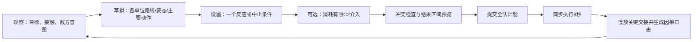
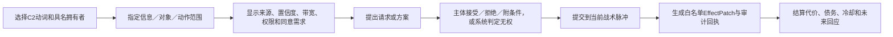

# 《万机残响》深度 SRPG / C2 主玩法详细设计 Candidate v1

> Status: `candidate_rules_and_p1_abcd_shortlist_p2_crossover_full_p2_p3_paper_fixtures / zero_build / human_not_run / user_review_required / no_runtime_authority`
>
> Depends on: G1 研究、[03-product-experience-charter.md](03-product-experience-charter.md)、[04-full-game-system-graph.md](04-full-game-system-graph.md)、Working Canon 人物／机体边界
>
> Rule tables: [data/tactical-action-contracts.tsv](data/tactical-action-contracts.tsv)、[data/tactical-tempo-equivalence.tsv](data/tactical-tempo-equivalence.tsv)、[data/tactical-resolution-kernel.tsv](data/tactical-resolution-kernel.tsv)、[data/authority-action-contracts.tsv](data/authority-action-contracts.tsv)、[data/authority-owner-sentinels.tsv](data/authority-owner-sentinels.tsv)、[data/authority-action-test-matrix.tsv](data/authority-action-test-matrix.tsv)、[data/enemy-intent-contracts.tsv](data/enemy-intent-contracts.tsv)、[data/tactical-objective-contracts.tsv](data/tactical-objective-contracts.tsv)

## 0. 主策划待裁决假设集

当前没有“首选时制”。先锁的是四项产品级共同语义：**短决策域、意图可读、已知物理确定、信息不完全**。它们不等于 WEGO，也不规定玩家必须一次规划全队。

- 前线保持 3-6 台具名身体，每台只有短路线／姿态、一个主要身体动作和一个可选反应条件；
- 敌方显示与情报质量相匹配的意图；已知条件不使用隐藏命中率抽签；
- 动作真实时长、质量、稳定、地形、碰撞、功能伤损、AI Doctrine、目标和未知信息预算只有一份语义真值；
- 主角团 C2 只改变知识、路线、许可、条件、验证与协同窗口，不直接替前线单位造成伤害；
- Encounter 以救援、守护、阻断、抵达、撤离、缴械、证明和有限击破为主，不默认全灭；
- `P1-A/B/C/D` 可以各用适合自身 Scheduler 的命令语法与最小 UI。原生 UI 是被测试的自变量，不得通过额外信息、预测、教程时间或较弱敌人给某版补偿。

P1 只负责淘汰基础战术不成立的版本并形成可撤销 shortlist，不能选胜者。shortlist 随后分别承载同一组六项核心 C2，通过 `D04-P2-CROSSOVER` 后，才向用户提交 `DEC-03-M`；完整 25 动作 C2 验证在用户选择唯一时制之后进行。中立边界、匿名标签、实现顺序、教程预算、预注册权重／阈值和结果枚举以 [time-system-neutrality-contract.tsv](data/time-system-neutrality-contract.tsv) 为机器真值。

## 1. 为什么不先定时制

| 方案 | 优点 | 本项目风险 | 当前裁决 |
| --- | --- | --- | --- |
| 传统阵营回合 | 教学成熟、操作清楚、Runtime成本低 | 整队先手爆发、轮流站桩与C2时间窗可能变弱 | `P1-D`正式控制组；与其他版本同等进入或退出shortlist |
| 交替单位激活 | 反应性强、单次决策负担低 | 先后手博弈可能压过角色协作；巨构与多单位同步较难表现 | `P1-A`正式候选 |
| 完整 WEGO 脚本 | 路线、朝向、时序与多人协同很强 | 学习/操作/调试负担过高；人物变成可编程棋子；预测越长越接近全知 | 淘汰完整脚本化 |
| 短脉冲 WEGO | 能表达计划、交接、碰撞、预演与有限介入；每次只看短未来 | UI和同步可读性要求高；需要扎实回放与日志 | `P1-B`正式候选，不预选 |
| 交替锁计划＋同步执行 | 降低全队同时规划负担，保留交错与公开承诺 | 后锁方可能过强，规则可能“两边都不像” | `P1-C`正式候选 |
| 实时暂停 C2 | 信息延迟、作战室气质强 | 机器人身体细节和手工名场面难读；易变成RTS多线操作 | 后期战略／远程支援可借，不作主战斗 |

完整脚本 WEGO 和实时暂停目前有明确的输入／资产风险，因此没有进入 P1；传统阵营回合没有被同样排除，必须作为正式 `P1-D` 建 Build 与冷测，不能再用一句“保留为对照”冒充比较。

P1 时制对照共用同一个规则核：

- `P1-A 显意图交替激活`：双方单位交替激活；每台 2 Tempo，保留 1 Tempo 可转一次公开反应；最易读、最便宜；
- `P1-B 短脉冲 WEGO`：每台路线／主要动作／反应一起安排，敌我同步执行约 8 秒；身体交错最强；
- `P1-C 混合制`：双方交替锁定一台单位的短计划，所有锁定计划在脉冲末同步执行；减少同时规划负担，但保留动作交错。
- `P1-D 传统阵营回合`：我方阶段内自由选择未行动单位，再进入敌方阶段；每台仍只有同一 2 Tempo，预留反应可在对方阶段触发一次。

四版动作时长只能有一份真值。每个身体／武装实例先解析真实秒数；P1-A/D 按 `<=4 秒 = 1 Tempo`、`>4 且 <=8 秒 = 2 Tempo` 映射，P1-B/C 直接使用同一秒数装入 8 秒窗口。`0 秒`只允许合法信息投影，不得刷新资源或反应；超过 8 秒的动作必须拆成具名准备／执行／安全分段。反应从同一 2 Tempo 预算预留，不能在触发后补缴。逐动作等价表见 `tactical-tempo-equivalence.tsv`。

四种制式都使用同一世界初态、动作结果、目标、AI Doctrine 与未知信息预算。Scheduler 及其不可分割的原生命令语法／最小 UI 可以不同，但不得改变合法动作、代价、后态、信息内容、教程预算或敌人强度。比较字段见 [time-system-ab-test.tsv](data/time-system-ab-test.tsv)。

## 2. 战场表示：三张叠合地图

每张地图同时存在三层，但玩家可切换简洁投影：

1. **物理层：** 可行走面、阻挡、支撑、坡度／高度、可破坏物、危险、目标身体和撤离边界；
2. **控制层：** 谁控制门、起重机、动力、交通、武装、停止链、通信节点和安全区；
3. **信息层：** 视线、传感覆盖、接触误差区、信号来源、数据链、盲区、过期报告与敌方干扰。

任何关键地图机制必须来自 GD2 地点／建筑档案，不能由战斗设计师临时创造一扇只为解题的门。Stage20 必须交付物理、控制与信息三层状态图；Reader 决定何时让人物和读者知道，战术系统只消费当前可见投影。

### 2.1 空间网格候选

- 底层使用正方形网格，适配城市道路、建筑模块与现有技术种子；
- 玩家默认看 8 方向朝向与路径曲线，不显示所有算法格；
- 标准 8-25 米机体按 1 格战术锚点处理，碰撞体和动作弧可越格；
- 25-60 米大型单位使用 2×2 或不规则占位；
- 小体群按“群体区”而不是几十个独立单位；
- 60 米以上巨构通常成为多区域“地图身体”，玩家攻击、攀附、支撑或切断它的不同功能区，而不是把它缩成一个超大HP棋子；
- 高度使用 3-4 个离散层级：地面、低架／屋顶、高架／空中、巨构；只有影响视线、路线、落差或武器弧时才出现。

格长、单位占位和高度层是 P1 需实测的参数，不从现有 Demo 的 32×18 配置继承。

## 3. 时间与行动经济

### 3.1 一个战术脉冲

本节是 `P1-B` 的原生操作示例，不是全产品已定流程。原型参数为 8 秒执行窗、4 个 2 秒节拍；`P1-A`以单位激活、`P1-C`以交替锁计划、`P1-D`以阵营阶段表达同一语义窗。下文其余“脉冲”若未特别标注，均指 **semantic decision window**，由 Scheduler adapter 映射，不要求四版共用同一点击顺序或时间轴 UI。

四版的原生命令边界不再自行解释世界时间。它们必须遵守 [Scheduler世界时钟适配合同](data/scheduler-clock-adapter-contracts.tsv)：A的一轮交替激活、B的一个全队时间窗、C的一轮交替锁计划、D的我方加敌方阶段，都只关闭一个`8.0s`世界周期；自主对象、环境、Deadline、观察刷新、反应过期和挥发资源重置只按同一周期账发生一次。28条纸面事件向量见 [d04-p1-adapter-event-vectors.tsv](data/d04-p1-adapter-event-vectors.tsv)，解释与停止门见 [四时制世界时钟纸面合同](validation/d04-p1-scheduler-clock-paper-contract-v0.1.md)。当前只完成静态合同，尚无可执行Adapter或向量结果，因此仍不得称四版已经公平实现。

四版原生命令循环为：

- `P1-A`：观察共同快照 → 选择一台未激活单位 → 以 2 Tempo 提交动作／反应 → 交替到另一方；
- `P1-B`：观察共同快照 → 全队短计划与冲突检查 → 同步执行 → 因果回放；
- `P1-C`：观察共同快照 → 双方交替锁定单体短计划 → 全部锁定后同步执行 → 因果回放；
- `P1-D`：观察共同快照 → 我方阶段内自由安排未行动单位 → 敌方按冻结观察快照执行阵营阶段 → 轮末日志。

教程只教本版真正存在的命令语法，但统一受 `max_8m / max_12_guided_inputs / max_2_context_hints / no_strategy_hint` 限制；不能为了“公平”把 D 做成时间轴 UI，也不能为了突出 B 给它更完整的预测。

每台单位在一个脉冲内可以安排：

- 一条不超过机动能力的路线，可在路线中设朝向与停点；
- 一个主要身体动作；动作有准备、作用、收招时间，可以与路线部分重叠，也可能要求停稳；
- 一个反应槽，前提是该身体、姿态或岗位具备相应反应；
- 一个条件：如“目标离开弧区则停止射击”“桥面失稳则刹停”“友军进入线区则延迟”；
- 未用时间可转为稳定、散热、观察或反应准备，不能累积成下回合双动。

### 3.2 不使用通用 AP 的原因

移动三格、开炮和变形不应都抽象为同一种点数。它们消耗的是不同身体时间、能源、热量、弹药、稳定和反应窗口。统一 AP 会让机体差异退化成“谁点数多”；四版都必须显式显示动作时长、身体占用和因果结果——B/C可用时间轴，A/D用Tempo、激活／阶段状态与反应预留表达，不能把时间轴本身当作产品结论。

### 3.3 原生 commit 与撤回

- 共同规则只规定“越过原生 commit 边界后不能无代价倒带”，不规定四版都有全队草案：A 提交当前单位激活，B 提交全队草案，C 锁定当前单体计划，D 提交当前己方阶段动作；
- 只有尚未越过本版 commit 边界的内容可修改；A/D 不得获得对未行动单位的隐藏全队草拟，B/C 也不得跳过自身的锁定／冲突检查；
- 已知物理冲突由各版原生 UI 在相同信息预算下明确警告，不让玩家因操作误解吃亏；
- 某些单位可在 commit 前设置 `ABORT` 条件，触发时牺牲原动作以制动、回避或停火；
- 极少数剧情授权的紧急中止可在本版合法反应窗介入，但必须有真实停止链、代价和责任，不能成为万能撤销键；
- 辅助难度可在 commit 前提供更细的交叉预览，但四版必须使用同一可知事实／未知结果带，不改变底层结果。

## 4. 一台机器人不是一组数值

### 4.1 单位行动底盘

每个可控单位由六部分构成：

1. `Body`：尺度、质量、足迹、移动方式、接口、系统与损伤；
2. `Actor/Operator`：谁驾驶、操作或下令，是否在场，能承担什么判断；
3. `Machine Soul/Autonomy`：主体性、偏好、拒绝边界和可协商动作；
4. `Role`：本次任务的前线或支援职责；
5. `Loadout`：少量具名功能件与工具；
6. `Relationship Protocols`：与特定人物／机体已成立的组合、求助、叫停和撤回方式。

玩家可操作不等于玩家取得产权、驾驶资格、法律权限或永久服从。四种状态必须分开记录。

### 4.2 功能状态而非单一HP

候选最小身体状态：

- `Integrity`：结构还能承受多少；
- `Stability`：当前是否站稳、能否承担大动作；
- `Mobility`：腿、推进、履带、飞行或其他移动功能；
- `Manipulation`：手臂、工具、抓取、武器操作；
- `Sensors/Comms`：自身看见与共享信息的能力；
- `Power/Heat`：供能与热负荷；
- `Core/Crew Safety`：继续行动是否危及主体或乘员。

攻击优先造成位置、姿态、系统或目标进度变化；结构归零只是极端结果。失去武器的单位仍可挡路、拖拽、支撑、传感、救援或撤离，避免伤损立即把角色从故事中删除。

### 4.3 轻成长的机体构筑

每台主要机体保持固定身份底盘，任务前最多处理：

- 一个主要任务工具／武装选择；
- 一个功能模块选择；
- 一个条件协议或支援岗位；
- 当前伤损与临时修复取舍。

解锁重点是新动词和新身体关系，例如“能稳定承重”“能共享某种接触”“能在拒绝第二动作时保留第一动作成果”，不是连续十阶攻击、防御、命中和驾驶员特技。

## 5. 基础玩家动词

完整字段见 `tactical-action-contracts.tsv`。基础层至少包含：

- **观察／聚焦：** 查看目标、地形、身体状态、接触来源与动作因果；
- **路线移动：** 画短路径、设朝向和停点；
- **稳固／支撑：** 提高承力和抗推，准备大动作或保护结构；
- **攻击：** 近战、射击、压制、推拉、切断，不默认等同扣HP；
- **反应：** 拦截、掩护、保护、回避、停止；
- **救援／搬运：** 接近、稳定、拖带、承接、撤离；
- **交互／工程：** 操作场地、修复、断开、供能、架设；
- **变形／姿态：** 用时间和空间改变后续动作集合；
- **撤离：** 带着伤损和未完成目标离开，仍可能是合法成功或部分成功。

每台主要机体只需 3-5 个签名动作、一个身体特性、一个反应和一个主体协议。差异来自身体与历史，而不是人人拥有同一菜单再换图标。

## 6. 物理结算与可预见性

### 6.1 已知条件下确定

- 没有基础命中率抽签；
- 射线、动作弧、目标路径和时间重叠则命中或接触；
- 掩体、遮挡、护盾、承力与反应在提交前可见；
- 力量结果由动作力、质量、稳定、接触方向和地形支撑计算；
- 系统损伤使用清楚阈值或已知结果带，不用隐藏暴击表。

### 6.2 未知条件显示区间

如果目标身份、装甲、真实位置或敌方分支不确定，UI 显示：

- 确认事实；
- 当前最可能结果带；
- 造成区间的具体未知项；
- 获取更好信息的方式；
- 最坏结果是否会破坏核心目标。

白鸢预演提高的是方案比较和风险可读性，不是把未知变成确定未来。纪存导航提供可行路线和接驳，不替前线单位移动。工程验证能把某个物理假说从“候选”变成“已验证”，但需要时间、工具和现实执行者。

### 6.3 同一物理核与同刻解算

四种时制只能替换 Scheduler 及其原生命令／UI adapter，不能各自发明碰撞、功能损伤、AI真值或隐藏信息。共同 seed rules 现在分为两层：

- [tactical-resolution-kernel.tsv](data/tactical-resolution-kernel.tsv) 定义计划静态校验、真实时间段、同刻反应、接触 component、位移/功能差值、同刻 owner 合并、后续中止、目标派生和六类 hash；
- [D04-P1中性规则纸面Fixture](validation/d04-p1-neutral-rules-paper-fixture-v0.1.md) 给出 14×10 地图、3台我方、5台敌方、3辆撤离车、断桥/侧路/样本箱、离散身体带、操作状态机和两类预计解。

该 kernel 与 Fixture 是为了让 P1 可实现、可否证和可对照，不是平衡或好玩证据。其中的整数带、地图和四个语义窗时限全是 Candidate seed values；未获得 `DEC-02/DEC-03` 测试授权、独立P1包络与既有R0 M3前不实现四个匿名 Build，也不迁入 C01-C03。

## 7. 反应、碰撞与协同

### 7.1 反应不是免费反击

反应必须预留身体、朝向和时间。候选类型：

- `INTERCEPT`：进入弧区时拦截；
- `COVER`：友军承受指定威胁时替其挡接触或改变力线；
- `EVADE`：威胁进入已知区间时放弃原动作并移动；
- `ABORT`：条件恶化时停火／制动／断开；
- `CATCH/BRACE`：对象跌落或结构失稳时承接；
- `COUNTER`：只有身体和姿态明确支持时才能反击。

### 7.2 碰撞

两条路径相交时，预览会显示接触时间和可能结果。友军可通过错峰、让路、承接或队形协议安全交接；敌我碰撞按质量、速度、稳定与动作意图解决。巨型机器人“推开、托住、卡住、接住”由此成为核心战术，而不是过场专属。

### 7.3 组合动作

组合不是按一个“合体攻击”按钮。它由多个可独立理解的动作在同一时间窗满足接口、路线、朝向、同意和承力条件后形成。UI 可以把已学协议包装成快捷计划，但展开后仍看得见每个主体做了什么，也允许其中一方拒绝或改条件。

## 8. C2 战场权能：改变知识、选项与约束

### 8.1 统一操作链

C2 动作共享有限的指挥带宽，但每个人的真实代价不同。带宽只限制本脉冲能协调多少介入；不能用它绕过权限、同意、物理不可行或角色不在场。

“提交到当前战术脉冲”是语义接口：A 映射到下一次合法单位激活／反应窗，B 映射到全队提交窗，C 映射到尚未锁定或仍可撤回的计划，D 映射到己方阶段动作或预留的敌方阶段反应。若某项 C2 只能在 B 的时间轴上成立，它不是 Scheduler 中立的核心权能，必须降为 B 专属表现候选，不能用来决定 B 胜出。

最终时制选择前的 `D04-P2-CROSSOVER` 只装载六项覆盖核心语义的动作：`C2_RELAY_CONTACT / JICUN_ROUTE / BAIYUAN_PREVIEW / QIHAI_VERIFY_AUTH / LUHENG_VERIFY / SOUL_RESPONSE`。每个 carrier 的补丁均为 Session-local、可清空、可单独退役；它不验证其余 19 项动作，也不生成角色、章节或 Runtime 迁移资格。

### 8.2 主角团候选职责

下表是玩法候选，不把未来能力提前晋升为 Canon。Current Working 边界只用来规定不能做什么。

| 拥有者 | 候选战场职责 | 玩家主要动词 | 改变什么 | 不得改变 |
| --- | --- | --- | --- | --- |
| 纪存 | 路线理解、有限接驳、向机魂提出可撤回请求 | `ROUTE / RELAY / ASK` | 可行路线、共享范围、主体回应与协作窗口 | 不代驾、不遥控、不读取私密记忆 |
| 七海 | 具名权限核验、本人或真实授权范围内的开放／限制／停止 | `VERIFY AUTH / AUTHORIZE / RESTRICT / STOP` | 某接口或动作是否合法、何时可撤回、谁承担责任 | 不生成军方／城市／他人权限，不逆转已发生物理动作 |
| 白鸢 | 基于现有资料比较有限方案与误差 | `PREVIEW / COMPARE / FLAG` | 两三条候选计划、置信度、冲突和未知项 | 不预知确定未来、不改写现实、不直接指挥 |
| 唐胶 | 用缩尺模型／手作把意图变成可讨论形状 | `MODEL / EXPLAIN / ADAPT` | 方案接口、动作轮廓、临时工具候选 | 不把模型直接放大成承力实机，不替工程师签字 |
| 陆衡 | 现实工程核验、承力判断和合法工具操作 | `VERIFY / BRACE / REPAIR` | 物理可行性、结构状态和实体修复 | 远程时不控制现场实机，不跳过测量与测试 |
| 兜灯 | 馆守 Z 与万机馆的整备、安全包络和实体制动 | `SAFETY / BRAKE / MAINTAIN` | 具体身体的可动作区、停机和损伤控制 | 不成为全队万能停止键，不被纪存替代安全判断 |
| 豪司 | 前线驾驶承诺、动作坚持与在机体拒绝后的撤令 | `COMMIT / CHALLENGE / RELEASE` | 自己与具名机体的动作姿态、风险承担和撤回 | 不让驾驶权等于机魂服从，不取得全局指挥权 |
| 机魂／自主机体 | 对具体提案作主体回应 | `ACCEPT / REFUSE / CONDITION / COUNTERPROPOSE` | 动作是否执行、附加条件、未来关系事件 | 不作为玩家可消费资源，也不因好感满值永久服从 |

具体动作、代价、反制、UI 和禁区见 `authority-action-contracts.tsv`。

`owner_id`默认必须解析到Canonical实体。仅有`shared_c2`和`MACHINE_SOUL_ACTOR`是本包的本地类型哨兵，实例化规则见 [authority-owner-sentinels.tsv](data/authority-owner-sentinels.tsv)：前者必须落到具名岗位／设备／参与者，后者必须落到一个具名机器主体；二者都不是新增Canon人物或万能权限。

表内玩家动词均有唯一合同：唐胶 `EXPLAIN → TANGJIAO_EXPLAIN`，陆衡 `REPAIR → LUHENG_REPAIR`，兜灯 `BRAKE → DOUDENG_BRAKE`，豪司 `CHALLENGE → HAOSI_CHALLENGE`。这些不是文档别名；P2 必须按稳定 `action_id` 记录调用、忍住、受克制和缺席替代。

### 8.3 团队行动链不是七层审批

在需要复杂巨构动作时，角色可以形成：

`纪存拼接态势／提路线 → 白鸢比较条件方案 → 陆衡核验承力 → 七海核验或撤回具名权限 → 唐胶制作小型适配 → 兜灯解限／制动 → 豪司与机魂共同提交身体动作`

这是一条可拆分、可跳过、可换人的协作链，不是每次攻击都要过七个菜单。普通动作只走所需最短链；缺少某一角色时必须存在更慢、更危险或更昂贵的现实替代，而不是脚本卡死。谁不在场、谁没有权限、谁的数据不足、谁拒绝了，都必须具体显示。

### 8.3 C2 四类效果白名单

1. **信息：** 创建／更新接触、证据、置信度、共享范围、过期时间；
2. **选项：** 开放一条可行路线、一个已验证动作或一个候选计划；
3. **约束：** 对具名接口设置许可、限制、停止条件或撤回窗；
4. **协同：** 为多个已经同意的身体动作建立时间／交接协议。

C2 默认不能直接写 `damage / healing / forced_move / mind_control / permanent_obedience`。若某角色未来真的拥有会造成物理输出的身体或装备，必须由 SYS-BODY 建立该实体动作，不能伪装成指挥菜单效果。

当前合同中的实体小改、加固、维修、制动、解限与收招也遵守同一边界：authority action 只创建具名 `tactical_action_request`、约束其范围并写审计回执；实际位置、功能、热量、稳定、损伤或场地变化由 `executing_system=SYS-C2>SYS-TACT>SYS-BODY` 路由到 `tactical_action_refs` 后结算。若引用的 TACT 动作不存在、执行身体不在场或资源／同意不成立，计划必须 fail-closed，不能让 `effect_patch` 直接改物理状态。

## 9. 信息战与全局视野

“全局视野”不是一个永久解锁按钮，而是多个来源经过通信链形成的共享态势。

### 9.1 接触识别五级

| 级别 | 玩家知道 | 可执行 |
| --- | --- | --- |
| `signal` | 某区域有异常或方位线 | 关注、侦察、避让；不能精确攻击 |
| `contact` | 误差区、速度／尺度大类、来源时间 | 区域压制、路线规避、继续识别 |
| `classified` | 单位类别、可能意图、部分功能 | 选择针对动作但仍有未知系统 |
| `identified` | 具名对象、已知身体和主要动作 | 精确计划与授权判断 |
| `tracked` | 实时或高频位置、动作时间和数据链 | 高精度协同；维持它会消耗传感／通信并可能暴露 |

每条接触显示 `source / observed_at / confidence / error_area / shared_with / stale_after`。通信节点受损时，信息变旧、分叉或只留在局部单位，不会神奇地从所有人脑中消失，也不会继续实时更新。

### 9.2 主动看清的代价

主动传感、强通信或高精度预演可以：

- 暴露万机馆／侦察单位位置；
- 占用指挥带宽或传感焦点；
- 让敌人学习我方常用链路；
- 造成机体热量、认知负荷或通信拥堵；
- 使其他方向暂时成为盲区。

因此玩家始终在“看清、隐藏、赶时间、保留带宽”之间选择，而不是只把迷雾全部点亮。

## 10. 敌人：有目标、有感知、有可学习的Doctrine

敌人不读后台玩家计划。每个 AI 由四层组成：

1. `Mission Goal`：它这场真正想完成什么；
2. `Doctrine`：偏好接近、压制、诱骗、取样、撤离、保护还是破坏；
3. `Perception`：它实际看见、误认和失去什么；
4. `Commitment/Contingency`：已承诺动作和一个条件分支。

玩家看见的意图取决于情报：高识别时看目标、路径、时间与条件；低识别时只看“向东高速移动”“正在锁定大型热源”“可能干扰通信”。敌人可以变招，但必须来自预先存在的条件分支、收到的新信息、受击／受阻或明确的指挥事件，不允许在玩家提交后作弊选克制动作。

基础 Doctrine：

- `BREAKER`：直取结构或目标，动作强但承诺长，可被改路、卡位与承接；
- `HUNTER`：追击孤立／受损单位，会被诱饵、保护链与撤离路线误导；
- `CONTROLLER`：占据节点、封路、压制区域，让玩家改变空间关系；
- `JAMMER`：破坏共享视野、伪造方位或迫使主动传感；
- `EXTRACTOR`：取得样本／人物／物件后撤离，形成非全灭胜负；
- `GUARDIAN`：保护自己的对象与同伴，展示敌方也有撤离、救援和主体性；
- `ADAPTER`：只根据可观察到的重复战法形成下一场反制，并在故事／结算中留下来源。

详细意图见 `enemy-intent-contracts.tsv`。

## 11. 目标、胜负与撤离

每场最多一个 Primary、两个 Secondary 和一个动态危机。主要目标优先使用：

- 让对象抵达／离开；
- 在时间窗内守住或支撑；
- 阻止敌方带走样本／人员；
- 关闭、断开、校验或恢复一个系统；
- 让特定主体接受、拒绝或安全完成一个动作；
- 缴械、固定、分离或迫使撤退；
- 在不破坏城市／机体／证据的条件下完成；
- 对巨构完成多个空间位置上的协同动作。

“击破 Boss”可以是高潮，但 Boss 身体状态、地图系统和人物选择必须共同构成解法。纯加血条和增援不算阶段变化。

撤离是合法动词：保存已经救下的人、取得的证据和造成的损伤，同时承担未完成目标。只有故事明确不存在继续态时才重试 Encounter。

目标合同见 `tactical-objective-contracts.tsv`。

## 12. 地图与Encounter设计模板

每张地图在进入关卡制作前必须回答：

1. Primary 冲突对应 Reader 中哪一个真正胜利动作？
2. 玩家至少哪两种方案能完成？它们分别承担什么代价？
3. 哪三处地形关系会改变路线、力线或信息，而不是只加命中／防御？
4. 哪个对象必须活着、完整、公开、隐藏、撤离或取得同意？
5. 敌人真正想要什么，什么时候会撤而不是送死？
6. 哪个角色／机体的身体是不可替代的？如果换成通用单位，场面失去什么？
7. 哪些信息一开始未知，玩家怎样主动缩小未知？
8. 失败如何继续，哪些才是 `continuation_break`？
9. 地点在战前、战中、战后分别是什么状态，谁在后续消费？
10. 哪个瞬间值得大动画，它是否来自玩家刚才完成的因果链？

地图目标不是做“漂亮谜题”。两种解法应来自不同风险结构，例如：

- 稳住正面、逐段护送，安全但消耗维修与时间；
- 绕行切断控制节点，快但信息不全、暴露后方；
- 与机体／组织谈成条件，减少破坏但承担未来承诺。

## 13. UI 与操作流程

### 13.1 主界面

- 中央：物理地图与单位路径；
- 底部：Scheduler 原生命令带——A 为激活／Tempo／反应，B 为时间轴／冲突／回放，C 为锁定队列／已承诺计划／回放，D 为阵营阶段／可行动单位／反应；四版共用同一信息内容与可访问性预算；
- 左侧：Primary／Secondary 目标、继续态和撤离条件；
- 右侧：当前选中单位身体动作，或主角团 C2 席；
- 顶部：通信、传感焦点、指挥带宽、万机馆／关键设施完整度；
- 图层键：物理／控制／信息；
- 因果日志：可点击任一结果，回看“来源→动作→接触→状态变化”。

### 13.2 信息语法

同时用颜色、形状、线型和文字区分：

- 实线：确认行动／事实；
- 虚线：估计路线／结果；
- 点线区域：未知误差；
- 锁形：权限限制；
- 对话气泡／主体图标：需要同意或可拒绝；
- 时钟：信息过期或窗口将关闭；
- 断链：通信未共享。

### 13.3 大动画与执行

执行默认以可读速度播放；重大交接可自动短慢放，但不能剪掉影响结果的动作。大魄力动画发生时，行动顺序／事件时间、目标与状态变化仍可在结束后回看。玩家可选择“完整演出／精简演出”，两者提交同一结果。

## 14. 难度与可访问性

难度主要调节：

- 敌方 Doctrine 的条件分支数量；
- 接触信息的清晰度、过期速度和干扰强度；
- 目标时间余量、资源恢复与重试点；
- 提交前交叉预览的详细程度；
- 推荐路线、冲突警告和自动错峰辅助。

不通过给敌人巨量HP、降低玩家命中或要求刷级来制造高难度。

可访问性：

- 规划阶段无强制倒计时；
- 执行动画可降速、暂停查看日志，不能改已提交动作；
- Scheduler 原生命令带／事件顺序、声音、颜色和震动都提供替代反馈；
- 可启用“自动安全条件”，系统为明显友军误伤／坠落加入 `ABORT`，但显示它占用了哪个反应；
- 简洁／标准／专家信息层共享同一规则；
- 故事内容不因难度缺失，辅助目标可影响状态但不锁主剧情观看资格。

## 15. 教学与机制演进原则

### 15.1 教学顺序

1. 单位身体：路线、朝向、稳固、一个动作；
2. 敌方意图：看见并解一条攻击；
3. 反应与保护：预留而非全力输出；
4. 多目标与撤离：胜利不是全灭；
5. 功能损伤与工程；
6. 来源／过期／误差区；
7. 第一个角色 C2 动词；
8. 权限与同意；
9. 敌方干扰和假意图；
10. 多区域巨构与跨地图持续。

一次只教一个新判断，并在下一场让它与旧规则组合；不用文字菜单一次性讲完。

### 15.2 全剧成长语法

每个新角色／机体接入只允许新增以下之一为主：

- 新观察方式；
- 新身体动词；
- 新反应／协同协议；
- 新权限或同意结构；
- 新尺度／地图关系；
- 对既有机制的敌方反制。

若一个角色同时新增资源、UI、行动相位、装备树和专属小游戏，视为范围爆炸，必须拆分或复用旧语法。

## 16. 五阶段强制灰盒与裁决

### P1：基础战术“断桥撤离”四时制中立筛选

**目的：** 关闭所有主角权能，证明基础战棋有趣。

- 非 Canon 测试场，约 14×10 格；
- 我方三台匿名测试机：锚定／承力、机动／牵制、工程／救援；
- 敌方：两台 Breaker、一台 Hunter、两台远程压制单位；
- Primary：四个脉冲内让三辆疏散车至少两辆离开；
- Secondary：桥梁不崩塌；阻止敌方带走一个样本箱；
- 至少两条解：正面锚定＋接力护送；侧路切控制＋诱导敌方改线；
- 验证：路线、朝向、稳固、推拉、反应、目标、撤离、功能损伤、敌方非全知；
- 同一初态分别跑 `P1-A 显意图交替激活`、`P1-B 短脉冲WEGO`、`P1-C 交替锁计划＋同步执行`、`P1-D 传统阵营回合`；
- 四版共用世界快照、单位、动作结果、目标、AI与未知信息预算；只替换 Scheduler及其原生命令／最小UI；
- 至少一台 1×2 大型单位验证旋转空间和质量碰撞；2×2、攀爬部位和完整巨构留给 P3。

实现入口是 [D04-P1中性规则纸面Fixture](validation/d04-p1-neutral-rules-paper-fixture-v0.1.md)。它只补齐共用真值与可否证初态；仍需先用自动 fixture 证明确定性/镜像性/预览一致，再按下述门进入冷启玩家测试。

通过门：

- 每种时制至少取得 6 次真正的首次接触，优先使用24名不同冷启动目标玩家；另以至少8名回访玩家做平衡不完全区组比较，但回访结果不得计入冷启动理解；
- 至少出现两种实质不同方案，而非同一路线不同数值；
- 至少 5/6 能复述三次关键接触为何发生；
- 学会后单次决策脉冲中位数候选目标不超过 3 分钟；
- 关闭 C2 后仍认为“愿意换一种方案再玩”的玩家至少 4/6；
- 匿名主指标锁定前不得揭示Build与Scheduler映射；统一教程预算为最多8分钟、12个引导输入、2次上下文提示、0次策略提示；
- 各版先过硬阈值，再按预注册权重形成shortlist；P1结果只能是`shortlist_two / shortlist_three / shortlist_four / no_winner / revise_top_two / retire_all`，禁止`select`；
- 只有`shortlist_two / shortlist_three / shortlist_four`并绑定carrier ID与证据hash时可进入crossover；`no_winner / revise_top_two / retire_all`都在P1停止并解锁0项，返修后须重跑受影响的P1证据；
- 自动或内部 PASS 不算通过。

### P2-X：最小核心 C2 可撤销 carrier/crossover

**目的：** 防止先选时制、后补产品核心。P1 shortlist 的每个 Scheduler 都装入同一 `16×12` 镜像救援切片和同一组六项核心动作：共享接触、纪存路线、白鸢比较、七海权限核验、陆衡工程核验、机魂回应。

- 入口只接受 `D04-P1-SHORTLIST@M5` 的`shortlist_two / shortlist_three / shortlist_four`结果，再加 `DEC-03-A + DEC-04-A + GATE-GD1`；明确不需要也不得伪造 `DEC-03-M`；
- 每个 carrier 保持自身原生命令／UI，但来源、置信、权限、同意、代价、反制、物理后态与教程增量完全相同；
- 每个shortlist carrier至少6名未参加P1的冷启动玩家，另用至少8名回访玩家做平衡顺序比较；
- 每次 Session 后清空所有 C2 patch、带宽、同意、权限和观察状态；`reset_hash`不一致立即停止；
- 只生成给 `DEC-03-M` 的比较证据，不验证完整25动作，不解锁章节、P3或Runtime；任一carrier都可单独`revise/retire`。
- 共用真值或六项C2语义变化会使全部carrier证据失效；只有某版adapter／UI变化时只使该carrier失效；`revise`必须重跑受影响证据，`no_selection / retire_all`解锁0项。

通过门：至少5/6正确复述来源／建议／权限／同意／身体执行链；存在两种有效方案；C2规划时间增幅不超过30%；万能权能误读为0。最终用户结果允许 `select / revise / no_selection / retire_all`；只有 `select` 且真实 `DR-DEC03-M` 绑定唯一Build／ruleset／map／crossover证据时才解锁完整P2。

### P2-Full：角色 C2“有雾的救援场”

**目的：** 证明信息、路线、预演、权限、工程与同意能增加选择，而非成为解题按钮。

- 隔离的非 Canon 工业场；不改 C01E02 Demo；
- 一条不稳定桥、一个权限受限设施、三个来源不同的接触报告、一台会拒绝高风险命令的自主机体；
- 玩家只能携带 3 个 C2 席位，每个脉冲最多介入两次；
- 敌人具备干扰、假接触和条件撤离；
- 每项权能各有“该用、该忍住、被克制”案例；
- 至少两种命令顺序产生不同但合理的代价。

可实现的中性初态、三层地图、接触/权限/同意状态、两条逐窗路线与25动作微Fixture见 [D04-P2/P3中性纸面Fixtures](validation/d04-p2-p3-neutral-paper-fixtures-v0.1.md)。完整P2只能读取 `DR-DEC03-M` 选择的唯一时制，并重新验证全部25动作；crossover通过不代签完整P2。它们都只是M2纸面目标，不是可运行规则或角色能力批准。

通过门：玩家能指出事实／估计／建议路线／许可／同意的区别；没有人把纪存理解成遥控、把白鸢理解成预知、把七海理解成万能权限。

### P3：多阶段巨构“测试环失稳”

**目的：** 验证四层协作、地图身体和跨阶段持续，不绑定 C04 具体剧情。

- 巨构分为承力、控制、供能、通信与撤离五个区域；
- 阶段变化来自玩家切断／支撑／修复的真实前态，不靠HP阈值换皮；
- 敌人会观察重复战法、破坏通信、伪造预演输入、锁住本地接口；
- 四个主角职责同场但不能全部每回合使用；
- 验证多格单位、地图身体、角色顺序冲突、伤损跨Encounter、存读档、Full/Skip演出同结果。

同一份 [D04-P2/P3中性纸面Fixtures](validation/d04-p2-p3-neutral-paper-fixtures-v0.1.md) 给出24×16五区地图身体、三Encounter持续账、两条逐窗路线、一条Encounter级第三终局trace、角色缺席替代与停止门。三条路线都未经规则搜索或玩家证明可达。

通过门：至少三种可行终局方案；任何一个主角席位都不是唯一必按按钮；去掉某角色时仍有更贵或更危险的替代路径，而不是直接脚本卡死。

## 17. C01E02 Demo 的使用边界

制作人完成后，它只回答指定切片中的：输入、相机、演出、Guardian Z 身体感、局部目标、节奏、可读性和现有 Godot 管线表现。它不能证明：

- A/B/C/D任一时制更好、应入shortlist或应被选择；
- 三至六单位编队成立；
- 主角团 C2、同意、权限或关系系统成立；
- 长期伤损、Hub、经济、收藏、世界图和三级结算成立；
- C01-C03 已经可玩。

Demo 中的脚本例外使用 `demo_local_*` 身份记录。任何可取结果必须经过“证据报告→设计采纳决定→新版本→用户验收→消费者迁移”，不能从代码倒推正式规则。

## 18. D04 仍待验证的高风险问题

1. 8 秒／4节拍是否足够表达机器人动作又不让计划过密？
2. 3-6 台单位逐台规划是否在 45 分钟内保持节奏？
3. 正方格 + 朝向 + 动作弧是否优于区域图或六角格？
4. 功能损伤是否让玩家理解身体，而不是增加检查表？
5. 信息不完全与确定物理能否同时给出可信预览？
6. C2 带宽是否形成真正取舍，还是变成每轮固定施法？
7. 同意／拒绝能否由清楚条件驱动，而不是随机夺走玩家控制？
8. 非歼灭目标是否足够多样，但仍能给机器人大战的火力爽感？
9. 多格巨构、同步回放与大动画是否符合独立游戏资产／工程预算？
10. C01-C03 的既定故事是否能在不改因果的前提下承担上述教学顺序？

这些问题分别进入 P1四版、P1 shortlist、P2 crossover、完整P2、P3 与 D06 章节纸面走查。中性纸面Fixture虽已齐备，但 [Fixture登记](data/prototype-paper-fixture-registry.tsv) 仍明确是 `zero_build / human_not_run`。用户批准设计方向不替代真人试玩，真人试玩某一灰盒也不替代整套系统批准。
