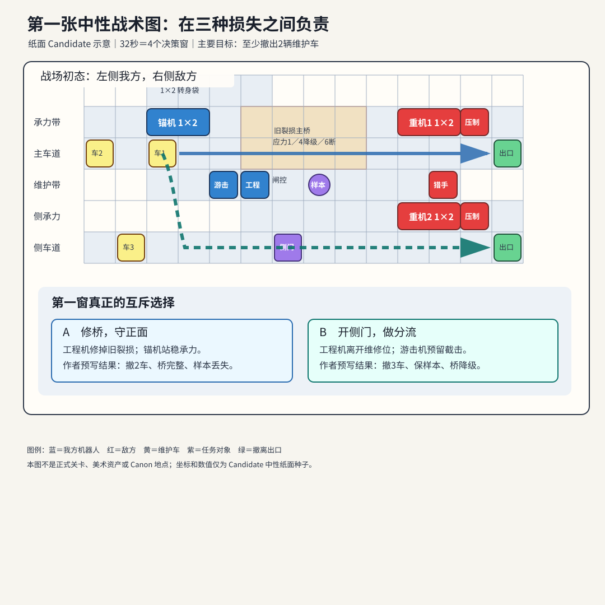

# 第一张中性战术图：玩家十分钟内到底在做什么

> 当前状态：`Candidate / zero_build / human_not_run / user_not_decided`
>
> 这是被主策否决后保留的v0.2失败基线：地图、目标和两条作者回放已经写出，但中后段缺少玩家决定，压制、碰撞和反应也不是规则推导。当前修订请直接读 [v0.3四窗责任阶梯](05f-first-neutral-tactics-v0.3-decision-ladder.md)。

这张图不使用 C01–C03 的人物和地点，也暂时关闭纪存、白鸢、七海及机魂能力。它只验证基础问题：**没有角色超能力撑场时，机器人靠身体、位置、朝向和承诺，是否已经值得玩。**

## 先看懂战场

三辆维护车要在 32 秒内向右撤离，至少救出两辆。玩家控制三台匿名测试机：

- **锚机**：身体占两格，能站稳、承力和保护，但转身需要净空；
- **游击机**：移动快，能预留截击和压制，但弹药有限；
- **工程机**：能修桥、开门、处理样本，但同一时间只能在一处工作。

敌方两台重机正压向桥面和侧路，两台压制机封锁长通道，一台猎手要取得中央样本后撤走。



这场战斗不问“能否清光红色单位”，而同时记录三件事：

1. 至少两辆车有没有撤出；
2. 主桥有没有保持完整通行能力；
3. 样本有没有被敌方带走。

因此玩家可能救到车，却留下桥梁维修债；也可能保住公共设施，却失去样本。一个总分不能把三种结果抹平。

## 屏幕上先出现什么

```text
┌──────────────── 战场地图 ────────────────┬── 选中：工程机 ──┐
│ 机体身体、朝向、车辆路线、桥和闸门          │ 机动：正常         │
│ 敌方意图箭头，以及预计发生接触的时间         │ 工具：2            │
│                                           │ 本窗：修桥／开门   │
├───────────────────────────────────────────┴────────────────┤
│ 还剩32秒　撤离0/2　桥：旧裂损1　样本：在场　[预览] [执行8秒] │
└────────────────────────────────────────────────────────────┘
```

第一眼应该能回答“敌人要做什么、哪条路受威胁、三台机体各能承担什么”。玩家不需要先翻人物属性表找最高攻击力。

## 一个决策窗怎样操作

下面只用“全队安排好以后一起执行 8 秒”来演示。其他回合制以后用同一地图另做真人比较，不在这份首读稿里展开。

1. **点敌人**：地图显示它的当前目标、路线和预计接触时间。
2. **点维护车**：选择主路或侧路；确认后，本窗内不能免费改道。
3. **点我方机体并画短路线**：终点直接显示整个身体占哪些格、面朝哪里、要花几秒。
4. **选一个主要动作**：例如站稳、修桥、开门或压制。
5. **可选一个预留反应**：例如“猎手进入这条线时截停”。没有预留，不能看完结果再补救。
6. **看因果预览并执行**：已知事实显示确定结果；尚无规则支撑的部分必须标成未知，不能装作系统已经算过。

鼠标操作可以是“点选—拖路线—点动作—长按执行”；手柄可以是“光标选中—逐格设路线—肩键转向—动作栏确认”。具体按键仍待可用性测试，但每次操作都必须立即显示时间、身体占位、资源和放弃了什么。

## 作者回放 A：修桥并守正面

这是目前纸面账中的一条候选结果，不是已经跑通的战法。

### 第1窗：先把旧裂损处理掉

- 车1、车2承诺走主路；车3走侧路，门不开就停在门前；
- 工程机原地修桥 6 秒，工具从 2 降到 1；
- 锚机向桥口移动并站稳，共 7 秒；
- 游击机保持观察；
- 执行后，桥的旧应力从 1 降到 0，敌重机和猎手同时接近。

### 第2窗：选择继续承力，不去争样本

敌方公开意图变为“重机撞锚机、猎手取样”。这条作者回放让锚机继续站稳，工程机和游击机不离开主桥责任区。结果是重机被挡住、车辆继续通过，但猎手取得样本，桥应力升到 1。

### 第3窗：样本开始撤走

玩家再次选择让锚机维持承力，而不拆开阵线追猎手。第一辆车撤出，猎手带着样本转入东侧撤离线，桥应力升到 2。

### 第4窗：保住第二辆车

锚机继续承受接触，第二辆车撤出；猎手带样本离场。最终是：

```text
主要目标：2/3辆车撤离——完成
主桥：应力3，保持完整——完成
样本：被敌方带走——前向失败
工程工具：剩1
```

## 作者回放 B：开侧门并做分流

只列出与 A 不同的操作。

### 第1窗：工程机放弃修桥

- 车1提前转入侧路，车2走主路，车3走侧路；
- 工程机移动到闸控并开门，共 6 秒；按当前纸面规则，开门**不消耗**工程工具；
- 游击机等待 1 秒、移动到截击位，并预留猎手进入目标线时触发的反应；
- 锚机仍去主桥站稳。

作者账把结果写为“猎手被截在样本外、侧门打开”。这项反应目前只是预写结果，规则程序还不能根据距离、朝向和同一时刻的身体接触自行算出它。

### 第2窗：工程机与猎手争样本

工程机用 4 秒取得样本；游击机进入侧路守卫袋，挡住第二台重机继续西进；锚机继续顶住主桥。作者账把同一时刻的结果写为“样本先转为我方保管，猎手因此中止取样”。桥应力升到 2。

### 第3窗：第一辆侧路车撤出

锚机和游击机继续守住各自通道，工程机保管样本。第一辆车从侧路撤出，桥应力升到 3。

### 第4窗：其余两辆车离场

侧路和主路各有一辆车撤出。主桥应力到 4，进入降级，但没有断裂。最终是：

```text
主要目标：3/3辆车撤离——完成
主桥：降级，需要后续维修——前向失败
样本：由我方保住——完成
工程工具：仍有2
```

## 两条结果为什么值得比较

| | A：修桥守正面 | B：开门做分流 |
| --- | --- | --- |
| 救出的车 | 2辆 | 3辆 |
| 公共设施 | 桥保持完整 | 桥降级 |
| 样本 | 丢失 | 保住 |
| 工具 | 剩1 | 剩2 |
| 责任重心 | 保护长期通行能力 | 保护眼前人员与证据 |

这张表只能证明作者写出了两种不同代价，不能证明游戏里真的只有这两种合法办法。也许存在“先修桥、再晚开门、同时截击”的混合解，把 A、B 都压过去；这要等真实规则计算和搜索后才知道。

## 主策划对当前版本的否决点

这份纸面例子现在**还不足以进入 Build**。原因不是缺表格，而是它尚未形成一整局持续有趣的操作：

- A 在第1窗作出核心决定后，第2至第4窗主要是在重复“继续站稳”；
- 两台压制机目前只留下“完成射击”的文字，没有实际改变路线、功能或反应；
- 锚机的两格身体虽然写进地图，但两条回放都没有真正要求玩家转身；
- 当前没有一次清楚的功能损伤，也没有“继续承担还是安全撤离”的身体抉择；
- 截击、同刻样本归属和多身体碰撞都还没有共同规则计算。

因此下一份纸面修订必须先补三次中段选择，再申请实现：

1. **第2窗**：锚机在“继续站稳保护桥”与“推开重机腾出空间”之间二选一；
2. **第3窗**：工程机在“处理样本”与“救援一辆受阻车辆”之间二选一；
3. **第4窗**：某台已经功能受限的机体在“多守两秒换目标完成”与“现在撤离避免长期伤损”之间二选一。

每次都必须让玩家看见新敌方意图、两种合法回应、具体身体代价和下一步后果。若补完后仍然只是按作者预定顺序续按“保持”，就应换地图题面，而不是靠主角能力掩盖。

## 玩家什么都不做或失败会怎样

- 没有命令的我方机体只维持安全状态，不会自动替玩家修桥或救援；
- 已承诺的车辆路线和敌方行动继续推进；
- 桥降级或样本丢失可以作为真实后果继续，不会被结算页改写成成功；
- 如果 32 秒内不足两辆车撤出，这个中性测试从稳定检查点重试，因为目前没有正式剧情承接它。将来章节能否前向继续，要另由 Operation 和剧情设计决定。

## 现在请你只判断三件事

1. “救车／保桥／保样本”三个目标分开结算，是否值得继续做成主战术原型？
2. 锚机、游击机、工程机这种**身体职责**，是否比坦克、输出、治疗更接近你想要的机器人战棋？
3. 我指出的中段决策不足是否成立；第2至第4窗应该优先增加哪一种身体抉择？

技术边界与数据账在 [v0.2 声明事件附录](data/d04-p1-v0.2/README.md)。当前最多只能报告“作者事件账可重复回放”；不能报告规则可执行、两种战法成立、玩法有趣或适合迁入 C01–C03。
