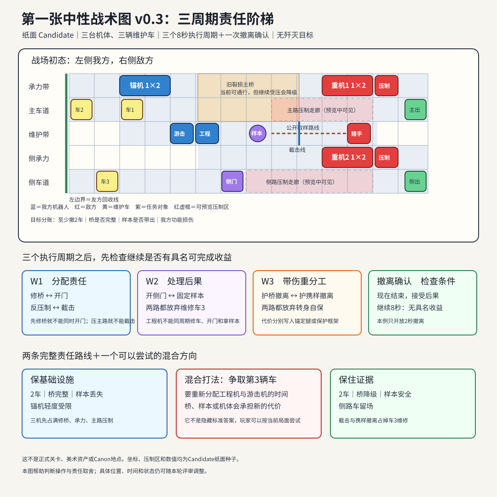

# 基础主战棋完整例 v0.3：第一张中性任务怎样从开局玩到结算

> 当前状态：`Candidate / current_public_tactics_main / current_core_design_review / user_not_decided`
>
> 这是当前唯一供用户判断基础主战棋的主稿。05a 与 05d 是已退役证据；05b 是白话规则索引；05e 与 05g 是技术附录。05c使用另一张独立的“K-17”中性地图说明角色C2：它只复用本文的身体规则，不共用维护车／主桥题面的地图、初态和结果。若这些文件与本文的玩家流程冲突，以本文作为当前 Candidate 提案。

这是一份核心玩法设计，不是运行录像。文中的数字和结果仍是 Candidate 例子，但已经把一场任务从开局、三个战术判断、一次撤离确认、失败到结算完整说清，供本轮直接评审操作、取舍与玩法方向。

## 一句话题面

三台身体职责不同的机器人，要在最迟第`32秒`前保护三辆维护车撤离。至少撤出两辆才完成主要目标；主桥、中央样本和我方身体分别结算，不能用一颗总分把损失抹掉。下面两条演示都执行三个完整的`8秒`周期，然后进入一次`2秒`撤离确认。只有当前局面确实存在一项能在下个周期完成的具名行动时，界面才会同时开放“继续承担”；本例不会用一句“可能改善”伪造收益。

```text
主要目标：最迟第32秒撤出至少2／3辆维护车
次要目标（公共设施）：主桥保持完整通行能力
次要目标（证据）：中央样本不被敌方带出
身体账：三台我方机体带着哪些具体功能损伤离场
```

没有全灭要求。敌人可以被挡住、迫停、推离、压制或迫使中止当前动作。



## 开局一眼看见什么

玩家不需要先开三层菜单。地图和右侧卡片同时显示：

- 三辆维护车的路线、预计离场时刻和哪一辆会被前车堵住；
- 主桥当前有一处旧裂损，侧门关闭，样本仍在中央工作位；
- 两台压制机分别覆盖主路和侧路；
- 两台重机正向桥与侧门推进；
- 猎手预计在本周期第7秒完成取样；
- 我方三台机各有哪些身体功能仍正常、受限或失效。

为避免后文把四个敌人混成一团，本例始终按职责称呼它们：`桥头重机`只向西支撑位施压，受阻就停；`侧门重机`维持侧路压力，不会临时瞬移去追工程机；`主路压制机`和`侧路压制机`各自封一条车道。敌人只有到了新的战术周期，才会根据已经发生、而且它实际看见的结果重新规划。

开局地图只有三条离场边界：`主车道→主出口`、`侧门→侧出口`、`西支撑位旁→友方回收线`。车辆从主出口或侧出口离场；受损到无法自行撤出的我方机体，只有到达友方回收线才能记为待拖带。工程机携带的已验证绝缘跨接头可以开侧门；它是唯一工具，安装后留在门边，不计入工程机的两份现场耗材。

三台我方机体不是坦克、输出和治疗的换皮：

| 机体 | 身体特点 | 本图真正争夺的职责 |
| --- | --- | --- |
| 锚机 | `1×2`身体，转身需要扫掠空间 | 结构承力、横身掩护、推离重机三选一 |
| 游击机 | 单格、换位快，但只有一个武器／反应通道 | 反压制一条车道，或预留截击猎手 |
| 工程机 | 单格、带一只具名操作肢和有限工具 | 修桥、开门、救停驶车、固定样本不能同时完成 |

本例从公共Hub主稿读取一条明确的身体前态：锚机左臂安装了只服务本次任务的临时箍架。它不是“按一次即消失”的战术消耗品；在载荷未进红区、左臂未再跌级且主体未中止时，可以跨本任务多个周期继续承力。任一停止条件发生或离开任务后，箍架立即报废，左臂仍是受限状态。

## 玩家每个周期怎样操作

下面采用主策当前推荐的“短全队协同”来演示：在一个8秒纸面周期里逐台编辑三台机体，再让全队、敌方与环境共同执行。点`本机排好`只标记这一行检查完成，不会锁死动作；打开`提交摘要`也只是检查整队得失。只有长按`执行本周期`才锁定全队并推进世界。它仍是Candidate方向，不是用户已经批准的最终时制；逐台交替行动保留为低负担备选，另外两种只作比较参考。

一次操作固定为：

```text
1. 看敌方意图和预计接触时刻
2. 点一台机，拖出短路线
3. 调整终点朝向，查看整副身体和转身扫掠区
4. 选一个主要身体动作
5. 可选地预留一个反应，并查看它放弃了什么
6. 打开`提交摘要`，查看“确定结果／情报未知范围／非法原因”，再长按`执行本周期`
```

鼠标下，左键选机、拖路线，滚轮转朝向，动作轮选主要动作，时间线点选反应；手柄用方向键切机、左摇杆画路线、肩键转朝向、`A`选动作、`X`预留反应。非法路线当场标出冲突格和时刻，不会先扣资源再报错。

玩家也可以让某台机`等待`。等待不会扣工具或弹药，但世界、敌人和车辆仍按已冻结意图推进；不操作不是暂停时间。

### 提交前，玩家实际会看到什么

以“保住公共设施”路线的第1周期为例。玩家给锚机、游击机和工程机排好动作以后，预览不会先把整场胜负剧透，只把当前已经能负责说明的事写成人话：

```text
确定会发生：锚机若最迟第2秒站稳，工程机随后开工，并会在第8秒修完桥面旧裂损。
敌方公开动作：猎手仍会在第7秒取得样本，因为本轮没有人为它预留截击。
你主动放弃：游击机把唯一武器／反应通道用于压住主路，不能同时保护样本。
仍然未知：敌方重机下一周期会普通推进还是强化冲撞；它的新意图要到下个判断点才出现。
不能提交的情况：锚机路线迟于第2秒、转身扫到墙体，或工程机在锚机站稳前就开始修桥。
```

玩家确认自己愿意用样本换主桥与车辆通行后，才长按`执行本周期`。执行时，时间线把已经发生的动作逐条从“预计”改为“已发生”；若新的可见状态让后续动作失去条件，机体会停在最后安全状态，并说明是哪一项条件失效。

## 三个执行周期和撤离确认分别在判断什么

```text
第1执行周期：三副身体先承担哪三条责任？
第2执行周期：刚产生的停驶车、样本和重机压力先处理哪一个？
第3执行周期：继续用身体保护，还是转身推开压力来源？
撤离确认：最低救援已完成后，是否已有一项能在下周期完成的具名改善动作；没有就提交2秒撤离。
```

下面给出两条从开局走到结算的完整纸面演示。每格里的“周期末状态”用来说明合法命令应产生的因果，不代表数值已经定案。

两条路线使用同一份开场资源：游击机有`3发`具名弹药，工程机有`2份`现场耗材，另有一只任务前已验证的绝缘跨接头。弹药和耗材在动作真正开始或反应实际触发时才消耗；跨接头安装后改变的是唯一工具的位置和借用责任，不会凭空变成`耗材-1`。

这里还有两个容易混淆的词：**保护**是锚机事先站到车辆或结构前，把下一次压力接到自己的保护框架；**反应**是游击机事先留住武器与时间，只有猎手越过样本前的具名截击线才开火，若条件没触发，这份预留也占掉了本周期的机会。二者都要在执行前承担，不能等结果发生后免费补选。

第3周期共用一条身体取舍：锚机一旦转身把重机推离，当前的结构承力或横身掩护就立即结束。继续保护可以让最后车辆或桥完成本周期的通过，但锚机要正面承受已公开的强化推进；转身推离可以减少后续身体压力，却会让尚未通过的车辆或桥失去本周期保护。

## 演示路线一：保住公共设施

这条路线接受样本失守和第三辆车留场，优先让两辆车通过完整的主桥。

| 周期 | 开窗事实 | 玩家给三台机的命令 | 纸面预期发生什么 | 下一周期看见什么 |
| --- | --- | --- | --- | --- |
| 1 | 桥承载区清空但有旧裂损；主路受压制；猎手第7秒完成取样 | 锚机最迟第2秒到西支撑承力格并`结构承力`；游击机`反压制主路`；工程机停在相邻维护带，条件等待至承力成立，再于第2–8秒从侧面接口`修复旧裂损` | 锚机第2秒先站稳，工程机才在相邻维护位开工，两副身体不占同一位置。第8秒旧裂损修复；游击机压住主路，两辆主路车没有停驶。因为无人预留截击，猎手取得样本；弹药`3→2`、现场耗材`2→1` | 桥恢复稳定通行；猎手携样本撤退；重机准备撞向支撑位 |
| 2 | 两辆车开始上桥；侧门关闭；桥头重机公开普通推进，侧门重机继续压迫侧路 | 锚机继续承力；游击机继续反压制主路；工程机在`维修第三辆车`与`开启侧门`之间选后者，为自己准备一条可撤的侧路 | 锚机替桥顶住桥头重机的这次普通冲撞，桥仍可完整通行。工程机将绝缘跨接头留在门边，侧门打开；这不消耗现场耗材，却会让第三辆车进入无人处理的侧路压制区，轮组变为受限并停在安全格。工程机本周期已用动作开门，不能同时维修；弹药`2→1` | 第一辆车接近主出口；桥仍完整；侧门已成为工程机的撤离路线；第三辆车需要一个完整周期维修 |
| 3 | 两辆车进入最后路段；桥头重机公开改用强化推进，侧门重机仍守住侧路压力 | 锚机主动放弃转身推离，继续承力；游击机维持主路反压制；工程机穿过已打开的侧门，走向侧出口 | 转身推离可以降低锚机后续身体压力，但会立即中断桥的承力保护；玩家选择用锚定腿风险换主桥完整。强化推进把锚机向西推开一格，锚定腿从`正常→受限`；它被推开前最后一次替桥顶住压力，两辆主路车越过撤离边界。工程机到达侧出口；弹药`1→0` | 主要目标完成；游击机位于主出口的2秒撤离路线内，工程机位于侧出口；锚机因锚定腿受限停在友方回收线，第三辆车与样本未解决 |
| 4 | 第24秒已有2辆车安全；敌方下一次完整动作尚未开始 | 玩家点`现在结束`，查看2秒撤离预览后长按提交 | 预览确认第24–26秒内没有已经排定的新接触；游击机跨过主出口，工程机跨过侧出口，锚机标记为`留场／友方回收`，第三辆车留场，样本保持敌持；第26秒后不再生成新意图 | 进入任务摘要 |

这条路线的示范结果统一写为：

```text
维护车撤出2／3
主桥保持完整通行
样本被敌方带走
锚机入场前已有的左臂受限仍然存在；临时箍架随任务结束报废
锚机锚定腿轻度受限
敌方记录到游击机反压制主路的惯用站位
游击机弹药0／3，工程机工具1／2
绝缘跨接头留在侧门，待任务摘要处理取回或借用责任
游击机与工程机已撤出；锚机在友方回收区等待，第三辆维护车留场
```

用白话说：工程机先修掉旧裂损；之后两次重机冲撞发生时，锚机都站在支撑位替桥顶住正面压力，所以桥虽然承受车辆通行，仍保持完整。第三辆车并不是被结算页凭空留下：玩家为了让工程机取得安全侧路撤离口，明知开门会让第三辆车进入无人处理的压制区，仍放弃了本周期维修。这是一笔看得见的撤离安全换车辆损失，不是作者为结算硬造的事故。

这条路线成立的必要条件是：第1周期车辆和重机都还没有进入承载区，锚机在第2秒前站稳；否则玩家的修复与承力会来不及，路线就必须改写，不能让动作无视时序。

## 演示路线二：保住证据

这条路线接受主桥降级和第三辆车留场，优先阻止敌人带走样本。

| 周期 | 开窗事实 | 玩家给三台机的命令 | 纸面预期发生什么 | 下一周期看见什么 |
| --- | --- | --- | --- | --- |
| 1 | 猎手的公开路线会在第5.5秒越过样本前的截击线，第7秒完成取样；主路与侧路都受压制 | 锚机横身`掩护主路`；游击机移到样本前的已标记射位，预留`猎手越线时射击夹爪`；工程机`开启侧门` | 锚机用保护框架替主路车辆挡下一次压制，框架从`正常→受限`。猎手第5.5秒越线，游击机在第6.5秒打断它接下来的取样动作；这个反应占掉了游击机反压制主路的机会。工程机将跨接头留在门边，第4秒打开侧门，并停在与样本操作位相连的维护带；第三辆车进入侧路压制区后轮组受限。弹药`3→2` | 猎手已经靠近，但样本仍在地面；工程机下周期可从维护带进入样本操作位；第三辆车需要一个完整周期维修 |
| 2 | 猎手已冻结的本周期意图仍是`继续抓取地面样本`；工程机本周期只能维修第三辆车或先带走样本；桥头重机继续逼近掩护位 | 锚机维持掩护；游击机改为`反压制主路`；工程机沿维护带进入样本操作位，并在第4秒完成`固定并携带样本` | 第4秒样本从`地面`变成`工程机操作肢携带`。猎手后续抵达原取样位时，目标已不在地面，只能安全中止已冻结的取样动作；它不能在同一周期临时改抓工程机。游击机压住主路，两辆车继续通过尚未修复的桥；弹药`2→1` | 样本由工程机携带；第三辆车仍停驶；两辆主路车已越过主路压制区，下周期只需锚机保住最后通过时刻 |
| 3 | 两辆车已越过主路压制区并进入最后路段；工程机带样本，侧门已打开；桥头重机公开强化推进 | 锚机主动放弃转身推离，继续横身掩护最后车辆和携样工程机；游击机本周期只`反压制侧路压制机`；工程机穿过侧门到侧出口，操作肢持续携样 | 主路车在开窗时已离开主路压制机的有效走廊，所以游击机没有用一个通道同时解决两路，它只压住侧路压制机，保工程机携样撤出。锚机如果转身推离，保护框架可能少吃一次压力，但最后车辆和工程机会失去当前掩护；玩家选择用框架失效换它们离场。桥头重机将余力从桥口掩护位传到旧损桥面，保护框架从`受限→失效`，桥降级但未断裂；弹药`1→0` | 两辆车与样本已离场；锚机与游击机分别处在友方回收线和主出口的2秒撤离路线内；第三辆车留场 |
| 4 | 第24秒已有2辆车与样本安全 | 玩家点`现在结束`，查看2秒撤离预览后长按提交 | 预览确认第24–26秒没有已经排定的新接触；锚机跨过友方回收线，游击机跨过主出口，桥保持降级，第三辆车留场；第26秒后不再生成新意图 | 进入任务摘要 |

这条路线的示范结果是：

```text
维护车撤出2／3
主桥降级但未断裂
样本由工程机携带撤出
锚机入场前已有的左臂受限仍然存在；临时箍架随任务结束报废
锚机保护框架失效
第三辆车留在现场等待地方队后续处理
游击机弹药0／3，工程机工具2／2
绝缘跨接头留在侧门，待任务摘要处理取回或借用责任
三台我方机已撤出
敌方记录到游击机的截击时机、侧门开启顺序和锚机的横身掩护方向
```

用白话说：这条路线把工程机的时间用来带走样本，没有修桥，也没有维修第三辆车。锚机的横身掩护位就在桥口承载带：重机的推力先撞上保护框架，余力再传入未修复的桥面。临时箍架只让旧伤左臂仍能合法保持这个动作，不会替保护框架免伤；因此本路线新失效的是保护框架，不是锚定腿。

两条路线的区别不是换一条颜色不同的路，而是三副身体从第一周期起承担了不同责任。本轮也不为了强保二选一而禁止合法的混合计划；若玩家真能以合理代价同时多保一项，它应被当作策略而不是漏洞。

| 同一结算口径 | 保公共设施 | 保住证据 |
| --- | --- | --- |
| 主要保住 | 主桥完整、两辆车撤出 | 样本、两辆车撤出、三机撤出 |
| 明确失去 | 样本、第三辆车 | 桥降级、第三辆车 |
| 入场旧伤 | 左臂受限；临时箍架只在本任务内开放承力 | 左臂受限；临时箍架只在本任务内开放承力 |
| 本场新增伤 | 锚定腿受限 | 保护框架失效 |
| 谁撤出 | 游击机、工程机；锚机由友方回收 | 三台我方机全部撤出 |
| 敌人学到 | 主路反压制的惯用站位 | 截击时机、开门顺序与横身掩护方向 |

## 撤离确认：没有具体收益时，不伪装成选择

“继续承担”不能只写一句可能改善。在这两条演示路线的第24秒，第三辆车需要一整个维修周期，但工程机已经在撤离位或场外；桥和样本也没有一项能由现有机体在下个8秒内合法改善。因此本例的继续按钮应当显示为`当前没有可在下一周期完成的次要目标`，并把2秒撤离列为唯一有意义的当前方案。

界面写成：

```text
现在撤离：锁定已经救出的两辆车，以及当前桥／样本／身体结果
继续8秒：没有具名可完成收益；只会生成敌方新一轮推撞与压制
设计结论：本局不把“继续”伪装成对等按钮
```

其他任务若要提供真正的撤离／继续抉择，必须在按钮上写出一项当前身体、位置和剩余资源确实能完成的具名动作，例如`应急拖带车3`或`撑到地方队接管`，以及它会让谁继续受险。没有这条具体操作链，就只提供撤离，不为了显得深刻而摆一个陷阱按钮。

一张真正的对照卡应该像这样：

```text
前提：工程机仍在车3附近，操作肢和剩余工具足以完成一次应急拖带。

现在撤离：锁定已救出的2车，以及当前桥、样本和身体结果。
继续一周期：尝试把车3拖入友方回收区；工程机和一名掩护者必须留场，
并承受下一周期已公开的重机推进与侧路压制。

没有在场执行者、合法动作或可完成收益时，“继续”不开放。
```

## 如果玩家什么都不做

第1周期让三台机全部等待是合法计划。执行后：压制机使第一辆主路车停在安全格，后车被堵；侧门保持关闭；猎手取得样本；重机继续接近桥。玩家没有被系统惩罚性扣资源，但第2周期面对的局面更差。

这用来说明：时间推进属于战场，不属于玩家按钮；`等待`也是有后果的选择。

## 如果到第32秒只救出一辆车

本中性例把`少于2辆撤出`归入00c的`无法形成合理继续态`，因此定义为`必须重试`；它只用于让读者看清主要目标失败后的处理。正式章节若仍有可信后续，才可以转入失败继续或撤离。

玩家看到：

```text
主要目标：失败——仅撤出1／3辆
仍然保留在本次尝试日志中的事实：桥状态、样本去向、身体损伤、工具与弹药消耗

[查看原因]  [从固定初态重试]
```

选择重试会回到同一中性初态，不把这次尝试写进长期进度，也不会靠随机敌人换题。正式游戏以后可以为具名任务选择“带着失败继续／撤离／重试”，但那必须由整项任务和剧情共同提供真实后续，不能由这张中性例图代替拍板。

## 任务摘要只讲因果，不让玩家重选事实

以“保公共设施”路线为例，摘要写成：

```text
工程机修复旧裂损，所以主桥保持完整通行。
锚机在两次重机冲撞发生时都站在支撑位替桥顶住压力；第三周期的强化推进仍让正面暴露的锚定腿变为受限。
游击机反压制主路，所以车辆没有停驶；也因此没有截击猎手。
猎手无人截击，所以样本被敌方带走。
第三辆车进入无人处理的侧路压制区后轮组受限；工程机先开门、随后撤离，没有空出一个完整周期维修它。
游击机三次反压制耗尽3发弹药；工程机修桥消耗1份工具，剩余1／2。
```

玩家可以展开原因，但不能在结算页把样本改成“已保住”。若还有工具借用、公开范围或下一路线等尚未提交的责任，返回对应负责页准备；最后只按一次`继续`。

这张战术图离场时只输出：车辆、桥、样本、具名身体功能、实际资源、敌方观察、撤离状态和原因。Hub维修价格、关系事件、章节去向由各自系统以后消费，不在战术结算页临时发明。

## 与总案的关系

本例只放大[核心玩法总案](00c-core-game-design-master-review.md#主战棋玩家每一轮究竟做什么)的身体战术、短全队协同、两条责任路线和撤离判断，不增加新的评审问题。任何意见都直接批注到总案的主战棋部分。

## 本轮之后仍要细化的核心规则

为了避免主稿再次膨胀，这里只列会影响后续设计的未定项；同刻细节和合法／非法例子放在 [八张规则卡](05e-neutral-tactics-rule-cards.md) 和 [逐刻结算附录](05g-common-tactical-resolver-paper-spec.md)。它们不妨碍你先评审本文的核心操作和两条责任路线。

1. 决定桥、门、样本、车辆路线和撤离边界的最终位置；
2. 决定三副身体各能走多远、怎样转身，以及哪些伤损会关掉哪些动作；
3. 说清两台身体同刻争一个位置、换边或相撞时怎样停下，不能按阵营或编号暗中抢先；
4. 让敌方到达、准备和生效时刻都能从玩家看见的路线与动作解释出来；
5. 统一界面上的“非法／确定／情报未知／条件反应”，并让每个失败原因可以用一句人话回看。

这些是后续策划收束项，不妨碍先评审本文的操作和两条责任路线。
