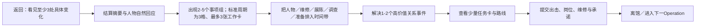

# 《万机残响》辅助玩法、Hub 与长期循环详细设计 Candidate v1

> Status: `candidate_system_contracts_first_fixtures_and_r2_paper_preflights / actual_replication_m6_build_human_required / user_review_required / no_runtime_authority`
>
> Depends on: G1 研究、D02 产品宪章、D03 系统／状态／经济合同、中性 Hub 与收藏合同。万机馆空间只在公共玩法通过后的第二阶段适配，不是本系统成立的前置。
>
> Rule tables: [data/auxiliary-loop-contracts.tsv](data/auxiliary-loop-contracts.tsv)、[data/auxiliary-output-gates.tsv](data/auxiliary-output-gates.tsv)、[data/hub-action-contracts.tsv](data/hub-action-contracts.tsv)、[data/relationship-event-contracts.tsv](data/relationship-event-contracts.tsv)、[data/settlement-contracts.tsv](data/settlement-contracts.tsv)、[data/mission-card-schema.tsv](data/mission-card-schema.tsv)、[data/collection-entry-schema.tsv](data/collection-entry-schema.tsv)

## 0. 核心裁决

辅助玩法的任务不是“给长剧情换口味”，而是让玩家亲手完成以下四件事：

1. 在地点里发现足以改变判断的证据；
2. 把候选设定变成经过实证的物理／社会条件；
3. 在持续 Hub 的有限时间、空间和人物之间承担取舍；
4. 把战斗结果变成具体的人、物、房间、关系、路线和下一场行动。

因此现有 16 个旧 Hybrid 模板不作为 16 套系统继续开发。它们被收束为：

- 三类探索框架：微型自由探索、调查／工程实证、知识门控遗迹；
- 四种微交互语法：校准、连线／调度、证据编排、表演／节奏；
- 一个共同 Hub 循环；
- 一个共同世界图与任务卡；
- 一套 Encounter／Operation／Chapter 三级结算。

每个章节最多选择一个主辅助框架和一个微交互变体。不能为了“每章有新鲜玩法”再造输入、UI、失败、存档和状态系统。

### 0.1 只允许四个复用内核

所有辅助活动必须组合下列内核，不得自行建立第五套状态与结算：

- `AUX-SPATIAL`：移动、观察、地标、稳定对象交互和返回点；
- `AUX-EVIDENCE`：证据、候选假说、比较、实证和知识层；
- `AUX-COMMIT`：有限行动、岗位、请求、接受／拒绝、保管与后果提交；
- `AUX-ROUTE`：节点、路线、时效、任务卡与后台执行者。

收藏／档案是这些内核产生结果的状态与查看层；三级结算是统一事务服务。工程 = Evidence + Commit + 实体对象，关系 = Commit + Story，开馆 = Spatial + Commit + Collection，世界图 = Route + Commit。四内核的机器合同见 [data/auxiliary-kernel-contracts.tsv](data/auxiliary-kernel-contracts.tsv)。

### 0.2 D05 资产上限

- `A0`：纯数据、文本或共享 UI，不新增场景／玩法代码；
- `A1`：一个共享交互扩展或 GD2 地点状态变体；至少计划 3 次消费、跨 2 章；
- `A2`：多模式共用地点套件或短英雄演出；必须同时服务 Story、探索、战术或 Hub 中至少两类，并单独批准；
- `A3`：独立引擎、大型唯一地图、专属动画体系；D05 默认禁止，只能转为 D06 章级高潮项目再审。

资产判定表见 [data/auxiliary-asset-tiers.tsv](data/auxiliary-asset-tiers.tsv)。

## 1. 辅助活动硬合同

任何活动进入制作前都必须填写：

```text
activity_id / family_id / player_role / story_question
location_design_pack_id / object_ids / actor_ids
core_verbs(3-6) / entry_state / information_model
meaningful_options(>=2) / duration / repeat_model
local_failure / forward_consequence / cancel_or_return
required_output_contract / primary_output_refs / optional_evidence_created
state_or_object_writeback / future_consumer
shared_runtime / new_assets / reuse_count / delete_condition
prototype_question / human_acceptance_scope
```

输出硬门按玩法家族判定，不能把 `evidence_created` 强加给所有活动：

- `AUX_EVIDENCE`／调查／知识编排必须产生有来源的证据、假说或证明结果；
- `AUX_SPATIAL`／微探索必须产生访问、对象、路线或局部空间摘要，证据只是可选输出；
- `AUX_COMMIT`／Hub／关系／工作单必须产生接受／拒绝、岗位、保管或owner写回请求；
- `AUX_ROUTE`／世界图必须产生任务承诺、到达态、时效或未选结果；
- 表演、校准和结算分别以具名演出/身体结果、校准结果和幂等回执为主，不必伪造证据。

精确字段与删除门见 `auxiliary-output-gates.tsv`。若该家族的 `primary_output_refs` 为空，或没有任何具名 `future_consumer`，默认删除或降级玩法：

- 只是为了交代信息且不属于需要玩家判断的调查：改成 Story/ADV 或短演出；
- 只是为了看场景：改成可自由观察的短空间；
- 只是为了按键：并入动画确认，不做小游戏；
- 只有奖励分数：取消分数，先找具体对象和后续消费者。

## 2. EX1 微型自由探索

### 2.1 玩家幻想

“我进入一个真实生活的机器人城市／舰内区域，自己选择路线，认识具名人物，观察机体与建筑怎样工作，并带回足以改变下一步的东西。”

### 2.2 基本循环


### 2.3 规则

- 单段 10-25 分钟，桥接章可更短，独立城市片段上限约 30 分钟；
- 一个远处可辨认的主目标、2-3 条路线、2 个具名人物小行动、3-5 个证据／景观锚；
- 动词：移动、观察、交谈、扫描／拍摄、帮助、返回；
- 不用战利品图标铺满地图；可选对象必须有名字、前后态或后续回应；
- 移动能力只承担轻路线差异，不做精密平台跳跃、坠落惩罚或长途返跑；
- 中性公共原型只使用测试空间；迁入正式章节时，地图才必须来自已批准的 GD2 地点档案，并先成立角色可达性、机体进出和建筑使用权；
- 关键剧情信息不能藏在容易漏掉的纯可选角落；可选探索增加理解、战前条件或人物回响，不让漏看者无法理解主线。

### 2.4 失败

- 路线走错：局部调整；
- 错过可选帮助：人物／公共支持未增加，但主线继续；
- 在时限探索中迟到：少带一条证据或路线关闭，必须提前显示；
- 危险区域受损：回到近检查点，保留已确认知识，不允许刷取重复奖励。

### 2.5 停放的阶段3候选落点

以下三行只保存以后要验证的问题，当前不设计路线、不做地图，也不计系统进度：

- C01：万机馆 L1 闭馆路线是**受约束的空间教学**，不是城市自由探索。玩家看见十九区大馆的容量，但只走 Current 允许的六站与两个连续观察点；
- C02：木桶街可用短街区／工坊网络表现模型、实机、比赛与维修共同生活；具体路线需 GD2 回补后才能定；
- C03：工务城可用“远处可见的城市承力目标 + 职业机作业点 + 具名工程员帮助”形成微型自由区；不能先于城市拓扑、工具归属和尺度包制作。

## 3. EX2 调查与工程实证

### 3.1 玩家幻想

“我不是在菜单里猜作者答案，而是从不同来源建立一个可推翻的判断，再用实体试验证明它能不能工作。”

### 3.2 基本循环

`提出问题 → 找 3 类不同证据 → 标注候选解释 → 选择测试配置 → 看实体反馈 → 确认／否定／保留未知 → 写入身体、地点、关系或战术`

证据至少来自两个不同通道，例如：

- 外观／损伤／材料；
- 日志／证书／说明；
- 人物证词／机魂回应；
- 现场测量／传感；
- 旧模型／版本差异。

### 3.3 规则

- 单案 5-15 分钟；重大工程案可跨两个场景，但每次只验证一个清楚命题；
- 玩家可把结论标为 `candidate / likely / verified / disproved / unresolved`；
- 系统不因点错选项立即宣布“错误”，而是让实体试验、后续证据或人物反应显示为什么；
- 试验必须操作真实变量，如载荷、温度、信号、相位、接口、材料、路径或权限，不做无依据字谜；
- 工程成功不自动授予物主许可、法律权限或机魂同意；三个状态分别结算；
- 失败优先是 `hypothesis_unconfirmed`，材料／人物处于真实风险时才产生有预告的前向后果；
- 同一底层可表现模型修复、机体诊断、设施加固、证书核验、黑匣子取证，不为每种皮肤复制系统。

### 3.4 停放的阶段3候选落点

以下只保存以后要验证的故事适配边界；中性工程实证原型没有通过前，不把它们写成章节玩法：

- C01：馆守 Z 右臂旧伤、维修限制、兜灯安全判断可以成为“观察→核验→选择保留／替换”的身体教学；硬故事结果不能因玩家解题改写；
- C02：模型意图、全尺寸重做、转子受限代管和事故救援天然适合“模型候选→工程复核→实体测试→主体确认”链；
- C03：城梁承力、职业机工具、衡令旧程序与第二锤拒绝需要把“证据、物理可行、权限、主体决定”分开，而不是一个工程进度条。

## 4. EX3 知识门控遗迹／残响层

### 4.1 玩家幻想

“我第一次进入时只能看见碎片；后来因为真正理解了某条语言、时间或载体规律，同一个地方变成另一张可读地图。”

### 4.2 基本循环

`短访问 → 观察不可理解现象 → 留下笔记与候选语义 → 在别处取得对照 → 重访 → 用知识选择新路径／操作 → 改变揭示层与后续行动`

### 4.3 规则

- 一个知识案跨 2-4 次短访问，累计 20-45 分钟；
- 真正的钥匙是玩家／角色已建立的知识记录，不是统一等级、万能钥匙卡或“情报点”；
- 语言、动作、信号或时间规则只建立足以服务本章和长期回收的有限词汇，不制作五套完整人工语言；
- 错译可先产生小型前向后果，但必须保留来源、置信度和以后纠正的机会；
- 重访必须有新可见差异、路线或人物回应，不能只为回去点同一个终端；
- B2、0号侧廊、旧黑匣子和远星信号的具体入口、尺度、载体与揭示时点仍由后续 L4/GD2 决定；本系统不能提前填入真相；
- 玩家知识、角色知识、公开知识与后台事实分别保存，图鉴不会自动把发现同步给所有角色。

### 4.4 资产控制

优先复用同一地点的状态差分、光照、音景、可交互层和少量新路径；只有规则真正需要时才做独立残响空间。若一个谜题只能靠制作全新环境和一次性演出成立，却无后续复用，优先改为 Story 演出。

## 5. 四种微交互语法

微交互不是独立长线系统。它们共享输入、提示、重试、结果和状态事务框架，通常 30 秒至 5 分钟。

### M1 校准

- 动词：观察、调节 1-3 个参数、保持、确认；
- 用途：重心、转子、信号、温度、供能、关节或安全包络；
- 乐趣：读物理反馈而非追移动小条；
- 失败：未达成、效率较低或产生有预告的临时负荷；
- 自动化：玩家证明理解后，可委托合适角色按已验证方案自动完成重复校准。

### M2 连线／调度

- 动词：连接、排序、分配、封锁、提交；
- 用途：维修管线、疏散路线、岗位、通信、货运与多机交接；
- 乐趣：有限节点、明确约束和机会成本；
- 失败：局部拥堵、延迟或替代路线，不做无限随机线路；
- 与战术共用地点／路线 ID，不能画一张与真实空间无关的抽象图。

### M3 证据编排

- 动词：比较、分组、标注、建立关系、提出结论；
- 用途：档案、身份、损伤、签名链、人物／机体跨场景归因；
- 乐趣：有限名单与多来源约束；
- 失败：结论保持未确认，禁止暴力试填；
- 每案控制在 5-8 个主体、3-7 个关键证据和少量动作词。

### M4 表演／节奏

- 动词：听／看提示、在宽窗口内配合、选择中止或继续；
- 用途：展演、合体仪式、声场、节庆和极少数大动作；
- 乐趣：角色节奏、共同提交与演出，不追求高难音游；
- 失败：降级演出、增加负荷或错过可选效果，不阻断主线；
- 低频使用，不能为每章造专属曲目和输入系统。

旧模板中的修复时机、重心校准、信号调谐、路线规划、同步压差、合体锁、灾害调度、档案策展分别并入 M1-M3；谈判回归关系／Story 选择；轻格斗只有在主战术身体动作无法承载且能复用输入时才保留；被动养护和重复派遣不做强制循环。

## 6. 公共 Hub：真实空间里的有限决定

### 6.1 空间边界

公共原型先使用一个中性小 Hub，只要求四种可辨认的功能区：生活／人物回应、维修／出击、档案／收藏、任务终端。它们可以是相邻房间，也可以是同一画面上的四个稳定热点；规则不能依赖万机馆某一层、某条走廊或某个正式泊位才成立。

玩家可以在当前重点区域短距离走动，也可从总览直接进入已开放活动。每次返馆只激活 2–3 个重点区域，其他变化通过终端、远景、来信和人物位置可见；不要求跑遍整座建筑捡对话。强制的“看回执→看变化→看任务卡”候选目标为 60–90 秒；玩家选择的关系、维修、调查、展陈和整备使完整标准返馆达到约 8–20 分钟，而不是用强制跑图拖到这个时长。

万机馆的楼层、机库、外部锁泊和展区怎样承载这些功能，属于公共 Hub 通过后的阶段2共享设定工作。届时只能把已成立的四种功能映射进真实空间，不能因为建筑资料丰富而重写时间格、工作卡或结算规则。

### 6.2 一次回馆周期



当前公共原型只采用一个可比较基线：标准回馆固定 3 格、最多提交 3 张会改变状态的高价值工作卡。页面可激活 2-5 个事项组，事项组只是把相关变化合并成可理解的问题，不等于额外行动或工作卡。卡片占用具名时间格、人物、机体、设施和工具；不冲突的卡可并行，世界时间每完成一格只推进一次。时间格不是可买资源；设施升级改变可选动作、并行的现实岗位或行动质量，不制造无限格。短回馆或章间长回馆是否改变格数，必须另经原型裁决，当前不预设 2 格或 4-5 格变体。

### 6.3 同一个时间格里，同一角色不能做两份工作

每张工作卡标明持续时间。具名角色在不重叠的时间格可以先完成一项短工作，再参加另一项；但不能在同一格同时承担两个高价值职责。出击、跨整个周期的重修或外勤会锁定它覆盖的全部时间格：

- 出击／支援岗位；
- 重修／工程项目；
- 外勤／后台任务；
- 关系／个人事件；
- 主持开馆／档案工作。

普通吃饭、路过对话、查看收藏和生活演出不占高价值工作卡；只有会改变状态、占用显著时间或排除另一选择的事件才进入时间带。目标是产生“这个时间窗把谁放在哪里”的人物取舍，不是把主角团变成人力表。

### 6.4 开馆不是餐厅模拟

开馆是低频 Hub Operation：

1. 选择本次主题与 2-4 件有来源的展品；
2. 安排讲解／安全／维修／接待岗位；
3. 预览观众、城市条件、风险和希望获得的回应；
4. 处理 1-3 个具名事件，而非连续服务随机客人；
5. 结算公共支持、关系、证据公开、设施负荷和下一任务。

玩家的目标是“如何表达并承担”，不是追单位时间最大客流。观众信任不是可刷声望币，而是具体群体对具体公开行为的状态。

## 7. 编队、岗位、维修、装备与轻经济

### 7.1 编队是关系与身体承诺

任务前分别确认：

- 人物是否到场、身体是否可用；
- 谁驾驶／操作、谁是机魂主体、谁只在支援席；
- 机体产权、维护责任和本次合法使用范围；
- B1／外部泊位／任务地会合；
- 伤损、能源、具名弹药和任务工具；
- 哪个角色本周期因此不能做 Hub／外勤行动。

候选 Encounter 前线规模 3-6 台，支援席 2-4 个；后期大军通过地图边缘支援、友舰、分队与巨构节点表现，不让玩家逐回合操作几十台机。

### 7.2 维修工作单

每项维修写明：

`target_body / broken_function / current_risk / required_facility / people / repair_capacity / common_material / unique_component / test / consent / result / remaining_debt`

玩家选择“先恢复哪个动词、保留哪处伤痕、谁来负责”，而不是点满 HP。临时修复可以提前出击，但带限制和未来正式维修债。

### 7.3 装备与库存

- 通用材料只有极少类别；
- 关键部件以唯一对象保存来源、保管、兼容和状态；
- 每台主要机体采用固定身份底盘 + 1 个任务工具／武装 + 1 个功能模块 + 1 个条件协议的候选上限；
- 任务工具用于改变动词和地图关系，如索具、探测、支架、非致死工具，不用随机词条；
- 装备不等于取得所有权，借用、托管、试用和主体同意分别记录；
- 商店只提供少量现实补给／公共制作选择，不经营刷素材与倒卖循环。

### 7.4 轻经济

章间只保留三类常规可消费约束：运营资金、通用材料、维修设备容量；再加少量具名关键部件。设备容量只表示重吊位、修理台与承力测试台的周期负荷，人物工时另由时间带和岗位占用表达，不重复扣费。泊位、人物时间、城市开放、关系、权限、同意和信息是条件状态，不可兑换货币。经济的核心问题是“现在修谁、开放什么、承担哪个公共责任”，不是财富增长曲线。

## 8. 关系事件：改变合作方式，不发好感奖励

### 8.1 事件结构

每个关系事件必须有：

- 由最近具体行动触发的原因；
- 具名参与者与各自知道的事实；
- 一个真实分歧、欲望、边界或未兑现承诺；
- 2-4 个表达优先级的回应，而不是明显正确答案；
- 一个关系／承诺／许可／伤害的具名变化；
- 一个未来 Story、Hub、探索或 C2 消费者。

事件结果可以开放：更诚实的信息、某类请求、共同工作、可撤回协议、独特反应或新的拒绝理由。它不能直接加攻击、买机魂服从或替主体在下次行动同意。

### 8.2 频率与防刷

- 每个 Operation 后 1-2 个高价值事件；短回馆可以没有；
- 同一关系主题有冷却、状态变化或新证据门；
- 不逐人送礼，不全员日更，不以睡觉刷新；
- 未选择的事件可延期、变形或错过，但必须提前说明窗口；
- 关键关系主线不能因为玩家没跑遍 Hub 而无声消失；
- 成人关系、职业协作、友谊、冲突和机魂协议分别建模，不汇总成一条恋爱进度。

事件类型与操作回写见 `relationship-event-contracts.tsv`。

## 9. 收藏、图鉴与展陈：共同生活史

### 9.1 一个条目是什么

收藏不是“打过就亮图标”。一个关键条目至少有：

- 它是实体、模型、原型锚、档案证据、机魂核心、旧影像还是废案；
- 来源和保管链；
- 当前物理位置与状态；
- 玩家、各角色、公众分别知道什么；
- 哪些解释仍是候选或相互矛盾；
- 与哪些人物／机体／地点／战斗动作有关；
- 展示、封存、交还、修复或暂不公开会产生什么回应；
- 哪个后续章节会重新读取它。

### 9.2 条目生命周期

`unknown → discovered → custodied → interpreted → displayable → displayed/withheld/returned → recontextualized → archived`

不是所有条目都必须归万机馆所有。照片、复制件、借展、代管、外部本体和只读信号都可以进入档案，而不篡改产权或载体连续性。

### 9.3 玩家动词

- 查看来源和状态；
- 比较版本／证据；
- 选择展签中已经可以公开的表达；
- 展示、封存、交还、维修或请求借展；
- 把条目连接到一个未确认假说；
- 回看由它触发的人物／战斗／城市回应。

关键条目必须有未来消费者；纯气氛小物可以只作为场景装饰，不强行登记成100%收集率。隐藏收藏不用于封锁主线结局，而用于更深理解、替代解法、关系或后游戏回看。

## 10. 世界图与任务卡：有限战略，不做4X

### 10.1 世界图保存什么

- 具名城市、舰队、遗迹和通信节点；
- 路线、航行时间、时限和回程条件；
- 当前求援与延迟／乱序信息；
- 到场角色、机体、泊位和友舰条件；
- 城市开放、公共支持、敌方威胁和已知未知；
- 未选路线由谁继续、它的能力和可能结果带。

### 10.2 一张任务卡

任务卡必须让玩家在提交前看到：

- 具体需要和 Primary 胜利动词；
- 地点与路线；
- 信息来源、更新时间和未知项；
- 预计玩法载体与时长带；
- 必须／可选到场者及其本周期机会成本；
- 可见风险、截止、撤离与失败继续；
- 具体可能收益和责任；
- 不选择时由谁处理、何时会收到结果。

同一时点 2-4 个真正可选卡已经足够。主线硬目的地可以只有一张，但仍应让玩家选择路线、准备、支援和承诺；不能伪装成自由世界。

### 10.3 未选路线

后台结果只由预先登记的具名执行者、能力、地点条件、玩家已提供支援和不确定性生成。系统不为了证明选择重要而随机杀人，也不让未选路线冻结。重要失败必须有提前可见的风险与后续回应。

## 11. 三级结算

### 11.1 Encounter 结算

回答：

- 哪些目标完成／部分／撤离／失败继续？
- 哪些人、机体、系统、地点、物件即时变化？
- 消耗了什么，敌人实际观察到了什么？
- 哪些许可、同意、承诺或拒绝发生？
- 下一 Encounter 带入哪些伤损、信息和路线？

它不处理全章奖励和大关系总结。

### 11.2 Operation 结算

聚合多个 Encounter 与探索活动，回答：

- 这次行动真正做成、没做成、带回什么？
- 返馆路线、维修、保管、人员可用性和下一立即需要是什么？
- 哪 1-2 个关系／生活回应获得优先窗口？
- 哪个地点／组织／敌人会在后续消费？

### 11.3 Chapter 结算

只有硬故事结果齐全才能封章：

- 角色随舰／留城／离队与职业代价；
- 机体所有权、驾驶、主体同意、身体状态和泊位；
- 地点永久态、回访点、路线与下一目的地；
- 关系、承诺、责任与未解决分歧；
- 关键物件、证据、收藏和保管链；
- 敌方身体、样本、已观察动作与剩余未知；
- 世界图开放与下一章需要。

三个层级都通过幂等事务提交，Full／Skip 演出结果一致。结算 UI 先显示具体对象的前后态，再显示资源；不能只发经验、钱和材料。

## 12. 停放：C01-C03 的候选长期回写示例

以下旧例保留作阶段3验证输入，不计当前公共玩法进度，也不继续深化。它们只映射已验收故事结果，不锁定具体玩法胜法、奖励数量或 UI；公共原型未通过前不得据此制作章节内容。

### C01

- 万机馆由固定旧馆转为低速巡展载体；L1、B1、外部锁泊的可见状态改变；
- 馆守 Z 右前臂永久毁损、临时巡展臂、裂盾与推进骨架损失进入维修／收藏账；
- 七海撤本人停机令和职业责任分别记录；
- 豪司／勇拳暂时参战后由企业回收，不等于加入常驻编队；
- BREAKER 核心毁灭、小体失去统一方向；敌方只记录取得右臂样本，不自动写“已经破解”；
- 下一站木桶街与打断的饭约成为路线和关系未来消费者。

### C02

- 3:2 赛果与事故不重赛是独立硬结果；小游戏分数不能改写；
- 无牌一号、旧拳王、白鸢登舰，但机体产权／共同维护关系保留；
- 新转子受限代管并安装，旧转子锁存；它们是具名部件与保管链，不是通用材料；
- 完全版王者自主卸装和留城分别进入主体／Roster；
- 万机馆不停机直达工务城，世界图不允许在中途刷支线。

### C03

- 城梁新承点、公共泊位和可回访工务城成为永久地点状态；
- 社勇王选择豪司、拒绝第二锤、豪司撤令形成具体主体协议；
- 三个月公共道路试用、企业产权、维护与到期复核分别记录；
- 七海、陆衡登舰及其职业责任进入 Roster／债务，不自动授予新权限；
- 当前求援与二十七年前缓存是两条不同来源；
- 百机航路只记录邀请已发与回应开放，不把百机直接加入队伍。

## 13. 原型序列

本节登记待制作原型的问题、规模和验收目标；五个首例的可编程中性内容已经落到 [D05辅助玩法中性内容Fixtures](validation/d05-auxiliary-neutral-content-fixtures-v0.1.md)，并由 [原型纸面Fixture登记](data/prototype-paper-fixture-registry.tsv) 逐项绑定到上游合同、用户决策门和 `zero_build / human_not_run` 状态。它们补齐了 P-EX1/2/3 的节点、初态、指令流与结局，P-HUB1 的五事件/两任务卡/三行动格冲突，以及 P-SET1 的三级结算/幂等/知识遮罩。另有三个独立 `TEST_*` 第二实例纸面数据包落在 [D05辅助玩法第二实例纸面Preflight](validation/d05-auxiliary-second-instance-paper-fixtures-v0.1.md)，由 [复用冻结合同](data/auxiliary-replication-freeze-contracts.tsv) 和 [canonical Fixture JSON](data/auxiliary-second-instance-paper-fixtures.json) 锁定“同一动作/UI/Outcome/状态域、零新增结算页”。

这仍不等于辅助玩法成立：三个 R2 只完成了第二实例纸面数据与静态防漂移 preflight，`replication_evidence_status=no_replication_evidence`；它们没有在同一实现上运行，也没有越过首例 M5、`DEC-06` 精确授权、Build、M6 或真人验收。五个首例同样没有Build、自动运行、目标玩家或用户验收，Hub与结算也尚未证明能在正式万机馆/章节状态中保持轻量和可复用。获得对应Candidate测试授权前，只能把这些Fixture用于程序拆分与问题审查。

### P-EX1 微型自由探索

- 一张小型城／馆区，远处主目标、三条路线、两名具名人物、一个照片／扫描证据；
- 15-25 分钟；不战斗；
- 验证玩家是否靠地标而非任务箭头移动，是否能说出一个人物和一条后续影响。

阶段3内容纸面适配候选为 C01E01 闭馆最后导览，但当前停放。届时只可在 Current 固定六站和连续观察点内部给短观察选择；不能改变公开顺序、让儿童默认跟队、进入封闭层或绕开饭约／警报汇流。若中性小馆灰盒尚未证明两条真实浏览路径，就不能进入 C01，也不能为了原型修改故事。

### P-EX2 工程实证

- 一个受损机体／结构，三类证据，两种候选方案，一次实体测试；
- 10-15 分钟；
- 验证错案是否可理解、调整，结论是否进入下一战术条件。

阶段3内容纸面适配候选为 C03E04 万机馆返港校正，当前停放：届时才可用转弯／扫尾包络、主推／侧推与惯性、职业机支援三类证据，比较早刹与多次微调等安全节奏；固定出口仍是低速校正和公共泊位成立，玩法只能改变磨损、时间和回应。C03E02 的工具复装最多作为系统通过后的 5 分钟复用压力测试，不在追逐中硬塞完整调查段。

### P-EX3 知识重访

- 同一小空间两次访问，中间获得一条新语义／时间规律；
- 总计 20-30 分钟；
- 验证第二次访问是否因理解而改变，而不是因为获得钥匙。

阶段3内容纸面适配候选为 C02E03 的机体来源／维修连续性调查，当前停放：届时才可把旧资料、实体痕迹与维修链作为有限节点，明确“能证明这副身体的连续性”不等于“解释机魂来源”，也不替机体决定是否观看或继续行动。具体场地、物件、权利人和必经节拍必须在 D06 对照 Current Reader 后锁定，不能由本系统先造事实。

### P-HUB1 回馆一夜

- 使用中性 Hub 四个功能锚点的纸面／UI灰盒，不做万机馆房间或正式美术；
- 上次行动产生三处可见变化；玩家有 3 个行动格、5 个候选事件、2 张任务卡；
- 必须在关系、维修、展陈、调查和准备之间取舍；
- 结束时能说出“谁在哪、修了什么、放弃了什么、下一场为何不同”。

### P-SET1 三层结算回放

- 用中性测试场的固定事实依次提交 Encounter、Operation、Chapter；C01-C03硬故事结果只在阶段3另做适配验证；
- 验证重放不重复奖励、知识范围不泄漏、产权／驾驶／同意不混合、硬故事结果不被分数覆写。

三个辅助家族现在各自已有一个纯数据／既有节点的第二短实例纸面包，专用 checker 能静态拒绝新增输入、主 UI、持久状态域、结算页、路线塌缩、求解器漂移和知识泄漏；这只完成了未来 R2 的数据 preflight。首例灰盒达到 M5 且取得 `DEC-06@approved_for_candidate_test` 后，仍必须把这些数据装入同一实现并完成 Build、自动回放与真人 M6；在此之前不得宣称 R2 已执行或“系统成立”。

## 14. 真人验收候选门

- 探索：至少 5/6 冷启动玩家能靠地标完成主目标，且至少两条路线被独立使用；至少 4/6 记住一个具名人物而非只记奖励；
- 工程：至少 5/6 能说出证据如何支持／否定方案；错案后知道下一步取证而不认为系统猜答案；
- 知识重访：至少 5/6 能说明第二次为什么能通过，答案不是“拿到了钥匙”；
- Hub：至少 5/6 能复述三个行动的机会成本；没有人认为需要跑遍所有房间或每天刷新；
- 关系：玩家能指出事件改变了哪项具体请求、边界、承诺或未来回应，而不是“好感加了”；
- 收藏：关键条目能被说出来源、当前位置和未来关联；玩家不会误认为档案自动等于所有角色知道；
- 世界图：玩家在提交前能说出目标、路线、时效、到场和不选后果；
- 结算：玩家能区分做成、未成、带回、欠下和下一消费者；
- 每个原型均需录像、输入／选择日志、复述记录和用户明确裁决；内部 PASS 不构成玩法验收。

## 15. 删除与降级规则

任一辅助系统满足以下任一项，删除或降级：

- 同一效果可由 30 秒交互或自然对话完成；
- 三章内没有第二次复用且无终局回收；
- 必须为一次内容制作新输入、新 UI、新存档、新 AI 和新资产族；
- 失败只能让玩家重做相同步骤，不能创造理解或后果；
- 结果只有资源数值，没有具名对象、关系或未来消费者；
- 与地点真实结构、角色能力或故事冲突无关；
- 测试者只记得小游戏类型，不记得人物、机体或世界发生了什么；
- 为了让它有用而削弱主战术、强迫日常打卡或引入刷取经济。

辅助玩法的成功标准不是“数量丰富”，而是玩家回想一章时能说：**我亲自看见、判断、修好、保留或放弃了某个具体东西，所以后来的战斗和人物真的不同。**
