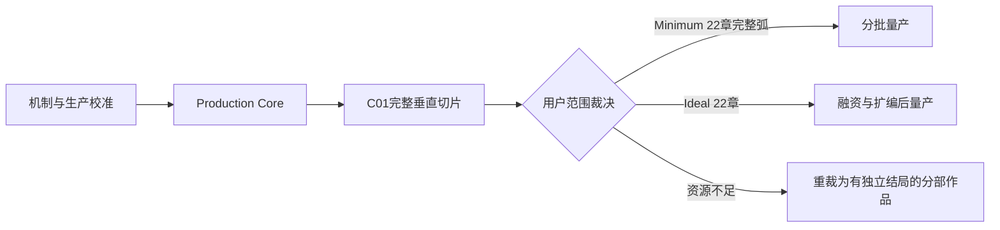

# D11｜体量、预算、RACI 与制作计划（Candidate）

> Status: `candidate_scope_plan_defined / provisional_uncalibrated / user_scope_decision_required`
>
> Authority: 本文只提出产品与制作候选，不提升 Canon、Reader、Runtime、正式资产或发行承诺。
>
> Planning unit: `person-month (PM)`；当前没有项目实测产能，下列人月、日历和FTE均是U0规划包络/止损假设，不是统计估算、报价、P50或P80。

## 1. 先下结论

当前不能直接批准“22章完整制作”。不是因为故事不够，而是四件事尚未被实证：

1. P1 基础战术是否在关闭主角权能后依然好玩；
2. P2 角色 C2 是否形成独特、可读、不会变成万能技能的主玩法；
3. 一套地点 Kit、主力机体 Rig、Encounter、英雄演出和一万字文本的真实生产速度；
4. C01 完整章能否把探索、战术、巨构、结算和回馆闭成一个可售体验。

因此正确的投资顺序是：



C01E02 Demo 不需要停，也不需要等它完成后才开始系统设计。它继续提供输入、镜头、可读性、压力与构建稳定性证据；但它不能替 P1/P2、Hub、结算、长期状态和全章生产速度作决定。

## 2. 当前范围红灯

### 2.1 已经可计数的规模

- 全剧母盘：22章；
- D08 回补账：53项，其中绝大多数会阻断后续章级制作；
- C01-C03：13话、20项章级 Previs 需求；
- C01-C03 Candidate 单话时长相加约 9.1–17.4 小时；
- 若机械地按相同密度外推22章，约为 67–128 小时。

最后一项只是风险外推，不是游戏时长承诺。它说明当前“每章都像支柱章、每话都做完整玩法段”的密度不可直接量产。

### 2.2 当前还没有的估算输入

仓库没有可用于商业承诺的真实：

- 人日／人月工时账；
- 地点、机体、地图、动画、文本的单位吞吐；
- 正式资产返工率与审批等待时间；
- 真人 M5/M6 玩法数据；
- 量产期缺陷率、存档迁移成本和本地化返修率；
- 团队全成本人月单价与外包报价。

因此本文不给一个貌似精确的人民币总价。先给可计数单位、低／高先验和止损门；垂直切片后用实测 P50/P80 重算。

可执行的实测入口已经建立，但保持空账：工作单位字段合同见 [data/production-work-unit-schema.tsv](data/production-work-unit-schema.tsv)，实际单位只允许写入 [data/production-work-unit-registry.tsv](data/production-work-unit-registry.tsv)；逐角色投入字段合同见 [data/production-measurement-schema.tsv](data/production-measurement-schema.tsv)，实际投入只允许写入 [data/production-measurement-instances.tsv](data/production-measurement-instances.tsv)。当前两张实例表都只有表头，**当前实测工作单位与投入记录都为0**。现有Demo完成报告、内部PASS、Git提交时间、文件修改时间和方向回执都不能事后换算成工时；只有当时按冻结范围、实际参与角色和真实开始／结束时间记录的贡献才可进入校准。

### 2.3 当前数字证据等级：U0，不得反推团队或日期

- `scope-cost-scenarios.tsv`中的PM总数是人为设定的成对投资包络，用来比较“到哪条线必须停”，没有自下而上的单位成本来源；
- 八工种PM列只是把同一包络分摊给成本域，证明列和等于总量，不证明真实人员配置；
- `average_active_fte = person_month_total / calendar_months`只是算术结果，不是具名团队、招聘计划或峰值并发；
- 6–10周、5–7个月、120PM、300PM、4PM等均是待实测的管理假设/红线，不能写成“预计会完成”；
- 当前没有Stage0的可信现金、具名人员可用率或外包报价。因此方向批准不能自动授权外部支出、招募或无限内部投入；任何实现先实例化[data/candidate-test-execution-envelope-schema.tsv](data/candidate-test-execution-envelope-schema.tsv)，当前实例数为0。

#### C01-C03回裁目标不是把9.1–17.4小时原样塞进22–30小时

[data/chapter-scope-allocation.tsv](data/chapter-scope-allocation.tsv)已给出第一轮顶层回裁：C01=`150–210`分钟、C02=`100–130`分钟、C03=`100–130`分钟，三章合计约`5.83–7.83`小时；相对13话蓝图直接相加的`9.1–17.4`小时，这是明确的压缩目标，不是当前Build实测。方法是C01只留一个切片主峰、C02赛事/事故/救援共用一套Kit与P3状态且只做一段完整高细玩法、C03四话共享城市地图身体且只留“停第二锤”为唯一主峰。

22章当前逐章分钟包络合计约`24.25–34.33`小时，而Scope 2硬目标仍是`22–30`小时。因此该表只能作为上限分配草案：进入章级BOM前必须把被选定版本的总和压到`≤1800`分钟；若仍高于30小时，先回裁桥接/标准章与重复辅助段，不能把34.33小时改名为“22–30小时已闭合”。

## 3. 一个校准阶段＋三档产品范围

### 3.1 Stage 0：机制与生产校准，不是商品、也不是产品档

目的：证明“做什么游戏”和“怎么量产”，不承担完整故事交付。

- P1 同图同语义A/B/C/D四时制基础战术；
- P2 信息／导航／预演／授权／机魂同意／工程验证；
- P3 三 Encounter 巨构 Operation；
- EX1/EX2/EX3、Hub、三级结算各首例与至少一个第二数据实例；
- 一个环境 Kit、一个主力机体 Rig、一个 Boss／地图身体、一个顶层 UI Shell、一个 30–45 秒英雄段、一万字全流程文本的生产 Spike；
- 产品作用：范围校准、融资／团队组建依据；不得包装成正式章节完成。

### 3.2 Scope 1：C01 完整垂直切片

这是进入全剧量产前的必经门，建议为 2.5–3.5 小时：

- E01：受约束导览／微型探索；
- E02：无主角 C2 的非歼灭基础战术；
- E03：同场地持续伤损与双主体协同；
- E04：玩家只选择航向节点、护航距离和支援窗口；万机馆由具名岗位执行，作为移动场景身体／护送目标形成一次商业级高潮，不开放自由驾驶；
- Encounter、Operation、Chapter 三级结算和一次回馆闭环；
- 正式章节外另放一张明确标注为非 Canon 的 P2 C2 挑战图，用于验证产品差异化。

该 P2 挑战默认先供内部、融资与定向试玩；是否进入公开 Steam Demo 必须另行裁决。若公开版本只有当前 C01E02，它会让玩家误以为产品只是普通战棋加剧情。

U0成对规划包络：`80PM/9个月/平均8.89 FTE`、`100PM/10个月/10 FTE`、`120PM/12个月/10 FTE`。三列不可交叉拼接；这是累计自Stage0开始的未校准上限门，不是预计成本或批准预算。

### 3.3 Scope 2：Minimum Sellable，22章完整故事弧（推荐商业基准）

目标：Steam PC 上可售、故事完整、玩法身份成立的最低完整弧。

- 主线目标 22–30 小时；
- 22章仍保留，但必须分成桥接／生活、标准、支柱三种密度；
- 24–30个战术 Encounter，18–24个 Operation；
- 14–18个主辅助活动，三家族均有纯数据第二实例；
- 12–18次回馆周期，不等于每话一次；
- 5–7个高成本巨构高潮；同一时间最多2个 A3 进入制作；
- 中文源语言＋完整英文文本／UI／字幕；其他语言经过市场门再加；
- 战斗语音、关键句和少量重要场面，不含全流程配音；
- 首发 Windows PC、键鼠＋手柄；主机、联机、移动端均不在范围。

U0成对规划包络：`360PM/32个月/11.25 FTE`、`440PM/36个月/12.22 FTE`、`520PM/42个月/12.38 FTE`。三列不可交叉拼接，均累计自Stage0开始；只有垂直切片满足成本、复用和质量门后，才可用实测模型替代这些包络。

### 3.4 Scope 3：Ideal，22章充分展开

目标：更充分的角色生活、回访、挑战和视听高潮，而不是另造一套系统。

- 主线 30–44 小时；
- 36–46个 Encounter、28–36个 Operation；
- 24–32个主辅助活动、20–28次 Hub 周期；
- 8–10个巨构高潮；
- 更多关系事件、收藏、地点状态和战后回访；
- 日语等追加语言、更多语音与英雄演出经过融资／市场门增补。

U0成对规划包络：`625PM/40个月/15.63 FTE`、`760PM/45个月/16.89 FTE`、`925PM/50个月/18.50 FTE`。不能跨列组合，也不能因为垂直切片“看起来不错”自动进入本档。

机器可读总量见 [data/scope-tier-budget.tsv](data/scope-tier-budget.tsv)、成对而不可交叉组合的 [data/scope-cost-scenarios.tsv](data/scope-cost-scenarios.tsv) 和 [data/asset-budget.tsv](data/asset-budget.tsv)。所有PM均以Stage0开始为累计口径；MS2的120PM硬帽也包含Stage0、Production Core和C01切片，不是只算最后五个月。

## 4. Minimum 章型预算

| 章型 | 数量 | 单章主线 | 战术量 | 新资产硬帽 |
| --- | ---: | ---: | --- | --- |
| 桥接／生活章 | 6 | 30–50分钟 | 0–1 Encounter | 默认只用已有 Kit 状态差分；无 A3 |
| 标准章 | 7 | 55–80分钟 | 通常1个 Encounter | 最多1个新环境 Kit 或1个新机体族 |
| 支柱章 | 9 | 90–130分钟 | 通常1–2个，开局章可达3个 | 最多1个新环境 Kit＋1个 Boss／巨构高潮 |

按 [data/chapter-scope-allocation.tsv](data/chapter-scope-allocation.tsv) 逐行相加为 1455–2060 分钟，即 24.25–34.33 小时；制作目标仍须压在 22–30 小时，当前上沿并未闭合。该分配把D07高峰显式映射为9个支柱章和7个A3生产簇，仍待用户范围裁决，不是BOM。普通章不得再按“2–6小时一章”的上沿量产。

开局三个高成本高潮必须共享规则，而不是各造引擎：

- C01E04：保留完整旗舰奇观，作为垂直切片主峰；
- C02E05：使用 P3 巨构 Operation 的分阶段救援语法，只选择一段做完整高细度玩法；
- C03E03：保留“停第二锤→拆战场”的主体性高潮，复用同一持续状态、提交／撤回和地图身体框架。

## 5. 资产预算口径

### 5.1 地图不是一个数字

所有地图分成：

1. `environment_kit`：材质、模块、标志物、尺度和声景；
2. `base_topology`：一张可玩的基础空间／战术拓扑；
3. `state_variant`：开放、警报、破损、修复、昼夜、控制权等差分。

同地点的战前、战中、战后不能虚报成三套全新地图。一个新 Kit 至少跨两个章节消费，或同时服务 Story 与一种玩法。

### 5.2 机体不是“登场数”

高细节资产只给对玩家判断有独立身体意义的主体。百机／舰队场面通过：

- 12–16个运动／尺度 Rig 家族；
- 轮廓、部件、武装、颜色和行为包变体；
- 地图边缘支援、群体区、远景和战区卡；
- 具名高细节主力／Boss／地图身体。

一次性登场且不产生新判断的机体使用场景体、Cut-in、远景或共享 Rig 变体。

### 5.3 复用目标

- 动画：60%–70%共享动作语法，20%–30%身体专属，10%–15%英雄演出；
- 主力高细节 Rig：至少在3个 Encounter 消费，或同时服务战术、Hub、Story和章级高潮；
- UI：量产期禁止按章节新增顶层 Shell，只能新增数据化 Widget／状态／图标；
- 音频：按运动、材质、尺度、供能、武装、结构接触建 SFX 家族；音乐使用 Leitmotif／Stem／变奏；
- 文本：预算包含 Reader、Hub、关系、档案、教程、UI、错误提示和本地化，不只统计故事稿。

## 6. 产能先验与校准公式

以下是排 Spike 的**毛工时假设**，不是团队 KPI，也不能与资产数量上限逐项相乘后当作总预算。资产数量是组合上限；总PM只能使用 [data/scope-cost-scenarios.tsv](data/scope-cost-scenarios.tsv) 中成对的低／基准／高场景，并在实测后替换：

| 生产单位 | 初始先验 | 超限警报 |
| --- | ---: | --- |
| 新环境 Kit，含 GD2、模块、美术和基础碰撞 | 2.5–5 PM | 连续两次超过5 PM |
| 用成熟 Kit 制作一张战术基础图 | 0.8–1.8 PM | P50超过2 PM |
| 一个地点状态差分 | 0.2–0.6 PM | 接近重做整图 |
| 主力机体高细节 Rig | 1.5–3.5 PM | 连续两台超过4 PM |
| Boss／多区域地图身体 | 2.5–5.5 PM | 超过6 PM且只使用一次 |
| 30–45秒有限动画英雄段 | 0.3–1.0 PM | 超过1.2 PM |
| 成熟规则 Encounter，从设计至 QA | 2–4 PM | P50超过4 PM |
| 一万字中文玩家文本，从写作至游戏内验收 | 0.6–1.2 PM | 连续两章超过1.5 PM |
| 新顶层 UI Shell | 1–2.5 PM | 量产期仍按章新增 |

垂直切片后以实测替换先验：

```text
PM_total =
  kit_count × observed_PM_per_kit
+ map_count × observed_PM_per_map
+ state_count × observed_PM_per_state
+ rig_count × observed_PM_per_rig
+ encounter_count × observed_PM_per_encounter
+ hero_sequence_count × observed_PM_per_sequence
+ text_10k_units × observed_PM_per_10k
+ fixed_system_release_PM
```

每个单位必须记录：开始／结束、参与人、等待时间、返工原因、缺陷、批准版本、是否复用和下一消费者。一个单位只有在工作单位账标为`accepted`、范围／质量边界hash冻结、验收证据能解析到同一build或asset、且投入账存在至少一行`accepted`贡献时才可进样本；多人贡献共享同一`work_unit_instance_id`，且恰好一行`quantity_credit=true`，防止重复计产量。

逐字段合同见 [data/production-work-unit-schema.tsv](data/production-work-unit-schema.tsv)、[data/production-measurement-schema.tsv](data/production-measurement-schema.tsv)，实例账见 [data/production-work-unit-registry.tsv](data/production-work-unit-registry.tsv)、[data/production-measurement-instances.tsv](data/production-measurement-instances.tsv)。P50/P80、复用、返工、阻塞、招募、缺陷、视觉吞吐和Demo抵扣规则见 [data/budget-calibration-contracts.tsv](data/budget-calibration-contracts.tsv)。单位P50/P80必须先按每个 `work_unit_instance_id` 计算`cost_i = accepted贡献工时总和 / quantity_completed`，再在同一`unit_type_ref`和同一质量边界内取连续分位数，禁止先汇总成平均值：`n>=3`才有临时P50；`n>=8`且至少跨2章才有可进入项目模型的U2 P80；`n>=12`且至少跨3章才是U3。8个样本若都来自同一章，仍不能作为项目P80输入。

全项目P80的机器输入见 [data/project-p80-model-inputs.tsv](data/project-p80-model-inputs.tsv)：每个model必须只绑定一个成对scope scenario，只消费U2/U3单位P80、可追溯固定工时、风险率和productive-hours-per-PM；跨低／基准／高场景拼接、把现金计入PM、缺变量或使用U0/U1单位均须失败。当前派生状态见 [data/budget-calibration-status.tsv](data/budget-calibration-status.tsv)：工作单位、投入、P50/P80合格类型与P80模型输入全为0，状态为`not_calculable_missing_U2`，`project_p80_hours/project_p80_pm=none`。当 [data/project-p80-model-inputs.tsv](data/project-p80-model-inputs.tsv) 只有表头时，**不得生成项目P80预测**；360–520 PM仍只是未校准范围先验。

Scope 2的章分钟硬门和预算校准账使用同一个checker。当前22章上沿仍为2060分钟，因此`scope2_duration_gate=blocked_above_1800`；只有选定章分配总上沿`≤1800`分钟，Scope 2的U2/U3 P80模型才允许进入可计算状态。只读重算命令：

```bash
python3 -B docs/superpowers/specs/game-design/2026-08-10-full-game-design-candidate-v1/scripts/check_d11_budget_calibration.py
```

该命令PASS只表示U0场景算术、空账边界、样本门、分位数输入、Scope 2时长门和MS0口径一致；不代表产生了实测、P50/P80、团队计划、报价、日历承诺、投资决定或任何执行授权。

现金公式只保留变量：

```text
总现金 = 总人月 × 团队全成本人月单价
       + 配音/音乐/本地化/法律/设备/商店/外采
       + 15%–25% 风险储备
```

## 7. 里程碑与退出门

机器表见 [data/scope-milestone-gates.tsv](data/scope-milestone-gates.tsv)。日历均为未校准候选。

### MS0｜范围校准（6–10周）

- R0技术核、P1四时制和辅助首例取得真实M3/M4速度，并让P1四版各自完成可裁决M5；淘汰版保留失败证据，只有满足两解与理解硬门的入围版形成合法shortlist；最终时制仍等最小核心C2 crossover和DEC-03-M；
- 完成六类生产 Spike；
- 建立人月、返工、等待和缺陷账。

停止门：任一版没有完成可裁决M5、`TSN-P1-RESULT`不在合法枚举、入围版没有两种真人可发现方案或无法复述关键因果、合法shortlist未完成最小核心C2 crossover与DEC-03-M时，禁止进入完整P2/P3，也禁止批准完整游戏档。被淘汰版失败本身不是绕门理由，也不要求返写成“通过”。

### MS1｜Production Core（10–14周）

- 由用户在crossover后select唯一时制，再验证并锁定完整C2动作语义；
- P2有限信息／角色C2与P3多阶段巨构依次达到M5；
- 状态、存档、回放、结算、日志和数据化内容工具；
- 一个战术第二实例和一个辅助第二实例；
- C01 GD1/GD2/GD3、gameflow和 Previs 封存。

退出门：P1/P2/P3核心机制达到 M5且可重放规则核达到M6；第二实例不新增顶层 UI、输入或长期状态域。P2仍被理解成 Buff／未来视／解锁门时，返回GD1/P2，不进入P3。

### MS2｜C01 垂直切片（5–7个月）

- C01 全章正式切片＋非 Canon P2挑战；
- 正式资产、音频、设置、手柄和可访问性；
- 12–18名目标玩家；玩法、视觉、生产三类用户回执；
- 实际单位产能与 P50 预算。

退出门：总投入不超过120 PM；关键复用率至少60%；P0/P1关闭；用户明确选择 Scope 2、Scope 3或回裁。

### MS3｜25%量产（5–6个月）

- 约 C01–C05 或等价25%正式内容；
- 预测与实耗误差在±20%内；
- 复用率至少65%；
- 成熟 Encounter P50不超过4 PM；
- 没有连续创建一次性 A3。

超限时先削理想档资产，不以加班维护虚假日期。

### MS4｜Content Alpha（7–9个月）

- 55%–60%章节可从头到尾运行，允许临时资产；
- 全长状态、存档迁移、敌方学习、Hub和世界图稳定；
- 后半章 GD1/GD2 依赖闭合；
- 新机制冻结，只允许已批准机制的组合与反制。

### MS5｜Content Complete（6–8个月）

- C01–C22全部可通；
- 主线文本和玩法结果冻结；
- 正式地图、主体和英雄段均已入版；
- 缺失项只允许替换占位，不再增加玩法。

### MS6｜Beta／本地化／无障碍／性能（4–6个月）

- 完整英文；
- 常见 PC、Steam Deck、键鼠／手柄、分辨率、字幕、颜色与时序辅助；
- 全剧坏档、Full/Skip、回放、结算和迁移回归；
- 商店素材、Demo和发行清单。

Steam Direct 当前每个产品收取 100 美元费用，达到 1,000 美元调整后总收入才可回收；商店页与构建审核通常需要 3–5 个工作日，Valve 建议至少预留 7 个工作日。它们不是大额开发成本，但必须进入现金账和发布关键路径。[Steam Direct Fee](https://partner.steamgames.com/doc/gettingstarted/appfee?l=english&language=english)；[Review Process](https://partner.steamgames.com/doc/store/review_process?l=english&language=english)

### MS7｜Release Candidate（2–3个月）

只处理 P0/P1、兼容、崩溃、存档迁移、必要平衡与发行；禁止新增章节、机体、顶层 UI 或英雄动画。

## 8. Session 分工与并行规则

完整 RACI 见 [data/production-raci.tsv](data/production-raci.tsv)。当前立即采用五条独立泳道：

RACI只说明“某类工作由哪个角色负责/问责”，不证明这些岗位已经有人、具有可用工时或存在替补。当前没有具名 staffing/capacity 表；`current_assignment`中的“Session”是工作路由，不是劳动合同或已组建团队。任何里程碑排期前仍须补具名负责人、每周可用率、兼职冲突、替补和成本率；缺一项时只能做WIP排序，不能从RACI反推日历。

1. **制作人／Demo Session**：继续冻结完成 C01E02；只回传版本化试玩、输入、镜头、可读性、压力、失败理解和构建证据。
2. **主策划 Session**：独占产品语义、系统边界、行动经济、范围账和用户决策账。
3. **战术原型 Session**：依次实现中性P1→P2→P3；P1 M5前P2只做纸面/UI，P2 M5前P3只做地图/状态纸模；不得修改Demo，也不得把测试数值写成Canon。
4. **GD1/GD2 设定 Session**：按消费顺序制作万机馆、C01街区、木桶街、工务城、天空铸环与核心机体 Master Pack。
5. **Story／Gameflow／Previs 泳道**：单一 Writer 只读取已封存安全上下文；gameflow在故事验收后工作；连续 Previs 在 gameflow后工作。C04E03在天空铸环与C2链过门前不继续。

WIP 上限：

- 同时最多1个核心规则原型处于实现；
- 同时最多1个章级 GD3 包进入封存；
- 同时最多1个连续 Previs 包进入用户视觉审；
- 同时最多2个 A3资产包进入正式制作；
- Writer只有1个主写 Session；其他 Session只能提问题或做独立审查，不能同时改同一 Reader。

## 9. 范围止损门

出现任一项，Scope 2 数量必须重算：

- 垂直切片超过120 PM或12个月；
- 新环境 Kit P50超过5 PM；
- 主力机体 Rig P50超过4 PM；
- 成熟规则 Encounter P50超过4 PM；
- 正式资产返工超过25%；
- 25%内容时复用率低于65%；
- 普通章试玩 P50超过90分钟；
- 三个辅助家族的第二实例仍需要新输入、顶层 UI 或存档域；
- C01-C03三个巨构高潮仍各要独立引擎；
- 后续 Reader 为玩法临时新增未登记建筑、机体能力或世界规则。

削减优先级：一次性探索空间 → 低价值档案／关系事件数量 → 低频机体高细节 Rig → 英雄动画数量／时长 → 非核心配音和追加语言 → 复用挑战 → 同话第二辅助段。

不得先削：P1基础战术可读性、C2来源／权限／同意、GD1/GD2前置、存档／结算／可访问性、真人验收、故事真正胜利动作和终局情感回收。

若可用总量低于约300 PM，不应把22章硬压成低质完整游戏。可讨论的诚实替代是把较短章节范围重写成有独立结局、明确标注的第一部；这需要正式重裁 L3 与故事弧，不能由制作预算表自动决定。

## 10. 当前建议

当前建议用户只考虑批准 Stage 0 的有界Candidate测试；Scope 1只保留纸面范围草案，是否立项等待DEC-14，不批准22章量产。下一次真正的商业范围决定放在 C01完整垂直切片通过之后。

在此之前：Demo继续；P1进入可玩实现；P2只做纸面语义/UI信息架构，待P1 M5后进入Runtime；P3只做地图身体/持续状态纸模，待P2 M5后进入Runtime；GD1/GD2 Master Pack可做问题brief，真实图按DEC-12授权；C04 Reader继续暂停。D12把产品方向、时制、C2语义、辅助玩法、时长、配音、平台和范围逐项交用户裁决。
