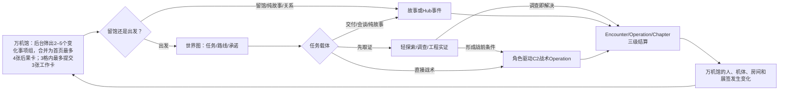

# D12｜内部决策账与历史执行附录（Candidate v1）

> Status: `internal_decision_ledger / public_skeleton_review / presented_no_decision / bounded_migration_forbidden`
>
> Rule: 用户每次只批准一个明确范围。“总体方向不错”不能顺带批准时制、章节玩法、美术、预算、Runtime或L6。

**已形成：** 一批可供继续讨论的纸面候选、机器合同、具体操作样例、验证方法和生产计划；它们不是“玩法设计已经完成”的证明。

**后续停放：** 可玩原型、真人验证、真实地点／机体设计图、正式资产、Runtime与预算校准均不属于当前核心策划评审的缺件。

**当前阅读阶段不请求签署。** 唯一入口见[用户阅读导航](00-user-reading-guide.md)，只读一份时直接看[00c核心玩法总案](00c-core-game-design-master-review.md)；`00b`只演示总案怎样连续接力两个周期，`05f`与`05c`分别放大基础身体战术和角色C2，`06a/06c/06d/06b`放大轻系统与长线页面。系统边界、提交位置和持久写回只以00c为准；`02a/04c/05a/05d`已退役，`05e/05g`是内部附录。不再让用户在平行版本中选真相。[旧首批四项决策包](12a-first-decision-signoff-sheet.md)已因时制方向改变而冻结为追溯附录；当前不能签署。以后若用户主动进入结构化授权，必须按届时有效方向重新制作新包。

## 当前用户阅读到此

当前所有玩法批注都直接带回[00c核心玩法总案](00c-core-game-design-master-review.md#已接受的四个产品方向)。下面的决策编号、回执、执行边界、阶段路线和90天计划是**以后进入结构化裁决或制作时使用的内部附录**，不构成本轮阅读任务，也不应被理解成“还没有东西可评”。

## 以后执行附录（本轮不读、不判断）

这里的“有边界”还必须落成[data/candidate-test-execution-envelope-schema.tsv](data/candidate-test-execution-envelope-schema.tsv)的精确实例，由[data/execution-envelope-authorization-receipt-schema.tsv](data/execution-envelope-authorization-receipt-schema.tsv)的独立回执批准该实例的`authorization_subject_sha256`，并在每次执行前通过[data/prototype-execution-preflight-schema.tsv](data/prototype-execution-preflight-schema.tsv)实例。四项方向回执本身不等于无限工时、外部招募、数据采集、采购或任意目录写入授权。当前方向回执、精确包络回执、执行包络、共享预算池和preflight实例均为0。

**并行关系：** 制作人继续C01E02 Demo，不等本案；主策原型若取得对应Candidate测试授权，也不必等待Demo完成。当前授权尚未取得，因此本案不启动原型；双方未来只通过版本化试玩证据回流。

**生产顺序：** 先完成全游戏公共玩法骨架，再做跨章共用基础设定；随后把C01-C03当作公共系统测试场，最后才做逐章适配。木桶街、货运环与万机馆新增资料当前均不作为玩法完成证据。

## 1. 历史决策基线摘要（不作为第二份总案）

本节只保存旧决策条目当时依据的产品基线，便于追溯字段与冻结旧执行包；当前产品定义、系统边界和正式批注只读00c。本节若与00c不同，不得要求用户在两份“总案”之间选择。

### 我们要做的游戏

《超GAG机器人大战：万机残响》候选定位为：

> **重故事、轻练级、角色驱动 C2 的机器人战术 RPG；万机馆既是移动之家、博物馆，也是长期状态和人物关系的可见承载体。**

玩家不是靠刷等级、堆随机词条和替换无名士兵取胜，而是逐渐学会：

- 看懂机器人身体、地形、敌方目标和非歼灭条件；
- 在短决策窗内安排移动、转向、保护、救援、反应和撤离；
- 分辨事实、估计、假设、盲区和过期信息；
- 让纪存、七海、白鸢与工程组分别改变路线、许可、条件预演和物理可行性；
- 请求机魂／驾驶者同意，并承受拒绝、撤回、延误、暴露和责任债；
- 把局部失败、伤损、关系、收藏、地点和敌方学习带回万机馆。

### 主循环



探索不是战斗的固定前置，战斗也不是每次出发的固定终点。一话只选择一个主体验和至多一个辅助体验；一章不强制集齐所有模式。主战术可以较深，辅助玩法只保留3–6个动词、一个证据模型和短时长。

### 玩法身份

- 基础战术必须在关闭所有主角 C2 权能时有趣，至少存在两种真人可发现解；
- 主策当前推荐短全队协同，逐台交替行动是低负担备选；逐台锁计划与传统阵营回合只保留比较参考。这个Candidate推荐等待用户作一级方向批注，不等于最终秒数、动作成本或制作授权已经锁定；
- C2不加攻击力或额外AP，而是改变“知道什么、允许什么、谁同意、什么在物理上可行”；
- 故事胜利必须等于玩法目标：守住、抵达、救援、证明、叫停、撤回、争取同意、带代价撤离都可以是胜利；
- 成长以新判断、新合作协议、新功能装备、关系许可和世界状态为主，数值只服务身体可读性，不建立刷级经济。

### 辅助玩法身份

仅保留三类主家族：

1. 微型自由探索：地标、观察、照片／扫描、具名人物帮助；
2. 调查／工程实证：证据三角、候选假设、真实试验、可解释反馈；
3. 知识门控：来源、时间、主体、置信度、矛盾和未确认结论。

它们共享 Spatial、Evidence、Commit、Route 四个内核；第二实例如果仍需新输入、顶层UI或存档域，就不算系统复用，应合并、降为ADV／演出或删除。

### 内容与制作身份

- C01-C03 Accepted Reader保留故事事实，不等于玩法、视觉、Runtime或资产已经验收；
- 写 Reader 之前，只完成本章因果、空间、身体、揭示与资产所依赖的角色／机体 GD1、城市／建筑／地点 GD2 和章级调用／BOM／揭示 GD3闭包；不要求22章全部最终设计；
- Writer只读取生成的安全上下文，不临时创造改变因果的地点、机体能力和世界规则；
- Reader验收后才做gameflow，之后做连续联合Previs、原型、正式资产和Runtime；
- 产品、故事、玩法、视觉、生产五类用户回执互不替代。

### 商业身份

以后若用户主动进入结构化裁决，第一批才讨论机制方向与生产边界。当前只读00c八项，不裁决测试或生产。C01完整垂直切片仅保留范围草案；22章时长与`360–520 PM`旧U0包络也不构成当前预计成本、预算或发行承诺。

## 2. 十五项独立用户决策

机器可读账见 [data/user-game-design-decisions.tsv](data/user-game-design-decisions.tsv)。

| 以后第一批 | 决策 | 推荐裁决范围 | 若延期 |
| --- | --- | --- | --- |
| 1 | DEC-01 产品身份 | 允许以C2战术RPG＋移动博物馆Hub作为Candidate测试方向 | 不迁移GD0，不宣称产品方向已定 |
| 2 | DEC-02 基础战术合同 | 锁定身体、地形、Intent、非歼灭与前向失败的Candidate共同规则方向；实际实现仍需精确包络与preflight | 不写正式数值、地图或章节胜负 |
| 3 | DEC-03 时制一级方向 | 评审B短全队协同是否作为主方向、A逐台行动是否作为低负担备选；C/D不再等权进入当前批注 | 保持Candidate推荐，不锁最终数值、制作或Runtime |
| 4 | DEC-11 生产边界 | 原则采用D09冻结精确path/version/SHA-256所定义的完整17门链与五类回执；脚本实施与现行链迁移分相另审 | 不改story-chain、Registry或正式上下文 |

DEC-12万机馆视觉封样先只完成问题brief，放到第二批视觉方向裁决；不把逻辑SVG升级成方向批准。

### DEC-01｜产品身份

**推荐：** 重故事、轻练级、角色驱动C2机器人战术RPG＋移动博物馆Hub。

替代：传统SRPG为主、C2弱化；或剧情冒险为主、战术轻量。批准只锁产品测试方向，不批准任何具体规则、资产或预算。

### DEC-02｜基础战术与失败合同

**推荐：** 已知物理尽量确定、战场信息不完全；以身体、地形、Intent、反应和非歼灭目标为核心；局部失败可前向继续。

替代：传统命中率／单HP；或失败即重开。最终需P1真人两解、因果复述与失败理解证据。

### DEC-03｜主时制的一级方向

**推荐：** 先在纯策划层接受B短全队协同为主方向、A逐台行动为低负担备选；C逐台锁计划和D传统阵营回合只保留比较参考。批准该方向也不锁最终秒数、动作成本、界面或制作。

替代：选择A为主、B为备选；要求返修两者；或暂不选择。当前Demo时制仍不得自动晋升全局规则。

现有D04/D10与授权Schema仍记录早先的A/B/C/D四版中立测试路线。它们从本次公开推荐形成之日起冻结为**旧执行附录**：实例仍为0，不能据此生成回执、启动Build、招募真人或声称四版仍等权。未来若用户另行决定进入验证，必须先把测试对象、预算、比较问题和停止条件重基到当时有效的主方案／备选，再重新呈现；本轮不做这项开发计划重编。

### DEC-04｜角色C2语义

**推荐：** C2只改变信息、路线、许可、同意、验证与协同；单脉冲有限带宽和席位。

替代：普通增伤／再动技能；或取消C2。所有角色能力在P2回执前保持Candidate，不写入Canon。

DEC-04-A先只授权shortlist carriers上的六项核心C2 crossover，不要求也不得预填DEC-03-M；完整25动作P2仍必须等待crossover后用户以DEC-03-M选择唯一时制。carrier全部Session-local、可清空、可撤销，不迁移章节或Runtime。

### DEC-05｜Hub、成长与结算

**推荐：** 每次回馆由后台筛出2–5个有来源的变化事项组，并合并为首页最多4张后果卡；玩家在标准三格日程里最多提交3张工作卡。轻经济、功能成长、三级结算；无刷级、无日更清单。

替代：传统商店／技能树；或Hub仅菜单。需P-HUB1、P-SET1和事务回放证据。

### DEC-06｜辅助玩法边界

**推荐：** 三类探索＋四个共享内核；每话最多一个主辅助段和一个微交互。

替代：保留旧16种模板；或全部降为ADV。需三首例M5，并以P-EX1-R2、P-EX2-R2、P-EX3-R2三个中性第二数据实例分别达到M6；不得借章节实例绕过DEC-08/09/10。

### DEC-07｜全剧机制演进（停放，P3后再议）

**推荐：** 保留22章预测脊柱；每章最多教一个新判断，目标70%复用、20%组合变化、10%新机制。

替代：每章独立新系统；或开局全开放。C04-C22在逐章L4前仍是预测，不能反写Canon。

### DEC-08｜C01玩法适配（停放，P3后再议）

**推荐：** E01只下令／观察，E02完成撤离，E02→E03持续伤损；E04玩家只选择航向节点、护航距离和支援窗口，万机馆由具名岗位执行，是移动场景身体／护送目标，不开放自由驾驶。

测试授权只解锁C01的GD闭包、设计Previs与隔离适配脚手架；不得直接生成连续Previs。只有证据后有界迁移与GATE-GAMEFLOW通过，才可进入连续Previs和章节适配灰盒；仍需万机馆GD2、P1和章节接缝测试。

### DEC-09｜C02玩法适配（停放，P3后再议）

**推荐：** 赛事3:2、事故、实体交割分域；E04→E05无缝；巨构救援分阶段，减少十几台主体的按钮列。

Accepted Reader的约九米转子事实保持有效，但正式工程资产在GD2验证前阻断；若证明确实不可行，必须另取故事迁移回执。

### DEC-10｜C03玩法适配（停放，P3后再议）

**推荐：** 本地知识修正预演、工具归主体、玩家促成停止第二锤、无敌军低速校准。

测试授权只解锁工务城GD闭包、设计Previs与隔离适配脚手架；连续Previs和章节适配灰盒仍须证据后有界迁移与GATE-GAMEFLOW通过。不批准中央环、工具Rig、合体动画或正式关卡。

### DEC-11｜新生产流程

**推荐：** 只在冻结 [09-production-pipeline-and-gates.md](09-production-pipeline-and-gates.md)、[data/game-design-gate-registry.tsv](data/game-design-gate-registry.tsv)与checker的精确path/version/SHA-256后，验证完整17门链：`GD0 → GD1 → GD2 → GD3 → S20 → S21 → L4 → REVEAL → READER → U-STORY → GAMEFLOW → PREVIS → PROTOTYPE → ASSET-AUTH → ASSET-HANDOFF → RUNTIME → L6`，五类回执分开。不得把缩写的“GD闭包→资产/Runtime”当成可执行链。

只有D09精确版本/hash、隔离故障注入、scope化门实例和checker证据齐全后，流程才可在Candidate副本中执行。现行链迁移仍必须依次经过`DEC11-M计划 → M1 checker → M2 Registry/schema → M3单一scope story-chain → M4部署后重验/回滚`五个独立回执与精确执行包络；任一前相不能预授权后相。

### DEC-12｜首个视觉／产能封样

**推荐：** 万机馆作为首个GD2封样；用统一外观、总平、剖面、三尺度、流线、控制、状态图和两个中保真表现Spike比较2D部件动画＋2.5D地图产能。

现有SVG只是逻辑问题图，不授权正式美术、Rig或Runtime。

### DEC-13｜C04恢复条件

**推荐：** 不续E03；先重做天空铸环地点与战斗语法，完成GD1/GD2/GD3、真实图、Stage20/21和可撤回C2链，再以同范围、同来源hash的 `GATE-L4` 兼容实例重验当前L4。

替代：长期搁置；或放弃当前地点命题重做整章。延期默认仍阻断Reader、gameflow和资产。

即使visual、gameplay、production三类修复证据全部通过，也只能先送审同范围 `GATE-L4` 兼容实例。只有L4兼容实例PASS，才可送审C04 E03的 `GATE-REVEAL` 实例；只有REVEAL实例PASS，才生成Candidate writer-safe context，不能由决策回执直接产出Writer输入。

### DEC-14｜垂直切片构成

**推荐：** C01完整4话＋章末闭环；另设明确非Canon的P2挑战。

替代：只做C01E01-E02低成本切片；或等更后章节再做正式含C2切片。当前C01E02 Demo继续隔离，不能自动成为公开产品代表。

### DEC-15｜商业范围档

**推荐：** 垂直切片后，以22章22–30小时的Minimum完整弧和360–520 PM的U0包络作为重算问题；只有U2/P80模型可作为投资基线，Ideal另行解锁。

替代：Ideal；重裁成有独立结局的分部作品；暂不量产。需切片M6、单位成本、复用率、缺陷率和现金模型后才可批准。

## 3. 决策状态与迁移边界

每项决定只允许以下状态：

```text
not_presented
presented_no_decision
approved_for_candidate_test
approved_for_bounded_migration
rejected
superseded
invalidated
```

`approved_for_candidate_test` 只解锁决策账中 `candidate_test_unlocks` 明列的隔离原型、Candidate图包、灰盒或测试仪器。证据未完成期间，决策仍保持`approved_for_candidate_test`；“待证据／执行中／待复核”写入[data/acceptance-evidence-registry.tsv](data/acceptance-evidence-registry.tsv)和Session账，不再把`evidence_pending`当成会撤销授权的决策状态。否则Prototype依赖刚开始执行就会因为状态改名而自行失效。

每项决策的测试授权与证据后迁移使用两个不同receipt set，见 [data/decision-receipt-sets.tsv](data/decision-receipt-sets.tsv)；决策型门实例必须同时绑定 `decision_id + phase + receipt_set_instance_id + requirement_ids`，并由 `decision_id + phase` 唯一解析到对应DRS模板。只有对应 [data/decision-receipt-requirements.tsv](data/decision-receipt-requirements.tsv) 的全部必需回执都绑定实际build/path/hash并通过，才可进入 `approved_for_bounded_migration`，且只能解锁 `bounded_migration_unlocks` 明列范围。单个故事、视觉、玩法、资产和构建门另按 [data/gate-receipt-set-templates.tsv](data/gate-receipt-set-templates.tsv) 生成scope化集合，不得借用产品决策回执替代。

任何未在 `bounded_migration_unlocks` 中逐项列出的域，默认禁止提升 Canon、Reader、正式资产、Current Runtime和L6。沉默、泛泛赞同、文档PASS、内部自测和单一复合回执都不能跨过这一默认拒绝。

### 3.1 Candidate测试执行包络

方向回执回答“准不准做这类证据”，独立精确包络回执回答“用户是否批准了这一个不可后改的subject hash”，执行前preflight回答“回执、scope化Gate实例、上游证据、来源hash、包络和共享池余额此刻是否仍同时有效”。三者缺一都不能开始实现或真人Session；产品方向不得当作实现授权。

第一批至少分成三个包络，而不是一次授权到底：

1. `E-R0-IMPLEMENT`：只做`R0-TEST-KERNEL`证据仪器并到M3，`max_total_builds=1`；不得包含P1 A/B/C/D，也不占用P1的4个Build身份。
2. `E-P1-ABCD-IMPLEMENT`：以既有R0 M3为前置，只做P1 A/B/C/D四个匿名中性Candidate，`max_total_builds=4`；不得包含R0。R0与P1两个包络各自有独立`envelope_id + authorization_subject_sha256 + 用户包络回执`，但必须共用唯一`shared_budget_program_scope_key=STAGE0_R0_P1`累计预算池和同一余额账：两包合计仍只能消耗`14`个日历日、`80`个内部人时、外部现金`0`，不得相加成`28日/160人时`。这是可另行裁决的管理上限，不是工期或成本预测。两包均为外部现金0、参与者0、外部服务none，Canon/Reader/story-chain/Current Runtime/正式资产/Demo均禁写。
3. `P1 human_run`：只有四个Build、任务、自动门、匿名映射、教程预算、隐私Schema和已知缺陷冻结后才另实例化；明确总招募上限、每版6个冷启单元、至少8名回访者、补招规则、补偿/现金、录像/语音范围、保存期限和删除方式。它可复用仍有效的DEC-01/02/03/11方向回执，但不能从任何`implementation`包络推导外部招募或数据采集权。

`D04-P2-CROSSOVER`必须在P1 shortlist后另建implementation与human_run包络，上限按shortlist carrier数计算；它不能借P1剩余Build、人时或参与者额度。

任一包络到期、单包Build超限、共享池工时/日历日/现金耗尽、样本超限、出现P0/隐私事件、授权决定失效或准备写入禁止目录时立即停止；扩展必须新建包络、新的subject hash与独立用户包络回执。如扩大共享池cap或周期，还必须生成新的pool subject hash并重新授权；不能手改旧实例上限。

## 4. 旧执行优先级（以后必须重基）

本节保留当时识别出的依赖与风险，但其四时制测试顺序已被最新00c方向取代，不是当前任务清单，也不得直接执行。

### 以后进入制作前需要证明的事项

1. 产品身份和完整公共循环是否值得继续投资；
2. 基础战术合同，以及届时有效的主方案／备选比较方法；
3. Hub、探索、调查、编队、成长、关系、收藏、世界图和三级结算是否能用共同玩家动词接成闭环；
4. P-SET1状态、结算、存档和泄密不变量；
5. 新生产流程与回执边界。

P0未完成时，不扩写逐章设定，不做正式全章地图、主力Rig、全配音、批量英雄动画或C04 Reader；万机馆、木桶街、货运环等现有草案只停放，不计玩法进度。

### P1｜证明差异化

1. 当前主方案／备选方向重基后，再决定是否需要最小核心C2对照与最终时制裁决；
2. EX1/EX2/EX3、P-SET1与Hub首例；
3. 编队、成长、关系、收藏和世界任务在同一中性两周期中的闭环；
4. D11只按公共原型的实测工作量重算。

### P2｜公共机制成立后补跨章基础设定

1. 万机馆、主角能力、核心机体和世界规则的共用母包；
2. 确实承担整章玩法的重要城市或巨构问题brief与GD2；
3. P3巨构Operation所需的共用空间和身体规则。

### P3｜最后才做章节适配

1. 用C01验证基础身体战术、轻探索和连续事故；
2. 用C02验证非致死竞技、功能损伤和调查实证；
3. 用C03验证多格空间、工程约束、许可和停止；
4. 其余章节只复用公共系统，并且每章最多新增一个机制维度；
5. 公共系统、共用设定和章节适配证据齐全后，才提交垂直切片Go／Revise／No-go包。

## 5. 旧90天条件路线（History，禁止执行）

以下日程建立在“四版等权、先做shortlist”的旧前提上，只保留为范围与越权风险记录。它不是当前90天计划；在用户完成00c方向批注、且另行要求进入制作／验证前，不更新也不执行。未来若重开，必须按B主推荐／A备选或届时的新方向从零重排，而不是沿用下面的Build数、样本数和日期。

### Day 1–14｜决策与仪器冻结

- 呈现DEC-01、02、03、11；DEC-12只准备问题brief；
- 冻结P1构建身份、任务、遥测、复述和证据账；
- 冻结P-SET1自动夹具规格；实际实现等待DEC-05 Candidate授权；
- 只完成公共玩法的白话说明、操作样例和中性原型规格；不新增逐章设定、正式资产brief或章节灰盒；
- 准备P1招募筛选、补偿、同意和数据删除方案；在`human_run`包络获批前不接触参与者、不收资料。

未取得Candidate测试授权，只继续纸面／只读设计；测试仪器不能保存版本、日志和状态hash，不开始真人样本。

### Day 15–35｜P1与生产速度首测

- 只有独立`human_run`包络有效后，P1 A/B/C/D每版才执行至少6次首次接触；
- 记录P1原型/UI与既有Demo中可归因的真实人时；不启动未授权Rig、动画或文本Spike；
- 提交只含 `shortlist_two / shortlist_three / shortlist_four / no_winner / revise_top_two / retire_all` 的P1报告，不提交胜者。

四版都没有两解、因果复述或重玩意愿，则返回D04，不进入crossover。

DEC-01、DEC-02、DEC-03、DEC-11只授权各自明列范围，不得替代DEC-04、DEC-05、DEC-06。P2、P-SET1/P-HUB1、P-EX1/2/3只有在对应Candidate授权回执状态为accepted且path/hash有效后，才可保存build、日志、状态hash或招募真人样本。

### Day 36–60｜第二批授权门与条件原型

- 以P1四版M5与合法shortlist报告呈现DEC-04，并分别呈现DEC-05、DEC-06；未取得对应Candidate授权时只继续纸面设计；
- 仅当DEC-03仍为有效`approved_for_candidate_test`、DEC-04=`approved_for_candidate_test`、DR-DEC04-A有效，且crossover独立implementation/human_run包络依次有效时，才为每个shortlist Scheduler制作可撤销`D04-P2-CROSSOVER`并冷测；此时不得要求或伪造DEC-03-M；
- Crossover M5完成后才把`select / revise / no_selection / retire_all`提交用户作DEC-03-M；只有`select`并绑定唯一build/ruleset/map/crossover证据，才允许完整D04-P2进入后续实现；
- 仅当DEC-06=`approved_for_candidate_test`且DR-DEC06-A有效，才制作并冷测EX1、EX2；EX3此阶段只做纸面与状态设计；
- 仅当DEC-05=`approved_for_candidate_test`且DR-DEC05-A有效，才制作并冷测P-SET1；P-HUB1只做纸面流程，不启动build、日志或冷测，直至P-SET1 M5且P-EX1/2/3依赖全部满足；
- 万机馆、木桶街、货运环和其他逐章设定继续停放；这一阶段只验证公共玩法；
- 只使用已授权原型与生产Spike的实测速度更新D11。

若任何对应授权缺失，该支线顺延，不得以内部自测、其他决策回执或事后补签的数据替代。C2仍被理解成遥控／预知／万能权限，则返回GD1。

### Day 61–75｜已授权公共机制裁决

- 仅在DEC-03-M=`select`且有效、DEC-04 Candidate授权持续有效时，才完成最终时制上的完整P2目标玩家测试并形成M5候选裁决；若crossover结果为revise/no_selection/retire_all，则返回对应Scheduler/C2 Owner且不启动完整P2；
- 仅在DEC-06 Candidate授权持续有效且对应首例M5后，制作EX3与P-EX1-R2/P-EX2-R2/P-EX3-R2中性第二数据实例；
- 仅在DEC-05、DEC-06授权均有效，且P-SET1 M5与P-EX1/2/3依赖满足后，才启动P-HUB1冷测；
- 只有主战术、三类辅助玩法、Hub与结算的公共首例都达到对应停止门后，才重新开启万机馆、主角能力、核心机体和世界规则的共用母包；
- P3只在共用空间与身体规则已经明确后做地图身体、跨Encounter状态和目标纸模，不承诺Runtime或M5；
- C01–C03此阶段仍只保留依赖清单，不制作章级灰盒、gameflow或连续Previs；
- 木桶街、货运环、工务城和天空铸环继续停放，除非它们成为已通过公共原型的直接依赖。

### Day 76–90｜P3内部实现入口与下一阶段裁决

- 只有P2 M5、DEC-04=`approved_for_bounded_migration`且DRS-DEC04-M全部有效后，才允许P3进入隔离Runtime，目标到M4内部可玩；P3八人M5放入下一里程碑；
- 只有公共玩法门与相关共用设定门都通过，才形成C01公共系统验证计划；不把PC01-SEAM承诺在90天内完成；
- C02/C03只更新公共系统依赖与风险，不启动各自专用灰盒；
- 汇总单位产能、缺陷、复用与测试成本；
- 重新呈现DEC-08至15；
- 给出Stage0下一阶段 `Continue / Revise / Stop`；垂直切片 `Go / Revise / No-go` 等P3、C01接缝和DEC-14证据齐全后再做。

这份旧路线不再定义“第90天最低成功”。未来只有在用户另行批准新的验证范围后，才能重新定义主方案／备选证据、产能测量与继续／返修／停止条件；旧shortlist、日期和样本假设不能自动继承。

## 6. 当前明确不做

- 不量产22章；
- 不续C04E03 Reader，不启动C05下游；
- 不做完整Hub经营和全流程配音；
- 不根据当前Demo锁全局时制、地图尺度、HP或经济数值；
- 不把SVG、文字Previs、对象方向板、Candidate Runner或内部PASS晋升正式资产／Runtime；
- 不让多个Writer并行改同一Reader；
- 不为赶工删除基础战术可读性、C2同意语义、GD1/GD2、存档、结算、可访问性和真人验收。

## 7. 本包完成与未完成的界线

本包已经形成的只是纸面材料：问题摸底、外部研究、产品候选、公共系统合同、战术/C2候选、辅助玩法候选、旧版C01-C03适配草案、全剧演进预测、设定回补清单、生产门禁、原型测试计划、范围/RACI/风险和决策账。章节与设定材料现已停放；它们的数量不计入公共玩法进度。

本包没有完成也没有冒充完成：玩法原型、真人M5/M6、真实城市/建筑/机体设计图、万机馆视觉方向、正式资产、正式Runtime、全剧量产预算、Canon迁移和用户批准。

当前下一步不是请用户签表，而是先让用户阅读并批注[00c核心玩法总案](00c-core-game-design-master-review.md)；00b、05f、05c与06a–06d只在需要时提供具体操作例。旧四项签署包只保存历史边界，不能呈请或形成回执。以后若用户主动进入结构化授权，再按届时有效方向另建新包；执行附录不回流成当前阅读负担。
