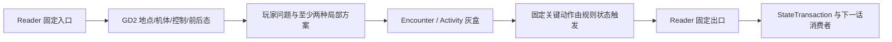

# C01–C03 逐话可玩蓝图 Candidate v1

> Status: `candidate_chapter_play_blueprint / accepted_story_fixed / gameplay_not_accepted / gd2_and_previs_required / parked / not_current / not_counted_as_gameplay_progress`
>
> Workstream boundary: 本蓝图只作为已冻结的开篇验证素材保留；公共玩法骨架与跨章共用基础设定通过前，不继续逐话设计、灰盒、Previs、资产或真人测试。
>
> Depends on: 已验收 C01–C03 纯剧情 Reader、D02 产品宪章、D03 状态合同、D04 战术系统、D05 辅助玩法
>
> Machine contracts: [逐话玩法合同](c01-c03-episode-play-contracts.tsv)、[故事状态种子](c01-c03-story-state-seeds.tsv)、[可玩/盟友/敌对主体](c01-c03-playable-units.tsv)、[GD2 与 Previs 清单](c01-c03-previs-needs.tsv)、[开篇Previs/灰盒/BOM](../data/opening-previs-graybox-bom.tsv)、[C02纸面Fixture登记](../data/opening-chapter-paper-fixture-registry.tsv)、[模式 token 合同](../data/episode-mode-token-contracts.tsv)、[Accepted Story 绑定](../data/opening-accepted-story-bindings.tsv)

## 0. 本蓝图解决什么

前三章已经有可接受的故事，却还不是三章可玩的游戏。本蓝图不重写 Reader，而是为每一话明确五层：

1. **固定入口与出口**：由用户验收的故事决定，玩法不得静默改写；
2. **玩家亲手完成的过程**：必须有至少两种有意义的局部策略，不能只按顺序触发演出；
3. **Operation / Encounter / Mode 拓扑**：什么时候只是 Episode Cut、Phase Checkpoint、Encounter Clear 或真正 Mission Clear；
4. **持久状态**：人物、机体身体、地点、证据、权限、关系和敌方状态怎样带到下一话；
5. **GD2 / Previs 阻断项**：城市、建筑、机体、工具和巨构动作还缺什么实体设计，缺失时不得让 gameflow 或作者临场创造。

这不是正式关卡设计，也不授权 Runtime、美术或 L6 制作。时长、可控单位和局部策略均为待灰盒、真人试玩与用户裁决的 Candidate。

## 1. 权威与适配规则

### 1.1 三种证据不得混用

| 层 | 本蓝图怎样使用 | 不能推论什么 |
| --- | --- | --- |
| 用户已验收 Reader | 锁定人物选择、比赛结果、胜负、登离舰、地点结果和揭示顺序 | 不证明关卡、UI、地图、美术、数值或试玩成立 |
| L4 / L4.5 / gameflow / 预生产文字 | 作为可回收的承载候选和问题清单 | 不自动覆盖 Reader；不证明已有图、灰盒或资产 |
| Runtime / C01E02 Demo | 只取相机、输入、可读性、状态隔离和试玩证据 | 不把专用脚本、地图、数值、Boss链或内部 PASS 升成通用玩法 |

C01 Reader 的验收范围还明确排除了万机馆空间与形态视觉基线；C02 的三条 `previs_asset` 是文字灰盒；C03 当前没有章级 `previs_asset`。因此“前三章已经有草图”不是当前产品事实。

### 1.2 Story Beat → Play 的固定算法

每个固定故事结果都按以下顺序适配：



- 玩家可以决定**怎样做到、先做什么、承担多少代价、带走哪些证据**；
- 玩家不能决定已验收人物是否同意、固定比赛谁赢、谁登舰、哪个核心是否被毁；
- 若固定结果无法由通用规则自然到达，应先返修关卡或上游空间，而不是添加不可见脚本；
- 若只有一种正确点击序列，改成短演出或重做规则，不冒充策略玩法；
- Story 胜利与关卡胜利必须是同一个问题。例如 C03E01 的胜利是“城梁换位并拆锁”，不是先打空衡令 HP 再看过场换位。

### 1.3 四种结算边界

| 边界 | 允许写入 | 禁止 |
| --- | --- | --- |
| `Phase Checkpoint` | 当前 Encounter 的位置、身体、目标和知识 | 发奖励、治疗、重置敌军、伪装 Mission Clear |
| `Encounter Clear` | 一段战术/活动结果、局部伤损、证据和地图态 | 清除同一 Operation 的持续状态 |
| `Operation Clear` | 任务目标、跨 Encounter 损伤、责任与地点变化 | 未结束的赛事/事故/追击提前结算 |
| `Chapter Settlement` | Roster、泊位、世界路线、长期关系/权限、实体交割 | 用单一“通关分数”覆盖具名人物与物件 |

逐话固定状态见 [故事状态种子](c01-c03-story-state-seeds.tsv)。这是 Candidate 状态合同，不是对 Canon 或现行 Runtime 的迁移。

### 1.4 Story-in-Hub、Hub Cycle 与 Operation 序列

“场景发生在万机馆”只说明地点，不自动等于玩家进入了 Hub 经营循环。机器合同采用以下严格区分：

| token / 字段 | 实际含义 | 是否消耗 Hub 行动格 |
| --- | --- | --- |
| `STORY_IN_HUB_*` | 发生在馆内的固定 Story 场面，例如夜谈、人物回应、交割或事故余波 | 否 |
| `HUB_CYCLE_*` | 玩家在返馆周期内，从 2–5 个高价值行动中作取舍并承担机会成本 | 是 |
| `AUX_*` | 复用型探索、调查、工程或轻量活动；按 ActivityResult 独立结算 | 否，除非由已进入的 `HUB_CYCLE_*` 明确占用一个行动格 |
| `OPERATION_SETTLEMENT` | 对一项真正完成的 Operation 聚合 Encounter / Activity 回执 | 否 |

因此 C02E03 的馆内夜间调查、C02E05 的馆内交割和 C03E04 的馆内关系场面，当前都仍是 Story 或 Activity，不得据此宣称前三章已经有可玩的 Hub 经营。以后若要把某段升级成 Hub Cycle，必须另行设计行动预算、候选池、延期后果、可见前后态并通过玩法门，不能只改名称。

逐话表中的 `operation_sequence` 允许一话跨越两项 Operation，但只表示先后关系。例如 C02E04 从赛事进入舞台事故、C02E05 从事故结算进入离馆交割；每项 Mission Clear 后都必须有自己的 `OPERATION_SETTLEMENT`，不能把比赛、事故和 Departure 合并成一个虚假的总清算。

### 1.5 时长候选与节奏目标

| Chapter | 话数 | 候选单话目标 | 章内节奏 | 主要学习 |
| --- | ---: | --- | --- | --- |
| C01 | 4 | 35–75 分钟 | 导览与撤离 → 单机护线 → 双机合击 → 多格母舰终战 | 空间、尺度、身体动作、非歼灭目标、连续 Operation |
| C02 | 5 | 45–85 分钟 | 资格赛 → 训练实证 → 来源调查/半决赛 → 决赛/事故 → 巨构救援/交割 | 非致死竞技、工程验证、Intent、阶段Boss、多主体救援 |
| C03 | 4 | 45–80 分钟 | 承重与拆锁 → 移动环追逐 → 合体/叫停/拆解 → 无敌军校准与结算 | 多格世界主体、本地知识、C2边界、同意/停止、多阶段空间 |

时长不是内容配额。冷测发现重复、停滞或只有演出按钮时，优先删减；不得靠走路、对话清单或更多敌人填满目标时长。

## 2. C01《闭馆以后，万机出击》

### 2.1 章级可玩命题

玩家不是“打四关”，而是在一个从地下突入、街区战到紧急离港的连续事故里，亲手把固定博物馆变成能够带人离开的低速载体。

全章只用一个 `OP_C01_BREAKER`：

```text
E01 警报与撤离命令
  → E02 人类撤离完成 / 馆守Z首战 P1
  → E03 同图双机破壳 P2
  → E04 起航 P3 / 沿海 P4
  → 核心毁灭后唯一 Mission Clear
```

当前旧 gameflow 把观众撤离完成提前放进 E01；已验收 Reader 明确把真正撤离放在 E02。D06 以 Reader 为准重裁，E01 的结束状态只能是 `ordered_not_complete`。

### 2.2 C01E01《最后一位观众》

**玩家体验**：在最后开放日亲手走完一条短而有情感密度的导览线；警报响起时，刚认识的空间立刻变成撤离问题。

**模式拓扑**：`受约束微探索 → 四站导览 → 勇拳固定测试回放 → 七海关系ADV → BREAKER突入 → 撤离准备 → Episode Checkpoint`。

**玩家可以决定**：

- 走四个强制认知点的快速导览；
- 或在同一路线上查看旧照片、全尺寸装备和模型病院，获得位置熟悉度、图鉴与后续提示；
- 警报后先确认哪一段人流和场景角色，但所有路径固定汇流到东侧坡道命令。

**玩家不能决定**：新增第五站、让模型变战力、提前介绍 G.A.G./白鸢、让勇拳参战、在本话完成撤离。

**生产阻断**：先完成万机馆四站步行线、主厅—维修角—东坡道—南巨机门连续空间，以及开放/闭馆/警报三态。无这些图，不做探索交互和镜头表。

**最小验证**：5 名冷启动玩家中至少 4 人无需浮动箭头在 20 分钟内完成固定导览并能复述 2 个空间/机械事实和 1 个人物记忆；两种观察路线必须回到同一警报出口。

### 2.3 C01E02《巨神从展台起身》

**玩家体验**：先在人的尺度完成撤离，再在同一空间外侧操作馆守Z，以身体和重盾保护最后一条安全线。

**模式拓扑**：`短探索撤离 → 人员安全 Checkpoint → 旧守护者/馆守Z同体揭示 → 七海撤本人命令 → 起身动画 → 地面战 P1 → 盾拍 → Phase Checkpoint`。

**固定战术目标**：

1. 保护东门、应急车辆与最后撤离线；
2. 阻止 BREAKER 越过北侧安全线；
3. 把它引回南侧空广场；
4. 撤离完成后取得重盾并把 Boss 拍倒；
5. 不以全灭散乱小体作为胜利。

**两种候选策略**：

- `门线固守`：占据 Boss—东门之间的宽面，先推开威胁车辆/出口的小体；
- `南向诱导`：以侧推、朝向和道路边界提前把冲撞轴转向南广场，换取更少正面承伤。

二者都以“盾拍只拍倒，Boss重新起身”收束。若无角色权能的基础灰盒不能让两条路线成立，不得靠纪存导航或七海权限按钮救活关卡。

**Demo边界**：当前 C01E02 Candidate Demo 可提供单位/地形辨认、滚动、命令路径、压力与失败理解证据；其 32×18、专用盾链、数值和脚本不是本关正式规则。

### 2.4 C01E03《双拳打碎外壳》

**玩家体验**：在完全继承 E02 的破损街区里，用两台身体差异明显的机体制造合击窗口，并承担馆守Z右臂永久毁损的固定代价。

**模式拓扑**：`豪司越令ADV → 同图战 P2 → 红裂窗口 → 右臂代价确认 → 双拳破壳 → 飞行核心/小体同步 → 万机馆回应 → Encounter Checkpoint`。

**两种候选策略**：

- `正面锚定`：馆守Z以盾/身体封钻地方向，勇拳绕侧把冲击回送同一甲缝；
- `冲撞反送`：勇拳占冲撞侧线改变 Boss 朝向，馆守Z利用边界完成旋转封锁。

玩家可改变站位、承伤和到达终结窗口的过程，不能保存右臂、跳过双拳或把飞行核心结算为新 Boss。小体必须从同一批 `scattered` 转成 `synchronized`，不能刷新一批“新敌人”偷换状态。

### 2.5 C01E04《博物馆追上天空》

**玩家体验**：第一次把万机馆作为多格移动场景身体与护送目标来协同；玩家在已经批准的航向节点之间选择护航距离、近防窗口和承压顺序，系统与具名岗位负责真实驾驶。C01 不开放自由母舰操纵，C05 才检验第一套玩家可控移动多格母舰规则。

**模式拓扑**：`起航准备/装备确认 → 万机馆离地 → 城市出航 P3 → 海岸 Checkpoint → 沿海 P4 → 舰艏终结 → Mission Clear → 回执/求援/路线/尾钩`。

**两种候选策略**：

- `紧密护航`：勇拳贴舰截击、馆守Z守舰艏，万机馆逐段清路；稳定但近防和转子压力高；
- `远端诱导`：勇拳远离舰体把核心牵入防空/舰艏直线，万机馆以转向分割小体；更快但勇拳机况风险高。

最终都必须回到 `勇拳回送俯冲 → 兜灯批准一次点火 → 馆守Z左拳贯穿 → 勇拳托肩归舰`。巡展臂不能握拳，近防不能伤 Boss，推进骨架只能点火一次。

**章级硬阻断**：没有万机馆固定馆/离地/低速巡展舰三态、整馆剖面、多格占位、转向半径、外泊/舰艏关系、城市到海岸连续图和联合 Previs，E04 不得进入正式关卡、美术或资产制作。

### 2.6 C01章末实际奖励

不是经验值或战利品箱，而是：

- 万机馆从固定展馆进入 `mobile_low_speed_carrier`；
- 馆守Z身体永久变化，盾与推进骨架成为有来源的报废物；
- 木桶街成为下一条实体路线；
- 七海、勇拳与当前队伍的去向明确；
- 采样机碎片与白色衬片进入两条不同保管/揭示链。

## 3. C02《木桶街，万机初开》

### 3.1 章级可玩命题

玩家要证明“动作、模型、身体、比赛和事故责任不是一回事”：先用非致死竞技学会读身体与 Intent，再把同一批机体投入真实巨构救援，最后逐件交割转子、装备、泊位和随舰关系。

三条 Operation：

```text
OP_C02_TOURNAMENT: E01资格 → E02训练 → E03两场半决赛 → E04决赛 Mission Clear
OP_C02_STAGE_ACCIDENT: E04事故P1 → E05救援P2/P3 → Accident Mission Clear
OP_C02_DEPARTURE: E05转子/装备/人物交割 → Chapter Settlement
```

E04 决赛结束后不得回 Hub、治疗、刷新地图或重置伤势；事故必须无缝继承。

### 3.2 C02E01《无牌一号，出场！》

**玩家体验**：先在木桶街调查约九米的冠军主循环转子、担保和参赛权，再用一台没有完整必杀技的机体完成非致死限时穿越。“约九米”已经是 Accepted Reader 的可见事实；重量、接口、运输架、吊点、B1升降台与安装包络仍须由 GD2 实体设计补证。若工程验证推翻九米，必须经用户批准后回改 Reader，不能在玩法蓝图里静默改写。

**模式拓扑**：`货柜领袖牵环 → B1故障核验 → 馆内Story调查/谈判 → 王者全装展示 → 担保/机体同意 → 借推进模块 → 资格赛 → 双钩`。

**战术问题**：90 秒内穿过两台门卫并以**左掌**敲钟。肩甲擦入、门卫互遮和两次推进横移的使用时机可变；固定出口是接住重击、右拳未成、放开对手、左掌敲钟。

旧 Candidate 曾写“肩头撞钟”，必须废弃。灰盒必须证明至少两条路线，不得把固定动作序列称为战术。

### 3.3 C02E02《必杀技未完成！旧拳王的挑战》

**玩家体验**：在缩尺模型上提出动作假说，经唐胶解释、工程人员核验、兜灯安全测试，再用全尺寸身体得到三种可解释失败。

**模式拓扑**：`录像复盘 → 缩尺动作表达 → 工程核验/试验锤 → 白鸢追责与七海通话 → 三机展示 → 非计分对练 → 开柜钩子`。

玩家可选择先观察重心、主动踏入或拳脚同步，调整训练距离/强度/停手窗口；不能提前完成必杀、制造永久模块，或让玩家替旧拳王决定停拳。飞行三机只是本地主体首秀，不自动入队。

### 3.4 C02E03《逆转天冲拳！师徒真打》

**玩家体验**：先亲手建立“当年两副身体”的证据链，再在主体知情同意后完成两场性质不同的半决赛。

**模式拓扑**：`馆内夜间Story → 年份/原件/工号/维修连续性调查 → 白鸢补图分层 → 两机知情选择 → 半决赛A → 半决赛B → 决赛准备`。

调查要求至少三类来源，结论区分 `Observed / Inferred / Verified`；白鸢补图是后来层，不能证明机魂来源。错误连接保持未确认并引导补取，不以红叉惩罚。

半决赛B的战术自由集中在“怎样逼旧拳王给出真正重击、何时踏出第二步”，不能改变无牌一号获胜。旧拳王此时尚未决定随舰；该决定只能在 E05 发生。

### 3.5 C02E04《全装王者！三比二之后的最终话》

**玩家体验**：先在规则透明的五分 Boss 战中赢得 3:2，再发现旧终幕被现实物理接管，立刻把比赛空间切换成事故现场。

**模式拓扑**：`赛前安全 → 决赛 → Tournament Clear → 赛后主体确认 → 旧终幕 → 事故 → 最后工房组撤离/通路 → Accident Checkpoint`。

本轮Candidate纸面Fixture选择了一个可裁决方案：前两分是明示不开放完整战术输入的短`Story Showcase`，计分板到`0:2`后才进入三分完整战术逆转。追分中推进侧移、贴身抢位、出界/五秒压制有两类纸面路线，第三分仍固定为王者正拳交锋后的逆转天冲拳。这只是`zero_build / not_run`的INF-C02-01假设；若用户要求前两分也完全可玩，必须重开Fixture，并在必要时对已验收Story走显式迁移，不得用幕后强制失分伪装成玩法。

**进入 GD2 前必须修的冲突**：

- 最终分是王者正拳，不是“盾组正面压上”；
- 王者带全装越过黄线，不能在 E04 提前卸装；
- 白鸢叫停，本地安全席断电，七海只远程问伤员/人数；
- 普通观众已在固定厅，外圈只剩最后工房组，不能凭空造观众棋子。

### 3.6 C02E05《新的最终回！万机同援》

**玩家体验**：操作一场分阶段开放主体的巨构救援，而不是把十几台机和百米馆体同时塞进一个回合；救援后逐实体完成交割。

**候选阶段**：

1. `P2a 侦察/护航/固定`：红、蓝、黄三机分别提供危险扫描、工程车护送、远射切断；
2. `P2b 承重/牵引`：货柜领袖、万机馆、馆守Z、旧拳王建立可验证的承重链；
3. `P3 自主卸装/设施Boss`：保护王者自己卸装，把炮车送入无牌一号/王者共同拳路；
4. `Accident Clear`：舞台炮入拆解架、环停止下沉，裁判重申 3:2；
5. `Departure`：旧/新转子两件实体、推进模块、人员/机体去向和不停机航路逐项提交。

大物理先后不能颠倒，但工程车路径、支援分配、危险清除顺序和承重余量必须提供局部多解。若仍是“红→蓝→黄→牵舰→卸装→拳”的唯一按钮列，应压缩为演出并重做关卡规则。

### 3.7 C02章末实际奖励

- `3:2`、事故清除和木桶街公共支持分别保存，不合并成一个分数；
- 旧热损转子与新冠军转子作为两件有 provenance 的实体同时保留；
- 推进模块归还，不留下凭空的永久横移技能；
- 无牌一号、旧拳王、白鸢随舰；飞行三机、坞工杰克、完全版王者留街；货柜领袖走自己的地面路线；
- 三飞行机本话援护不自动升级成长期召唤菜单。

## 4. C03《工务城，谁在让城市站着》

### 4.1 章级可玩命题

玩家第一次面对“城市本身也是一台多主体机器”：外来预演、本地知识、法律/岗位权限、机魂/驾驶员同意和真实承重必须分开。胜利不是把衡令打空 HP，而是让城市、万机馆和职业机恢复各自能继续生活/工作的状态。

```text
OP_C03_CITY_WEIGHT: E01拆锁/工具被夺 → E02回收工具/衡令入环 → E03合体/停锤/拆连接
OP_C03_RETURN_TO_CITY: E04低速归港校正 → C-1 → 人物/信号/路线 Chapter Settlement
```

### 4.2 C03E01《整座城压上来》

**玩家体验**：在城梁换位和万机馆托桥同时发生时，保护承重链并拆除三副永久固定架；本地工务员会用隐藏维修坡道修正白鸢的纸面路线。

**模式拓扑**：`抵达/短空间认识 → 城梁换位奇观 → 承桥拆锁战 → 衡令夺工具 → Fallout`。

**两种候选策略**：

- 走维修坡道，先建立快速拆锁线；
- 走正面承力线，先稳定桥与城梁再处理锁架。

可再选择先拖离或先打断锁架，差异进入时间、损伤和公共支持；城梁到新基座、三锁架被移除和工具被夺固定不变。直接攻击衡令不能结束关卡。

**C2教学**：白鸢只能给可讨论、可推翻的 L1 路线；本地工务员掌握隐藏坡道；纪存协调但不取代本地判断。这是“信息有来源”而非“主角全知”。

### 4.3 C03E02《四机出击！把工作抢回来》

**玩家体验**：四组工具不是掉落物，而是四台职业机身体与工作的延伸；玩家要把每件工具从衡令身上拆下、交回对应主体并完成最低限度实证。

**模式拓扑**：`陆衡责任/撤证 → 四机主动出发 → 移动货运环追逐 → 四工具回收/验证 → 衡令越线入环`。

**两种候选策略**：

- `顺序接力`：每恢复一台职业功能，就用它帮助下一次回收；
- `双线截击`：主力分成阻截与护送两线，同时管理环体位置。

四组工具都要归还，四台主体保持可作业，衡令仍必须主动越线进入中央环。型号相同不等于可直接扣回；磨痕、接口和空载/半载验证必须在 GD2 身体包中先成立。

### 4.4 C03E03《社勇王，现场合体》

**玩家体验**：先用基础身体动作清出四模块合体线并执行第一锤；当地下缆索把医院、住宅和城梁拉进负载后，玩家与角色一起停止已提交动作，重新把“Boss战”改写成拆除整座战场。

**三阶段目标**：

1. 为四模块建立真实合体通道；
2. 第一锤击碎工具架；
3. 危险揭示后停止第二锤，隔离三组城市负载，保护万机馆/城梁并拆除衡令连接。

第三阶段可 `外向内逐组隔离`，或先用万机馆承载窗口再集中拆接；顺序、损伤和暴露可变。第二锤必须停止，社勇王可以拒绝，豪司撤令；这不是玩家输掉一次按键，而是系统教学“已提交计划也有中止、同意撤回和重新规划”。

**公平门**：缆索来源、负载连接、白鸢估算的置信度、七海通过本地链取得确认及疏散，都必须在 UI 与 Previs 中可追溯。若玩家只能在过场后被告知“你的正确策略突然错了”，原型失败。

### 4.5 C03E04《第一座可以回来的城》

**玩家体验**：没有敌军。玩家用三类证据和真实低速试验，让万机馆安全完成转弯、扫尾、关主推滑行和 C-1 停靠；随后看到人物、泊位、信号和世界路线结算。

**模式拓扑**：`战后恢复 → 工程实证/校准 → C-1停靠 → 关系/试用安排 → 当前求援与27年前旧讯息 → Chapter Settlement → 天空铸环任务卡`。

**两种候选策略**：

- `早刹稳进`：更早关闭主推，依靠职业机/侧推保守校正；
- `分段微调`：保留更长推进，使用多个小调整窗口换较短时间。

二者只改变耗时、轻磨损和人物反馈，不取消 C-1、登离舰或固定回复。错误配置应由物理预警和本地权利人阻止，不能让玩家因一次操作摧毁已验收故事结果。

两封信不是知识谜题：当前天空铸环求援与二十七年前缓存必须显示不同来源、时间戳、可知范围和后续消费者；纪存给旧讯息的回复固定，不把情感选择变成答题奖励。

### 4.6 C03章末实际奖励

- 工务城成为可以返回的地点，C-1 是有空间与权限来源的公共泊位；
- 万机馆仍只具低速能力，不因一次校准成为完整战舰；
- 社勇王/豪司以三个月试用约束加入；七海、陆衡按具名职责登舰；货柜领袖走地面；
- 当前求援、旧讯息、百机邀请与真正入队数量分别保存；
- 白鸢的预演、七海的证据链、陆衡/唐胶/兜灯的工程职责和机体同意形成可继续演化的 C2 基础，但尚不是全游戏权能系统验收。

## 5. 三章单位、地图与资产策略

### 5.1 “可控”不是“遥控”

[可玩单位合同](c01-c03-playable-units.tsv)把主体分为四类：

- `direct_body_action`：玩家提交动作，驾驶员/机体仍是身体执行主体；
- `task_request`：本地职业机、工程组或盟友收到具名任务，可接受、拒绝或条件执行；
- `scene_body`：万机馆、城梁等多格世界主体，只开放真实岗位/场景动作；
- `intent_ai`：敌人和竞赛对手以可见目标、承诺窗口和条件变招运行。

因此“这一话有十台机器人”不等于玩家拥有十个编队槽。临时切控、盟友请求、随舰 Roster、长期支援和场景主体必须分别结算。

### 5.2 资产只按复用和多模式价值升级

- `A1`：长期 Hub 的地点状态、共享交互、身体/工具接口；
- `A2`：同时服务 Story、探索、战术或 Hub 至少两类的地点/动作包；
- `A3`：C01E04、C02E04/E05、C03E03 这类章级高潮，必须先通过低模与 animatic 单独批准；
- 对象方向图不等于连续 Previs；文字 Mermaid 不等于视觉草图；一次动画不等于可复用动作规则。

优先级不是按章顺序平均制作，而是：

1. 万机馆整馆 Master Pack；
2. C01 E01/E02 连续空间与街区基础战术图；
3. 木桶街和工务城章级 Master Pack；
4. 三个高成本连续 Previs：C01E04、C02E04/E05、C03E03；
5. 机体/职业工具/泊位的可复用身体与接口包。

## 6. 灰盒与真人验收顺序

### 6.1 不为十三话各造一套原型

先验证通用系统，再把章节装进同一规则核：

| 原型 | 章节内容 | 唯一问题 | 通过后可覆盖 |
| --- | --- | --- | --- |
| `D04-P1` | 中性地图四时制筛选＋最小核心C2 crossover | 无主角权能时，移动/身体/地形/反应是否至少有两种解 | C01E02/E03、C02比赛底层、C03拆锁 |
| `CH-EX1` | C01E01短导览 | 空间观察是否轻松、可读并写回后续 | 三章微探索 |
| `CH-C01-CARRIER` | C01E04低模 | 多格母体、甲板与贴舰敌人是否成立 | 后续万机馆作战 |
| `CH-C02-QUALIFIER` | C02E01同图两路线 | 非致死限时关是否有策略而非脚本 | 竞技/撤离/抵达目标 |
| `CH-KNOWLEDGE` | C02E03资料—身体链 | 玩家能否区分证据、推论、同意 | 后续档案/残响 |
| `D04-P3 / CH-GIANT` | C02E05或中性巨构 | 多阶段持续状态是否清楚且不堆同屏 | C03巨构和后续Boss |
| `CH-C03-C2` | C03E03第二锤转折 | 信息/许可/同意/叫停是否公平、可操作 | 全剧角色C2 |
| `CH-VERIFY` | C03E04校准 | 无敌军工程实证是否轻松、有两种节奏 | 修理/Hub/城市工程 |

### 6.2 章级通过门

每章进入正式制作前必须同时满足：

1. **Story门**：固定入口/出口绑定已验收版本，无 gameflow 冲突；
2. **GD2门**：地点、机体、工具、控制权、日常功能、前后/损毁态、揭示账均有实物；
3. **Previs门**：Heavy内容有真实低保真图，文件存在且经过用户视觉裁决；
4. **Rules门**：关键 Encounter 使用通过验证的共同规则核，至少两种方案由玩家独立发现；
5. **State门**：Episode Cut、Encounter、Operation、Chapter结算不混用，存读档不丢状态；
6. **Human门**：录像、输入日志、复述、方案分类和用户明确回执齐全；内部 PASS 不能替代。

### 6.3 当前裁决

- **C01**：故事与连续 Operation 骨架成立；E01/E02 边界已在本蓝图重裁。E02 Demo只能提供窄证据；E04被万机馆 Master Pack和连续Previs阻断。
- **C02**：比赛—事故—交割的产品曲线有潜力；E04/E05已有3个机器可校验Candidate纸面合同，只有MATCH四条接触式可静态算术重算，事故Checkpoint和三阶段救援仍无物理resolver。全部仍是零Build、零规则搜索、零真人证据；整章仍缺真实木桶街图、非致死战术resolver和巨构救援灰盒。
- **C03**：最能验证项目独特的“信息/权限/同意/工程/城市身体”方向；但也是当前章级 Previs 最空的一章。E03之前不得用文字承载代替城市负载图和连续视觉预演。

因此 D06 的状态是 `candidate_story_play_mapping_complete / level_design_gd2_previs_prototype_human_review_pending`：它完成的是已验收故事到玩家过程、状态与生产债务的映射，不是地图、Encounter规则或前三章玩法设计已经成立。

## 7. 需要用户裁决的章级问题

1. C01E01 是否接受“纯导览/撤离准备、无战棋”，把第一场正式战术延后到 E02？
2. C01E04 是否接受多格母舰作为首章最高学习峰值，还是把其战术复杂度压低、主要承担高潮演出？
3. C02 资格/半决赛A是否都要完整可玩，还是保留资格赛与半决赛B，把王者对杰克压缩为短互动战以控制重复？
4. 是否接受本轮Candidate的`0:2 Story Showcase → 三分完整战术逆转`方案，还是要求前两分也遵守完整可玩规则并重开适配？
5. C02E05 是否适合作为首个正式巨构 Operation 原型，还是先用中性 P3 测试场验证后再迁入？
6. C03 四台职业机采用短时直接切控，还是统一使用“任务请求—主体响应”的盟友语法？
7. C03E04 的工程校准是否作为本游戏第一个完整无敌军玩法段？
8. 三章时长上限是否优先压缩到每话 45–60 分钟，允许高潮话达 75–85 分钟？

这些问题未被明确裁决前，默认继续保留 Candidate，不从沉默推断批准。
