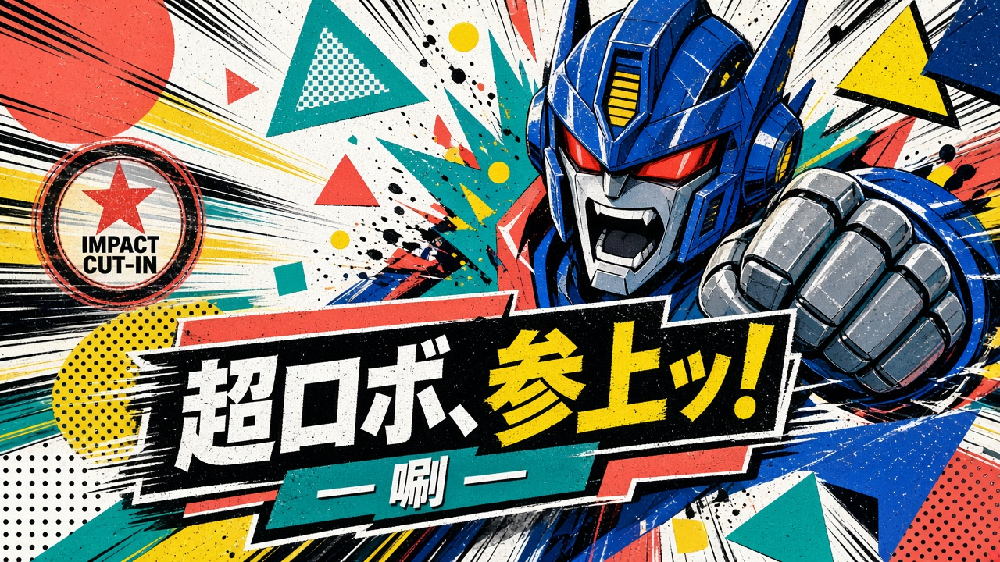

# 《超GAG机器人大战》动画原画 × 档案套印美术规范 v2

> 权威：`Working Canon / project_art_direction`  
> 用户确认：2026-08-06；2026-10-10按用户提供的视觉总参考修订  
> 适用：人物、机体、场景、调查道具、纪存终端、对话立牌、SRPG Sprite、Cut-in、章节图与宣传特绘  
> 边界：本合同锁定共同画法和资产强度，不替换人物脸、服装、机设、比例、损伤生命周期或现有 Hard Canon 美术母版。

**当前视觉入口**：[给Astra的视觉总参考](../../work-packages/2026-10-02-chao-gag-linked-operation-candidate/v5完整整改计划-20261008/给Astra的视觉总参考.html)。用户在2026-10-10明确要求将其立为项目标准，并调整现有规范。本页直接吸收该参考，覆盖旧版冲突表述；保留原文件路径以兼容既有引用。[修订前规范](history/series-art-direction-ab-lock-before-20261010.md)只作历史记录。

本页的**制作层 A/B/C**分别指赛璐璐母语、档案峰值、可选特绘；参考页的**用途档 A/B**分别指冲击画面和战棋盘面。两套字母不可混为一谈。生产数据采用 `IMPACT`、`TACTICS` 标识用途，避免把“战棋档B”误解成档案效果常驻。

## 1. 已确认结论

采用一套母语、三档用途，不把 A、B、C 平均混成折中画风：

| 层级 | 正式职责 | 状态 |
|---|---|---|
| A `KINETIC_CEL` | 常态生产母语：对话、普通剧情、角色/机体立绘、探索与战斗单位图 | `approved_baseline_language` |
| B `ARCHIVE_OFFSET` | A 的峰值增强层：调查、机魂显现、终端接管、必杀 Cut-in、章节标题图 | `approved_peak_layer` |
| C `MATTE_GOUACHE` | 海报、收藏卡、重大回忆和少量高成本剧情特绘 | `approved_optional_key_art` |

A 与 B 必须保持同一人物五官、机体结构、透视、色块和材质逻辑。B 只能增加品牌强度，不能另起一套脸、比例或机甲表面。C 允许改变笔触密度，但不得改变角色和机体身份。

## 2. 共同母语

### 2.1 线

- 外轮廓使用有压力变化的深墨蓝线；受力侧、近景侧和遮挡侧较重。
- 内部线比外轮廓细，并允许在亮面、软材质和次要结构处断开。
- 不使用全图同粗黑描边，也不靠密集面板线、发丝线或衣褶线制造完成度。
- 人物与机体必须出现在同一透视和同一线压系统内，禁止人物像二游卡面、机体像商品渲染的拼接感。

### 2.2 色与光

- 常态以墨蓝、朱红、象牙与机体自己的英雄色为基础。环境使用按关卡指定的中间明度有色色块；不再以“低饱和环境色”作为全项目默认，更不能压成灰板。纸白/冷白限于局部高光和留白，不作为大片屋顶或地坪默认。
- 普通画面最多两级硬阴影；亮面以大色块转折为主，不叠碎高光。
- 微白机魂光保持近白、低彩，不改成青色霓虹。
- 朱红承担主角动作、胸部主符号、警戒和档案切面；不能平均撒成全身彩条。
- 禁止二游皮肤泛光、头发丝光、透明衣料碎反射，以及机体塑料/合金玩具棚拍高光。

### 2.3 形与节奏

- 先读纯黑剪影，再读 4 至 7 个大色块，最后才允许出现局部结构。
- 一张常态画面只保留一个最高细节焦点；非焦点主动留白或合并。
- 人物动作线、机体受力线、场景导视线应朝向同一事件，不以正中白底站姿代替叙事画面。
- 人物的布料褶面与机体装甲折面共享“少而准”的硬边逻辑，但材质边缘仍需区分软硬。

## 3. B 峰值增强规则

B 不是覆盖整张画面的滤镜。每张图最多选择两处主触发点与一处回声点：

- 主触发点：纪存终端手光、机魂接口、馆守 Z 红 X 胸、必杀动作核心、关键调查物。
- 回声点：翼尖、构图切边、局部投影或角色视线终点。
- 允许：极窄的朱红/淡电蓝错版边、纸白切口、少量干笔和有限网点。
- 禁止：伪日文、伪英文、小字墙、假印章、假条码、随机编号和全屏旧纸纹理。
- 错版只表达“档案被读取、重叠或显形”，不得成为永久材质或无剧情含义的装饰。

强度上限：普通调查画面约 15% 画面面积；机魂与 Cut-in 约 25%；章节主视觉可到 35%。角色脸部不得被错版切坏，机体关键轮廓不得被网点吞没。

## 4. C 特绘规则

- 使用大块不透明哑光色和硬边体积，内部线可显著减少。
- 只服务海报、收藏卡、重大回忆或章节级单张特绘，不进入普通对话和批量 Sprite。
- 每张 C 稿先通过 A 版构图/身份检查，再进入厚涂；不得靠笔触重新设计脸、服装、机体部件或年龄。
- C 稿不能反向提高 A/B/Q 资产的细节预算。

## 5. 资产规格映射

| 资产 | 使用层 | 必须保留 | 必须删除/拆层 |
|---|---|---|---|
| `ICON` | A 极简 | 头部轮廓、眉眼方向、身份色 | 衣褶、磨损、微型文字、套印纹理 |
| `Q_RUNTIME` | A 极简；触发时局部 B FX | 3 个身份锚、4–7 个大色块、清楚脚点 | 细碎划痕、小扣件、贴纸、永久光效 |
| `STANDARD` | A | 主轮廓、职业/机设结构、最多 3 个焦点 | 随机污痕、无功能挂件、全身均匀刻线 |
| `SCENE_BG` | A | 可导航空间、固定物件位置、明确尺度与主光 | 为气氛改变平面关系、随图漂移的展品与出口 |
| `PROP` | A；调查时 B | 独立透明资产、固定朝向/破损状态 | 烘焙在唯一背景中、依赖假文字识别 |
| `CUTIN` | A+B | 强透视、单一动作核心、事件伤痕 | 目录站姿、全屏滤镜、随机能量线 |
| `KEY_ART` | A+B 或 C | 人物/机体身份与故事事件 | 为“漂亮”擅改机设、脸或生命周期 |
| `COLLECTOR_MASTER` | 独立工程表现 | 可动、材料、接口、结构一致性 | 冒充游戏内常态画风 |

## 6. 跨规格生产规则

所有资产从同一 `BASE_CLEAN` 派生：

```text
BASE_CLEAN  -> ICON / Q_RUNTIME / STANDARD
WEAR        -> 日常磨损覆盖层
DAMAGE      -> 剧情损伤与缺件覆盖层
LIGHT       -> 微白机魂光与功能灯
ARCHIVE_FX  -> B档案套印峰值层
KEY_PAINT   -> C高成本特绘重绘层
```

- Q版不是正比例等比缩小；必须重画为大形，人物保留 3 个身份锚，机体保留 3 个主轮廓锚和 1 个武器/损伤锚。
- 随机划痕、污迹、标签、小纸片、火花和发光线不得烘焙进 `BASE_CLEAN`。
- 机体高细节母版可用于图鉴、海报、收藏卡和玩具工程；游戏标准版删去约 45% 至 60% 不改变轮廓的内部细节。
- 角色正比例姿态、头像和 Q 版必须共享脸型、发型大块、服装三层结构与身份色，不允许生成时重新抽取身份。

## 7. 反 AI 味门禁

出现任意一项即退回，不以“完成度高”放行：

1. 人物默认精致偶像脸，角色之间只换发型、瞳色或表情。
2. 机体默认对称商品站姿、均匀面板线、全身同材质高光或无功能发光缝。
3. 服装与机体表面出现无法复述用途的细碎扣件、腰包、铭牌、磨损和随机纹样。
4. 画面出现伪日文、乱码英文、假印章、假条码或无设定来源的编号。
5. 同一角色在不同姿态改变年龄、性别呈现、脸型或身体比例。
6. 同一机体在不同图中改变肩、胸、头冠、手臂长度、翼根和损伤位置。
7. 所有边缘都一样锐、所有区域都一样精细，没有人工选择过的主次。
8. B 被当成全屏怀旧滤镜，C 被当成掩盖结构错误的厚涂滤镜。

## 8. 生产验收

每批资产按以下顺序验收：

1. **身份**：与对应 `character_mecha_art_locks.tsv` 的脸、机设和生命周期一致。
2. **大形**：纯黑剪影、四色平涂、最终显示尺寸均能识别。
3. **同系列**：人物、机体和场景共享线压、硬阴影、色温和事件方向。
4. **强度**：常态只用 A；B 有明确剧情触发且面积受控；C 仅用于批准规格。
5. **生产性**：配件与部件能在 30 秒内复述；状态差分来自独立层。
6. **文字**：除经 UI/字体系统排版的正式文字外，图像本体不得生成文字。
7. **一致性**：同一资产的正面、侧面、背面、动作、Q版和 Cut-in 逐项核对锚点。

## 9. 当前参考与非迁移边界

- A 方向参考：`art-delivery/review/series_style_storyframe_v23a_kinetic_cel.png`。
- B 方向参考：`art-delivery/review/series_style_storyframe_v23b_archive_offset.png`。
- C 方向参考：`art-delivery/review/series_style_storyframe_v23c_matte_gouache.png`。
- 三张图只锁定绘画语言与强度分层，不是纪存、馆守 Z、万机馆场景或任何剧情镜头的正式资产。
- `CML001` 纪存与 `CML008` 馆守 Z 的当前 Hard Canon 美术锁保持不变；后续设计母版迁移必须另行确认。
- 旧 `series-style-calibration-v22.md` 及其图像继续作为“只有统一参数、没有独立风格”的失败反例。

## 10. 下一批执行顺序

1. 先用同一锁定角色与机体各做一张 `STANDARD_A`，验证身份和大形。
2. 在同一构图上追加 `ARCHIVE_FX_B`，验证峰值层是否能开关且不改本体。
3. 从 `STANDARD_A` 重画 Q 版，并以 96 px/128 px 实际尺寸验收。
4. 通过后再扩主角团、主要机体、场景、道具与终端，不用旧生成图直接批量续图。
5. C 特绘单独立项，不阻塞 A+B 的常态资产生产。

## 11. 两种用途强度：同一画法，分别组织信息

| 用途 | 对应正靶 | 具体制作要求 | 不应出现 |
|---|---|---|---|
| `TACTICS` 战棋常态、观察、预演 | 主正靶11-tactics-user-accepted；03辅助；calm仅对照 | 动能赛璐璐、英雄涂装、工整格线；机体剪影与脚点先读，威胁/HP/目标随后读，环境细节最后读 | 军事灰板、满屏孟菲斯、立绘盖住棋盘、用海报贴纸代替实际状态 |
| `IMPACT` 标题、重要过场、必杀Cut-in | 06—10 | 珊瑚、青绿、柠黄、钴蓝可强对撞；人物/机体/字幕沿一条动作线闪入；保留一个动作核心；有剧情触发时追加有面积上限的ARCHIVE_OFFSET | 永久滤镜、伪字、另换人物脸、把所有普通攻击都做成全屏插播 |




正靶规定视觉方向，不授权照搬其生成文字、机设或密集HUD。当前鼠标直操、光标探查与精简常驻信息仍然有效。否决图11b、11c及hardcore-deprecated只用于识别错误，不作为生产目标。

## 12. 每关必须声明场景包与色板

共同画法不等于所有关卡一个颜色。每关配置须列出“场景物件、主色、辅色、局部强调、禁用语言”；新关未声明时不得默认继承工务城或古风包。

**工务城当前标准**：工业仓、吊车、供电柜、集装箱、桁架、甲板、现代居民楼；钢青绿、混凝土米、警示朱红为共同底盘。A供能前庭偏鼠尾草绿与青绿设备，B跨渠桥座偏钢蓝与矿物青水，C环下装卸站偏褪蓝与朱红货运设备。三个工作面保持同一座城的材质关系，由物件职责和次色区分；其他关卡可以另定完全不同的色板。

| 层 | 应如何画 | 要检查的错误 |
|---|---|---|
| 地面 | 有色中明度，实际板缝、沟槽、轨道、破口；表面纹理低对比 | 用脏灰、照片锈迹或大白底充当材质；装饰凹凸暗示不存在的阻挡 |
| 建筑 | 有首层、门窗、楼板、屋顶设备的现代形体；钢青绿涂层与米色矿物墙分区 | 小屋与十几米机体比例失真；古风檐瓦；无用途的圆角积木 |
| 机体 | 保留IP映射身份、4—7大色块、主武器和姿态；不为配套而全员染成环境色 | 敌我剪影和明度接近；同模型换色冒充全部谱系；微反射吞没颜色 |
| 交互信息 | 移动范围轻底，路线清楚；危险有方向/形状，选中有重点；HP按损失段闪烁 | 环境灯与威胁预告同闪同色；永久高亮铺满格子 |
| HUD | 深墨蓝平面、象牙文字、有限黄铜细边、朱红主要行动；保留明确状态差异 | 灰蓝渐变军用面板、金框层层套娃、复制参考图全部面板 |

工程色票及用途字段统一保存在 [visual-standard-20261010.json](visual-standard-20261010.json)。参考原稿没有给出十六进制数值；该JSON是依据正靶落实的工程色票，不能将采样数值伪称为用户逐色确认。`scripts/build_gongwu_visual_style.py`从它生成场景色板与UI SVG，避免多处手写色值漂移。

## 13. 比例、材质与战场表现

1. 单格机体按小型/标准两档呈现，大型按2×2，超大型与布景按玩法规格处理；不按所有原作米数线性缩放。**2026-10-12用户补充：敌人、非我方单位和我方使用同一套战棋体量档位，普通敌体不能被缩成机甲脚边的小动物。** 低伏、履带、长炮管和展开肢体可保留各自轮廓，按档位控制整体体量；不为齐高拉伸身体。人物、机器犬等明确微型对象在盘面约占四分之一格的平面面积（边长约半格），这是显示约定，不自动创建分数占格规则。Boss、剧情要求的巨型/微型物和特殊工具允许显式尺寸例外，必须有对应来源。变形前后沿用同一档位，不能因为换成载具就变成玩具。建筑以3米左右楼层、2.4米左右入口作尺度线索，工务城居民目标采用5—7层现代楼房；门窗不与机甲头部同量级。
2. 轮廓线为细墨蓝且有受光/受力变化；几何折面最多两级硬阴影；关闭细碎镜面高光。凹窗、阳台、屋顶、管道和支撑使用实体几何，纹理服务表面，不承担全部体积。
3. 完好、受损、毁坏通过形体差分表达；毁坏不能只将完整楼房染黑。损伤与临时遮挡剖切分开，剖切不伪造伤害。
4. 正常战棋距离必须看清三类设施和两类机体职责。选中或悬停被挡单位时局部剖切/减遮挡；地图旋转后仍有真实侧背面，不以贴片替代3D主体。
5. 场景美术不改变规则。不可走、深水、坑洞、桥梁、可破坏结构及预告必须与真实判定一致；不会因为一道装饰阴影突然多出障碍。

## 14. 人物与机体的同系列要求

人物按动画原画与馆藏设定档处理，保留脸型、年龄、职业衣装和动作身份；禁止默认网游偶像脸、厚塑料线、腮红渐变。人机同框共享线压、透视与色温。半Q不是幼儿二头身糊团；STANDARD也不是全身堆满刻线的商品展示。纪存、馆守Z和其他主体的当前Hard Lock优先于参考画廊中的示例人物/机体。

## 15. 逐图检查，而非用脚本宣布美术通过

- 先核身份、用途档和关卡包，再与对应正靶并排；战棋主对照为用户指定的11，不能把更淡的calm当作上限。
- 正常HUD、关闭HUD、灰度、缩略图、机体与建筑同屏都必须看。脚本只核资源、参数、状态与运行，不判断“好看”或“已达参考完成度”。
- 硬禁令涵盖：photoreal rust、AAA PBR、废土灰棕、AC6写实落地、塑料棚拍、泛科幻壳、蓝紫霓虹堆积、低模玩具城、渐变HUD、贴纸涂装、大白/死黑底、敌我同值、VFX吞威胁、幼儿糊团、镜面铬、粗塑料线、网页游脸、廉价腮红、衣装堆砌、抢脸金框、盘面孟菲斯、ITB灰板、工务城古风建筑。逐条对照视觉总参考第6节，不以技术加载成功放行。
- 禁用高光爆白、纹理噪点和随意降低细节三种捷径。出现灰板要改色块关系与场景组织，不能只把曝光再抬高。
- 新标准已经获用户授权；每批新资产和Demo效果仍需独立记录实现与视觉检查结果，不自动成为已验收Runtime。
