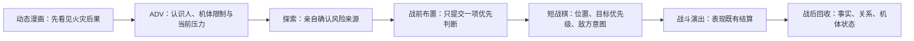

# C01 多玩法可玩切片生产说明

> 状态：`candidate production pilot`
>
> 日期：2026-07-13
>
> 本切片用于验证多玩法因果链与馆守 Z 战斗演出总装，不替代冻结的 V35.10 Episode Packet。

## 1. 切片要回答的问题

多玩法不是把 ADV、探索、小游戏和战棋首尾拼起来，而是让玩家在不同操作语法中处理同一件事：今晚火灾前，万机馆正在被封存执行链接管；玩家要确认风险、选择先相信谁的判断，并在战场上承担这项选择。



贯穿全部模式的是同一份 `C01SliceState`，不是模式各自的临时变量。

## 2. 当前可玩流程

| 环节 | 内容量 | 玩家行为 | 写回状态 |
|---|---:|---|---|
| 动态漫画 | 5 幅 | 推进、建立时间悬念 | 无不可逆提交 |
| ADV | 15 句 | 认识纪存、兜灯、孩子、跌跌和馆守 Z 限制 | 建立任务语境 |
| 空间探索 | 2 个小场景 | 连续移动、靠近调查、场景往返 | 事实、方案解锁、关系边 |
| 多轮对话 | 4 条主线，约 29 句含回应 | 推进、选择具体承诺 | 停机权、撤离委托、七海窗口 |
| 战前布置 | 3 条可选路线 | 只提交一项优先级 | `selected_preparation` |
| 短战棋 | 最多 3 回合 | 移动、武器、目标、待机、结束阶段 | 唯一战斗结果 |
| 战斗演出 | full / short / off | 观看或随时跳过 | 不拥有结算权 |
| 战后回收 | 3 页 | 查看选择后果 | 半跪、低热、右臂仍连接 |

按首见阅读、正常探索两至三条线、一次战术思考计算，目标时长约 10–15 分钟。当前尚缺真人盲测；极限跳读或只取第一条准备路线会显著短于该时长，不应拿它冒充正常首玩时长。

## 3. 三条准备路线

### 3.1 低热量安全锁

- 来源：兜灯与馆守 Z 胸牌。
- 剧情动作：纪存把停机权交给兜灯。
- 战场变化：馆守 Z 唯一一次低热掌部防卫能打断重型执行机。
- 代价：馆守 Z 仍不能起身，兜灯有权中止行动。

### 3.2 守展小队撤离线

- 来源：阿澄、小满与留言墙后侧路线。
- 剧情动作：纪存承认孩子不必等英雄回来。
- 战场变化：撤离灯完整度提高，允许多承受一次截断。
- 代价：玩家不能把“所有人等主角”当作默认英雄叙事。

### 3.3 封存执行意图追踪

- 来源：0号侧廊异响之后才亮起的普通通讯台。
- 剧情动作：七海只交出执行顺序，不替万机馆担保。
- 战场变化：从第一回合公开全部封存无人机下一目标。
- 代价：纪存自己承担使用情报后的决定。

三条路线不改 Canon 结果，但改变玩家在战场上掌握的信息、可承受的错误和演出台词来源。

## 4. 关键门控

1. 冷开场是“今晚火灾后 30 秒”，随后回到“三小时前”；不存在七年前火灾。
2. 七海通讯台初始只是环境物件，不可调查。
3. 调查 0 号侧廊玻璃异响后，`qihai_console_unlocked=true`，通讯台才成为热点。
4. 玩家只需确认一条真实风险线即可推进，不要求清空全部 NPC 对话。
5. 重访同一对象使用短后续对白，不重复首访选择与事务。
6. 馆守 Z 全程 18 米、半跪、低热量、右臂连接；本切片停在不可逆断臂决定之前。
7. 豪司不在本切片越权出场；其后续第三回合介入仍由正式 Episode 承担。

## 5. 运行时结构

```text
C01PlayableSliceScene
├── C01SliceDirector        # 编排模式，不计算伤害
├── C01SliceState           # 事实、关系边、机体状态、幂等事务
├── C01SliceBattleSession   # 短战棋规则与唯一结算
├── BattlePresentationDirector
└── BattlePresentationPlayer
```

实现文件：

- `game-godot/scripts/c01_slice/c01_playable_slice_scene.gd`
- `game-godot/scripts/c01_slice/c01_slice_director.gd`
- `game-godot/scripts/c01_slice/c01_slice_state.gd`
- `game-godot/scripts/c01_slice/c01_slice_battle_session.gd`
- `game-godot/scenes/c01_playable_slice.tscn`

更完整的全项目候选架构见 `2026-07-13-chao-gag-multi-play-runtime-architecture-v1.md`。

## 6. 多玩法的项目级实现原则

可见玩法可以很多，底层引擎不应同样多。推荐稳定为五个执行域：

| 执行域 | 承担内容 | 不承担内容 |
|---|---|---|
| `NarrativeDirector` | 动态漫画、ADV、剧情演出 | 战斗结算 |
| `SpatialActivityEngine` | 展馆探索、潜入、搜救、场景移动 | 独立战棋回合 |
| `ConstraintActivityEngine` | 修复、排程、舆论回应、资源承诺 | 做成万能菜单 |
| `TimingActivityEngine` | 少量机械操作、紧急输入、演出节拍 | 完整动作游戏 |
| `TacticalBattleEngine` | SRPG 主冲突、敌方意图、目标压力 | 叙事分支真相 |

笔记本、日常与结算是玩家理解状态的操作台，不应再成为第六套互不相通的规则系统。

## 7. 生产验收门

- 每个玩法节点必须说明入口事实、玩家动作、可失败方式、写回状态、后续消费点、重复进入规则和跳过规则。
- 同一个事实只由一个权威系统提交；表现层不能重复提交伤害或剧情事务。
- 模式转换前后必须可存档、可恢复、可取消或明确禁止取消。
- 任何可选内容都要改变理解、风险或关系；纯粹为了延长时间的调查点不进入正式生产。
- 新玩法先证明可复用内核，再进入正式章节排期。

## 8. 当前判断

这份切片已经证明“漫画/ADV → 探索 → 布置 → 战棋 → 演出 → 回收”可以共享同一因果状态，并且不需要把游戏做成数值养成或小游戏合集。

它仍只是生产候选：探索环境、人物演出和真人时长尚未达到正式模板验收线；在完成盲测和第二台机体复用前，不建议把它升级为全项目标准。
