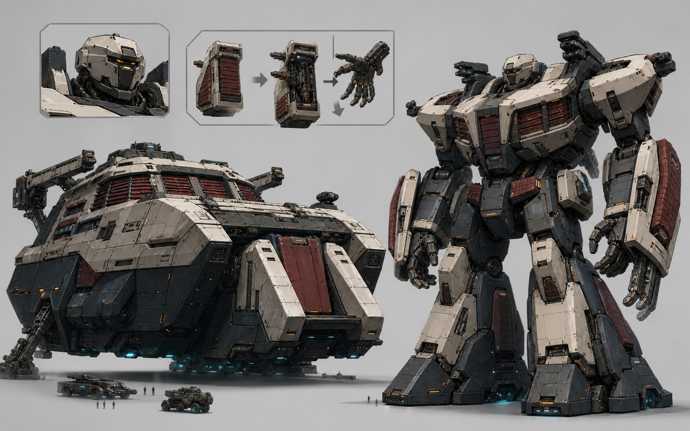

# A23 万机馆双形态｜用户视觉确认入口

> Status: `USER_REVIEWED / TRANSFORMATION_FORM_DIRECTION_ACCEPTED / OVERALL_NOT_ACCEPTED / REWORK_REQUIRED / CANDIDATE_ONLY`
>
> 这不是 Canon、Runtime 或 Godot 资产。

## 用户裁决

- 低矮巡展体→巨型人形的形态方向：`ACCEPTED_DIRECTION_ONLY`
- A23 Call01 整稿：`NOT_ACCEPTED`
- 退回原因：`MILITARY_OVERREAD / HEAD_GENERIC / ABOVE_GROUND_MUSEUM_IDENTITY_MISSING / GROUND_UNDERGROUND_MAPPING_UNPROVEN`

本页保留为送审历史入口。后续只允许定点结构返修；返修稿未明确获批时不得下游接入。
