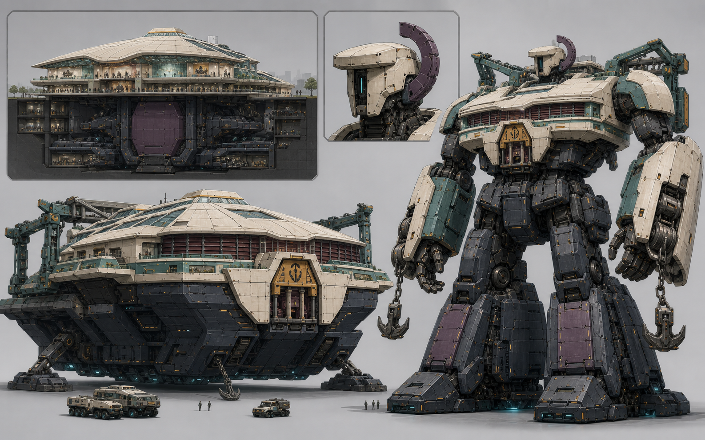

# A23 Call02 万机馆定点结构返修｜用户已退回历史稿

> Status: `USER_REVIEWED / OVERALL_NOT_ACCEPTED / REWORK_REQUIRED / HISTORICAL_CANDIDATE_ONLY`
>
> 只保留形态映射证明；本张不得作为后续正向像素母版，也不是 Canon、Runtime 或 Godot 资产。

## 用户裁决

- 整稿不接受：方盒、工业堡垒和纯军事工程体首读过强，丢失现代高科技展馆与优雅巡展舰的流线。
- 头部方向不接受：巨型偏心环＋竖槽没有形成万机馆专属、帅且可持续深化的头雕。
- 只保留固定馆→巡展舰→未来人形，以及地上馆冠／地下 B1/B2 的同一部件映射。

Call03 返修仍须停在用户视觉确认门；未明确批准时，不进入正侧背定稿、Godot、Runtime 或 Canon。
