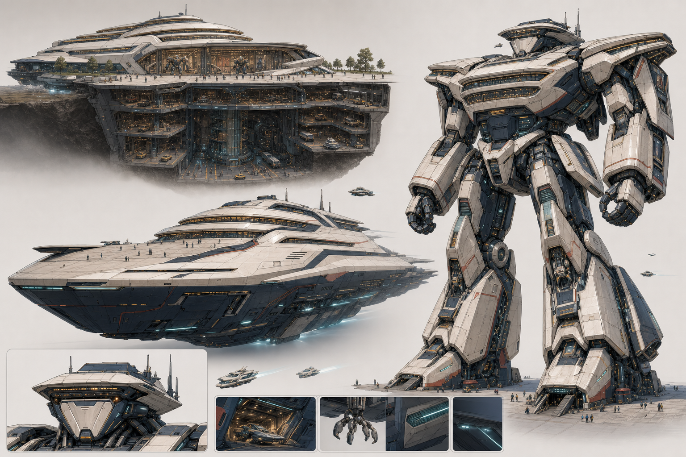

# A23 Call03 万机馆现代展舰返修｜用户确认门未开放

> Status: `NOT_OPENED / SECTION2_INTERNAL_HARD_GATE_FAIL / SEALED / CANDIDATE_ONLY`
>
> 本页不是请用户从失败稿中选方向；它只记录为何 Section 2 没有把 Call03 冒充可批准候选。

## 已改善

- 固定馆重新一眼可读为可进入的现代机器人博物馆，并表现出远大于地上馆的地下母体。
- 巡展舰恢复长、低、深、连续收尖的现代流线；舰首、航向、飞船体量和大型游艇级精致度成立，不再是 Call02 的方盒工业堡垒。
- 未来人形有明确实体无脸头，地上馆冠／地下 B1/B2 的主质量映射可以追认。

## 封存原因

- 巡展舰馆冠、人形头部及胸肩仍呈现连续发光玻璃／展窗带，没有明确闭合装甲百叶或闸门。
- 巡展舰的公众入口／展廊入口首读弱于飞船和大型游艇首读。

因此本次停在 Section 2 内部硬门，不提出用户视觉问题，也不进入 Godot、Runtime 或 Canon。
