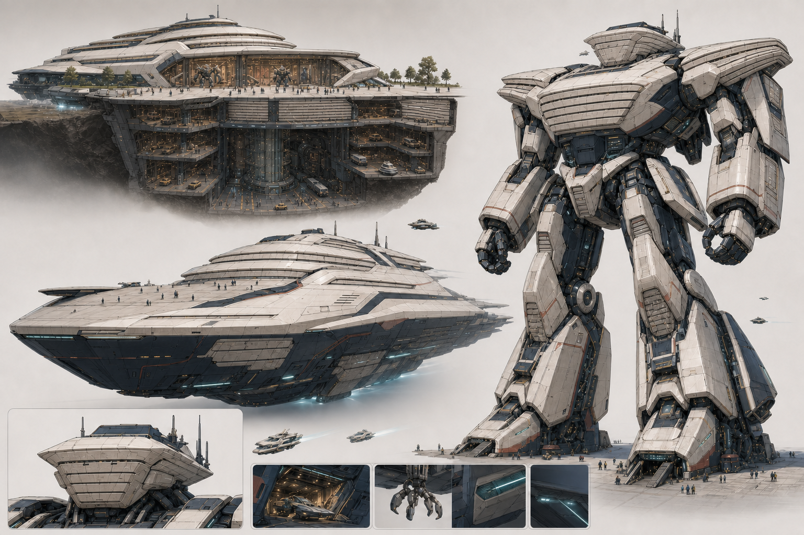

# A23 Call04 万机馆现代展舰与装甲闭窗｜用户选定深化母版

> Status: `USER_SELECTED_AS_CURRENT_BEST_MOTHERBASE / REFINEMENT_REQUIRED / CANDIDATE_ONLY`
>
> 本张正向锁定整体调性与身体／展馆／展舰基础，但仍不是最终 Canon、Runtime 或 Godot 资产。

## 用户裁决

- 本张是目前最好的母版。
- 必须保留现代可进入展馆、白色流线馆冠、优雅展舰、巨大深色 B1/B2、青金点缀、三态构图、人物尺度和战斗态装甲闭窗。
- Call06 只深化：较小的日式机甲指挥头、由公共馆门转译的标志性胸甲、有限近防／救援／投放暗示，以及可追认的同源变形机构。

Call06 未获用户确认前，不进入正侧背定稿、Godot、Runtime 或 Canon。
