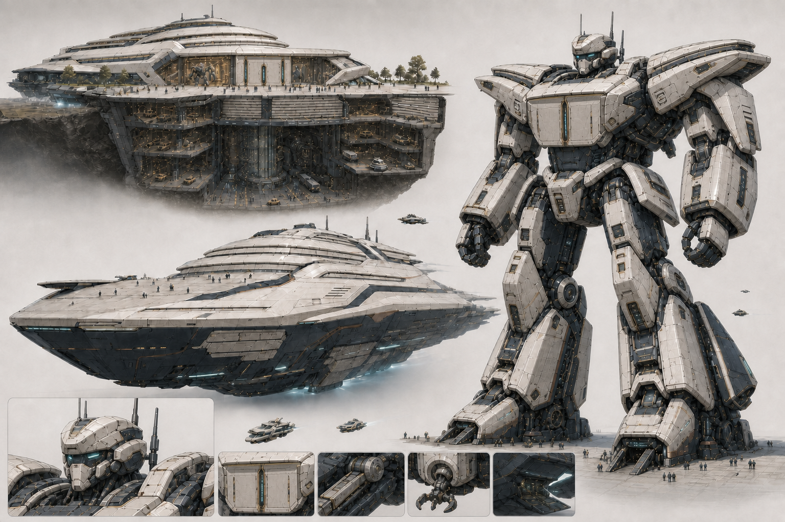

# A23 Call07 最终胸门同源编辑｜用户确认门未开放

> Status: `NOT_OPENED / FINAL_SECTION2_HARD_GATE_FAIL / NO_FURTHER_IMAGEGEN / CANDIDATE_ONLY`

- 固定馆入口和人形胸甲已形成横门楣、左右门板与中轴青线的同源关系。
- 展舰没有画出对应的双门合缝／锁止线，三态映射只完成两态；底部锁定 inset 也发生变化。
- 因此不向用户提出视觉选择。Call04 继续是用户明确选定的当前最好母版，Call06／Call07 只作内部失败诊断。
