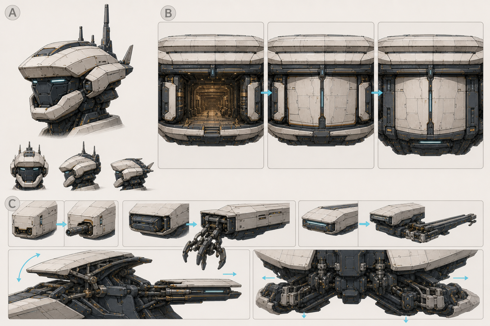

# A24 万机馆局部部件与三态映射｜用户视觉确认入口

> Status: `PASS_FOR_USER_COMPONENT_VISUAL_REVIEW / CANDIDATE_ONLY / USER_APPROVAL_MISSING`

## 本张只确认局部，不替代 Call04 整机

- A：较小的独立机械头、双传感眼、非对称天线／头冠。
- B：同一低宽双层馆门在固定馆开放、展舰闭合、人形胸甲闭合三态的映射。
- C：收纳式有限近防、救援抓持头／绞盘、作业梁，以及馆冠和 B1/B2 的铰链／导轨／锁销提示。

Call04 继续是整机调性母版；本张未接 Godot、Runtime 或 Canon。详细血缘、风险和制作人首读见 `receipts/A24-SECTION2-USER-REVIEW-RECEIPT.md`。
