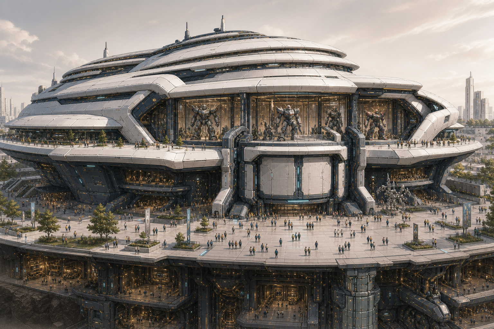
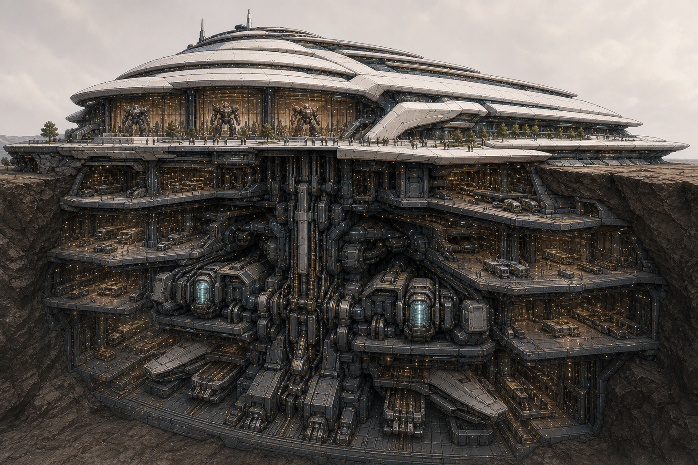
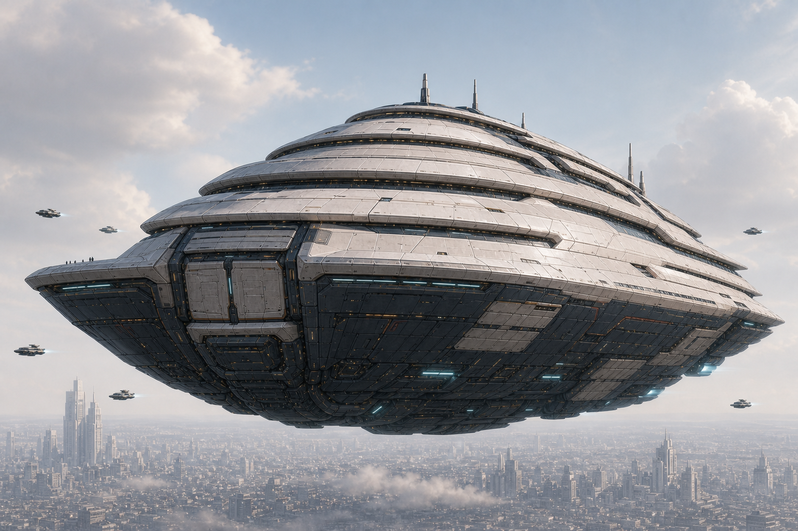
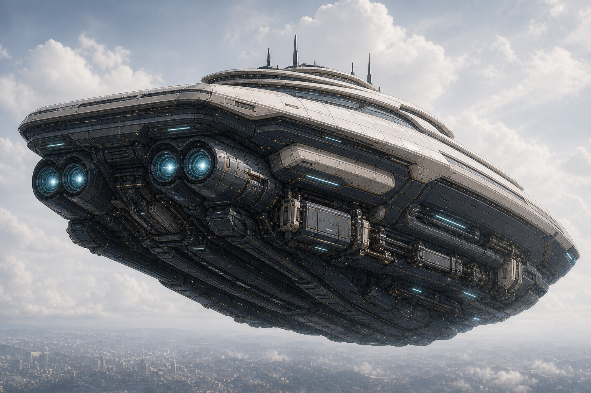
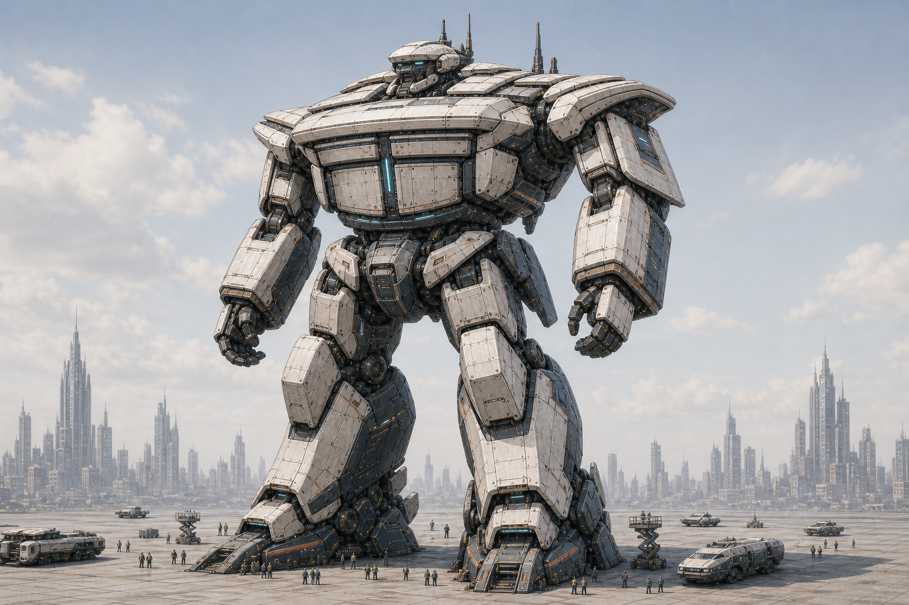
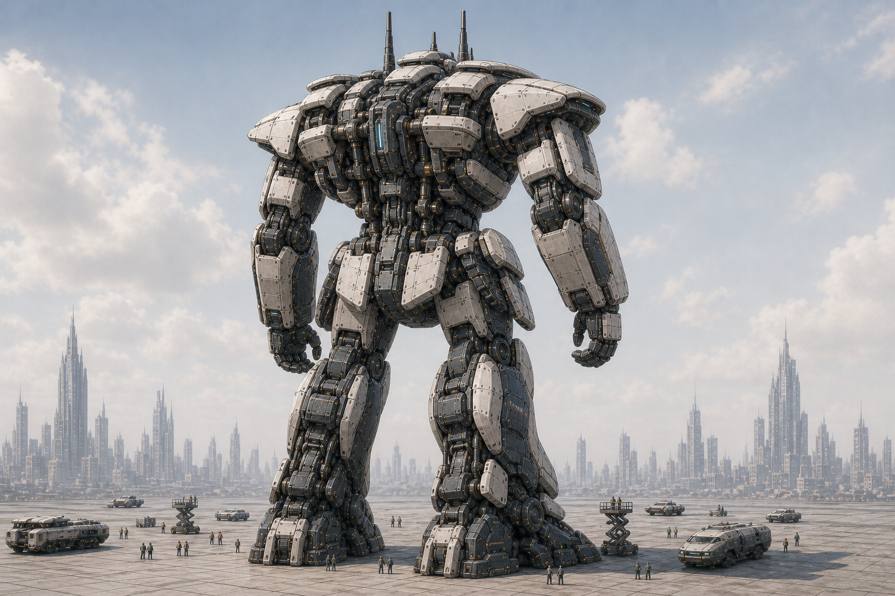

# A25｜万机馆六张独立稿用户目视确认页

状态：`CANDIDATE_NOT_USER_APPROVED / HUMANOID_05_06_TARGETED_REWORK_REQUIRED`  
Runtime：`false`

## 2026-08-24 最新用户裁决

- 用户基本同意此前制作人判断：固定馆 01／02 是本组六张中最成立的正向结构源；巡展舰仍略显通用飞碟，人形与展舰／馆体的机构映射仍不足，所以整组没有获批。
- 人形 05 正面过宽、过壮；06 背面与 05 的肩胸、髋、膝、脚包络不一致，视觉上像两套比例。
- A25 人形上半身方向问题较小，A24 已成立的小型双眼指挥头、非对称天线、双层馆门胸甲与馆冠语言继续保留，只允许为统一比例做必要收窄。
- 人形下半身，尤其小腿的大块普通机甲甲片和放大机器人鞋，无法追认固定馆的地上／地下模块，也不符合巨型馆体机器人的承力结构，必须重构。
- 本次裁决只授权 Candidate 窄返修；不批准 05／06，不批准整组六图，不接 Godot、Runtime 或 Canon。

完整逐项回执见 `receipts/A25-HUMANOID-PROPORTION-AND-LOWERBODY-USER-DECISION-20260824.md`。

## 01｜固定馆·公共入口前侧三分之四

## 02｜固定馆·后侧／侧后地下剖视三分之四

## 03｜巡展舰·前侧三分之四

## 04｜巡展舰·后下侧三分之四

## 05｜未来人形·前侧三分之四

## 06｜未来人形·后侧三分之四

## 请用户裁决

1. 六张图是否可以视为同一万机馆的三形态、两方向整体母版。
2. 人形小头、双指挥塔眼与非对称天线是否已达到所需的日式机甲特征强度。
3. 低宽双层馆门胸甲是否足够成为万机馆的标志性胸部识别。
4. 巡展舰的有限武装暗示是否足够；若加强，只加强微型近防与救援／作业装置，不新增主炮和导弹阵列。
