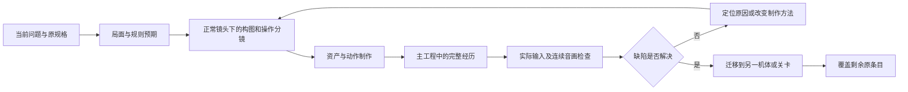

# 游戏制作方法与工程约定

方法修订：`GAME_PRODUCTION_METHOD_20261012_R2`。适用于本项目的游戏原型、关卡、机体、战斗、界面、演出和资产生产。2026-10-12 按用户要求整合制作方式审查，并区分通用方法与当前 Demo 任务。本文件规定后续怎样制作和判断，**不表示这里描述的工程改造已经完成**。

沿用当前 Canon、Reader、美术方向和已批准的任务范围。正式剧情的阶段仍由六层看板与 story-chain 决定；Candidate Demo 不推进正式剧情验收。新方法不批准另建游戏框架、不自动授权外包或增购服务、不自动委派其他会话。

| 内容 | 唯一放置位置 | 更新时机 |
|---|---|---|
| 怎样制作、选工具、组织工程和判质量 | 本文件；批次模板提供记录格式 | 方法暴露缺陷时 |
| 身份、美术方向、具体玩法及质量要求 | 对应 Canon、视觉标准、原设计规格 | 依其权威与用户决定迁移 |
| 一个任务的施工次序、具体局面、镜头试值和代码接入 | 该任务的施工规格 | 安排或调整施工时 |
| 当前在做什么、失败历史、下一位置、实际完成状态 | 该任务已有台账及其引用的批次记录 | 每次实际尝试后 |

任务的某台机体、某张地图、某个镜头数值不能成为全项目默认；方法中不维护运行版本或当前批次。方法更新也不能重置已有工程、补写他人的观察或自动迁移旧评审。

## 1. 每次开工先确定一段玩家体验

范围清单回答“最终要覆盖什么”；当批工作回答“玩家这一段怎样变好”。每批使用一份[体验批次记录](体验批次模板.md)，可直接合入现有批次报告，多包引用同一文件，禁止为每个包复制一套表。

先打开当前工程、当前问题所对应的原条目和实际运行证据。已经完成且可靠的部分复用；历史截图、报告中的判断与当前已复现问题分开。写清这六件事再开始大量制作：

1. **玩家问题**：具体卡在哪里，例如看不出哪次攻击会毁桥，或踢腿看起来反关节。
2. **完整经历**：起始局面 → 玩家实际输入 → 即时反馈 → 行为与结果 → 下一次可做的决定。选一个有明确终点的过程。
3. **原要求**：引用现有编号、章节及调整决定，不重新概括出一个更小的目标。
4. **质量基准**：使用真实参考和当前正常镜头；注明哪些是既定要求，哪些只是待比较的设计假设。
5. **工程边界**：复用什么，改哪一层，哪些消费者受影响，用哪个不同局面检验通用性。
6. **退出条件**：本段何时可以推广；哪些缺陷会要求换方法；尚未覆盖的原范围在哪里继续。

原生输入不可用时，继续可独立完成的制作，保留输入检查缺口。不能用程序注入命令填成已经完成原生操作。

同一时段集中完成一段体验。必要的规则修复、工具修复和依赖可以穿插，须说明它使这段体验哪一步成立。并行只是一种资源安排，不能把几个各自未完成的子系统拼成批次完成声明。

**执行顺序是：体验与取舍 → 正常镜头/操作分镜 → 专业制作件 → 主工程完整过程 → 实际输入与连续音画 → 质量判断 → 修正或推广。** 做完规则或局部修复时回到这条线，不重新挑一项容易计数的工程工作。资产、动作或工具的独立制作是这段体验的工序，不能反过来代替其终点。

在原台账用`production_focus`记录这段体验的目标、终点、当前步骤与批次引用。每项工作标明属于`experience`（直接制作）、`blocking_dependency`（证实会阻断本段的依赖）或`maintenance`（其他维护）。阻断工作给出现象、证据和恢复主线的位置；其他维护仍留在原范围待办。修一次热点后回到实机，不为取得更好测试数字连续开启合批、缓存或几何校验批次。输入延迟、严重掉帧、可访问性退化确实阻断体验时照常修复。

## 2. 工程按职责演进，逐步消除场景特例

先检查现有实现，再沿已有接口调整。以下是职责要求，不是要求新建同名类或整体重写。

| 层 | 必须负责 | 不应承担 |
|---|---|---|
| 身体与能力数据 | 占格、移动方式、质量/承重、工具、装备、资源、抗性；能力有来源与装卸条件 | 因角色显示名或剧情台词临时获得通用能力 |
| 效果与命令规则 | 目标合法性、费用、伤害、位移、支撑、状态、地形响应；返回明确失败原因 | 在 HUD 或动画回调里另算伤害、扣资源、决定胜负 |
| 局面与任务配置 | 地形/对象初态、目标、公开增援、跨区依赖与阶段条件 | 复制一份规则引擎、按地图名字给同一效果不同隐藏含义 |
| 预测与事件结果 | 从相同状态版本得到结果、原因、受影响对象和阶段；提交时重新核验 | 预览偷偷改存档；敌人已公开意图在玩家操作后无提示换目标 |
| 呈现与交互 | 把同一结果用于光标、路径、血槽、位移、碰撞、动作、声音和回放 | 只凭技能名字猜动画；为演出效果改变已经承诺的规则结果 |

工程接线原则：

- **一份意图输入，一份合法性判断。** 地图点击、头像、快捷键、自动走近使用同一命令入口。实际输入先进入自由探索/选中走位/选招/执行/相机手势等明确状态；Ctrl 手势直到释放独占输入，不能漏发棋盘点击。
- **预测、执行和回放共享规则语义。** 预测用冻结状态的副本计算，执行验证状态版本并提交，回放消费已记录结果；动画快进与跳过不会再结算一次。异步预测结果只应用于它所对应的当前状态和光标目标。
- **空间规则独立于画面比例。** 单格小型、单格标准、2×2、3×3和局部巨构可分别呈现；路线、扫掠、承重、净空和落点都用完整占格计算。平滑移动沿合法路径表现，不能为好看穿墙或改变费用。
- **效果先看对象性质。** 同一推移、盾、火焰或爆破对敌我、设施、地形如何生效，由对象的抗性、接口和规则决定；例外应有可检查的性质来源。任务可以引用对象 ID 指定目标，核心效果不能按剧情 ID 开后门。
- **跨区因果是数据关系。** 区域间的供能、道路、支撑等依赖引用设施和接口，事件保留来源、目标、前后值与原因。跨区提示、目标读数和场景状态消费同一变化，不能只改任务文字。
- **费用和持续时间分别表达。** 移动额度、主行动、备件/弹药与跨轮准备各有来源。一次动作何时支付、何时生效、能否取消及取消后保留什么，必须能在提交前获知。

每次新增或修复通用机制，至少安排一个与当前剧情不同的有效用例和一个失败反例。优先换对象、阵营、地形、占格或局面配置；检查无需添加角色/地图名称分支。借助临时测试数据，不改正式机体身份来做试验。

通用性不要求先抽象全部引擎。先在既有接口修通，再用第二种情境证明边界；存在真实差异就增加明确能力或性质，不为了统一把所有招式做成同一招。

## 3. 机体、敌人和关卡围绕选择设计

机体能力表至少把以下内容连起来：身份依据、身体规格、装备/工具、可作用的对象、费用/时机、主要效果、反制条件、招牌动作与表现资产。工程机的维修必须来自工具；飞行来自机体/装备能力；拳、掌、刀、导弹、贯穿射线要有各自作用与呈现。

允许共享基础能力；差异应体现在站位、范围、时机、成本、风险和配合方式，不靠改名字或为每台机体强造一条孤立规则。更换编队时检查玩家的实际选择如何变化。

敌人制作同时定义：可辨识的轮廓、移动/占格、意图绑定方式、准备/执行/恢复阶段、可用反制、增援预告与出生失败规则。意图图形必须指向真实目标或方向，不能只有编号和说明文字。

关卡元素以用途组合：阻挡、推移、承重、导电、危险、可破坏、可保护、可操作等。每个新增元素必须至少参与一个实际决策，并有清楚的形态和状态反馈。不能以填满空格或增加元素数量作为丰富度指标。

玩法检查分三层：

1. **成立**：替代方案在同一初态下合法，费用、当前结果、敌方/环境阶段和下一轮局面均算清楚。
2. **看懂**：玩家能指出目标、主要威胁、这一手改变什么以及不作为的后果。
3. **有取舍**：至少比较原规格要求的不同方案，看是否存在不同代价、风险和后续机会；换机体/换局面后仍可组合。按钮数量、可通关和自动通关不证明乐趣。

测试预期从批准的规则独立推导。报告中的解法也需复算；不能为符合报告里的例子，悄悄修改现行护盾、损失或落点规则。

## 4. 美术生产先在真实镜头中成立

美术方向继续读取[当前 Working 标准](art-direction-v0.3/visual-standard-20261010.json)和其指向的真实参考。角色身份母版与制作标准分开，标准变化不自动认可某个 Runtime 资产。

按以下次序生产：

1. **确定视图任务。** 默认决策镜头要同时看清可操作对象、路径和主要威胁；总览用于跨区调度；近景用于有价值的接触与演出，并能回到原决策位置。
2. **灰模验证构图。** 检查建筑与机体相对体量、道路/渠/平台剖面、前中后景和遮挡。现代城市通过楼层、窗带、结构与基础设施表达，不能在机甲旁堆小屋来凑建筑数。
3. **确定材质分工。** 用真实尺寸的结构、UV、材质尺度、绘制痕迹和明暗组织区别混凝土、涂装金属、玻璃等。地形高差需要几何和阴影支持。换色、加线和调亮不单独算场景重做。
4. **制作可维护的资产。** 源图检查结构/左右/装备连接；必要时图生三维，再修整网格、分件、UV、贴图、关节和绑定。保留可编辑源文件、导出方法和运行时实际加载路径。模块化或程序制作可用于适合的物件，不能成为降低目标精度的理由。
5. **同镜头检查后推广。** 在实际 HUD、光照、常用分辨率及连续动作中检查；看清轮廓、接触、材料和状态后才扩展资产家族。角色各有自己的英雄色，环境与战术标记分工，不统一洗成一套青灰涂装。

Fable 提出的占屏比例、描边像素、饱和面积和常驻字数是候选比较参数，不自动成为全项目硬指标。已批准的清晰度和性能门槛仍执行；改动它们须说明真实理由与影响。投影占比要量实际画面，不能直接用机体米数除镜头尺寸替代。参考插画不应被当成与实机完全相同的相机投影。

“候选”必须进入当前任务的实际比较并作取舍，不能成为一直保留旧画面的理由。制作前列出本段的**实测基线、目标/试值、单位、测量区域与依据**：单位投影高度、可见格数、轮廓线宽、环境/单位的明度和彩度分布、HUD占屏与常驻文字。所选指标须对应玩家问题；不适用的项写明理由。正常画面应同时检查关HUD、正常、悬停、瞄准、受损五种状态；无此状态的内容引用其实际状态。灰度和轮廓检查是诊断手段，不取代彩色实机判断。

资产变化用同局面、同机位、同分辨率和HUD条件对照；镜头本身变化时，保留相同局面/分辨率/HUD，明确记录前后相机参数和变化目的。不得为了“同机位”隐藏镜头改动，也不得换局面制造改善。

### 制作工具与实际产物

| 内容 | 制作工序与必须留下的源 | 游戏侧职责 | 无效时改什么 |
|---|---|---|---|
| 场景与建筑 | 在 Blender 或合适场景编辑器中做正常机位灰模；楼层、门窗、渠壁、地坪剖面有可读结构；模块分件、UV、损毁态和布局源 | 读取布局与kit、切状态；临时盒子只能用于灰模 | 镜头或体块读不清就重做构图；不在旧浮板上继续加小件 |
| 材质 | 依真实参考分别制作混凝土、涂装金属、玻璃等材质家族的atlas与源图；检查UV尺度和实际引用 | 同一画法下装配材料与光照 | 同色同质就改绘制、材质和明度层，不靠曝光补救；同图复制成多个文件不算分家 |
| 机体与敌种 | 合格模型先复用；按身份母版修涂装、轮廓、结构；不合格处再图生三维、Blender修整和绑定 | 正确加载分件/材质/骨架，显示规格与规则足迹分离 | 远景不可辨先改剪影与色块；不能靠更多面数、名字标签或统一洗色 |
| 动作 | 参考或动作库重定向→IK/支撑与手型→关键帧/重心曲线→剪辑与事件标记；保留可编辑制作源 | 读取剪辑事件、挂点与结果；导出脚本负责可重复导出 | 同一招仍僵硬就换动作基础或关键帧方法；不能继续批量数值摆姿势、改名调速 |
| 特效与产物 | 按分镜制作道具、展开/损毁态、预制特效、命中与环境响应 | 同一事件驱动接触、位移、破坏和残留 | 查产物来源与接触；不能让墙、钻头凭空出现 |
| 声音 | 找合适且可使用的采样，制作瞬态/材料/低频/尾音层并混音；合成适用于UI/能量等需要 | 按事件播放、随机化与混音控制 | 合成音重复无重量就换采样与层次；不能仅改音量或只查波形 |
| HUD与图标 | 先做默认/探索/选中/瞄准/执行的版式；矢量源、图标、Theme及可编辑场景组件 | 绑定状态与数据，少量动态创建 | 主次不清就改布局与图形承接；不继续逐个Label拼面板、缩字塞信息 |

程序化生成、`bpy`、图像生成和自动导出都可以使用；判断依据是实际产物和效果。先看参考、源结构及正常镜头，再推广同类资产。不能把“支持这种工具”写成已经使用，或把生成源与运行加载件断开。

**2026-10-12 用户补充的环境制作路线：** 全环境建筑，以及棋盘内的楼房、电力设施、工程设施、列车等静态或简单运动对象，统一先出符合当前美术标准的设计图，再由设计图制作低多边形轮廓、UV、贴图和材质。生图承担样式、材料、立面和细节设计；建模把设计落实为空间，不再默认凭文字用程序堆最终建筑。已有合格建筑可复用；纯程序体块用于灰模与结构验证。轮廓、遮挡、可走高差、明显凹凸及破损保留实体，窗框、接缝、磨损等小尺度细节优先进入贴图。开关、闸门、吊臂、转盘、列车车轮等按需要分件，用简单平移/旋转响应相同规则事件，不套用机体完整骨骼流程。图生三维只是可选工序，不要求每座楼调用生成服务。低面数之外仍检查材质数、绘制调用和纹理预算，是否节省资源以运行量测为准。

## 5. 动作、特效和声音作为一次行为共同制作

**2026-10-12 用户补充的复用边界：** 常规待机、行走/奔跑、交互、推物、举持、投掷、射击与受击优先使用已有合格动作或可使用的标准动作库。先建立动作家族与骨架映射；每种骨架/体型做一次基础适配，按装备补挂点、手型或局部姿势。不得默认逐机重做每个标准动作，也不以双方机体组合维护接触参数表。定制制作集中于体术机及体现身份的招牌动作；具体招式名单属于任务规格。

规则事件先确定作用对象、方向、效果和终态；出手者、受击者、环境和特效各自消费事件、播放自己的状态。共享参数可包括动作家族、轻重受击、目标高度档、武器挂点、有限朝向与伸手修正。演出接触允许合理近似，正常镜头下表达清楚、有力度、无明显反关节/严重穿插即可；不把逐对贴面、毫米级接触或连续物理碰撞作为常规制作门槛。规则层的占格、费用、命中、位移终点及预演一致性仍须准确。旧精密接触证据保留为诊断，不据此扩大所有动作的制作要求。

普通设备操作以“手部示意→设备状态动效→可见规则后果”完成表达。灯光、开关、能量流或短状态变化已能说明时，不继续制作打开机柜、内部维修接线、手指抓握准确开关等模拟细节。小活动件只是可选表现手段；不能让它们的精密调校挤占整体美术、战斗表现和操作手感。

每招先完成“预备—作用—结果—恢复”的连续分镜，给出身体、道具/武器、命中对象、环境、相机、HUD与声音的对应关系。分镜时长是演出，不另发一套规则拍数。

标准动作可以引用同一份家族分镜与源剪辑，再列本招的事件时点、武器、效果和例外；不要求为每台机体重复生产整套骨骼剪辑与文档。

分镜用同一时间表对齐身体、产物、特效、声音、规则事件、相机、HUD七条轨。产生实体或承担重量的动作要表达取件/施力、落地或承重、收势及残留；普通设备操作沿用上述手部示意与状态反馈，不附加这些实体制作要求，也不是每招都强套七拍。记录实际剪辑的作用/结束帧；有离手、接触的动作再记录对应时点。表格和事件同步通过后，仍须检查正常速度下动作是否自然、有重量且可辨认。

- 从合适的参考动作、可用库剪辑或现有合格动作开始；重定向后检查支撑脚、转髋、膝盖方向、手型和装备净空。需要修关键帧和曲线时实际修整并保留源文件，不靠换名或调速交差。
- 以机体真实挂点和接触关系驱动钻头、拳、刀、炮口、墙体、支撑点。产物在哪里出现、怎样离手机、怎样着地和承担作用必须连贯。
- 特效按效果性质分家：贯穿路径、爆炸范围、推移/碰撞、持续燃烧、护盾吸收等，各自解释发生了什么。夸张程度服务于招牌识别和打击感，不遮掉目标及最终落位。
- 声音明确预备、发动、接触、环境余响与结果层次。可以采样、合成或组合，但须在游戏混音中实听；文件存在、波形无削波、离线导出成功都不证明听感。
- 接触、状态变化、环境响应与声音使用同一事件来源及显式呈现时点。旧回调逐步迁移，不再在动画、HUD和规则三处各写一份触发判断。
- 正常播放检查连贯与力度；快进和跳过检查最终状态、镜头返回及音效停止。固定帧录制不证明真实帧率，脚底误差合格不证明动作自然。

同一动作缺陷在两次有效修复尝试后仍存在，应改变参考、动作底层、分镜、工具或制作方式。失败两次是指实际制作并观察了结果；锁屏、未运行或格式错误不算一次动作质量尝试。外部人力或新增付费服务需要另行获得授权，其他可做的部分继续推进。

## 6. 界面和手感与规则一起制作

| 操作状态 | 首要呈现 | 退出与保护 |
|---|---|---|
| 自由探索 | 随光标的对象反馈、一行摘要、可展开的详细信息；可探索地形/设施/敌我 | 无需先进入菜单；浮窗不挡目标和光标 |
| 选中走位 | 当前移动范围、连续路线、合法终点和费用；大机显示完整足迹 | 左键提交安全合法移动；右键回探索；非法目标说明具体原因 |
| 选招预览 | 真实目标、受影响范围、血槽变化、位移箭头、碰撞/落水/失效及被取消的威胁 | 右键回走位；必要的高代价确认只覆盖明确风险，不能层层确认普通动作 |
| 执行/敌方阶段 | 当前行为和后果可跟随；重要跨区变化有来源与目标；结束后回到决策状态 | 正常/快进/跳过一致；镜头不能无故夺走输入或丢失选中对象 |
| 相机手势 | Ctrl 与鼠标组合独占缩放/拖拽，保持用户既定操作语言 | 无论先松 Ctrl 还是鼠标，都不补发移动/攻击命令 |

常驻 HUD 保留当前目标、阶段和会影响决定的资源；其他信息按对象和状态出现。删文字须有清楚的图形承接，红点不能代替威胁目标和剩余条件。符号与形状补充颜色，字体/对比、减少动效、快捷键与输入响应从首段体验开始检查。

性能伴随制作：测实际输入到反馈、悬停/预览尾延迟、真实帧时间及场景切换。先定位规则重算、实例创建、资源加载、绘制或动画热点，再优化相应位置；不通过减少原定表现或延长时长把卡顿“测没了”。

## 7. 质量判断与工作记录

既有批次报告保留三个不同结论：工程/规则验证结果、体验质量判断、用户认可。作者应说明可见变化及缺陷；独立复核写清身份与实际查看内容。独立模型审查可以发现问题，但不能冒充人类首玩，未实听不能填实听。没有复核时保留未复核状态，不让用户承担每批基础查漏。

体验复核围绕三个问题：**最危险的对象/事件是什么；这一手为什么改变结果；还留下哪项风险或下一选择。** 保存实际回答和观看/操作范围，不能由作者代答再标为非作者。视觉、动作和声音的质量结论要有实际评审者、查看的媒体、时间段及具体发现；`listened:true`或“明显改善”本身不够。工程检查可先通过；独立质量检查缺失时，完整体验不通过，继续可独立进行的制作。自动检查只能验证记录及测量条件，不能证明评审者诚实或代替审美判断。

量化检查用于发现问题和防止退化。文件数量、测试数量、资产占比、文字数量和单帧截图均不能单独关闭质量项。已有“通过”若被连续音画或真实输入反证，应重开相应缺陷。

每批结束只更新现有台账中的：可观察变化、核验入口/证据、未过项、已尝试方法、下一施工位置。共享缺陷只保留一个当前记录，其他报告引用它。原需求表保留来源与采纳决定；当前实施状态以施工台账为准，覆盖页引用它，不维护多套互相矛盾的完成百分比。

**重复失败必须改变后续行动。** 在同一台账的`defect_ledger`里，按缺陷保留有效尝试：批次、具体方法、观察结果及证据。`observed=true`且结果为`persists`才算一次已观察的未改善；锁屏、未运行、缺证据不计次数，也不计改善。连续两次仍存在时，记录`method_changes`的旧法、新法、原因、复测方法和对应失败；下一次实际制作须采用新法。`planned`只表示安排；`applied`须有制作证据，质量是否改善仍看之后的观察。第三次仍失败时改动作基础/资产组织等更深层制作方式；达到自身能力或工具边界时准确记录，需要外部协助再说明具体资源，不能自动外包或让用户重述任务。

检查工具要列出待换法项，并拒绝把“重复失败且尚未实际换法”的相关评审登记成通过。修复命令仍可运行，不能因缺陷未解决把修复本身锁死。历史证据缺失时保留“次数未确认”，不按批次名称、重复文字或本次回顾虚构尝试次数。

恢复工作先读当前批次与缺陷，再读本段体验引用的原规格/参考和上一轮结果。涉及新增专业或范围时读取对应原条目；不能只凭摘要续作，也不必每次重读整套报告。每次实际尝试都核对是否仍在解决同一玩家问题。

内部基准通过后迁移到其他机体、地图和任务，逐条覆盖原范围。专关与实验沿既定进入/退出条件执行；第一段体验合格不改变最终范围。真正的外部阻碍明确保留，不能改称完成。

## 8. 与制作方式审查的整合结论

来源：[制作方式审查](../work-packages/2026-10-02-chao-gag-linked-operation-candidate/制作方式审查-20261011/README.md)。下表记录方法的采用情况；实际作品是否达到要求仍查任务台账。

| 审查要求 | 原约定已有内容 | R2补强及放置位置 |
|---|---|---|
| §1/§9/§12：完整体验串行推进，保留全范围 | 第1节已有完整经历与范围分离 | 补`production_focus`与工作分类，阻断修复完成后回主线；任务次序放任务施工规格 |
| §6：正常镜头、墨线、色分工和HUD可测量 | 第4节只有原则及候选参数说明 | 补实测基线/目标/单位/区域/五态；候选必须实际比较，不能无限等待 |
| §7：各专业用合适工具生产可编辑源 | 第4/5节已有源资产与加载链 | 补七类制作工序、实际产物与失败换法；不把所有内容继续变成代码拼件 |
| §8：动作与环境、声音、规则是同一行为 | 第5节已有共用事件 | 补七轨分镜和接触帧内容；同步正确与动作好看分开检查 |
| §11：作者不自证质量，记录真实判断 | 第7节已有三类结论分开 | 补三问、评审者及实际媒体范围；机器检查记录完整性，不自动授权调用其他会话 |
| §11/§12：两轮无改善必须换方法 | 原来只有一句原则 | 补有效尝试定义、唯一缺陷记录、planned/applied区别、机械核对与恢复位置 |
| §9：具体六段任务、B街区/造墙/跨区例子、镜头试值 | 混在通用方法和任务安排中 | 统一移到任务施工规格；不能把B区或固定像素数设为全项目规则 |
| §9/§10：冻结跑偏工作、必要时外部制作 | 原约定保留性能/无障碍与授权边界 | 采用“主线+已证实阻断”安排；已有范围不删，实际能力不足准确说明；不默认要求用户逐批验收 |

工务城的具体局面、代码接入与施工次序只读[05—施工与验收](../work-packages/2026-10-02-chao-gag-linked-operation-candidate/v5完整整改计划-20261008/05-施工与验收.md)及其原台账。其他任务沿本方法绑定各自来源、入口与台账。本次整合完成的是工作约定和检查接线，未制作或未验证的游戏内容仍保持未完成。
