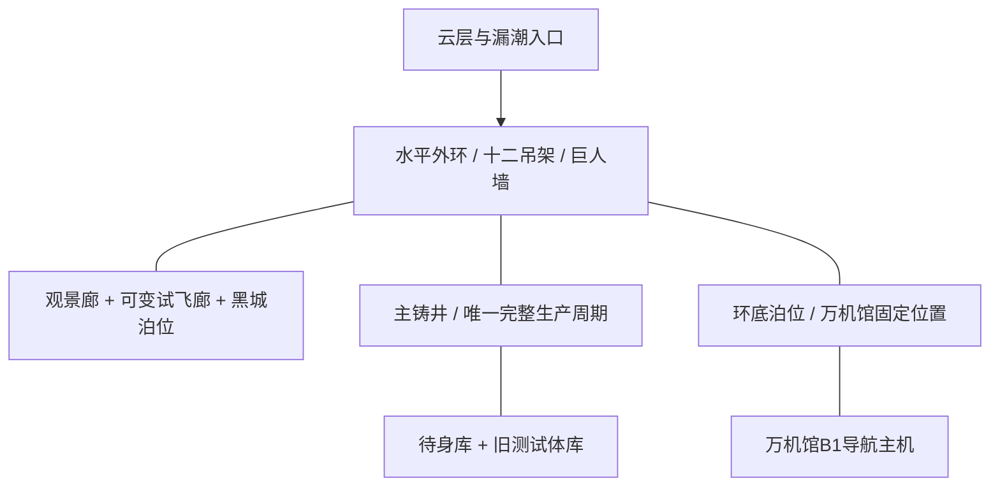
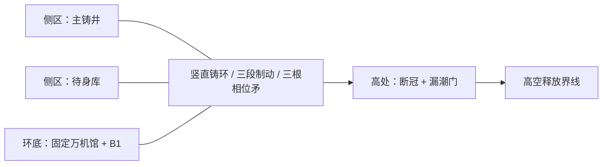

# C04章级预生产模型反向编译试验 v1

> Status: `non_canon_research / retrospective_preproduction_pilot`
>
> Date: `2026-07-23`
>
> 对象：C04当前五话Candidate。这里反向模拟“如果在写完整总纲前先做预生产模型，会发生什么”。不修改C04正文与Canon。

## 一、结论

C04必须按重量章处理。它同时包含：

- 六百米新巨构；
- 8米至80米多尺寸机体；
- 130至160米长的万机馆；
- 水平、半竖、全竖三种地图状态；
- 驾驶舱、万机馆B1、主铸井和外部巨机战交叉；
- 白鸢、纪存、七海三种新能力或权限链；
- 三旗舰、百相、断冠、白框与军方多方互动；
- 胜负直接依赖铸环地形。

若先有这份模型，当前两个block会在完整总纲生成前出现：

- `C04PF-OBJ-USHIELD`无法同时通过位置字段；
- `C04PF-ACT-PHYSDECOY`没有实体执行者和可见动作，无法进入导演板。

## 二、空间灰盒

### 2.1 水平装配态：E01至E03



### 2.2 半竖至全竖态：E04至E05



这里直接产生四条约束：

1. 万机馆在C04只能在环底固定位置支援。
2. 人类场面发生在主铸井、观景廊和舰内，不能让玩家在巨机SRPG阶段同时操作普通人穿越巨脚。
3. 断冠的大位移依赖铸环发射轴，不由百相单手完成。
4. E04与E05虽然共图，当前主要目标必须依次显隐，不能让所有图标同时常亮。

## 三、尺度灰盒

| 层级 | 对象 | 写作前结论 |
| --- | --- | --- |
| 人类 | 纪存、七海、白鸢、驾驶员与工房员 | 通过ADV、岗位支援与交叉剪辑进入巨机战 |
| 8米 | 七号公共体 | 可在巨机脚下作业，不与断冠正面对轰 |
| 14米 | 灰模零号 | 工房与冠骨内部作业 |
| 18至24米 | 馆守Z、共鸣双机、岛卫三号 | 中型主力、牵引、追击与局部防区 |
| 40至42米 | 黑城、心墙零式 | 巨型Boss外壳与生体防壁 |
| 55至60米 | 百相、潮墙巨兵 | 同一正面对抗级；潮墙更重，百相更快 |
| 72至120米展开 | 断冠本体与冠环 | 需要多机、铸环和发射轴共同处理 |
| 舰长130至160米 | 万机馆 | 长而低，不等于160米高巨人 |
| 直径600米 | 天空铸环 | 山体轴承承重，任何单机只能改变局部受力 |

## 四、四条控制链

### 4.1 纪存与百相

```text
各机驾驶员主动开放局部视野
-> 万机馆B1固定主机
-> 纪存辨认下一次交接
-> 建议传回各驾驶席
-> 驾驶员决定是否采用
-> 韩秀雅实际驾驶百相
```

### 4.2 白鸢

```text
可信传感与人物陈述
-> 白鸢提出候选动作
-> 工程/飞控编译
-> 驾驶员修改、接受或拒绝
-> 机体由驾驶员执行
-> 白框只能复制已经进入测试包的版本
```

### 4.3 七海旧许可

```text
军方伪造电子签名
-> 本地旧授权错误放行
-> 七海带来的本人实体U盾现场核验
-> 本人凭证优先
-> 她拔掉后加军用支路
-> 救援线继续运行
```

这条是推荐修订模型。它会取代“同一枚U盾同时留在本地又被随舰携带”的现稿冲突，但本试验不直接改正文。

### 4.4 断冠与白框不能串成一个观察者

```text
断冠：现实机体动作 -> 自身传感 -> 重摆阵位与物理反击

白框：上传动作图 -> 远端测试包 -> 空白骨架复现与路线保存
```

因此E04必须分别欺骗：

- 驾驶员做出可见的假汇入动作，骗断冠；
- 七海切断实时镜像，让白框只拿到冻结假图。

## 五、动作词库

### 5.1 允许承担PV与高潮

1. 心墙留空、岛卫封路、潮墙转向、百相切入。
2. 黑城从堡垒变成人形，艾达从内部开甲，米拉半变形穿入。
3. 断冠把四个旧交接位重新摆成杀局。
4. 铸环从水平转为竖直，三个战区被拉开。
5. 潮墙绕伤臂旋转、岛卫织牵引网、心墙铺斜轨、百相侧切。
6. 馆守Z用空肩牵引改变发射角。
7. 整座铸环把断冠送过高空界线，漏潮门坍缩。

### 5.2 只作因果后台

- 固定销如何松动；
- 锁扣内部结构；
- 接口握手次序；
- 几厘米的肩位修正；
- 生产设备的内部专业名；
- 局部受力数值。

这些可以进入制作附录，不承担Reader高光。

## 六、生成前已经暴露的问题

| ID | 问题 | 若在写纲前会怎样处理 |
| --- | --- | --- |
| `C04PF-OBJ-USHIELD` | 同一U盾双位置 | 直接block，先统一物件位置 |
| `C04PF-MECH-QIHAIAUTH` | 授权链受U盾冲突污染 | 不准进入导演板，改成本人U盾对抗伪电签 |
| `C04PF-ACT-PHYSDECOY` | 白鸢总图没有实体执行者 | 直接block，先指定三旗舰驾驶员的假动作 |
| `C04PF-ACT-HANBACKUP` | 韩秀雅输掉HERO主张后没有主动行动 | warn，补角色动作而非尊重选择台词 |
| `C04PF-ACT-FINALCOMBO` | E05机制并排过多 | warn，改为分阶段显隐和路线替代步骤 |
| `C04PF-PREVIS-*` | 缺少统一尺度、双态地图与关键奇观图 | warn，进入总纲前完成低精度预演 |

## 七、资产边界

### 必须拥有独特资产

- 天空铸环水平/竖直双态；
- 百相、三旗舰、断冠、黑城与共鸣双机；
- BODY路线共享骨架及四种差分；
- 馆守Z空肩牵引背架；
- 四红标、假图冻结和实体凭证对照的最低UI。

### 应复用

- 万机馆舰内B1、战术席和外泊；
- 既有社勇王、旧拳王、货柜领袖、无牌一号；
- 工房通用模块、吊架、维护轨和驾驶舱模板；
- E04与E05同一竖环地图。

### 不值得独立命名或做资产

- 只为解释一次动作出现的锁舌、回弹件、接收架和路由槽；
- 玩家看不见差异的多种内部控制模块；
- 只能用旁白说明用途的一次性装置。

## 八、重量章预演清单

进入C04正式演出规划以前还需补四项低精度产物：

1. 人物、8米至80米机体、万机馆和铸环的正侧尺度轮廓；
2. 水平与竖直两态灰盒地图；
3. 纪存、白鸢、七海与断冠四条控制/观察链；
4. 巨人墙、首套接力、黑城开甲、冠环再演、竖环、第二合击、反发射、破晓八格奇观板。

本文件已经完成第2项文字灰盒和第3项逻辑灰盒；第1与第4项应由美术/导演预演任务补充，不在剧情梗概中临时用机械说明代替。

## 九、试验裁决

章级预生产模型能够比现有“写完总纲再补三板”更早发现C04真实问题，而且没有要求重写已经成立的机体、人物和关系高光。

因此它应进入第四层正式生产顺序；C04先按模型关闭两个block，再重跑Creative Compiler。C05必须从章引擎后先建预生产模型，不得直接扩写总纲。
