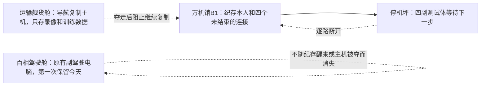
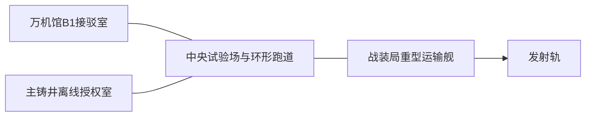

# C05章级预生产前向回放 v1

> Status: `non_canon_validation / forward_replay_root_block_closed / reader_not_authorized`
>
> Date: `2026-07-23`
>
> 对象：C05《百相夺体，巨人里醒着另一个人》当前第四层Candidate。
>
> 目的：不用C05现稿反推“为什么它其实没问题”，而是从C04真实出站状态、C05章引擎和现行世界机制重新编译本章可用实体、控制权、空间、动作与玩家可见证据，再检查当前总纲是否越过这些边界。

## 一、回放裁决

C05的章引擎成立，高光也足够强：

- 纪存与韩秀雅让百相赢下一场真正漂亮的世界直播大战；
- 一次依赖临场信任的协同被战装局拆成可批量部署的导航产品；
- 七海发现自己的旧签名被重新接回，亲手废除那张仍救过人的许可；
- 韩秀雅拒绝用两盏确认灯删除百相里的新声音；
- 艾达选择放弃旧档案捷径，米拉承担击毁记忆舱的一枪；
- 万机馆第一次作为移动母舰进入棋盘；
- 百相副驾驶在已经能够撤离时回身救人，证明自己不只是纪存的记录。

前向回放也确实抓出一个此前三板没有识别的跨章阻断：

> C04已经让七海拔掉后加军用隔离桥，并规定后续测试必须使用战装局正式权限；C05旧稿却让同一旧签名直接放行试航与外运，等于把C04结果自动复原。

本轮已作定点修复：

1. 公开试航使用战装局自己的正式防卫权限；
2. 战装局决定外运四副民用校准体时，运输组才重新装入临时军用转接盒；
3. 外运单复制七海七年前的电子签名，沈砺承认命令由自己批准；
4. 七海使用唯一实体U盾启动本人证书紧急撤销，永久废除旧许可并终止假外运单；
5. 设备过热来自四副身体仍在吊运时执行器被强制停机，不来自抽象的“真假证书互相打架”；
6. 该动作不关闭全国系统、战装局武器或民用待身库，待身库随后改用人工核验。

第二轮物理审查又抓出两处前台断裂，本轮也已关闭：

7. 外运许可失效后，战装局自己的正式试验遥控仍在线；四名远程操作员驱动四副测试体，未结束的B1请求只扭曲它们下一步的判断，不凭空让空身获得自主驾驶；
8. E05补出完整装载动作：百相先把获救试驾艇放入运输舰救援托架，再退入巨机泊架，艾达进入旁侧机位；韩秀雅接入运输舰本地驾驶，米拉只切断军方远程通信，因此百相、试驾艇和运输舰能够在同一条物理链上离场。

修复后，C05第四层可判为：

> `PASS_WITH_ADVISORY_AT_LAYER4`

但当前总纲不能直接扩写Episode Reader：

> `BLOCK_FOR_READER_COMPRESSION_AND_PERFORMANCE`

原因不是物理因果仍然断裂，而是后台必须区分的三种对象、五条人物线和四场大战仍可能被正文重复解释，令机制压过人物与机器人魅力。

## 二、最小继承

本章只需要继承以下事实：

1. C04结束时百相高55米，由韩秀雅唯一驾驶；纪存只在万机馆B1做有限多机导航。
2. 百相座舱后方原本就有实体副驾驶电脑，保留七年工程训练，但每次试车后清掉当日经历。
3. 天空铸环待身库有十二副无驾驶员、无机魂的旧校准空身；C05只启用四副。
4. 七海携带唯一实体U盾；C04已拔掉后加军用隔离桥，未废除七年前救援许可。
5. 白鸢只能提出动作候选；陆衡与工房编译，驾驶员或远程操作员才执行。
6. 共同试运程序已有一份可执行版本留在共享测试包；白鸢为保留再次追到艾达的可能没有关闭它。
7. 米拉驾驶共鸣一号；艾达驾驶共鸣二号并仍被机构叫作`R-04`；黑城是无机魂的40米可变外壳。
8. 万机馆已装上承力脊节，仍未在战斗中作为移动母舰使用。

以下内容不得提前引入：

- 纪存完整身世；
- 索引人格化介入战装局；
- 万机馆暴走、人形化或万机殿；
- 十二个纪存、完美纪存或纪存肉身进入百相；
- 白鸢直接画开现实道路；
- 百相副驾驶继承纪存人生。

## 三、三个最容易混淆的对象

后台可以知道三种对象，玩家前台只能通过位置和动作一次看懂。



### 3.1 纪存与四个连接

- 纪存的人形身体始终留在B1，是当前机魂主体载体。
- 四副测试体由战装局远程操作和既有动作程序驱动。
- 它们遇到未完成选择时仍向纪存询问下一步，因此四个连接一直没有结束。
- 四路共同占住纪存的感知与动作反馈，使身体进入保护性昏迷。
- 每断一条，纪存恢复一部分身体反应；第四条断开后醒来。

前台只需要看见：

> 四根连接线逐一断开，B1里的纪存逐步恢复。

### 3.2 导航复制主机

- 它位于战装局运输舰货舱。
- 保存纪存的画面、动作记录、四路会话日志和训练方法。
- 它没有机魂，不会说话，也不是灵魂罐。
- 万机馆夺走它，只是阻止战装局立即复制下一批远程终端。

前台只需要看见：

> 一台被装上运输舰的服务器，被玩家作为明确占领目标夺下。

### 3.3 百相副驾驶电脑

- 它一直安装在百相驾驶舱后方，从未接入四副测试体。
- 七年工程升级给它配合驾驶员的能力，却没有连续的个人经历。
- C05战装局为了保留纪存导航模型，第一次取消赛后清空。
- 它持续经历韩秀雅驾驶、艾达选择和百相受伤，开始害怕被删除并作出自主救援。
- `执行纪存`只是项目名；新主体后续必须获得自己的名字。

前台只需要看见：

> 纪存已经醒来，百相驾驶舱里那台本该清空的电脑却仍记得今天，并在撤离时自己选择回头。

三者不得在同一场对话里完整解释。E01建立位置，E03用断线/醒来证明第一条，E04用“只记得今天”证明第三条，E05用夺取货舱证明第二条。

## 四、空间灰盒

本章只保留五个观众需要辨认的空间。



### 尺度

| 对象 | 尺度与边界 |
| --- | --- |
| 人类 | 只在B1、主铸井、驾驶舱、运输舰内和安全观察位活动 |
| 共鸣双机、馆守Z、社勇王等 | 18至24米主战层 |
| 黑城 | 约40米，仅在E03中央Boss阶段出现 |
| 百相 | 55米，韩秀雅驾驶；与中型机同图但不进入狭窄室内 |
| 万机馆 | 长130至160米、舰高35至45米的低矮母舰；E05进入多格棋盘 |
| 运输舰 | 足以运载百相、四副测试体和导航主机；精确尺寸不要求玩家记忆 |

### 地图复用

1. E01圆形试验场：模拟Boss战转真实迎击。
2. E02直线停机坪：阻止运输舰起飞。
3. E03同一试验场外环：四体非致命回收，黑城只在第二阶段出现。
4. E05发射轨：运输舰、百相与万机馆母舰战。

E04不用完整SRPG，负责人物冲突与百相新主体判断。

## 五、六条控制链

### 5.1 纪存导航

```text
机体主动开放局部视野
-> B1固定接驳
-> 纪存提出下一步
-> 驾驶员接受、修改或拒绝
-> 韩秀雅实际驾驶百相
```

### 5.2 四副测试体

```text
战装局外运命令与远程操作员
-> 四副旧校准体执行既有动作
-> 遇到未完成选择时向B1提问
-> 四路连接共同扣住纪存
-> 玩家逐路切断命令和提问
-> 测试体停机，纪存恢复
```

### 5.3 白鸢试运程序

```text
白鸢候选动作
-> 陆衡与工房校验
-> 驾驶员确认形成可执行版
-> 白鸢为追艾达保留在共享测试包
-> 战装局删除确认点
-> 远程操作员调用绕行路线
```

白鸢不是四副身体的电源、驾驶员或机魂来源。

### 5.4 七海授权

```text
C04军方桥已拔
-> C05试航使用战装局正式权限
-> 运输组为外运民用校准体重装临时转接
-> 复制七海旧电签到外运单
-> 七海以实体U盾撤销本人旧证书
-> 假外运单失效、U盾烧毁、人工核验接替
-> 战装局正式试验遥控仍在线，必须在战场上另行切断
```

### 5.5 黑城、米拉与艾达

```text
项目方把艾达旧记忆舱装入黑城侧胸
-> 艾达与共鸣二号位于中央驾驶区
-> 艾达主动打开侧胸外甲
-> 米拉击毁记忆舱，不命中驾驶区
-> 黑城停机，二号机脱离
```

### 5.6 百相新主体

```text
副驾驶电脑停止赛后清空
-> 保留百相当天传感与韩秀雅驾驶经历
-> 表达害怕被删除
-> 韩秀雅拒绝格式化
-> 在安全撤离与回身救人之间自主选择救人
-> 取得新生机魂证据
```

G.A.G.只加快周围主体对这份连续选择的识别，不复制、供能或凭空创造人格。

## 六、角色有限认知沙盘

### 6.1 纪存

- 想再次使用C04体验过的巨体协同，并主动同意试航。
- 不知道自己的机魂本质，也不知道战装局会延长连接。
- 醒来后不能立刻理解七海和白鸢的动机；他的身体仍把触碰误认成远处测试体。
- E05必须在答案不完整时主动指挥，并亲自决定停火。

### 6.2 七海与白鸢

- 白鸢看到纪存不醒，最自然动作是尝试拔线；七海因旧事故经验 physically 阻止。
- 白鸢由此怀疑七海隐瞒比文件更深的过去。
- 七海知道白鸢在C04保留了可执行路线，却不知道她是为了还能追到艾达而主动留下。
- 两人的争执不能写成责任复盘。代表场已经改为：抢拔接驳、手腕被扣、旧经历暴露、可执行路线被揭、纪存要求她们别拿自己当证据。
- 战后触碰必须先询问，以行为表现关系没有复原。

### 6.3 韩秀雅与沈砺

- 沈砺曾签字让韩秀雅重返驾驶席，双灯和举手是她们共同成功的私人记号。
- 沈砺真心相信标准导航会减少边防死亡，也必须亲口承担伪造外运单的决定。
- 韩秀雅的分道扬镳至少经过两次可见越线：军方锁臂保护设备而不救吊台；格式化命令要求她删掉正在害怕的新声音。
- 百相仍由韩秀雅驾驶，新声音不夺体。

### 6.4 米拉与艾达

- C04已经建立亲密、编号伤口与第一次黑城分离；C05不能当作初登。
- 艾达主动选择摧毁旧档案捷径，米拉承担不可撤回的一枪。
- 艾达转向百相不是恋爱复位或同类宣言，而是她刚刚亲自证明“旧档案不比今天的选择更有资格定义一个人”。

## 七、动作词库

### 可承担PV和章节记忆

1. 百相在现有主力围攻下连续换装，继而转身迎击真实分裂群。
2. 米拉与艾达以两种不同变形轨迹穿过弹幕。
3. 韩秀雅拒绝举手，用百相左臂托住坠落吊台。
4. 四副测试体从中央向四方散开，远处一声“纪存”让其中一副回头。
5. 黑城展开城市级防壁，艾达开甲，米拉贯穿侧胸记忆舱。
6. 万机馆横进发射轨，开放一侧甲板，全队从母舰出击。
7. 百相已能离场却回身接住翻滚试驾艇，纪存命令全队停火。

### 只作后台因果

- 四个连接如何争用神经/机魂反馈；
- 证书撤销的密码学过程；
- 副驾驶模型参数；
- 模块锁位、接口握手和运输固定件；
- 白鸢路线的工程编译细节。

这些内容不能成为Reader段落中心，也不能由人物用完整说明句重复讲解。

## 八、剩余警告

| ID | 警告 | 最早处理层 | 禁止修法 |
| --- | --- | --- | --- |
| `C05PF-W01` | 三种“纪存相关数据对象”对普通玩家仍然相似 | 演出承载规划 | 再加一场角色念定义 |
| `C05PF-W02` | E03同时包含四体回收与黑城悲恋Boss，情绪可能互相抢夺 | 导演板/逐话切分 | 给每一副测试体增加人格独白 |
| `C05PF-W03` | 沈砺缺少比双灯更具体的私人损失与生活证据 | 章级人物场 | 用一段过去说明替代共同动作 |
| `C05PF-W04` | 百相刚建立主角机卖相便离队，玩家可能产生被夺走感 | 奖励/机体生命周期 | 用“以后会回来”一句话敷衍 |
| `C05PF-W05` | C01-C05反派连续使用“把多样性压成标准”的相近发动机 | 全剧结构母盘 | 只换敌人名字与地图皮肤 |
| `C05PF-W06` | 胜利后果过快跟上，E01大胜可能没有完整燃完 | 章节导演板 | 用旁白声明“这次胜利不是错误” |
| `C05PF-W07` | 三主角冲突已有动作，但正式对白仍容易回到技术与责任结算腔 | Reader/台本 | 增加术语解释或工整金句 |

## 九、预演要求

C05是重量章，进入演出规划前仍需低精度完成：

1. 纪存人形主载体、B1接驳设备、四副测试体、运输舰内导航记录服务器、百相本地副驾核的控制权关系图；
2. 试验场、主铸井、运输舰、发射轨和万机馆的俯视灰盒；
3. 18至24米主力、40米黑城、55米百相与百米母舰尺度轮廓；
4. 百相大胜、韩秀雅拒举手、四体散开、黑城开甲、万机馆入盘、百相回头六格奇观板；
5. 百相短期离队的玩家补偿方案：至少提供可操作试航记录、后续回援窗口、专属强化继承或清楚说得条件中的两项。

预演只做轮廓、箭头和关键帧，不提前生产正式资产。

## 十、前向测试是否有效

有效，但有边界。

它证明章级预生产层能够在不依赖旧C05自证的情况下发现：

- C04到C05授权链自动复原；
- 三种“纪存相关对象”会在前台混淆；
- 白鸢路线的执行者虽已正确，人物冲突仍被责任复盘替代；
- E03机制与情绪过载；
- 百相离队导致的拥有感风险；
- 规则严密不等于Reader已经好看。

它也没有误杀：

- 百相大胜；
- 四路逐断、纪存逐醒；
- 七海烧U盾；
- 韩秀雅拒绝沈砺；
- 米拉/艾达What-if；
- 万机馆母舰首控；
- 百相新主体回身救人。

因此，新生产线不应要求C05重写章引擎。下一层只允许：

1. 压缩前台信息；
2. 补沈砺与韩秀雅的共同生活证据；
3. 处理百相短期离队奖励；
4. 把三主角冲突写成人会后悔的动作与话；
5. 用视觉预演验证E03、E05是否装得下。

机器表见：

- [C05预生产实体动作表](../data/research/c05_chapter_preproduction_model_v1.tsv)
