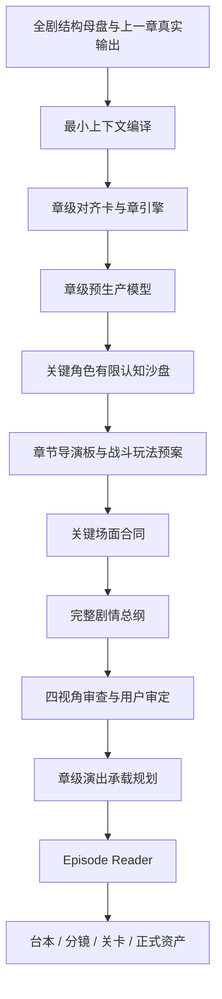

# 《超GAG机器人大战》章级预生产模型 v1

> Status: `working_production_method / non_canon`
>
> Date: `2026-07-23`
>
> 用途：在章引擎成立后、完整剧情总纲扩写前，先固定本章可以使用的人物、机体、敌人、机制、空间、动作与资产灰盒，阻止写作中途为了补因果而临时创造装置、权限、技术名和微动作。

## 一、为什么必须新增这一层

章引擎能够回答：

- 这一章为什么发生；
- 谁与谁争什么；
- 章末要造成什么变化。

它不能自动回答：

- 本章世界里究竟有哪些实体；
- 谁控制哪台机器；
- 一种能力接收什么输入、由谁落地；
- 人、巨机、母舰和建筑如何共处；
- 哪些动作能被SRPG、ADV或短动画看懂；
- 哪些新东西值得做资产和长期复用。

过去C04、C05的常见失败都发生在这片空白中。写作者先想到一个高光，再临时创造设施、接口、权限和术语解释高光，最后由人物用对白念说明。章级预生产模型把这部分创造前移到可以比较、淘汰和画灰盒的阶段。

## 二、它在生产线里的位置



它不是新Canon。Hard/Working Canon仍是事实来源；预生产模型只是当前章的可删除编译结果。章纲通过后，真正产生的新事实再按正常流程迁移。

## 三、只保留一份可读包和一张机器表

每章默认只新增：

1. `Cxx-章级预生产模型.md`：供编剧、导演、玩法和美术共同阅读。
2. `Cxx-预生产实体动作表.tsv`：供检查器核对ID、来源、状态和场面引用。

不再分别建立人物功能表、机体功能表、空间表、动作表和资产表。机器表用`item_type`区分：

- `character`
- `subject`
- `mecha`
- `enemy`
- `mechanism`
- `object`
- `space`
- `action`
- `previs_asset`

字段定义见[章级预生产模型Schema](../data/research/chapter_preproduction_model_schema_v1.tsv)。

## 四、预生产模型必须回答的七件事

### 4.1 人物与主体

只写本章状态，不重写完整小传：

- 眼下最想得到什么；
- 知道什么、误会什么；
- 有什么权限和能力；
- 会主动做什么；
- 哪件事绝不接受；
- 开场在哪里；
- 章末变成什么状态。

重大选择、关系破裂、背叛、牺牲和四方冲突再运行角色沙盘。角色可以反对大纲，但不能发明世界规则。

### 4.2 机体与敌人

每台关键机体先锁：

- 驾驶员、机魂、AI、导航和武装控制分别归谁；
- 尺寸、移动方式、主战职责；
- 一项主要能力和一项限制；
- 本章允许的标志性大动作；
- 明确不能做什么；
- 首登、损伤、升级、加入或离场结果。

敌人额外回答：

- 它此刻真正想得到什么；
- 为什么现在行动；
- 通过什么传感或情报观察我方；
- 玩家如何识别其规则；
- 怎样被反制；
- 它会带走什么经验或伤口。

### 4.3 能力与机制

凡是推动因果的新能力，必须写成：

```text
输入
-> 处理者
-> 可被人或系统读取的输出
-> 编译/验证环节
-> 接受或拒绝者
-> 真实执行者
-> 可见结果
-> 限制与代价
```

任何一环为空，能力不得进入章纲高潮。纸张、模型、名字、路线图和数据不能跳过执行身体直接改变现实。

### 4.4 空间与尺度

至少锁定：

- 主要场景和连接关系；
- 人、机体、母舰与巨构的尺度；
- 谁能进入哪里；
- 何种移动需要支点、运输或时间；
- 哪些区域进入SRPG棋盘；
- 每个战斗阶段的主尺度；
- 舰内与舰外事件怎样交叉剪辑。

空间优先使用普通词。能叫停机坪、生产井、观景廊、仓库、吊架和泊位，就不创造新的“槽、架、廊、锚、语法”组合。

### 4.5 动作词库

预生产阶段只锁本章可成立的动作，不写逐步走位：

- 每台主力的两至四个可见大动作；
- 每个Boss阶段的一项核心反制；
- 需要短动画、Cut-in或地图事件的动作；
- 只能留在后台的微小工程动作；
- 不能由当前资产完成的动作。

高潮优先使用远景可读的整机动作：变形、合体、贯穿、托举、旋转、坠落、展开、拖拽、改形和发射。微小锁舌、厘米开缝和多段接口握手只能支撑因果，不能承担观众记忆点。

### 4.6 资产与复用

任何新专名、新装置或新形态先回答：

1. 玩家能看见什么独特差异；
2. 它改变哪条因果或玩法；
3. 后续是否复用；
4. 能否由既有场景、机体、UI或普通名词完成；
5. 若删除它，故事损失什么。

一次性使用、没有独特画面、玩法或后续价值的装置，不获得专名和独立资产。

### 4.7 视觉预演

预演不是正式美术。它只负责在写作前验证轮廓、空间、动作与制作可能性。

## 五、视觉预演分级

### 5.1 轻量章

适用：舰内关系、普通城市调查、单场景低强度冲突。

只需：

- 现有地图引用；
- 人物站位草图；
- 一张场面顺序图。

### 5.2 中量章

触发条件：新地点、单台新主力、一次新变形、两种尺度交叉或新能力首用。

追加：

- 俯视灰盒；
- 尺度轮廓；
- 三至四格关键动作草图；
- 最低资产列表。

### 5.3 重量章

满足以下任一项便进入重量预演：

- 新大型场景或巨构；
- 多尺寸机体同场；
- 母舰/机体变形；
- 驾驶舱、机魂空间和现实战场交叉；
- 新能力第一次决定胜负；
- 三方以上势力混战；
- 胜负依赖地形结构；
- 高成本Boss或章级PV高潮。

必须先有：

1. 机体与建筑尺度轮廓图；
2. 主要战场俯视灰盒；
3. 至少一张剖面或前后状态图；
4. 控制权与能力执行链图；
5. 四至八格关键奇观草图；
6. SRPG阶段切换灰盒；
7. 新增与复用资产边界。

C04天空铸环属于重量章。

## 六、七道生成前门

### 6.1 实体门

完整总纲原则上只能使用预生产表已有的具名人物、机体、敌人、关键物件与地点。

普通食物、衣物、工具和无因果作用的背景物不受此限。只要新名词承担关键行动、胜负、身份或长期伏笔，就必须先登记。

### 6.2 控制权门

每个关键动作必须能回答：

- 谁提出；
- 谁验证；
- 谁接受或拒绝；
- 谁实际操作；
- 哪个身体或系统执行。

一个主体不能因叙述方便同时占用两个身体或两个不可连通地点。

### 6.3 能力门

新能力第一次生效前，输入、输出、落地者、限制和代价必须固定。不能写到高潮才解释能力原来还能这样用。

### 6.4 空间门

每个大位移、坠落、拖拽、合体与变形必须能落在灰盒上。若需要连续近景和长篇工程说明才能成立，优先简化动作或换载体。

### 6.5 大动作门

每场高潮至少要有一个玩家截图便能理解的整机动作。若胜负只靠微小关节、几厘米偏差、多个看不见的接口或一连串UI状态，退回动作词库。

### 6.6 资产门

一次性新专名必须证明独特画面、玩法、后续复用或不可替代的情绪价值。否则使用普通称呼或既有资产。

### 6.7 复杂度门

同一战斗阶段只保留一个当前主要目标和一个核心可见规则。其他机制按阶段显隐或成为分支替代步骤，不能并排常亮。

## 七、写作中出现新灵感怎么办

不封杀临场创造，但必须先暂停正文，提交一张极短的变更票：

```text
新增项：
现有元素为什么做不到：
玩家能看到什么不同：
改变哪条因果：
后续是否复用：
新增资产：
裁决：采用 / 合并到旧项 / 改为普通名词 / 拒绝
```

只有改变因果、能力、空间、控制权、胜负或资产的新增项需要变更票。普通动作、生活细节、笑点和不改变设定的表演不需要登记。

采用后先更新预生产模型，再继续写纲。禁止先把它写进正文，最后用物理板替它辩护。

## 八、与现有三板怎样分工

### 预生产模型

回答“本章有什么、能做什么、在哪里、值不值得做资产”。

### 章节导演板

只回答“这些既有元素按什么场面顺序改变人物、信息与情绪，玩家怎样看见”。

### 战斗与玩法预案

只回答“玩家操作哪些既有单位、在什么灰盒上完成什么目标，阶段怎样变化”。

### 物理因果与人物站位板

只验证少数高风险大动作和跨场移动。它可以否决，不能再发明新装置补洞。

这四者不是重复表。若导演板重新介绍每台机体尺寸，或物理板首次创造地点和权限，说明分工失败。

## 九、C04反向试验得到的证据

配套[C04章级预生产模型反向编译](./2026-07-23-chao-gag-c04-chapter-preproduction-pilot-v1.md)表明：

- 实体物件行会在写纲前发现U盾双位置；
- 白鸢能力链会强制区分“路线数据、工程编译、驾驶员执行”和“白框复制”；
- 敌人观察模型会强制区分断冠的现实传感与白框的上传镜像；
- 动作词库会在E05写纲前发现三制动、三锁、四红标、BODY和舰体菜单同时常亮；
- 韩秀雅的角色行会显示她在COMMON路线输掉核心主张后缺少主动替代动作；
- 空间灰盒会阻止万机馆、百相或潮墙凭单机力量拖动整座铸环。

这说明它不是新的复选框，而是能把已知错误提前到生成前。

## 十、迁移裁决

章级预生产模型作为第四层生产方法立即采用；它不修改Canon，也不改变已经审定的剧情。

Creative Compiler其余部分仍按C04、C05两章试验：

```text
C04预生产反向编译与定点修复
-> C04回归通过
-> C05预生产反向编译与回放
-> 两章均能抓错且不误伤
-> 再更新正式Writing Skill与Episode Loop
```

后续C06不得从章引擎直接扩写完整总纲，必须先通过本层。C01-C03只做轻量反向登记，不重写已通过故事。
