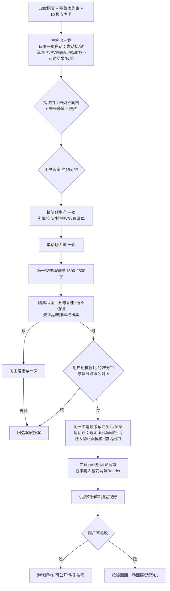

# 03 生产处方：三套方案比较与推荐

> Status: `candidate_research / fable_root_review_phase2 / awaiting_user_P2_choice`
>
> 日期：2026-08-16
>
> 前置：`02-root-cause-audit.md`（RC1-RC8）、`04-L1-L4-and-game-design-joint-review.md`（指纹表与极点轮换）。三套方案共享同一事实底座（Canon 四层、三层分离、单一主笔、冷读隔离——02号文件「保留」清单），分歧只在**创意选择权放在哪里、机器门保留多少、失败回退到哪里**。

## 〇、三案一览

| | A 精简现管线 | B 选择前置主笔制（推荐） | C L3 局部重审＋B（条件触发） |
| --- | --- | --- | --- |
| 一句话 | 十四阶段合并成七阶段，把选案门和指纹门插进现有链 | 先选故事再造合同：三案→用户选案→短样熔断→顺序成稿，机器门降为写后底线 | 若 Gate A 证明 L3 职责本身产不出好案，先重审 C09/C10/C19 与极点轮换，再走 B |
| 治疗对准 | RC5、RC2 | RC1、RC2、RC3、RC7（全部主因） | RC4 |
| 风险 | 选择门被打卡惯性同化（重演 G6 断层） | 前置判断若品味错，浪费在案层（成本低） | 动上游，波及 Working 结构，成本最高 |
| 何时选它 | 你最信任现有链的安全性 | 默认 | 仅当 Gate A 三案在现 L3 职责下全败 |

## 一、方案 A：精简现管线

- **谁在什么时候做创意决定**：主笔在 series_alignment 阶段内提三案，用户选案后进入原链；其余不变。
- **主笔读什么/不读**：沿用 layer_usage_policy_v3 现行可见性。
- **Runtime**：现行 v3 七阶段照旧。
- **章/话/场规划**：原十四阶段合并为七：对齐+选案 → 预生产（含三板合一） → 完整总纲 → 首读盲审（输入加前两章+指纹表） → 逐话 Reader → 冷读+声线 → 章审+验收。
- **防局部自洽全章无趣**：新增选案门与指纹门。
- **防跨章重复**：指纹表挂在对齐阶段。
- **冷读隔离**：现行。
- **用户停点**：选案＋章末验收（两点）。
- **单章成本**：约比现状省 30%（合并封存与重复填报），主要调用约 25-30 次/四话章。
- **失败回退**：回对齐阶段重选案。
- **判语**：能用，但把选择门插进一条以封存为荣的链里，很可能重演 G6 被进度挤掉的历史（RC5/RC7 未根治）。作为 B 的降级备选。

## 二、方案 B：选择前置主笔制（推荐）

### 2.1 单章流程（一页白话）

### 2.2 十一项逐答（委托书第八节）

1. **谁在什么时候做真正的创意决定**：主笔在案层做提案（拥有否决旧高光与 Working 场面的迁移提案权）；用户在选案（P 类停点一）与短样盲比（停点二）做裁决；章验收退化为确认而非首次判断。
2. **作家每次读取什么、不读取什么**：案层读 L3 本章职责、L1 三条判据、指纹表、合法人物/机体索引、未来峰值预留清单——不读旧同章章纲与旧 Reader；正文层读选定案、场面链、活跃人物正面模型、前话出口、已准入素材——不读负面案例、审稿史、合同、玩法字段（继承 story-writer skill 的 draft 边界）。
3. **Runtime 何时推送、何时微查**：默认零推送；案层与建模层各一次编译包（沿用 v3 的 ideation/entity_model 包但砍掉调试切片），正文层只允许主笔按具体问题微查 canon-query（次数记账，不设上限但入成本账）。
4. **人物模型、Canon、素材池、玩法候选怎样进入**：人物模型在建模步一次性给活跃者正面分面；Canon 经 canon-query 事实切片；素材池只在选案后按案检索并显式准入（research-admission 保留）；玩法候选只进游戏解构层，永不进 Reader 简报。
5. **一章、一话、一场如何规划与生成**：章=三案选一；话=一页场面链；场=顺序成稿，首场熔断，超长话按完整戏剧场拆分但同主笔顺序写（继承现行规则）。
6. **防局部自洽、全章无趣**：案层就比「值得讲」（U3 五问入选案模板）；短样盲比在扩写前拦截；冷读席新增 `NOT_WORTH_TELLING` 终态。
7. **防跨章重复**：指纹门在案层硬拦（04号文件第五节判据）；因果盲审输入扩到前两章；每章验收后回填指纹表。
8. **冷读者如何隔离作者答案**：冷读席零作者答案、零 L4、零后台板（现行）；新增：审前必读品味账本用户原话全集（校准不等于泄题——账本只含用户对**其他稿件**的判决）。
9. **用户只在哪几个高价值节点判断**：选案约15分钟、短样盲比约25分钟、章验收正常阅读；每章合计用户时间约 1.5-2 小时，其中前两点决定 80% 走向。
10. **单章成本估算（四话章）**：三案 3-4 次主要调用＋预生产 1＋场面链×4＝4＋短样 1＋冷读短样 2＋正文约 8-10（每话 2-3）＋章冷读/声线/盲审 3＋机战审 1＋定点重写储备 2 ≈ **25-28 次主要调用**，其中在用户首次裁决（选案）前只花 3-4 次。对照：旧链在用户看到任何故事前已花掉几十次（C04：十四阶段+两话成稿后才触达用户）。**核心改进不是总量更省，而是「花错方向的钱」占比从约 90% 降到 15% 以内。**
11. **失败回退**：短样两败回选案换案（沉没成本 ≤5 次调用）；三案全否回 L3 职责复审（触发方案 C）；正文期根因回场面链或选案，不全量重跑；一切回退写品味账本。

### 2.3 六对矛盾的回答

1. **设定充分 vs 创作自由**：事实用 canon-query 按需拉取＋预生产一页清单锁实体/控制权；合同不再预写场面。主笔简报八分区（已锁事实/戏剧要求/可改写范围/开放问题/未来保留/准入素材/建模空白/迁移候选，继承 skill 现行规则）。
2. **因果清楚 vs 机制过密**：前台概念预算（每场默认一个关键变化）写进场面链模板；常识可解者不命名（U3 五问第 5 条为选案级检查）。
3. **纯剧情 vs 可游玩**：三层分离不动；案层的「玩家主要动作」栏保证故事胜利可被操作承载；游戏解构在验收后派生。
4. **单一主笔 vs 长篇失控**：首场熔断＋分场顺序创作＋每场只继承必要前情（现行 v2.2 交互纪律保留为工具，不再作为默认合同层）。
5. **审稿完整 vs 善意补义**：冷读只评文本传达（复述+值不值得+`NOT_WORTH_TELLING`），设计问题走独立机战/制作席（design 包），两席永不合并回执。
6. **工程安全 vs 作品有电**：机器门全部后置为底线检查（canon smoke、声线 lint、指纹回填、哈希封存），有一票否决权的只剩用户与熔断规则；任何机器 PASS 禁止出现在给用户的质量陈述里。

### 2.4 与旧文件/Agent 的合并与降级（对齐 02号文件第三节裁决）

- 十四阶段 story-chain → 七个封存点：选案回执 / 预生产页 / 场面链 / 短样+盲比回执 / 章 Reader / 冷读+机战回执 / 用户验收。哈希与失效语义不变。
- 三板＋L4.5 → 「章级可拍性备忘」一页（heavy 章可扩两页）；24 游玩段映射移到验收后。
- 四席章审 → 一席创作冷读＋一席机战/制作审。
- 品味账本 → 常设制度：每次用户裁决当日回写。

## 三、方案 C：L3 局部重审＋B

- **触发条件**：Gate A 三案在现 L3 职责与指纹约束下全部被用户否决，且否决理由指向「这一章的职责本身没戏」。
- **动作**：仅重审弱主语三章（C09/C10/C19，04号文件第四节）＋为 22 章补极点声明；产出 L3 迁移提案（候选级），经用户批准走正式迁移；然后按 B 执行。
- **明确不做**：不推倒 22 章结构、不动已验收 C01-C03 事实、不改 86/87 话容量框架（除非迁移证明必要）。
- **成本**：L3 复审约 6-8 次主要调用＋一次用户裁决（约 30 分钟）。

## 四、推荐与理由

**推荐 B。** 理由：(a) 对照组 D（C02 选案获验收 vs C04 缺选案被否决）直接支持选择前置；(b) B 把用户第一次裁决前的沉没成本压到 3-4 次调用，是三案中唯一根治 RC7 成本倒挂的；(c) A 的门插在封存链上，与 G6 断层同构，历史已经演示过它会被进度挤掉；(d) C 动上游，应由证据触发而非默认——B 的失败路径自然通向 C，不冲突。

**预注册的 B 方案失败模式**（Gate B 后回验）：若用户在选案时三案都「勉强可以」但短样后仍判平庸，说明瓶颈在案的生成质量而非选择权位置——届时优先检查案层输入（L3 职责细度、素材准入时机），其次考虑 C。

## 五、P2 停点：请用户裁决

1. 选 A / B / C（或指定融合）。建议 B。
2. 若选 B：是否同意十四阶段合并为七个封存点（保留哈希/失效语义）？此项不改机器脚本，本轮先以人工封存回执运行，工程化另行授权。
3. 单章调用预算上限默认 28 次（超限即停下报账）。是否接受？
