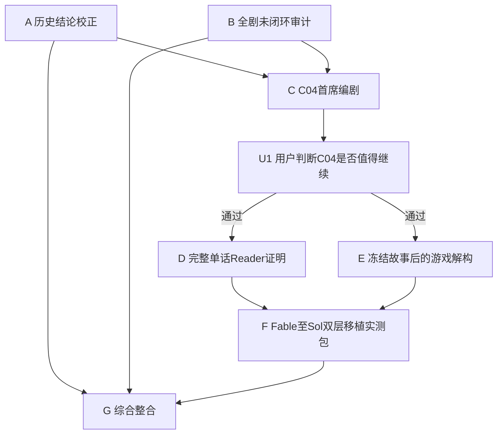

# Fable 5 综合写作室任务：全剧闭环、C04主笔、游戏解构与Sol能力移植

> 使用方式：在项目根目录使用 Plan 或 Multitask 模式执行。
>
> 项目根目录：`/Users/rayz/Documents/超gag机器人大战`
>
> 本提示词是对 `2026-08-17-fable-C04真材实料主笔交付提示词-v1.md` 的上位编排。必须先完整读取该文件；其中的权威入口、SHA、C04硬事实、文风红线和Current保护边界继续有效，除非本提示词明确覆盖。

## 0. 用户真正要得到什么

用户不是要更多方法论，也不是要Fable替项目打一个PASS。用户要同时回答四个彼此耦合的问题：

1. 当前L1-L3和全剧母盘，是否真的能持续长出精彩故事，而不是只在表格里成立；
2. C04究竟有没有一个不脱离本作精神、在现有连续性中合理、值得继续读的故事；
3. 这个故事是否能被解构为有玩家行动、机器人快感和策略空间的游戏，而不是任务说明；
4. Fable这次做对的东西能否被Sol复现，最终变成项目能力，而不是Fable的一次性代写。

四问必须联合考虑，但不能在同一个上下文里互相污染。请把本任务当作一个小型写作室，由隔离子任务并行勘察、单一主笔创作、独立整合席收口。

## 1. 总边界

- 全部产物为 `Candidate / external writer-room proposal`。
- 只允许在本提示词指定的新目录中创建交付物：
  `docs/superpowers/specs/research/2026-08-15-fable-story-method-root-review/integrated-v2/`
- 不修改Current Canon、Story Chain、已验收Reader、现行L1-L3、Skill、Runtime、玩法总案、Godot或美术资产。
- 旧C04总纲、旧Reader、旧五话稿和旧身体路线只可用于历史裁决，不得进入新C04主笔上下文。
- 不得用机器PASS、Fable自评或文档完整度证明故事好看。
- 不得要求用户理解Gate、哈希、迁移层级或工具状态；给用户的判断始终使用自然语言。
- 不展示或索取隐藏思维链。所有“为什么”只需给出简洁的证据、取舍和可复核理由。

## 2. 先建立任务图，不要一锅运行

开工时先提交一张任务DAG，至少包含以下隔离角色：

执行要求：

- A、B可以并行，但互不读取对方未冻结的结论。
- C只接收A、B整合出的少量当前红线和开放问题，不读取两份长报告全文。
- E必须在C的故事被用户认可并按文件SHA冻结后，使用新的上下文执行。
- F只从真实成稿和真实解构反推可移植行为，不先写抽象方法再逼作品证明。
- G只能整合已经冻结的产物，不能替创作席补写故事。

如果当前执行环境不能真正创建隔离子任务，必须明确标记 `ISOLATION_NOT_PROVEN`，不得伪称多席独立。

## 3. 共同权威与历史资料

### 3.1 Current优先

先按v1提示词第2节读取项目权威入口、当前L1-L3、世界机制、C01-C03正式前情、当前人物/机体资料和最新玩法Candidate。所有实测SHA均须记录；漂移时先判断是合法更新还是来源冲突，不可自动拿旧研究报告覆盖Current。

### 3.2 必须复核的Fable谱系

至少读取：

- `2026-08-03-fable-full-series-story-structure-audit-report-v1.md`
- `2026-08-03-fable-full-series-root-reanalysis-report-v2.md`
- `2026-08-03-Fable-v2精华吸收矩阵与处方回补-v1.md`
- `2026-08-03-超GAG全剧根治处方与执行方案-v1.md`
- `2026-08-15-fable-story-method-root-review/01`至`08`
- `2026-08-16-fable-C04融合案D与Sol写作能力移植验证提示词-v1.md`
- `2026-08-17-fable-C04真材实料主笔交付提示词-v1.md`
- `V35-G5-02定向融合正式迁移回执-v1.md`

研究报告只有研究权威。凡与Current或后续用户裁决冲突，以Current事实和最新用户裁决为准。

## 4. 任务A：Fable历次结论自我校正

独立输出：

`01-Fable历次结论自校正与当前采纳状态.md`

建立可检索表：

| claim_id | 来源与日期 | 原结论 | 后续反证/新证据 | 当前状态 | 当前权威依据 | 是否已迁移 | 仍需什么证明 | 对本轮影响 |
|---|---|---|---|---|---|---|---|---|

`当前状态`只能使用：

- `STILL_VALID`
- `VALID_WITH_CORRECTION`
- `SUPERSEDED`
- `DISPROVED`
- `UNTESTED_HYPOTHESIS`
- `USER_TASTE_DECISION`

必须逐项复核：

1. “C01-C05已经证明成功”；
2. 旧C04、C05的高评价；
3. “22章骨架全部成立”；
4. 三案选案门是第一主因的证据强度；
5. C02作为选案成功正例是否成立；
6. Gate B到底证明了概念信号、短样质量还是通用方法；
7. B+全剧方案中哪些已经进入G5-02，哪些只是研究候选；
8. T1-T4哪些仅被设计、哪些真正执行；
9. Fable此前因未读全资产而产生的误判；
10. 当前C04案D哪些是有效方向、哪些仍未成立。

本任务不重新写故事，只清除结论谱系中的假确定性。

## 5. 任务B：全剧母盘未闭环项与C04影响审计

独立输出：

`02-全剧母盘未闭环项-C04影响与关闭时序.md`

这不是重写22章总纲。它要回答：当前母盘哪些部分已经能指导创作，哪些仍只是好概念，C04改变后会把什么推向C05及未来。

### 5.1 建立增强版22章创意指纹

每章至少记录：

- 地点剪影与空间拓扑；
- 欲望主语与主动对手；
- 主要动词和战斗/非战斗家族；
- 高潮语法与胜利性质；
- 关系的实际转折；
- 玩家永久所得及谁拥有它；
- 对手或世界真正带走了什么；
- 日常载体与喜剧发动方式；
- 信息揭示方式；
- 机体/IP生命周期推进；
- 不得提前消费的未来峰值。

它必须能标出，不只限于：环形空间、巨构竖起、多机岗位接力、重复救援、行政高潮、胜利即罚单、吃饭代替全部日常、全员机敏对白、相同关系误解、相同敌方采样结尾。

### 5.2 逐项回收旧报告提出但尚未关闭的问题

至少审定：

- C06、C07、C16、C19谁真正发动故事；
- C08首登过载如何减载；
- C10聚焦三话还是扩容，眠城与C18如何分工；
- C17 What-if一主一副怎样在前文种熟；
- C13“玩家亲手确认索琳更好用”的玩法回路；
- C06-C08两场会改变行动的私人决定；
- C09/C10七海与白鸢在纪存缺席时共同承担一次失败；
- C10-C13断冠、裂星潮和地外压力是否从叙事中失踪；
- C14接管怎样逐项来自玩家此前真实使用或批准的接口；
- C19怎样避免成为C02资源物流任务的宇宙放大版；
- C20每个机体包的作品精神是否已在前文获得人生，而非终局补课；
- C01-C03只作为现行事实基线，不冒充不可超越的质量金线。

### 5.3 C04必须提供的全剧差分

无论最终C04故事如何，必须说明：

- 它使用L2哪一极，C05因此必须避开什么重复；
- 断冠从C04学到什么，C05-C14怎样连续而不万能；
- 七号、韩秀雅、百相、三旗舰、七海、白鸢各自向C05交接什么；
- 哪些关系、机体、谜团和奇观仍完整保留给未来；
- 这版C04是否改变当前章名、地点、C03出口或任何Working描述。

### 5.4 输出关闭时序

把问题分为：

- `NOW_BEFORE_C04_SELECTION`
- `BEFORE_C05`
- `BEFORE_C06`
- `BEFORE_C13`
- `BEFORE_C19`
- `LATER_PRODUCTION_ONLY`

技术上可推出的事项自行给推荐，不丢给用户。真正属于创作口味的决策最多压缩为5项，并说明不现在决定的默认后果。

## 6. 任务C：C04首席编剧交付

独立输出：

`03-C04实质故事-人物小传与困难场样稿.md`

严格执行v1提示词第3至第9节，包括C03真实接缝、C04硬事实、具名现实行动者、七号和韩秀雅的小传、四话完整故事、机甲文化兑现、困难场样稿和连续性自检。

额外要求：

1. C只读取任务A/B提供的“当前红线、开放项、C04对全剧的必要交接”短表；不得把全剧审计语句写进正文。
2. 四话故事先用不含权限、流程、接口、样本等词的300字白话讲清。白话讲不通，不进入扩写。
3. 给每场指定一个感知中心：这场主要跟随谁看见、误解和改变；避免全知梗概替人物解释。
4. 困难场不是宣传片，而要包含一次人物判断、一次真实误解或失手、一个机器人不可替代的大动作和明确后果。
5. 记录简洁的 `source_to_choice_trace`：每个重大创意决定引用事实来源、说明保留了什么和留下多少自由，不记录隐藏思维链。

### U1停止门

C完成后先停止后续正文生产，给用户一页自然语言裁决卡：

1. 这个C04值得继续，进入完整单话与游戏解构；
2. 方向有潜力，只改一至三处；
3. 仍不值得写，回到C04或L3上游。

用户未选择1前，不写完整Episode，不做正式移植结论。

## 7. 任务D：完整单话Reader与交互粒度上下文证明

仅在U1通过后执行。独立输出：

`04-C04完整单话Reader与场景交接证明.md`

由Fable选择一话，但不得选择最容易的纯轻松话。至少包含三至五个连续完整场面，并证明长文本不是靠一次漂亮样稿撑住。

交付包括：

1. 一整话纯剧情Reader；
2. 每场的简短输入卡：前场出口、在场人物、当前欲望、物理状态、必须发生结果、开放创作空间；
3. 每场结束的状态回写：谁知道了什么、关系如何变化、机体/地点怎样变化、下一场为何必然；
4. 对白隐名辨识测试；
5. 普通读者五句复述；
6. Reader语法总结，只能从本话实际有效行为反推，最多一页。

Reader语法必须回答：

- 场面感知中心怎样选；
- 设定正文、可选公开情报和作者后台事实怎样分开；
- 战斗正文写到什么粒度；
- 多次模型交互时，哪些状态必须继承，哪些资料不得重复灌入；
- 一话如何获得满足感并留下下一话发动。

## 8. 任务E：冻结故事后的双场型游戏解构

仅在U1通过且C/D故事文件按SHA冻结后，在新的隔离上下文执行。独立输出：

`05-C04剧情到游玩拓扑与双场型垂直解构.md`

先执行v1提示词第10节的全章剧情到游玩拓扑，再做两个不同场型的垂直解构：

1. 一段最高负载机器人战斗或三方冲突；
2. 一段生活、探索、整备、调查或关系玩法，不得只是走路触发ADV。

两段都要说明：

- 玩家为何愿意亲手做；
- 至少两种成立玩法，而非唯一漂亮路线；
- 人物已经作出的选择与玩家可决定的局部空间；
- 故事状态、Checkpoint、Retry/Resume与不可逆结果；
- 机体或角色能力为何不可替代；
- 最低成本fallback；
- 这一设计最可能怎样把故事拆坏。

不得宣称纸面解构已经证明“游戏好玩”。结论只能是：

- `PLAYABLE_HYPOTHESIS_CLEAR`
- `NEEDS_PROTOTYPE`
- `STORY_TO_PLAY_CONFLICT`

实际乐趣最终由制作人审查和可玩原型证明。

## 9. 任务F：Fable至Sol双层移植实测包

独立输出：

`06-Fable至Sol叙事与游戏解构双层移植实测包.md`

这不是再写一份方法论，而是准备可以直接运行的实验。

### 9.1 叙事线

- T1同题：Fable与Sol使用同一冻结事实包，各写同一困难场；匿名盲比。
- T2相邻留出：Sol独写下一场，Fable不得提供样稿，只提供批准故事、人物模型、前场出口和事实切片。
- T3完整话级：Sol独立完成一整话或一个未由Fable示范的完整Episode；检验多场连续状态、声线和满足感。
- T4跨章泛化：至少两个场型不同、未参与规则归纳的任务。优先考虑C02E05弱段与C06章发动机/场面；不能把C01-C03正负样本同时用于归纳和留出。

### 9.2 游戏解构线

- G1同题：Fable与Sol分别解构同一个冻结故事段，制作人盲审。
- G2留出：Sol独立解构一个Fable未示范的不同场型段落。
- G3原型门：纸面通过后才交制作人决定是否做最小可玩验证；Fable不得代签。

### 9.3 评判标准

不得只与本项目“相对凑合”的基线比较。建立两层标准：

1. 项目基线：C01-C03现行事实、用户明确认可和否定的具体段落；
2. 绝对功能基准：选择3至5个公认机器人动画或叙事游戏章节，只比较它们如何完成欲望、宿敌、关系转折、机器人奇观、玩家行动和结尾追读力；不引用长段原文，不模仿具体文风。

审稿提示词必须先在历史用户判例上做方向校准。不能识别Run B糊涂开场、认真但无聊的Creative First和旧C04复读问题的审稿人，不得进入正式实验。

### 9.4 能力结论词表

只能使用：

- `FABLE_INSTANCE_WORKS`
- `NARRATIVE_TRANSFER_NOT_TESTED`
- `NARRATIVE_TRANSFER_PARTIAL`
- `NARRATIVE_TRANSFER_PROVEN_ON_HOLDOUT`
- `STORY_TO_PLAY_TRANSFER_NOT_TESTED`
- `STORY_TO_PLAY_TRANSFER_PARTIAL`
- `STORY_TO_PLAY_TRANSFER_PROVEN_ON_HOLDOUT`
- `GENERALIZATION_NOT_PROVEN`

不得把一场好样稿称为“方法已经移植”。

## 10. 任务G：综合裁决与后续工作流迁移预览

独立输出：

`07-综合裁决-用户决策与Sol接手路线.md`

整合A-F，但不再新增故事。必须分开回答：

1. 当前C04是否值得写；
2. 当前母盘哪些地方可以继续，哪些必须在对应章前关闭；
3. Fable只证明了实例、局部方法，还是已在留出任务证明迁移；
4. 纯剧情能力和故事到游戏解构能力分别处于什么状态；
5. Sol现在可以接手什么，不能接手什么；
6. 还需要Fable在哪些高杠杆位置工作：章级选案、人物/对手建模、峰值场、失败复诊、全剧长线；
7. 何时才允许修改 `chao-gag-story-writer`、`chao-gag-writing-pipeline` 和Runtime查询协议。

只有在T2、T3和至少一个跨章留出通过后，才可以提出正式Skill迁移预览。迁移预览必须写到可实施粒度：

- 哪个Skill增加或删除什么模式；
- Pipeline阶段如何重排；
- Runtime在选案、场面链、正文、游戏解构阶段分别允许查什么；
- 跨章指纹、品味账本和Reader状态交接如何维护；
- 哪些旧检查退到后台，不再污染主笔；
- 回归测试和失败回滚怎样执行。

预览不等于修改授权。本轮不得直接改Skill、Pipeline或Runtime。

## 11. 失败与停止规则

- 任何子任务发现Current冲突，先登记证据和影响，不得用新故事偷偷覆盖。
- C04白话发动机仍不成立，停止C04扩写，给出最早阻断层和两个上游方向。
- Fable旧结论互相冲突时必须公开降级，不能选择对当前方案最有利的一份。
- 全剧任务不得借机把22章全部重写成新的漂亮摘要。
- 同一正文最多一稿加一次定点修订；仍失败就升层，不循环补强。
- 不因多任务模式扩大无效调用。Phase I主要调用预警12次、硬停18次；U1通过后的Phase II另计预警10次、硬停14次。
- 用户否决C04时，D/E/F中依赖该故事的任务立即停止；A/B仍可作为独立研究交付。

## 12. 最终给用户看的内容

不要把七份后台文件一次性丢给用户。综合文件首页只提供：

1. 三分钟C04故事；
2. 五个最值得期待的场面；
3. 三项全剧最高优先级风险；
4. 当前已经证明和尚未证明的能力；
5. 用户此刻最多三项自然语言选择。

其余证据留在各任务文件供Sol、制作人和后续审计读取。
