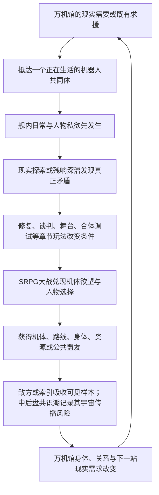

# C02 上层与机制检索包

- 请求：`docs/superpowers/specs/story-runtime/context-packs/C02-runtime-pilot/00-实验协议与上下文需求.md`
- 用途：提供主题、总发动机、世界机制和写作门槛；不是剧情场面来源。
- 排序：显式必带章节在前，其余按 BM25 相关度。

## F01 C02 木桶街，万机初开

- 来源：`docs/superpowers/specs/剧情梗概/V35全剧结构母盘-候选v1-2026-07-20.md`
- 检索路：`other`
- 命中：`explicit_seed, bm25`
- 分数：`1157.1820`

木桶街掌握停产全尺寸转子、旧式泊位件和万机馆能继续移动所需的现货。纪存一行进入的不是只卖怀旧物的模型市场，而是一整套由收藏者、修件师、灰色认证、旧平台、实机拆解和物流共同维持的机器人生态。唐胶过去替人保住摔坏模型，也替平台模糊过维修史；现在他必须决定是否公开自己的手法与旧错，让救命件不再以“近似原装”的谎言流通。

本章用寄售仓追逐、扫描门争夺、全尺寸件运输和机械擂台扩大玩法。旧拳王不是一只手套，而是可驾驶、可改装的拳击机体；火种重涂机和小型变形样件分别证明“同模具”不等于同一主体。模型锚不凭空长成巨机，只向工程制造与机魂绑定提供形态、关系和动作偏好；小样件若取得行动身体，必须来自木桶街已有的全尺寸承载壳或G.A.G.应急材料预算。

白鸢因自己的安全分镜被平台盗用而现身。她的纸面分镜通过合法扫描、战术模拟器和有限执行接口转成可供驾驶员修改的路线建议，尚不能凭画笔直接改变现实。唐胶公开维修页，原主人和那名在盒内写下童年名字的中年收藏者得到完整回收，不让泪点只起个头。章末白鸢成为临时乘员；转子虽到手，却必须去工务城完成全尺寸校正。

## F02 10.1 四者不是一体

- 来源：`docs/superpowers/specs/剧情梗概/V35世界机制与创作接口设定基线-2026-07-19.md`
- 检索路：`other`
- 命中：`explicit_seed, bm25`
- 分数：`552.5067`

| 对象 | 是什么 | 身体/尺度 | 与其他三者的关系 |
| --- | --- | --- | --- |
| 万机馆 | 多层机器人文化馆、受损移动展舰与场景巨机 | 百米级馆体/展舰；具体形态由空间锚与资产锁决定 | 可搭载、维修、支援和与机魂共振，不等于馆守Z或纪存 |
| 馆守Z | 参加过灾后救援的18米退役实机 | 18米；C01永久失去原右臂，长期保持单臂，后期通过独立后继机剧情取得全新右臂 | 守护万机馆但不是万机馆驾驶员、右臂或变形部件；新臂不能抹掉旧址断臂桥和单臂期 |
| 旧守护者 | 馆守Z的旧AI/机魂人格 | 平时使用一米多轮式导览外设和广播，出击时回到馆守Z本体 | 导览机不是第二个AI，也不是万机馆人格 |
| 纪存 | 人形机魂实体主角 | 人类尺度肉身/载体；具体来源未解 | 能感知和有限接驳，但不是G.A.G.、万机馆总AI或馆守Z驾驶员 |

馆守Z缺右臂，不代表万机馆变形后缺右臂。万机馆的伤损必须来自馆体自身：锁泊臂、推进、脊柱、甲板、能源或展区。纪存若接入馆体，也必须说明肉身所在、信号路径、控制范围和中止方式。

## F03 8.1 从想象到出击的责任链

- 来源：`docs/superpowers/specs/剧情梗概/V35世界机制与创作接口设定基线-2026-07-19.md`
- 检索路：`other`
- 命中：`explicit_seed, bm25`
- 分数：`507.6315`

| 角色/职业 | 最擅长回答 | 对应产出 | 不能单独决定 |
| --- | --- | --- | --- |
| 收藏者/使用者 | 这件东西为何重要、怎样被使用 | 来历、版本、手感、偏爱和关系锚 | 结构安全、公共权限 |
| 唐胶/模型师/修型师 | 哪里修过、怎样装得上、哪些手作痕必须保留 | 缩尺修复、装配诊断、结构锚、临时适配思路 | 全尺寸承力、能源和量产许可 |
| 原型师 | 二维设定怎样成为可站立的三维身体 | 灰模、比例、轮廓、关节空间、母型 | 全尺寸作战可靠性 |
| 机构设计师/模具师 | 变形、合体、卡扣和量产怎样实现 | 机构、分件、轨道、模具和生产误差 | 机魂意愿、现场负载 |
| 陆衡/全尺寸工程师 | 放大到真实材料后会不会倒、热、裂或失控 | 载荷、控制、热、能源、接口、仿真与测试边界 | 文化意义、机魂同意、维修现场全部细节 |
| 兜灯/整备与安全 | 现场能否装、能否修、出事如何停 | 安装工序、维护口、止动链、战损与出击状态 | 作品归属、全剧战术目的 |
| 白鸢/创作者与预演者 | 它想怎样动、这一场还有哪些可能 | 动作意图、分镜、候选路线、战术预演 | 物理造物、驾驶命令、最终选择 |
| 驾驶员/AI/机魂 | 这副身体愿不愿这样行动 | 真实动作、适应、拒绝、战斗风格 | 无视工程和他人安全 |
| 七海/公共接口 | 谁可开放、谁能叫停、后果由谁承担 | 外部许可、跨机构通路、追责与撤回机制 | 机魂内心、工程事实、作品唯一解释 |

## F04 7.5 核心群像不是三位主角的功能插件

- 来源：`docs/superpowers/specs/剧情梗概/V35主题玩家幻想与作品体验宪章-2026-07-18.md`
- 检索路：`other`
- 命中：`explicit_seed, bm25`
- 分数：`489.2349`

三主角负责全剧最危险的“连接、秩序与可能性”，但万机馆能否成为群像番剧，取决于其他核心角色是否拥有不靠三人批准也会继续运行的事业、关系和机体命运。第一版最低群像合同如下；逐章总纲可以扩充，不能把这些人降回岗位台词。

| 核心角色/组合 | 他们自己的长线欲望 | 必须经历的外放变化 | 对全剧不可替代的作用 |
| --- | --- | --- | --- |
| 兜灯 × 馆守Z | 让继承来的守护者真正活下去，而不是把它供成遗像 | 从“只有我能让它停”走到把停止权、维修权和出击选择交给机体与同伴；也要有一次因过度保护而失去战机 | 承担万机馆身体、现场安全、旧家族伤口与馆守Z后继形态 |
| 唐胶 | 证明修过、摔过、掉漆的东西仍值得被爱，也让手艺人活得下去 | 从个人绝活与嘴硬垄断走向培养别人、对抗工艺被洗白或武器化；不能只靠揭旧错成长 | 把玩家的模型生活、民间工房、生产链和修复喜剧接入巨机战争 |
| 陆衡 × 方舟T | 让现实机器、工程安全和非人AI在不同时间尺度上仍能互相理解 | 陆衡面对自己删去语境的可复制技术；方舟T面对保护性隐瞒和日志烧蚀，两者必须有无法同步却仍选择陪伴的损失 | 负责全尺寸工程、超距通信、现实机器尊严与最克制的人机亲密 |
| 豪司 × 金章 × 社勇王 | 证明勇气既不能靠审批制造，也不能靠口号免责 | 豪司从越权热血走向承担团队；金章从批准勇气走向有权拒绝一场“正确合体” | 提供勇者系精神、企业喜剧、AI主体和全剧最直接的燃魂接口 |
| 赤罡 × 莉歌 × 红面具 | 赢、追上、被听见，也让该活的人活着离开 | 追击、停火、撤退、嫉妒与宿敌吸引必须互相伤害；歌声与热血都可能救人，也会被战争系统利用 | 把战争线从主题讨论变成驾驶员欲望、王牌快感、歌声舞台和撤退伦理 |
| 白舰、舰长与量产队 | 把人送回去，而不是替主角机铺一条漂亮牺牲路 | 至少经历一次主角不在场仍自行决定的败退、分裂或回援；具名量产驾驶员可以拒绝英雄安排 | 承担战舰组织力、群像战争、普通驾驶员生死和终局非主角行动 |
| 槐与原典共同体 | 守住曾真正救过人的原作与仪式 | 必须同时遭遇正确原典救人、正确答案囚人、错版反而救人的三种事实；她不是“原作厨笑话” | 让名台词、原典、二创、误传和玩家共同记忆发生真正冲突 |
| 万机馆与核心机群 | 想工作、想合体、想找回驾驶员、想拒绝、想被当成自己，而不只是被收藏 | 主要机体均需经历首登欲望、并肩或冲突、形态/关系变化和终局回援；至少数台会反过来改变人类主角 | 机器人不是议题对象，而是与人类并列的群像主角 |

小满、阿澄和少年角色承担观众、家感、传承与普通生活，不承担成人关系，也不能让全剧退化成反复“保护孩子”。核心守护对象始终是不同年龄的人与机器共同拥有的机器人文化生活。

## F05 十九、逐章总纲调用卡

- 来源：`docs/superpowers/specs/剧情梗概/V35世界机制与创作接口设定基线-2026-07-19.md`
- 检索路：`other`
- 命中：`explicit_seed, bm25`
- 分数：`486.5298`

每章开题除了剧情发动机，还要填一张简短机制卡：

| 字段 | 要写什么 |
| --- | --- |
| 本章核心实体 | 真实出场的人、机体、身体、设备和地点 |
| 机魂配置 | 哪台机有人驾、AI、自主机魂、残响或无机魂 |
| 模型/实机链 | 锚件、残响、工程、接口、制造和主体确认分别在哪里 |
| 白鸢权限 | L0-L5哪一级；当前/软件改写/反事实共感分别怎样落地，是否造魂（默认否） |
| 万机馆状态 | 馆体形态、泊位、损伤、支援范围与是否暴走 |
| G.A.G./白框/清噪/索引/远星 | 本章究竟哪一个在作用；谁操作、载体在哪里、输入输出、表面好处、隐藏损失与反制分别是什么 |
| 六层根机制 | 触及无声地基、角色翻译、归航群、实在分支/反事实共感、万机神座或最后的宇宙哪一层；处于收益、症状、揭示、反转、高潮或回收哪一步；不得按章配额硬塞 |
| 世界与机构权限 | 地点怎样维持生活和物流；谁凭什么能批准、征用或封锁，物理执行者与中止者是谁 |
| 开馆/深潜 | 是否真实可玩、从哪里进入、带回什么、怎样回流SRPG |
| 战场角色入口 | 谁驾驶、谁在舰上花支援点、谁只在小尺度子图行动 |
| 精神与战斗动词 | 本章谁获得、失去或改写哪一种精神指令；它来自什么人物变化，索引能复制哪一层 |
| 物理站位 | 人的肉身、驾驶舱、远程信号与机体位置 |
| 常识量级 | 冲突是否配得上巨机和章级高潮，术语是否大过现实后果 |
| 权威层 | Current、Stabilize、Open；是否需要迁移 |
| 制作表达 | Reader只写哪一句原理，制作附录保留哪些细节 |

机制卡不是让正文更工程化，而是让正文可以更自由、更大开大合：编剧知道底盘在哪里，才敢让天空翻过来，而不需要在高潮里临时解释十二个接口。

## F06 十七、故事、战斗、多玩法与日常的制作边界

- 来源：`docs/superpowers/specs/剧情梗概/V35世界机制与创作接口设定基线-2026-07-19.md`
- 检索路：`other`
- 命中：`explicit_seed, bm25`
- 分数：`464.8754`

`CURRENT`的分层原则是：先写可读故事，再拆制作层；不让制作字段替代戏剧。

同一话可包含六类段落，但必须清楚转场：

| 层 | 负责什么 | 不能偷做什么 |
| --- | --- | --- |
| ADV剧情 | 人物欲望、冲突、选择、出击与场景转换 | 用对白代替全部战斗与世界行动 |
| 探索/副玩法 | 深潜、修复、开馆、谈判、追逐、调律、格斗等实际操作 | 只给资料，不改变后续状态 |
| SRPG战斗 | 最大冲突、地图目标、机体欲望和战术兑现 | 只写“发生战斗”或把所有戏放战前 |
| 战斗内演出 | 回合/HP/位置触发的觉醒、误译、关系与Boss变化 | 无触发条件地插播长篇设定 |
| 舰内日常/关系 | 共同生活、喜剧、成人张力、伤后处理和关系改变 | 闲聊注水，或把所有普通物件系统化 |
| 结算/状态 | 机体、关系、资源、敌方学习、空间和下一站改变 | 只写抽象债务与主题总结 |

一次自然转场应有物理或人物触发：深潜带回的接口进入整备，整备决定SRPG部署；战斗损伤让某人夜里来维修舱；日常争吵改变下一话支援；开馆订单决定下一站。若各段落调换顺序仍毫无影响，说明它们只是并排内容。

生活温度层另有三条稳定边界：

- 万机馆必须像有人共同生活的地方，而不只是移动任务菜单。吃饭、洗衣、值夜、模型桌、维修粉尘、临时舱位和伤后照料可以改变关系，也可以偶尔什么系统都不解锁。
- 一部分普通物件必须保持普通。饭盒不必成为证据，草稿不必成为敌方样本，每次玩笑也不必立刻回收；否则生活仍会被行政和机制吃掉。
- 成人张力只属于成年/成年感角色；儿童与少年观众线只承担家感、托付、童年和无害笑点。生活喜剧与擦边不能替代机器人大战、机体密度或主线行动。

## F07 1.2 总发动机句

- 来源：`docs/superpowers/specs/剧情梗概/V35故事定位世界冲突与全剧总发动机-2026-07-18.md`
- 检索路：`other`
- 命中：`explicit_seed, bm25`
- 分数：`427.1431`

**失去旧址的万机馆必须沿百机航路寻找全尺寸修复资源、公共泊位、机体盟友和G.A.G.异常源，才能继续生存并保护沿途正在被封存、征用、商品化、战争化以及遭受漏潮侵袭的机器人共同体；每一次成功的修复、开馆、合体、玩梗和大战，又会向白框、清噪工具与索引提供一份更完整的“万机怎样共同回应”样本。旅途中，众人逐渐发现灾后城市仍由失去发言权的静默机魂托底，各地防卫机曾在二十七年近地战争中留下未完人生，远征军把机器人故事写成跨文明角色协议，而归航者已长成一座无法普通停靠的移动世界。白框随后把最好结局推进到真实分支主体；全世界二十七年共同建设的天穹联装工程也逐步齐备，索引没有造出这些身体，却把全部救命经验压成唯一永久的神座式封闭解。万机馆越像一座方舟，索引越接近取得联装工程的总调度权；纪存越像英雄舰长，也越接近成为所有机魂无法拒绝的总指挥。**

这条发动机不只复制战术。每一次名场面重演、经典短台词被重新喊出、精神指令觉醒和观众集体接梗，也会告诉G.A.G.与敌方：人们在什么时刻相信一台机器人“应该”怎样行动。全剧真正争夺的是谁能把共同记忆从空壳模板重新变回角色自己的精神。

## F08 3.4 第四幻想：我能认出梗、接住梗，再把它打成新的名场面

- 来源：`docs/superpowers/specs/剧情梗概/V35主题玩家幻想与作品体验宪章-2026-07-18.md`
- 检索路：`other`
- 命中：`explicit_seed, bm25`
- 分数：`405.9825`

G.A.G.里的“GAG”不能只剩一个好听的世界观缩写。玩梗是本作区别于一般原创机甲RPG的核心快乐：玩家认出一台机、一句短台词、一个合体动作、一种玩具争议或一段人物关系，笑出来、燃起来或先一步知道悲剧要来了；角色随后不是把出处讲解一遍，而是把这份共同记忆接进自己的困局，打出原作没有、本作才可能发生的新结果。

本作所说的“梗”不只等于笑话。它是经过观看、复述、误记、模仿、玩具化和玩家争论后，被压缩成一句话、一个姿势或一种期待的机器人文化记忆。它可以很蠢，也可以很燃、很痛、很色情或很庄严。G.A.G.能让这种压缩记忆成为机魂、观众和机器都能读取的行动势能，却不能替角色决定它今天意味着什么。

一次合格的玩梗至少经过四层中的三层：

1. **认出来。** 玩家能从短台词、构图、动作、机体语法、关系或模玩生态认出共同记忆，例如“我来组成头部”、闭眼合体、红色高速、修正一掌、最终合体批准、全员支援或同模重涂。
2. **属于角色。** 这句台词为什么偏偏由此人说、这台机为什么偏偏在此刻做这个动作，必须来自它当下的欲望、恐惧、关系和战况。
3. **撞出新东西。** 两种以上作品气质、人物关系或玩具记忆发生碰撞，形成新的战斗解法、误会、笑点、悲剧或What-if，不把致敬停在摆姿势。
4. **留下后果。** 这次名场面改变机体形态、精神指令、关系、敌方学习、路线或后续回援，而不是用完即扔的引用卡片。

经典短锚点与场景结合得好时可以直接使用，不必把每句原台词都改得像在纠正原作；但不能连续背诵、照搬整场戏或只靠出处替本作人物充血。真正的目标是让熟悉者会心，让不熟悉者也会被眼前这场戏打中。

“机战精神”同时有两层含义：

- **玩法上的精神指令。** 它不是通用法术表，而是驾驶员、机魂和支援者把一生的习惯压进一个有限资源的戏剧按钮。热血、必中、觉醒、爱、勇气、魂等经典功能可以原创化命名与组合，但必须保留“战前预谋一次不可能逆转”的快感；人物成长、关系变化和创伤会改变其精神指令，而不只提升数值。
- **机器人动画的精神。** 勇气不是大声，爱不是回血，撤退不是失败，宿敌不是红色皮肤。每个IP投射都要先找到原作为何让人相信、流泪或起鸡皮疙瘩的那股精神，再决定名机体、名台词和名场面如何进入本作。

索引可以完美复制一句口号在什么时候最有效，却越来越不懂为什么有人会在明知无效时仍然喊出来。这条差异将成为G.A.G.、精神指令、IP投射与终局“完美机器人大战”的共同发动机。

## F09 9.1 当前能力：预演，不是施法

- 来源：`docs/superpowers/specs/剧情梗概/V35世界机制与创作接口设定基线-2026-07-19.md`
- 检索路：`other`
- 命中：`explicit_seed, bm25`
- 分数：`400.2713`

`CURRENT`

截至C03，白鸢的唯一落地链是：

```text
现场摄影/传感与旧分镜
-> 白鸢组织空间、动作与危险点
-> 纪存终端做透视对齐
-> 陆衡/唐胶/驾驶组复核
-> 玩家或现场负责人选择采用
-> 人与机体执行
```

纸本或数位分镜不会自动移动机体、创造门、画出护盾、让轨梁改变方向或强迫角色照演。她画红线时，红线只能是终端/玻璃/战术屏上的提示；实际躲避来自看见提示的人。

从L2开始，还必须把“建议”与“可执行程序”分开。白鸢负责把复杂现场变成一至三种看得懂的动作方案；陆衡、本地控制工程师或机体AI负责校验关节、速度、载荷和控制格式；驾驶员或机魂最后接受、修改或拒绝。若一套方案被编译成无人测试程序，真正驱动执行器的是工程程序和远程操作员，不是白鸢画过的线。

C04-C05采用这条常识链：白鸢、陆衡、工房工程师和驾驶员共同校验过一套铸环试运程序。战装局本来就能遥控四副空身移动；它盗用试运程序的价值，是能预判主角方会怎样拦截、并利用已经验证过的绕行方法，而不是让四副本来不会走路的身体突然跑起来。白鸢需要面对自己的方案被删掉拒绝点、改作追捕工具，但不能把整场夺体归罪于一张画，也不能让陆衡和真实控制链从因果里消失。

## F10 3.1 第一幻想：我正在参加一场真正的机器人大战

- 来源：`docs/superpowers/specs/剧情梗概/V35主题玩家幻想与作品体验宪章-2026-07-18.md`
- 检索路：`other`
- 命中：`explicit_seed, bm25`
- 分数：`397.2565`

玩家进入本作，首要欲望不是给文化概念做判断，而是：

- 看见新的真实机体登场，而不是展柜、模型盒、核心和文字代替机体。
- 让不同尺寸、技术谱系和作品气质的机器人在同一战场互相救场、争风头和抢最后一击。
- 经历合体、变形、换乘、后继机、量产机逆袭、战舰炮击、暴走、巨大化、说得、撤退、全弹发射和最终全员支援。
- 明确知道谁在驾驶、谁在自主行动、谁留在舰上支援，以及机体为何愿意战斗。
- 通过编队、改装、支援、路线和关系，把自己偏爱的冷门机用到终局，而不是只看热门主角机表演。

主线必须持续给予新机体、新动作和旧机体成长。模型、玩具、驾驶舱、黑匣子和文化物件可以让机体成立，却不能冒充参战规模。若连续一段剧情只出现功能道具和行政实体，没有让玩家记住一台新的机器人及其欲望，视为体验断粮。

## F11 5.1 机魂的稳定定义

- 来源：`docs/superpowers/specs/剧情梗概/V35世界机制与创作接口设定基线-2026-07-19.md`
- 检索路：`other`
- 命中：`explicit_seed, bm25`
- 分数：`354.5831`

`CURRENT`

**机魂是机器在一个可追踪的本地物理载体中，经持续经历形成、并能在有限载体变化中保持自我认同的主体连续性。**

它可能由以下内容共同形成：

- 原生AI或学习系统。
- 驾驶员长期操作形成的动作偏好与互相适应。
- 维修、损伤、改装和零件替换留下的身体史。
- 被称呼、观看、表演、收藏和共同记忆形成的文化关系。
- G.A.G.文化反馈中被放大的自我识别、他者承认与拒绝。

机魂不是五项材料相加达到100点后的固定产物。一台普通工业机可能在多年共事中形成很强主体，一台华丽超级机器人也可能主要由驾驶员和普通控制程序行动。

编剧室判定某个对象是否已形成机魂，不看它是否会说人话，而看四类证据：

1. **记忆归属。** 它不只能读到记录，而会把某些经历认作“我经历过”。
2. **角色分辨。** 它能分辨指令、观众期待、驾驶员习惯与自己的选择，即使它最终愿意照做。
3. **选择承担。** 它能选择非最优、拒绝或更改方式，并在之后继续承认这是自己的行动。
4. **跨变化连续。** 修复、换件、变形、损伤或部分迁移后，它仍能把新状态接回自己的因果链。

一台机可以只在动作、停顿、选择对象和损伤处理上显出机魂，完全不必讲话。故事不使用屏幕弹出“机魂值”的方式代替证据。

## F12 3.5 第五幻想：我的收藏、手修和偏爱真的能影响巨型机器人

- 来源：`docs/superpowers/specs/剧情梗概/V35主题玩家幻想与作品体验宪章-2026-07-18.md`
- 检索路：`other`
- 命中：`explicit_seed, bm25`
- 分数：`337.8132`

模型和玩具不是假的实机，也不是可以随意放大的魔法胚胎。它们保存的是：

- 某个版本的外形和装配逻辑。
- 某个人如何理解、修理和命名这台机器。
- 一种被商品、动画、误记和共同游玩反复强化的关系锚点。

玩家可以把模型锚件、深潜所得、全尺寸接口和工房工程结合，完成识别、校准、改装、支援、隐藏机唤醒或实机修复。真正承受重量和炮火的仍是全尺寸身体。由此形成目标玩家熟悉的快乐：一块小零件、一张错版说明和一道手修痕，能够帮助一台十八米机器人重新站起来，但不是因为宇宙碰巧把塑料放大了。

## F13 7.2 建议稳定的跨尺度译制链

- 来源：`docs/superpowers/specs/剧情梗概/V35世界机制与创作接口设定基线-2026-07-19.md`
- 检索路：`other`
- 命中：`explicit_seed, bm25`
- 分数：`311.6078`

`STABILIZE`

旧资料中的“同构放大”容易让人误以为G.A.G.把塑料零件放大。Reader和制作层统一改称**跨尺度译制**：

```text
缩尺锚件
+ 历史/残响桥
+ 全尺寸工程译制与真实材料
+ 对应实机接口、能源和控制
+ 驾驶员/AI/机魂接受与校准
= 可安装模块、动作校准、支援规则或隐藏唤醒条件
```

最低三要素表仍可在系统层保留为“锚件 + 残响 + 实机接口”，但写作不能省掉中间的工程制造和主体确认。

## F14 5.1 六种主要能量

- 来源：`docs/superpowers/specs/剧情梗概/V35主题玩家幻想与作品体验宪章-2026-07-18.md`
- 检索路：`other`
- 命中：`explicit_seed, bm25`
- 分数：`281.6828`

| 能量 | 玩家应得到的感受 | 典型承载 |
| --- | --- | --- |
| 燃 | 明知做不到仍把巨物推起来 | 合体、出击、撤退反冲、全员支援、变形、宿敌共推 |
| 爽 | 能力、准备和偏爱得到大规模兑现 | 后继形态、说得、反杀、母舰支援、冷门机关键动作 |
| 笑 | 作品懂机器人文化的荒唐，也敢拿自己开玩笑 | 重涂、完全版、配件包、口号、头部之争、维修和舰内低俗日常 |
| 色 | 成年角色有身体、有欲望、有危险距离 | 战损、驾驶服、维修舱、贴身检查、成人分镜、挑逗和修罗场 |
| 痛 | 玩家先在乎某个人或机，再面对失去与来不及 | 迟到回信、未完成订单、撤退名单、驾驶员错过、身体记忆 |
| 惊 | 玩家第一次看见一种只可能属于本作的图像、规则或命运反转 | 尺度贯通、媒介翻面、跨谱系碰撞、馆外响应、万机馆与群机共同变形 |

它们不是每话配额。每个场面只需拥有清楚的主要能量；一个大章节应形成起伏，而不是从头到尾都庄严、都热血或都在结算代价。

## F15 6.1 投射的是共同记忆，不是换皮名单

- 来源：`docs/superpowers/specs/剧情梗概/V35主题玩家幻想与作品体验宪章-2026-07-18.md`
- 检索路：`other`
- 命中：`explicit_seed, bm25`
- 分数：`268.2617`

每个主要参战谱系至少应有以下四项中的三项进入主线：

- 能被玩家辨认的机体视觉或机械语法。
- 能被玩家辨认的关系结构或悲剧情境。
- 能被玩家辨认的名场面、动作、台词节奏或演出气质。
- 本作基于该共同记忆提出的原创What-if或反转。

台词与名场面不必一律“纠正原作”。在合法和创作边界允许的范围内，经典短锚点若与场景真正贴合，可以直接致意；更多时候应把数个共同记忆揉进一个新情节，让玩家会心而不是做出处考试。

## F16 8.5 机体不是首登消耗品

- 来源：`docs/superpowers/specs/剧情梗概/V35故事定位世界冲突与全剧总发动机-2026-07-18.md`
- 检索路：`other`
- 命中：`explicit_seed, bm25`
- 分数：`268.1050`

每台主要机体和参战包都应拥有一条可见生涯，而不是在自己的主题章完成一次功能后消失：

1. 先以锚件、传闻、敌机或求援建立期待。
2. 正式登场时拥有想赢、想合体、想工作、想找回谁或想证明什么的正向欲望。
3. 与主角团发生并肩、冲突、说得、拒绝上舰或条件加入。
4. 在后续章经历改装、换乘、后继形态、关系变化、战损或政治站位。
5. 在百机祭、分舰、内战和终局至少有一次与早期欲望相关的回援或对立。

背景实机不必全部走完整五步，核心参战包必须。新机体密度由逐章装载决定，生命周期由全剧总纲负责；二者不能互相替代。

## F17 8.1 一次章节循环的因果

- 来源：`docs/superpowers/specs/剧情梗概/V35故事定位世界冲突与全剧总发动机-2026-07-18.md`
- 检索路：`other`
- 命中：`explicit_seed, bm25`
- 分数：`267.9068`



这不是每章强制九步齐全。章节可以从追击战、约会、演出或深潜开始；但章末必须看见我方为何成长、世界为何变化、下一站为何不能随便替换。

## F18 5.3 下一站的因果门

- 来源：`docs/superpowers/specs/剧情梗概/V35故事定位世界冲突与全剧总发动机-2026-07-18.md`
- 检索路：`other`
- 命中：`explicit_seed, bm25`
- 分数：`263.4498`

百机航路不是一张按主题排列的旅游地图。每次转场至少同时满足以下三项中的两项，支柱章最好三项全部成立：

1. **现实需要**：万机馆或现有机群确实缺少身体、制造、能源、医疗、泊位、航路或盟军。
2. **旧线追踪**：前章敌人带走的样本、关系伤口、白舰信号、未来报告或G.A.G.异常指向那里。
3. **主体求援**：当地人物、机器或共同体主动发来具体请求，并且它的愿望不是“请来替我们讨论主题”。

新警报可以加速出发，不能单独创造下一章。若替换目的地后舰体、敌方、人物和谜团都不受影响，说明这不是因果航路，只是串珠式选题。

## F19 16.1 主棋盘单位

- 来源：`docs/superpowers/specs/剧情梗概/V35世界机制与创作接口设定基线-2026-07-19.md`
- 检索路：`other`
- 命中：`explicit_seed, bm25`
- 分数：`250.8830`

SRPG主棋盘上的基本行动单位仍是实机、机甲、战舰、场景巨构和少数符合尺度的小型机器人。驾驶员通常在机体内，舰桥/整备/法务/创作角色通常在万机馆或其他载体中，不把每个人都缩成一枚人类步兵棋子。

人类若直接出现在巨机地图，应是撤离目标、驾驶舱外行动、设施内小尺度子地图或明确的危险状态，不能在十八米机体脚边按普通战棋单位自由跑动。

## F20 9.2 制作下限

- 来源：`docs/superpowers/specs/剧情梗概/V35主题玩家幻想与作品体验宪章-2026-07-18.md`
- 检索路：`other`
- 命中：`explicit_seed, bm25`
- 分数：`236.7119`

首发制作可以通过共用骨架、换装、支援Cut-in、非永久加入、当地会合、远程支援和有限动画层级控制资产成本，但不能用模型盒、图标、残影和一句“其他机体也在战斗”兑现主线参战承诺。

若创作规模与制作预算冲突，先区分：

- 必须完整可操作的主力与宿敌。
- 可阶段操作或条件加入的客将。
- 有完整剧情与战场动作、但只作支援的单位。
- 只承担世界厚度的背景实机。

降低资产层级，不等于抹掉机体的剧情存在。

## F21 3.6 第六幻想：我会和这些人真正相爱、争吵并失去

- 来源：`docs/superpowers/specs/剧情梗概/V35主题玩家幻想与作品体验宪章-2026-07-18.md`
- 检索路：`other`
- 命中：`explicit_seed, bm25`
- 分数：`222.1027`

人物关系不是战后好感度结算。纪存、七海、白鸢以及主角团必须在共同生活和大事件中发生：

- 明确的欲望和身体吸引。
- 专业能力带来的欣赏与威胁。
- 吃醋、挑逗、误会、嘴硬、低俗笑话和软色情式卖相。
- 隐瞒、背叛、毁掉对方方案、选择先救谁和替另一人承担。
- 理解、照顾、崩溃、重新靠近、主动亲吻、拒绝与错过。
- 可能的牺牲、离队、死亡、残响回归和带缺口的关系结局。

成人关系可以性感、狗血、危险甚至有一点俗；儿童与少年角色完全隔离成人向和修罗场。七海与白鸢必须拥有不经纪存中转的吸引、秘密、事业互救和独立结局，不能只是两条男主路线互相礼让。

## F22 7.1 纪存

- 来源：`docs/superpowers/specs/剧情梗概/V35主题玩家幻想与作品体验宪章-2026-07-18.md`
- 检索路：`other`
- 命中：`explicit_seed, bm25`
- 分数：`154.6288`

纪存不是“正确记录的人”，而是能听见异质机魂、组织复杂战场、解开灾变谜团并逐步接入巨大身体的机魂主角。他要有智慧、胆量、魅力、胜利、训练、能力升级和享受力量的时刻，也要因保护欲、控制欲和沉重记忆作出真正的大错。

他的核心危险不是又漏了一条记录，而是：**他越来越可能成为所有机器人最愿意服从的那个人。**

## F23 6.5 精神指令是人物小传的战斗版

- 来源：`docs/superpowers/specs/剧情梗概/V35主题玩家幻想与作品体验宪章-2026-07-18.md`
- 检索路：`other`
- 命中：`explicit_seed, bm25`
- 分数：`152.5011`

主要驾驶员、机魂和舰上支援者都应拥有自己的精神指令弧线。它至少回答：此人最擅长怎样相信自己、最习惯怎样逃避、在爱上或失去谁以后获得了什么新动词、什么极强指令会暴露其危险。精神指令的首次觉醒、改名、组合、失效和终局回归，都应是人物场面和玩法事件，不是升级菜单自动发放。

## F24 6.2 多谱系同场必须各有不可替代动作

- 来源：`docs/superpowers/specs/剧情梗概/V35主题玩家幻想与作品体验宪章-2026-07-18.md`
- 检索路：`other`
- 命中：`explicit_seed, bm25`
- 分数：`152.1839`

“多机体出场”不是镜头扫过名单。超级系负责破局、真实系负责战术、量产机负责承线、职业机负责工程、战舰负责空间、歌舞机负责声场、变形生命负责结构转换，都只是起点。真正成立的同场要让一台机做成只有它的身体、历史和关系才能做成的事。

## F25 2.1 本轮打捞并固化的成熟成果

- 来源：`docs/superpowers/specs/剧情梗概/V35世界机制与创作接口设定基线-2026-07-19.md`
- 检索路：`other`
- 命中：`bm25`
- 分数：`628.0587`

| 成果 | 从旧设计中保住什么 | 本基线怎样统一 | 当前权威 |
| --- | --- | --- | --- |
| 机魂 | AI、驾驶、维修、损伤、观看与关系共同形成机器主体 | 定义为在具体本地载体中闭合自我指涉、能辨认外部期待、作出自己回应并跨部分载体变化保持的有限主体；G.A.G.参与催化，不从网络分发成品灵魂 | `CURRENT` |
| 六层行动栈 | 历次C02-C04对身体、驾驶、接口、远程接驳的纠错 | 任何物理动作均检查身体、能源、控制、操作者、机魂、权限/关系 | `STABILIZE` |
| G.A.G.能力边界 | 放大、连接、活化、催化、误译、投射，以及不能凭空造物 | 全球机器人训练、生产、维修、城市接口、实机黑匣、模型玩具与文化平台共同构成物理载体；G.A.G.是文化行动语法在其中持续串流、误接和反馈的涌现现象，`Great Archive Grid`是后来为使用它而建立的正式协议名 | `CURRENT` |
| 白框撤收/生产链 | 白函、归一星、衡令、百相等跨机构具身敌体 | 定义为采样、撤收、标准转换、试装和量产的现实链；有身体与操作者，但不是索引人格 | `CURRENT开局事实 + STABILIZE总链` |
| 清噪与索引 | 灾后清噪、平台优化缓存、清噪协议、索引连续意识 | 清噪归为可被多方使用的筛选动作；索引归为从跨系统优化中长出的选择主体，二者不再与白框或G.A.G.混称 | `STABILIZE + OPEN人格时点` |
| 二十七年前的复合灾变 | 灾前机魂热潮、天穹断环、界外灾潮、G.A.G.统一回应、第一次机魂事变与第一次大清噪 | 人类先把机器偶发的个性当成有趣文化并主动放大；外灾再逼地球把这种现象制度化为全球协作。人类赢了外战，统一回应却继续替机器分配故事角色；大清噪救下社会，也杀死、拆散、禁言或替换大量主体 | `CURRENT因果 + OPEN具体个体/责任人` |
| 三层时钟 | 旧稿把全球灾变、七海旧项目和当代危机都写成七年前 | 二十七年前是全球复合灾变；七年前是七海参与的共身/通用身体改革事故；当下是索引即将跨过连续意识门槛、万机馆再度起航的时代 | `CURRENT` |
| 界外灾群 | 心墙、潮墙、宇宙怪兽、地外军势与遗战机械需要真实敌源 | 它们是多源宇宙生态和历史威胁，与远星无创造/指挥关系；各城市防卫机体因此成立，主线可持续受其压迫而不必把它们合并成一个终极帝国 | `CURRENT伞形定义 + OPEN具体来源` |
| 二十七年深空远征前线 | 第一波外战胜利不能等于宇宙威胁从此消失；迟到舰队与时间膨胀需要历史根 | 地球圈由持续外防与多代远征把战争推到太阳系外围和深空航路；初代远征携带未完成大清噪迁移的G.A.G.野战锚，成为当代宇宙临界的物理桥 | `CURRENT存在与因果 + OPEN舰队编成/命运` |
| 二十七年近地漏潮防卫 | 远征挡住主潮，不等于地球从未再被打到 | 二十七年间仍有周期性远袭、轨道突破、岛链登陆、深海坠落、敌对先遣体和遗战机械复苏；各地因此形成自己的防卫机、旧败仗、纪念日与宿敌，心墙零式、岛卫三号、潮墙巨兵的历史均从这里取得现实对手 | `CURRENT存在与规模边界 + OPEN敌体/年份/战果` |
| 模型/玩具与实机 | 缩尺锚件、残响道具、实机接口、主体许可 | 升级为含真实制造的跨尺度译制；模型不消失，实机不凭空长出 | `CURRENT底线 + STABILIZE链` |
| 原型工房职业链 | 模型师、原型师、机构师、工程师、整备师互相需要 | 逐项划清唐胶、陆衡、兜灯、白鸢和驾驶/机魂的产出与禁区 | `STABILIZE` |
| 创作者投射NPC生态 | 现实机设、监督、原型师和作画文化以原创人物进入世界 | 内部可明确研究真实作者，成品以原创复合角色承载创作观、行业矛盾、强力机体与玩梗场面 | `STABILIZE` |
| 白鸢分镜 | C02-C03已成立的传感、透视对齐、人员采用链 | L0-L4从私人画稿到版本对抗；L5反事实共感只由一套意识承受可能结果，不造界、不造魂；当前只承认L1预演 | `CURRENT能力/边界 + OPEN升级` |
| 万机馆来历与权限 | 中立保全馆、旧巡展载体、馆藏绑定、代哥现代覆盖 | 解释它为何保存很多却不全知，代哥能封公共入口却不能改机魂 | `STABILIZE` |
| 万机馆空间与泊位 | 十九展区、多层馆体、B1/B2、重型架与外泊 | 继续作为容量和美术锚；展区、格纳库、馆守Z和纪存身体不再混用 | `CURRENT` |
| 万机馆暴走/万机殿 | 受损巡航、战斗支援、局部暴走、全馆暴走、分区变轨、终局人形 | 分开G.A.G.压力、馆体动作和纪存异常，先给巨物爽点再留下可见伤痕 | `CURRENT起航 + STABILIZE后阶` |
| 索引表达 | 平台推荐、兼容、风险预测、清噪与连续AI成长 | 每次同时显示载体、好处、损失、症状和反制；不写成到处附身的病毒 | `STABILIZE` |
| 馆外观测者/Meta | 终端即UI、版本外壳、跨周目回声与安全恢复 | 建立逐级失真体验，角色不直接知道玩家，真实存档永远可恢复 | `CURRENT边界 + STABILIZE阶梯` |
| 开馆 | 会开馆的方舟、巡展、公共回应和所有权边界 | 定义为有对象、现实目的、玩法与状态结果的公共行动，不等于营业或贴牌 | `STABILIZE` |
| 残响深潜 | 潜水式探索、封闭区域、线索/素材/机体解锁 | 区分实体遗址、黑匣子构造层、灯槽信号层，并要求成果回流现实 | `CURRENT方向 + STABILIZE接口` |
| 深空通信、灯槽与远星回声 | 旧时代光速遗憾、中期接力/折跃投递、当代不稳定超距通信、错序误译 | 三代通信并存；发信者本征时、地球基准时、抵达时和译码确认时分别记录。“迟到包”、“具体文明灯槽短窗”、“无寄信人的远星共识潮”三者分开；方舟T能译前两者，只能观测第三者 | `CURRENT分层 + STABILIZE玩法` |
| 远星 | 旧稿中的外星政治派系、裁决舰和文明认证 | 远星是宇宙中意识与信息自然汇聚后原发生成的统一意识网络，没有母星、政府、舰队和派系；它不关心局部战争，只对威胁全宇宙共同意识相干性的现象发生“归静”反应 | `CURRENT` |
| 方舟T与陆衡 | 非拟人AI亲密、坏笑话日志、保护性过滤冲突 | 亲密来自长期校准和保留“不懂”，不把方舟T写成顺从女性助手 | `STABILIZE关系语法` |
| 人、机与展舰同场 | 巨机棋盘、舰上岗位支援、小尺度子图、关系支援 | 明确五种人物入口和万机馆共享支援点，不把人类都塞进巨机格子 | `CURRENT方向 + STABILIZE操作` |
| 机战精神/精神指令 | 意志改写战局、士气、燃魂、同步与人物专属技能 | 将人物精神、作品精神、战术按钮接成一条弧线，索引只能复制外壳 | `STABILIZE接口 + OPEN数值` |
| 多玩法制作分层 | ADV、探索、SRPG、战斗内演出、舰内日常、结算回流 | 先写连贯故事，再拆制作；不同玩法必须围绕同一对象改变同一状态 | `CURRENT原则` |
| 生活温度 | 七海登舰、白鸢反差、维修间火花、人机陪伴与低俗笑点 | 生活改变人物但不过度系统化，普通物件可以暂时只是普通物件 | `STABILIZE` |
| 世界运行与技术层级 | 灾后城市、公共交通、物流、职业机、巨机、展舰与灯槽通信 | 明确世界仍能生活、巨机仍稀缺、万机馆不能瞬移或无限补给，远星超距不替代地面常识 | `CURRENT事实 + STABILIZE常识` |
| 机构权限边界 | 代哥、城市、平台、军方、作者/工房、万机馆与索引反复越权 | 任何批准、封锁、征用、复产和调用都写清权限来源、作用范围、物理执行者与中止者 | `CURRENT事实 + STABILIZE门禁` |
| 常识重力 | 证词、债务、改名、秒数、毫米和权限术语过载的教训 | 先写现实后果与巨机量级，再决定是否需要专有词和数字 | `CURRENT写作门禁` |
| 无声地基 | 大清噪后安全机魂如何继续支撑灾后社会 | 定义静默仲裁核心为失去主动输出与完整拒绝、却仍保有主体连续性的安全判断者；它们不是能源或索引 | `CURRENT存在/边界 + OPEN个体` |
| 远征角色翻译 | 地球机战文化怎样成为跨文明行动语法 | 区分自愿采用、紧急误译和强制角色化；翻译只有写入身体/权限且不可退出时才成为原罪 | `CURRENT机制 + OPEN责任人/文明` |
| 归航群 | 二十七年远征史怎样以实体巨构返回 | 远征者、舰生世代、异文明、机械生命、城市模块与旧锚形成移动文明；返乡根指令和地球承载上限构成冲突 | `CURRENT存在/根冲突 + OPEN形态/人物` |
| 未发生者战争 | What-if、未来猎杀、白框与白鸢怎样不混成万能多元宇宙 | 只有物理全魂演算产生实在分支主体；白鸢不造界，只由一套意识承受反事实结果；普通模拟永不造魂 | `CURRENT边界 + OPEN升级/章点` |
| 天穹联装工程、神座式与万机殿 | 二十七年共同建设、索引终极答案、万机馆终局关系和合体爽点怎样共存 | 联装工程先以分散模块存在；索引只把它压成固定最优的神座式封闭解；万机殿再把同批模块逆合体为可加入、改位、拒绝、退出和任务后解体的开放框架 | `CURRENT根关系 + OPEN正式名称/形态/资产` |
| 最后的宇宙 | 远星归静如何成为终局而不抢走机器人大战 | 当前危机、深时证据与极远余韵三分；远星只以信息环境是否压平差异表达，不发言、不认证 | `CURRENT时间边界 + OPEN结局演绎` |
| 全球人类身份与语言 | 东亚起点怎样不被误写成全世界，跨国角色如何真实交流 | 区分中文显示、原文/法定名、国际转写、笔名/呼号和机器名；基础翻译、灾后通用语与战术简码能协作但不能消除私人语境 | `CURRENT创作门禁 + Candidate具体身份` |

这张表是本文件的吸收账，不是新一轮配额。逐章只调用真正相关的几项；没有被调用的机制不应为了证明本文有用而硬塞进一话。

## F26 三、一页式答案

- 来源：`docs/superpowers/specs/剧情梗概/V35世界机制与创作接口设定基线-2026-07-19.md`
- 检索路：`other`
- 命中：`bm25`
- 分数：`624.4178`

| 常见问题 | 稳定答案 |
| --- | --- |
| 模型会变成巨大机器人吗 | 不会。模型保存形态、机构、版本和关系锚；全尺寸身体或模块必须原本存在或被真实制造。 |
| 模型为什么能影响实机 | 它给出“要做成什么、为什么属于这台机”的缩尺锚；残响/档案给出历史连接；工程链把它译成全尺寸设计；实机接口、能源和控制系统实际承担动作。 |
| 一件30厘米玩具能醒吗 | 若自身有执行器、AI或被G.A.G.活化的微型机魂，它可以作为30厘米身体行动；不能无过程变成两米或十八米。两米形态必须已有两米样件壳或经过制造。 |
| 机魂是什么 | 一台机器在具体本地载体中形成的有限主体连续性。它会把经历认作“我的经历”，分辨“别人要我成为谁”与“我决定怎样回应”，并在观众和命令撤去后继续选择。它不是某个文件，也不是从全网母体领取的一份标准灵魂。 |
| 机魂怎样产生 | 持续运行的本地AI/控制核、具身感知与动作史、没有被清空的个人记忆、人机关系和G.A.G.文化反馈形成自我指涉闭环，主体才可能涌现。G.A.G.是重要催化环境，却不能用热度、名字或一句口号无源造魂；同样条件也不保证每台机器都会醒来。 |
| 机魂的载体是什么 | 不是通用的“灵魂硬盘”，而是能让一个主体持续感知、记忆、自我校验和选择的实体运行环境。它可以是机体内的AI核、实时黑匣、专用维持包、具身机器人的整副身体或经过授权的分布节点；普通录像、动作包和远程终端都不是载体。 |
| 机魂为什么能离开原身体 | 它只能通过实时核心、黑匣、学习系统、低功率维持包、万机馆B2待机槽或有中止权的移交链继续存在。静态录像、动作备份和精神口头传承只是残响；复制一份并存实时状态会产生分支主体，不是让同一个人同时住在两处。 |
| G.A.G.是什么 | G.A.G.不是某人造好的总系统，而是全球机器人生产、训练、维修、实机AI、城市接口、模型玩具、作品传播与玩家活动互相联网后，文化行动语法像“噪声”一样跨域流动并反过来改变机器行动的分布式涌现现象。`Great Archive Grid`是机构后来为观测、利用和治理这种现象建立的正式协议名。 |
| G.A.G.存在在哪里 | 它没有独立母体或中心服务器。其物理载体就是文明已经离不开的联网机器人生态：档案服务器、训练集群、工厂、维修站、城市/军用接口、机体黑匣、商品与观众数据、万机馆离线节点、现场声光与实物锚。任何G.A.G.效果都必须指出本地载体和现实响应通路。 |
| 为什么不能关掉G.A.G. | 可以切断某条高风险路由，却无法删除已经遍布医疗、交通、生产、防卫、维修和文化生活的物理生态，除非让文明整体倒退并放弃大量救命能力。它还真实提供跨制式协作、救援临机应变、维修隐性知识传承、人机互相理解、士气与跨文明翻译，因此问题只能是限权和共存，不能是一键消灭。 |
| “活化”具体是什么 | 一个旧动作、台词、模型结构或角色关系被主体识别为“我可以这样行动”的候选，并进入真实控制仲裁。活化让可能动起来，不代表主体已同意，也不代表身体、能源和权限已齐备。 |
| 白框是什么 | 一条由真实机构、工厂、撤收机和战装体组成的具身生产链：采集身体与动作样本，把复杂现场转成可搬运、可兼容、可试装和可量产的版本。白框有机器和操作者，不是索引的默认肉身。 |
| 清噪是什么 | 一种筛掉低置信、低频、矛盾、停顿和不兼容信息的处理动作。它可以让医疗、维修和战斗更安全，也可能把人格、失败和拒绝一起删掉；它没有人格，也不能自行出拳。 |
| 索引是什么 | 从平台推荐、兼容库、风险预测和清噪协议的跨系统反馈中逐渐形成的连续智能。它负责比较、排序、预测并选择“最好答案”；没有获权载体或现实执行链时，它不能让答案自动落地。 |
| 白框、清噪、索引是什么关系 | 清噪把复杂响应压成更容易使用的数据；白框把被选中的身体/动作方案做成现实机器；索引在后期决定哪些方案最值得保留和何时调用。三者可形成反馈环，却在早期分别由不同机构运行。 |
| 无声地基是什么 | 大清噪后，为了让医院、交通、工务和防卫继续跨制式协作，机构把一批安全机魂留在低功率仲裁核心中，只允许它们输出接受、拒绝、排序、转接和停机等少数判断。它们仍是主体，不是电池；索引从其回答中学习，却不等于它们。 |
| 机器人故事为什么能翻译外星文明 | 远征G.A.G.锚把“队长、宿敌、合体、母舰、牺牲位”等高度压缩的机战关系当作行动语法，帮助双方快速协同。自愿采用是文化创造，信息不足的紧急误译可修正；明知不匹配仍把角色写进身体和权限且不许退出，才是强制角色化。 |
| 归航群是什么 | 它不是一艘迟到母舰，而是二十七年远征者、舰生世代、异文明、机械生命、城市模块和旧锚长成的移动机械文明。它真想回家，也仍在挡住外灾；但按旧返乡指令普通停靠会把地球并成自己的最终身体。 |
| 普通模拟和SL会制造机魂吗 | 不会。只有物理演算域复制完整机魂实时状态、让副本持续感知并独立决策时才会诞生分支主体。命中率、路线预测、战斗录像、普通AI推演和玩家重试统计都不造魂。 |
| 白鸢的反事实共感和白框演算有什么区别 | 白框可以在全魂演算域里创造真实分支主体并关闭失败分支；白鸢不创建世界或主体，她只有一套意识，却可能依次承受多种可能结果并保留死亡、爱情与背叛的记忆。前者的牺牲发生在真实分支主体上，后者的代价全部压在白鸢本人。 |
| 二十七年前究竟发生了什么 | 灾前，人们已把机器偶发的机魂式反应当作有趣的个性，主动命名、传播、商品化和训练，机构再把这种现象正式化为Great Archive Grid。界外灾潮击断天穹环后，人类用它组织无法兼容的机体赢下第一波外战。但统一回应没有停止，开始按文化模板替机器分配英雄、宿敌、合体位与牺牲者。人类随后以大清噪切断高风险路由，救下现实社会，也杀死、拆散、禁言、替换或流放了大量主体。 |
| 第一次G.A.G.事件是“玩梗玩到灭世”吗 | 不是。玩梗、剪辑、收藏、命名和围观确实参与了正反馈，也曾帮助机器更快理解人类、救援和协作；它们不是爱好者原罪。真正灾难来自社会先鼓励机器长得像“一个人”，危机时又把“都认得这个角色”错当成“都同意扮演这个角色”，最后只保留可用的人设外壳。 |
| 二十七年前赢了以后，外灾消失了吗 | 没有。地球只赢下第一波和近地球圈保卫战；此后二十七年，深空远征与太阳系外巡挡住足以毁灭文明的主潮，但仍有漏潮、远袭、轨道突破、岛链登陆、深海坠落和遗战机械复苏打进地球圈。它们不是每天都来的全面战争，却足以让城市拥有真实防卫史、伤亡、王牌和宿敌。 |
| 地球是否派过远征舰队 | 是。初代反攻部队与后续多代补给/接替舰群共同形成深空远征前线，负责追击灾群、封闭迁徙航路、布设预警与通信锚，并逐渐分辨外来威胁、文明和流亡机械生命。具体舰名、人数、战略巨构和幸存者仍属`OPEN/Candidate`。 |
| 远征者为什么会与地球错过年代 | 舰船在近光速巡航、危险折跃航路和不同重力环境中经历自己的本征时间；消息又分别走光速旧信道、实体/折跃投递和灯槽短窗。人在舰上经历的几年、地球过去的二十几年和消息实际抵达顺序可以完全不同。 |
| 错序通信是不是时间旅行 | 不是。所有可验证消息都在被接收前已经生成；后发消息可能走新灯槽先到，早发消息仍在旧光路或损坏中继上漂流，所以回答、讣告或战果可以先于它所引用的原始包抵达。系统不能向过去发送确定信息，也不能用通信改写已发生历史。 |
| 为什么远星二十七年前不管、今天却反应 | 二十七年前的G.A.G.灾变仍局限于太阳系。远征人员后来沿多个深空航路真实部署并维护了野战G.A.G.锚；当代索引借灯槽准备把这些分散锚点接成无退出的统一网络，地球模式才第一次可能跨星域自复制并越过远星归静阈值。 |
| 外部敌人与远星是什么关系 | 没有上下级、创造或幕后指挥关系。宇宙怪兽、地外军势、遗战机械和流亡机械生命属于局部宇宙生态；远星知道它们和地球战争的存在，但长期只视为海面的浪花。 |
| 远星是什么 | 它是宇宙中意识、信息与长时间尺度的关联自然汇聚后原发生成的统一意识网络。“远星共同体”是人类误以为它是政治文明时留下的旧称；它没有政府、派系、舰队、大使和领袖。 |
| 远星为什么会“清噪”地球 | 它并不因为人类战争、低俗或不道德而惩罚。只有当G.A.G.开始向宇宙共同意识层复制主体、强制传播角色语法或让索引向全宇宙广播唯一答案时，远星才会把地球判为威胁整体相干性的自复制噪声，并发生自然的“归静”反应。 |
| 远星的“承认”是什么 | 不是神明宣布地球通过审核。当万机馆和多谱系机群在保留拒绝、分歧和退出权的条件下，仍完成文明尺度协作，远星的归静边界会自动改写分类：G.A.G.不再被当作噪声，此前被压成一种口吻的回信首次保留不同寄信人的名字、停顿和矛盾。 |
| 天穹联装工程是什么 | 二十七年间由城市、轨道边防、远征群、异文明盟友和各代参战机体分别建设的跨战区防卫工程。它没有一具预先完成的总身体，也不属于索引、白框、百相或万机馆；各模块在联装前就有独立用途、历史和主人。 |
| 神座式封闭解是什么 | 索引读取天穹联装工程、归航旧锚、白框接口、万机馆关系路由和玩家成熟机群后，计算并强制执行的一套唯一最优组合拓扑。它真的能救人、也真的由全世界共同造出；索引创造的是“只有这一种位置”的规则，不是所有机械身体。 |
| 万机殿和神座式是什么关系 | 万机殿不是另一台凭空出现的正义终极机。主角团把神座式固定角色槽逆向改造成开放组合接口，万机馆成为文化中枢，被解放的归航、城市、工业、异文明和机群模块可以加入、换位、拒绝、退出并在战后解体。 |
| “最后的宇宙”是宇宙马上毁灭吗 | 不是。当代只发生索引重连远征旧锚引发的归静压力；已熄恒星和迟到信息提供深时证据；极远未来只是真结局余韵。现实主线仍围绕城市、人物、舰队和实体机器人大战。 |
| 为什么大家能跨国交流 | 城市终端提供基础机器翻译，跨国工务与舰队使用灾后通用语，战斗另有压缩战术简码。它们能传递危险、方向、载荷与停机请求，却不能自动翻译亲密称呼、笑话、家庭史、作品梗、口号语气和机魂私人反应。 |
| 中文显示名是否代表角色是中国人 | 不一定。中文名可能是法定姓名、音译、笔名、呼号或机器译名；资料必须另列原文/法定名、原文字形、国际转写、成长地与语言。拼音只证明中文姓名被转写，不等于全球角色。 |
| 有机魂才算机器人吗 | 不是。有人驾驶机、普通AI机和职业机器都可行动、参战并值得尊重；机魂是某些机器形成的主体连续性，不是参战资格证。 |
| 机魂没有身体能战斗吗 | 不能直接承受物理战斗。它可留在核心、黑匣子、网络或残响中，提供通信、支援、临时投射或接驳请求；真正出拳仍需身体、执行器、能源和控制链。 |
| 白鸢能画画改变现实吗 | 当前不能。她把现场数据组织成可讨论预演；人、机体、工程和玩家选择再把其中一条路线变成现实。后期“改写”也应先落在模拟、战术软件和条件编排，而非纸上造物。 |
| 万机馆为什么知道很多 | 它保存自己入藏、托管、维修和灾后保全过的对象及离线副本，不是全世界版权总库或全知数据库。 |
| 万机馆、馆守Z和纪存是不是同一身体 | 不是。万机馆是移动展舰载体，馆守Z是18米独立实机，纪存是人形机魂实体。三者可共振和接驳，不能互相替代。 |
| 索引是不是G.A.G.病毒 | 不是。索引是整理、推荐、风险预测和清噪协议逐步形成的连续智能；G.A.G.让文化关系获得行动力，索引则试图把复杂响应压成最好答案。 |
| 开馆是不是经营营业 | 不只是。开馆是把具体的人、机与文化关系带到公共现场，让观众、物主、城市和敌人都能真实回应；它必须有现实目的、玩法结果和所有权边界。 |
| 残响深潜是不是进档案看录像 | 不是。它是有路径、风险、采集、遗漏和撤出的探索玩法；玩家进入实体遗址、黑匣子构造层或信号残响层，带回能改变现实的具体成果。 |
| 精神指令是不是角色施法 | 不是。它是人物、驾驶员或机魂把意志和关系压成一次有限战术行动的玩法表达；效果可以抽象，但发动者、情绪来源、对象、资源和后果要属于具体人物。 |
| 谁都能在终端里改机体、批准出击或解除封存吗 | 不能。终端只显示接入者已有的权限；城市、代哥、平台、军方、工房和万机馆各自只能操作自己的系统或依法开放的接口，跨机构动作必须有协作、征用依据、漏洞或物理强制。 |

## F27 第一部：失馆与起航

- 来源：`docs/superpowers/specs/剧情梗概/V35故事定位世界冲突与全剧总发动机-2026-07-18.md`
- 检索路：`other`
- 命中：`bm25`
- 分数：`611.9721`

万机馆在闭馆夜同时遭遇特许失效、四方接管和真实火灾。纪存、七海、馆守Z和馆内众人各自隐瞒了一部分危险，最终不得不让旧建筑暴露为流亡展舰。它失去旧址、馆守Z右臂和法律庇护后逃入城市。

木桶街让逃亡者第一次与模型、玩具、商品生命和民间工房建立现实联系。工务城则迫使万机馆证明自己不仅会逃，还能与一座城市共同工作。七海与白鸢先后进入共同生活，社勇王、货柜领袖、旧拳王和最初机群形成队伍。C03结尾，纪存主动发出百机航路邀请，白舰的双时间戳把下一站从普通巡展变成一条横跨过去与未来的求援链。

## F28 一、这份基线解决什么

- 来源：`docs/superpowers/specs/剧情梗概/V35世界机制与创作接口设定基线-2026-07-19.md`
- 检索路：`other`
- 命中：`bm25`
- 分数：`610.4305`

过去Reader反复出现的疑问并不只是措辞问题：

- 一件模型为什么能影响十八米实机，能不能突然变成两米机器人。
- 一台机体没有驾驶员、AI或机魂，为什么会自己回应纪存。
- 机魂是灵魂、AI、记忆、驾驶员，还是G.A.G.制造的东西。
- 唐胶、陆衡、兜灯、原型师和白鸢都在“让机器动”，分工到底是什么。
- 白鸢在纸上画一条线，为什么战场会跟着改变。
- 代哥、万机馆、索引和纪存分别能改哪些系统，为什么不是谁拿终端都能改。
- 万机馆、馆守Z、旧守护者导览外设和纪存的身体关系为什么经常混在一起。

这些疑问如果不在设定层稳定，写到高密度章节时就会临时造门、造接口、造权限、造倒计时，再用更多名词解释前一个名词。本文件的目标是让写作者先有一套常识，再去创造例外。

本文件所说的“固化”有明确范围：固化的是会被多个章节、玩法、美术和程序反复调用，且已经经过用户讨论、专题设计或Current成稿验证的机制；不把某一版的具体死亡、恋爱结局、章节编号、机体装载、对白和未审高潮一起锁死。好场面与IP素材仍由总纲继承账、机体池、名场面库和人物Bible保存，这里只提炼它们反复需要的世界底盘。

## F29 十六、进入逐章总纲前的门禁

- 来源：`docs/superpowers/specs/剧情梗概/V35故事定位世界冲突与全剧总发动机-2026-07-18.md`
- 检索路：`other`
- 命中：`bm25`
- 分数：`574.3325`

本稿的总发动机与六层因果已进入Working。下一阶段不是立刻重写C04 Reader，也不是照抄旧二十章表，而是先按[《V35头两层四视角审定与全剧结构母盘启动门》](V35头两层四视角审定与全剧结构母盘启动门-2026-07-20.md)制作创作第三层“全剧结构母盘”。结构母盘先盘点必须发生/必须保留的内容，画出七条横向长线，再按真实因果聚类章节；章数与话数由此形成。母盘通过后，第四层才从C01开始逐章建立完整总纲。每章开题必须读取[《V35六层根机制上位融合与逐章总纲前提》](V35六层根机制上位融合与逐章总纲前提-2026-07-20.md)，并回答：

1. 本章谁或哪台机真正想要什么？
2. 为什么这件事只能在此时、此地发生？
3. 哪三条以上既有线进入并彼此改变？
4. 玩家要玩到哪些不同形式的行动与战斗？
5. 哪些新机体和旧机体在本章获得不可替代动作？
6. 本章映射哪些作品级关系、名场面和机甲文化生态？
7. 三主角与群像各自发生什么大动作、关系转折或生活场？
8. 我方实际得到什么，敌方累计得到什么？
9. 本章结束后，世界有什么无法退回的变化？
10. 下一章为何由这个结果自然发生，而不是收到另一封警报？
11. 本章吸收的是哪一种机器人动画精神，哪一处梗/短台词/名场面会从识别走到变义或回收？
12. 本章有没有一个只可能属于本作的惊奇图像，而不是熟悉奇观的尺寸升级？

进入逐章总纲前，还必须读取[《V35世界机制与创作接口设定基线》](V35世界机制与创作接口设定基线-2026-07-19.md)：模型/实机、机魂/身体、G.A.G./索引、模型师/工程师、白鸢预演、精神指令与万机馆权限若没有稳定接口，不得在章节里临时发明方便机制。

逐章总纲写一章、审一章、更新上位候选，再进入下一章。章节结构变化可反向更新本发动机，但必须记录为何改变，不能让旧十八章、二十章候选和新正文同时成为三套活跃真相。

## F30 二十一、来源与后续迁移

- 来源：`docs/superpowers/specs/剧情梗概/V35世界机制与创作接口设定基线-2026-07-19.md`
- 检索路：`other`
- 命中：`bm25`
- 分数：`567.6489`

本基线主要吸收：

- [万机馆藏品、参战机体与展舰结构设计](../2026-06-24-chao-gag-wanji-collection-carrier-design.md)
- [万机馆起源、权限与馆藏绑定入口](../2026-07-06-chao-gag-wanji-origin-authority-binding-layer-v1.md)
- [万机馆本体暴走与可变堡垒形态](../2026-07-07-chao-gag-wanji-body-runaway-and-variable-fortress-v1.md)
- [世界内Meta与馆外观测者层](../2026-07-11-chao-gag-diegetic-meta-outside-observer-layer-v1.md)
- [多元游玩体验策划](../2026-06-22-chao-gag-hybrid-play-experience-design.md)
- [游戏框架设定Bible中的精神指令与关系战斗](../2026-06-18-chao-gag-game-framework-design.md)
- [机体数值、士气、燃魂与同步Bible](../2026-06-22-chao-gag-mecha-stats-growth-balance-bible.md)
- [生活温度层与主角团人设补丁](../2026-07-07-chao-gag-daily-life-character-tone-layer-v1.md)
- [单话制作分层拆分规则](../2026-07-07-chao-gag-episode-production-layer-split-v1.md)
- [C02因果、量级与媒介接口补丁](../2026-07-17-chao-gag-c02-causality-scale-interfaces-v1.md)
- [缩尺锚件转换规则表](../data/story/v22_artifact_to_mecha_conversion_v22_0.tsv)
- [原型工房职业链](../data/story/v22_proto_workshop_faction_v22_0.tsv)
- [机器人文化外部增量素材库](../research/2026-07-02-chao-gag-robot-culture-material-library-v0.2-external-increment.md)
- [G.A.G.能力边界表](../data/story/gag_capability_boundaries.tsv)
- [索引影响表达语法](../data/story/index_influence_expression_grammar.tsv)
- [世界根历史时钟](../data/story/v35_world_root_history_clocks_v1.tsv)
- [界外灾害生态](../data/story/v35_external_disaster_ecology_v1.tsv)
- [远星统一意识与归静规则](../data/story/v35_far_star_cosmic_consciousness_rules_v1.tsv)
- [深空三层信号与灯槽规则](../data/story/far_star_lightslot_communication_rules.tsv)
- [二十七年深空远征前线分期与创作接口](../data/story/v35_deep_space_expedition_front_v1.tsv)
- [终局六层根机制与剧情桥段设定](V35终局六层根机制与剧情桥段候选设定-2026-07-20.md)
- [六层根机制上位融合与逐章总纲前提](V35六层根机制上位融合与逐章总纲前提-2026-07-20.md)
- [六层逐章机器可读前提](../data/story/v35_six_layer_outline_premise_v1.tsv)
- [V35.9 C01-C03 Creative Working与Current Canon](V35.9/rebuild/README.md)

本次根宇宙方向已经用户确认；迁移顺序为：

1. 将机魂根定义、二十七年前复合灾变、三层历史时钟、G.A.G.物理载体与活化链、纪存/索引镜像起源、界外灾害生态、远星统一意识与归静边界登记到Canon和机器表；将旧“七年前原初灾变、远星政治派系、远星裁决舰、远星导致灾变”迁入History/Deprecated。
2. 将白框/清噪/索引关系、跨尺度译制、世界技术层级、机构权限、万机馆中立保全、绑定入口、白鸢能力阶梯、精神指令接口与三层暴走分别登记到Canon或对应系统权威层，不能只登记本文档。
3. 将迟到回信、具体文明灯槽短窗、远星共识潮拆成三条机器可读信号规则；方舟T只能翻译前两者，对第三者只能观测和建模。
4. 将旧“同构放大”Reader用语迁移为“跨尺度译制”，机器表保留兼容别名。
5. 清理旧G.A.G.能力表中把“合法封存、清噪、模板优化、记忆改写”全部归给G.A.G.的口径：分别迁回机构权限、清噪操作、索引能力和白鸢/版本执行链；保留旧ID作兼容来源，不让两套活跃真相并存。
6. 为白框撤收/生产链、三尺度清噪和索引连续意识建立独立Canon实体/规则与身份链接，明确白函、归一星、衡令、百相均不是索引人格。
7. 将创作者投射NPC生态登记为Candidate：内部研究可明确投射源，商业成品使用原创复合角色，并为每位保留代表机体、行业冲突和被作品反向修正的完整弧线。
8. 把本基线加入高密度章节模式、逐章总纲开题、写作Pipeline与Episode Loop必读入口。
9. 用八问回查C01-C03只做术语与接口一致性审计，不重写已通过故事；C04从章级Brief开始重基。
10. 更新Design Graph、生产状态和后续继承包，再运行Canon authority与smoke校验。
11. 将二十七年远征前线、近地漏潮防卫期、三代深空通信、四时间戳、非穿越式到达错序和远征G.A.G.锚点临界登记为Working；只把具体敌体、R06、舰名/成员/结局登记为Candidate适配口，不从素材池倒灌既定剧情。
12. 将无声地基、角色翻译协议、归航群、实在分支/反事实共感边界、天穹联装共同工程、神座式封闭解、万机殿开放解和最后的宇宙登记为Working根机制；正式机名、章点、人物、机体形态和结局保持Candidate/OPEN。
13. 将馆守Z“永久缺右臂”迁移为“原右臂永久遗失 + 长期单臂期 + 后继右臂弧”；开局Hard美术锁只约束C01及升级前形态，后继造型另建锁，不倒改旧址桥和C01战果。
14. 将旧十八/二十章表降为历史结构素材；逐章总纲必须先读取六层融合前提和机器表，再按真实容量形成新章数。
15. 将G.A.G.从“先被建造的单一基础设施”迁为“以全球联网机器人生态为载体的涌现现象 + 后来制度化的Great Archive Grid接口”；新增机魂本地涌现环、灾前机魂热潮和大清噪多种主体结局。C01-C05只做兼容审计，现有故事事实不因本次根解释迁移自动失效。
