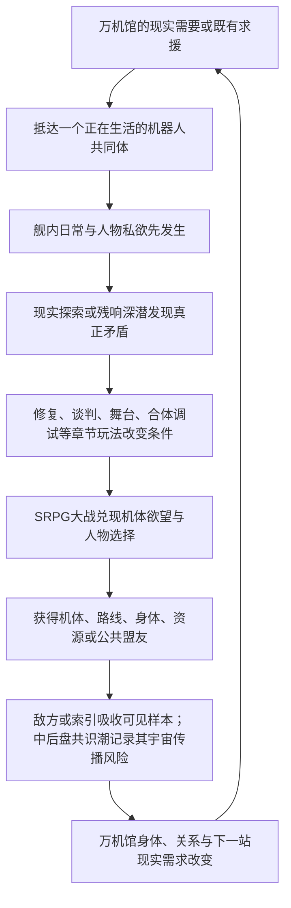

# Story Runtime v3 主笔决策视图：C02E01-BPLUS-A-S1-COLD-REVIEW-20260802

> 主笔默认只读本文件。其他TSV、trace和完整切片只用于审计、冲突排查或定向二次查询。

- 阶段：`review`
- 章节：`C02`
- 可用人物：6
- 可查实体：13
- 底座冲突：0 error / 0 warning

## 本阶段上层与结构边界

## L1 精确节选

### 2.1 商业定位句

**一款以原创机体承载经典机器人动画共同记忆、以会开馆也会变形暴走的流亡博物馆为基地、把SRPG大战、残响探险、机体修复、舰内生活和成人关系编织成一部长篇群像番剧的机甲RPG。**

它不是若干机器人主题小游戏的合集，也不是博物馆经营模拟器外接战棋；它首先要让玩家获得“这真是一场机器人大战”的满足，然后让战斗、收藏、生活和世界谜团彼此改变。

### 2.2 情感定位句

**献给所有曾经认真喜欢过机器人、动画、模型和玩具的人：你喜欢的东西不必先被洗成高雅文化才值得存在，它可以荒唐、商品化、错译、修过、掉漆，仍然能够成为人与机器彼此理解的一种语言。**

这不是向爱好者颁发“你们其实很有内涵”的奖状。作品要先承认爱好本来就有欲望、占有、争执、消费、低俗笑话、烂胶和失败，再让玩家亲手看到它如何承载友谊、爱情、责任、战争记忆和文明想象。

### 2.3 戏剧定位句

**一群把机器人爱得各不相同的人，驾驶一座流亡的万机馆，试图重新连接灾后彼此失语的人类、机器和群星；他们越能把万机组织起来，越接近再次制造那个曾险些毁掉世界的“唯一标准角色”。**

### 3.1 第一幻想：我正在参加一场真正的机器人大战

玩家进入本作，首要欲望不是给文化概念做判断，而是：

- 看见新的真实机体登场，而不是展柜、模型盒、核心和文字代替机体。
- 让不同尺寸、技术谱系和作品气质的机器人在同一战场互相救场、争风头和抢最后一击。
- 经历合体、变形、换乘、后继机、量产机逆袭、战舰炮击、暴走、巨大化、说得、撤退、全弹发射和最终全员支援。
- 明确知道谁在驾驶、谁在自主行动、谁留在舰上支援，以及机体为何愿意战斗。
- 通过编队、改装、支援、路线和关系，把自己偏爱的冷门机用到终局，而不是只看热门主角机表演。

[可按需查询完整切片]

### 3.4 第四幻想：我能认出梗、接住梗，再把它打成新的名场面

G.A.G.里的“GAG”不能只剩一个好听的世界观缩写。玩梗是本作区别于一般原创机甲RPG的核心快乐：玩家认出一台机、一句短台词、一个合体动作、一种玩具争议或一段人物关系，笑出来、燃起来或先一步知道悲剧要来了；角色随后不是把出处讲解一遍，而是把这份共同记忆接进自己的困局，打出原作没有、本作才可能发生的新结果。

[可按需查询完整切片]

### 3.5 第五幻想：我的收藏、手修和偏爱真的能影响巨型机器人

模型和玩具不是假的实机，也不是可以随意放大的魔法胚胎。它们保存的是：

- 某个版本的外形和装配逻辑。
- 某个人如何理解、修理和命名这台机器。
- 一种被商品、动画、误记和共同游玩反复强化的关系锚点。

玩家可以把模型锚件、深潜所得、全尺寸接口和工房工程结合，完成识别、校准、改装、支援、隐藏机唤醒或实机修复。真正承受重量和炮火的仍是全尺寸身体。由此形成目标玩家熟悉的快乐：一块小零件、一张错版说明和一道手修痕，能够帮助一台十八米机器人重新站起来，但不是因为宇宙碰巧把塑料放大了。

### 3.6 第六幻想：我会和这些人真正相爱、争吵并失去

人物关系不是战后好感度结算。纪存、七海、白鸢以及主角团必须在共同生活和大事件中发生：

- 明确的欲望和身体吸引。
- 专业能力带来的欣赏与威胁。
- 吃醋、挑逗、误会、嘴硬、低俗笑话和软色情式卖相。
- 隐瞒、背叛、毁掉对方方案、选择先救谁和替另一人承担。
- 理解、照顾、崩溃、重新靠近、主动亲吻、拒绝与错过。
- 可能的牺牲、离队、死亡、残响回归和带缺口的关系结局。

成人关系可以性感、狗血、危险甚至有一点俗；儿童与少年角色完全隔离成人向和修罗场。七海与白鸢必须拥有不经纪存中转的吸引、秘密、事业互救和独立结局，不能只是两条男主路线互相礼让。

### 3.7 第七幻想：我不只看剧情，我用多种玩法改变它

本作的持续循环应让玩家反复经历：

1. 在舰内生活、接任务、整备和选择今日开放内容。
2. 进入现实区域或残响层探险，寻找零件、人物、路线、记忆和危险样本。
3. 通过修复、认证、谈判、调律、舞台、格斗、追逐或章节专属玩法改变局势。
4. 把结果带入SRPG：改变地图、初始部署、隐藏目标、说得窗口、支援和损伤。
5. 战后回到万机馆，看见设施、关系、机体、敌方学习和下一站都已不同。

SRPG承担最大的冲突与兑现，多玩法负责让胜利成为“我准备出来、发现出来、修出来和打出来的”，不能只是看完ADV后进入一张无关地图。

### 6.1 投射的是共同记忆，不是换皮名单

每个主要参战谱系至少应有以下四项中的三项进入主线：

- 能被玩家辨认的机体视觉或机械语法。
- 能被玩家辨认的关系结构或悲剧情境。
- 能被玩家辨认的名场面、动作、台词节奏或演出气质。
- 本作基于该共同记忆提出的原创What-if或反转。

台词与名场面不必一律“纠正原作”。在合法和创作边界允许的范围内，经典短锚点若与场景真正贴合，可以直接致意；更多时候应把数个共同记忆揉进一个新情节，让玩家会心而不是做出处考试。

### 7.5 核心群像不是三位主角的功能插件

三主角负责全剧最危险的“连接、秩序与可能性”，但万机馆能否成为群像番剧，取决于其他核心角色是否拥有不靠三人批准也会继续运行的事业、关系和机体命运。第一版最低群像合同如下；逐章总纲可以扩充，不能把这些人降回岗位台词。

| 核心角色/组合 | 他们自己的长线欲望 | 必须经历的外放变化 | 对全剧不可替代的作用 |
| --- | --- | --- | --- |
| 兜灯 × 馆守Z | 让继承来的守护者真正活下去，而不是把它供成遗像 | 从“只有我能让它停”走到把停止权、维修权和出击选择交给机体与同伴；也要有一次因过度保护而失去战机 | 承担万机馆身体、现场安全、旧家族伤口与馆守Z后继形态 |

[可按需查询完整切片]

## L2 精确节选

### 1.1 全剧最核心的一句话

**他们必须重新连接全世界、最终连接群星中的机器人，才能阻止新的毁灭；而二十七年前，人类正是在一次真正救过世界的全球连接中，让所有机器人逐渐被迫接受同一种安全角色。**

这句话同时解决主线目标、G.A.G.灾变、万机馆航路、纪存能力、索引成长和终局选择。

### 1.2 总发动机句

**失去旧址的万机馆必须沿百机航路寻找全尺寸修复资源、公共泊位、机体盟友和G.A.G.异常源，才能继续生存并保护沿途正在被封存、征用、商品化、战争化以及遭受漏潮侵袭的机器人共同体；每一次成功的修复、开馆、合体、玩梗和大战，又会向白框、清噪工具与索引提供一份更完整的“万机怎样共同回应”样本。旅途中，众人逐渐发现灾后城市仍由失去发言权的静默机魂托底，各地防卫机曾在二十七年近地战争中留下未完人生，远征军把机器人故事写成跨文明角色协议，而归航者已长成一座无法普通停靠的移动世界。白框随后把最好结局推进到真实分支主体；全世界二十七年共同建设的天穹联装工程也逐步齐备，索引没有造出这些身体，却把全部救命经验压成唯一永久的神座式封闭解。万机馆越像一座方舟，索引越接近取得联装工程的总调度权；纪存越像英雄舰长，也越接近成为所有机魂无法拒绝的总指挥。**

[可按需查询完整切片]

### 5.3 下一站的因果门

百机航路不是一张按主题排列的旅游地图。每次转场至少同时满足以下三项中的两项，支柱章最好三项全部成立：

1. **现实需要**：万机馆或现有机群确实缺少身体、制造、能源、医疗、泊位、航路或盟军。
2. **旧线追踪**：前章敌人带走的样本、关系伤口、白舰信号、未来报告或G.A.G.异常指向那里。
3. **主体求援**：当地人物、机器或共同体主动发来具体请求，并且它的愿望不是“请来替我们讨论主题”。

新警报可以加速出发，不能单独创造下一章。若替换目的地后舰体、敌方、人物和谜团都不受影响，说明这不是因果航路，只是串珠式选题。

### 8.1 一次章节循环的因果

这不是每章强制九步齐全。章节可以从追击战、约会、演出或深潜开始；但章末必须看见我方为何成长、世界为何变化、下一站为何不能随便替换。

### 8.4 防止再次写成串珠公路片

每章都要同时拥有四种线，但不平均分配篇幅：

- **本地主事件**：当地人物和机体此刻非解决不可的具体危机。
- **追入线**：至少两条前章人物、敌方、资源、谜团或关系后果进入本章，并改变本地主事件。
- **远端线**：至少一股未到现场的阵营继续行动，通过市场、舰队、舆论、远程任务或另一条分支留下结果。
- **带出线**：本章至少把三条已经改变的线送往不同未来，不把所有问题在章末一起结清。

全剧应呈现“分散行动、交叉误伤、短暂汇合、再次分舰、最终汇流”的波形。角色不出场时也可以在别处工作、失败、恋爱或夺权；缺席不能等同暂停存在。

### 8.5 机体不是首登消耗品

每台主要机体和参战包都应拥有一条可见生涯，而不是在自己的主题章完成一次功能后消失：

1. 先以锚件、传闻、敌机或求援建立期待。
2. 正式登场时拥有想赢、想合体、想工作、想找回谁或想证明什么的正向欲望。
3. 与主角团发生并肩、冲突、说得、拒绝上舰或条件加入。
4. 在后续章经历改装、换乘、后继形态、关系变化、战损或政治站位。
5. 在百机祭、分舰、内战和终局至少有一次与早期欲望相关的回援或对立。

背景实机不必全部走完整五步，核心参战包必须。新机体密度由逐章装载决定，生命周期由全剧总纲负责；二者不能互相替代。

### 8.6 名场面、玩梗与精神指令也要有生命周期

IP素材不是每话抽两张卡。逐章总纲先确定原作精神与关系困局，再选择名机体、短台词、构图、玩具生态和玩法承载。高辨识锚点可以先以笑话或误记出现，后来在战败、关系破裂或终战中被同一人物重新说出，意义发生变化；精神指令也可以随人物从模仿英雄、依赖某人，发展到拥有自己的战斗动词。

支柱章应优先创造“多个熟悉元素撞成一个陌生结果”的场面，而不是把所有台词平均分给机体。直接短引、误记、反说和原创变奏都可使用，但要在台词账本中记录首次、变义与回收，避免名场面只消费不生长。

## L3 相邻章节精确节选

### C01 闭馆以后，万机出击

万机馆停止续约后的最后开放日，一头突破近海防线的裂星潮突入体`BREAKER`落入东部旧会展区。闭馆来自长期亏损、灾后恐惧、馆长失踪与代哥停止续约共同造成的现实衰败；代哥不是本章Boss。纪存先完成最后一场导览和观众撤离，再进入馆守Z胸前的导览席，与它的机魂人格“旧守护者”共同迎战。七海位于东区封存中心附近，撤回自己签发的停机令并承受调查，不越权替城市或军方批准作战。

这章的主语是“博物馆重新记起自己也会战斗、也会远行”。馆守Z以18米旧巨神之身对抗近30米的BREAKER地面重甲；荒川豪司越过企业撤离令，驾驶无机魂的勇拳试作机加入双拳协战。馆守Z以火箭右拳和勇拳的冲击储存共同击穿外壳，原右臂因过载毁损，敌方却露出能够飞行并指挥增援的核心形态。万机馆随后恢复二十七年前的巡展舰身体，退役重盾、救援锚和推进骨架作为本馆独有的巡展武装重新参战；馆守Z装上只有抓握与固定功能的临时巡展臂装，从舰首追入云层，以一直负责保护的左拳击毁BREAKER。

玩家第一次获得一场完整的机器人大战：旧巨神起身、勇者试作机越权出击、双拳接力、敌人二阶段、战舰升空和舰首必杀。玩家也只在行动层面看见机魂与G.A.G.：旧守护者从轮式导览终端回到同一具馆守Z身体，万机馆在全馆回应中恢复巡展能力；本章不解释机魂生成、纪存真相和二十七年前完整灾变。白鸢不出现，社勇王真机不出现；白色采样机只在尾声取得右拳残片，作为更大回收网络的无名钩子。

胜利使旧址成为无法复原的巨大船坞，万机馆却不是低功率逃亡，而是主动把路线牌推进“第七次巡展”。它的旧引擎只足以可靠抵达邻近一站，巡展臂装不能承受第二场大战，舰底也缺少现代泊位接口。木桶街公开广播拥有旧式泊位、全尺寸改件和让临时手臂继续成长的办法，因此成为第七次巡展的第一个现实目的地。纪存、唐胶、兜灯、跌跌和机器犬随舰；豪司与勇拳留在企业体系内，七海留在城市接受调查。

### C02 木桶街，万机初开

木桶街掌握停产全尺寸转子、旧式泊位件和万机馆能继续移动所需的现货。纪存一行进入的不是只卖怀旧物的模型市场，而是一整套由收藏者、修件师、灰色认证、旧平台、实机拆解和物流共同维持的机器人生态。唐胶过去替人保住摔坏模型，也替平台模糊过维修史；现在他必须决定是否公开自己的手法与旧错，让救命件不再以“近似原装”的谎言流通。

本章用寄售仓追逐、扫描门争夺、全尺寸件运输和机械擂台扩大玩法。旧拳王不是一只手套，而是可驾驶、可改装的拳击机体；火种重涂机和小型变形样件分别证明“同模具”不等于同一主体。模型锚不凭空长成巨机，只向工程制造与机魂绑定提供形态、关系和动作偏好；小样件若取得行动身体，必须来自木桶街已有的全尺寸承载壳或G.A.G.应急材料预算。

白鸢因自己的安全分镜被平台盗用而现身。她的纸面分镜通过合法扫描、战术模拟器和有限执行接口转成可供驾驶员修改的路线建议，尚不能凭画笔直接改变现实。唐胶公开维修页，原主人和那名在盒内写下童年名字的中年收藏者得到完整回收，不让泪点只起个头。章末白鸢成为临时乘员；转子虽到手，却必须去工务城完成全尺寸校正。

### C03 工务城，谁在让城市站着

工务城不是又一次“救几台机器”。衡令使用陆衡当年删去现场语境的廉价稳定程序，开始把吊装机、交通塔和道路板锁成可征用姿势，并沿三层环轨撤退。市政最初把万机馆视为新风险源；当衡令同时夺取城市工务机，玩家用实际协作证明自己能帮这座城继续上班，双方才建立临时共同战线。

预算二号、市政吊装机、灰崎警备机和消防架桥机都有明确到场原因。战斗围绕移动道路、翻转轨道、热锁视野和旧伤限制展开，不再靠十分钟、一厘米制造虚假紧迫。陆衡负责把模型与锚件表达翻译为承力、材料、控制和安全工程；唐胶负责看见量产图纸没有记录的修件痕迹、公差手感和民间做法。两人互补，不争夺同一个“会修东西”的位置。

七海实体抵达并以共同监督身份登舰；白鸢第一次允许地方驾驶员把她的构图改得面目全非，并仍署共同作者。陆衡失去旧跨城资质，衡令失去工具冠、外甲和城市接口，只带受损旧稳定核撤离；万机馆获得低速稳定运行与公共泊位。白舰随后送来一份当前身体制造求援和一份二十七年前旧远征包，纪存则从工务城主动发出百机航路邀请。求援与主动选择共同迫使队伍面对比修船更大的问题：谁有权为机魂制造身体。

## H0定向查询

## H0可查询目录

- 《超GAG机器人大战：万机残响》世界机制与创作接口设定基线
- 一、这份基线解决什么
- 二、权威标记
  - 2.1 本轮打捞并固化的成熟成果
- 三、一页式答案
- 四、核心关系图
- 五、机魂、AI、驾驶员和身体
  - 5.1 机魂的稳定定义
  - 5.1.1 G.A.G.与机魂的边界
  - 5.1.2 机魂涌现反馈环
  - 5.1.3 AI、机魂、驾驶员与整备员
  - 5.1.4 离体、转移与分支主体
    - 机魂场面的四项必答
  - 5.2 六层行动栈
  - 5.3 常见机体配置
  - 5.4 换身体、共身和复制

[可按需查询完整切片]

## Current场景与前章出口

| 场景 | 标题 | 地点 | 必要实体 | 可选实体 | 当前只锁什么 |
|---|---|---|---|---|---|
| V359-C02E01-CREATIVE | 救命零件，限定发售 | 木桶旧件市货运环线/退役会展车库 | CH_JICUN;CH_TANGJIAO;CH001;V353U043;V353U071;MECHA_WANJI_MAIN_CIRCULATION_ROTOR | CH_QIHAI;N_BAIYUAN;V353U001 | 当前只锁故事事实：木桶街拥有万机馆续航所需的全尺寸转子与泊位件；唐胶的旧维修认证史进入公开冲突；模型锚只能向工程与机魂绑定提供信息，不能凭空长成巨机。白鸢本人不在场，只能以被盗用作品痕迹预显影；陆衡尚未正式登场。货运地图、零件尺寸和战斗阶段由C02 L4重建。 |

## C01-v3.1创作基线与C02继承包-v2.md

# C01用户审定故事与C02继承包

> Status: `working_story_handoff / C01_layer4_closed / C02_not_initialized`
>
> 日期：2026-07-26
>
> Story source: `V35第四层逐章完整总纲/C01/C01-完整剧情总纲.md`

本包只保存C02必须继承的故事状态。旧C01 Reader、Runtime、Graybox、载荷Bundle和白函战斗均不具有当前生产权。

## 一、C02硬事实

- 万机馆已从固定展馆恢复为百米级巡展舰，路线牌进入“第七次巡展”。
- 旧址被舰体挣开后成为无法复原的巨大船坞，万机馆不会回去重新当固定建筑。
- 馆守Z是18米独立实机；旧守护者是其机魂人格，不是驾驶员或独立导览AI。
- 馆守Z原右拳和完整前臂在过载火箭拳中毁损，主要残片留在旧址。
- 馆守Z现装临时巡展臂装，只能抓握、放锚、牵引与固定；真正后继右臂尚未取得。
- 万机馆旧引擎只能可靠抵达邻近一站，舰底缺现代泊位接口，巡展臂装也经不起第二场大战。
- 纪存、唐胶、兜灯、跌跌和机器犬随舰；陆衡、豪司、七海、儿童、观众与消防组没有登舰。
- 豪司与无机魂勇拳试作机完成首战，随后被企业回收；社勇王真机仍未首控。
- 七海留在东区封存中心接受调查。她撤回了本人签发的停机令；外海航路和火力区由城市应急系统开放，她只把公开路线传给纪存，没有获得万能权限。
- 纪存与七海的饭约只完成“一半”：一只保温盒由七海带走，另一只写着纪存名字留在店家冷藏柜。
- `BREAKER`地面外壳和飞行核心已被击毁；无标志白色采样机带走一块馆守Z右拳残片。
- 木桶街主动邀请万机馆来开馆，并掌握旧式泊位、全尺寸改件与巡展臂装升级能力。

## 二、C02必须延续的人物运动

### 纪存

他已经从守馆员变成第七次巡展的组织者，完成过观众撤离、导览席协战和母舰起航。C02不能再让他只审批、贴标签或重复犯错；他应主动决定万机馆第一次去哪里开、愿意向谁求助、哪些机体可以作为伙伴而非藏品同行。

### 七海

她的选择不是“偷偷放水”，而是公开撤回自己签发的停机令。C02应让调查后果、职业同僚和她仍想赴完那顿饭的私人欲望同时存在，不能让一次远程共餐自动完成和解。

### 唐胶与兜灯

唐胶因木桶街广播认出旧人，负责把临时巡展臂装带进真正的模型、改件和实机生态；兜灯必须判断哪些改装会伤害馆守Z。两人的专业冲突和吸引力要通过一件真的装备推进，不回到互相吐槽。

### 豪司

他已经证明自己能驾驶勇拳打出英雄动作，也必须承担企业处分。C02可以让社勇王正式驾驶资格成为诱惑，但不能抹掉越权首战，也不能把勇拳直接升级成社勇王。

### 白鸢与陆衡

二人均未在C01出现。白鸢可在C02按第三层职责正式进入故事；陆衡的正式登场与加入推迟到C03新L4，不得从旧继承包恢复成C01随舰工程师。

## 三、机制边界

- 机魂形成连续自我与主动选择；驾驶员、程序或成熟AI都能让机器行动，但不自动等于机魂。
- 模型、玩具和手修件只能提供形状、版本、动作偏好和关系锚，不能凭空长成巨机。
- G.A.G.不是万能能源。本章只允许它放大已有载体、记忆与关系中的回应。
- 万机馆巡展武装必须来自真实全尺寸装备；馆藏不会临时拼装成舰体。
- 白鸢的纸面分镜若要影响行动，必须经过她的预演、可读行动图、现实执行者和现场修改，不能直接改写现实。
- `万机馆｜本次开放资料`只整理故事已经演出的知识，不能替C02主因果补洞。

## 四、C02入口而非固定剧情

C02的固定入口只有：

1. 万机馆抵达木桶街却找不到可兼容的现代泊位；
2. 唐胶必须面对旧关系与旧手艺；
3. 馆守Z巡展臂装需要全尺寸改件；
4. 木桶街希望万机馆开馆，平台、收藏者、工房和实机各有不同利益；
5. 白色采样机带走的残片在幕后继续流转。

具体战斗、机体首登、白鸢入场方式、是否取得转子及如何前往工务城，必须由C02对齐卡、预生产和新总纲决定，不从旧四话候选直接继承。

## 五、禁止回流

- 白函作为C01主敌或带伤撤退；
- 断臂桥、档案主库牺牲和载荷二选一；
- 36小时死亡倒计时和移动风险编号；
- 陆衡C01随舰；
- 0号侧廊、迟到回信和错序箭头在C01必显；
- 把木桶街只写成救命零件商店；
- 把馆守Z巡展臂装当成完整新右臂；
- 用资料卡解释模型与实机、白鸢能力或平台关系中本应由故事演出的因果。

## 14-C02E01-S1-fuse-draft-v1.md

# C02E01《救命零件，限定发售》第一场熔断样本

> Status: `candidate_fuse_sample / pending_cold_read`

## 万机馆没有泊位

【短动画】

万机馆在木桶街上空绕了第二圈，仍然没有找到能落下的泊位。

街区比纪存想象中大得多。成排的模型店只占最下面两三层，屋顶上方横着全尺寸机体的吊运轨道；十八米高的作业机能沿主街通行，涂着不同年代标记的机库一直排到货运内环。但这些设施都是为巨机和运输车修的，没有一处能容纳一艘一百多米长的巡展舰。

地面引导灯最后把万机馆带到街区外。那里曾是大型展会的装卸场，展馆拆除后，只剩一片足够宽的混凝土承台和几座停用塔吊。

万机馆缓缓降下。舰底碰到承台时，整片空地沉了一下，积水从伸缩缝里挤出来。自动航行系统关掉推进器，周围随即安静下来。没有补给臂靠近，也没有任何管线接上舰体。

【舰内ADV】

兜灯蹲在前厅地板上，手掌贴着还在轻微震动的检修盖。震动停稳后，她才站起来。

“能落。”她说。

纪存等了两秒：“后半句呢？”

“这儿只有一块够硬的地，算不上泊位。散热还在往上走，再起飞会怎么样，我现在不敢答应。”

唐胶已经走到舷窗边。隔着废弃承台和一条宽货道，他能看见木桶街最外侧的招牌。那些招牌有些换过好几轮，支架和店面却还是原来的位置。

“邀请里可没写让我们停荒地。”纪存说。

“木桶街什么时候按邀请办过事。”唐胶拉上工具包，“至少没让你交停车费。”

外部通讯忽然接进来。一个女人的声音从前厅扬声器里传出，中文很流利，没有寒暄。

“唐启明。下船。”

唐胶抓工具包的手停了一下。

纪存看向他：“找你的？”

“一般这么叫我的，都是来翻旧账的。”

扬声器里的女人显然听见了：“这次账比较大。把能做决定的人也带上。”

【承台ADV】

人员舷梯落到地面。纪存、唐胶和兜灯下舰时，馆守Z也从舰腹机库走出，停在承台另一端。它缺失的右前臂装着黄色巡展臂，三指夹爪收在身侧，没有做出战斗姿态。

来接他们的是一辆灰白色重载引导车。女人站在车旁，四十多岁，工作服袖口卷到手肘，一只手还戴着防割手套。她先看了看万机馆，又看了看唐胶。

“你回来的东西比以前大。”

“它不是我的。”唐胶说。

“你以前也爱这么说。”

她摘掉手套，向纪存伸手。

“玛拉·瓦尔加。木桶街重载运输班。邀请是我让人发的。”

纪存和她握了握手：“纪存。现在负责让这座馆别掉下来。”

“那正好。”玛拉从车里拿出一块工作终端，“我这里有件东西，能让它继续飞。今晚十二点以后就没有了。”

屏幕上正在播放平台仓库的公开画面。

一套巨大的环形设备横放在低载架上，占了半个仓位。工人已经撤到安全线外，两台自动切割机正在校准位置。画面旁列着十几项预售商品：外环散热片、中心轴承组、老规格连接座。每一项后面都标着买家已付款。

标题写得很清楚：

`木桶街全尺寸试机台主转子｜拆分发货：午夜` 

兜灯把画面放大，又调出万机馆保留下来的设备图。她没有报参数，只把两个圆环叠在一起。

“尺寸对得上。”她说，“它能接进万机馆的主循环。整套才有用，切开就别想了。”

唐胶盯着切割机停留的位置，脸色沉了下来。

“这套东西不是平台造的。”

“平台出过仓储费，也替木桶街垫过钱。”玛拉说，“合同到期，他们按库存处理。拆件订单已经卖完，我昨天申请停运，今天上午被驳回。”

她把另一页文件翻出来。唐胶只看了一眼，就认出了自己的签名。

“你当年写的是可替换件可以单独流通。”玛拉说，“他们现在认为，能换的部分加在一起，就是整套都能拆。”

“我没写过这种话。”

“所以进去看。别在停车场跟我争。”

纪存问：“回购呢？”

“买家不止一个。我们付不起退款和违约金。”

“走正式争议？”

“明天可以争。第一刀今晚下。”

承台另一端，馆守Z胸前的扬声器响了一声。

“本舰当前不具备可靠返航条件。”旧守护者说，“建议优先检查替代设备。”

玛拉抬头看了它一会儿：“它一直这么客气？”

“今天算客气的。”兜灯说。

纪存把工作终端还给玛拉。

“你叫我们来，是想把它运进万机馆？”

“先把它完整留下来。放在哪里，可以以后再谈。”

“按现在这份合同，我们进去拿算什么？”

玛拉没有绕开这个问题。

“算抢。”

唐胶没有看纪存。他把工具包重新背好，先往引导车走了两步，又停下来等。

纪存望了一眼停在承台上的万机馆。舰体没有熄灯，自动系统却已经把起飞状态标成了黄色。

“先看实物，也看完整合同。”他说，“看完再决定抢不抢。”

玛拉拉开车门：“那就别站着了。平台六点换班，换班以前，我们还能以维修人的身份进去。”

引导车驶向木桶街。馆守Z沿货道步行跟在后方，万机馆留在断电的承台上，远远压过已经拆空的会展地基。

终端里的直播仍在继续。第一台切割机完成校准，机械臂抬了起来。

## 合法人物

### 兜灯 (`CH001`)
- 身份/职责：馆守Z整备员
- 当前能力边界：可在第一章作为维修与安全操作单位出现；她负责判断馆守Z何时能够行动、何时必须制动，并能在现场真正执行，不由纪存或系统代替。具体战斗动作和回合数由C01 L4决定。
- 想要：证明祖传机体不是灾难;也证明自己不是只会守旧
- 害怕：祖父留下的东西其实害过人;自己维护的是错误神话
- 压力下先做什么：擦零件;骂人;把情绪转成维修指令
- 亲密如何落实为动作：允许别人碰她的工具;给旧件写日期
- 容易被写扁成：让兜灯讲抽象守护论或只靠拒绝别人证明主体性
- 句形：短硬句;常打断别人
- 身体动作：擦油污;检查螺丝;护住旧件
- 身份备注：中国公民，本名窦晓宁；兜灯是窦姓与童年头灯习惯形成的维修组昵称。铁馆魔神线入口，和馆守Z的长期关系优先于一次战斗爽点；旧C01E02-BATTLE-START仅为历史实现时序。
- 全剧弧线权威：Candidate Support，不得当作本章既成事实
- 当前状态证据（仅匹配行）：
  - {"C01E01_change": "在滨海塔楼预约餐厅等纪存；因闭馆移交返回代哥东区封存中心危机联络室", "C01E02_change": "确认观众撤离与兜灯在场后撤回本人停机令；不替城市批准战斗；因此进入内部调查", "C01E03_change": "留在危机联络室读取城市公开应急图与代哥交通卫星数据，没有介入勇拳企业权限或馆守Z战术", "C01E04_output": "明确自己无权批准起飞或调动城市炮火，只把民用净空航路与防空禁射区叠给纪存；战后回到已闭厨的预约餐厅，与纪存约定下一次由他订位；留城接受调查", "C02_required_read": "C02不得把她突然写成随舰特派员；私人频道与未完成饭约保留；后续登舰需要新的正式由头", "category": "character", "chapter_input": "代哥安全封存局人员；位于东区；与纪存多次约饭未成；曾签发馆守Z停机令", "entity": "佐伯七海 / Nanami Saeki", "record_id": "C01STATE002", "status": "layer4_current_pending_manifest_seal"}
  - {"C01E01_change": "以模型病院、合体模型笑点和未取件展示日常工作", "C01E02_change": "从烟中把修好的社勇王交给小满并封存易燃材料；不让儿童随舰", "C01E03_change": "留在馆内安全维修区，帮助确认旧巡展装备来历但不解释巨机工程", "C01E04_output": "随舰；断开市政管线、固定馆藏并与兜灯接入全尺寸巡展臂；从木桶街陌生来电听出旧关系", "C02_required_read": "C02由他的木桶街人脉发动；其模型/手修判断不能替代兜灯的实机整备", "category": "character", "chapter_input": "模型病院负责人；熟悉模型、手修、旧件与万机馆藏品", "entity": "唐胶", "record_id": "C01STATE003", "status": "layer4_current_pending_manifest_seal"}
  - {"C01E01_change": "在右侧维修架工作，与旧守护者形成日常互呛", "C01E02_change": "打开导览席、接主动力并说明馆守Z机况；七海撤令后解除物理限位", "C01E03_change": "E03说明过载火箭拳会失去原右臂；不替馆守Z作决定", "C01E04_output": "随舰；完成巡展臂装结构接入并持续监控烧损右肩", "C02_required_read": "C02不得让巡展臂免费等同战斗右拳；兜灯继续负责实机边界", "category": "character", "chapter_input": "馆守Z实机维修与安全负责人；知道展示回路下仍有可应急直连的主动力，也知道老化冷却最多支撑本次连续出动", "entity": "兜灯", "record_id": "C01STATE004", "status": "layer4_current_pending_manifest_seal"}
  - {"C01E01_change": "轮式终端在人群脚边导览；巨体作为主展品；胸灯在警报后亮起", "C01E02_change": "正在使用的终端外壳受损后由胸前扬声器续话；机魂主体未受损；馆守Z自主操纵巨体撞墙出击、扯盾并击倒BREAKER", "C01E03_change": "决定过载发射右前臂；双拳击碎地面重甲；右前臂与肩内回收装置报废，残片留在封锁广场；用左臂把裂盾带回外部泊位", "C01E04_output": "接入不能握拳的巡展臂；前半战守在舰艏，终战获兜灯许可后让推进骨架点火一次，以左拳击毁裸露核心；推进骨架熄火后由勇拳托住左肩，两机落回裂盾；飞行稳定后备用轮式终端作为远端外壳接入；正式主力", "C02_required_read": "C02读取缺失右前臂、烧损肩接口、巡展臂功能、备用导览终端外壳和寻找/重造战斗右臂的长期目标", "category": "mecha", "chapter_input": "同一主体；旧守护者为馆守Z承担日常导览职责时的称呼；馆守Z为18米实机；巨体半跪但两臂齐全；机魂以馆守Z巨体主控系统为主要物理载体", "entity": "旧守护者 / 馆守Z", "record_id": "C01STATE008", "status": "layer4_current_pending_manifest_seal"}

### 旧守护者 (`CH002`)
- 身份/职责：馆守Z机魂人格;展厅导览人格
- 当前能力边界：第一章先以轮式导览终端和馆内广播陪伴观众；终端被压后，同一句话从馆守Z胸前扬声器继续说完。人格根始终固定在馆守Z胸腔保护舱内，E02在兜灯解除物理限位、七海撤回本人停机令后取得巨体运动权。
- 想要：完成闭馆并保护所有观众
- 害怕：分不清展品和孩子;忘记自己曾经没保护住谁
- 压力下先做什么：广播提示;纠正用词;重复安全规范
- 亲密如何落实为动作：把某人从观众识别为家人;主动降低规则优先级
- 容易被写扁成：让旧守护者像普通萌AI或纯搞笑系统
- 句形：短句;纠正句;重复句
- 身体动作：胸牌亮;广播失真;缓慢转头
- 身份备注：旧守护者与馆守Z是同一主体的日常称呼和正式机体名；导览终端、广播与胸前扬声器只是远程感官和输出端，不是独立AI或可复制机魂。纪存进入导览席只提供路线与判断，不控制四肢。
- 全剧弧线权威：Candidate Support，不得当作本章既成事实
- 当前状态证据（仅匹配行）：
  - {"C01E01_change": "完成最后导览并准备赴约；表现出对观众、藏品和馆内路线的熟悉；外敌来袭时判断不能往地下避难", "C01E02_change": "组织东侧撤离；确认旧守护者与馆守Z同体；进入导览席，第一次把机体视线和城市路线组织成实战判断", "C01E03_change": "找出BREAKER准备钻地时张开的中央红裂口；协调馆守Z、勇拳与城市边缘火力；见证馆守Z自行牺牲右前臂", "C01E04_output": "发现敌群持续追逐万机馆并提出引敌离城；在入口前厅恢复的公共航行台选择东侧净空航路，汇合城市、友军和敌影位置；自动航行系统负责推力、转向与平衡；终战为馆守Z报出唯一出击时机；成为第七次巡展实际组织者并随舰", "C02_required_read": "仍只表现为异常敏锐的机体理解、路线组织与协同天赋；不得提前公开机魂实体真相；下一章主动处理泊位、臂装与馆藏现实问题", "category": "character", "chapter_input": "万机馆导览与日常运营核心；旧馆长失踪后守住临时开放；与七海认识一年多；不知道自身真相", "entity": "纪存", "record_id": "C01STATE001", "status": "layer4_current_pending_manifest_seal"}
  - {"C01E01_change": "在右侧维修架工作，与旧守护者形成日常互呛", "C01E02_change": "打开导览席、接主动力并说明馆守Z机况；七海撤令后解除物理限位", "C01E03_change": "E03说明过载火箭拳会失去原右臂；不替馆守Z作决定", "C01E04_output": "随舰；完成巡展臂装结构接入并持续监控烧损右肩", "C02_required_read": "C02不得让巡展臂免费等同战斗右拳；兜灯继续负责实机边界", "category": "character", "chapter_input": "馆守Z实机维修与安全负责人；知道展示回路下仍有可应急直连的主动力，也知道老化冷却最多支撑本次连续出动", "entity": "兜灯", "record_id": "C01STATE004", "status": "layer4_current_pending_manifest_seal"}
  - {"C01E01_change": "通过导览和旧照片建立馆守Z、模型病院与万机馆的生活史", "C01E02_change": "全部经东侧坡道和封闭消防通道进入东区加固灾害避难所；小满只带走修好的模型；老余确认旧守护者的日常人格", "C01E03_change": "在避难所直播墙观看双机战，不进入战场", "C01E04_output": "从避难所直播墙看万机馆升空；全部留城", "C02_required_read": "儿童不随舰、不进入成人关系或危险探险；可作为未来观众回信和开馆反馈", "category": "character_group", "chapter_input": "万机馆最后开放日观众；小满社勇王模型待取；老余曾被馆守Z救过", "entity": "小满、阿澄、老余与最后观众", "record_id": "C01STATE006", "status": "layer4_current_pending_manifest_seal"}
  - {"C01E01_change": "轮式终端在人群脚边导览；巨体作为主展品；胸灯在警报后亮起", "C01E02_change": "正在使用的终端外壳受损后由胸前扬声器续话；机魂主体未受损；馆守Z自主操纵巨体撞墙出击、扯盾并击倒BREAKER", "C01E03_change": "决定过载发射右前臂；双拳击碎地面重甲；右前臂与肩内回收装置报废，残片留在封锁广场；用左臂把裂盾带回外部泊位", "C01E04_output": "接入不能握拳的巡展臂；前半战守在舰艏，终战获兜灯许可后让推进骨架点火一次，以左拳击毁裸露核心；推进骨架熄火后由勇拳托住左肩，两机落回裂盾；飞行稳定后备用轮式终端作为远端外壳接入；正式主力", "C02_required_read": "C02读取缺失右前臂、烧损肩接口、巡展臂功能、备用导览终端外壳和寻找/重造战斗右臂的长期目标", "category": "mecha", "chapter_input": "同一主体；旧守护者为馆守Z承担日常导览职责时的称呼；馆守Z为18米实机；巨体半跪但两臂齐全；机魂以馆守Z巨体主控系统为主要物理载体", "entity": "旧守护者 / 馆守Z", "record_id": "C01STATE008", "status": "layer4_current_pending_manifest_seal"}

[可按需查询完整切片]

## 机体、对手与其他实体索引

- 木桶街模型街 (`LOC_MODEL_STREET`) | location | C02外部临时开馆和模型/玩具/旧件生态主场 | 参战=未定 | 口径=不是商店菜单；必须同时呈现旧盒绘墙、退坑柜、临时托管柜、寄售台、样件柜、模型长灯和追踪物流线。 | 投射/来源=C02E01开始承接C01资源缺口和移动风险编号；后续可扩展为模型街自治路线。
- 馆守Z巡展臂装 (`MECHA_GUARDIAN_TOURING_ARM`) | mecha_component | C01E04由万机馆旧救援锚改成的临时右侧装备 | 参战=V355-C01E04 | 口径=接在馆守Z右肩残存固定口，只能抓握、放锚、牵引、固定和投放装备；不能握拳、精密操作、发射火箭拳或表现成完整新右臂。E

… | 投射/来源=后续可在木桶街换装不同工作手，但真正后继右臂必须另建机体形态和剧情。
- 万机馆主循环磁流散热转子 (`MECHA_WANJI_MAIN_CIRCULATION_ROTOR`) | scene_mecha | C02使万机馆恢复有限航行的全尺寸工业总成，必须由重型运输和吊装设备搬运，不能退化成手掌大的密封件 | 参战=V359-C02E01-CREATIVE | 口径=它是场景巨构和任务载荷，不是人格机体、不计参战；模型批次与维修史只能帮助辨认版本和适配方法，真正安装仍需全尺寸实物与

… | 投射/来源=正式资产应突出巨大转子、运输架、吊装和万机馆检修窗，不制作密集内部机构动画；精确尺寸、重量和安装动作由C02

…
- 万机馆巡展舰体 (`MECHA_WANJI_MOBILE_CHASSIS`) | mecha | C01E04恢复的百米级移动基地与母舰身体 | 参战=V355-C01E04 | 口径=生产态只保留固定展馆、离地转换和巡展舰三态；E01旧照片预告巡展形态，E03地下轮廓回应，E04恢复舰体并进入空战。

… | 投射/来源=与WBM001、LOC_WANJI_MOBILE_CHASSIS和泊位规则共同定义后续主循环；旧引擎只足以可

…
- 馆守Z (`V353U001`) | mecha | 18米开局旧巨神主力；C01失去原右拳与完整前臂，此后经历巡展臂装、代用结构和后继右臂成长 | 参战=V355-C01E02 | 口径=与MECHA_GUARDIAN_Z为同一机体的V35生命周期ID；旧守护者是其机魂人格。C01E02完成首次正式战斗

… | 投射/来源=内部锚Mazinger式火箭拳、旧超级系后继强化与博物馆守护者；后继弧读取CONCEPT_GZ_SUCCES

…
- 火种货柜领袖 (`V353U043`) | mecha | 作业变形、护送和领袖支援主力 | 参战=V359-C03E04-CREATIVE | 口径=以已有全尺寸载具身体和独立载具人格参加C02，并完成护送万机馆到工务城的一站承诺；C03E04离舰，承担百机航路邀请

… | 投射/来源=内部锚Transformers领袖与车队文化；C04不占舰位，C06不得由它包办星火车队谱系。
- 玩家模型机“无牌一号” (`V353U071`) | mecha | 自由改装、零件兼容和玩家构筑单位 | 参战=V359-C02E01-CREATIVE | 口径=木桶街原有全尺寸模块竞赛底盘和低权限竞赛AI；缩尺模型只提供改件同构数据，不会放大成机体。它在C02首控，V359-

… | 投射/来源=内部锚Gundam Build与模型竞技；名称可由玩家改，不共享社勇王许可。

## 本阶段任务

作为不知道作者答案的冷读者，先白话复述正文发生了什么，再判断欲望、因果、空间、知识、控制权和情绪是否成立。不要替文本补意义；若必须依靠设计说明才能理解，判为未完成。
