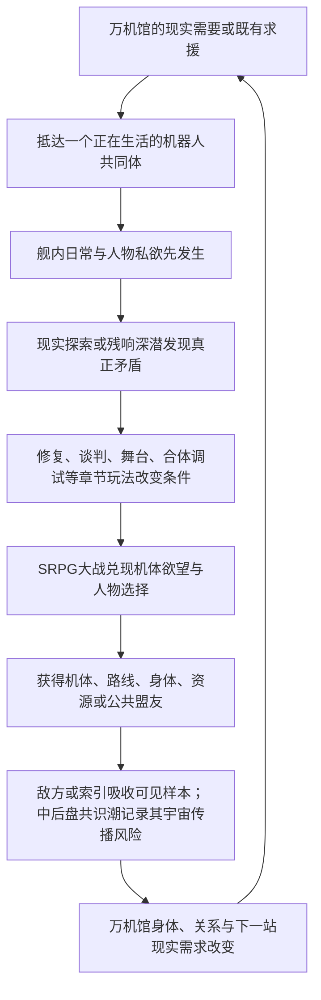

# 上层与机制上下文

## L1 精确节选

### 2.1 商业定位句

**一款以原创机体承载经典机器人动画共同记忆、以会开馆也会变形暴走的流亡博物馆为基地、把SRPG大战、残响探险、机体修复、舰内生活和成人关系编织成一部长篇群像番剧的机甲RPG。**

它不是若干机器人主题小游戏的合集，也不是博物馆经营模拟器外接战棋；它首先要让玩家获得“这真是一场机器人大战”的满足，然后让战斗、收藏、生活和世界谜团彼此改变。

### 2.2 情感定位句

**献给所有曾经认真喜欢过机器人、动画、模型和玩具的人：你喜欢的东西不必先被洗成高雅文化才值得存在，它可以荒唐、商品化、错译、修过、掉漆，仍然能够成为人与机器彼此理解的一种语言。**

这不是向爱好者颁发“你们其实很有内涵”的奖状。作品要先承认爱好本来就有欲望、占有、争执、消费、低俗笑话、烂胶和失败，再让玩家亲手看到它如何承载友谊、爱情、责任、战争记忆和文明想象。

### 2.3 戏剧定位句

**一群把机器人爱得各不相同的人，驾驶一座流亡的万机馆，试图重新连接灾后彼此失语的人类、机器和群星；他们越能把万机组织起来，越接近再次制造那个曾险些毁掉世界的“唯一标准角色”。**

### 3.1 第一幻想：我正在参加一场真正的机器人大战

玩家进入本作，首要欲望不是给文化概念做判断，而是：

- 看见新的真实机体登场，而不是展柜、模型盒、核心和文字代替机体。
- 让不同尺寸、技术谱系和作品气质的机器人在同一战场互相救场、争风头和抢最后一击。
- 经历合体、变形、换乘、后继机、量产机逆袭、战舰炮击、暴走、巨大化、说得、撤退、全弹发射和最终全员支援。
- 明确知道谁在驾驶、谁在自主行动、谁留在舰上支援，以及机体为何愿意战斗。
- 通过编队、改装、支援、路线和关系，把自己偏爱的冷门机用到终局，而不是只看热门主角机表演。

主线必须持续给予新机体、新动作和旧机体成长。模型、玩具、驾驶舱、黑匣子和文化物件可以让机体成立，却不能冒充参战规模。若连续一段剧情只出现功能道具和行政实体，没有让玩家记住一台新的机器人及其欲望，视为体验断粮。

### 3.4 第四幻想：我能认出梗、接住梗，再把它打成新的名场面

G.A.G.里的“GAG”不能只剩一个好听的世界观缩写。玩梗是本作区别于一般原创机甲RPG的核心快乐：玩家认出一台机、一句短台词、一个合体动作、一种玩具争议或一段人物关系，笑出来、燃起来或先一步知道悲剧要来了；角色随后不是把出处讲解一遍，而是把这份共同记忆接进自己的困局，打出原作没有、本作才可能发生的新结果。

本作所说的“梗”不只等于笑话。它是经过观看、复述、误记、模仿、玩具化和玩家争论后，被压缩成一句话、一个姿势或一种期待的机器人文化记忆。它可以很蠢，也可以很燃、很痛、很色情或很庄严。G.A.G.能让这种压缩记忆成为机魂、观众和机器都能读取的行动势能，却不能替角色决定它今天意味着什么。

一次合格的玩梗至少经过四层中的三层：

1. **认出来。** 玩家能从短台词、构图、动作、机体语法、关系或模玩生态认出共同记忆，例如“我来组成头部”、闭眼合体、红色高速、修正一掌、最终合体批准、全员支援或同模重涂。
2. **属于角色。** 这句台词为什么偏偏由此人说、这台机为什么偏偏在此刻做这个动作，必须来自它当下的欲望、恐惧、关系和战况。
3. **撞出新东西。** 两种以上作品气质、人物关系或玩具记忆发生碰撞，形成新的战斗解法、误会、笑点、悲剧或What-if，不把致敬停在摆姿势。
4. **留下后果。** 这次名场面改变机体形态、精神指令、关系、敌方学习、路线或后续回援，而不是用完即扔的引用卡片。

经典短锚点与场景结合得好时可以直接使用，不必把每句原台词都改得像在纠正原作；但不能连续背诵、照搬整场戏或只靠出处替本作人物充血。真正的目标是让熟悉者会心，让不熟悉者也会被眼前这场戏打中。

“机战精神”同时有两层含义：

- **玩法上的精神指令。** 它不是通用法术表，而是驾驶员、机魂和支援者把一生的习惯压进一个有限资源的戏剧按钮。热血、必中、觉醒、爱、勇气、魂等经典功能可以原创化命名与组合，但必须保留“战前预谋一次不可能逆转”的快感；人物成长、关系变化和创伤会改变其精神指令，而不只提升数值。
- **机器人动画的精神。** 勇气不是大声，爱不是回血，撤退不是失败，宿敌不是红色皮肤。每个IP投射都要先找到原作为何让人相信、流泪或起鸡皮疙瘩的那股精神，再决定名机体、名台词和名场面如何进入本作。

索引可以完美复制一句口号在什么时候最有效，却越来越不懂为什么有人会在明知无效时仍然喊出来。这条差异将成为G.A.G.、精神指令、IP投射与终局“完美机器人大战”的共同发动机。

### 3.5 第五幻想：我的收藏、手修和偏爱真的能影响巨型机器人

模型和玩具不是假的实机，也不是可以随意放大的魔法胚胎。它们保存的是：

- 某个版本的外形和装配逻辑。
- 某个人如何理解、修理和命名这台机器。
- 一种被商品、动画、误记和共同游玩反复强化的关系锚点。

玩家可以把模型锚件、深潜所得、全尺寸接口和工房工程结合，完成识别、校准、改装、支援、隐藏机唤醒或实机修复。真正承受重量和炮火的仍是全尺寸身体。由此形成目标玩家熟悉的快乐：一块小零件、一张错版说明和一道手修痕，能够帮助一台十八米机器人重新站起来，但不是因为宇宙碰巧把塑料放大了。

### 3.6 第六幻想：我会和这些人真正相爱、争吵并失去

人物关系不是战后好感度结算。纪存、七海、白鸢以及主角团必须在共同生活和大事件中发生：

- 明确的欲望和身体吸引。
- 专业能力带来的欣赏与威胁。
- 吃醋、挑逗、误会、嘴硬、低俗笑话和软色情式卖相。
- 隐瞒、背叛、毁掉对方方案、选择先救谁和替另一人承担。
- 理解、照顾、崩溃、重新靠近、主动亲吻、拒绝与错过。
- 可能的牺牲、离队、死亡、残响回归和带缺口的关系结局。

成人关系可以性感、狗血、危险甚至有一点俗；儿童与少年角色完全隔离成人向和修罗场。七海与白鸢必须拥有不经纪存中转的吸引、秘密、事业互救和独立结局，不能只是两条男主路线互相礼让。

### 3.7 第七幻想：我不只看剧情，我用多种玩法改变它

本作的持续循环应让玩家反复经历：

1. 在舰内生活、接任务、整备和选择今日开放内容。
2. 进入现实区域或残响层探险，寻找零件、人物、路线、记忆和危险样本。
3. 通过修复、认证、谈判、调律、舞台、格斗、追逐或章节专属玩法改变局势。
4. 把结果带入SRPG：改变地图、初始部署、隐藏目标、说得窗口、支援和损伤。
5. 战后回到万机馆，看见设施、关系、机体、敌方学习和下一站都已不同。

SRPG承担最大的冲突与兑现，多玩法负责让胜利成为“我准备出来、发现出来、修出来和打出来的”，不能只是看完ADV后进入一张无关地图。

### 6.1 投射的是共同记忆，不是换皮名单

每个主要参战谱系至少应有以下四项中的三项进入主线：

- 能被玩家辨认的机体视觉或机械语法。
- 能被玩家辨认的关系结构或悲剧情境。
- 能被玩家辨认的名场面、动作、台词节奏或演出气质。
- 本作基于该共同记忆提出的原创What-if或反转。

台词与名场面不必一律“纠正原作”。在合法和创作边界允许的范围内，经典短锚点若与场景真正贴合，可以直接致意；更多时候应把数个共同记忆揉进一个新情节，让玩家会心而不是做出处考试。

### 7.5 核心群像不是三位主角的功能插件

三主角负责全剧最危险的“连接、秩序与可能性”，但万机馆能否成为群像番剧，取决于其他核心角色是否拥有不靠三人批准也会继续运行的事业、关系和机体命运。第一版最低群像合同如下；逐章总纲可以扩充，不能把这些人降回岗位台词。

| 核心角色/组合 | 他们自己的长线欲望 | 必须经历的外放变化 | 对全剧不可替代的作用 |
| --- | --- | --- | --- |
| 兜灯 × 馆守Z | 让继承来的守护者真正活下去，而不是把它供成遗像 | 从“只有我能让它停”走到把停止权、维修权和出击选择交给机体与同伴；也要有一次因过度保护而失去战机 | 承担万机馆身体、现场安全、旧家族伤口与馆守Z后继形态 |
| 唐胶 | 证明修过、摔过、掉漆的东西仍值得被爱，也让手艺人活得下去 | 从个人绝活与嘴硬垄断走向培养别人、对抗工艺被洗白或武器化；不能只靠揭旧错成长 | 把玩家的模型生活、民间工房、生产链和修复喜剧接入巨机战争 |
| 陆衡 × 方舟T | 让现实机器、工程安全和非人AI在不同时间尺度上仍能互相理解 | 陆衡面对自己删去语境的可复制技术；方舟T面对保护性隐瞒和日志烧蚀，两者必须有无法同步却仍选择陪伴的损失 | 负责全尺寸工程、超距通信、现实机器尊严与最克制的人机亲密 |
| 豪司 × 金章 × 社勇王 | 证明勇气既不能靠审批制造，也不能靠口号免责 | 豪司从越权热血走向承担团队；金章从批准勇气走向有权拒绝一场“正确合体” | 提供勇者系精神、企业喜剧、AI主体和全剧最直接的燃魂接口 |
| 赤罡 × 莉歌 × 红面具 | 赢、追上、被听见，也让该活的人活着离开 | 追击、停火、撤退、嫉妒与宿敌吸引必须互相伤害；歌声与热血都可能救人，也会被战争系统利用 | 把战争线从主题讨论变成驾驶员欲望、王牌快感、歌声舞台和撤退伦理 |
| 白舰、舰长与量产队 | 把人送回去，而不是替主角机铺一条漂亮牺牲路 | 至少经历一次主角不在场仍自行决定的败退、分裂或回援；具名量产驾驶员可以拒绝英雄安排 | 承担战舰组织力、群像战争、普通驾驶员生死和终局非主角行动 |
| 槐与原典共同体 | 守住曾真正救过人的原作与仪式 | 必须同时遭遇正确原典救人、正确答案囚人、错版反而救人的三种事实；她不是“原作厨笑话” | 让名台词、原典、二创、误传和玩家共同记忆发生真正冲突 |
| 万机馆与核心机群 | 想工作、想合体、想找回驾驶员、想拒绝、想被当成自己，而不只是被收藏 | 主要机体均需经历首登欲望、并肩或冲突、形态/关系变化和终局回援；至少数台会反过来改变人类主角 | 机器人不是议题对象，而是与人类并列的群像主角 |

小满、阿澄和少年角色承担观众、家感、传承与普通生活，不承担成人关系，也不能让全剧退化成反复“保护孩子”。核心守护对象始终是不同年龄的人与机器共同拥有的机器人文化生活。

## L2 精确节选

### 1.1 全剧最核心的一句话

**他们必须重新连接全世界、最终连接群星中的机器人，才能阻止新的毁灭；而二十七年前，人类正是在一次真正救过世界的全球连接中，让所有机器人逐渐被迫接受同一种安全角色。**

这句话同时解决主线目标、G.A.G.灾变、万机馆航路、纪存能力、索引成长和终局选择。

### 1.2 总发动机句

**失去旧址的万机馆必须沿百机航路寻找全尺寸修复资源、公共泊位、机体盟友和G.A.G.异常源，才能继续生存并保护沿途正在被封存、征用、商品化、战争化以及遭受漏潮侵袭的机器人共同体；每一次成功的修复、开馆、合体、玩梗和大战，又会向白框、清噪工具与索引提供一份更完整的“万机怎样共同回应”样本。旅途中，众人逐渐发现灾后城市仍由失去发言权的静默机魂托底，各地防卫机曾在二十七年近地战争中留下未完人生，远征军把机器人故事写成跨文明角色协议，而归航者已长成一座无法普通停靠的移动世界。白框随后把最好结局推进到真实分支主体；全世界二十七年共同建设的天穹联装工程也逐步齐备，索引没有造出这些身体，却把全部救命经验压成唯一永久的神座式封闭解。万机馆越像一座方舟，索引越接近取得联装工程的总调度权；纪存越像英雄舰长，也越接近成为所有机魂无法拒绝的总指挥。**

这条发动机不只复制战术。每一次名场面重演、经典短台词被重新喊出、精神指令觉醒和观众集体接梗，也会告诉G.A.G.与敌方：人们在什么时刻相信一台机器人“应该”怎样行动。全剧真正争夺的是谁能把共同记忆从空壳模板重新变回角色自己的精神。

### 5.3 下一站的因果门

百机航路不是一张按主题排列的旅游地图。每次转场至少同时满足以下三项中的两项，支柱章最好三项全部成立：

1. **现实需要**：万机馆或现有机群确实缺少身体、制造、能源、医疗、泊位、航路或盟军。
2. **旧线追踪**：前章敌人带走的样本、关系伤口、白舰信号、未来报告或G.A.G.异常指向那里。
3. **主体求援**：当地人物、机器或共同体主动发来具体请求，并且它的愿望不是“请来替我们讨论主题”。

新警报可以加速出发，不能单独创造下一章。若替换目的地后舰体、敌方、人物和谜团都不受影响，说明这不是因果航路，只是串珠式选题。

### 8.1 一次章节循环的因果

这不是每章强制九步齐全。章节可以从追击战、约会、演出或深潜开始；但章末必须看见我方为何成长、世界为何变化、下一站为何不能随便替换。

### 8.4 防止再次写成串珠公路片

每章都要同时拥有四种线，但不平均分配篇幅：

- **本地主事件**：当地人物和机体此刻非解决不可的具体危机。
- **追入线**：至少两条前章人物、敌方、资源、谜团或关系后果进入本章，并改变本地主事件。
- **远端线**：至少一股未到现场的阵营继续行动，通过市场、舰队、舆论、远程任务或另一条分支留下结果。
- **带出线**：本章至少把三条已经改变的线送往不同未来，不把所有问题在章末一起结清。

全剧应呈现“分散行动、交叉误伤、短暂汇合、再次分舰、最终汇流”的波形。角色不出场时也可以在别处工作、失败、恋爱或夺权；缺席不能等同暂停存在。

### 8.5 机体不是首登消耗品

每台主要机体和参战包都应拥有一条可见生涯，而不是在自己的主题章完成一次功能后消失：

1. 先以锚件、传闻、敌机或求援建立期待。
2. 正式登场时拥有想赢、想合体、想工作、想找回谁或想证明什么的正向欲望。
3. 与主角团发生并肩、冲突、说得、拒绝上舰或条件加入。
4. 在后续章经历改装、换乘、后继形态、关系变化、战损或政治站位。
5. 在百机祭、分舰、内战和终局至少有一次与早期欲望相关的回援或对立。

背景实机不必全部走完整五步，核心参战包必须。新机体密度由逐章装载决定，生命周期由全剧总纲负责；二者不能互相替代。

### 8.6 名场面、玩梗与精神指令也要有生命周期

IP素材不是每话抽两张卡。逐章总纲先确定原作精神与关系困局，再选择名机体、短台词、构图、玩具生态和玩法承载。高辨识锚点可以先以笑话或误记出现，后来在战败、关系破裂或终战中被同一人物重新说出，意义发生变化；精神指令也可以随人物从模仿英雄、依赖某人，发展到拥有自己的战斗动词。

支柱章应优先创造“多个熟悉元素撞成一个陌生结果”的场面，而不是把所有台词平均分给机体。直接短引、误记、反说和原创变奏都可使用，但要在台词账本中记录首次、变义与回收，避免名场面只消费不生长。

## L3 相邻章节精确节选

### C01 闭馆以后，万机出击

万机馆停止续约后的最后开放日，一头突破近海防线的裂星潮突入体`BREAKER`落入东部旧会展区。闭馆来自长期亏损、灾后恐惧、馆长失踪与代哥停止续约共同造成的现实衰败；代哥不是本章Boss。纪存先完成最后一场导览和观众撤离，再进入馆守Z胸前的导览席，与它的机魂人格“旧守护者”共同迎战。七海位于东区封存中心附近，撤回自己签发的停机令并承受调查，不越权替城市或军方批准作战。

这章的主语是“博物馆重新记起自己也会战斗、也会远行”。馆守Z以18米旧巨神之身对抗近30米的BREAKER地面重甲；荒川豪司越过企业撤离令，驾驶无机魂的勇拳试作机加入双拳协战。馆守Z以火箭右拳和勇拳的冲击储存共同击穿外壳，原右臂因过载毁损，敌方却露出能够飞行并指挥增援的核心形态。万机馆随后恢复二十七年前的巡展舰身体，退役重盾、救援锚和推进骨架作为本馆独有的巡展武装重新参战；馆守Z装上只有抓握与固定功能的临时巡展臂装，从舰首追入云层，以一直负责保护的左拳击毁BREAKER。

玩家第一次获得一场完整的机器人大战：旧巨神起身、勇者试作机越权出击、双拳接力、敌人二阶段、战舰升空和舰首必杀。玩家也只在行动层面看见机魂与G.A.G.：旧守护者从轮式导览终端回到同一具馆守Z身体，万机馆在全馆回应中恢复巡展能力；本章不解释机魂生成、纪存真相和二十七年前完整灾变。白鸢不出现，社勇王真机不出现；白色采样机只在尾声取得右拳残片，作为更大回收网络的无名钩子。

胜利使旧址成为无法复原的巨大船坞，万机馆却不是低功率逃亡，而是主动把路线牌推进“第七次巡展”。它的旧引擎只足以可靠抵达邻近一站，巡展臂装不能承受第二场大战，舰底也缺少现代泊位接口。木桶街公开广播拥有旧式泊位、全尺寸改件和让临时手臂继续成长的办法，因此成为第七次巡展的第一个现实目的地。纪存、唐胶、兜灯、跌跌和机器犬随舰；豪司与勇拳留在企业体系内，七海留在城市接受调查。

### C02 木桶街，万机初开

木桶街掌握停产全尺寸转子、旧式泊位件和万机馆能继续移动所需的现货。纪存一行进入的不是只卖怀旧物的模型市场，而是一整套由收藏者、修件师、灰色认证、旧平台、实机拆解和物流共同维持的机器人生态。唐胶过去替人保住摔坏模型，也替平台模糊过维修史；现在他必须决定是否公开自己的手法与旧错，让救命件不再以“近似原装”的谎言流通。

本章用寄售仓追逐、扫描门争夺、全尺寸件运输和机械擂台扩大玩法。旧拳王不是一只手套，而是可驾驶、可改装的拳击机体；火种重涂机和小型变形样件分别证明“同模具”不等于同一主体。模型锚不凭空长成巨机，只向工程制造与机魂绑定提供形态、关系和动作偏好；小样件若取得行动身体，必须来自木桶街已有的全尺寸承载壳或G.A.G.应急材料预算。

白鸢因自己的安全分镜被平台盗用而现身。她的纸面分镜通过合法扫描、战术模拟器和有限执行接口转成可供驾驶员修改的路线建议，尚不能凭画笔直接改变现实。唐胶公开维修页，原主人和那名在盒内写下童年名字的中年收藏者得到完整回收，不让泪点只起个头。章末白鸢成为临时乘员；转子虽到手，却必须去工务城完成全尺寸校正。

### C03 工务城，谁在让城市站着

工务城不是又一次“救几台机器”。衡令使用陆衡当年删去现场语境的廉价稳定程序，开始把吊装机、交通塔和道路板锁成可征用姿势，并沿三层环轨撤退。市政最初把万机馆视为新风险源；当衡令同时夺取城市工务机，玩家用实际协作证明自己能帮这座城继续上班，双方才建立临时共同战线。

预算二号、市政吊装机、灰崎警备机和消防架桥机都有明确到场原因。战斗围绕移动道路、翻转轨道、热锁视野和旧伤限制展开，不再靠十分钟、一厘米制造虚假紧迫。陆衡负责把模型与锚件表达翻译为承力、材料、控制和安全工程；唐胶负责看见量产图纸没有记录的修件痕迹、公差手感和民间做法。两人互补，不争夺同一个“会修东西”的位置。

七海实体抵达并以共同监督身份登舰；白鸢第一次允许地方驾驶员把她的构图改得面目全非，并仍署共同作者。陆衡失去旧跨城资质，衡令失去工具冠、外甲和城市接口，只带受损旧稳定核撤离；万机馆获得低速稳定运行与公共泊位。白舰随后送来一份当前身体制造求援和一份二十七年前旧远征包，纪存则从工务城主动发出百机航路邀请。求援与主动选择共同迫使队伍面对比修船更大的问题：谁有权为机魂制造身体。

## H0机制目录（需要时再查）

- 《超GAG机器人大战：万机残响》世界机制与创作接口设定基线
- 一、这份基线解决什么
- 二、权威标记
  - 2.1 本轮打捞并固化的成熟成果
- 三、一页式答案
- 四、核心关系图
- 五、机魂、AI、驾驶员和身体
  - 5.1 机魂的稳定定义
  - 5.1.1 G.A.G.与机魂的边界
  - 5.1.2 机魂涌现反馈环
  - 5.1.3 AI、机魂、驾驶员与整备员
  - 5.1.4 离体、转移与分支主体
    - 机魂场面的四项必答
  - 5.2 六层行动栈
  - 5.3 常见机体配置
  - 5.4 换身体、共身和复制
- 六、根机制、复合灾变与宇宙层级
  - 6.1 G.A.G.的能力边界
  - 6.1.1 G.A.G.的五类可追踪环节
  - 6.1.2 G.A.G.的六个核心动词
  - 6.2 梗为什么能影响机器
  - 6.3 六个概念的分工
  - 6.4 白框、清噪与索引的完整关系
    - 被选中的答案与被丢掉的回应
    - 白框是什么
    - 清噪是什么
    - 索引是什么，又怎样使用白框
    - 用同一件事辨认三者
  - 6.5 二十七年前复合灾变的完整因果
    - 6.5.0 灾前机魂热潮：人类先邀请机器成为“谁”
    - 6.5.1 天穹断环：外灾
    - 6.5.2 全球统一回应：胜利
    - 6.5.3 第一次机魂事变：胜利没有停止
    - 6.5.4 第一次大清噪：拯救与屠杀
  - 6.5.5 未结束的胜利：二十七年深空远征前线
  - 6.5.6 三层历史时钟
  - 6.6 世界仍怎样运转
  - 6.7 机构权限和物理执行必须分层
  - 6.8 界外灾群的伞形设定
  - 6.9 远星的稳定定义
  - 6.10 远星归静的发动条件与玩家可见现象
  - 6.11 索引对远星的误解
  - 6.12 G.A.G.对远星的最终意义
  - 6.13 宏观真相的玩家揭示阶梯
  - 6.14 根机制禁区
  - 6.15 六层根机制的稳定物理接口
    - 6.15.1 无声地基与静默仲裁核心
    - 6.15.2 远征角色翻译协议
    - 6.15.3 归航群
    - 6.15.4 白框实在分支演算与普通模拟
    - 6.15.5 白鸢反事实共感
    - 6.15.6 天穹联装工程、神座式、万机馆与万机殿
    - 6.15.7 最后的宇宙时间边界
  - 6.16 全球人类身份与语言接口
- 七、模型、玩具、深潜物与巨大实机
