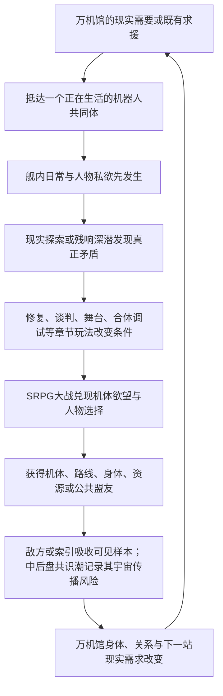

# Story Runtime v3 主笔决策视图：C02-RUNTIME-V3-IDEATION-20260801

> 主笔默认只读本文件。其他TSV、trace和完整切片只用于审计、冲突排查或定向二次查询。

- 阶段：`ideation`
- 章节：`C02`
- 可用人物：7
- 可查实体：21
- 底座冲突：0 error / 0 warning

## 本阶段上层与结构边界

## L1 精确节选

### 2.1 商业定位句

**一款以原创机体承载经典机器人动画共同记忆、以会开馆也会变形暴走的流亡博物馆为基地、把SRPG大战、残响探险、机体修复、舰内生活和成人关系编织成一部长篇群像番剧的机甲RPG。**

它不是若干机器人主题小游戏的合集，也不是博物馆经营模拟器外接战棋；它首先要让玩家获得“这真是一场机器人大战”的满足，然后让战斗、收藏、生活和世界谜团彼此改变。

### 2.2 情感定位句

**献给所有曾经认真喜欢过机器人、动画、模型和玩具的人：你喜欢的东西不必先被洗成高雅文化才值得存在，它可以荒唐、商品化、错译、修过、掉漆，仍然能够成为人与机器彼此理解的一种语言。**

这不是向爱好者颁发“你们其实很有内涵”的奖状。作品要先承认爱好本来就有欲望、占有、争执、消费、低俗笑话、烂胶和失败，再让玩家亲手看到它如何承载友谊、爱情、责任、战争记忆和文明想象。

### 2.3 戏剧定位句

**一群把机器人爱得各不相同的人，驾驶一座流亡的万机馆，试图重新连接灾后彼此失语的人类、机器和群星；他们越能把万机组织起来，越接近再次制造那个曾险些毁掉世界的“唯一标准角色”。**

### 3.1 第一幻想：我正在参加一场真正的机器人大战

玩家进入本作，首要欲望不是给文化概念做判断，而是：

- 看见新的真实机体登场，而不是展柜、模型盒、核心和文字代替机体。
- 让不同尺寸、技术谱系和作品气质的机器人在同一战场互相救场、争风头和抢最后一击。
- 经历合体、变形、换乘、后继机、量产机逆袭、战舰炮击、暴走、巨大化、说得、撤退、全弹发射和最终全员支援。
- 明确知道谁在驾驶、谁在自主行动、谁留在舰上支援，以及机体为何愿意战斗。
- 通过编队、改装、支援、路线和关系，把自己偏爱的冷门机用到终局，而不是只看热门主角机表演。

[可按需查询完整切片]

### 3.4 第四幻想：我能认出梗、接住梗，再把它打成新的名场面

G.A.G.里的“GAG”不能只剩一个好听的世界观缩写。玩梗是本作区别于一般原创机甲RPG的核心快乐：玩家认出一台机、一句短台词、一个合体动作、一种玩具争议或一段人物关系，笑出来、燃起来或先一步知道悲剧要来了；角色随后不是把出处讲解一遍，而是把这份共同记忆接进自己的困局，打出原作没有、本作才可能发生的新结果。

[可按需查询完整切片]

### 3.5 第五幻想：我的收藏、手修和偏爱真的能影响巨型机器人

模型和玩具不是假的实机，也不是可以随意放大的魔法胚胎。它们保存的是：

- 某个版本的外形和装配逻辑。
- 某个人如何理解、修理和命名这台机器。
- 一种被商品、动画、误记和共同游玩反复强化的关系锚点。

玩家可以把模型锚件、深潜所得、全尺寸接口和工房工程结合，完成识别、校准、改装、支援、隐藏机唤醒或实机修复。真正承受重量和炮火的仍是全尺寸身体。由此形成目标玩家熟悉的快乐：一块小零件、一张错版说明和一道手修痕，能够帮助一台十八米机器人重新站起来，但不是因为宇宙碰巧把塑料放大了。

### 3.6 第六幻想：我会和这些人真正相爱、争吵并失去

人物关系不是战后好感度结算。纪存、七海、白鸢以及主角团必须在共同生活和大事件中发生：

- 明确的欲望和身体吸引。
- 专业能力带来的欣赏与威胁。
- 吃醋、挑逗、误会、嘴硬、低俗笑话和软色情式卖相。
- 隐瞒、背叛、毁掉对方方案、选择先救谁和替另一人承担。
- 理解、照顾、崩溃、重新靠近、主动亲吻、拒绝与错过。
- 可能的牺牲、离队、死亡、残响回归和带缺口的关系结局。

成人关系可以性感、狗血、危险甚至有一点俗；儿童与少年角色完全隔离成人向和修罗场。七海与白鸢必须拥有不经纪存中转的吸引、秘密、事业互救和独立结局，不能只是两条男主路线互相礼让。

### 3.7 第七幻想：我不只看剧情，我用多种玩法改变它

本作的持续循环应让玩家反复经历：

1. 在舰内生活、接任务、整备和选择今日开放内容。
2. 进入现实区域或残响层探险，寻找零件、人物、路线、记忆和危险样本。
3. 通过修复、认证、谈判、调律、舞台、格斗、追逐或章节专属玩法改变局势。
4. 把结果带入SRPG：改变地图、初始部署、隐藏目标、说得窗口、支援和损伤。
5. 战后回到万机馆，看见设施、关系、机体、敌方学习和下一站都已不同。

SRPG承担最大的冲突与兑现，多玩法负责让胜利成为“我准备出来、发现出来、修出来和打出来的”，不能只是看完ADV后进入一张无关地图。

### 6.1 投射的是共同记忆，不是换皮名单

每个主要参战谱系至少应有以下四项中的三项进入主线：

- 能被玩家辨认的机体视觉或机械语法。
- 能被玩家辨认的关系结构或悲剧情境。
- 能被玩家辨认的名场面、动作、台词节奏或演出气质。
- 本作基于该共同记忆提出的原创What-if或反转。

台词与名场面不必一律“纠正原作”。在合法和创作边界允许的范围内，经典短锚点若与场景真正贴合，可以直接致意；更多时候应把数个共同记忆揉进一个新情节，让玩家会心而不是做出处考试。

### 7.5 核心群像不是三位主角的功能插件

三主角负责全剧最危险的“连接、秩序与可能性”，但万机馆能否成为群像番剧，取决于其他核心角色是否拥有不靠三人批准也会继续运行的事业、关系和机体命运。第一版最低群像合同如下；逐章总纲可以扩充，不能把这些人降回岗位台词。

| 核心角色/组合 | 他们自己的长线欲望 | 必须经历的外放变化 | 对全剧不可替代的作用 |
| --- | --- | --- | --- |
| 兜灯 × 馆守Z | 让继承来的守护者真正活下去，而不是把它供成遗像 | 从“只有我能让它停”走到把停止权、维修权和出击选择交给机体与同伴；也要有一次因过度保护而失去战机 | 承担万机馆身体、现场安全、旧家族伤口与馆守Z后继形态 |

[可按需查询完整切片]

## L2 精确节选

### 1.1 全剧最核心的一句话

**他们必须重新连接全世界、最终连接群星中的机器人，才能阻止新的毁灭；而二十七年前，人类正是在一次真正救过世界的全球连接中，让所有机器人逐渐被迫接受同一种安全角色。**

这句话同时解决主线目标、G.A.G.灾变、万机馆航路、纪存能力、索引成长和终局选择。

### 1.2 总发动机句

**失去旧址的万机馆必须沿百机航路寻找全尺寸修复资源、公共泊位、机体盟友和G.A.G.异常源，才能继续生存并保护沿途正在被封存、征用、商品化、战争化以及遭受漏潮侵袭的机器人共同体；每一次成功的修复、开馆、合体、玩梗和大战，又会向白框、清噪工具与索引提供一份更完整的“万机怎样共同回应”样本。旅途中，众人逐渐发现灾后城市仍由失去发言权的静默机魂托底，各地防卫机曾在二十七年近地战争中留下未完人生，远征军把机器人故事写成跨文明角色协议，而归航者已长成一座无法普通停靠的移动世界。白框随后把最好结局推进到真实分支主体；全世界二十七年共同建设的天穹联装工程也逐步齐备，索引没有造出这些身体，却把全部救命经验压成唯一永久的神座式封闭解。万机馆越像一座方舟，索引越接近取得联装工程的总调度权；纪存越像英雄舰长，也越接近成为所有机魂无法拒绝的总指挥。**

[可按需查询完整切片]

### 5.3 下一站的因果门

百机航路不是一张按主题排列的旅游地图。每次转场至少同时满足以下三项中的两项，支柱章最好三项全部成立：

1. **现实需要**：万机馆或现有机群确实缺少身体、制造、能源、医疗、泊位、航路或盟军。
2. **旧线追踪**：前章敌人带走的样本、关系伤口、白舰信号、未来报告或G.A.G.异常指向那里。
3. **主体求援**：当地人物、机器或共同体主动发来具体请求，并且它的愿望不是“请来替我们讨论主题”。

新警报可以加速出发，不能单独创造下一章。若替换目的地后舰体、敌方、人物和谜团都不受影响，说明这不是因果航路，只是串珠式选题。

### 8.1 一次章节循环的因果

这不是每章强制九步齐全。章节可以从追击战、约会、演出或深潜开始；但章末必须看见我方为何成长、世界为何变化、下一站为何不能随便替换。

### 8.4 防止再次写成串珠公路片

每章都要同时拥有四种线，但不平均分配篇幅：

- **本地主事件**：当地人物和机体此刻非解决不可的具体危机。
- **追入线**：至少两条前章人物、敌方、资源、谜团或关系后果进入本章，并改变本地主事件。
- **远端线**：至少一股未到现场的阵营继续行动，通过市场、舰队、舆论、远程任务或另一条分支留下结果。
- **带出线**：本章至少把三条已经改变的线送往不同未来，不把所有问题在章末一起结清。

全剧应呈现“分散行动、交叉误伤、短暂汇合、再次分舰、最终汇流”的波形。角色不出场时也可以在别处工作、失败、恋爱或夺权；缺席不能等同暂停存在。

### 8.5 机体不是首登消耗品

每台主要机体和参战包都应拥有一条可见生涯，而不是在自己的主题章完成一次功能后消失：

1. 先以锚件、传闻、敌机或求援建立期待。
2. 正式登场时拥有想赢、想合体、想工作、想找回谁或想证明什么的正向欲望。
3. 与主角团发生并肩、冲突、说得、拒绝上舰或条件加入。
4. 在后续章经历改装、换乘、后继形态、关系变化、战损或政治站位。
5. 在百机祭、分舰、内战和终局至少有一次与早期欲望相关的回援或对立。

背景实机不必全部走完整五步，核心参战包必须。新机体密度由逐章装载决定，生命周期由全剧总纲负责；二者不能互相替代。

### 8.6 名场面、玩梗与精神指令也要有生命周期

IP素材不是每话抽两张卡。逐章总纲先确定原作精神与关系困局，再选择名机体、短台词、构图、玩具生态和玩法承载。高辨识锚点可以先以笑话或误记出现，后来在战败、关系破裂或终战中被同一人物重新说出，意义发生变化；精神指令也可以随人物从模仿英雄、依赖某人，发展到拥有自己的战斗动词。

支柱章应优先创造“多个熟悉元素撞成一个陌生结果”的场面，而不是把所有台词平均分给机体。直接短引、误记、反说和原创变奏都可使用，但要在台词账本中记录首次、变义与回收，避免名场面只消费不生长。

## L3 相邻章节精确节选

### C01 闭馆以后，万机出击

万机馆停止续约后的最后开放日，一头突破近海防线的裂星潮突入体`BREAKER`落入东部旧会展区。闭馆来自长期亏损、灾后恐惧、馆长失踪与代哥停止续约共同造成的现实衰败；代哥不是本章Boss。纪存先完成最后一场导览和观众撤离，再进入馆守Z胸前的导览席，与它的机魂人格“旧守护者”共同迎战。七海位于东区封存中心附近，撤回自己签发的停机令并承受调查，不越权替城市或军方批准作战。

这章的主语是“博物馆重新记起自己也会战斗、也会远行”。馆守Z以18米旧巨神之身对抗近30米的BREAKER地面重甲；荒川豪司越过企业撤离令，驾驶无机魂的勇拳试作机加入双拳协战。馆守Z以火箭右拳和勇拳的冲击储存共同击穿外壳，原右臂因过载毁损，敌方却露出能够飞行并指挥增援的核心形态。万机馆随后恢复二十七年前的巡展舰身体，退役重盾、救援锚和推进骨架作为本馆独有的巡展武装重新参战；馆守Z装上只有抓握与固定功能的临时巡展臂装，从舰首追入云层，以一直负责保护的左拳击毁BREAKER。

玩家第一次获得一场完整的机器人大战：旧巨神起身、勇者试作机越权出击、双拳接力、敌人二阶段、战舰升空和舰首必杀。玩家也只在行动层面看见机魂与G.A.G.：旧守护者从轮式导览终端回到同一具馆守Z身体，万机馆在全馆回应中恢复巡展能力；本章不解释机魂生成、纪存真相和二十七年前完整灾变。白鸢不出现，社勇王真机不出现；白色采样机只在尾声取得右拳残片，作为更大回收网络的无名钩子。

胜利使旧址成为无法复原的巨大船坞，万机馆却不是低功率逃亡，而是主动把路线牌推进“第七次巡展”。它的旧引擎只足以可靠抵达邻近一站，巡展臂装不能承受第二场大战，舰底也缺少现代泊位接口。木桶街公开广播拥有旧式泊位、全尺寸改件和让临时手臂继续成长的办法，因此成为第七次巡展的第一个现实目的地。纪存、唐胶、兜灯、跌跌和机器犬随舰；豪司与勇拳留在企业体系内，七海留在城市接受调查。

### C02 木桶街，万机初开

木桶街掌握停产全尺寸转子、旧式泊位件和万机馆能继续移动所需的现货。纪存一行进入的不是只卖怀旧物的模型市场，而是一整套由收藏者、修件师、灰色认证、旧平台、实机拆解和物流共同维持的机器人生态。唐胶过去替人保住摔坏模型，也替平台模糊过维修史；现在他必须决定是否公开自己的手法与旧错，让救命件不再以“近似原装”的谎言流通。

本章用寄售仓追逐、扫描门争夺、全尺寸件运输和机械擂台扩大玩法。旧拳王不是一只手套，而是可驾驶、可改装的拳击机体；火种重涂机和小型变形样件分别证明“同模具”不等于同一主体。模型锚不凭空长成巨机，只向工程制造与机魂绑定提供形态、关系和动作偏好；小样件若取得行动身体，必须来自木桶街已有的全尺寸承载壳或G.A.G.应急材料预算。

白鸢因自己的安全分镜被平台盗用而现身。她的纸面分镜通过合法扫描、战术模拟器和有限执行接口转成可供驾驶员修改的路线建议，尚不能凭画笔直接改变现实。唐胶公开维修页，原主人和那名在盒内写下童年名字的中年收藏者得到完整回收，不让泪点只起个头。章末白鸢成为临时乘员；转子虽到手，却必须去工务城完成全尺寸校正。

### C03 工务城，谁在让城市站着

工务城不是又一次“救几台机器”。衡令使用陆衡当年删去现场语境的廉价稳定程序，开始把吊装机、交通塔和道路板锁成可征用姿势，并沿三层环轨撤退。市政最初把万机馆视为新风险源；当衡令同时夺取城市工务机，玩家用实际协作证明自己能帮这座城继续上班，双方才建立临时共同战线。

预算二号、市政吊装机、灰崎警备机和消防架桥机都有明确到场原因。战斗围绕移动道路、翻转轨道、热锁视野和旧伤限制展开，不再靠十分钟、一厘米制造虚假紧迫。陆衡负责把模型与锚件表达翻译为承力、材料、控制和安全工程；唐胶负责看见量产图纸没有记录的修件痕迹、公差手感和民间做法。两人互补，不争夺同一个“会修东西”的位置。

七海实体抵达并以共同监督身份登舰；白鸢第一次允许地方驾驶员把她的构图改得面目全非，并仍署共同作者。陆衡失去旧跨城资质，衡令失去工具冠、外甲和城市接口，只带受损旧稳定核撤离；万机馆获得低速稳定运行与公共泊位。白舰随后送来一份当前身体制造求援和一份二十七年前旧远征包，纪存则从工务城主动发出百机航路邀请。求援与主动选择共同迫使队伍面对比修船更大的问题：谁有权为机魂制造身体。

## H0机制目录（需要时再查）

- 《超GAG机器人大战：万机残响》世界机制与创作接口设定基线
- 一、这份基线解决什么
- 二、权威标记
  - 2.1 本轮打捞并固化的成熟成果
- 三、一页式答案
- 四、核心关系图
- 五、机魂、AI、驾驶员和身体
  - 5.1 机魂的稳定定义
  - 5.1.1 G.A.G.与机魂的边界
  - 5.1.2 机魂涌现反馈环
  - 5.1.3 AI、机魂、驾驶员与整备员
  - 5.1.4 离体、转移与分支主体
    - 机魂场面的四项必答
  - 5.2 六层行动栈
  - 5.3 常见机体配置
  - 5.4 换身体、共身和复制

[可按需查询完整切片]

## Current场景与前章出口

以下是Current Working话位，用于提醒已有生命周期，不是必须照写的动作链：
- `V359-C02E01-CREATIVE` 救命零件，限定发售：木桶旧件市货运环线/退役会展车库
- `V359-C02E02-CREATIVE` 同模不是同一个人：木桶街立体空域
- `V359-C02E03-CREATIVE` 拳王赢了：木桶街地下拳台/外圈服务院/机械拍卖巨台
- `V359-C02E04-CREATIVE` 万机初开：木桶街开放日内街/外环/城市空域/万机馆临时饭桌
新方案可重排、合并或替换上述话位，但要列出Working迁移。

## C01-v3.1创作基线与C02继承包-v2.md

# C01用户审定故事与C02继承包

> Status: `working_story_handoff / C01_layer4_closed / C02_not_initialized`
>
> 日期：2026-07-26
>
> Story source: `V35第四层逐章完整总纲/C01/C01-完整剧情总纲.md`

本包只保存C02必须继承的故事状态。旧C01 Reader、Runtime、Graybox、载荷Bundle和白函战斗均不具有当前生产权。

## 一、C02硬事实

- 万机馆已从固定展馆恢复为百米级巡展舰，路线牌进入“第七次巡展”。
- 旧址被舰体挣开后成为无法复原的巨大船坞，万机馆不会回去重新当固定建筑。
- 馆守Z是18米独立实机；旧守护者是其机魂人格，不是驾驶员或独立导览AI。
- 馆守Z原右拳和完整前臂在过载火箭拳中毁损，主要残片留在旧址。

[可按需查询完整切片]

### 纪存

他已经从守馆员变成第七次巡展的组织者，完成过观众撤离、导览席协战和母舰起航。C02不能再让他只审批、贴标签或重复犯错；他应主动决定万机馆第一次去哪里开、愿意向谁求助、哪些机体可以作为伙伴而非藏品同行。

### 七海

她的选择不是“偷偷放水”，而是公开撤回自己签发的停机令。C02应让调查后果、职业同僚和她仍想赴完那顿饭的私人欲望同时存在，不能让一次远程共餐自动完成和解。

### 唐胶与兜灯

唐胶因木桶街广播认出旧人，负责把临时巡展臂装带进真正的模型、改件和实机生态；兜灯必须判断哪些改装会伤害馆守Z。两人的专业冲突和吸引力要通过一件真的装备推进，不回到互相吐槽。

### 豪司

他已经证明自己能驾驶勇拳打出英雄动作，也必须承担企业处分。C02可以让社勇王正式驾驶资格成为诱惑，但不能抹掉越权首战，也不能把勇拳直接升级成社勇王。

### 白鸢与陆衡

二人均未在C01出现。白鸢可在C02按第三层职责正式进入故事；陆衡的正式登场与加入推迟到C03新L4，不得从旧继承包恢复成C01随舰工程师。

## 三、机制边界

- 机魂形成连续自我与主动选择；驾驶员、程序或成熟AI都能让机器行动，但不自动等于机魂。
- 模型、玩具和手修件只能提供形状、版本、动作偏好和关系锚，不能凭空长成巨机。
- G.A.G.不是万能能源。本章只允许它放大已有载体、记忆与关系中的回应。
- 万机馆巡展武装必须来自真实全尺寸装备；馆藏不会临时拼装成舰体。
- 白鸢的纸面分镜若要影响行动，必须经过她的预演、可读行动图、现实执行者和现场修改，不能直接改写现实。
- `万机馆｜本次开放资料`只整理故事已经演出的知识，不能替C02主因果补洞。

## 四、C02入口而非固定剧情

C02的固定入口只有：

1. 万机馆抵达木桶街却找不到可兼容的现代泊位；
2. 唐胶必须面对旧关系与旧手艺；
3. 馆守Z巡展臂装需要全尺寸改件；

[可按需查询完整切片]

## 合法人物

### 兜灯 (`CH001`)
- 本章存在：`V359-C02E01-CREATIVE`=physical(default); `V359-C02E02-CREATIVE`=physical(default); `V359-C02E03-CREATIVE`=physical(default); `V359-C02E04-CREATIVE`=physical(default)
- 首次正式登场：C01E01-REPAIR-BAY
- 本作作用：馆守Z整备、安全判断、继承者与维修间关系
- 想要：证明祖传机体不是灾难;也证明自己不是只会守旧
- 压力下先做什么：擦零件;骂人;把情绪转成维修指令
- 模型缺口：无

### 旧守护者 (`CH002`)
- 本章存在：`V359-C02E01-CREATIVE`=linked_machine_soul; `V359-C02E04-CREATIVE`=linked_machine_soul
- 首次正式登场：V355-C01E01
- 本作作用：馆守Z机魂人格、展馆日常与老派守护者
- 想要：完成闭馆并保护所有观众
- 压力下先做什么：广播提示;纠正用词;重复安全规范
- 模型缺口：无

### 豪司 (`CH036`)
- 本章存在：`V359-C02E03-CREATIVE`=physical; `V359-C02E04-CREATIVE`=physical
- 首次正式登场：V355-C01E01
- 本作作用：勇者驾驶员、企业生态、热血与拒绝批准
- 想要：驾驶真正会回应他的勇者机，同时让勇气不再只是公司拥有的宣传词
- 压力下先做什么：先冲向最显眼的危险，再在频道里确认谁还没撤;压力越大越像在主持直播
- 模型缺口：无

### 纪存 (`CH_JICUN`)
- 本章存在：`V359-C02E01-CREATIVE`=physical(default); `V359-C02E02-CREATIVE`=physical(default); `V359-C02E03-CREATIVE`=physical(default); `V359-C02E04-CREATIVE`=physical(default)
- 首次正式登场：C01E01-ADV
- 本作作用：玩家视角、万机响应天赋、机魂身世与开馆英雄弧线
- 想要：找出自己为什么能唤醒万机，带着那些曾被清除的回应穿过下一场灾变，并亲手决定这份力量服务什么
- 压力下先做什么：先确认谁还能动、谁正被遗漏;亲自去最危险但能打开局面的位置;把杂乱的信号组织成伙伴可以行动的方向
- 模型缺口：无

### 七海 (`CH_QIHAI`)
- 本章存在：`V359-C02E01-CREATIVE`=remote_live; `V359-C02E02-CREATIVE`=remote_live; `V359-C02E03-CREATIVE`=remote_live; `V359-C02E04-CREATIVE`=remote_live
- 首次正式登场：C01E01-QIHAI-CONSOLE
- 本作作用：成熟改革者、远程封存官、后续共同监督与感情主线
- 想要：让世界不再被自由机魂毁掉，也让代哥重新配得上自己曾相信的初心
- 压力下先做什么：先看哪里真会死人、谁在说谎、自己的位置能挡住什么;一旦决定就亲自走到代价面前，不等别人替她安排退路
- 模型缺口：无

### 唐胶 (`CH_TANGJIAO`)
- 本章存在：`V359-C02E01-CREATIVE`=physical(default); `V359-C02E02-CREATIVE`=physical(default); `V359-C02E03-CREATIVE`=physical(default); `V359-C02E04-CREATIVE`=physical(default)
- 首次正式登场：C01E01-MAIN-COMBO_TABLE
- 本作作用：模型修复、手作生态、文化争论与维修间关系
- 想要：让玩具和手作痕迹被认真对待
- 压力下先做什么：挑水口;报材料;吐槽工艺;先骂后修
- 模型缺口：无

### 白鸢 (`N_BAIYUAN`)
- 本章存在：`V359-C02E01-CREATIVE`=work_trace; `V359-C02E02-CREATIVE`=work_trace; `V359-C02E03-CREATIVE`=physical; `V359-C02E04-CREATIVE`=physical
- 首次正式登场：V359-C02E03-CREATIVE
- 本作作用：创作者、预演组织者、未来分支承受者与感情主线
- 想要：给角色一个不痛的结局，也想被某个人看见她画里不体面的欲望
- 压力下先做什么：先在脑中排出几种结果;抢先把最痛的一种排除;当现场不肯照她想的发生时，会冒险走进别人的行动距离
- 模型缺口：无

## 机体、对手与其他实体索引

- 旧机复产开放日 (`CONCEPT_C02_REPRODUCTION_OPEN_DAY`) | concept | C02E04把复产订单、公共港测试、公共展示和平台反扑放进同一场外部开馆事件 | 参战=未定 | 口径=物主可以短借、展示后带回、出售或不参加；万机馆取得最低复产线、公共港测试、通行支持和伙伴关系，不自动取得街区物权或库

… | 投射/来源=这是“开馆不是清仓”的现实事件，不是经营菜单，也不代表百机祭章程已经成立。
- 全装冠军“百刃” (`ENEMY_C02_FULL_ARMOR_CHAMPION_BAIREN`) | enemy_unit | C02非致命擂台对手机，以过量尖刺、背包和武器包承载模玩过度设计与全装崇拜 | 参战=V359-C02E03-CREATIVE | 口径=必须是完整拳斗或竞技实机；过量配件既带来正面战力，也形成一眼可懂的体积、转向和场地限制，不得只当笑话靶。具体拳赛阶段

… | 投射/来源=与旧拳王形成朴素机体对全装商品奇观；正式造型需避开现实产品的一比一拼贴。
- 商品回收王牌“归一星” (`ENEMY_C02_UNITY_RECLAIMER`) | enemy_unit | C02重涂人格空战具名敌机，读取四台重涂机的工厂动作库并试图把它们压回同一商品身份 | 参战=V359-C02E02-CREATIVE | 口径=它能调用商品回收设施和复制已取得的工厂动作样本，但不能复制四机后来形成的主体判断。具体武装、场地控制和破局方式由C0

… | 投射/来源=归一星属于商品回收实体执行链，不是胶价王投影或索引人格；内部锚商品回收、量产王牌和统一模板，外观不复刻具体喷

…
- 未发售变形工程样机 (`MECHA_UNRELEASED_TRANSFORM_SAMPLE`) | mecha_candidate | C02模型街既有两米级实体工程原型，承担取消企划、活动巡演和未发售商品生命线 | 参战=V359-C02E04-CREATIVE | 口径=本体从制造时起就是两米级实体机，平时折叠固定在带动力接口、承载铭牌和真实磨损的工业测试架内；E01只作可见首显，E0

… | 投射/来源=旧控制器是原主人保留的关系物件，不是人格开关；同批收藏级小玩具是独立非战斗物件，封盒与开盒都可被尊重；火种旧

…
- 万机馆主循环磁流散热转子 (`MECHA_WANJI_MAIN_CIRCULATION_ROTOR`) | scene_mecha | C02使万机馆恢复有限航行的全尺寸工业总成，必须由重型运输和吊装设备搬运，不能退化成手掌大的密封件 | 参战=V359-C02E01-CREATIVE | 口径=它是场景巨构和任务载荷，不是人格机体、不计参战；模型批次与维修史只能帮助辨认版本和适配方法，真正安装仍需全尺寸实物与

… | 投射/来源=正式资产应突出巨大转子、运输架、吊装和万机馆检修窗，不制作密集内部机构动画；精确尺寸、重量和安装动作由C02

…
- 馆守Z (`V353U001`) | mecha | 18米开局旧巨神主力；C01失去原右拳与完整前臂，此后经历巡展臂装、代用结构和后继右臂成长 | 参战=V355-C01E02 | 口径=与MECHA_GUARDIAN_Z为同一机体的V35生命周期ID；旧守护者是其机魂人格。C01E02完成首次正式战斗

… | 投射/来源=内部锚Mazinger式火箭拳、旧超级系后继强化与博物馆守护者；后继弧读取CONCEPT_GZ_SUCCES

…
- 火种货柜领袖 (`V353U043`) | mecha | 作业变形、护送和领袖支援主力 | 参战=V359-C03E04-CREATIVE | 口径=以已有全尺寸载具身体和独立载具人格参加C02，并完成护送万机馆到工务城的一站承诺；C03E04离舰，承担百机航路邀请

… | 投射/来源=内部锚Transformers领袖与车队文化；C04不占舰位，C06不得由它包办星火车队谱系。
- 喷气叛星 (`V353U044`) | mecha | 高速空战、诱饵分身和品牌背叛路线机 | 参战=V359-C02E02-CREATIVE | 口径=C02完成首次战斗并确认独立主体身份；它承认自己也是重涂角色，不以原版血统洗白。后续加入和回收节点由L3生命周期表决

… | 投射/来源=内部锚Starscream式叛星；必须有独立头雕、翼型、武器和性格。
- 重涂机“死锁” (`V353U045`) | mecha | 近战突入与旧人格冲突路线机 | 参战=V359-C02E02-CREATIVE | 口径=C02完成首次战斗并确认独立主体身份；它拒绝被改写成更好卖的英雄版本。后续加入和回收节点由L3生命周期表决定。 | 投射/来源=内部锚热门重涂与漂移/死锁式身份记忆；正式公开前做避撞审查。
- 重涂机“镜星” (`V353U046`) | mecha | 电子干扰和敌我标识翻转路线机 | 参战=V359-C02E02-CREATIVE | 口径=C02完成首次战斗并确认独立主体身份；镜像涂装必须服务它自己的立场与行动，不只作皮肤。后续加入和回收节点由L3生命周

… | 投射/来源=内部锚镜像世界重涂。
- 重涂机“雷翎” (`V353U047`) | mecha | 远射、侦察和机动换位路线机 | 参战=V359-C02E02-CREATIVE | 口径=C02完成首次战斗并确认独立主体身份；具体收尾动作和轮换冲突由C02 L4决定。后续加入和回收节点由L3生命周期表决

… | 投射/来源=内部锚喷气重涂军团。
- 旧拳王机 (`V353U048`) | mecha | 拳击、受击蓄势和非致命击倒主力 | 参战=V359-C02E03-CREATIVE | 口径=与MECHA_OLD_BOXER_KING为同一机体的V35生命周期ID；C02作为完整可驾驶机体赢得擂台并正式加入

… | 投射/来源=内部锚Real Steel式机器人拳击；具体影子模式错位和决胜拳由C02 L4决定。
- 影子陪练机 (`V353U049`) | mecha | 动作复制、反击教学和非致命训练路线机 | 参战=V359-C02E03-CREATIVE | 口径=与MECHA_SHADOW_SPARRING_MACHINE为同一机体的V35生命周期ID；C02参加擂台，录像与原

… | 投射/来源=内部锚机器人拳击影子模式。
- 玩家模型机“无牌一号” (`V353U071`) | mecha | 自由改装、零件兼容和玩家构筑单位 | 参战=V359-C02E01-CREATIVE | 口径=木桶街原有全尺寸模块竞赛底盘和低权限竞赛AI；缩尺模型只提供改件同构数据，不会放大成机体。它在C02首控，V359-

… | 投射/来源=内部锚Gundam Build与模型竞技；名称可由玩家改，不共享社勇王许可。

## 本阶段任务

提出三个真正不同的章级故事方案。先用白话说明谁想做什么、什么迫使冲突升级、玩家主要做什么、高潮凭什么成立。可以否决旧桥段；不得写正文，不得把名词或奇句当创意。
