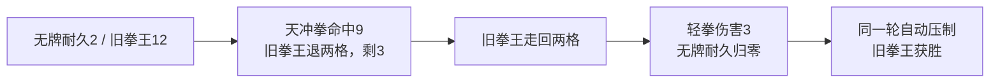

# 三局复玩：行动原因与玩法缺口

2026-09-21 · 修订版实际玩家记录 · Candidate 对练诊断

**结论：用户已实际做出打断、绕开和天冲拳，现版仍未形成清楚、有回报的打法。上一轮显示修订不足，不能继续把这场对练当作已成立的玩法向小队战扩展。** 本次不改游戏代码或数值，保留现版供后续同题面比较。

## 证据与边界

取得 11:49:23 启动的一份 `source=player` 记录，包含三局、30 次提交与完成、117 个实际事件。两项日志内版本指纹均与当前规则和程序一致；以当前规则重放全部命令，逐项对照实际事件、轮末状态、下一轮起点，全部一致。这里的通过只说明实现按现有规则运行，不是玩法通过。

- 实际发生：5 次打断、4 次绕开、3 次天冲拳；没有记录到跳过演出。
- 三局依次为：9 轮出界获胜；13 轮被压制失利；8 轮压制获胜。输赢不能代替用户对体验的评价。
- 记录没有原始屏幕录像，也没有镜头、模型朝向和演出速度切换历史。另从记录状态重建了四个关键回合，以完整速度录制并检查关键画面。重建片不冒充用户原始录像。
- 见[记录摘要](../../../../../artifacts/c02_duel/player-review-20260921/session-summary.json)、[逐轮数据](../../../../../artifacts/c02_duel/player-review-20260921/rounds.json)、[规则重放核对](../../../../../artifacts/c02_duel/player-review-20260921/rule-replay-check.json)、[四个回合的演出重建](../../../../../artifacts/c02_duel/player-review-20260921/reconstruction.mp4)。原始本地日志未被修改。

## 1. 为什么有时追击，有时像连续行动

当前对手按回合编号固定轮换：奇数轮轻拳追击，偶数轮定向重拳。两种动作允许的临时调整不同：

| 对手本轮动作或状态 | 代码实际允许它做什么 | 玩家看到的结果 |
|---|---|---|
| 轻拳 | 等无牌走完、出拳后，再从自己的新位置向无牌的新位置追三格；相邻则攻击 | 被推开也能走回来再打 |
| 重拳 | 只能打预告的原方向；被击退则整次取消，目标离开则挥空 | 没有伤害后很快又让玩家输入 |
| 追近但不够远 | 走完三格，仍不相邻则不攻击 | 也会出现“它没打，又到我了” |
| 倒地 | 本轮不还手；下轮不压制它就起身 | 得到下一次操作窗口 |

这不是日志中的回合随机跳变，而是几个不同原因都表现为对手没有打中、随后交还操作。具体例子：

| 用户实际回合 | 实际发生 | 解释 |
|---|---|---|
| 第一局第 1 轮 | 直拳推退一格，旧拳王走回一格并还击，耐久 18→15 | 轻拳追击轮 |
| 第一局第 2 轮 | 绕侧直拳推退一格，旧拳王不还击，耐久保持 15 | 重拳因位移取消；没有额外发一份行动额度 |
| 第一局第 4 轮 | 原地直拳同样打断 | 打断来自普通拳自带击退，不来自侧绕 |
| 第二局第 5 轮 | 旧拳王追三格后仍隔两格，没有出拳 | 移动已执行，只是没追到攻击距离 |
| 第三局第 7 轮 | 天冲拳后旧拳王不追击，随后可压制 | 它的耐久从 3 归零，已经倒地 |

普通拳同时承担伤害、击退和取消重拳，且不耗能。因此“打断”经常是照常攻击的附带结果，没有让玩家形成另一种攻防决策。

## 2. 天冲拳的击退，在记录里确实被追击抵消

第二局第 13 轮的真实顺序：

第三局第 3 轮也发生了“天冲拳推两格 → 走回两格 → 轻拳还击”；第 7 轮没有发生，原因是这次直接击倒，并非那次角度或操作打出了更强的控制。

而且当前返劲只能由偶数轮重拳伤害获得、仅下一行动有效，**自然流程中的天冲拳正好总在轻拳追击轮使用**。只要对方未倒地、未出界且追得上，就可以把这段距离追回。这使“承伤后爆发”的中场收益尤其弱。

第二局还揭示一处行动待遇不一致：无牌将对手打倒后，需要下一行动压制；旧拳王将无牌打倒后，却在同一轮自动衔接压制。当前没有向玩家提供对等的动作安排，也没有将其解释成一个明确的敌方专长。

## 3. 侧绕没有得到相应的朝向收益

当前战斗状态没有机体朝向字段，也没有正面防御、侧背打击或转身代价。模型的转向由每个动作开始及轮末的同步函数直接朝向对方；重拳预告方向例外，但其取消后又回到自动面对。

因此侧绕目前主要改变击退方向和距边界的位置，不能让玩家持续占住对手的盲侧。第三局第 5 轮中，无牌走到侧面，旧拳王在无牌出拳前的同步阶段便已转向它；这与用户观察吻合。

另作两项**同起点假设比较，不是用户实际操作**：

- 第一局第 2 轮，实际绕侧打与改为正面打，都造成 4 伤害、取消重拳、无牌不受伤、不耗 EN。区别只在双方落点与击退方向。
- 第二局第 2 轮，实际侧移待机成功绕开。如果在同一个落点选直拳，同样不受伤、不耗 EN，还能打 4 伤害并击退。当前没有给单纯躲开留下额外的反击机会。

这些比较不证明所有站位等价，却足以解释为什么尝试不同角度后，没有出现预期的攻防差异。

## 4. 演出重建看到的表现问题

- [第一局第 2 轮打断](../../../../../artifacts/c02_duel/player-review-20260921/reconstruction/m1-t2-2-boxer-interrupted.png)：仍在全场远景，主要变化是小机体的收势及“重拳取消”字幕，没有连贯看见已开始的敌方出拳如何受阻。
- [第二局第 13 轮天冲拳接触](../../../../../artifacts/c02_duel/player-review-20260921/reconstruction/m2-t13-0-hero-contact.png)到[对手追近](../../../../../artifacts/c02_duel/player-review-20260921/reconstruction/m2-t13-1-boxer-move.png)：从大特写切回全场远景，追击在小比例机体上进行。“被打飞后重新逼近”没有作为一个连续攻防过程突出呈现。
- [第三局第 5 轮出拳前](../../../../../artifacts/c02_duel/player-review-20260921/reconstruction/m3-t5-1-hero-start.png)：模型已自动面对，无牌侧绕的过程并未留下可见的防御破绽。

这些是按同版本、相同起点与命令重建的观察。原玩家镜头与速度设置未知，不能据此声称逐帧看过其原屏幕。

另有三次侧推在不移动或只走一格时被扣费：第一局第 4、7 轮，第二局第 12 轮。逐项比较关闭侧推后的同一命令，战斗结果不变，各省 4 EN 和一次侧推。这是菜单把“扩展移动能力”和“实际采用扩展路线”混在一起的交互问题。

## 5. 下一件保持同擂台短计划，先改变规则关系

此次记录支持上一轮已定的同题面对照方向，不支持继续扩机体和小队。现版保留作为比较对象。下一版先兑现以下具体关系，数值仍需试制验证：

| 必须改变 | 下一版需要让玩家安排什么 | 怎样判断有改善 |
|---|---|---|
| 敌方临时补走与免费转身 | 敌方路线、出拳方向及允许的追踪范围在提交前确定；受击后的调整占用同一份行动时间 | 玩家能根据起点预判侧绕与击退的结果，对手不能事后免费追回全部距离 |
| 普通拳自动包办打断 | 快拳重在稳定输出；造成明显位移或中断的动作承担更长准备或资源代价 | 直接打、抢先打断与避开后出手不再只是同一拳换落点 |
| 接拳与反击分散到两轮 | 玩家提前选择“接住这次来拳后反击”，条件成立时在同次交锋接续，条件不成立就失去这次攻击机会 | 能看到自己押中的动作兑现，承担的耐久和资源换来明确收益 |
| 追击、压制凭额外分支白送 | 敌我共同遵守主动作、后续动作与倒地处置规则；公开的特殊能力才可例外 | 同一轮结束的原因能从身体动作理解，不需读日志解释 |

这里恢复的是“判断意图 → 安排一次短计划 → 看敌我动作兑现”，不同时搬回旧工程操作、全队配置和大规模关卡。演出要跟随这一轮共同发生的攻防，再回地图交还操作；字幕用于确认已经看见的结果。

下一版若仍需要先读说明、再按给定步骤才能体会三种打法，仍判体验未成立。当前用户已经做出足够多的探索，不应再要求反复试玩同样的交替规则来证明它有趣。施工次序统一见 [README.md §7](README.md)。
