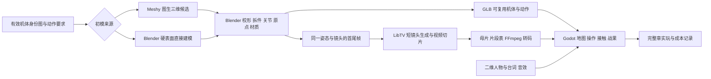

# 美术、引擎与制作方案

设计候选 v1 · 2026-09-21。先做同一个动作的可复用资产链，再扩成完整木桶街。本页区分本机实际存在的产物与下一步要开发的能力。

**2026-09-26 制作更新：** demo 已以 P 包融回公式台，在同一世界连接可操作前场、当前战斗和真实战后变化。当前 P 为“模型与动作样板 v2”，已替换被否定的少帧图集，接入人物骨架模型、Blender 检修铺和馆守动作片段，见[实际交付与证据](../../production/formula-harness-v1/stage-battle-model-motion-v2-20260926.md)。完整制作目标仍见[140](../../production/formula-harness-v1/140-formula-lab-integrated-visual-production-goal.md)；新样板尚未获得用户视觉、手感验收，不能用流程通过代替七公式整体完成。旧工具核验与估算保留原日期和适用范围。

**开发更新（2026-09-22）：**已增加 [小队演练](squad-combat.md)。无牌、旧拳王继续复用原有 GLB；本轮新增馆守 Z 候选及同一训练壳体的近战 / 射击、红 / 青变化。Blender 4.4.3 生成刚性分件、保存 `.blend`、导出五份 GLB；Godot 4.7 负责全部可交互战斗、动作和镜头。没有调用新的 Meshy 或 LibTV 生成。

馆守参照最新 V10X 身份图的深蓝甲、红色分胸、银色腹甲、金色眉角与面罩，保留缺失的原右前臂，左拳承担攻击。它属于独立 C02 演练的简化三维候选，不改变 C01 已锁的二维生产方向，不表示造型已通过验收。源图、五份导出的哈希、尺寸和部件数记录于 `artifacts/c02_squad/source/asset-report.json`；原始生成脚本为 `artifacts/c02_squad/source/build_squad.py`。

本轮复用刚性关节和接触点接口，新增射击持枪与馆守左拳 / 接弹动作。替换模型仍要适配关节、足底、接触点并重查取景。首轮导出遇到本机默认材质节点差异，已改为显式创建材质节点和工厂启动，实际导出回执与原生载入均留证。工时表仍是估算，不将脚本导出的运行时间当成全流程美术成本。唯一施工顺序见 [README.md §7](README.md)。

## 1. 采用的组合

**Godot 是唯一游戏运行时。** 它负责输入、路径、判定、状态、存档和镜头调度。Blender 与 Meshy 产资产，LibTV 产特定演出。HTML 看板只是本工作包的沟通工具；不另建一个 Three.js 游戏再想办法同步两个项目。Three.js 可以做网页查看器，但当前没有必须引入的需求。

**当前机体怎样制作、怎样替换：**无牌与旧拳王均由 Blender Python 脚本创建分离的硬表面部件及父子关节，保存 `.blend` 并导出 `.glb`；Godot 载入模型，程序控制部件转动。这两台没有使用蒙皮骨骼或随模型导出的动画片段。当前动作依赖躯干、肩肘、髋膝踝等命名节点、脚底与拳头接触点，因此模型可以替换，任意模型直接换文件后动作正确则没有保证。

后续人工模型或 Meshy 候选先在 Blender 对齐尺寸、朝向、关节转轴与接触点；保留现有节点结构可复用程序动作，使用不同骨架则适配动作驱动。比例改变后要重新检查脚底贴地、拳头接触、倒地和镜头取景。伤害、能量、回合等规则独立于模型，换造型不需要重写这些规则。现有造型属于试制件，并非最终美术锁定。实现依据：[旧拳王建模脚本](../../../../../artifacts/c02_duel/source/build_boxer.py)、[动作驱动](../../../../../game-godot/scripts/candidate/c02_duel/mecha_motion.gd)。

保留现有 GDScript 技术方向。Godogen 的可借之处是把引擎使用、资产制作和实机检查接起来；目前没有证据说明换语言或重搭框架能解决本项目的角色、战术与声画问题。[Godogen 项目](https://github.com/htdt/godogen)

## 2. 本机已核到什么

| 环节 | 本次实际核验 | 本次没有把它当作什么 |
|---|---|---|
| Blender | `/Applications/Blender.app/Contents/MacOS/Blender --version` 返回 4.4.3；有环境、长椅、结算桥、必杀镜头参照和机体研究脚本 | 有 Blender 不等于已有可用机器人模型；旧白青机与 Joint Room v2 有明确失败记录 |
| Godot | 本机二进制返回 `4.7.stable.official.5b4e0cb0f`；现有战术相机、演出队列和视频控制代码可读 | 本次没有启动完整章实玩，也没有签署旧公式台手感达标 |
| LibTV | CLI 1.1.1；通过只读 `node list -p fc035e21db0c4f73b9985c27ed4de6ff` 查到两张首尾帧与一条视频节点 | 没有新建节点、生成、上传或消费额度；画布可读不是新镜头已完成 |
| LibTV 已有文件 | 馆守 Z 4.041667 秒母片、1.625 秒裁短片与 OGV 在库；本次重新看了八帧接触表；旧 C01 还有四段历史视频 | 素材回执标 `review_ready_not_runtime_approved`；历史片不自动恢复为现行已批准资产 |
| Meshy | 9月19日万机馆输入预检文件和待用图存在，明确 `input_preflight_complete_no_generation` | 未有上传、成模、下载或 Godot 导入证据；免费账户是既有记录，当前余量未重新核实 |
| FFmpeg | 本机 `/opt/homebrew/bin/ffmpeg` 可用；已有码流转为 OGV 的产物与回执 | 不把裁剪转码成功等同于镜头连续性和力量感通过 |

本次找到了 LibTV 的 `video-clip` 时间线能力和已裁片产物；**尚未定位到一个可确认就是用户所指的独立自动切片程序**。因此复用的是已证实的 CLI、时间线方法、文件和播放接入方式，不能声称已经恢复了某个未找到的专用工具。

直接依据：

- [LibTV 馆守 Z 回执](/Users/rayz/Documents/超gag机器人大战/docs/superpowers/specs/production/battle-presentation-v0.1/libtv-validation-receipt-v1.md)；[视频接触表](/Users/rayz/Documents/超gag机器人大战/docs/superpowers/specs/production/battle-presentation-v0.1/art-delivery/review/vid_gz_c01_palm_guard_libtv_seedance2_contact_sheet_v01.jpg)。接触表确实看得到掌由低位抬起，但没有证明走步、拳击接触、任意敌机配合。
- [Meshy 输入预检](/Users/rayz/Documents/超gag机器人大战/artifacts/formulas/experience-foundation-v1/chapter-art/meshy-wanji-pilot-v1/input-preflight.json)。万机馆输入有后底面信息不足；它也不是本章首件无牌一号的可用输入。
- [Joint Room v2 失败记录](/Users/rayz/Documents/超gag机器人大战/artifacts/formulas/visual-targets-v1/art/joint-room-v2/blender/README.md)：技术校准通过，画风仍像几何块，明确不能当视觉升级。
- [必杀镜头 Blender 参照](/Users/rayz/Documents/超gag机器人大战/artifacts/formulas/visual-targets-v1/art/finisher-keyframes-v1/blender/README.md)：环境和相机可重建，机体包络只是参照，不是完成的身体。
- [现有 C01 视频控制代码](/Users/rayz/Documents/超gag机器人大战/game-godot/scripts/c01_breaker_demo/c01_gf_operation_hud.gd:2832)：存在按片段加载、停止与尾帧保持；需要提取成小接口后验证，不整段复制巨大 HUD。

## 3. 美术取向：有体积、有轮廓、有具体机体身份

**最新地图方向以[公式台 140 §3](../../production/formula-harness-v1/140-formula-lab-integrated-visual-production-goal.md)为准。** 用户明确否决 `chapter_m/jicun_v1/jicun_atlas_v2.png` 与 `chapter_m/baiyuan_v1/baiyuan_atlas_v2.png` 的地图头身比。它们保留在历史包，新版不得继续以其比例生产角色。

制作侧先试更 Q 的地图人物与配套风格化场景；另一可行方向是《Demonschool》那样的整体比例，具体几头身未定。人物、机体、建筑、门窗、道具、地面细节和镜头需要成套校准。Q 版重新设计身体与动作轮廓，不能用正比例立绘缩小代替；场景同样概括，不追求写实材质。人类与巨型机甲的等级差仍须可辨。

对白使用正比例半身立绘，能力选择使用简洁方形头像，特殊事件可用正比例插画及背景。地图与立绘沿用同一角色身份、服装、配色和机体武装特征；实时战斗近景保持地图机体的身体连续性。材质继续采用清楚色块、硬阴影和克制高光。

同屏样例同时检查待机、转身、行走与基本交互，场景需要适量生活动作；基础动态属于切片本身。关键剧情和招式再制作独有动作。角色单图、背景单图与模型数量不能分别通过后便默认组合成立。

近景机体先看 **轮廓、关节、接触和光影层次**，再加表面划痕。此前程序加很多零件仍不满意，说明“对象数量”和“造型完成度”不同。旧失败母型不直接换色当无牌或旧拳王。

## 4. Meshy 与 Blender 如何实际分工

**首件是无牌一号、可受击的靶模型和擂台的一次完整出拳，不拿最复杂的万机馆母舰试全套。** 靶模型只是第一轮动作接触验证；换成旧拳王后还要按其身体复核，不能凭灰模接触判定正式角色已完成。U01 是可选补镜，K01/UK01 与多人演练都在首件之后。

1. 从当前有效身份源选一张清楚的主体图，核对左右手、背面未知部位、16 米身份与需要活动的部件。当前尚未核定三台主机都具备可投产的多视图；缺图在首件输入阶段解决，不用猜出来的背面冒充已定设定。
2. Meshy 若账户允许所需模型下载，用单机清楚视图试一次。合成的多形态大板不能冒充同一对象多视角。当前官方文档把图生三维作为模型起点，输出仍需按本项目的运动用途检查。[Meshy 图生三维说明](https://help.meshy.ai/en/articles/9996860-how-to-use-meshy-image-to-3d)
3. 在 Blender 中先看素模轮廓与四个转角。装甲成团、武器粘手、左右部件错误或关节不可拆，就记录问题；不能用漂亮贴图掩盖结构。最多做一次针对性重试，仍不合适就直接用 Blender 重建关键壳体。这里限制的是无效试生成，不是给整个项目规定两次迭代上限。
4. 将躯干、上臂、前臂、掌、腿、脚与侧推拆成可控制硬件；主要旋转中心落在关节，脚底放在地面基准。无牌异色装甲可以共用材质模板，但不抹掉其拼接身份。刚性部件优先父子层级/刚性权重，必要处才用复杂蒙皮。
5. 做待机、移动、起拳、接触、受击、复位六个基本动作；天冲拳在同一关节体系上增加踏步与蓄势。检查从地图相机和近景相机看都成立，再做武器粒子。
6. 导出 GLB，固定尺寸和原点，动作命名有含义；游戏逻辑数据与模型拆开。Godot 官方优先支持 glTF/GLB 资产路径；直接导入 `.blend` 会依赖本机 Blender 转换，交付运行资源时用明确导出的 GLB 更好追踪。[Godot 三维格式说明](https://docs.godotengine.org/en/stable/tutorials/assets_pipeline/importing_3d_scenes/available_formats.html)

Meshy 是可选的初模供应环节。Blender 即使没有图生三维也可做场地、简单零件与核心硬表面。生成主机的质量与速度尚未实测，不能把“AI 建模已很容易”直接写成大批资产预算。

## 5. LibTV 视频切片怎样接回战斗

继续使用 [LibTV CLI 技能](/Users/rayz/.codex/skills/libtv-cli/SKILL.md)。已有 `video-clip` 节点支持从多个视频/音频来源按时间线裁取片段：`sourceOffset/sourceDuration` 决定取哪一段，`startTime/duration` 决定放在时间线哪里。该能力是剪辑/合成，不是另选一个图像生成模型。[本机 video-clip 文档](/Users/rayz/.codex/skills/libtv-cli/node-types/video-clip.md)

本章只先制作三类候选镜头：

| 镜头 | 约长与用途 | 首选生产方式 | 回到战斗的锚点 |
|---|---|---|---|
| U01 无牌天冲拳蓄势 | 1–2 秒；踏步后肩肘压缩、拳光上升 | Blender 固定首尾姿态；LibTV 可补这段局部重量变化 | 尾帧必须与实时拳击起势兼容，不能片中已打中、地图又打一遍 |
| K01 王者全武装亮相 | 3–4 秒；第一次让观众相信它很强，附带商品展示笑点 | 同一模型的实时镜头优先；若 LibTV 更好只替换这次固定展示 | 回到亮相前后同一武装状态，不在每回合重复播放 |
| UK01 两台机一起离开炮门 | 4–6 秒；章末改演后的完整小段 | Blender 先排两机与道具关系；LibTV 用于已固定结局的短镜头 | 救场结算已经确定，片后两机与道具落在相同位置 |

**直接命中、击退几格、拆掉哪个部件由实时演出优先承担。** 这些内容要适配不同敌人和落点，把整段结果都烘焙进视频会迅速产生大量版本；视频也不能替代基本走路与战场操纵。

每段保留一张简单片段表：来源母片与哈希、入点/出点、使用机体/武装状态、起止姿态、镜头、是否含背景、对应战斗事件、音轨、回退演出。一次长生成只切出真实连续可用的短段，不能将中间变形藏在“已生成”一栏。

LibTV 中用 `video-clip` 检查与组合；本地 FFmpeg 负责明确裁切和转码。保留高质量母片，运行版另导出 OGV。Godot 核心 `VideoStreamPlayer` 支持 Ogg Theora，H.264 MP4 母片不能直接当成默认可播放资源；首测采用 720p/24fps，必要时再比较 1080p。Theora 以 CPU 解码，一次只播一个主特写。[Godot 视频播放说明](https://docs.godotengine.org/en/stable/tutorials/animation/playing_videos.html)

全屏或固定构图片段优先。需要透明主体时，先比较 Blender 原生透明序列/实时三维；不默认 OGV 带可靠透明通道，也不把绿幕抠像写成零成本。对白、字幕、伤害数字、音效与 BGM 不焊进生成视频，以便跳过、翻译和变化。

这里复用的是生产能力和播放逻辑。原馆守 Z 视频包含特定旧身体状态，不能把它镜像或改名就用作无牌的招式。

## 6. 本章资产清单与成本控制

| 资产 | 本章需要的内容 | 复用方式 |
|---|---|---|
| 三台重点机体 | 无牌、旧拳王、完全版王者；各一套可动主体，王者外装可拆 | 主体用于地图、对话头像、近景与馆内查看；既有有效图像先作为身份依据，不算已完成模型 |
| 第四台可操作机 | 馆守 Z；待机、移动、原有左拳、守护、受击/复位 | 救场与小队演练共用。现有插图与视频不能替代可动身体，另列动作/资产工时 |
| 支援机群 | 万机馆、货柜领袖、码头千斤顶、三飞机 | 本章只制作用得上的有限姿态/镜头；中型机与母舰不能共用一套假比例 |
| 守卫 | 一套资格赛靶机基础资产 | 复用成两近战/两射击演练敌人，配色与武器区分用途 |
| 场景 | 木桶街一条可逛街、擂台/广告/后台一套模块、馆内一个归来空间 | 擂台复用训练、半决赛、决赛与演练；事故新增损坏状态和道具，不再造全新地图 |
| 人物 | 纪存、兜灯、唐胶、赵梅、胶价王、白鸢；远程陆衡/七海按实际出场需要 | 先核现有有效人物图；基础表情加必要例外，不批量造全身动作 |
| 演出 | 三类短镜头候选；比赛出手和受击优先实时；旧片可用有限分镜 | 共用动作可调参数，独特的蓄势与合作保留独特编排 |
| 声音 | 起动、步伐、滑步、金属接触、拳击、落地、场内欢呼、裁判判分、短场景音乐 | 首件就放入重量与节奏；不是所有机器人都用同一声“砰”。全语音配音不作为首章完工前置 |

下面是**用于分配工作量的初始估算**，没有本项目首件实测支撑，不是报价或承诺。按人的有效制作/检查时间记录，不把模型排队、无人值守渲染与并发任务相加成“人日”。

| 工作 | 初始估算 |
|---|---:|
| 规则适配与章节入口 | 6–10 小时 |
| 无牌身份整理、初模清理、六动作首件 | 8–16 小时 |
| 旧拳王/王者复用并处理差异 | 8–16 小时 |
| 馆守 Z 可操作身体与演练动作适配 | 6–12 小时 |
| 场景与支援有限镜头 | 4–8 小时 |
| 对白、章流程、界面与收束 | 10–16 小时 |
| 战斗镜头、声音与整合 | 12–20 小时 |
| 完整章与小队演练实玩回修 | 8–16 小时 |
| **合计** | **62–114 小时；另留约 25% 未知返工，即约 78–143 小时** |

此估算按“有效身份图可取得、有限支援表现、无全语音、四台可操作机”假定。缺身份图、主模型连续生成失败、全套定制动画都会使其失效。首件结束时用实际记录替换前两行；如果翻倍，先判断卡在造型、拆件、动作还是引擎接入，再修该环节。不能先把这个估算乘到整部游戏后宣布值得做或不值得做。

Meshy/LibTV 的本次费用为零：只读核验已有资料，没有生成。后续生成前以账户当前可用下载、额度和单次报价列出一张具体任务单；当前没有价格依据，不写一个虚假的人民币总预算，也不假定付费插件能通过免费 API 绕过。

## 7. 引擎改造边界与实际验证

开发时新增独立 C02 候选入口，先复用可确认有用的输入、存档、对话和演出组件。规则层产生“谁、用什么、命中与否、伤害、位移终点、触发事件”，表现层消费这一结果；完整动画、快演出、跳过走同一结算。不要以全员指令牌提交器为底座硬塞即时执行。

规则变更的必要检查：碰撞与推退、不重复消费行动、返劲/减速/守护的失效时点、比赛记分与普通耐久分别结算。表现集成的必要检查：同一结果完整/快演出/跳过后状态相同，视频缺失有可看懂的实时回退，存档在一个动作前后恢复一致。然后实际玩通章节与至少两种小队战术，检查焦点、声音、加载与退出。

本机是 macOS；如果目标发行 Windows，导出并在 Windows 实际运行仍是一项未完成工作，不能由 Mac 截图替代。最低性能目标先在确定测试设备后定，当前不承诺帧率；首件要记录模型面数、显存、帧时间与视频播放开销，以便选真实资产预算。

首件只要求一个明确答案：**这台机，在这条地图上，由玩家下达这一次命令，是否打出值得再看也值得再操作的一拳？** 若失败，留下具体画面和原因，在该环节修；不再开启几十轮与整章无关的静态画面评议。

## 8. 这次研究转成的工作方法

故事先连贯读一遍，确认想继续看；再拆操作，分清哪些情节应该演、哪些值得玩家决定。动作先在同一身体上完成地图到近景，再扩资产。每次交付都带一个真正可看或可玩的对象，以及最影响体验的少数问题。

主笔维护本主案与完整章；实现者对其负责。独立读者/试玩者描述自己实际读到、做到什么，不能拿幕后设定替作品补意义。验证为设计服务，不再让“通过多少表项”成为产品目标。
