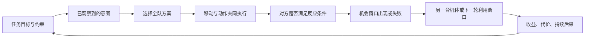

# 战术与任务共用的因果：v2 已实现范围

2026-09-22 · 独立 Candidate。优先打磨当前战斗，不推进正式章节或全剧稿。

## 从本次操作记录得到的诊断

原始玩家会话 `squad-1790062003969415-20679.jsonl` 共执行3轮，却留下62次计划修改、14次选机、69次光标变化。这是日志事件数，不等同于鼠标点击数。第一轮旧拳王移动后仍在调整步伐，馆守选择的目标在另一翼；第二轮没有造成敌方伤害，旧拳王受到19点伤害。繁琐操作并没有稳定地转成玩家能看懂的配合。

v1 日志同时确认：拍数按钮回调执行 `refresh_details()` 时，同步 `free()` 了正在响应点击的按钮。此前自动检查没有点击每个拍数，漏掉了这个真实错误。v2 改为固定按钮池，更新选择状态，不再在自己的回调中销毁控件。

v1 源码、文档、原始玩家日志和错误日志保存在 `artifacts/c02_squad/v2/baseline/`，不覆盖成成功记录。

## 底层设计：先规定因果，再提供方便的选项

这一轮落实了三个部分，而不是把所有事情都改成伤害数值：

| 层 | 实际负责什么 | 当前实现 |
|---|---|---|
| 地图与共同时间线 | 行动占用时间、移动、占位、冲突、动作发生时的位置 | `squad_rules.gd`；现有移动解析器继续共用 |
| 任务与机会 | 原子消耗、有限时效的窗口、事实与资源变化、成功条件、失败约束 | `mission_logic.gd`；不含招式、HP或具体角色ID |
| 行动领域 | 什么反应算成立，窗口用于什么效果 | 战斗由 `squad_rules.gd` 处理拳招、装甲、破绽；非战斗由 `task_actions.gd` 处理注意力与证据 |

全队方案是把机体角色分工拟合到当前公开局面：目标、路线、朝向、招式和撤步位置都仍是普通合法指令。它没有伤害加成、必中豁免或读取隐藏拳路的特权。玩家可以改变其中任何一台，也可以另选主攻目标。编排暂不消耗支援；已经主动使用的人物能力仍按原规则消耗。

## 战斗中三类不同的决策

| 打法 | 玩家押注 | 实际变化 | 代价与不适用情况 |
|---|---|---|---|
| 破阵合击 | 先压掉对方大动作，集中近战火力 | 冲拳造成真实位移时取消对方尚未释放的招式，队友接上重拳 | 可能吃另一翼攻击；相互挤位、提前推离队友拳区都可能破坏配合 |
| 诱敌反打 | 利用敌人的莽进、朝向和准备状态 | 虚晃诱出空拳产生破绽；或对已识破的对手改为接拳、侧击；已有窗口时转入天冲拳 | 占用无牌一次行动、耗2体力；沉稳、已经上过一次当、已出手或看不到虚晃的对手不会被骗 |
| 侧翼 / 后排 / 突围 | 放弃当前部分火力，换位置和任务进度 | 避开前排、从侧面绕过装甲；突围任务中抵达出口即可结束 | 移动本身不送攻击；短期可能打不到目标，也可能暴露给射手 |

三类名称与副标题会随任务和实际安排变化。界面显示的连携提示只声明所有公开拳路分支都成立的事件；若未形成配合，会明确提示。支援展开未知拳路的价值仍保留。

### 虚晃 → 破绽 → 天冲拳

这条链已经进入实际解析与演出：

1. 无牌在目标正面两格内虚晃，并提前选定相邻撤步格。
2. 只有“莽进、未被骗过、尚未释放近战招”的对手会抢先出拳；敌方原计划被消耗，其剩余移动停止。沉稳对手和射手不会被这条规则强迫出招。
3. 撤步格必须在执行时空闲。撤完仍在横扫范围内会真的挨打；只有被骗出来的拳实际落空，才形成破绽。
4. 成功首次奖励2气势。破绽持续到下一轮结束：近战追加3伤害、暂时忽略正面装甲，对手下一次准备延后一步。
5. 对破绽目标，2气势即可使用天冲拳；普通目标仍需3气势。大招消耗全部气势，不用改成“等够回合免费开大”。错过窗口会失效，同一对手不会再次上当。

无牌虚晃与对手空拳使用实时模型动作和近景；天冲拳重新按现场遮挡选取镜头侧面。不是插入一段与战果无关的视频。

## 同一地图的任务条件必须改变选择价值

右侧“局面”可切换，切换会开始新一局：

| 局面 | 胜利 / 失败条件 | 用来检验什么 |
|---|---|---|
| 清场演练 | 击退四台敌机，至少一台友机留场 | 后排处理与多目标分工 |
| 重装破阵 | 8轮内击破42耐久、正面减伤3的赤近战；无牌必须留场 | 先强攻、侧击，还是付出一轮骗招换窗口；无须清场 |
| 掩护突围 | 6轮内让无牌抵达右侧出口；无牌退出即失败 | 是否值得停下来打人，谁牵住前排；无须清场 |

自动输入或公开信息拟合得到的对照样本如下。它们证明状态结果不同，不能代表人类觉得好玩，也不是最优解证明。

| 局面 | 强攻 | 诱敌反打 | 侧翼 / 突围 |
|---|---|---|---|
| 清场 | 6轮完成 | 5轮完成 | 4轮完成 |
| 重装破阵 | 3轮，累计受伤14，无大招 | 2轮，累计受伤0，一次成功骗招、一次天冲拳 | 3轮，累计受伤0，无大招 |
| 掩护突围 | 4轮，累计受伤4 | 3轮，累计受伤0 | 3轮，累计受伤12 |

重装破阵的骗招路线有完整原生两轮录像：由正常开局、按钮选打法、执行，第一轮挣得窗口，第二轮才打出天冲拳；没有注入气势或结算结果。此布局给骗招较强优势，尚不能宣称所有战术已经均衡。接下来的平衡判断应看玩家能否理解并主动利用条件，不以把每条路线伤害调成一样为目标。

## 非战斗复用验证及边界

当前完成的是**无界面的地图与规则验证**，不是新章节、完整任务或非战斗UI验收。

测试例“引开巡检取证”使用相同格子移动、占位冲突和时间顺序，任务层不扣任何机体HP：

| 方案 | 行动组合 | 结果差别 |
|---|---|---|
| 协同取证 | 一台先引开巡检，另一台随后靠近记录 | 消耗两份专注，当轮取得完整证据，警戒不增加 |
| 耐心观察 | 从外围分两轮观察 | 较慢，同样取得证据，无警戒和关系损失 |
| 强行记录 | 一台当场取得记录 | 快，但警戒+2，并保留“摊主拒绝后续合作”事实；要求低调的任务会因此失败 |
| 配合失误 | 记录先于注意力窗口 | 没拿到证据，反而引起警戒；靠近、支付资源或选择了动作都不等于成功 |

窗口有来源、对象、生效步数、到期轮次；任务可同时有目标和约束。以后增加调查、谈判、比赛或救援时，应接入新的行为与效果适配，不复制整个战斗代码或把“证据”改名为HP。现有非战斗适配仍是小例，巡逻行为、角色专属选项、长期分支与玩家界面尚未制作。

非战斗界面的设计约束同样是：光标选中任务对象，再看到当前角色和机体实际可做的事；选择“引开后取证”等组合时自动排出分工，玩家只需改关键人选、位置或先后关系。不会要求逐个填写每台机体的每一步。观察路线应让玩家感到掌握信息，协同路线应看得见对方转身、队友抓住机会，强行路线则要当场表现警戒与关系变化。这些体验要求尚未完成视觉或玩家验证，不能由规则测试代签。

## 本轮验收证据

- 旧小队34项规则回归；新增32项机会、任务和非战斗规则检查。
- 原生131项检查：真正点击第一、第二、第三步并反复切换；三种窗口大小；完整与取消试演都保留原计划、资源及敌方计划；正常切回微调；三种清场路线完整执行15轮。
- 原生12项两轮链条检查：骗招形成窗口、2气势转为大招、镜头演出、优先目标达成后仍有三台敌机留场。
- 最后44项原生界面检查：三种尺寸下实际点击步骤，检查风险文案与按钮间距，通过地图内菜单切换任务，并验证演出时镜头菜单收起。各次运行的源码哈希与日志分别保留，不把先前运行说成对最后界面修订的检查。
- 原始会话、渲染截图、视频、规则与状态回执：`artifacts/c02_squad/v2/`。技术通过与玩家的手感、视觉、平衡验收分开记录。

唯一施工队列仍是本包 README §7。没有新增需要并行维护的TODO表。
