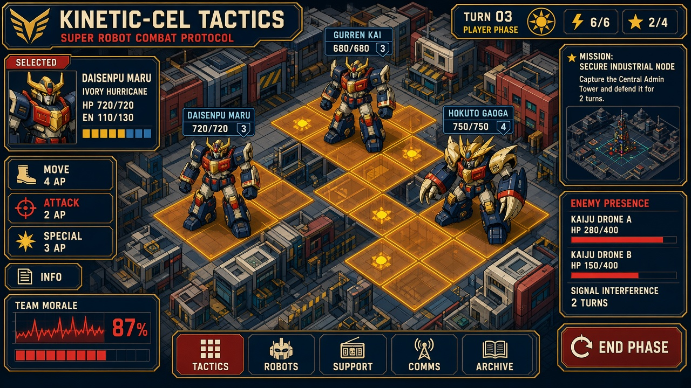

# 居民楼、材质与场景比例：本轮重做

这次首先纠正一个明确的错误：原模型把居民保护目标做成了小屋。只加雨棚、窗框和一组新色值，仍不能让它与十几米至几十米的机甲处在可信的同一空间里。

此前报告中的建筑轮廓、尺寸参照、材质分工和损毁分级，没有真正约束住实现。本轮按这些要求改了实际 Blender 模型、场景装配、着色器和遮挡交互；下面是当前 Godot 渲染，不是概念图。完整整改计划的其他工作包仍需分别核验。

## 0. 新标准已进入规范和Demo

10月10日按你提供的[视觉总参考](给Astra的视觉总参考.html)直接修订了[项目美术规范 v2](../../../production/art-direction-v0.3/series-art-direction-ab-lock-v1.md)。旧规范已存档，原入口保留，避免后续制作继续引用冲突要求。参考中的战棋正靶11是方向；更淡的calm版本和否决图不是上限。

| 新标准的要求 | 本轮落地 | 实机检查重点 |
|---|---|---|
| 动能赛璐璐、英雄涂装；不要灰板与商品渲染 | 场景与机体使用硬分档受光，取消碎镜面；保留现有机体贴图，纠正重复乘色使涂装发暗的问题 | 同屏比较社勇、王者、敌体与背景；不全员染成青绿 |
| 工务城：钢青绿、混凝土米、警示朱红 | 三区地面、楼房、仓库、吊机与柜体接入一份工程色板；B改为钢蓝桥座，不沿用旧灰紫稿 | 每区有职责差别，也属于同一座现代工业城 |
| 建筑有可信的现代结构 | 保留5—7层居民楼及三档损毁；外围厂房新增实体卷帘门、深窗、分格与檐口，塔楼新增楼层与屋顶服务构件 | 正常战棋镜头辨住宅/仓库/电气设施；不依赖标签或平面立面贴纸 |
| HUD与场景协调，但不抢棋盘 | 墨蓝面、象牙字、黄铜细边、朱红主要按钮；14类UI面板和三区符号统一；没有照搬正靶全部面板 | 普通观察保持精简，悬停/选中再展开；危险仍由方向、形状和动态共同表达 |
| 剧情与战斗同一种绘制语言 | 标题全景、车前阻拦、供能恢复三张旧背景重绘为同地点的赛璐璐版本；标题、部署、剧情、结果均已绑定 | 原列车、桥梁、耦合机械关系保留；人类立绘仍用原身份资产 |
| 执行标准可复用 | 正式规范 → 共享JSON色板 → Godot材质/UI生成器；来源与正靶有摘要校验 | 不依靠每次临时手写颜色；新关必须另声明场景包 |

三张背景由内置 image_gen 编辑原图，项目文件位于 [工务城全景](../../../../../../game-godot/assets/formula_lab/linked_campaign_v6/backgrounds/command-ring-kinetic.png)、[列车受阻](../../../../../../game-godot/assets/formula_lab/linked_campaign_v6/backgrounds/story-car-kinetic.png)和[供能恢复](../../../../../../game-godot/assets/formula_lab/linked_campaign_v6/backgrounds/story-link-kinetic.png)，[完整提示词](../../../../../../game-godot/assets/formula_lab/linked_campaign_v6/backgrounds/production-prompts.json)随资产保存。旧版图仍留存，当前场景引用新版本。下面全部模型及棋盘截图已换成本轮真实渲染。

## 1. 把“有人居住”做进建筑形体

| 报告要求与这次问题 | 本轮实际处理 | 检查方式 |
|---|---|---|
| 居民单位像小屋，机甲与建筑比例失真 | A 六层、B 五层、C 七层；每层约3米，门高2.4米；建筑总高约17—23米。单格压缩平面占地，保留楼层与门窗比例 | 与相同镜头下的标准机甲和2×2王者比较，不单独放大楼体截图冒充改善 |
| 建筑缺少可辨认的轮廓 | 上部退台、服务核心筒、阳台、深窗洞、首层入口和屋顶设备共同塑形；三区分别采用阳台、竖向窗间构件和公共外廊 | 关闭HUD，正常战棋距离仍看得出住宅和电气设施的区别 |
| 完好、受损、停用只靠变色 | 半损住宅缺失上角，露出楼板和结构；毁坏住宅保留倒塌楼板、残墙及钢筋，窗灯熄灭 | 三种状态同镜头并列；不把损坏画成一幢仍然整齐的小楼 |
| 大楼会挡住单位 | 只切开视线中挡住所选/悬停机体的住宅上部，保留下层墙体和剖切面；恢复自由观察后复原 | 实际放置楼后机体，验证模型点选和剖切复原 |

A面：六层住宅与完全版王者同屏。住宅的首层、楼层、阳台和屋顶设备提供尺度参照。

完好住宅：入口门、层间楼板、退台与楼梯服务核心筒均为实体。

受损住宅：缺失楼角与外露结构改变轮廓，保留可识别的原建筑。

毁坏住宅：实际倒塌的楼板与残墙，内部窗灯熄灭。

遮挡时只剖开挡住机体的楼层。这是临时观察状态，不代表楼体遭到破坏。

## 2. 配色和材质如何约束实现

当前配色由新规范中的工务城场景包决定。早期 ART02/COLOR-2 对材料分区和可读性的要求保留，旧灰紫桥座色稿已经退役；不再让同一项目同时存在两套有效调色目标。

| 层次 | A 供能前庭 | B 跨渠桥座 | C 环下装卸站 |
|---|---|---|---|
| 主地面 | 鼠尾草绿承重地坪 | 钢蓝渠岸与矿物青水 | 褪蓝站台与铁道 |
| 建筑表面 | 混凝土米色、钢青绿设备 | 偏冷米色、钢蓝结构 | 暖米外墙、褪蓝设备 |
| 工程构件 | 铜色母排、陶瓷与朱红局部 | 钢蓝桁架、铜金五金 | 朱红货柜、铜金吊具与铁路 |
| 局部亮点 | 暖色室内灯和有效接口 | 桥锁与停靠接口 | 作业灯和列车灯 |

这些色值是从已定视觉方向落实的工程色票，不冒称参考原稿给出了精确HEX。色板在 [visual-standard-20261010.json](../../../production/art-direction-v0.3/visual-standard-20261010.json)集中保存；[生成器](../../../../../../scripts/build_gongwu_visual_style.py)同时产生场景参数和SVG UI。

材质以色块、实体折面、深窗和局部低对比表面差别区分。关闭细碎镜面高光，环境不用纯白屋顶；地面深槽、轨道、破口保留实际几何。机体仍使用自己的身份色和贴图，不能为了“统一”把所有角色染成同一种场景色。战棋盘面不使用孟菲斯装饰；冲击画面按情节需要使用，不能生硬盖到背景上。

B面：深渠、桥面与桁架承担画面结构，材质和颜色与供能前庭有区别。

C面：两节实体车厢、铁路和吊机。旧的小屋式车头已移除；车头和车尾各自跟随真实轨道节点。

A面灰度检查：保持相同镜头与曝光，检查楼体、机体和地面之间的明度分离。

## 3. 设施也必须有可读的损伤

15种实际模型变体，每种有完好、受损、毁坏三种实体，共45个GLB；其中住宅为三区各一型。下列并排图从左到右依次是完好、受损、毁坏，使用同一场景灯光与材质。它们用于核对形体；游戏内的尺寸仍以棋盤和机体同屏图为准。

### 居民楼

居民楼的三种实体状态。

### 渠岸住宅

渠岸住宅的三种实体状态。

### 环站公寓

环站公寓的三种实体状态。

### 电气柜

电气柜的三种实体状态。

### 周转货柜

周转货柜的三种实体状态。

### 实体护墙

实体护墙的三种实体状态。

### 转运台

转运台的三种实体状态。

### 撤离车厢

撤离车厢的三种实体状态。

### 压力罐

压力罐的三种实体状态。

### 承运入口

承运入口的三种实体状态。

### 升降机构

升降机构的三种实体状态。

### 吊运机构

吊运机构的三种实体状态。

### 锁固锚点

锁固锚点的三种实体状态。

### 上层承重板

上层承重板的三种实体状态。

### 柱环支架

柱环支架的三种实体状态。

## 4. 实际检查和未关闭项

- 原生窗口中测试了 Ctrl＋左键：没有选择机体，也没有产生移动；普通左键可以直接选择模型并展示合法范围。本轮一次移动的预算由4变为1，Z撤回后回到原格且恢复为4。
- 三地图使用正常战棋镜头重新渲染；住宅三种损伤保持相同镜头，避免用取景差异掩饰比例问题。
- 新标准落实后，又在1440×900原生窗口开启HUD逐图复看，实际点选社勇王、移动、撤回并用F2/F3切换B、C地图。建筑没有盖住底部动作栏；敌机靠近设施时，局部标签仍有拥挤，未把整个HUD整改记成完成。
- 楼后机体点选、遮挡剖切、移开后恢复、列车旧模型隐藏和只显示一份车头状态均通过运行检查。过程中发现并修复了包围盒射线接口返回类型处理错误。
- 173项机制集成检查通过，包括隧道受阻后撤回、实际线缆损毁切断供电、备用线恢复供电、长箱旋转后占格变化，以及显示路线与实际移动的一致性。这些是规则回归，不代替画面评价。
- 本轮新材质和额外建筑几何下，30次选中、300次格点预览的95分位分别为51.6毫秒和10.6毫秒；与此前52/10毫秒处在相近范围。选中和悬停没有修改战斗状态。现在复用已显示的合法路径，提交时重新检查整片占格、楼梯、新增障碍和真实消耗；不会靠省略规则检查来换速度。
- 当前住宅已按本轮比例与楼房形体要求重做；整体场景仍不能写成达到《陷阵之志》的美术完成度。完整包里的触屏操作、音频试听、逐招连续演出、长期成长实验及真实玩家评估，也不能由这轮建筑重做代签完成。

现代幕墙、门窗、转角和构件组织另参考了 [Poly Haven 的模块化城市建筑立面](https://polyhaven.com/a/modular_urban_apartments_facade)。本轮没有下载或使用该模型，实际GLB由项目内Blender脚本构建。

实现入口：`scripts/build_gongwu_visual_style.py`、`scripts/build_gongwu_v6_environment.py`、`v6/full_art.gd`、`environment_art.gd`、`ground_relief.gd`、`kit_material.gdshader`、`v6/structure_cel.gdshader`、`v6/terrain_cel.gdshader`。验证入口：`v6/architecture_review.gd`、`v6/prop_review.gd`、`v6/mechanics_integration_test.gd`。

本轮复核记录：[标准来源、运行检查与原生操作](../../../../../../artifacts/formulas/production-lab-v1/qa/visual-standard-20261010/visual-standard-review.json)。
